# Page: One-Eval Overview

# One-Eval Overview

<details>
<summary>Relevant source files</summary>

The following files were used as context for generating this wiki page:

- [README.md](README.md)
- [README_zh.md](README_zh.md)
- [one-eval-web/.gitignore](one-eval-web/.gitignore)
- [one_eval/graph/workflow_all.py](one_eval/graph/workflow_all.py)
- [one_eval/nodes/dataset_keys_node.py](one_eval/nodes/dataset_keys_node.py)
- [static/logo/318QRcode.jpg](static/logo/318QRcode.jpg)
- [static/logo/eval_framework.png](static/logo/eval_framework.png)
- [static/logo/gallery.png](static/logo/gallery.png)
- [static/logo/logo.png](static/logo/logo.png)

</details>


One-Eval is an automated, agent-based evaluation framework for Large Language Models (LLMs). It is designed to implement the **NL2Eval** concept: transforming natural language evaluation requirements into fully orchestrated evaluation workflows and comprehensive reports.

Built upon the [DataFlow](https://github.com/OpenDCAI/DataFlow) operator system and [LangGraph](https://github.com/langchain-ai/langgraph) state management, One-Eval provides a traceable, interruptible, and scalable pipeline for model assessment [README.md:20-21]().

## System Architecture

One-Eval follows a decoupled architecture consisting of a Python FastAPI backend and a React-based frontend web application [README.md:73-75]().

### Backend (Python)
The backend manages the evaluation lifecycle using a directed acyclic graph (DAG) defined in `one_eval/graph/workflow_all.py`. It leverages LangGraph to maintain state across different evaluation phases, allowing for process persistence and Human-in-the-Loop (HITL) interruptions [README.md:41-46]().

### Frontend (React + Vite)
The frontend provides an interactive "Eval Studio" where users can input natural language queries, review agent-suggested benchmarks, monitor real-time execution, and visualize multi-dimensional reports [README.md:83-91]().

### High-Level System Flow
The following diagram illustrates the transition from the **Natural Language Space** (User Intent) to the **Code Entity Space** (Internal Nodes and Tools).

**Diagram: NL2Eval Execution Flow**
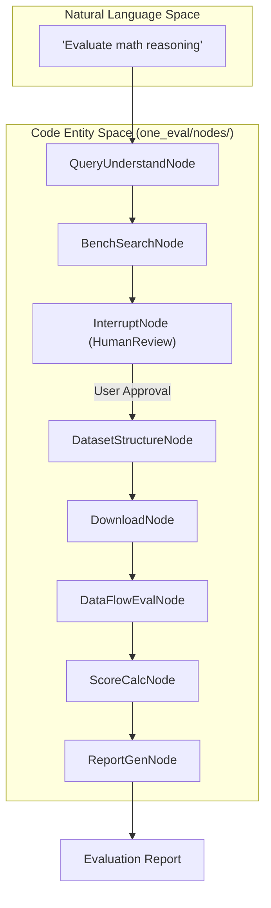
Sources: [one_eval/graph/workflow_all.py:44-68](), [README.md:43-46]()

## Key Components

One-Eval's functionality is partitioned into several specialized subsystems:

| Component | Description | Primary Code Entities |
| :--- | :--- | :--- |
| **Graph Engine** | Orchestrates the evaluation phases and handles state persistence. | `GraphBuilder`, `NodeState`, `AsyncSqliteSaver` |
| **Agent Layer** | LLM-powered entities that perform task inference, metric recommendation, and report generation. | `BaseAgent`, `QueryUnderstandNode`, `BenchTaskInferNode` |
| **Bench Gallery** | A registry of meta-information for mainstream benchmarks (Reasoning, Knowledge, etc.). | `bench_gallery.json`, `BenchRegistry` |
| **Metric System** | A library of automated scoring functions for different task types. | `MetricRegistry`, `MetricRunner`, `ScoreCalcNode` |
| **DataFlow Integration** | The underlying execution engine for high-performance LLM inference. | `DataFlowEvalNode`, `DataFlowEvalTool` |

Sources: [one_eval/graph/workflow_all.py:14-26](), [README.md:107-117](), [one_eval/nodes/dataset_keys_node.py:13-23]()

## NL2Eval Pipeline Phases

The evaluation process is divided into seven distinct phases, as defined in the complete workflow [one_eval/graph/workflow_all.py:44-68]():

1.  **Discovery (NL2Bench):** Parses user intent and suggests benchmarks (e.g., MATH, GSM8K) [one_eval/graph/workflow_all.py:74-85]().
2.  **Preparation:** Inspects dataset structures and prepares local configurations [one_eval/graph/workflow_all.py:91-98]().
3.  **Download:** Fetches datasets from HuggingFace or local sources [one_eval/graph/workflow_all.py:94]().
4.  **Task Inference:** Automatically maps dataset columns (keys) to evaluation inputs/outputs [one_eval/nodes/dataset_keys_node.py:13-19]().
5.  **Evaluation:** Executes LLM inference via the DataFlow engine [one_eval/graph/workflow_all.py:111-112]().
6.  **Scoring:** Matches appropriate metrics and calculates scores [one_eval/graph/workflow_all.py:115-132]().
7.  **Reporting:** Generates multi-dimensional visualizations and LLM-summarized insights [one_eval/graph/workflow_all.py:134-135]().

For a deep dive into the pipeline mechanics, see **[NL2Eval Concept & Evaluation Pipeline](#1.2)**.

## Getting Started

To set up One-Eval, you must initialize both the backend server and the frontend application.

1.  **Backend Setup:** Install dependencies using `pip install -e .` and start the FastAPI server [README.md:58-81]().
2.  **Frontend Setup:** Navigate to `one-eval-web`, install npm packages, and run the development server [README.md:86-89]().
3.  **Configuration:** Use the Web UI settings to configure your `HF_TOKEN` and model API bases (e.g., OpenAI-compatible endpoints) [README.md:93-94]().

For detailed installation steps and environment variable requirements, see **[Getting Started & Installation](#1.1)**.

## Architecture & Code Mapping

The following diagram maps high-level system operations to specific code components and files.

**Diagram: System Component Mapping**
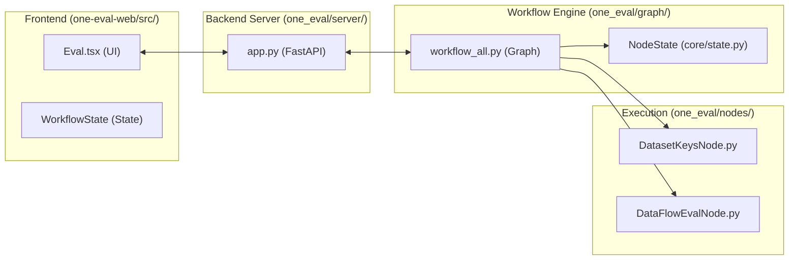
Sources: [one_eval/server/app.py](), [one_eval/graph/workflow_all.py:69-72](), [one_eval/nodes/dataset_keys_node.py:13]()

---

# Page: Getting Started & Installation

# Getting Started & Installation

<details>
<summary>Relevant source files</summary>

The following files were used as context for generating this wiki page:

- [.gitignore](.gitignore)
- [README.md](README.md)
- [README_zh.md](README_zh.md)
- [one-eval-web/.gitignore](one-eval-web/.gitignore)
- [one-eval-web/src/lib/i18n.ts](one-eval-web/src/lib/i18n.ts)
- [one-eval-web/src/lib/utils.ts](one-eval-web/src/lib/utils.ts)
- [one_eval/core/agent.py](one_eval/core/agent.py)
- [one_eval/nodes/dataset_keys_node.py](one_eval/nodes/dataset_keys_node.py)
- [one_eval/serving/custom_llm_caller.py](one_eval/serving/custom_llm_caller.py)
- [pyproject.toml](pyproject.toml)
- [requirements.txt](requirements.txt)
- [static/logo/318QRcode.jpg](static/logo/318QRcode.jpg)

</details>


This page provides a comprehensive technical guide for setting up the One-Eval environment. It covers Python dependency management, frontend build requirements, critical environment variables, and the execution of both backend and web components.

## System Prerequisites

One-Eval requires a dual-environment setup:
1.  **Backend**: Python 3.11+ environment for the FastAPI server and LangGraph workflow engine [README.md:5-5]().
2.  **Frontend**: Node.js environment for the Vite + React web interface [README.md:83-89]().

## Backend Installation

The backend can be installed using either `conda` or `uv`. The project uses a `pyproject.toml` file to manage metadata and `requirements.txt` for specific version pinning [pyproject.toml:5-32](), [requirements.txt:1-45]().

### Option A: Conda Setup
```bash
conda create -n one-eval python=3.11 -y
conda activate one-eval
pip install -e .
```
Sources: [README.md:58-63]()

### Option B: UV Setup
```bash
uv venv
uv pip install -e .
```
Sources: [README.md:66-71]()

### Core Dependencies
The system relies on several key library groups:
*   **Workflow**: `langgraph`, `langchain-core`, `langgraph-checkpoint-sqlite` [requirements.txt:4-7]().
*   **Data**: `huggingface-hub`, `datasets`, `pandas`, `open-dataflow` [requirements.txt:11-13, 41-41]().
*   **Serving**: `fastapi`, `uvicorn`, `httpx`, `openai` [requirements.txt:23-29]().

## Frontend Installation

The web interface is located in the `one-eval-web` directory. It uses `npm` for package management and `Vite` for the build pipeline [README.md:83-89]().

```bash
cd one-eval-web
npm install
npm run dev
```
Sources: [README.md:85-88]()

## Configuration & Environment Variables

One-Eval uses environment variables for model access, API routing, and authentication. These can be set in a `.env` file (ignored by git) [ .gitignore:137-137]().

### Critical Variables

| Variable | Description | Default / Example |
| :--- | :--- | :--- |
| `OE_API_BASE` | Base URL for the LLM API used by Agents | `http://...:3000/v1` [one_eval/core/agent.py:128-131]() |
| `OE_API_KEY` | Authentication key for the Agent LLM | `sk-xxxxx` [one_eval/core/agent.py:132-135]() |
| `OE_MODEL_NAME` | The specific model identifier for Agents | `gpt-4o` [one_eval/serving/custom_llm_caller.py:68-69]() |
| `HF_TOKEN` | HuggingFace token for private/gated datasets | Required for batch downloads [README.md:93-93]() |
| `OE_TIMEOUT_S` | Global timeout for LLM API calls | `60` [one_eval/serving/custom_llm_caller.py:65-67]() |

Sources: [one_eval/core/agent.py:126-136](), [one_eval/serving/custom_llm_caller.py:62-76](), [README.md:93-94]()

## Execution Flow

### Backend and Frontend Startup
The system follows a decoupled architecture where the frontend communicates with the FastAPI backend via REST.

#### One-Eval Service Architecture
The following diagram illustrates the relationship between the startup commands and the underlying code entities.

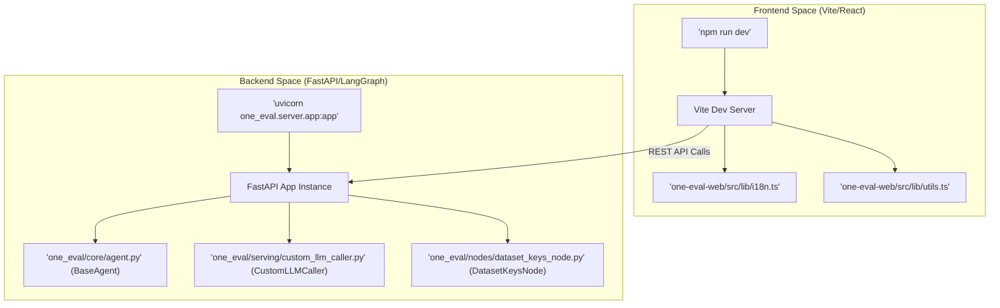
Sources: [README.md:73-89](), [one_eval/core/agent.py:17-113](), [one_eval/serving/custom_llm_caller.py:38-45](), [one_eval/nodes/dataset_keys_node.py:13-23]()

### Running the Services

1.  **Start Backend**:
    ```bash
    uvicorn one_eval.server.app:app --host 0.0.0.0 --port 8000
    ```
    Sources: [README.md:80-80]()

2.  **Start Frontend**:
    ```bash
    cd one-eval-web && npm run dev
    ```
    Sources: [README.md:88-88]()

3.  **Developer CLI Mode**:
    For direct execution without the UI, use the `workflow_all` module:
    ```bash
    python -m one_eval.graph.workflow_all "Evaluate reasoning tasks"
    ```
    Sources: [README.md:100-103]()

## Technical Implementation Details

### LLM Connectivity
The `CustomLLMCaller` class handles the bridge between LangGraph nodes and external LLM providers. It implements the `BaseLLMCaller` interface and uses `httpx.AsyncClient` for non-blocking network I/O [one_eval/serving/custom_llm_caller.py:38-76]().

*   **Raw API Mode**: Bypasses LangChain abstractions for higher performance when tools are not needed [one_eval/serving/custom_llm_caller.py:130-160]().
*   **Tool Mode**: Uses `ChatOpenAI.bind_tools` to support complex agentic behaviors within the graph [one_eval/serving/custom_llm_caller.py:178-193]().

### Data Preparation Logic
Upon initialization, the system often triggers the `DatasetKeysNode`. This node is responsible for scanning the `dataset_cache` (usually a JSONL file) to extract schema information [one_eval/nodes/dataset_keys_node.py:13-19]().

#### Data Initialization Sequence
This diagram shows how the system transitions from a raw file to a state ready for evaluation.

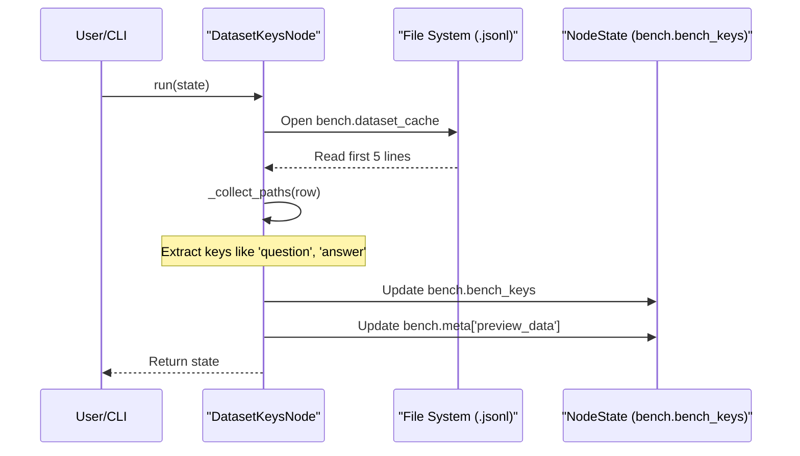
Sources: [one_eval/nodes/dataset_keys_node.py:37-88](), [one_eval/core/state.py:7-7]()

### Frontend Utilities
The web interface includes localized support via `useLang` in `i18n.ts`, which persists settings in `localStorage` [one-eval-web/src/lib/i18n.ts:8-13, 37-41](). UI components utilize the `cn` utility (combining `clsx` and `twMerge`) for dynamic Tailwind CSS class management [one-eval-web/src/lib/utils.ts:4-6]().

---

# Page: NL2Eval Concept & Evaluation Pipeline

# NL2Eval Concept & Evaluation Pipeline

<details>
<summary>Relevant source files</summary>

The following files were used as context for generating this wiki page:

- [README.md](README.md)
- [README_zh.md](README_zh.md)
- [one-eval-web/.gitignore](one-eval-web/.gitignore)
- [one_eval/core/graph.py](one_eval/core/graph.py)
- [one_eval/graph/workflow.py](one_eval/graph/workflow.py)
- [one_eval/graph/workflow_all.py](one_eval/graph/workflow_all.py)
- [one_eval/nodes/dataset_keys_node.py](one_eval/nodes/dataset_keys_node.py)
- [one_eval/nodes/interrupt_node.py](one_eval/nodes/interrupt_node.py)
- [static/logo/318QRcode.jpg](static/logo/318QRcode.jpg)

</details>


The core philosophy of One-Eval is **NL2Eval**: the transformation of a natural language requirement into a fully orchestrated evaluation workflow and a comprehensive report [README.md:20-21](). This paradigm replaces manual benchmarking scripts with an agentic, graph-based execution process that handles everything from discovery to scoring [README.md:36-44]().

## The NL2Eval Paradigm

One-Eval reconstructs the evaluation process into a **Graph / Node / State** architecture [README.md:41](). Instead of writing code, a user provides a query such as *"Evaluate the model's performance on math reasoning tasks"* [README.md:43](). The system then uses a **LangGraph** engine to traverse a series of specialized nodes, each responsible for a specific phase of the evaluation lifecycle [one_eval/graph/workflow_all.py:44-68]().

### Key Characteristics
*   **Traceable**: Every step of the agent's reasoning and tool usage is recorded in the `NodeState` [README.md:21]().
*   **Interruptible**: The pipeline includes "Human-in-the-Loop" (HITL) gates where the system pauses for user validation [README.md:45]().
*   **Scalable**: Built on the **DataFlow** operator system, allowing for the integration of custom metrics and private datasets [README.md:46-47]().

---

## Evaluation Pipeline Phases

The complete evaluation pipeline is implemented in `one_eval/graph/workflow_all.py` and consists of seven distinct phases [one_eval/graph/workflow_all.py:44-68]().

### 1. Discovery Phase (NL2Bench)
The system parses the user's intent and identifies relevant benchmarks.
*   **QueryUnderstandNode**: Uses LLM agents to extract task domains and requirements from the natural language query [one_eval/graph/workflow_all.py:75]().
*   **BenchSearchNode**: Searches the `BenchRegistry` and external sources (like HuggingFace) for matching benchmarks [one_eval/graph/workflow_all.py:76]().
*   **HumanReviewNode**: An `InterruptNode` that pauses execution, allowing the user to approve, reject, or modify the suggested benchmarks [one_eval/graph/workflow_all.py:77-85]().

### 2. Preparation Phase (Download & Prep)
Once benchmarks are selected, the system prepares the data.
*   **DatasetStructureNode**: Inspects the dataset schema (subsets, splits) [one_eval/graph/workflow_all.py:92]().
*   **BenchConfigRecommendNode**: Recommends the best configuration for the specific evaluation task [one_eval/graph/workflow_all.py:93]().
*   **DownloadNode**: Fetches the data and converts it into a unified JSONL format [one_eval/graph/workflow_all.py:94]().

### 3. Task Inference Phase
The system analyzes the downloaded data to ensure the evaluation logic matches the data format.
*   **DatasetKeysNode**: Reads the first few lines of the JSONL file to extract available keys (e.g., `question`, `answer`, `choices`) [one_eval/nodes/dataset_keys_node.py:13-19]().
*   **BenchTaskInferNode**: Infers the specific task type (e.g., multiple choice, math verification) based on the dataset structure [one_eval/graph/workflow_all.py:102]().

### 4. Evaluation Phase (Execution)
The core inference loop where the model-under-test generates responses.
*   **PreEvalReviewNode**: A final check-gate before starting expensive LLM inference [one_eval/graph/workflow_all.py:108]().
*   **DataFlowEvalNode**: Executes the evaluation loop. It routes between generating answers and potentially calling an LLM-as-Judge for open-ended tasks [one_eval/graph/workflow_all.py:111-112]().

### 5. Scoring Phase
*   **MetricRecommendNode**: Suggests appropriate metrics (e.g., Exact Match, Pass@k, ROUGE) based on the task type [one_eval/graph/workflow_all.py:115]().
*   **MetricReviewNode**: An `InterruptNode` for the user to verify the scoring plan [one_eval/graph/workflow_all.py:119-127]().
*   **ScoreCalcNode**: Runs the `MetricRunner` to calculate final scores and generate artifact files [one_eval/graph/workflow_all.py:131]().

### 6. Reporting Phase
*   **ReportGenNode**: Aggregates scores into multi-dimensional visualizations (radar charts, bar charts) and uses an LLM to generate a summary report [one_eval/graph/workflow_all.py:134]().

**Sources:** [one_eval/graph/workflow_all.py:44-135](), [one_eval/nodes/dataset_keys_node.py:13-88](), [README.md:41-47]()

---

## Pipeline Data Flow & Architecture

The following diagrams illustrate how natural language concepts map to specific code entities and how the state flows through the system.

### Diagram 1: NL Space to Code Entity Mapping (Phase 1-3)
This diagram bridges the user's natural language request to the internal classes and nodes that process it.

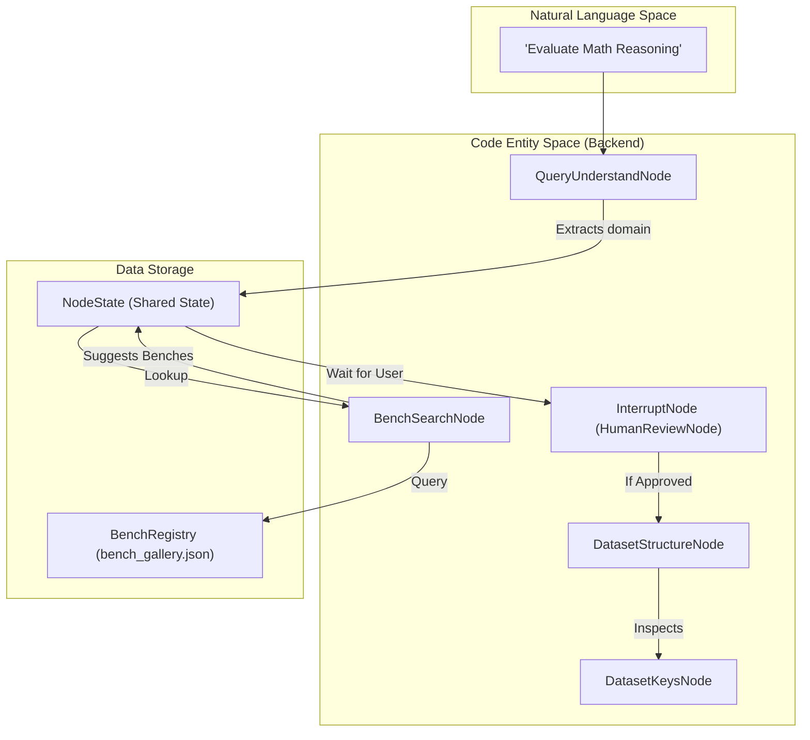
**Sources:** [one_eval/graph/workflow_all.py:74-105](), [one_eval/core/state.py:9-10](), [one_eval/nodes/dataset_keys_node.py:37-38]()

### Diagram 2: Execution & Scoring Pipeline (Phase 4-7)
This diagram shows the transition from data preparation to the final report generation.

```mermaid
graph LR
    subgraph "Evaluation Loop"
        DF_Eval["DataFlowEvalNode"]
        DF_Tool["DataFlowEvalTool"]
    end

    subgraph "Scoring Engine"
        MR_Node["MetricRecommendNode"]
        SC_Node["ScoreCalcNode"]
        M_Runner["MetricRunner"]
    end

    subgraph "Reporting"
        RG_Node["ReportGenNode"]
        FinalReport["report.json / RadarChart"]
    end

    DF_Eval --> DF_Tool
    DF_Tool -- "Generates Responses" --> MR_Node
    MR_Node -- "Selects Metrics" --> SC_Node
    SC_Node -- "Invokes" --> M_Runner
    M_Runner -- "Calculates Scores" --> RG_Node
    RG_Node --> FinalReport
```
**Sources:** [one_eval/graph/workflow_all.py:107-135](), [one_eval/nodes/interrupt_node.py:17-35]()

---

## Workflow Implementation with LangGraph

The pipeline is orchestrated using the `GraphBuilder` class, which wraps the **LangGraph** `StateGraph` [one_eval/core/graph.py:58-59]().

### State Management
The `NodeState` object is the "single source of truth" that flows through every node. It contains:
*   `user_query`: The original input [one_eval/graph/workflow.py:63]().
*   `benches`: A list of `BenchInfo` objects being evaluated [one_eval/graph/workflow_all.py:37]().
*   `llm_history`: A log of agent interactions [one_eval/nodes/interrupt_node.py:78]().

### Interrupt & Resume Logic
Human-in-the-loop is handled by the `InterruptNode`. When a validator (e.g., `benches_manual_review`) fails, the node calls the LangGraph `interrupt()` function [one_eval/nodes/interrupt_node.py:68-74](). This persists the state to a SQLite database using `AsyncSqliteSaver`, allowing the backend to stop and wait for a frontend signal to resume [one_eval/graph/workflow.py:54-67]().

### Conditional Routing
The pipeline uses conditional edges to manage loops, such as iterating through multiple benchmarks during the evaluation phase:
```python
def _route_after_eval(state: NodeState) -> str:
    benches = getattr(state, "benches", None) or []
    cursor = int(getattr(state, "eval_cursor", 0) or 0)
    if cursor < len(benches):
        return "DataFlowEvalNode"
    return "MetricRecommendNode"
```
[one_eval/graph/workflow_all.py:36-41]()

**Sources:** [one_eval/core/graph.py:1-185](), [one_eval/graph/workflow_all.py:36-175](), [one_eval/nodes/interrupt_node.py:37-161]()

---

# Page: Backend Architecture

# Backend Architecture

<details>
<summary>Relevant source files</summary>

The following files were used as context for generating this wiki page:

- [one_eval/__init__.py](one_eval/__init__.py)
- [one_eval/core/__init__.py](one_eval/core/__init__.py)
- [one_eval/core/state.py](one_eval/core/state.py)
- [one_eval/server/app.py](one_eval/server/app.py)
- [one_eval/toolkits/__init__.py](one_eval/toolkits/__init__.py)

</details>


The One-Eval backend is a Python-based system designed to transform natural language evaluation requests into structured execution pipelines. It leverages a stateful workflow engine to manage the complex, multi-stage process of benchmark discovery, dataset preparation, LLM inference, and metric calculation.

The architecture is built on four primary pillars:
1.  **FastAPI Server**: Provides the RESTful interface for the frontend and manages the lifecycle of evaluation threads.
2.  **LangGraph Workflow Engine**: Orchestrates the evaluation pipeline as a directed graph with support for persistence and Human-in-the-Loop (HITL) interrupts.
3.  **Core State Model**: A unified `NodeState` that serves as the "single source of truth" flowing through the graph.
4.  **Agent & Node Abstractions**: Modular components that perform specific tasks, ranging from LLM-based reasoning to heavy-duty data processing.

### System Overview Diagram

The following diagram illustrates the relationship between the external API, the internal orchestration engine, and the persistent storage layer.

**One-Eval Backend Component Map**
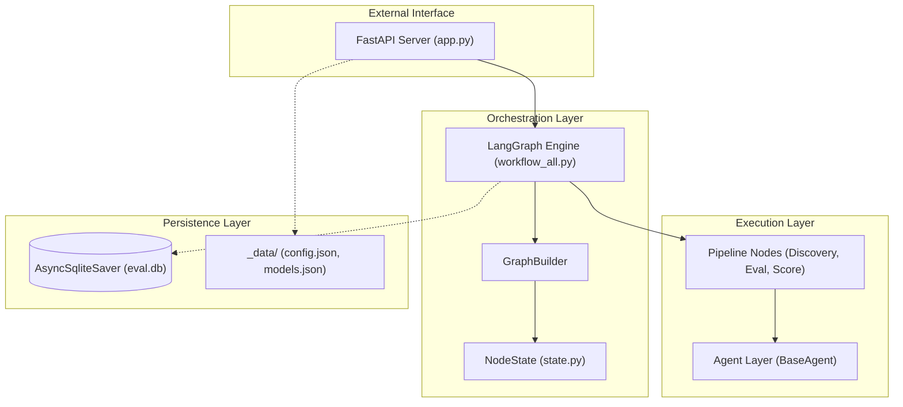
**Sources:** [one_eval/server/app.py:15-41](), [one_eval/core/state.py:79-123]()

---

### FastAPI Server & REST API
The entry point for all operations is the FastAPI server defined in `one_eval/server/app.py`. It handles configuration management (LLM providers, HuggingFace tokens), model registration, and workflow control. The server maintains a mapping of `thread_id` to graph states, allowing the frontend to poll for progress or resume interrupted tasks.

Key responsibilities include:
*   **Environment Setup**: Loading `env.sh` and managing local JSON storage in the `_data/` directory.
*   **Thread Lifecycle**: Creating and resuming LangGraph threads.
*   **Static Asset Serving**: Providing access to generated reports and evaluation artifacts.

For details, see [FastAPI Server & REST API](#2.1).

**Sources:** [one_eval/server/app.py:24-42](), [one_eval/server/app.py:138-190]()

---

### Core State & Data Models
The system relies on a central data structure, `NodeState`, to maintain context across asynchronous node executions. This state is defined using Python `dataclasses` and is designed to be serializable for checkpointing in SQLite.

| Class | Purpose | Key Fields |
| :--- | :--- | :--- |
| `NodeState` | Global container for graph execution. | `user_query`, `benches`, `target_model`, `waiting_for_human` |
| `BenchInfo` | Metadata for a specific benchmark. | `bench_name`, `dataset_cache`, `eval_status` |
| `ModelConfig` | Configuration for the LLM under test. | `model_name_or_path`, `is_api`, `api_url`, `temperature` |

For details, see [Core State & Data Models](#2.2).

**Sources:** [one_eval/core/state.py:37-50](), [one_eval/core/state.py:52-76](), [one_eval/core/state.py:79-123]()

---

### Graph Engine & Workflow Orchestration
One-Eval uses **LangGraph** to define the evaluation pipeline as a state machine. This allows for complex logic, such as looping through multiple benchmarks or pausing for human approval (HITL).

The workflow is defined by:
*   **Nodes**: Python functions or classes that transform the `NodeState`.
*   **Edges**: Logic that determines the next node based on the current state (e.g., routing to `HumanReviewNode` if a benchmark is ambiguous).
*   **Checkpointer**: An `AsyncSqliteSaver` that persists the state to `eval.db`, enabling the server to recover from restarts or long-running evaluation pauses.

For details, see [Graph Engine & Workflow Orchestration](#2.3).

**Sources:** [one_eval/server/app.py:40-41](), [one_eval/core/state.py:134-145]()

---

### Agent Layer & LLM Calling
The "Intelligence" of the backend resides in the Agent Layer. Nodes often delegate reasoning tasks to Agents, which use structured prompting to interact with LLMs.

**Code Entity Interaction Diagram**
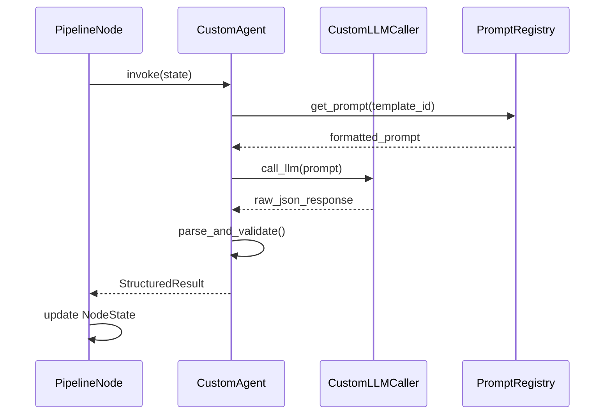

The `BaseAgent` provides a unified interface for system prompts and response parsing, while `CustomLLMCaller` abstracts the differences between various API providers (OpenAI, DashScope) and local vLLM deployments.

For details, see [Agent Layer & LLM Calling](#2.4).

**Sources:** [one_eval/core/state.py:27-28](), [one_eval/server/app.py:162-189]()

---

# Page: FastAPI Server & REST API

# FastAPI Server & REST API

<details>
<summary>Relevant source files</summary>

The following files were used as context for generating this wiki page:

- [one_eval/runtime/progress_store.py](one_eval/runtime/progress_store.py)
- [one_eval/server/app.py](one_eval/server/app.py)
- [one_eval/utils/checkpoint.py](one_eval/utils/checkpoint.py)
- [one_eval/utils/validators.py](one_eval/utils/validators.py)

</details>


The One-Eval backend is powered by a FastAPI server that acts as the orchestration hub for the evaluation lifecycle. It manages the persistence of model configurations, handles benchmark registry queries, and interfaces with the LangGraph workflow engine to manage long-running evaluation threads.

## Server Initialization & Configuration

The server initializes its environment by loading settings from three primary sources: environment variables, an `env.sh` script, and local JSON configuration files. It establishes a data directory (`_data`) for persisting application state across restarts [one_eval/server/app.py:26-31]().

### Data Persistence Structure
The server maintains several local files within the `_data` directory:
*   `config.json`: Global settings for HuggingFace (HF) endpoints, agent providers, and judge models [one_eval/server/app.py:29]().
*   `models.json`: A registry of LLM configurations (API bases, keys, and local paths) [one_eval/server/app.py:30]().
*   `thread_meta.json`: Metadata tracking the creation and update timestamps for evaluation threads [one_eval/server/app.py:31]().
*   `eval.db`: A SQLite database used by `AsyncSqliteSaver` to persist LangGraph checkpoints [one_eval/server/app.py:40]().

### Configuration Management Logic
The function `load_server_config` performs a tiered lookup for critical settings like `HF_ENDPOINT` and `OE_API_KEY`. It prioritizes `config.json` values, falling back to `os.environ` or hardcoded defaults [one_eval/server/app.py:138-189]().

Sources: [one_eval/server/app.py:24-136](), [one_eval/server/app.py:138-210]()

---

## REST API Reference

The server exposes endpoints categorized by their functional domain. All long-running evaluation tasks are executed as background tasks to prevent blocking the HTTP response.

### Workflow Control & Threads
These endpoints manage the state of the evaluation pipeline.

| Endpoint | Method | Description |
| :--- | :--- | :--- |
| `/api/threads` | `GET` | Lists all existing evaluation threads with metadata [one_eval/server/app.py:465](). |
| `/api/eval/start` | `POST` | Initializes a new `thread_id` and starts the `workflow_all` graph [one_eval/server/app.py:532](). |
| `/api/eval/status` | `GET` | Retrieves the current state of a thread, including the last node and HITL flags [one_eval/server/app.py:648](). |
| `/api/eval/resume` | `POST` | Resumes an interrupted thread (e.g., after human review) [one_eval/server/app.py:588](). |
| `/api/eval/progress`| `GET` | Fetches real-time execution progress (e.g., percentage complete) [one_eval/server/app.py:641](). |

### Model & Benchmark Registry
| Endpoint | Method | Description |
| :--- | :--- | :--- |
| `/api/models` | `GET/POST` | Manages the model configuration list in `models.json` [one_eval/server/app.py:423-441](). |
| `/api/bench/gallery`| `GET` | Returns the list of benchmarks from the local `bench_gallery.json` [one_eval/server/app.py:394](). |
| `/api/bench/search` | `POST` | Searches for benchmarks using the `BenchRegistry` [one_eval/server/app.py:402](). |

Sources: [one_eval/server/app.py:394-463](), [one_eval/server/app.py:465-645]()

---

## Thread Lifecycle & Checkpointing

One-Eval uses a checkpoint-resume mechanism to handle Human-In-The-Loop (HITL) interrupts and system crashes. 

### Thread State Transition
The server uses `AsyncSqliteSaver` to persist the `MainState` at every node transition in the LangGraph. If a node (like `HumanReviewNode`) requires user input, the graph execution pauses. The user submits updates via `/api/eval/resume`, which triggers a new execution run using the saved `thread_id`.

**Server Component Interaction Map**
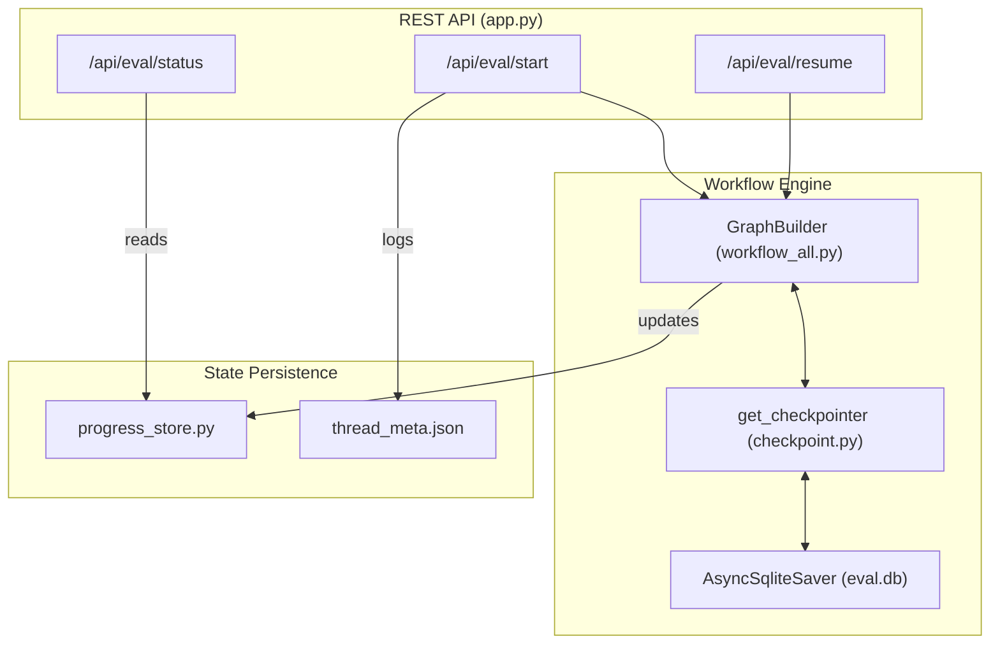
Sources: [one_eval/server/app.py:532-586](), [one_eval/utils/checkpoint.py:18-28](), [one_eval/runtime/progress_store.py:10-23]()

---

## Data Flow: From Request to Node

When a request hits `/api/eval/start`, the server transforms the `EvalStartRequest` into a `MainState` object. This state is then passed into the `ainvoke` method of the compiled LangGraph.

**Data Flow Architecture**
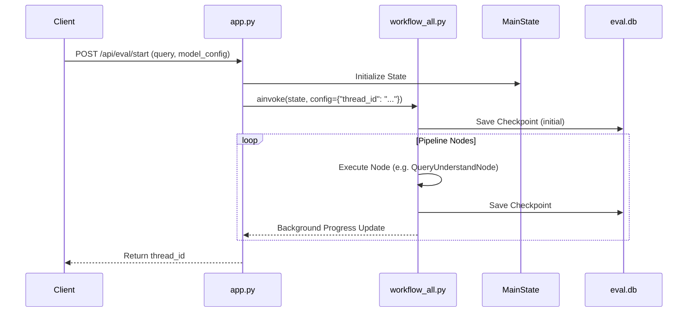

### Interrupt Handling
Interrupts are defined in `one_eval/utils/validators.py`. When a validator like `benches_manual_review` returns a payload, the graph enters an `interrupted` state [one_eval/utils/validators.py:4-19](). The server detects this via `_thread_interrupt_cache` and signals the frontend that manual intervention is required [one_eval/server/app.py:43-45]().

Sources: [one_eval/server/app.py:532-586](), [one_eval/utils/validators.py:4-46](), [one_eval/server/app.py:648-692]()

---

## Model Registry & Path Normalization

The server provides a specialized utility, `_normalize_model_path_for_host`, to handle cross-platform pathing issues (e.g., running the server in WSL while the models reside on a Windows host drive). It automatically converts between `/mnt/c/...` and `C:\...` formats based on the operating system [one_eval/server/app.py:120-136]().

The model registry (`/api/models`) stores configurations including:
*   `model_name`: Unique identifier.
*   `model_path`: Local filesystem path or HF repo ID.
*   `api_base` / `api_key`: Connection details for OpenAI-compatible providers.
*   `engine_type`: Specifies if the model should run via `vllm`, `fschat`, or `api` [one_eval/server/app.py:423-441]().

Sources: [one_eval/server/app.py:120-136](), [one_eval/server/app.py:423-463]()

---

# Page: Core State & Data Models

# Core State & Data Models

<details>
<summary>Relevant source files</summary>

The following files were used as context for generating this wiki page:

- [one_eval/core/node.py](one_eval/core/node.py)
- [one_eval/core/state.py](one_eval/core/state.py)

</details>


This page provides a technical deep dive into the shared data structures that form the backbone of the One-Eval evaluation pipeline. In One-Eval, state is managed through a hierarchical set of dataclasses that flow through the LangGraph workflow, ensuring consistency across different execution nodes and allowing for seamless checkpointing and Human-In-The-Loop (HITL) interactions.

## State Hierarchy & Purpose

One-Eval utilizes a layered state model to separate generic request data from graph-specific execution context. The primary container used by the workflow engine is the `NodeState`, which inherits from `MainState`.

### MainState & MainRequest
The base layer handles low-level message passing and temporary storage.

*   **`MainRequest`**: Captures the initial user intent, such as the preferred language for interaction (defaulting to "zh") and the specific evaluation target.
*   **`MainState`**: Provides the foundation for LangGraph integration. It includes a `messages` list annotated with `add_messages` to support conversational history and an `agent_results` dictionary to store raw outputs from various LLM agents.

Sources: [one_eval/core/state.py:11-35]()

### NodeState: The Global Context
`NodeState` is the comprehensive state container that flows through every node in the graph. It tracks the evaluation lifecycle from the initial query to the final report generation.

| Field | Type | Description |
| :--- | :--- | :--- |
| `state_id` | `str` | A unique UUID for the execution thread. |
| `current_node` | `str` | The name of the node currently being executed. |
| `user_query` | `str` | The natural language input from the user (e.g., "Evaluate math performance"). |
| `target_model` | `ModelConfig` | Configuration for the LLM being evaluated. |
| `benches` | `List[BenchInfo]` | A list of benchmarks identified for this run. |
| `eval_cursor` | `int` | Index pointer used to iterate through benchmarks during the execution phase. |
| `waiting_for_human` | `bool` | A flag that triggers a graph interrupt for manual review. |

Sources: [one_eval/core/state.py:79-123]()

## Data Models

### BenchInfo
The `BenchInfo` class represents a single benchmark instance within the pipeline. It tracks metadata, configuration, and the status of the data lifecycle (download and evaluation).

*   **`bench_name`**: The identifier for the benchmark (e.g., "GSM8K").
*   **`bench_dataflow_eval_type`**: Determines the logic used during evaluation (e.g., `key1_text_score`).
*   **`bench_keys`**: A list of specific fields (question, answer, etc.) mapped from the dataset.
*   **`dataset_cache`**: Local file path to the downloaded JSONL dataset.
*   **`download_status` / `eval_status`**: Enums tracking progress ("pending", "success", "failed").

Sources: [one_eval/core/state.py:37-50]()

### ModelConfig
The `ModelConfig` class encapsulates all parameters required to invoke an LLM, whether it is a local instance or a remote API.

*   **API Settings**: Includes `api_url`, `api_key`, and `api_provider` (defaulting to "openai_compatible").
*   **Resource Management**: `api_max_workers` controls concurrency, while `api_connect_timeout` and `api_read_timeout` manage network resilience.
*   **Generation Parameters**: Standard parameters like `temperature`, `top_p`, and `max_tokens`.
*   **Local Serving**: Fields like `tensor_parallel_size` and `gpu_memory_utilization` are reserved for local vLLM-based execution.

Sources: [one_eval/core/state.py:52-77]()

## State Lifecycle & Persistence

The `NodeState` class implements methods to ensure that the evaluation can be safely paused, persisted to a database, and resumed without data loss.

### Update and Checkpoint Logic
The state is updated incrementally by nodes. To prevent accidental attribute creation, the `update` method validates field existence before assignment.

*   **`update(**fields)`**: Updates multiple attributes and refreshes the `last_updated` timestamp. [one_eval/core/state.py:124-133]()
*   **`checkpoint()`**: Creates a `copy.deepcopy` of the state dictionary. This is critical for the `AsyncSqliteSaver` used in LangGraph to store snapshots of the workflow at every edge. [one_eval/core/state.py:134-138]()
*   **`resume(snapshot)`**: Restores the state from a saved dictionary, typically used when the server restarts or a user resumes a thread from the UI. [one_eval/core/state.py:139-145]()

## Data Flow Diagram

The following diagram illustrates how natural language inputs are transformed into structured code entities and stored within the `NodeState`.

### Natural Language to Code Entity Mapping
"This diagram shows the transition from User Input to the internal NodeState structure."

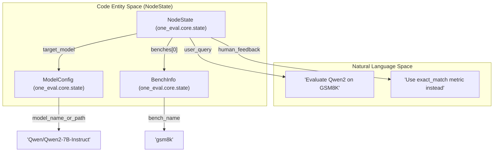
Sources: [one_eval/core/state.py:52-123]()

## Execution Flow & HITL Flags

One-Eval uses specific flags within `NodeState` to manage the flow of control between the automated agents and the human user.

### Interrupt Mechanism
When a node (such as `HumanReviewNode` or `PreEvalReviewNode`) requires user intervention, it sets `waiting_for_human = True`. The LangGraph engine detects this state or a specific `interrupt` signal and halts execution.

### Data Flow through Nodes
Every node in the graph follows a standard interface defined by `BaseNode`.

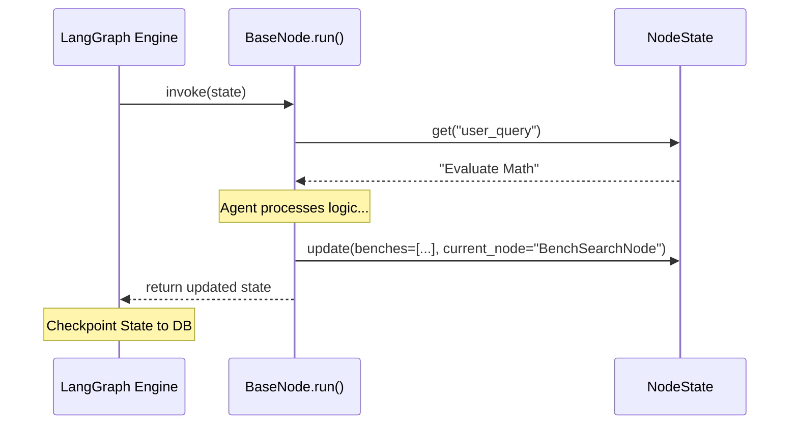
Sources: [one_eval/core/node.py:7-23](), [one_eval/core/state.py:124-133]()

### Key Fields for Phase Transitions
*   **Discovery to Preparation**: The `benches` list is populated.
*   **Preparation to Execution**: `dataset_cache` paths are filled, and `bench_keys` (input/output mappings) are defined in `key_plan`.
*   **Execution to Scoring**: `eval_results` are populated with raw model outputs.
*   **Scoring to Reporting**: `metric_plan` is executed, and final `reports` are generated.

Sources: [one_eval/core/state.py:102-110]()

---

# Page: Graph Engine & Workflow Orchestration

# Graph Engine & Workflow Orchestration

<details>
<summary>Relevant source files</summary>

The following files were used as context for generating this wiki page:

- [one_eval/agents/__init__.py](one_eval/agents/__init__.py)
- [one_eval/core/graph.py](one_eval/core/graph.py)
- [one_eval/graph/__init__.py](one_eval/graph/__init__.py)
- [one_eval/graph/workflow.py](one_eval/graph/workflow.py)
- [one_eval/graph/workflow_all.py](one_eval/graph/workflow_all.py)
- [one_eval/graph/workflow_bench_verify.py](one_eval/graph/workflow_bench_verify.py)
- [one_eval/graph/workflow_eval.py](one_eval/graph/workflow_eval.py)
- [one_eval/graph/workflow_metric_recommend.py](one_eval/graph/workflow_metric_recommend.py)
- [one_eval/graph/workflow_nl2bench.py](one_eval/graph/workflow_nl2bench.py)
- [one_eval/graph/workflow_task_infer.py](one_eval/graph/workflow_task_infer.py)
- [one_eval/nodes/bench_config_recommend_node.py](one_eval/nodes/bench_config_recommend_node.py)
- [one_eval/nodes/bench_task_infer_node.py](one_eval/nodes/bench_task_infer_node.py)
- [one_eval/nodes/dataset_structure_node.py](one_eval/nodes/dataset_structure_node.py)
- [one_eval/nodes/interrupt_node.py](one_eval/nodes/interrupt_node.py)
- [one_eval/utils/deal_json.py](one_eval/utils/deal_json.py)
- [tests/test_download_single.py](tests/test_download_single.py)

</details>


The One-Eval backend is powered by a directed acyclic graph (DAG) orchestration engine built on top of LangGraph. This engine manages the transition between evaluation phases, handles persistent state via SQLite-based checkpointing, and facilitates Human-in-the-loop (HITL) interactions through specialized interrupt nodes.

## GraphBuilder & Node Registration

The `GraphBuilder` class in `one_eval/core/graph.py` acts as a wrapper around LangGraph's `StateGraph`. It provides a simplified interface for registering nodes, edges, and tools while ensuring that the `NodeState` is correctly propagated through the system.

### Key Implementation Details
- **State Management**: It initializes the graph with `NodeState` as the central data model [one_eval/core/graph.py:59-62]().
- **Node Wrapping**: The `_wrap_node_with_tools` method automatically injects a `RunnableConfig` and registers custom tools for specific roles before executing the node function [one_eval/core/graph.py:135-176]().
- **Tool Integration**: It utilizes a `tool_registry` to bind functions to specific graph roles, allowing agents to access capabilities like HuggingFace searching or dataset probing [one_eval/core/graph.py:68-115]().

### Graph Construction Logic
| Method | Description |
| :--- | :--- |
| `add_node(name, func)` | Registers a processing unit (e.g., `QueryUnderstandNode`) [one_eval/core/graph.py:76-78](). |
| `add_edge(src, dst)` | Defines a static transition between two nodes [one_eval/core/graph.py:84-86](). |
| `add_conditional_edge(src, func)` | Routes flow based on the return value of a logic function [one_eval/core/graph.py:92-94](). |
| `build(checkpointer)` | Compiles the graph into a runnable object with optional persistence [one_eval/core/graph.py:178-185](). |

**Sources:** [one_eval/core/graph.py:10-185](), [one_eval/graph/workflow_all.py:69-72]()

---

## Workflow Topology (`workflow_all.py`)

The complete One-Eval pipeline is defined in `one_eval/graph/workflow_all.py`. It orchestrates seven distinct phases, moving from natural language query understanding to final report generation.

### Complete Workflow Diagram
This diagram maps the logical phases to the specific code entities defined in the `build_complete_workflow` function.

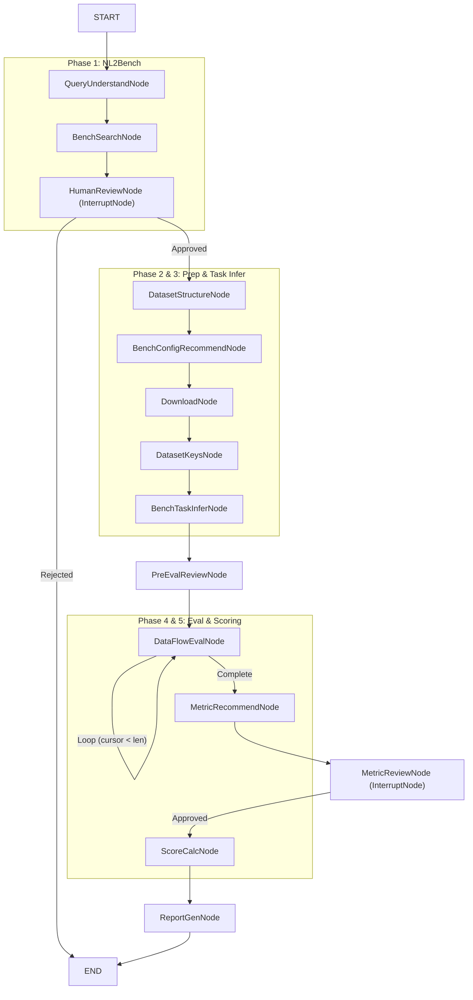
**Sources:** [one_eval/graph/workflow_all.py:44-68](), [one_eval/graph/workflow_all.py:137-175]()

---

## Interrupt & Resume Mechanics

One-Eval uses a specialized `InterruptNode` to implement Human-in-the-loop (HITL) gates. This allows the system to pause execution, wait for user feedback via the UI, and then either continue or "rewind" to previous nodes.

### Implementation: `InterruptNode`
The node utilizes the LangGraph `interrupt` function to yield control back to the caller [one_eval/nodes/interrupt_node.py:68-74]().

1.  **Validation**: It runs a list of `validators` (e.g., `benches_manual_review`) against the current `NodeState` [one_eval/nodes/interrupt_node.py:42-54]().
2.  **Suspension**: If a validator fails/triggers, the node calls `interrupt()`, which serializes the current state and stops execution [one_eval/nodes/interrupt_node.py:68-74]().
3.  **Agent Decision**: Upon resumption (via `Command(resume=...)`), the `HumanInLoopAgent` processes the user input and decides whether to `goto_node` (rewind) or `continue` [one_eval/nodes/interrupt_node.py:102-149]().

### Persistence: `AsyncSqliteSaver`
The `get_checkpointer` utility provides an `AsyncSqliteSaver` that connects to `checkpoints/eval.db` [one_eval/graph/workflow_all.py:182-185](). This ensures that even if the server restarts, an evaluation run can be resumed using its `thread_id` [one_eval/graph/workflow_all.py:187-200]().

**Sources:** [one_eval/nodes/interrupt_node.py:17-161](), [one_eval/graph/workflow_all.py:178-200](), [one_eval/utils/checkpoint.py:1-20]()

---

## Evaluation Loop Routing Logic

The evaluation phase involves iterating over multiple benchmarks. This is handled by a conditional edge and a cursor-based routing function.

### `_route_after_eval` Function
This function determines if the graph should stay in the `DataFlowEvalNode` or proceed to scoring [one_eval/graph/workflow_all.py:36-41]().

```python
def _route_after_eval(state: NodeState) -> str:
    benches = getattr(state, "benches", None) or []
    cursor = int(getattr(state, "eval_cursor", 0) or 0)
    if cursor < len(benches):
        return "DataFlowEvalNode" # Continue evaluation loop
    return "MetricRecommendNode" # Proceed to next phase
```

### Routing Entity Mapping
The following diagram illustrates how the `NodeState` properties drive the transition logic in `workflow_all.py`.

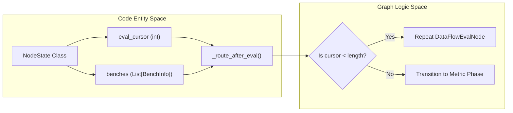

**Sources:** [one_eval/graph/workflow_all.py:36-41](), [one_eval/graph/workflow_all.py:162]()

---

# Page: Agent Layer & LLM Calling

# Agent Layer & LLM Calling

<details>
<summary>Relevant source files</summary>

The following files were used as context for generating this wiki page:

- [one_eval/agents/human_in_loop_agent.py](one_eval/agents/human_in_loop_agent.py)
- [one_eval/agents/query_understand_agent.py](one_eval/agents/query_understand_agent.py)
- [one_eval/core/agent.py](one_eval/core/agent.py)
- [one_eval/nodes/bench_search_node.py](one_eval/nodes/bench_search_node.py)
- [one_eval/nodes/pre_eval_review_node.py](one_eval/nodes/pre_eval_review_node.py)
- [one_eval/nodes/query_understand_node.py](one_eval/nodes/query_understand_node.py)
- [one_eval/serving/custom_llm_caller.py](one_eval/serving/custom_llm_caller.py)
- [one_eval/utils/bench_registry.py](one_eval/utils/bench_registry.py)
- [one_eval/utils/bench_table/bench_config.json](one_eval/utils/bench_table/bench_config.json)
- [one_eval/utils/node_docs.py](one_eval/utils/node_docs.py)
- [one_eval/utils/prompts.py](one_eval/utils/prompts.py)
- [requirements.txt](requirements.txt)
- [tests/test_hf.py](tests/test_hf.py)

</details>


The Agent Layer serves as the cognitive engine of One-Eval, responsible for translating natural language intent into structured evaluation configurations. It abstracts the complexities of prompt engineering, LLM provider differences, and tool execution, providing a unified interface for the LangGraph workflow nodes to perform reasoning tasks.

## Core Abstractions

One-Eval uses a hierarchical agent structure built on top of LangChain and custom HTTP callers to ensure reliability and performance.

### BaseAgent
`BaseAgent` is an abstract base class that defines the execution pattern for all agents in the system [one_eval/core/agent.py:17-111](). It provides:
- **Unified Interface**: Standardizes `role_name`, `system_prompt_template_name`, and `task_prompt_template_name` requirements [one_eval/core/agent.py:73-89]().
- **Robust Parsing**: Implements `parse_result` to extract and validate JSON content from LLM responses, including markdown block stripping [one_eval/core/agent.py:91-106]().
- **Configuration**: Manages model parameters like `temperature`, `max_tokens`, and `parser_type` [one_eval/core/agent.py:29-65]().

### CustomAgent
`CustomAgent` extends `BaseAgent` to provide concrete implementations for most One-Eval nodes [one_eval/core/agent.py:113-194](). It integrates with `CustomLLMCaller` and `PromptRegistry` to handle the standard "Get Prompt -> Call LLM -> Update State" cycle.

### CustomLLMCaller
The `CustomLLMCaller` is the primary interface for LLM interaction [one_eval/serving/custom_llm_caller.py:38-201](). Unlike standard LangChain callers, it is optimized for the One-Eval backend:
- **Raw API Mode**: Directly uses `httpx.AsyncClient` to call OpenAI-compatible endpoints for maximum performance when tools are not required [one_eval/serving/custom_llm_caller.py:130-160]().
- **Tool-Binding Mode**: Dynamically switches to `ChatOpenAI.bind_tools` when complex agentic behavior (like `HFSearchTool` usage) is needed [one_eval/serving/custom_llm_caller.py:178-193]().
- **Message Conversion**: Automatically maps LangChain message objects (`SystemMessage`, `HumanMessage`, `AIMessage`, `ToolMessage`) to standard OpenAI API payloads [one_eval/serving/custom_llm_caller.py:82-129]().

### EmbeddingCaller
A specialized utility for RAG-based benchmark discovery, used to vectorize text for similarity searches against the benchmark gallery [one_eval/serving/custom_llm_caller.py:202-226]().

**Sources:** [one_eval/core/agent.py:17-194](), [one_eval/serving/custom_llm_caller.py:38-226]()

---

## Agent Invocation Data Flow

The following diagram illustrates how a `BaseNode` within the LangGraph workflow utilizes an Agent to transform the `NodeState`.

**Agent Execution & State Update Flow**
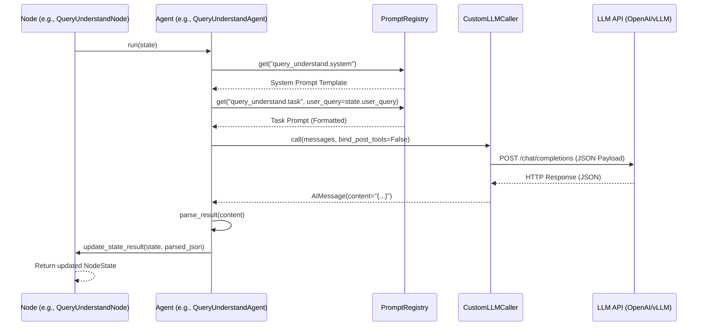
**Sources:** [one_eval/core/agent.py:172-185](), [one_eval/agents/query_understand_agent.py:29-54](), [one_eval/serving/custom_llm_caller.py:130-160]()

---

## Prompt Management

One-Eval uses a centralized `PromptRegistry` to manage all system and task instructions. This ensures consistency across the pipeline and allows for easy tuning of agent behavior without modifying core logic.

### PromptRegistry
The registry stores `PromptTemplate` objects, which support Python f-string style formatting [one_eval/utils/prompts.py:11-37]().

| Registry Key | Agent / Node | Purpose |
|:---|:---|:---|
| `query_understand.system` | `QueryUnderstandAgent` | Defines the role for parsing user intent into structured JSON [one_eval/utils/prompts.py:45-61](). |
| `bench_search.hf_query` | `BenchNameSuggestAgent` | Instructs the agent to recommend benchmarks based on domain and user query [one_eval/utils/prompts.py:103-146](). |
| `hitl.system` | `HumanInLoopAgent` | Manages logic for human-in-the-loop interruptions and node jumping [one_eval/utils/prompts.py:151-197](). |
| `metric_recommend.system`| `MetricRecommendAgent` | Logic for matching benchmark types to valid metric names [one_eval/utils/prompts.py:242-269](). |

**Sources:** [one_eval/utils/prompts.py:1-269]()

---

## Technical Implementation Details

### JSON Parsing & Validation
Agents are designed to be "JSON-first." The `BaseAgent.parse_result` method includes logic to handle common LLM failure modes, such as including markdown code blocks or explanatory text around the JSON object [one_eval/core/agent.py:91-106]().

### Tool Binding vs. Raw API
The `CustomLLMCaller` decides the invocation path based on the `bind_post_tools` flag [one_eval/serving/custom_llm_caller.py:165-175](). 
- **Internal Agents** (e.g., `QueryUnderstandAgent`) typically set this to `False` to reduce latency and token usage [one_eval/agents/query_understand_agent.py:48]().
- **Discovery Agents** (e.g., those searching HuggingFace) set this to `True` to allow the LLM to emit `tool_calls` which are then executed by the `ToolManager` [one_eval/serving/custom_llm_caller.py:180-193]().

### Code-to-NL Mapping
The following diagram bridges the "Natural Language Space" (Prompts/User Input) to the "Code Entity Space" (Classes/Methods).

**NL2Eval Logic Mapping**
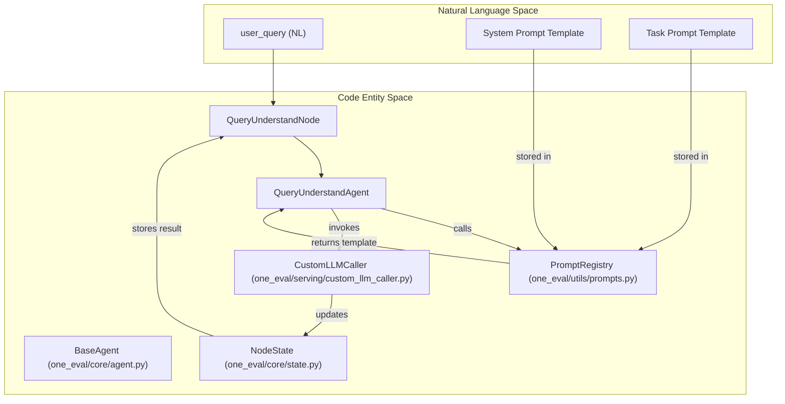
**Sources:** [one_eval/core/agent.py:113-164](), [one_eval/nodes/query_understand_node.py:11-37](), [one_eval/agents/query_understand_agent.py:11-55](), [one_eval/utils/prompts.py:20-37]()

---

# Page: Evaluation Pipeline Nodes

# Evaluation Pipeline Nodes

<details>
<summary>Relevant source files</summary>

The following files were used as context for generating this wiki page:

- [one_eval/core/graph.py](one_eval/core/graph.py)
- [one_eval/graph/workflow.py](one_eval/graph/workflow.py)
- [one_eval/graph/workflow_all.py](one_eval/graph/workflow_all.py)
- [one_eval/nodes/interrupt_node.py](one_eval/nodes/interrupt_node.py)

</details>


The One-Eval pipeline is a structured sequence of execution nodes orchestrated by LangGraph. Each node represents a discrete phase of the evaluation lifecycle, transforming a natural language query into a comprehensive performance report. The workflow is designed to handle complex logic, such as benchmark discovery, dataset conversion, large-scale model inference, and multi-dimensional scoring.

## Pipeline Architecture Overview

The pipeline is defined in `one_eval/graph/workflow_all.py` [one_eval/graph/workflow_all.py:44-175](). It utilizes a `GraphBuilder` [one_eval/core/graph.py:57-185]() to register nodes and define the directed edges that govern the flow of the `NodeState` object.

### High-Level Workflow Diagram
The following diagram illustrates the progression through the seven primary phases of the evaluation pipeline.

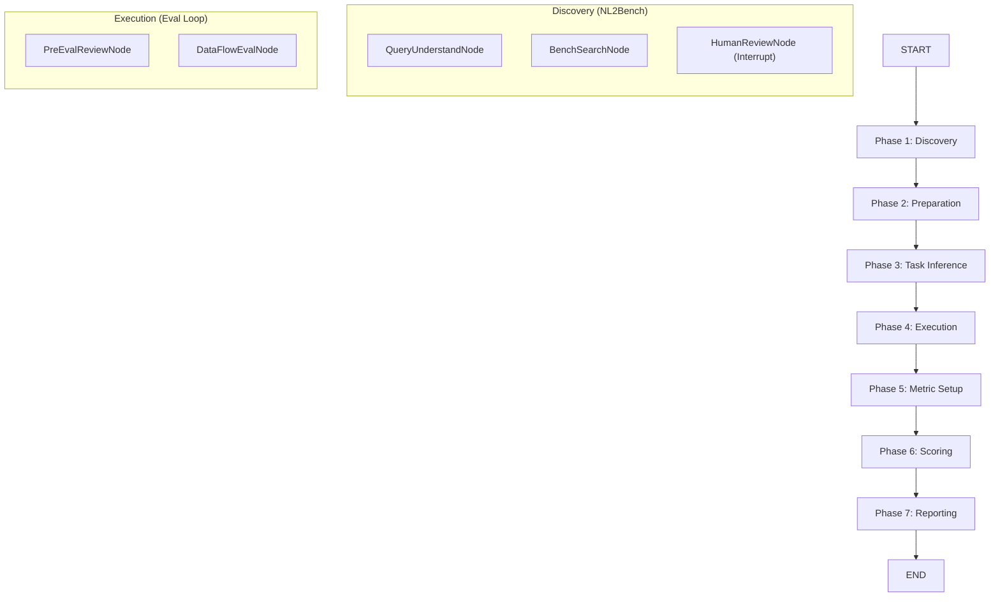
**Sources:** [one_eval/graph/workflow_all.py:44-68](), [one_eval/graph/workflow_all.py:74-135]()

---

## Phase 1: Discovery (NL2Bench)
The Discovery phase translates the user's natural language intent into a concrete list of benchmarks. It uses a combination of semantic understanding and retrieval tools to search the local gallery and HuggingFace.

*   **QueryUnderstandNode**: Analyzes the user query to extract domains, tasks, and evaluation requirements [one_eval/graph/workflow_all.py:75]().
*   **BenchSearchNode**: Performs the actual search across available benchmark registries [one_eval/graph/workflow_all.py:76]().
*   **HumanReviewNode**: An `InterruptNode` that pauses execution for user confirmation of the selected benchmarks before proceeding to download [one_eval/graph/workflow_all.py:77-85]().

For details, see [Discovery Phase: Query Understanding & Benchmark Search](#3.1).

---

## Phase 2: Preparation & Download
Once benchmarks are selected, the system must prepare the local environment. This involves inspecting dataset structures (splits/subsets) and fetching the raw data.

*   **DatasetStructureNode**: Probes HuggingFace or local paths to identify available subsets and splits [one_eval/graph/workflow_all.py:92]().
*   **BenchConfigRecommendNode**: Suggests the best configuration (e.g., which split to use for validation) [one_eval/graph/workflow_all.py:93]().
*   **DownloadNode**: Executes the data fetching and converts diverse formats into a unified JSONL structure [one_eval/graph/workflow_all.py:94]().

For details, see [Preparation Phase: Dataset Download & Configuration](#3.2).

---

## Phase 3: Task Inference
This phase bridges the gap between raw data and model-ready prompts by identifying the schema of the downloaded datasets.

*   **DatasetKeysNode**: Identifies the primary keys (input, reference, options) within the JSONL files [one_eval/graph/workflow_all.py:101]().
*   **BenchTaskInferNode**: Determines the task type (e.g., Multiple Choice, Math, Code Generation) based on the dataset content [one_eval/graph/workflow_all.py:102]().

---

## Phase 4: Execution (Evaluation)
The Execution phase is the most resource-intensive part of the pipeline, where the target model processes the benchmark items.

*   **PreEvalReviewNode**: A final gate to review the model configuration and prompt templates [one_eval/graph/workflow_all.py:108-109]().
*   **DataFlowEvalNode**: Manages the inference loop. It handles model serving (via vLLM or API), batching, and saves raw model outputs to "Step 2" files [one_eval/graph/workflow_all.py:111-112]().

For details, see [Execution Phase: DataFlow Evaluation](#3.3).

---

## Phase 5 & 6: Scoring & Metric Calculation
After inference, the system calculates quantitative scores using a extensible metrics engine.

*   **MetricRecommendNode**: Recommends appropriate metrics (e.g., BLEU, Pass@k, Exact Match) based on the task type [one_eval/graph/workflow_all.py:115-116]().
*   **MetricReviewNode**: An `InterruptNode` allowing users to modify the scoring plan [one_eval/graph/workflow_all.py:119-128]().
*   **ScoreCalcNode**: Runs the `MetricRunner` to compare model outputs against references and generate "Step 3" score files [one_eval/graph/workflow_all.py:131-132]().

For details, see [Scoring & Reporting Phase](#3.4).

---

## Phase 7: Reporting
The final phase aggregates all results into a human-readable format.

*   **ReportGenNode**: Compiles scores, error classifications, and capability dimensions into a structured report [one_eval/graph/workflow_all.py:134-135](). It generates radar charts and LLM-powered summaries of the model's strengths and weaknesses.

---

## Node Implementation & Interaction
All nodes inherit from `BaseNode` and are integrated into the graph using `builder.add_node` [one_eval/core/graph.py:76-78](). The `InterruptNode` is a specialized class used for Human-In-The-Loop (HITL) gates, utilizing the `interrupt` and `Command` features of LangGraph [one_eval/nodes/interrupt_node.py:17-37]().

### Code-to-System Mapping
This diagram maps the logical pipeline phases to the specific Python classes that implement them.

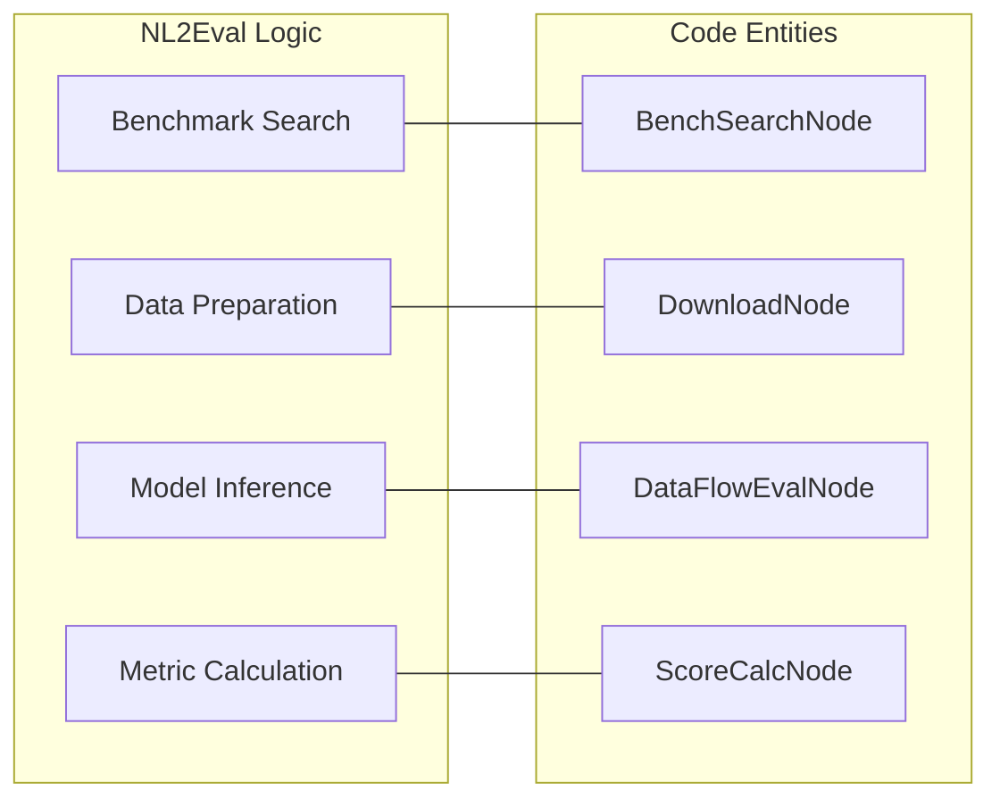

**Sources:** [one_eval/graph/workflow_all.py:14-26](), [one_eval/nodes/interrupt_node.py:17-18]()

---

# Page: Discovery Phase: Query Understanding & Benchmark Search

# Discovery Phase: Query Understanding & Benchmark Search

<details>
<summary>Relevant source files</summary>

The following files were used as context for generating this wiki page:

- [one_eval/agents/bench_resolve_agent.py](one_eval/agents/bench_resolve_agent.py)
- [one_eval/agents/human_in_loop_agent.py](one_eval/agents/human_in_loop_agent.py)
- [one_eval/agents/query_understand_agent.py](one_eval/agents/query_understand_agent.py)
- [one_eval/nodes/bench_name_suggest_node.py](one_eval/nodes/bench_name_suggest_node.py)
- [one_eval/nodes/bench_search_node.py](one_eval/nodes/bench_search_node.py)
- [one_eval/nodes/pre_eval_review_node.py](one_eval/nodes/pre_eval_review_node.py)
- [one_eval/nodes/query_understand_node.py](one_eval/nodes/query_understand_node.py)
- [one_eval/toolkits/hf_search_tool.py](one_eval/toolkits/hf_search_tool.py)
- [one_eval/utils/bench_registry.py](one_eval/utils/bench_registry.py)
- [one_eval/utils/bench_table/bench-key.xlsx](one_eval/utils/bench_table/bench-key.xlsx)
- [one_eval/utils/bench_table/bench_config.json](one_eval/utils/bench_table/bench_config.json)
- [one_eval/utils/bench_table/bench_gallery.json](one_eval/utils/bench_table/bench_gallery.json)
- [one_eval/utils/node_docs.py](one_eval/utils/node_docs.py)
- [one_eval/utils/prompts.py](one_eval/utils/prompts.py)
- [tests/test_bench_registry.py](tests/test_bench_registry.py)
- [tests/test_hf.py](tests/test_hf.py)
- [tests/test_single_tool.py](tests/test_single_tool.py)

</details>


The Discovery Phase is the initial stage of the One-Eval evaluation pipeline. Its purpose is to transform a user's natural language request into a structured evaluation plan by identifying specific domains, target models, and a list of validated benchmarks from both local registries and HuggingFace.

## Overview of the Discovery Flow

The phase is orchestrated by two primary nodes: `QueryUnderstandNode` and `BenchSearchNode`. These nodes transition the system from "Natural Language Space" (user intent) to "Code Entity Space" (structured configurations and dataset references).

### Discovery Phase Data Flow
The following diagram illustrates how user input is transformed into structured `BenchInfo` objects.

**Title: Discovery Phase Entity Mapping**
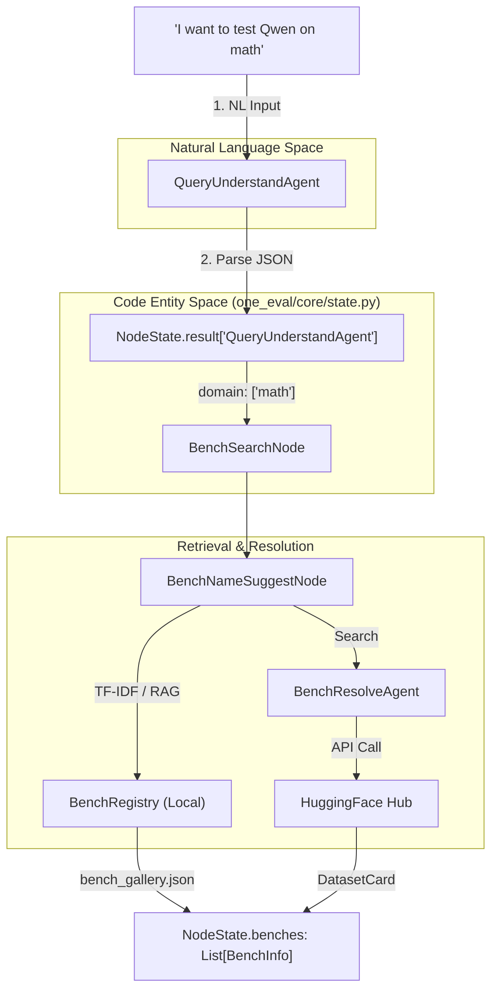
**Sources:** [one_eval/nodes/query_understand_node.py:11-36](), [one_eval/nodes/bench_search_node.py:12-40](), [one_eval/core/state.py:1-50]()

---

## Query Understanding

The `QueryUnderstandNode` serves as the entry point. It utilizes the `QueryUnderstandAgent` to perform semantic parsing of the `state.user_query`.

### QueryUnderstandAgent
The agent uses a two-part prompt (`query_understand.system` and `query_understand.task`) to extract specific fields:
*   **is_eval_task**: Boolean indicating if the query is an evaluation request.
*   **domain**: List of identified domains (e.g., `["math", "code"]`).
*   **specific_benches**: Benchmarks explicitly named by the user.
*   **model_path**: The model identifier or local path to be tested.

**Sources:** [one_eval/agents/query_understand_agent.py:11-55](), [one_eval/utils/prompts.py:44-81]()

---

## Benchmark Search & Retrieval

The `BenchSearchNode` encapsulates the logic for finding the actual datasets. It executes two sub-components sequentially: `BenchNameSuggestNode` and `BenchResolveAgent`.

### 1. BenchNameSuggestNode (Retrieval Modes)
This node identifies candidate benchmark names without calling an LLM, ensuring high performance and cost-efficiency. It operates in two modes via the `BenchmarkRetriever` class:

| Mode | Implementation | Data Source |
| :--- | :--- | :--- |
| **TF-IDF** | Custom `_tokenize` and `_compute_tf` logic using `math.log` for IDF. | `BenchmarkTable_Filter.xlsx` |
| **RAG** | `EmbeddingCaller` using OpenAI-compatible embeddings (e.g., `text-embedding-3-small`). | `benchmarks_embeddings.npy` (Cache) |

**Key Function:** `BenchmarkRetriever.search(query, top_k)` returns a list of candidate names based on the similarity between the user query and the `Name`, `Type`, and `Description` columns in the filtered benchmark table.

**Sources:** [one_eval/nodes/bench_name_suggest_node.py:30-194](), [one_eval/nodes/bench_search_node.py:28-30]()

### 2. BenchResolveAgent (Resolution)
Once names are suggested, the `BenchResolveAgent` resolves them into concrete `BenchInfo` objects.

*   **Local Resolution**: It queries the `BenchRegistry`, which loads `bench_gallery.json`. It matches names against `bench_name` or `aliases` [one_eval/utils/bench_registry.py:83-107]().
*   **HuggingFace Resolution**: If a benchmark is not found locally, it uses `huggingface_hub.DatasetCard` to fetch metadata directly from HF. It prioritizes exact `repo_id` matches before falling back to search [one_eval/agents/bench_resolve_agent.py:71-139]().

**Sources:** [one_eval/agents/bench_resolve_agent.py:15-191](), [one_eval/utils/bench_registry.py:10-78]()

---

## Human-in-the-Loop: HumanReviewNode

To ensure the pipeline doesn't proceed with incorrect benchmarks, the system includes an interrupt gate.

### Interrupt Logic
The `HumanReviewNode` (often referred to as the HITL gate) triggers an `interrupt` in LangGraph. This pauses execution and waits for a frontend response.

**Title: HITL Decision Flow**
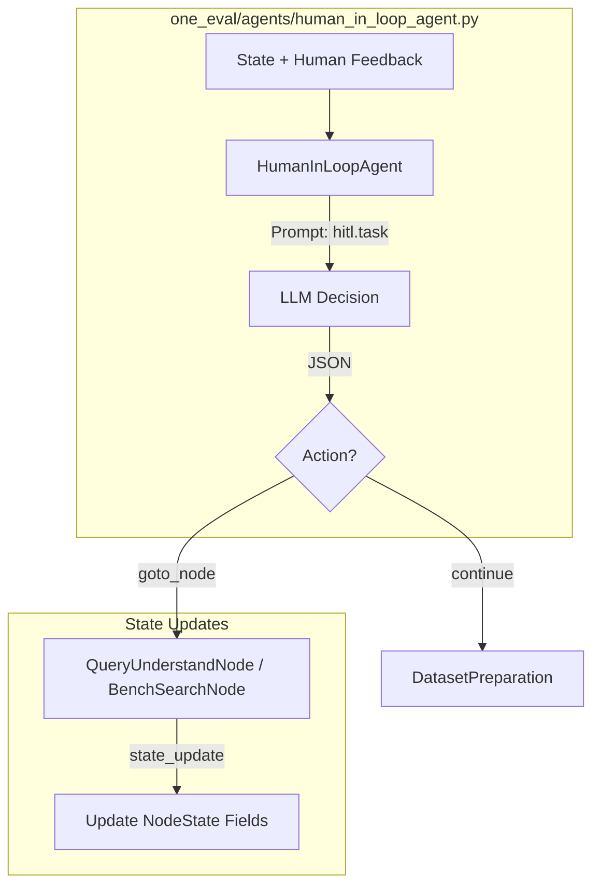

### HumanInLoopAgent
The agent processes the `human_input` and `check_result` (warnings) to decide the next step. It can:
1.  **Continue**: Proceed to the next phase.
2.  **Goto Node**: Roll back the graph to a previous node (e.g., `QueryUnderstandNode`) to re-parse requirements if the user provides corrections.
3.  **State Update**: Inject new values into the `NodeState` (e.g., manually adding a benchmark name).

**Sources:** [one_eval/agents/human_in_loop_agent.py:14-150](), [one_eval/utils/prompts.py:151-235](), [one_eval/nodes/pre_eval_review_node.py:11-40]()

---

# Page: Preparation Phase: Dataset Download & Configuration

# Preparation Phase: Dataset Download & Configuration

<details>
<summary>Relevant source files</summary>

The following files were used as context for generating this wiki page:

- [README.md](README.md)
- [README_zh.md](README_zh.md)
- [one-eval-web/.gitignore](one-eval-web/.gitignore)
- [one_eval/agents/bench_config_recommend_agent.py](one_eval/agents/bench_config_recommend_agent.py)
- [one_eval/agents/bench_task_infer_agent.py](one_eval/agents/bench_task_infer_agent.py)
- [one_eval/graph/workflow_download.py](one_eval/graph/workflow_download.py)
- [one_eval/graph/workflow_eval.py](one_eval/graph/workflow_eval.py)
- [one_eval/graph/workflow_task_infer.py](one_eval/graph/workflow_task_infer.py)
- [one_eval/nodes/bench_config_recommend_node.py](one_eval/nodes/bench_config_recommend_node.py)
- [one_eval/nodes/bench_task_infer_node.py](one_eval/nodes/bench_task_infer_node.py)
- [one_eval/nodes/dataset_keys_node.py](one_eval/nodes/dataset_keys_node.py)
- [one_eval/nodes/dataset_structure_node.py](one_eval/nodes/dataset_structure_node.py)
- [one_eval/nodes/download_node.py](one_eval/nodes/download_node.py)
- [one_eval/toolkits/hf_dataset_structure_tool.py](one_eval/toolkits/hf_dataset_structure_tool.py)
- [one_eval/toolkits/hf_download_tool.py](one_eval/toolkits/hf_download_tool.py)
- [static/logo/318QRcode.jpg](static/logo/318QRcode.jpg)

</details>


The **Preparation Phase** is the second major stage in the One-Eval pipeline. It transforms the benchmark names identified in the Discovery Phase into local, ready-to-evaluate JSONL files. This phase handles the complexity of HuggingFace dataset structures (subsets and splits), automated configuration recommendation, file downloading, and schema inference.

## Phase Overview

The preparation phase is orchestrated across two primary sub-workflows: `workflow_download.py` and `workflow_task_infer.py`. It bridges the gap between a high-level benchmark name and the technical requirements needed for the execution engine.

### Data Flow & Node Topology

The following diagram illustrates the transition from the "Natural Language/Metadata Space" to the "Code/FileSystem Space".

**Preparation Phase Data Flow**
```mermaid
graph TD
    subgraph "Discovery Output"
        A["NodeState.benches"]
    end

    subgraph "Download Workflow (workflow_download.py)"
        B["DatasetStructureNode"] --> C["BenchConfigRecommendNode"]
        C --> D["DownloadNode"]
    end

    subgraph "Task Inference Workflow (workflow_task_infer.py)"
        E["DatasetKeysNode"] --> F["BenchTaskInferNode"]
        F --> G["PreEvalReviewNode (Interrupt)"]
    end

    A --> B
    D --> E
    G --> H["Execution Phase"]

    %% Code Entity Mapping
    B -- "Uses" --> B1["HFDatasetStructureTool"]
    D -- "Uses" --> D1["HFDownloadTool"]
    C -- "Uses" --> C1["BenchConfigRecommendAgent"]
    F -- "Uses" --> F1["BenchTaskInferAgent"]
```
**Sources:** [one_eval/graph/workflow_download.py:25-49](), [one_eval/graph/workflow_task_infer.py:23-45]()

---

## 1. Dataset Discovery & Structure Analysis

Before downloading, the system must understand the internal structure of the HuggingFace repository.

### DatasetStructureNode
This node uses the `HFDatasetStructureTool` to fetch the available subsets (configs) and splits for each benchmark. It populates `bench.meta["structure"]` with a JSON representation of the repository's layout.
*   **Implementation:** [one_eval/nodes/dataset_structure_node.py]()
*   **Key Tool:** `HFDatasetStructureTool` (inspects subsets and splits via HuggingFace API).

### BenchConfigRecommendNode
Since many datasets (e.g., MMLU) contain hundreds of subsets, the `BenchConfigRecommendAgent` analyzes the user's original query and the available subsets to pick the most relevant configuration.
*   **Implementation:** [one_eval/nodes/bench_config_recommend_node.py]()
*   **Agent Logic:** Uses `BenchConfigRecommendAgent` to select a `config` and `split` (e.g., `config="elementary_mathematics"`, `split="test"`). [one_eval/agents/bench_config_recommend_agent.py:15-180]()

**Sources:** [one_eval/nodes/dataset_structure_node.py:1-20](), [one_eval/agents/bench_config_recommend_agent.py:83-179]()

---

## 2. The Download Engine

The downloading process ensures that datasets are converted into a standardized format for the `DataFlow` execution engine.

### DownloadNode
The `DownloadNode` manages the lifecycle of the physical file acquisition. It includes an auto-correction logic for splits: if a recommended split (like "test") is missing, it falls back to "validation" or "dev" automatically.
*   **Split Selection:** `_pick_best_split` prioritizes `test` -> `validation` -> `dev` -> `train`. [one_eval/nodes/download_node.py:27-41]()
*   **Caching:** Files are saved to `cache/` using a naming convention: `{repo}__{config}__{split}.jsonl`. [one_eval/nodes/download_node.py:125-127]()

### HFDownloadTool
This tool wraps the `datasets` library to fetch data and perform "cleaning" during conversion to JSONL.
*   **Data Cleaning:** It iterates through dataset items and ensures every field is JSON-serializable. Non-serializable objects (like PIL Images) are cast to strings to prevent pipeline crashes. [one_eval/toolkits/hf_download_tool.py:84-103]()
*   **Function:** `download_and_convert(repo_id, config_name, split, output_path)`. [one_eval/toolkits/hf_download_tool.py:45-117]()

**Sources:** [one_eval/nodes/download_node.py:14-175](), [one_eval/toolkits/hf_download_tool.py:13-117]()

---

## 3. Schema Inference & Task Mapping

Once the JSONL file exists locally, the system must determine how to map the JSON keys to evaluation inputs (e.g., which key is the "question", which is the "ground truth").

### DatasetKeysNode
This node reads the first few lines of the downloaded JSONL file to extract all available keys, including nested paths (e.g., `metadata.difficulty`).
*   **Implementation:** [one_eval/nodes/dataset_keys_node.py:13-88]()
*   **Output:** Populates `bench.bench_keys` and `bench.meta["preview_data"]`.

### BenchTaskInferNode & Agent
The `BenchTaskInferAgent` uses an LLM to map the extracted keys to a standard `eval_type` (defined in the Bench Gallery).
*   **Supported Types:** Includes `key3_q_choices_a` (Multiple Choice), `key2_qa` (Question/Answer), etc. [one_eval/agents/bench_task_infer_agent.py:14-21]()
*   **Fallback Logic:** If the LLM fails, `_fallback_type_by_keys` uses regex-like pattern matching on key names (e.g., keys containing "prompt" or "query" are mapped to `input_question_key`). [one_eval/agents/bench_task_infer_agent.py:50-73]()

**Schema Inference Mapping**
| Target Field | Potential JSON Keys (Aliases) |
| :--- | :--- |
| `input_question_key` | question, query, prompt, instruction |
| `input_choices_key` | choices, options, candidates |
| `input_target_key` | target, reference, ground_truth, gold |

**Sources:** [one_eval/nodes/dataset_keys_node.py:57-83](), [one_eval/agents/bench_task_infer_agent.py:24-150]()

---

## 4. Human-in-the-Loop: PreEvalReviewNode

The preparation phase concludes with a mandatory interrupt gate: the `PreEvalReviewNode`. 

**Interrupt Mechanism**
1.  The graph state is saved to the `AsyncSqliteSaver` database.
2.  The workflow enters a `suspended` state.
3.  The Frontend displays the "Review Benchmarks" UI, showing the recommended configs, detected keys, and the inferred task mapping.
4.  The user can manually override the `eval_type` or `key_mapping` before signaling the backend to resume.

**Preparation Phase Implementation Detail**
```mermaid
classDiagram
    class NodeState {
        +List~BenchInfo~ benches
        +ModelConfig target_model
        +str current_node
    }
    class BenchInfo {
        +str bench_name
        +str dataset_cache
        +str bench_dataflow_eval_type
        +dict meta
    }
    class HFDownloadTool {
        +download_and_convert()
    }
    class BenchTaskInferAgent {
        +run(state)
        -_fallback_type_by_keys(keys)
    }
    
    NodeState "1" *-- "many" BenchInfo
    DownloadNode ..> HFDownloadTool : uses
    BenchTaskInferNode ..> BenchTaskInferAgent : delegates
```
**Sources:** [one_eval/core/state.py](), [one_eval/nodes/download_node.py:55](), [one_eval/nodes/bench_task_infer_node.py:11-28]()

---

# Page: Execution Phase: DataFlow Evaluation

# Execution Phase: DataFlow Evaluation

<details>
<summary>Relevant source files</summary>

The following files were used as context for generating this wiki page:

- [one_eval/nodes/dataflow_eval_node.py](one_eval/nodes/dataflow_eval_node.py)
- [one_eval/toolkits/dataflow_eval_tool.py](one_eval/toolkits/dataflow_eval_tool.py)
- [one_eval/toolkits/tool_manager.py](one_eval/toolkits/tool_manager.py)
- [tests/test_demo.py](tests/test_demo.py)

</details>


The Execution Phase is the core engine of One-Eval, responsible for generating model responses and performing preliminary evaluations. It leverages the **DataFlow** library to manage the lifecycle of Large Language Model (LLM) serving, inference, and dataset evaluation. This phase is primarily orchestrated by the `DataFlowEvalNode` and its underlying `DataFlowEvalTool`.

## DataFlow Evaluation Architecture

The evaluation process bridges the gap between raw datasets and structured model outputs. It supports both local inference (via vLLM) and remote API calls, ensuring high throughput and robust error handling.

### Natural Language to Code Entity Space Mapping

| Natural Language Concept | Code Entity | File Path |
| :--- | :--- | :--- |
| **Evaluation Node** | `DataFlowEvalNode` | [one_eval/nodes/dataflow_eval_node.py:25-33]() |
| **Execution Engine** | `DataFlowEvalTool` | [one_eval/toolkits/dataflow_eval_tool.py:85-90]() |
| **Model Serving** | `LLMServingABC` | [one_eval/toolkits/dataflow_eval_tool.py:18-18]() |
| **Rate Limit Handler** | `RobustAPILLMServing` | [one_eval/toolkits/dataflow_eval_tool.py:27-32]() |
| **Answer Generator** | `BenchAnswerGenerator` | [one_eval/toolkits/dataflow_eval_tool.py:14-14]() |
| **Dataset Evaluator** | `UnifiedBenchDatasetEvaluator` | [one_eval/toolkits/dataflow_eval_tool.py:14-14]() |

### System Data Flow Diagram

The following diagram illustrates the flow from `NodeState` through the `DataFlowEvalTool` to the generation of results.

"Execution Data Flow"
```mermaid
graph TD
    subgraph "Natural Language Space"
        UserQuery["Evaluation Request"]
    end

    subgraph "Code Entity Space"
        State["NodeState (benches, target_model)"]
        Node["DataFlowEvalNode.run()"]
        Tool["DataFlowEvalTool.run_eval()"]
        Serving["LLMServing (vLLM / API)"]
        Generator["BenchAnswerGenerator"]
        Evaluator["UnifiedBenchDatasetEvaluator"]
        Storage["FileStorage (JSONL)"]
    end

    UserQuery --> State
    State --> Node
    Node --> Tool
    Tool --> Serving
    Tool --> Generator
    Generator --> Serving
    Serving --> Generator
    Generator --> Evaluator
    Evaluator --> Storage
    Storage --> Node
    Node --> State
```
Sources: [one_eval/nodes/dataflow_eval_node.py:42-160](), [one_eval/toolkits/dataflow_eval_tool.py:186-220]()

---

## DataFlowEvalNode: The Workflow Orchestrator

`DataFlowEvalNode` is a LangGraph node that iterates through the benchmarks defined in the `NodeState`.

### Key Responsibilities
1.  **Configuration Preparation**: Extracts `ModelConfig` from the state, defaulting to local inference if not specified [one_eval/nodes/dataflow_eval_node.py:56-72]().
2.  **State Validation**: Ensures the benchmark has a valid `dataset_cache` and `eval_type` (e.g., `key3_q_choices_a`) [one_eval/nodes/dataflow_eval_node.py:88-133]().
3.  **Progress Tracking**: Implements a `_on_progress` callback that updates both the `NodeState` and the global `progress_store` for real-time UI feedback [one_eval/nodes/dataflow_eval_node.py:148-154]().
4.  **Error Handling**: If a benchmark fails validation, it triggers a `Command(goto="PreEvalReviewNode")` to interrupt the workflow for human intervention [one_eval/nodes/dataflow_eval_node.py:94-102]().

### Supported Evaluation Types
The node validates benchmarks against `VALID_EVAL_TYPES`, which include:
*   `key1_text_score`: Text-based scoring.
*   `key2_qa`: Standard Question-Answering.
*   `key3_q_choices_a`: Multiple-choice questions.
*   `key3_q_a_rejected`: Preference-based evaluation (RLHF style).

Sources: [one_eval/nodes/dataflow_eval_node.py:15-22](), [one_eval/nodes/dataflow_eval_node.py:119-133]()

---

## DataFlowEvalTool: The Execution Engine

The `DataFlowEvalTool` wraps the DataFlow library to perform the heavy lifting of inference and evaluation.

### LLM Serving Lifecycle
The tool manages two primary serving modes:
1.  **vLLM (Local)**: Uses `LocalModelLLMServing_vllm`. It includes a class-level cache `_cached_llm_serving` to prevent redundant reloading of heavy models into GPU memory across different benchmarks [one_eval/toolkits/dataflow_eval_tool.py:92-94]().
2.  **API (Remote)**: Uses `RobustAPILLMServing` for OpenAI-compatible or DeepSeek endpoints [one_eval/toolkits/dataflow_eval_tool.py:117-134]().

### RobustAPILLMServing: Rate-Limit Handling
To handle the instability of remote APIs, `RobustAPILLMServing` extends the base request class with:
*   **429 Interception**: Mocks the session's post method to specifically catch "Too Many Requests" errors [one_eval/toolkits/dataflow_eval_tool.py:37-47]().
*   **Exponential Backoff**: Implements a retry loop with jitter. For 429 errors, it uses a longer sleep time: `(2 ** i) * 1.5 + random.uniform(0, 2)` [one_eval/toolkits/dataflow_eval_tool.py:71-75]().

### Evaluation Pipeline Flow
The `run_eval` method executes the following sequence:
1.  **Serving Initialization**: Starts vLLM or initializes the API client [one_eval/toolkits/dataflow_eval_tool.py:186-200]().
2.  **Answer Generation**: Invokes `BenchAnswerGenerator` to produce model outputs based on the dataset and prompt templates [one_eval/toolkits/dataflow_eval_tool.py:214-220]().
3.  **Unified Evaluation**: Calls `UnifiedBenchDatasetEvaluator` to perform rule-based or LLM-as-Judge evaluation [one_eval/toolkits/dataflow_eval_tool.py:230-240]().

"Serving Lifecycle"
```mermaid
sequenceDiagram
    participant N as DataFlowEvalNode
    participant T as DataFlowEvalTool
    participant S as RobustAPILLMServing
    participant V as LocalModelLLMServing_vllm

    N->>T: run_eval(bench, model_config)
    alt is_api == True
        T->>S: Initialize/Retrieve Serving
        S->>S: Handle 429 with Backoff
    else is_api == False
        T->>V: Load vLLM (Cached)
    end
    T->>T: Execute BenchAnswerGenerator
    T->>T: Execute UnifiedBenchDatasetEvaluator
    T->>N: Return Stats & Detail Path
```
Sources: [one_eval/toolkits/dataflow_eval_tool.py:27-82](), [one_eval/toolkits/dataflow_eval_tool.py:186-240]()

---

## LLM-as-Judge Integration

For complex benchmarks where exact matching is insufficient, One-Eval supports using a reference model as a judge.

*   **Judge Configuration**: The `reference_model` from `NodeState` is passed to the tool [one_eval/nodes/dataflow_eval_node.py:158]().
*   **Serving**: A separate `judge_serving` instance is created if the judge model differs from the target model [one_eval/toolkits/dataflow_eval_tool.py:202-212]().
*   **DataFlow Integration**: The `UnifiedBenchDatasetEvaluator` uses this serving instance to score open-ended responses based on predefined criteria.

Sources: [one_eval/toolkits/dataflow_eval_tool.py:114-114](), [one_eval/toolkits/dataflow_eval_tool.py:230-240]()

---

## Progress Tracking and State Persistence

One-Eval ensures that long-running evaluation tasks are transparent and resumable.

### Real-time Updates
During the execution of `run_eval`, a `progress_callback` is triggered for every batch of processed data. This updates:
*   **NodeState**: `bench.meta["eval_progress"]` stores the current stage, percentage, and counts [one_eval/nodes/dataflow_eval_node.py:148-154]().
*   **Progress Store**: `set_progress(thread_id, p)` allows the FastAPI server to stream progress to the frontend [one_eval/nodes/dataflow_eval_node.py:153-154]().

### Artifacts
Upon completion, the tool returns a `detail_path` pointing to a JSONL file containing every prompt, model response, and evaluation result [one_eval/nodes/dataflow_eval_node.py:173](). This file is stored in the `cache/eval_results` directory by default [one_eval/nodes/dataflow_eval_node.py:39-40]().

Sources: [one_eval/nodes/dataflow_eval_node.py:162-174](), [one_eval/runtime/progress_store.py:12-12]()

---

# Page: Scoring & Reporting Phase

# Scoring & Reporting Phase

<details>
<summary>Relevant source files</summary>

The following files were used as context for generating this wiki page:

- [one_eval/agents/metric_recommend_agent.py](one_eval/agents/metric_recommend_agent.py)
- [one_eval/agents/report_gen_agent.py](one_eval/agents/report_gen_agent.py)
- [one_eval/agents/score_calc_agent.py](one_eval/agents/score_calc_agent.py)
- [one_eval/metrics/prompt_generator.py](one_eval/metrics/prompt_generator.py)
- [one_eval/metrics/runner.py](one_eval/metrics/runner.py)
- [one_eval/nodes/report_gen_node.py](one_eval/nodes/report_gen_node.py)
- [one_eval/nodes/score_calc_node.py](one_eval/nodes/score_calc_node.py)

</details>


The **Scoring & Reporting Phase** is the final segment of the One-Eval pipeline. It transitions from raw model outputs (Step 2) to structured metric calculations (Step 3) and finally to a comprehensive analytical report. This phase involves automated metric recommendation, parallelized score calculation, and LLM-powered result summarization.

## Phase Overview

This phase is composed of four primary logical units within the LangGraph workflow:
1.  **Metric Recommendation**: Determining which metrics are appropriate for the evaluated benchmarks.
2.  **Human Review (Optional)**: A HITL (Human-in-the-Loop) interrupt for manual metric adjustment.
3.  **Score Calculation**: Executing the metrics against the model predictions.
4.  **Report Generation**: Aggregating results into visual dimensions and natural language summaries.

### Scoring & Reporting Data Flow

The following diagram illustrates the transition from raw execution results to the final report artifacts.

**Diagram: Scoring and Reporting Data Flow**
```mermaid
graph TD
    subgraph "Execution Output (Step 2)"
        S2_FILE["eval_detail_path (*_step2.jsonl)"]
    end

    subgraph "MetricRecommendationNode"
        MRA["MetricRecommendAgent"]
        M_REG["metric_dispatcher"]
        PROMPT_GEN["MetricPromptGenerator"]
    end

    subgraph "ScoreCalcNode"
        SCA["ScoreCalcAgent"]
        MR["MetricRunner"]
        S3_FILE["*_step3.jsonl (with metric_details)"]
    end

    subgraph "ReportGenNode"
        RGA["ReportGenAgent"]
        RADAR["Radar Dimension Mapper"]
        LLM_SUM["LLM Summary Generator"]
    end

    S2_FILE --> MRA
    M_REG -- "Registry Track" --> MRA
    PROMPT_GEN -- "Analyst Track" --> MRA
    MRA -- "state.metric_plan" --> SCA
    S2_FILE -- "artifact_paths" --> SCA
    SCA --> MR
    MR --> S3_FILE
    S3_FILE -- "state.eval_results" --> RGA
    RGA --> REPORT["state.reports['default']"]

    style S2_FILE stroke-dasharray: 5 5
    style S3_FILE stroke-dasharray: 5 5
```
Sources: [one_eval/agents/metric_recommend_agent.py:15-21](), [one_eval/agents/score_calc_agent.py:137-156](), [one_eval/agents/report_gen_agent.py:97-143]()

---

## 1. Metric Recommendation

The `MetricRecommendNode` utilizes the `MetricRecommendAgent` to decide which metrics to run for each benchmark in `state.benches`.

### Dual-Track Strategy
The agent employs a "Dual-Track" strategy to ensure both reliability for known benchmarks and flexibility for new ones:
*   **Registry Track**: Checks `metric_dispatcher` (via `one_eval/core/metric_registry.py`) for pre-defined metrics associated with the benchmark name [one_eval/agents/metric_recommend_agent.py:35-39]().
*   **Analyst Track**: If the benchmark is unknown, the agent calls an LLM. It uses `MetricPromptGenerator` to construct a prompt containing the "Metric Library" (all registered metrics and their descriptions) and "Decision Rules" based on the dataset's evaluation type (e.g., `key3_q_choices_a`) [one_eval/metrics/prompt_generator.py:11-58](), [one_eval/agents/metric_recommend_agent.py:159-210]().

### Normalization and Validation
The agent ensures every metric has a `priority` ("primary", "secondary", or "diagnostic"). If the LLM fails to provide a primary metric, the agent assigns the first one as primary to ensure an overall score can be calculated [one_eval/agents/metric_recommend_agent.py:41-71](), [one_eval/agents/metric_recommend_agent.py:114-119]().

Sources: [one_eval/agents/metric_recommend_agent.py:15-21](), [one_eval/metrics/prompt_generator.py:6-9]()

---

## 2. Score Calculation

The `ScoreCalcNode` executes the `ScoreCalcAgent`, which orchestrates the `MetricRunner` to process model predictions.

### MetricRunner Execution
The `MetricRunner` is responsible for:
1.  **Input Resolution**: Locating the `records_path` (the `_step2.jsonl` file) from the benchmark metadata [one_eval/metrics/runner.py:139-160]().
2.  **Parallel Execution**: For independent, sample-wise metrics (like `exact_match`), it uses a `ProcessPoolExecutor` to chunk the data across CPU cores [one_eval/metrics/runner.py:22-48]().
3.  **Corpus-Level Handling**: Metrics like `BLEU` or `chrf` are marked as `NON_PARALLEL_METRICS` and run sequentially to maintain corpus-level statistical integrity [one_eval/metrics/runner.py:16-17]().

### Step 3 File Generation
After calculation, the `ScoreCalcAgent` performs a "Step 3" write-back:
*   It loads the Step 2 records.
*   It attaches the individual score for each sample into a `metric_details` field within each JSON object [one_eval/agents/score_calc_agent.py:87-105]().
*   It saves the enriched data to a new file, typically named `[original]_step3.jsonl` [one_eval/agents/score_calc_agent.py:71-85](), [one_eval/agents/score_calc_agent.py:115-127]().

**Diagram: MetricRunner Logic**
```mermaid
graph LR
    subgraph "MetricRunner.run_bench"
        INPUTS["_resolve_inputs"] --> LOAD["_load_pred_ref"]
        LOAD --> LOOP{"Metric Loop"}
        LOOP -- "is parallel?" --> PARA["_run_metric_parallel"]
        LOOP -- "is sequential?" --> SEQ["fn(preds, refs)"]
        PARA --> MERGE["Merge Details & Score"]
        SEQ --> MERGE
        MERGE --> RES["results['metrics']"]
    end
```
Sources: [one_eval/metrics/runner.py:84-137](), [one_eval/agents/score_calc_agent.py:115-127]()

---

## 3. Report Generation

The `ReportGenNode` uses the `ReportGenAgent` to transform the flat dictionary of scores into a structured report for the frontend.

### Radar Dimensions and Mapping
To support the Radar Chart in the UI, the agent maps benchmarks to specific capability dimensions (Knowledge, Reasoning, Math, Coding, etc.).
*   **Metadata Mapping**: It first checks `bench.meta["radar_dimensions"]` [one_eval/agents/report_gen_agent.py:195-197]().
*   **Keyword Fallback**: If missing, it uses `BENCH_KEYWORD_RULES` to match the `bench_name` against known patterns (e.g., "gsm8k" maps to "mathematics" and "reasoning") [one_eval/agents/report_gen_agent.py:41-81]().

### Diagnostic Analysis
The agent performs statistical analysis on the results:
*   **Error Distribution**: It aggregates error types (e.g., format errors, extraction failures) [one_eval/agents/report_gen_agent.py:118]().
*   **Length Histogram**: It calculates the distribution of model output lengths to detect verbosity or brevity biases [one_eval/agents/report_gen_agent.py:135]().

### LLM Summary Generation
Finally, the agent constructs a `summary_payload` containing the overall score, top 20 benchmarks, and error distribution. This is sent to an LLM to generate a natural language summary of the model's performance strengths and weaknesses [one_eval/agents/report_gen_agent.py:115-122]().

### Report Schema
The final `state.reports["default"]` object follows this structure:

| Key | Description |
| :--- | :--- |
| `overall` | Contains `score` (weighted average) and `bench_summaries`. |
| `macro` | Data formatted for Radar charts based on capability dimensions. |
| `diagnostic` | `error_distribution` and `length_histogram`. |
| `cases` | A list of specific sample rows (question, output, GT, score) for the UI Case Table. |
| `llm_summary` | The natural language analysis generated by the agent. |

Sources: [one_eval/agents/report_gen_agent.py:124-143](), [one_eval/agents/report_gen_agent.py:166-202]()

---

## 4. Node Definitions

### ScoreCalcNode
A wrapper for `ScoreCalcAgent`. It initializes the agent with the global `tool_manager` and triggers the scoring loop [one_eval/nodes/score_calc_node.py:12-29]().

### ReportGenNode
A wrapper for `ReportGenAgent`. It updates the `state.reports` dictionary, which is then persisted by the LangGraph saver for the frontend to poll [one_eval/nodes/report_gen_node.py:11-28]().

Sources: [one_eval/nodes/score_calc_node.py:1-29](), [one_eval/nodes/report_gen_node.py:1-28]()

---

# Page: Metrics System

# Metrics System

<details>
<summary>Relevant source files</summary>

The following files were used as context for generating this wiki page:

- [HOW_TO_REGISTER_METRIC.md](HOW_TO_REGISTER_METRIC.md)
- [one_eval/core/metric_registry.py](one_eval/core/metric_registry.py)
- [one_eval/metrics/__init__.py](one_eval/metrics/__init__.py)
- [one_eval/metrics/common/__init__.py](one_eval/metrics/common/__init__.py)
- [one_eval/metrics/config.py](one_eval/metrics/config.py)
- [one_eval/metrics/dispatcher.py](one_eval/metrics/dispatcher.py)

</details>


The Metrics System in One-Eval is a decoupled subsystem responsible for recommending, registering, and executing evaluation metrics across diverse benchmarks. It utilizes an "LLM-first with rule-based fallback" strategy to determine which metrics (e.g., Exact Match, BLEU, Pass@k) are most appropriate for a given dataset and model output.

### System Architecture

The system bridges the gap between high-level task descriptions and low-level Python implementations through a registry-dispatcher-runner pattern.

#### Metrics Logic Flow
The following diagram illustrates how a metric implementation in code is selected and executed based on natural language task requirements.

**Metric Resolution & Execution Flow**
```mermaid
graph TD
    subgraph "Natural Language Space"
        TaskDesc["Task Description / eval_type"]
        BenchMeta["Benchmark Meta (metrics override)"]
    end

    subgraph "Code Entity Space (one_eval/core/ & one_eval/metrics/)"
        Registry["MetricRegistry [_REGISTRY_CACHE]"]
        Dispatcher["MetricDispatcher [DATASET_METRICS]"]
        Runner["MetricRunner (Execution Logic)"]
        Impl["Metric Implementation (e.g., compute_exact_match)"]
    end

    TaskDesc -->|Context| Dispatcher
    BenchMeta -->|Override| Dispatcher
    Dispatcher -->|Lookup| Registry
    Registry -->|Metadata| Dispatcher
    Dispatcher -->|Recommendation| Runner
    Runner -->|Invoke| Impl
```
**Sources:**
- [one_eval/core/metric_registry.py:27-33]() (Registry Cache and Alias Map)
- [one_eval/metrics/dispatcher.py:15-26]() (Dispatcher Initialization)
- [HOW_TO_REGISTER_METRIC.md:16-58]() (Recommendation Logic)

---

### Core Components

The metrics subsystem is composed of three primary architectural layers:

1.  **Metric Registry**: A centralized store for metric metadata. It uses the `@register_metric` decorator to capture function pointers, descriptions, and categories for LLM consumption [one_eval/core/metric_registry.py:35-79]().
2.  **Metric Dispatcher**: The decision engine that resolves which metrics to run. It performs a "best-match" search against `DATASET_METRICS` using normalized keys and manages default priority assignments (Primary, Secondary, or Diagnostic) [one_eval/metrics/dispatcher.py:44-98]().
3.  **Metric Runner**: Handles the actual computation, ensuring that predictions and references are correctly aligned and that results are persisted to the filesystem.

#### Metric Priority Taxonomy
Metrics are categorized by their role in the evaluation report:
*   **Primary**: The headline score for the benchmark (e.g., `exact_match` for GSM8K).
*   **Secondary**: Supporting scores (e.g., `token_f1`).
*   **Diagnostic**: Metrics that measure system health rather than performance (e.g., `extraction_rate`, `format_compliance`) [one_eval/metrics/dispatcher.py:44-51]().

For details on the implementation of these components, see [Metric Registry, Dispatcher & Runner](#4.1).

---

### Built-in Metrics & Registration

One-Eval includes a library of standard metrics organized by task category in `one_eval/metrics/common/`. These are automatically discovered and loaded by the system [one_eval/core/metric_registry.py:81-100]().

| Category | Key Metrics | Code Location |
| :--- | :--- | :--- |
| **Classification** | `exact_match`, `token_f1` | `one_eval/metrics/common/classification.py` |
| **Text Generation** | `bleu`, `rouge_l`, `chrf` | `one_eval/metrics/common/text_gen.py` |
| **Math/Symbolic** | `numerical_match`, `math_verify` | `one_eval/metrics/common/math_verify.py` |
| **Code** | `pass_at_k`, `code_similarity` | `one_eval/metrics/common/code.py` |
| **Judge** | `llm_judge_score` | `one_eval/metrics/common/judge.py` |

#### Extending the System
New metrics are added by implementing a Python function and decorating it with `@register_metric`. The system automatically injects the `desc` and `usage` fields into the LLM's prompt context to enable intelligent recommendation [HOW_TO_REGISTER_METRIC.md:71-90]().

For a full list of implementations and a guide on adding custom metrics, see [Built-in Metric Implementations](#4.2).

**Sources:**
- [one_eval/metrics/config.py:6-17]() (Metric Suites)
- [one_eval/core/metric_registry.py:18-25]() (MetricCategory constants)
- [HOW_TO_REGISTER_METRIC.md:61-90]() (Registration Step-by-Step)

---

### Child Pages
*   **[Metric Registry, Dispatcher & Runner](#4.1)**: Deep dive into the internal classes, the `@register_metric` decorator, and the parallel execution engine.
*   **[Built-in Metric Implementations](#4.2)**: Detailed documentation of every built-in metric and instructions for writing custom evaluation logic.

---

# Page: Metric Registry, Dispatcher & Runner

# Metric Registry, Dispatcher & Runner

<details>
<summary>Relevant source files</summary>

The following files were used as context for generating this wiki page:

- [one_eval/core/metric_registry.py](one_eval/core/metric_registry.py)
- [one_eval/metrics/__init__.py](one_eval/metrics/__init__.py)
- [one_eval/metrics/common/__init__.py](one_eval/metrics/common/__init__.py)
- [one_eval/metrics/config.py](one_eval/metrics/config.py)
- [one_eval/metrics/dispatcher.py](one_eval/metrics/dispatcher.py)
- [one_eval/metrics/prompt_generator.py](one_eval/metrics/prompt_generator.py)
- [one_eval/metrics/runner.py](one_eval/metrics/runner.py)

</details>


The metrics subsystem in One-Eval provides a decoupled architecture for defining, discovering, and executing evaluation metrics. It consists of a centralized registry for metric discovery, a dispatcher for rule-based recommendation, and a high-performance runner capable of parallel execution.

### Metric Registry

The `MetricRegistry` is the foundation of the metrics system, utilizing a decorator-based registration pattern to decouple metric implementations from the core engine.

#### Key Entities
- **`MetricMeta`**: A dataclass storing metadata for each metric, including its name, implementation function, description, usage context, categories, and aliases [one_eval/core/metric_registry.py:9-16]().
- **`MetricCategory`**: Defines standard evaluation types such as `key1_text_score` (Text Scoring), `key2_qa` (Single QA), and `key3_q_choices_a` (Single Choice) [one_eval/core/metric_registry.py:18-25]().
- **`@register_metric`**: A decorator used to register functions into the global `_REGISTRY_CACHE`. It supports automatic name inference from function names (e.g., `compute_exact_match` becomes `exact_match`) [one_eval/core/metric_registry.py:35-79]().

#### Implementation Logic
The registry uses `pkgutil` to automatically scan and load all modules under `one_eval.metrics.common` [one_eval/core/metric_registry.py:81-99](). This ensures that any metric decorated with `@register_metric` is available for lookup by name or alias via `get_metric_fn` [one_eval/core/metric_registry.py:101-114]().

**Sources:** [one_eval/core/metric_registry.py:1-120]()

---

### Metric Dispatcher

The `MetricDispatcher` serves as the intelligence layer, determining which metrics are appropriate for a given dataset based on hardcoded mappings and heuristic rules.

#### Dispatch Logic
1. **Direct Lookup**: It uses `DATASET_METRICS` (defined in `one_eval/metrics/config.py`) to map dataset names to pre-defined metric suites like `_SUITE_NUMERICAL` or `_SUITE_CODE` [one_eval/metrics/config.py:6-85]().
2. **Fuzzy Matching**: The dispatcher normalizes dataset names and performs substring matching to find the best fit in the configuration map [one_eval/metrics/dispatcher.py:39-42, 87-93]().
3. **Priority Inference**: When "inflating" a list of metric names into a configuration, the first metric is assigned `primary` priority. Others are marked as `diagnostic` (if they appear in a specific hardcoded list like `extraction_rate`) or `secondary` [one_eval/metrics/dispatcher.py:44-68]().

#### Metric Prompt Generation
The `MetricPromptGenerator` class bridges the code space to the LLM Agent space. It generates markdown documentation describing "Decision Logic" and the "Metric Library" which is injected into the LLM's system prompt during the `MetricRecommendNode` phase [one_eval/metrics/prompt_generator.py:6-140]().

**Sources:** [one_eval/metrics/dispatcher.py:1-101](), [one_eval/metrics/config.py:1-85](), [one_eval/metrics/prompt_generator.py:1-140]()

---

### Metric Runner

The `MetricRunner` is responsible for the actual execution of metrics. It handles data loading, ID alignment, and parallel processing.

#### Parallel Execution Flow
Metrics are executed in parallel using a `ProcessPoolExecutor` if the dataset exceeds 100 samples and the metric is not in the `NON_PARALLEL_METRICS` list (e.g., BLEU and ROUGE, which require corpus-level statistics) [one_eval/metrics/runner.py:15-16, 108-114]().

| Feature | Implementation Detail |
| :--- | :--- |
| **Worker Count** | Defaults to `cpu_count() - 1` [one_eval/metrics/runner.py:20](). |
| **Chunking** | Inputs are divided into chunks; order is preserved via `executor.submit` map-style collection [one_eval/metrics/runner.py:31-41](). |
| **Merging** | Results from chunks are aggregated. Scores are averaged based on sample counts [one_eval/metrics/runner.py:50-82](). |

#### Artifact Resolution
The runner resolves input data through `_resolve_inputs`. It prioritizes `artifact_paths` (results from `DataFlowEvalNode`) over the local `dataset_cache` [one_eval/metrics/runner.py:139-173](). It specifically looks for `records.jsonl` or split files (e.g., `predict.jsonl` and `gt.jsonl`) [one_eval/metrics/runner.py:144-165]().

**Metric Execution Pipeline Diagram**
```mermaid
graph TD
    subgraph "Natural Language Space (Agent/UI)"
        A["MetricRecommendAgent"] -- "Generates Config" --> B["metrics_cfg (JSON)"]
    end

    subgraph "Code Entity Space (MetricRunner)"
        B --> C["MetricRunner.run_bench()"]
        C --> D["_resolve_inputs()"]
        D --> E["_load_pred_ref()"]
        E --> F{"Parallel?"}
        F -- "Yes (Count > 100)" --> G["_run_metric_parallel()"]
        F -- "No" --> H["Direct Call"]
        G --> I["ProcessPoolExecutor"]
        H --> J["get_metric_fn()"]
        I --> J
        J --> K["Metric Implementation (@register_metric)"]
        K --> L["Merge & Return Results"]
    end
```
**Sources:** [one_eval/metrics/runner.py:18-173]()

---

### System Integration & Data Flow

The following diagram illustrates how the `MetricRegistry`, `Dispatcher`, and `Runner` interact during the scoring phase of the evaluation pipeline.

**Metric System Interaction Diagram**
```mermaid
sequenceDiagram
    participant S as ScoreCalcNode
    participant D as MetricDispatcher
    participant R as MetricRunner
    participant REG as MetricRegistry
    participant CFG as DATASET_METRICS

    S->>D: get_metrics(dataset_name)
    D->>CFG: Lookup suite
    CFG-->>D: ["exact_match", "extraction_rate"]
    D-->>S: Inflated Config (primary/diagnostic)
    
    S->>R: run_bench(bench_info, metrics_cfg)
    R->>R: _resolve_inputs(bench_info)
    loop For each metric in cfg
        R->>REG: get_metric_fn(name)
        REG-->>R: Callable function
        R->>R: Execute (Parallel or Sequential)
    end
    R-->>S: Final Score Dict
```

**Sources:** [one_eval/metrics/dispatcher.py:70-98](), [one_eval/metrics/runner.py:84-137](), [one_eval/core/metric_registry.py:101-114]()

---

# Page: Built-in Metric Implementations

# Built-in Metric Implementations

<details>
<summary>Relevant source files</summary>

The following files were used as context for generating this wiki page:

- [HOW_TO_REGISTER_METRIC.md](HOW_TO_REGISTER_METRIC.md)
- [one-eval-web/src/components/ui/simple-markdown.tsx](one-eval-web/src/components/ui/simple-markdown.tsx)
- [one_eval/metrics/common/analysis.py](one_eval/metrics/common/analysis.py)
- [one_eval/metrics/common/classification.py](one_eval/metrics/common/classification.py)
- [one_eval/metrics/common/code.py](one_eval/metrics/common/code.py)
- [one_eval/metrics/common/general.py](one_eval/metrics/common/general.py)
- [one_eval/metrics/common/math_verify.py](one_eval/metrics/common/math_verify.py)
- [one_eval/metrics/common/symbolic.py](one_eval/metrics/common/symbolic.py)
- [one_eval/metrics/common/text_gen.py](one_eval/metrics/common/text_gen.py)

</details>


This page documents the standard metric implementations provided in `one_eval/metrics/common/`. These metrics cover classification, text generation, mathematical verification, code analysis, and general diagnostic utilities. All metrics follow a unified interface and are registered via the `MetricRegistry` to be discoverable by the LLM-based recommendation agents.

## Overview of Metric Categories

The One-Eval metrics system is organized into functional categories defined in `MetricCategory`. Each metric implementation is a Python function decorated with `@register_metric`, which defines its metadata (name, description, usage, and applicable categories).

### Metric Data Flow
The following diagram illustrates how data flows from model predictions to a final metric score.

**Metric Execution Data Flow**
```mermaid
graph TD
    subgraph "Natural Language Space"
        A["LLM Output (Raw Prediction)"]
        B["Ground Truth (Reference)"]
    end

    subgraph "Code Entity Space (one_eval/metrics/)"
        C["MetricRunner"]
        D["MetricDispatcher"]
        E["compute_xxx (Metric Function)"]
        F["AnswerExtractor (one_eval/utils/extractor.py)"]
    end

    A --> C
    B --> C
    C --> D
    D -- "Lookup Metadata" --> E
    E -- "Clean/Normalize" --> F
    F -- "Processed Text" --> E
    E -- "Dict{'score': float, ...}" --> C
```
Sources: [one_eval/core/metric_registry.py:6-12](), [one_eval/metrics/common/general.py:13-20](), [HOW_TO_REGISTER_METRIC.md:16-58]()

---

## 1. Classification & Choice Metrics

These metrics evaluate the model's ability to select discrete labels or categories.

| Metric Name | Function | Description |
| :--- | :--- | :--- |
| `exact_match` | `compute_exact_match` | Checks if the normalized prediction exactly matches the reference. |
| `choice_accuracy` | `compute_choice_accuracy` | Specifically for A/B/C/D choices; uses `extract_choice` to isolate the option. |
| `gini_index` | `compute_gini_index` | Measures ability balance across categories; requires category metadata in `refs`. |
| `mcc` | `compute_mcc` | Matthews Correlation Coefficient for binary/multi-class classification (e.g., GLUE). |
| `auc_roc` | `compute_auc_roc` | Calculates Area Under the ROC Curve; supports probability inputs. |

### Implementation Detail: Gini Index
The `compute_gini_index` calculates the Gini coefficient of accuracy across different subsets (subjects/domains) to determine if a model is "balanced" or "biased" towards specific topics [one_eval/metrics/common/classification.py:14-108]().

Sources: [one_eval/metrics/common/classification.py:8-179](), [one_eval/metrics/common/general.py:127-188]()

---

## 2. Text Generation Metrics

Used for open-ended generation, translation, and summarization. Most generation metrics leverage the `sacrebleu` or `rouge-score` libraries.

| Metric Name | Library Dependency | Key Features |
| :--- | :--- | :--- |
| `bleu` | `sacrebleu` | Corpus-level BLEU score; handles multi-reference transposition. |
| `rouge_l` | `rouge_score` | ROUGE-L F1 score; takes the maximum score across multiple references. |
| `chrf` | `sacrebleu` | Character n-gram F-score; useful for morphologically rich languages. |
| `ter` | `sacrebleu` | Translation Edit Rate; measures the number of edits needed to match a reference. |
| `token_f1` | Custom | Word-level F1 score after punctuation removal and normalization. |

### Implementation Detail: Multi-Reference Handling
For metrics like BLEU, `one_eval` transposes the reference list from `List[Sample_Refs]` to `List[Ref_Streams]` as required by `sacrebleu.corpus_bleu` [one_eval/metrics/common/text_gen.py:23-58]().

Sources: [one_eval/metrics/common/text_gen.py:7-203]()

---

## 3. Math & Symbolic Verification

Math metrics handle the complexity of LaTeX formatting, numerical equivalence, and symbolic simplification.

### Hybrid Math Strategy
The `math_verify` metric uses a multi-stage approach to ensure high recall:
1.  **Text Containment**: Uses `AnswerExtractor.text_contains_match` to see if the gold answer appears in the prediction [one_eval/metrics/common/math_verify.py:60-61]().
2.  **Symbolic Equivalence**: Uses the `math_verify` library (or `sympy` fallback) to parse expressions and check if `simplify(pred - ref) == 0` [one_eval/metrics/common/math_verify.py:63-73](), [one_eval/metrics/common/symbolic.py:37-41]().

**Math Verification Logic**
```mermaid
graph TD
    P["Prediction"] --> EX["AnswerExtractor"]
    EX --> PE["Extracted Pred"]
    PE --> M1{"Text Match?"}
    R["Reference"] --> M1
    M1 -- "No" --> M2{"math_verify.verify()"}
    PE --> M2
    R --> M2
    M2 -- "No" --> M3{"sympy.simplify()"}
    M1 -- "Yes" --> S1["Score = 1.0"]
    M2 -- "Yes" --> S1
    M3 -- "Yes" --> S1
    M3 -- "No" --> S0["Score = 0.0"]
```
Sources: [one_eval/metrics/common/math_verify.py:34-86](), [one_eval/metrics/common/symbolic.py:9-54]()

---

## 4. Code Evaluation

One-Eval distinguishes between sandboxed execution and static analysis.

*   **`pass_at_k`**: Currently a placeholder requiring a sandboxed environment [one_eval/metrics/common/code.py:10-18]().
*   **`soft_code_execution`**: Performs static analysis using the Python `ast` module. It checks for `SyntaxError` and awards points for valid syntax and the presence of function/class definitions [one_eval/metrics/common/code.py:42-110]().
*   **`code_similarity`**: A proxy metric using BLEU to compare code strings [one_eval/metrics/common/code.py:26-32]().

Sources: [one_eval/metrics/common/code.py:1-110]()

---

## 5. Diagnostic & Analysis Utilities

These utilities do not just provide a score but offer insights into model behavior or evaluation health.

### Extraction Rate (`extraction_rate`)
Calculates the percentage of samples where the system successfully extracted a valid answer format (e.g., a number from a CoT response or a choice letter). It is highly recommended as a "diagnostic" metric to identify parsing failures [one_eval/metrics/common/general.py:192-231]().

### Case Study Analyst (`case_study_analyst`)
A unique LLM-based diagnostic tool that:
1.  **Samples** instances (e.g., 5 negative examples) [one_eval/metrics/common/analysis.py:42-105]().
2.  **Constructs a Prompt** containing the sampled predictions and references [one_eval/metrics/common/analysis.py:108-157]().
3.  **Calls an LLM** (via `CustomLLMCaller`) to provide a natural language summary of why the model is failing [one_eval/metrics/common/analysis.py:160-184]().

Sources: [one_eval/metrics/common/analysis.py:19-184](), [one_eval/metrics/common/general.py:192-231]()

---

## 6. Registering a Custom Metric

To add a new metric, create a function in `one_eval/metrics/common/` and use the `@register_metric` decorator.

### Step-by-Step Registration
1.  **Define the function**: Must accept `preds: List[Any]` and `refs: List[Any]`.
2.  **Return Format**: Must return a dictionary containing at least the `"score"` key.
3.  **Decorate**: Provide metadata for the LLM recommendation agent.

```python
from one_eval.core.metric_registry import register_metric, MetricCategory

@register_metric(
    name="my_custom_metric",
    desc="Brief description for LLM",
    usage="When to use this metric",
    categories=[MetricCategory.QA_SINGLE]
)
def compute_my_metric(preds, refs, **kwargs):
    # Implementation logic
    return {"score": 0.85, "details": [...]}
```

Sources: [HOW_TO_REGISTER_METRIC.md:61-98](), [one_eval/core/metric_registry.py:19-25]()

---

# Page: Benchmark Registry & Gallery

# Benchmark Registry & Gallery

<details>
<summary>Relevant source files</summary>

The following files were used as context for generating this wiki page:

- [one_eval/nodes/bench_search_node.py](one_eval/nodes/bench_search_node.py)
- [one_eval/nodes/pre_eval_review_node.py](one_eval/nodes/pre_eval_review_node.py)
- [one_eval/utils/bench_registry.py](one_eval/utils/bench_registry.py)
- [one_eval/utils/bench_table/bench_config.json](one_eval/utils/bench_table/bench_config.json)
- [one_eval/utils/bench_table/bench_gallery.json](one_eval/utils/bench_table/bench_gallery.json)
- [one_eval/utils/prompts.py](one_eval/utils/prompts.py)
- [tests/test_hf.py](tests/test_hf.py)

</details>


The **Benchmark Registry & Gallery** system in One-Eval serves as the central management layer for all evaluation datasets. It bridges the gap between high-level user queries (e.g., "I want to test math skills") and technical execution details (e.g., specific HuggingFace subsets, key mappings, and evaluation types). The system handles both a curated local gallery and dynamic integration with the HuggingFace ecosystem.

## Overview of Benchmark Management

One-Eval categorizes benchmarks into two primary tiers:
1.  **Local Gallery**: A curated set of high-quality, pre-configured benchmarks with rich metadata.
2.  **External (HuggingFace)**: Any dataset available on HuggingFace that can be dynamically discovered, downloaded, and converted into a standard format.

The `BenchRegistry` class [one_eval/utils/bench_registry.py:10-16]() acts as the primary interface for the system, facilitating search, alias matching, and domain-based filtering.

### Benchmark Resolution Pipeline
The resolution of a benchmark follows a structured flow within the `BenchSearchNode` [one_eval/nodes/bench_search_node.py:12-40]():

```mermaid
graph TD
    "UserQuery" --> "BenchNameSuggestNode"
    "BenchNameSuggestNode" -- "TF-IDF / RAG" --> "NameList"
    "NameList" --> "BenchResolveAgent"
    subgraph "Registry Resolution"
        "BenchResolveAgent" -- "Lookup" --> "BenchRegistry"
        "BenchRegistry" -- "Check" --> "bench_gallery.json"
    end
    "BenchResolveAgent" -- "Not Found Locally" --> "HFSearchTool"
    "HFSearchTool" -- "API Call" --> "HuggingFace Hub"
    "BenchResolveAgent" --> "FinalBenchList"
    
    style "BenchRegistry" stroke-dasharray: 5 5
    style "HuggingFace Hub" stroke-dasharray: 5 5
```
**Sources:** [one_eval/nodes/bench_search_node.py:12-40](), [one_eval/utils/bench_registry.py:112-192]()

---

## Local Bench Gallery & BenchRegistry

The local gallery is defined by `bench_gallery.json`, which contains exhaustive metadata for "first-class" benchmarks. This metadata allows the system to automate configuration that would otherwise require manual intervention.

### Core Components
*   **`BenchRegistry`**: The engine that loads the gallery and provides search APIs. It supports case-insensitive matching and alias resolution [one_eval/utils/bench_registry.py:83-107]().
*   **`bench_gallery.json`**: The primary data store [one_eval/utils/bench_table/bench_gallery.json:1-83]().
*   **`eval_type` Taxonomy**: Defines the evaluation logic (e.g., `key2_qa` for question-answering, `key3_q_choices_a` for multiple choice) [one_eval/utils/bench_table/bench_gallery.json:7]().

### Metadata Structure
A typical entry in the registry includes:
*   **Aliases**: Alternative names (e.g., "gsm8k" vs "Grade School Math") [one_eval/utils/bench_table/bench_gallery.json:20-23]().
*   **Key Mapping**: Maps raw dataset columns to standard internal keys like `input_question_key` and `input_target_key` [one_eval/utils/bench_table/bench_gallery.json:71-75]().
*   **Radar Dimensions**: Categorizes the benchmark for reporting (e.g., "reasoning", "instruction") [one_eval/utils/bench_table/bench_gallery.json:78-81]().

For details on the schema and filtering logic, see [Local Bench Gallery & BenchRegistry](#5.1).

**Sources:** [one_eval/utils/bench_registry.py:10-50](), [one_eval/utils/bench_table/bench_gallery.json:1-83]()

---

## HuggingFace Integration

When a benchmark is not found in the local registry, One-Eval leverages its HuggingFace integration tools to fetch and analyze external datasets.

### Integration Tools
*   **`HFSearchTool`**: Queries the HuggingFace Hub to find datasets matching a specific name or description.
*   **`HFDatasetStructureTool`**: Inspects a repository to identify available subsets (configs) and splits (e.g., `test`, `validation`) [one_eval/utils/bench_table/bench_gallery.json:38-65]().
*   **`HFDownloadTool`**: Handles the physical download and conversion of the dataset into the internal JSONL format used by the evaluation engine.

### Automated Configuration
The system uses LLM-based agents to recommend the best `download_config` (which subset and split to use) based on the dataset structure [one_eval/utils/bench_table/bench_gallery.json:66-70]().

For details on the download and auto-correction logic, see [HuggingFace Integration](#5.2).

**Sources:** [one_eval/utils/bench_table/bench_gallery.json:29-70](), [tests/test_hf.py:1-14]()

---

## Registry Data Flow

The following diagram illustrates how the `BenchRegistry` interacts with file entities and the broader system state.

| Entity | Role | File Path |
| :--- | :--- | :--- |
| **Primary Registry** | Curated benchmark list | `one_eval/utils/bench_table/bench_gallery.json` |
| **Legacy Config** | Backward compatibility | `one_eval/utils/bench_table/bench_config.json` |
| **Search Engine** | Name & Alias matching | `one_eval/utils/bench_registry.py` |
| **Prompt Registry** | Agent instruction templates | `one_eval/utils/prompts.py` |

### System Entity Mapping

```mermaid
graph LR
    subgraph "Code Entity Space"
        BR["class BenchRegistry"]
        BGJ["bench_gallery.json"]
        PR["class PromptRegistry"]
        BSN["class BenchSearchNode"]
    end

    subgraph "Natural Language Space"
        Query["'Find math benchmarks'"]
        Suggest["'Recommend GSM8K'"]
    end

    Query --> BSN
    BSN --> PR
    PR -- "bench_search.system" --> BSN
    BSN --> BR
    BR -- "Load" --> BGJ
    BR -- "Match Alias" --> Suggest
```
**Sources:** [one_eval/utils/bench_registry.py:10-50](), [one_eval/utils/prompts.py:20-37](), [one_eval/nodes/bench_search_node.py:12-40]()

---

# Page: Local Bench Gallery & BenchRegistry

# Local Bench Gallery & BenchRegistry

<details>
<summary>Relevant source files</summary>

The following files were used as context for generating this wiki page:

- [one_eval/nodes/bench_search_node.py](one_eval/nodes/bench_search_node.py)
- [one_eval/nodes/pre_eval_review_node.py](one_eval/nodes/pre_eval_review_node.py)
- [one_eval/utils/bench_registry.py](one_eval/utils/bench_registry.py)
- [one_eval/utils/bench_table/BenchmarkTable_Filter.xlsx](one_eval/utils/bench_table/BenchmarkTable_Filter.xlsx)
- [one_eval/utils/bench_table/BenchmarkTable_Filter_with_keys.xlsx](one_eval/utils/bench_table/BenchmarkTable_Filter_with_keys.xlsx)
- [one_eval/utils/bench_table/bench_config.json](one_eval/utils/bench_table/bench_config.json)
- [one_eval/utils/bench_table/bench_gallery.json](one_eval/utils/bench_table/bench_gallery.json)
- [one_eval/utils/convert_bench_config.py](one_eval/utils/convert_bench_config.py)
- [one_eval/utils/prompts.py](one_eval/utils/prompts.py)
- [tests/test_hf.py](tests/test_hf.py)

</details>


The **Benchmark Registry** and **Local Gallery** form the core knowledge base of One-Eval. This system manages how benchmarks are identified, searched, and configured. It bridges the gap between a user's natural language request (e.g., "I want to test math skills") and the technical metadata required to execute an evaluation (e.g., HuggingFace repo IDs, key mappings, and task types).

## BenchRegistry Class

The `BenchRegistry` class is the central authority for managing local benchmark metadata. It is responsible for loading the gallery, performing fuzzy name matching, and filtering benchmarks by domain.

### Key Responsibilities
1.  **Initialization**: Loads `bench_gallery.json` (primary) and maintains compatibility with the legacy `bench_config.json` [one_eval/utils/bench_registry.py:18-78]().
2.  **Alias Matching**: Implements `_match_bench_by_name_or_alias` to support case-insensitive searches and alias lookups [one_eval/utils/bench_registry.py:83-107]().
3.  **Domain Filtering**: Uses `meta.tags` to suggest benchmarks based on the task domain (e.g., "math", "code") [one_eval/utils/bench_registry.py:156-192]().

### Search Logic Flow
The `search` method follows a two-step process:
1.  **Direct Match**: Resolves names provided in `specific_benches` via the alias map [one_eval/utils/bench_registry.py:143-153]().
2.  **Recommendation**: If a `domain` is provided, it performs a set intersection between the requested domain and the `tags` found in the benchmark metadata [one_eval/utils/bench_registry.py:182-192]().

**Sources:** [one_eval/utils/bench_registry.py:10-208]()

---

## Data Schema & Gallery Files

One-Eval uses a multi-layered configuration approach to balance ease of maintenance (Excel) with machine readability (JSON).

### 1. bench_gallery.json
This is the main runtime database. Each entry contains comprehensive metadata for a benchmark.

| Field | Description |
| :--- | :--- |
| `bench_name` | Unique identifier (e.g., `crmarena`) |
| `bench_dataflow_eval_type` | The taxonomy key for evaluation logic (e.g., `key2_qa`) |
| `meta.aliases` | List of alternative names used for search matching |
| `meta.key_mapping` | Maps dataset columns to internal keys (`input_question_key`, etc.) |
| `meta.structure` | Detailed HuggingFace repository structure (subsets, splits) |

**Sources:** [one_eval/utils/bench_table/bench_gallery.json:1-187]()

### 2. BenchmarkTable_Filter.xlsx
The source of truth for benchmark categorization. This Excel file is maintained by domain experts and converted to JSON via `convert_bench_config.py`. It defines the initial `aliases`, `task_type`, and `hf_repo` [one_eval/utils/convert_bench_config.py:31-108]().

### 3. bench_config.json
A simplified, legacy configuration file primarily used for quick lookups of math-related benchmarks like `gsm8k` and `hendrycks_math` [one_eval/utils/bench_table/bench_config.json:1-240]().

---

## Eval Type Taxonomy

The `bench_dataflow_eval_type` field determines how the `DataFlowEvalNode` processes data and how the `MetricDispatcher` selects metrics.

| Eval Type | Meaning | Key Mapping Convention |
| :--- | :--- | :--- |
| `key1_text_score` | Text generation with direct scoring. | Target is usually a numeric or string score. |
| `key2_qa` | Standard Question-Answering. | `input_question_key` -> `input_target_key`. |
| `key3_q_choices_a` | Multiple choice QA. | Includes `choices` or `options` in the question. |

**Sources:** [one_eval/utils/bench_table/bench_gallery.json:7, 88, 192](), [one_eval/utils/bench_table/bench_config.json:13, 72, 103]()

---

## System Architecture Diagrams

### From Query to Registry Entity
This diagram illustrates how a user's natural language input is transformed into a concrete entity within the `BenchRegistry`.

```mermaid
graph TD
    UserQuery["User Query: 'Test my model on math'"] --> QueryAgent["QueryUnderstandAgent (one_eval/utils/prompts.py)"]
    QueryAgent -- "Extracts domain: ['math']" --> SearchNode["BenchSearchNode (one_eval/nodes/bench_search_node.py)"]
    SearchNode --> SuggestNode["BenchNameSuggestNode"]
    SuggestNode --> Registry["BenchRegistry.search() (one_eval/utils/bench_registry.py)"]
    
    subgraph "Registry Matching"
        Registry -- "Lookup tags" --> Gallery[("bench_gallery.json")]
        Gallery -- "Match 'math' tag" --> BenchEntity["GSM8K / MATH-500"]
    end
    
    BenchEntity --> Resolve["BenchResolveAgent"]
    Resolve --> FinalState["NodeState.benches"]
```
**Sources:** [one_eval/utils/prompts.py:45-81](), [one_eval/nodes/bench_search_node.py:12-40](), [one_eval/utils/bench_registry.py:112-192]()

### Configuration & Key Mapping Flow
This diagram shows how the static configuration files interact with the evaluation execution engine.

```mermaid
graph LR
    Excel["BenchmarkTable_Filter.xlsx"] -- "convert_bench_config.py" --> Gallery["bench_gallery.json"]
    
    subgraph "Execution Context"
        Registry["BenchRegistry (one_eval/utils/bench_registry.py)"]
        State["NodeState (one_eval/core/state.py)"]
    end
    
    Gallery -- "Load" --> Registry
    Registry -- "Get bench_info" --> State
    
    State -- "meta.key_mapping" --> EvalNode["DataFlowEvalNode (one_eval/nodes/execution_phase)"]
    
    subgraph "Data Transformation"
        EvalNode -- "Map 'query' to" --> InternalQ["input_question_key"]
        EvalNode -- "Map 'answer' to" --> InternalA["input_target_key"]
    end
```
**Sources:** [one_eval/utils/convert_bench_config.py:31-108](), [one_eval/utils/bench_registry.py:18-78](), [one_eval/utils/bench_table/bench_gallery.json:71-75]()

---

## Key Mapping Conventions

The `key_mapping` object in `bench_gallery.json` is critical for the `DataFlowEvalNode`. It allows One-Eval to handle datasets with arbitrary column names by aliasing them to internal standards:

*   **`input_question_key`**: The column containing the prompt or question (e.g., `query` in CRMArena [one_eval/utils/bench_table/bench_gallery.json:72]()).
*   **`input_target_key`**: The column containing the ground truth answer (e.g., `answer` [one_eval/utils/bench_table/bench_gallery.json:73]()).
*   **`input_context_key`**: Optional column for metadata or personas [one_eval/utils/bench_table/bench_gallery.json:74]().

**Sources:** [one_eval/utils/bench_table/bench_gallery.json:71-76, 175-180]()

---

# Page: HuggingFace Integration

# HuggingFace Integration

<details>
<summary>Relevant source files</summary>

The following files were used as context for generating this wiki page:

- [one_eval/graph/workflow_download.py](one_eval/graph/workflow_download.py)
- [one_eval/nodes/download_node.py](one_eval/nodes/download_node.py)
- [one_eval/toolkits/hf_dataset_structure_tool.py](one_eval/toolkits/hf_dataset_structure_tool.py)
- [one_eval/toolkits/hf_download_tool.py](one_eval/toolkits/hf_download_tool.py)
- [one_eval/toolkits/hf_search_tool.py](one_eval/toolkits/hf_search_tool.py)
- [one_eval/utils/bench_table/bench-key.xlsx](one_eval/utils/bench_table/bench-key.xlsx)
- [tests/test_bench_registry.py](tests/test_bench_registry.py)
- [tests/test_hf_dataset_structure.py](tests/test_hf_dataset_structure.py)
- [tests/test_single_tool.py](tests/test_single_tool.py)

</details>


The HuggingFace (HF) Integration in One-Eval provides a robust mechanism for discovering, inspecting, and downloading datasets directly from the HuggingFace Hub. This integration is centered around a suite of specialized tools and nodes that handle the transition from a natural language benchmark name to a local, unified JSONL format suitable for evaluation.

## Architecture Overview

The integration follows a multi-stage process:
1.  **Search**: Finding relevant repositories based on natural language queries.
2.  **Probing**: Inspecting the internal structure (subsets and splits) of a repository.
3.  **Correction**: Automatically resolving valid configuration/split combinations when defaults are missing.
4.  **Download & Conversion**: Fetching data and transforming it into a standardized JSONL format.

### Component Relationship Diagram

The following diagram illustrates how natural language concepts map to specific code entities within the HF integration suite.

"Natural Language to Code Entity Space"
```mermaid
graph TD
    subgraph "Natural Language Space"
        A["'Find math datasets'"]
        B["'What splits are in GSM8K?'"]
        C["'Download test split'"]
    end

    subgraph "Code Entity Space (one_eval/toolkits/)"
        A --> HFSearch["hf_search_tool (hf_search_tool.py)"]
        B --> HFStructure["HFDatasetStructureTool (hf_dataset_structure_tool.py)"]
        C --> HFDownload["HFDownloadTool (hf_download_tool.py)"]
    end

    subgraph "Workflow Orchestration (one_eval/nodes/)"
        HFStructure --> DSN["DatasetStructureNode"]
        HFDownload --> DN["DownloadNode"]
    end

    DSN --> DN
```
Sources: [one_eval/toolkits/hf_search_tool.py:7-11](), [one_eval/toolkits/hf_dataset_structure_tool.py:31-38](), [one_eval/toolkits/hf_download_tool.py:13-17](), [one_eval/nodes/download_node.py:14-20]()

---

## HFSearchTool: Dataset Discovery

The `hf_search_tool` is a LangChain-compatible tool used by agents during the **Discovery Phase**. It leverages the `huggingface_hub` library to query the Hub and retrieve structured metadata.

*   **Function**: `hf_search_tool(query: str, limit: int = 10)` [one_eval/toolkits/hf_search_tool.py:7]()
*   **Mechanism**: It calls `list_datasets` and attempts to load the `DatasetCard` for each result to extract tags and metadata [one_eval/toolkits/hf_search_tool.py:14-23]().
*   **Output**: A list of dictionaries containing the `id`, `card_text`, `meta`, and `tags` [one_eval/toolkits/hf_search_tool.py:20-24]().

Sources: [one_eval/toolkits/hf_search_tool.py:1-36]()

---

## HFDatasetStructureTool: Subset & Split Inspection

Once a repository is identified, the `HFDatasetStructureTool` probes its internal organization. This is critical because many HF datasets (e.g., MMLU) contain hundreds of subsets (configs).

### Probing Logic
The `probe` method returns a `RepoStructure` dataclass containing:
*   **Subsets**: List of available configurations [one_eval/toolkits/hf_dataset_structure_tool.py:16-20]().
*   **Splits**: For each subset, the names (e.g., `train`, `test`) and example counts [one_eval/toolkits/hf_dataset_structure_tool.py:10-13]().
*   **Features**: The schema/columns available in that subset [one_eval/toolkits/hf_dataset_structure_tool.py:19]().

The tool uses `get_dataset_config_names` and `get_dataset_split_names` from the `datasets` library [one_eval/toolkits/hf_dataset_structure_tool.py:52-57]().

Sources: [one_eval/toolkits/hf_dataset_structure_tool.py:1-175]()

---

## Download & Auto-Correction Logic

The `DownloadNode` orchestrates the actual retrieval. It contains sophisticated logic to handle cases where the requested `config` or `split` does not exist in the target repository.

### Data Flow: Download Pipeline
The following diagram shows the transition from a requested benchmark to a cached JSONL file.

"Download Workflow Data Flow"
```mermaid
sequenceDiagram
    participant S as NodeState
    participant DN as DownloadNode
    participant DT as HFDownloadTool
    participant FS as Local File System

    S->>DN: benches list (meta.download_config)
    DN->>DN: _pick_best_split() logic
    Note over DN: Resolve "test" vs "validation"
    DN->>DT: download_and_convert(repo, config, split)
    DT->>DT: datasets.load_dataset()
    DT->>FS: write clean_item to .jsonl
    FS-->>DT: File Saved
    DT-->>DN: {ok: True, output_path: path}
    DN->>S: update bench.dataset_cache
```
Sources: [one_eval/nodes/download_node.py:43-57](), [one_eval/toolkits/hf_download_tool.py:45-52](), [one_eval/nodes/download_node.py:153-158]()

### Auto-Correction Implementation
If a benchmark's structure information is available in `bench.meta["structure"]`, `DownloadNode` performs the following corrections:

1.  **Config Correction**: If the requested config (e.g., "default") is missing, it looks for "main" or picks the first available subset [one_eval/nodes/download_node.py:93-98]().
2.  **Split Correction**: The `_pick_best_split` function implements a fallback priority:
    *   Exact match (e.g., "test") [one_eval/nodes/download_node.py:30-31]().
    *   Hardcoded priority: `test` > `validation` > `dev` > `val` > `train` [one_eval/nodes/download_node.py:32-34]().
    *   Fuzzy matching for strings containing "test", "valid", or "dev" [one_eval/nodes/download_node.py:35-40]().
    *   First available split [one_eval/nodes/download_node.py:41]().

Sources: [one_eval/nodes/download_node.py:27-41](), [one_eval/nodes/download_node.py:86-113]()

---

## HFDownloadTool: Conversion to JSONL

The `HFDownloadTool` is responsible for the technical execution of the download and the standardization of data.

### Standardized Format
The tool converts various HuggingFace dataset formats into a uniform **JSONL** file. This ensures that the downstream `DataFlowEvalNode` can process any dataset using a consistent line-by-line reader.

### Key Implementation Details
*   **Data Cleaning**: It iterates through dataset items and attempts to JSON-serialize every field. If a field contains non-serializable objects (like `PIL.Image`), it converts them to strings to prevent crashes [one_eval/toolkits/hf_download_tool.py:90-102]().
*   **Caching**: The tool uses a `cache_dir` (defaulting to the project `cache/` folder) and names files using the pattern `repo__config__split.jsonl` [one_eval/nodes/download_node.py:124-127]().
*   **Offline Mode**: Supports `HF_HUB_OFFLINE` environment variables [one_eval/toolkits/hf_download_tool.py:27-29]().

### Workflow Integration
The download process is encapsulated in a dedicated LangGraph sub-workflow: `START -> DatasetStructureNode -> BenchConfigRecommendNode -> DownloadNode -> END`.

Sources: [one_eval/toolkits/hf_download_tool.py:45-116](), [one_eval/graph/workflow_download.py:25-47]()

---

# Page: Frontend Web Application

# Frontend Web Application

<details>
<summary>Relevant source files</summary>

The following files were used as context for generating this wiki page:

- [.gitignore](.gitignore)
- [one-eval-web/README.md](one-eval-web/README.md)
- [one-eval-web/eslint.config.js](one-eval-web/eslint.config.js)
- [one-eval-web/index.html](one-eval-web/index.html)
- [one-eval-web/package-lock.json](one-eval-web/package-lock.json)
- [one-eval-web/package.json](one-eval-web/package.json)
- [one-eval-web/postcss.config.js](one-eval-web/postcss.config.js)
- [one-eval-web/public/vite.svg](one-eval-web/public/vite.svg)
- [one-eval-web/scripts/ensure-rollup-native.cjs](one-eval-web/scripts/ensure-rollup-native.cjs)
- [one-eval-web/src/App.tsx](one-eval-web/src/App.tsx)
- [one-eval-web/src/components/layout/Layout.tsx](one-eval-web/src/components/layout/Layout.tsx)
- [one-eval-web/src/components/layout/Sidebar.tsx](one-eval-web/src/components/layout/Sidebar.tsx)
- [one-eval-web/src/lib/i18n.ts](one-eval-web/src/lib/i18n.ts)
- [one-eval-web/src/lib/utils.ts](one-eval-web/src/lib/utils.ts)
- [one-eval-web/src/pages/ReportComponents.tsx](one-eval-web/src/pages/ReportComponents.tsx)

</details>


The One-Eval frontend is a modern single-page application (SPA) built with **React 19** and **Vite**. It provides a graphical interface for interacting with the LangGraph-driven evaluation backend, allowing users to initiate natural language queries, manage human-in-the-loop (HITL) interrupts, browse benchmark galleries, and visualize complex evaluation reports.

The application is structured around a central `Layout` containing a persistent `Sidebar` for navigation between the functional modules of the system [one-eval-web/src/components/layout/Layout.tsx:4-13](), [one-eval-web/src/components/layout/Sidebar.tsx:37-82]().

### Application Architecture

The frontend follows a standard React architecture using `react-router-dom` for client-side routing and `lucide-react` for iconography. It communicates with the FastAPI backend via `axios`.

#### Navigation Structure
The `App.tsx` file defines the primary entry points for the application [one-eval-web/src/App.tsx:8-24]():

| Route | Component | Purpose |
| :--- | :--- | :--- |
| `/` | `Home` | Landing page with entry points to evaluation. |
| `/eval` | `Eval` | The "Eval Studio" workspace for running and monitoring workflows. |
| `/gallery` | `Gallery` | Browser for the local and remote benchmark registry. |
| `/settings` | `Settings` | Configuration for models, API keys, and system mirrors. |

#### System Component Map
The following diagram illustrates how the frontend components relate to the logical "Natural Language Space" of the user and the "Code Entity Space" of the React application.

**Component & Route Mapping**
```mermaid
graph TD
    subgraph "Natural Language Space (User Interaction)"
        UserQuery["'Evaluate GPT-4 on GSM8K'"]
        ConfigAction["'Update API Key'"]
        BrowseAction["'Show me Math benchmarks'"]
    end

    subgraph "Code Entity Space (one-eval-web)"
        Router["BrowserRouter (App.tsx)"]
        
        subgraph "Pages"
            EvalPage["Eval.tsx (Route: /eval)"]
            SettingsPage["Settings.tsx (Route: /settings)"]
            GalleryPage["Gallery.tsx (Route: /gallery)"]
            HomePage["Home.tsx (Route: /)"]
        end

        subgraph "Shared Layout"
            SidebarComp["Sidebar.tsx"]
            LayoutComp["Layout.tsx"]
        end
    end

    UserQuery --> EvalPage
    ConfigAction --> SettingsPage
    BrowseAction --> GalleryPage
    
    Router --> HomePage
    Router --> LayoutComp
    LayoutComp --> SidebarComp
    LayoutComp --> EvalPage
    LayoutComp --> SettingsPage
    LayoutComp --> GalleryPage
```
Sources: [one-eval-web/src/App.tsx:8-24](), [one-eval-web/src/components/layout/Layout.tsx:4-13](), [one-eval-web/src/components/layout/Sidebar.tsx:37-82]().

---

### Core Functional Modules

#### 1. Eval Studio
The Eval Studio is the primary workspace where the `Eval` component manages the evaluation lifecycle. It handles the `WorkflowState`, which tracks the progress of the LangGraph backend. It includes specific UI handlers for HITL interrupts such as `HumanReviewNode` and `MetricReviewNode`.
*   For details, see [Eval Studio (Eval.tsx & EvalComponents.tsx)](#6.1).

#### 2. Settings & Gallery
The Gallery provides a visual interface for `bench_gallery.json`, allowing users to inspect benchmark metadata and `key_mapping` configurations. The Settings page manages the model registry and environment-specific configurations like HuggingFace mirrors.
*   For details, see [Settings, Gallery & Home Pages](#6.2).

#### 3. Report Visualization
Once an evaluation is complete, the `ReportView` component utilizes a specialized schema (`ReportData`) to render diagnostic charts. This includes `RadarChart` for capability dimensions and `DonutChart` for error distributions [one-eval-web/src/pages/ReportComponents.tsx:25-47]().
*   For details, see [Report Visualization (ReportComponents.tsx)](#6.3).

---

### Technical Infrastructure

#### Build System & Cross-Platform Support
The project uses Vite for bundling. A critical utility script, `ensure-rollup-native.cjs`, is executed during `dev` and `build` phases to ensure that the correct native Rollup binaries are installed for the host platform (Linux vs Win32), preventing common environment mismatches [one-eval-web/scripts/ensure-rollup-native.cjs:3-18](), [one-eval-web/package.json:6-11]().

#### Internationalization (i18n)
The application supports English (`en`) and Chinese (`zh`) through a custom `useLang` hook. It utilizes `localStorage` for persistence and a `CustomEvent` (`oneEval:lang-change`) to synchronize language state across different components [one-eval-web/src/lib/i18n.ts:3-49]().

#### Styling and Utilities
*   **Tailwind CSS**: Used for all styling, configured via `postcss.config.js` [one-eval-web/postcss.config.js:1-7]().
*   **Utility `cn()`**: A helper function combining `clsx` and `tailwind-merge` to handle conditional class names efficiently [one-eval-web/src/lib/utils.ts:4-7]().

**Build & Utility Entity Map**
```mermaid
graph LR
    subgraph "Build Process"
        Vite["vite build"]
        RollupNative["ensure-rollup-native.cjs"]
    end

    subgraph "Core Utilities"
        i18n["useLang (i18n.ts)"]
        CN["cn (utils.ts)"]
    end

    subgraph "Styling"
        TW["Tailwind CSS"]
        PC["PostCSS"]
    end

    Vite --> RollupNative
    TW --> PC
    CN --> TW
```
Sources: [one-eval-web/package.json:6-11](), [one-eval-web/src/lib/i18n.ts:15-49](), [one-eval-web/src/lib/utils.ts:4-7]().

*   For details on the build pipeline and helper functions, see [Frontend Build System & Utilities](#6.4).

---

# Page: Eval Studio (Eval.tsx & EvalComponents.tsx)

# Eval Studio (Eval.tsx & EvalComponents.tsx)

<details>
<summary>Relevant source files</summary>

The following files were used as context for generating this wiki page:

- [one-eval-web/src/pages/Eval.tsx](one-eval-web/src/pages/Eval.tsx)
- [one-eval-web/src/pages/EvalComponents.tsx](one-eval-web/src/pages/EvalComponents.tsx)

</details>


The Eval Studio is the primary workspace for users to interact with the One-Eval evaluation pipeline. It serves as the frontend orchestrator for the LangGraph-powered backend, providing interfaces for natural language query submission, benchmark configuration, real-time execution monitoring, and human-in-the-loop (HITL) decision-making.

## Workspace Architecture

The workspace is divided into a dual-panel layout: a **ChatPanel** for interaction and history, and a **Workflow Canvas** that visualizes the pipeline's progress through `WorkflowBlock` components.

### Data Flow and State Management

The frontend maintains a central `WorkflowState` that mirrors the backend's `MainState`. It uses a polling mechanism to synchronize state when the graph is active.

1.  **State Synchronization**: The `fetchStatus` function polls the `/status/{thread_id}` endpoint [one-eval-web/src/pages/Eval.tsx:288-348]().
2.  **WorkflowState**: Defined in `EvalComponents.tsx`, this interface captures the current benchmarks, target models, metric plans, and generated reports [one-eval-web/src/pages/EvalComponents.tsx:27-35]().
3.  **Interrupt Handling**: When the backend reaches a breakpoint (e.g., `HumanReviewNode`), the status returns an `interrupted` state. The UI then renders specific input forms to collect user approval or modifications [one-eval-web/src/pages/Eval.tsx:304-315]().

### Component Relationship Diagram

This diagram illustrates how the React components in `Eval.tsx` and `EvalComponents.tsx` map to the logical entities of the evaluation workspace.

```mermaid
graph TD
    subgraph "Eval Studio (Eval.tsx)"
        A["Eval (Main Page)"] --> B["ChatPanel"]
        A --> C["WorkflowBlock Stepper"]
        A --> D["SummaryPanel"]
        A --> E["GalleryModal"]
    end

    subgraph "Workflow Logic (EvalComponents.tsx)"
        C --> C1["BenchCard"]
        C --> C2["HITL Interrupt Forms"]
        C1 --> C1a["Bench (Data Model)"]
    end

    subgraph "Backend Communication"
        A -- "POST /run" --> G["LangGraph Engine"]
        A -- "GET /status" --> G
        A -- "POST /resume" --> G
    end

    style A stroke-width:2px
    style G stroke-dasharray: 5 5
```

**Sources:** [one-eval-web/src/pages/Eval.tsx:54-147](), [one-eval-web/src/pages/EvalComponents.tsx:17-35]()

---

## Interaction Modes

One-Eval supports two primary interaction modes, toggled via the `workMode` state [one-eval-web/src/pages/Eval.tsx:57-60]().

| Mode | Description | Key UI Elements |
| :--- | :--- | :--- |
| **Agent Mode** | NL2Eval flow. Users describe goals in natural language. The system suggests benchmarks and configurations. | `ChatPanel`, `HumanReviewNode` interrupt UI. |
| **Manual Mode** | Direct configuration. Users select benchmarks from the gallery and manually specify model parameters. | `GalleryModal`, `manualBenches` state, `ManualModelConfig`. |

**Sources:** [one-eval-web/src/pages/Eval.tsx:57-60](), [one-eval-web/src/pages/Eval.tsx:431-480]()

---

## HITL Interrupt Handling

The pipeline pauses at specific nodes to ensure accuracy. The frontend detects these via the `next_node` array in the status response [one-eval-web/src/pages/Eval.tsx:19-21]().

### 1. Discovery Review (`HumanReviewNode`)
Occurs after the system suggests benchmarks based on the user query.
*   **UI Display**: Shows a list of suggested `BenchCard` components.
*   **User Action**: Users can add/remove benchmarks or modify `eval_type`.
*   **Resume**: Sends the updated `benches` list back via `/resume` [one-eval-web/src/pages/Eval.tsx:367-400]().

### 2. Configuration Review (`PreEvalReviewNode`)
Occurs after datasets are downloaded and task inference is complete.
*   **UI Display**: Shows detailed benchmark metadata, including inferred `dataset_cache` paths and `eval_type` [one-eval-web/src/pages/EvalComponents.tsx:323-380]().
*   **User Action**: Verification of dataset mapping and target model selection.

### 3. Metric Review (`MetricReviewNode`)
Occurs before the scoring phase.
*   **UI Display**: A grid of benchmarks and their assigned metrics.
*   **User Action**: Users can click "Add Metric" to open a searchable registry and customize parameters (e.g., `priority`, `args`) [one-eval-web/src/pages/Eval.tsx:117-142]().

**Sources:** [one-eval-web/src/pages/Eval.tsx:1100-1150](), [one-eval-web/src/pages/EvalComponents.tsx:323-380]()

---

## Key UI Components

### WorkflowBlock & BenchCard
`WorkflowBlock` represents a phase in the pipeline (Discovery, Preparation, Execution, etc.). Inside these blocks, `BenchCard` displays individual benchmark status.

*   **BenchCard Features**: Displays `download_status` (idle/loading/success) and `eval_status` [one-eval-web/src/pages/EvalComponents.tsx:323-360]().
*   **Progress Tracking**: During the Execution phase, it renders a progress bar using `eval_progress` data (percent, generated/total) [one-eval-web/src/pages/Eval.tsx:23-29]().

### ChatPanel
The `ChatPanel` manages the conversation history and the primary input for Agent mode.
*   **Implementation**: Uses a `messages` array [one-eval-web/src/pages/Eval.tsx:145-147]().
*   **Auto-Scroll**: Employs a `useRef` and `useEffect` hook to keep the latest messages in view [one-eval-web/src/pages/EvalComponents.tsx:216-222]().

### SummaryPanel & ReportView
Once the `ReportGenNode` completes, the `SummaryPanel` displays the final results.
*   **ReportView**: Renders visual charts (Radar, Bar, Donut) based on the `reports` field in `WorkflowState` [one-eval-web/src/pages/EvalComponents.tsx:14]().
*   **Markdown Summary**: Displays the LLM-generated evaluation summary using `SimpleMarkdown` [one-eval-web/src/pages/Eval.tsx:11]().

---

## State Transition Logic

The following diagram maps the frontend interaction to backend node transitions and state updates.

```mermaid
sequenceDiagram
    participant User
    participant Eval.tsx
    participant API as FastAPI Server
    participant LG as LangGraph (workflow_all.py)

    User->>Eval.tsx: Enter Query & Click Send
    Eval.tsx->>API: POST /run {query, thread_id}
    API->>LG: Start Workflow
    loop Polling
        Eval.tsx->>API: GET /status/{thread_id}
        API-->>Eval.tsx: {status: "interrupted", next_node: ["HumanReviewNode"]}
    end
    Eval.tsx->>User: Display Suggested Benchmarks
    User->>Eval.tsx: Edit Benchmarks & Click Confirm
    Eval.tsx->>API: POST /resume {thread_id, payload: {benches}}
    API->>LG: Resume from HumanReviewNode
```

**Sources:** [one-eval-web/src/pages/Eval.tsx:288-348](), [one-eval-web/src/pages/Eval.tsx:367-400]()

## Utility Modals

### EvalTypeReferenceModal
A technical reference for users to understand the mapping between `eval_type` (e.g., `key3_q_choices_a`) and the required data keys (e.g., `question`, `choices`, `label`).
*   **Data Source**: `EVAL_TYPE_REFERENCE_ROWS` [one-eval-web/src/pages/EvalComponents.tsx:45-88]().
*   **Purpose**: Helps users manually correct `eval_type` during the Discovery or Preparation review phases [one-eval-web/src/pages/EvalComponents.tsx:90-116]().

### GalleryModal
Used in Manual Mode to browse the `BenchRegistry`.
*   **Functionality**: Allows filtering by category and keyword. Selecting a benchmark adds it to the `manualBenches` state [one-eval-web/src/pages/Eval.tsx:108]().

**Sources:** [one-eval-web/src/pages/EvalComponents.tsx:45-116](), [one-eval-web/src/pages/Eval.tsx:108]()

---

# Page: Settings, Gallery & Home Pages

# Settings, Gallery & Home Pages

<details>
<summary>Relevant source files</summary>

The following files were used as context for generating this wiki page:

- [one-eval-web/src/pages/Gallery.tsx](one-eval-web/src/pages/Gallery.tsx)
- [one-eval-web/src/pages/Home.tsx](one-eval-web/src/pages/Home.tsx)
- [one-eval-web/src/pages/Settings.tsx](one-eval-web/src/pages/Settings.tsx)

</details>


This page details the auxiliary user interface components of the One-Eval web application. These pages manage the system's configuration, provide a browser for the benchmark library, and offer a landing experience for users.

## Home Page

The `Home` page serves as the landing interface. It features a particle-based background and provides quick access to the evaluation studio and external project repositories.

### Key Features
*   **Dynamic Background**: Utilizes `react-tsparticles` and `tsparticles-slim` to render an interactive node-and-link background [one-eval-web/src/pages/Home.tsx:5-19]().
*   **GitHub Integration**: Fetches real-time star counts for the `OpenDCAI/One-Eval` and `OpenDCAI/DataFlow` repositories using the GitHub API [one-eval-web/src/pages/Home.tsx:22-46]().
*   **Language Toggle**: Provides a global switch between English and Chinese via the `useLang` hook [one-eval-web/src/pages/Home.tsx:170-177]().

**Sources:** [one-eval-web/src/pages/Home.tsx:1-196]()

---

## Benchmark Gallery

The Gallery page allows users to browse and search the `bench_gallery.json` registry. It categorizes benchmarks and displays detailed metadata including field mappings and HuggingFace source information.

### Data Model and Categorization
Benchmarks are categorized into specific domains such as "Math", "Reasoning", and "Coding" [one-eval-web/src/pages/Gallery.tsx:34](). Each item in the gallery follows the `BenchGalleryItem` structure, which includes:
*   **Metadata (`BenchGalleryMeta`)**: Aliases, descriptions (EN/ZH), and category [one-eval-web/src/pages/Gallery.tsx:76-89]().
*   **Field Mapping (`KeyMapping`)**: Defines how the dataset's internal keys (e.g., `input_question_key`) map to the evaluator's expected inputs [one-eval-web/src/pages/Gallery.tsx:69-73]().
*   **Structure**: Information about subsets and splits available on HuggingFace [one-eval-web/src/pages/Gallery.tsx:46-59]().

### Component Architecture: BenchGalleryItem
The `BenchGalleryItem` component renders an individual benchmark card. When clicked, it opens a detailed overlay showing the `key_mapping` logic and prompt templates.

**Gallery Data Flow**
```mermaid
graph TD
    subgraph "Frontend Space"
        G["Gallery.tsx"] -- "fetch" --> API["FastAPI /api/bench/gallery"]
        API -- "returns" --> BGI["BenchGalleryItem[]"]
        G -- "transforms" --> BI["BenchItem (UI State)"]
        BI -- "renders" --> Card["Benchmark Card"]
    end
    
    subgraph "Logic Entities"
        Card -- "onClick" --> Modal["Detail Modal"]
        Modal -- "displays" --> KM["Key Mapping Overlay"]
        Modal -- "displays" --> PT["Prompt Template"]
    end
```
*Sources: [one-eval-web/src/pages/Gallery.tsx:34-116](), [one-eval-web/src/pages/Gallery.tsx:167-185]()*

---

## Settings Page

The `Settings` page is the central hub for configuring the evaluation environment. It manages model registries, HuggingFace mirror settings, and agent server parameters.

### Model Registry & Validation
One-Eval supports both local paths (for vLLM/Local serving) and API-based models (OpenAI compatible).
*   **ModelConfig**: Defines the structure for model entries, including `api_url`, `api_key`, and worker constraints [one-eval-web/src/pages/Settings.tsx:14-25]().
*   **Two-Stage Validation**:
    1.  **Path/API Connectivity**: Checks if the endpoint or local path is reachable.
    2.  **Model Response**: A "Test" button triggers a dummy request to ensure the model can actually generate text [one-eval-web/src/pages/Settings.tsx:120-122]().

### Configuration Categories
| Section | Key Entities | Purpose |
| :--- | :--- | :--- |
| **Model Registry** | `ModelConfig` | Manages list of models available for evaluation. |
| **HF Config** | `hfEndpoint`, `hfToken` | Configures HuggingFace mirror (e.g., `hf-mirror.com`) and authentication. |
| **Agent Server** | `agentBaseUrl`, `agentModel` | Configures the LLM used for "Agent Mode" (Task Inference, Scoring, etc.). |
| **Judge Model** | `JudgeModelConfig` | Specifically configures the model used for LLM-as-a-Judge metrics. |

### Settings Persistence Flow
The settings page interacts with the backend via REST API but also maintains local state for immediate UI feedback.

```mermaid
graph LR
    subgraph "Settings.tsx Component"
        SM["setModels"]
        SA["setAgentConfig"]
        SJ["setJudgeConfig"]
    end

    subgraph "Backend Entities (app.py)"
        MR["/api/models (GET/POST)"]
        AC["/api/config/agent (GET/POST)"]
        JC["/api/config/judge (GET/POST)"]
    end

    SM <--> MR
    SA <--> AC
    SJ <--> JC
    
    LocalStorage["localStorage (apiBaseUrl)"] -.-> SM
```
*Sources: [one-eval-web/src/pages/Settings.tsx:103-138](), [one-eval-web/src/pages/Settings.tsx:172-180](), [one-eval-web/src/pages/Settings.tsx:217-250]()*

### Agent Server Configuration
The "Agent Server" is critical for the NL2Eval pipeline. Users can select from presets (OpenAI, OpenRouter) or define a custom endpoint [one-eval-web/src/pages/Settings.tsx:140-149](). The `handleTestAgent` function validates that the agent model is responsive before the user starts an evaluation run [one-eval-web/src/pages/Settings.tsx:313-335]().

**Sources:**
*   **Home Page**: [one-eval-web/src/pages/Home.tsx]()
*   **Gallery & Metadata**: [one-eval-web/src/pages/Gallery.tsx]()
*   **Settings & Model Registry**: [one-eval-web/src/pages/Settings.tsx]()

---

# Page: Report Visualization (ReportComponents.tsx)

# Report Visualization (ReportComponents.tsx)

<details>
<summary>Relevant source files</summary>

The following files were used as context for generating this wiki page:

- [one-eval-web/package-lock.json](one-eval-web/package-lock.json)
- [one-eval-web/package.json](one-eval-web/package.json)
- [one-eval-web/scripts/ensure-rollup-native.cjs](one-eval-web/scripts/ensure-rollup-native.cjs)
- [one-eval-web/src/components/ui/simple-markdown.tsx](one-eval-web/src/components/ui/simple-markdown.tsx)
- [one-eval-web/src/pages/ReportComponents.tsx](one-eval-web/src/pages/ReportComponents.tsx)
- [one_eval/metrics/common/classification.py](one_eval/metrics/common/classification.py)

</details>


The `ReportView` component and its associated sub-components in `ReportComponents.tsx` provide the final visual synthesis of an evaluation run. This module transforms raw JSON data generated by the `ReportGenNode` into an interactive, multi-dimensional dashboard. It utilizes SVG-based custom charts and a lightweight Markdown parser to present model capabilities, error distributions, and qualitative summaries.

### Report Data Schema

The visualization layer expects a structured `ReportData` object, typically produced at the end of the evaluation pipeline.

| Field | Type | Description |
|:---|:---|:---|
| `version` | `string` | Schema version of the report [one-eval-web/src/pages/ReportComponents.tsx:26](). |
| `model` | `string` | The identifier of the model being evaluated [one-eval-web/src/pages/ReportComponents.tsx:28](). |
| `overall` | `object` | Contains the aggregate score and benchmark-specific summaries [one-eval-web/src/pages/ReportComponents.tsx:29-32](). |
| `macro` | `object` | Data for the Radar chart (capability dimensions) and score tables [one-eval-web/src/pages/ReportComponents.tsx:33-37](). |
| `diagnostic` | `object` | Error distribution (Donut) and output length (Histogram) data [one-eval-web/src/pages/ReportComponents.tsx:38-41](). |
| `llm_summary` | `string` | A natural language analysis of the model's performance [one-eval-web/src/pages/ReportComponents.tsx:46](). |

**Sources:**
- [one-eval-web/src/pages/ReportComponents.tsx:25-47]()

---

### Visualization Architecture & Data Flow

The reporting system bridges the gap between the Python backend's metric calculations and the React frontend's visual representation.

#### Natural Language to Code Entity Mapping

| System Concept | Code Entity (Frontend) | Code Entity (Backend) |
|:---|:---|:---|
| Capability Radar | `RadarChart` [one-eval-web/src/pages/ReportComponents.tsx:52]() | `ReportGenNode` |
| Error Breakdown | `DonutChart` [one-eval-web/src/pages/ReportComponents.tsx:141]() | `ScoreCalcNode` |
| Length Distribution | `HistogramChart` [one-eval-web/src/pages/ReportComponents.tsx:238]() | `MetricRunner` |
| LLM Analysis | `SimpleMarkdown` [one-eval-web/src/components/ui/simple-markdown.tsx:85]() | `ReportGenAgent` |

#### Data Flow Diagram: From Scores to Visuals

This diagram illustrates how data flows from the backend state into specific React components.

```mermaid
graph TD
    subgraph "Backend (Python)"
        A["ScoreCalcNode"] -->|"Compute Metrics"| B["MainState.metrics"]
        B --> C["ReportGenNode"]
        C -->|"Aggregate JSON"| D["ReportData Schema"]
    end

    subgraph "Frontend (React)"
        D -->|"Axios Fetch"| E["ReportView"]
        E -->|"radar"| F["RadarChart (SVG)"]
        E -->|"error_distribution"| G["DonutChart (SVG)"]
        E -->|"length_histogram"| H["HistogramChart (SVG)"]
        E -->|"llm_summary"| I["SimpleMarkdown"]
    end
    
    style D stroke-width:2px,stroke-dasharray: 5 5
```

**Sources:**
- [one-eval-web/src/pages/ReportComponents.tsx:7-47]()
- [one-eval-web/src/components/ui/simple-markdown.tsx:1-187]()

---

### Key Components

#### 1. RadarChart (Capability Dimensions)
The `RadarChart` component renders a multi-axis SVG polygon representing model strengths across different dimensions (e.g., Coding, Math, Reasoning). It calculates vertex coordinates using basic trigonometry based on the number of labels provided in the `RadarData` [one-eval-web/src/pages/ReportComponents.tsx:60-65]().

*   **Implementation:** Uses `framer-motion` for entry animations [one-eval-web/src/pages/ReportComponents.tsx:108-111]().
*   **Logic:** Normalizes scores to a radius and draws background "level" polygons (0.2, 0.4, etc.) for reference [one-eval-web/src/pages/ReportComponents.tsx:67-89]().

#### 2. DonutChart (Error Distribution)
Visualizes the proportion of different failure modes (e.g., Format Error, Extraction Failure, Refusal).

*   **Logic:** Calculates SVG path arcs using `largeArcFlag` to determine if a segment exceeds 180 degrees [one-eval-web/src/pages/ReportComponents.tsx:164-187]().
*   **Color Mapping:** Maps error types to specific semantic colors (Emerald for Correct, Red for Incorrect, Slate for Refusal) [one-eval-web/src/pages/ReportComponents.tsx:149-155]().

#### 3. HistogramChart (Length Distribution)
Displays the distribution of model output lengths, distinguishing between correct and incorrect responses. This is critical for detecting "verbosity bias" or length-based performance correlations.

*   **Implementation:** Iterates through `bins` to draw stacked rectangles representing `correct` and `incorrect` counts [one-eval-web/src/pages/ReportComponents.tsx:275-300]().

#### 4. SimpleMarkdown
A custom, lightweight Markdown parser designed to render LLM-generated summaries without the overhead of heavy external libraries.

*   **Parser:** Uses a recursive inline parser (`parseInline`) for bold, italic, and code blocks [one-eval-web/src/components/ui/simple-markdown.tsx:6-83]().
*   **Block Support:** Handles headers (`#`), blockquotes (`>`), unordered lists (`-`), and ordered lists (`1.`) [one-eval-web/src/components/ui/simple-markdown.tsx:123-160]().

**Sources:**
- [one-eval-web/src/pages/ReportComponents.tsx:52-138]() (Radar)
- [one-eval-web/src/pages/ReportComponents.tsx:141-235]() (Donut)
- [one-eval-web/src/pages/ReportComponents.tsx:238-320]() (Histogram)
- [one-eval-web/src/components/ui/simple-markdown.tsx:1-187]() (Markdown)

---

### Technical Implementation Details

#### SVG Coordinate Calculation
The charts avoid heavy visualization libraries like D3.js in favor of direct SVG manipulation for performance and style consistency.

```mermaid
graph LR
    subgraph "Radar Logic"
        Angle["Angle = (2π * i) / N"] --> X["x = center + cos(Angle) * R * val"]
        Angle --> Y["y = center + sin(Angle) * R * val"]
    end
    
    subgraph "Donut Logic"
        Perc["Percentage = count / total"] --> Start["startX/Y (accumulatedAngle)"]
        Perc --> End["endX/Y (accumulatedAngle + Angle)"]
    end
```

**Sources:**
- [one-eval-web/src/pages/ReportComponents.tsx:60-65]()
- [one-eval-web/src/pages/ReportComponents.tsx:168-173]()

#### Styling and Animation
The components use `tailwind-merge` (`cn`) for dynamic styling and `framer-motion` for transitions.
*   **Radar Transition:** Animates the polygon from `scale: 0` to `scale: 1` [one-eval-web/src/pages/ReportComponents.tsx:109-110]().
*   **Donut Stagger:** Segments animate with a staggered delay based on their index [one-eval-web/src/pages/ReportComponents.tsx:196]().

**Sources:**
- [one-eval-web/src/pages/ReportComponents.tsx:1-2]()
- [one-eval-web/package.json:15-17]()

---

# Page: Frontend Build System & Utilities

# Frontend Build System & Utilities

<details>
<summary>Relevant source files</summary>

The following files were used as context for generating this wiki page:

- [.gitignore](.gitignore)
- [one-eval-web/package-lock.json](one-eval-web/package-lock.json)
- [one-eval-web/package.json](one-eval-web/package.json)
- [one-eval-web/scripts/ensure-rollup-native.cjs](one-eval-web/scripts/ensure-rollup-native.cjs)
- [one-eval-web/src/lib/i18n.ts](one-eval-web/src/lib/i18n.ts)
- [one-eval-web/src/lib/utils.ts](one-eval-web/src/lib/utils.ts)
- [one-eval-web/src/pages/ReportComponents.tsx](one-eval-web/src/pages/ReportComponents.tsx)
- [one-eval-web/tailwind.config.js](one-eval-web/tailwind.config.js)
- [one-eval-web/tsconfig.app.json](one-eval-web/tsconfig.app.json)
- [one-eval-web/vite.config.ts](one-eval-web/vite.config.ts)

</details>


This page details the build pipeline and utility layer of the `one-eval-web` application. It covers the Vite-based compilation process, cross-platform compatibility scripts, the internationalization (i18n) framework, and styling utilities.

## Build Pipeline & Scripts

The frontend utilizes **Vite** as its build tool and dev server, paired with **TypeScript** for type safety and **Tailwind CSS** for styling.

### Cross-Platform Native Dependency Handling
A specific challenge in the build pipeline is ensuring that the `rollup` native binaries are correctly installed across different operating systems (Linux vs. Windows). The `ensure-rollup-native.cjs` script automates this by detecting the host platform and forcing the installation of the required optional dependency if it is missing.

- **Linux**: Installs `@rollup/rollup-linux-x64-gnu` [one-eval-web/scripts/ensure-rollup-native.cjs:4-4]().
- **Windows**: Installs `@rollup/rollup-win32-x64-msvc` [one-eval-web/scripts/ensure-rollup-native.cjs:5-5]().

This script is executed as a pre-requisite for both the `dev` and `build` commands [one-eval-web/package.json:7-8]().

### Build Command Workflow
The build process follows a three-step sequence:
1. **Native Check**: Runs `scripts/ensure-rollup-native.cjs`.
2. **Type Check**: Executes `tsc -b` to validate TypeScript project references.
3. **Bundling**: Runs `vite build` to generate the production assets [one-eval-web/package.json:8-8]().

### Build System Component Mapping
The following diagram bridges the build-time scripts to the resulting configuration entities.

**Build System Entity Map**
```mermaid
graph TD
    subgraph "Build Scripts (package.json)"
        "dev_cmd"["npm run dev"]
        "build_cmd"["npm run build"]
    end

    subgraph "Execution Logic"
        "ensure_script"["ensure-rollup-native.cjs"]
        "vite_engine"["Vite + @vitejs/plugin-react"]
        "tsc_engine"["TypeScript (tsc)"]
    end

    subgraph "Config Entities"
        "vite_config"["vite.config.ts"]
        "ts_config"["tsconfig.app.json"]
        "tailwind_config"["tailwind.config.js"]
    end

    "dev_cmd" --> "ensure_script"
    "dev_cmd" --> "vite_engine"
    "build_cmd" --> "ensure_script"
    "build_cmd" --> "tsc_engine"
    "build_cmd" --> "vite_engine"
    
    "vite_engine" -.-> "vite_config"
    "tsc_engine" -.-> "ts_config"
    "vite_engine" -.-> "tailwind_config"
```
**Sources:** [one-eval-web/package.json:6-11](), [one-eval-web/scripts/ensure-rollup-native.cjs:1-18](), [one-eval-web/vite.config.ts:5-12]().

## Internationalization (i18n)

The system supports English (`en`) and Chinese (`zh`) through a custom React hook-based architecture [one-eval-web/src/lib/i18n.ts:3-3]().

### The `useLang` Hook
The `useLang` hook provides the current language state, a setter function, and a translation utility `t`.

- **Persistence**: Language preference is stored in `localStorage` under the key `oneEval.lang` [one-eval-web/src/lib/i18n.ts:5-5]().
- **Detection**: The `detectLang` function first checks `localStorage`, then falls back to `navigator.language` [one-eval-web/src/lib/i18n.ts:8-13]().
- **Synchronization**: The hook listens for both standard `storage` events (for cross-tab sync) and a custom `oneEval:lang-change` event (for same-tab sync) [one-eval-web/src/lib/i18n.ts:18-35]().

### Translation Utility `t()`
The `t` function is a memoized closure that accepts a dictionary of type `Record<Lang, string>` and returns the string corresponding to the active language, defaulting to English if the specific key is missing [one-eval-web/src/lib/i18n.ts:43-46]().

**i18n Data Flow**
```mermaid
sequenceDiagram
    participant U as UI Component
    participant H as useLang Hook
    participant LS as LocalStorage
    participant WE as Window Events

    U->>H: call t({en: "Hello", zh: "你好"})
    H-->>U: returns "你好" (if lang='zh')
    
    U->>H: setLang("en")
    H->>LS: setItem("oneEval.lang", "en")
    H->>WE: dispatchEvent("oneEval:lang-change")
    WE-->>H: onCustom listener triggers
    H-->>U: state updates, UI re-renders
```
**Sources:** [one-eval-web/src/lib/i18n.ts:1-50]().

## Styling & Tailwind Utilities

### Tailwind Configuration
The project uses a highly customized Tailwind configuration to support a themeable UI. Key design tokens (colors, border-radii) are mapped to CSS variables (e.g., `hsl(var(--primary))`), allowing for dynamic theme switching if implemented in CSS [one-eval-web/tailwind.config.js:9-48]().

### The `cn()` Utility
To manage complex conditional class names, the project provides a `cn` helper function in `src/lib/utils.ts`.

```typescript
export function cn(...inputs: ClassValue[]) {
  return twMerge(clsx(inputs))
}
```
- **`clsx`**: Handles conditional logic (e.g., `isActive && "bg-blue-500"`).
- **`twMerge`**: Resolves Tailwind class conflicts (e.g., ensuring `px-4` overrides `p-2`) [one-eval-web/src/lib/utils.ts:4-6]().

## TypeScript Configuration

The project is split into two TypeScript configurations to distinguish between the application code and the build tools:

| Config File | Purpose | Key Settings |
|:---|:---|:---|
| `tsconfig.app.json` | Main React application | `target: ES2020`, `jsx: react-jsx`, `@/*` path alias [one-eval-web/tsconfig.app.json:3-27]() |
| `tsconfig.node.json` | Vite config and scripts | Environment for Node.js execution |

The application config includes a path alias `@/*` mapping to `./src/*`, which is mirrored in `vite.config.ts` to allow clean imports [one-eval-web/tsconfig.app.json:25-27](), [one-eval-web/vite.config.ts:8-11]().

**Sources:** [one-eval-web/tsconfig.app.json:1-31](), [one-eval-web/vite.config.ts:1-13](), [one-eval-web/tailwind.config.js:1-52]().

---

# Page: Testing

# Testing

<details>
<summary>Relevant source files</summary>

The following files were used as context for generating this wiki page:

- [one_eval/logger.py](one_eval/logger.py)
- [one_eval/nodes/metric_recommend_node.py](one_eval/nodes/metric_recommend_node.py)
- [one_eval/toolkits/hf_search_tool.py](one_eval/toolkits/hf_search_tool.py)
- [one_eval/utils/bench_table/bench-key.xlsx](one_eval/utils/bench_table/bench-key.xlsx)
- [tests/test_api_model_config.py](tests/test_api_model_config.py)
- [tests/test_bench_registry.py](tests/test_bench_registry.py)
- [tests/test_ckpt.py](tests/test_ckpt.py)
- [tests/test_example.py](tests/test_example.py)
- [tests/test_interrupt.py](tests/test_interrupt.py)
- [tests/test_metric_recommend.py](tests/test_metric_recommend.py)
- [tests/test_single_tool.py](tests/test_single_tool.py)
- [tests/test_workflow_metric_recommend.py](tests/test_workflow_metric_recommend.py)

</details>


One-Eval includes a comprehensive test suite located in the `tests/` directory. The suite is designed to validate the entire lifecycle of an evaluation, from initial natural language query understanding to the final scoring and reporting. Tests are categorized into high-level integration/workflow tests and granular unit tests for specific tools and registries.

## Test Infrastructure Overview

The testing framework leverages `pytest` and `asyncio` to handle the asynchronous nature of the LangGraph workflow. It focuses on ensuring that state transitions in `NodeState` [one_eval/core/state.py:5-5]() are preserved across interrupts and that the system correctly interfaces with external providers like HuggingFace and various LLM APIs.

### Key Testing Dimensions

| Dimension | Description | Primary Files |
|:---|:---|:---|
| **Workflow** | Full graph execution, node transitions, and entry point logic. | `test_example.py`, `test_interrupt.py` |
| **Persistence** | Checkpointing state to SQLite and resuming from specific thread IDs. | `test_ckpt.py` |
| **Logic/Agents** | Validating LLM-based recommendations for metrics and benchmarks. | `test_metric_recommend.py`, `test_bench_registry.py` |
| **Integrations** | API configuration preservation and HuggingFace tool reliability. | `test_api_model_config.py`, `test_single_tool.py` |

**Sources:** [tests/test_interrupt.py:1-110](), [tests/test_ckpt.py:10-60](), [tests/test_api_model_config.py:1-40]()

---

## Workflow & Integration Tests

These tests validate the orchestration layer of One-Eval. They simulate real-world usage where a user query triggers a sequence of nodes, potentially pausing for human intervention.

### Interrupt and Resume Patterns
The system uses `InterruptNode` [tests/test_interrupt.py:89-94]() to implement Human-in-the-Loop (HITL) checkpoints. Tests verify that the graph correctly pauses when a `validator` (e.g., a budget check) returns a warning, and resumes only after a `Command(resume=...)` is received [tests/test_interrupt.py:146-152]().

### Checkpointing and State Persistence
Persistence is tested using `AsyncSqliteSaver` [tests/test_ckpt.py:30-38](). The test suite ensures that if a workflow is interrupted or the process exits, providing the same `thread_id` allows the `GraphBuilder` to reconstruct the `NodeState` from the database [tests/test_ckpt.py:43-47]().

For detailed implementation of these patterns, see **[Workflow & Integration Tests](#7.1)**.

### System Flow: Interrupt and Persistence
The following diagram illustrates how the test suite validates the transition from an active node to a checkpointed state during an interrupt.

```mermaid
graph TD
    subgraph "Active Execution Space"
        A["QueryUnderstandNode.run()"] --> B["InterruptNode.run()"]
        B -- "validator fails" --> C["Graph Interrupted"]
    end

    subgraph "Persistence Space (SQLite)"
        C --> D["AsyncSqliteSaver.put()"]
        D --> E[("eval.db / checkpoints")]
    end

    subgraph "Resume Space"
        F["Command(resume)"] --> G["graph.astream()"]
        E -. "load by thread_id" .-> G
        G --> H["Success Node"]
    end
```
**Sources:** [tests/test_interrupt.py:82-110](), [tests/test_ckpt.py:30-58]()

---

## Unit Tests: Metrics, HF Tools & Registry

Unit tests focus on the deterministic and heuristic components of the system, ensuring that data transformations and lookups are accurate.

### Metric Recommendation Logic
Tests for the `MetricRecommendNode` [one_eval/nodes/metric_recommend_node.py:11-18]() verify the "3-layer funnel":
1.  **Registry Match:** Exact matches for known datasets like `gsm8k` [tests/test_metric_recommend.py:28-44]().
2.  **Decentralized Registration:** Dynamic updates via the `@register_metric` decorator [tests/test_metric_recommend.py:56-70]().
3.  **LLM Fallback:** Agent logic when the dataset is unknown [tests/test_metric_recommend.py:91-108]().

### Model and Tool Configuration
One-Eval supports complex API configurations. Tests in `test_api_model_config.py` ensure that `api_extra_body` fields (like DeepSeek's `thinking` or `reasoning_effort`) are preserved during the conversion from `ModelConfig` to the internal serving kwargs used by `DataFlowEvalTool` [tests/test_api_model_config.py:6-38]().

For more details on tool and metric testing, see **[Unit Tests: Metrics, HF Tools & Registry](#7.2)**.

### Logic Mapping: Benchmarks to Metrics
This diagram maps how the `BenchRegistry` and `MetricDispatcher` are exercised by the test suite to ensure correct evaluation parameters.

```mermaid
graph LR
    subgraph "Registry Entities"
        BR["BenchRegistry"]
        MD["MetricDispatcher"]
        MC["ModelConfig"]
    end

    subgraph "Test Cases"
        T1["test_bench_registry.py"]
        T2["test_metric_recommend.py"]
        T3["test_api_model_config.py"]
    end

    T1 -->| "search(domain='math')" | BR
    T2 -->| "get_metrics('gsm8k')" | MD
    T3 -->| "_build_api_serving_kwargs()" | MC
```
**Sources:** [tests/test_bench_registry.py:18-38](), [tests/test_metric_recommend.py:46-54](), [tests/test_api_model_config.py:25-37]()

---

## Running Tests

Tests can be executed using standard Python test runners. Ensure your environment variables (like `OE_API_BASE`) are set if running tests that involve LLM calls.

1.  **Run all tests:**
    ```bash
    pytest tests/
    ```
2.  **Run specific workflow test:**
    ```bash
    python tests/test_interrupt.py
    ```
3.  **Run persistence test:**
    ```bash
    python tests/test_ckpt.py
    ```

**Sources:** [tests/test_interrupt.py:158-159](), [tests/test_ckpt.py:62-64]()

---

# Page: Workflow & Integration Tests

# Workflow & Integration Tests

<details>
<summary>Relevant source files</summary>

The following files were used as context for generating this wiki page:

- [one_eval/logger.py](one_eval/logger.py)
- [one_eval/toolkits/tool_manager.py](one_eval/toolkits/tool_manager.py)
- [tests/test_ckpt.py](tests/test_ckpt.py)
- [tests/test_demo.py](tests/test_demo.py)
- [tests/test_example.py](tests/test_example.py)
- [tests/test_interrupt.py](tests/test_interrupt.py)

</details>


The **Workflow & Integration Tests** suite validates the end-to-end orchestration of the evaluation pipeline. These tests focus on the interaction between the `GraphBuilder`, `NodeState`, and external persistence layers, ensuring that complex multi-step evaluation workflows can handle interruptions, persist state across restarts, and execute tool-bound agent logic correctly.

## Workflow Orchestration & Persistence

One-Eval utilizes `LangGraph` for workflow management, requiring robust testing of state transitions and persistence. Integration tests verify that the `GraphBuilder` correctly assembles nodes and that `AsyncSqliteSaver` reliably captures snapshots of the `NodeState`.

### Checkpoint Persistence (`test_ckpt.py`)
This test validates the lifecycle of a workflow thread across multiple process executions. It uses a local SQLite database to store the state of the graph, allowing a "resume" capability.

1.  **Database Initialization**: The test locates the project root and creates a `checkpoints/eval.db` file [tests/test_ckpt.py:12-20]().
2.  **Graph Construction**: A `GraphBuilder` instance is initialized with `NodeState` and a `QueryUnderstandNode` [tests/test_ckpt.py:33-35]().
3.  **Checkpoint Integration**: The `AsyncSqliteSaver` is passed to the `builder.build()` method to enable state tracking [tests/test_ckpt.py:30-38]().
4.  **State Recovery**: The test calls `graph.aget_state(config)` to check for existing data in the specified `thread_id` [tests/test_ckpt.py:43-47]().
5.  **Execution & Save**: The `ainvoke` method is used to process user input, which automatically triggers a state save to the SQLite backend [tests/test_ckpt.py:57-60]().

**Sources:** [tests/test_ckpt.py:1-65](), [one_eval/core/graph.py]()

### Workflow Topology Mapping
The following diagram illustrates how the `GraphBuilder` maps natural language evaluation concepts to code entities and persistence layers during an integration test.

**Diagram: Workflow Persistence Architecture**
```mermaid
graph TD
    subgraph "Natural Language Space"
        UserQuery["'Evaluate gpt-4 on GSM8K'"]
        ThreadID["Thread: 'test_ckpt_001'"]
    end

    subgraph "Code Entity Space (one_eval/core/)"
        State["NodeState (state.py)"]
        Builder["GraphBuilder (graph.py)"]
        Node["QueryUnderstandNode (nodes/query_understand_node.py)"]
    end

    subgraph "Persistence Space (LangGraph)"
        DB["eval.db (AsyncSqliteSaver)"]
        Snapshot["Checkpoint Snapshot"]
    end

    UserQuery --> State
    State --> Builder
    Builder -->|builds| Node
    Node -->|run()| Snapshot
    Snapshot -->|commits to| DB
    ThreadID -->|lookup key| DB
```
**Sources:** [tests/test_ckpt.py:23-38](), [one_eval/core/state.py:1-5](), [one_eval/core/graph.py:7-10]()

---

## Human-In-The-Loop (HITL) & Interrupts

A core feature of One-Eval is the ability to pause execution for human review (e.g., cost warnings or metric verification). `test_interrupt.py` demonstrates the implementation of an `InterruptNode` with custom validation logic.

### Interrupt Mechanism (`test_interrupt.py`)
The test defines a "cost check" scenario where the workflow halts if expensive models are requested.

*   **Validator Logic**: The `expensive_model_validator` function inspects `NodeState.target_model`. If it finds restricted strings like `"gpt-4-expensive"`, it returns a dictionary containing a warning [tests/test_interrupt.py:58-79]().
*   **Interrupt Node**: An `InterruptNode` is inserted between the `QueryUnderstandNode` and the final output. It is configured with the validator and routing paths for `success_node` and `failure_node` [tests/test_interrupt.py:89-94]().
*   **Triggering the Break**: When `app.astream` is called with an initial state containing an expensive model, the graph execution pauses. The test verifies this by checking `snapshot.next` [tests/test_interrupt.py:127-133]().
*   **Resuming**: The test simulates user approval by sending a `Command(resume={"action": "approve", ...})` back into the graph [tests/test_interrupt.py:144-152]().

**Sources:** [tests/test_interrupt.py:1-160]()

---

## Agent & Tool Integration

The system's intelligence relies on `CustomAgent` interacting with tools managed by the `ToolManager`. `test_demo.py` and `test_example.py` provide minimal viable runners for these interactions.

### Tool Execution Flow (`test_demo.py`)
This test verifies the "Reasoning and Acting" cycle of an agent.

1.  **Registration**: A test tool `add_numbers` is registered to the `ToolManager` under the role `CustomAgent` [tests/test_demo.py:37]().
2.  **LLM Call (Round 1)**: The agent calls the LLM with `bind_post_tools=True`. The LLM returns a `tool_calls` payload instead of a text answer [tests/test_demo.py:55-60]().
3.  **Manual Tool Invocation**: The test extracts the tool arguments and executes the function via the `ToolManager` [tests/test_demo.py:64-72]().
4.  **LLM Call (Round 2)**: The tool result is wrapped in a `ToolMessage` and sent back to the LLM to generate the final natural language response [tests/test_demo.py:79-92]().

**Diagram: Agent-Tool Interaction Space**
```mermaid
graph LR
    subgraph "Agent Logic (one_eval/core/agent.py)"
        Agent["CustomAgent"]
        LLM["CustomLLMCaller"]
    end

    subgraph "Tool Management (one_eval/toolkits/)"
        TM["ToolManager (tool_manager.py)"]
        Reg["register_post_tool()"]
    end

    subgraph "Execution (tests/test_demo.py)"
        ToolFunc["add_numbers (@tool)"]
        Msg1["HumanMessage"]
        Msg2["ToolMessage"]
    end

    Msg1 --> Agent
    Agent --> LLM
    LLM -->|Request Tool| TM
    TM -->|Invoke| ToolFunc
    ToolFunc -->|Result| Msg2
    Msg2 --> Agent
    Agent -->|Final Answer| LLM
```
**Sources:** [tests/test_demo.py:18-92](), [one_eval/toolkits/tool_manager.py:9-47]()

### Basic Workflow Execution (`test_example.py`)
This provides a template for testing specific pipeline transitions, such as moving from `NL2BenchNode` (Natural Language to Benchmark) to `EvalNode` (Execution) [tests/test_example.py:9-16](). It serves as the baseline for verifying that the `GraphBuilder` can link disparate node classes into a functional `CompiledGraph` [tests/test_example.py:19-27]().

**Sources:** [tests/test_example.py:1-31]()

---

## Logging and Debugging
All integration tests utilize the centralized logging system defined in `one_eval/logger.py`. This system supports:
*   **Pretty JSON Formatting**: Automatically detects JSON strings in logs and reformats them for readability using `_prettify_message` [one_eval/logger.py:45-119]().
*   **Dual Handlers**: Simultaneous output to the console (with ANSI colors) and a rotating file (`one_eval.log`) [one_eval/logger.py:131-145]().

**Sources:** [one_eval/logger.py:1-162]()

---

# Page: Unit Tests: Metrics, HF Tools & Registry

# Unit Tests: Metrics, HF Tools & Registry

<details>
<summary>Relevant source files</summary>

The following files were used as context for generating this wiki page:

- [one_eval/graph/workflow_nl2bench.py](one_eval/graph/workflow_nl2bench.py)
- [one_eval/nodes/metric_recommend_node.py](one_eval/nodes/metric_recommend_node.py)
- [one_eval/utils/deal_json.py](one_eval/utils/deal_json.py)
- [tests/test_api_model_config.py](tests/test_api_model_config.py)
- [tests/test_download_single.py](tests/test_download_single.py)
- [tests/test_hf_dataset_structure.py](tests/test_hf_dataset_structure.py)
- [tests/test_metric_recommend.py](tests/test_metric_recommend.py)
- [tests/test_workflow_metric_recommend.py](tests/test_workflow_metric_recommend.py)

</details>


This page details the unit testing suite for One-Eval's core subsystems, including metric recommendation logic, HuggingFace (HF) integration tools, benchmark registry management, and model configuration validation. These tests ensure the reliability of the "Preparation" and "Scoring" phases of the NL2Eval pipeline.

## 1. Metric Recommendation Tests

The metric recommendation system uses a three-layer funnel: Registry Lookup, Metadata Analysis, and LLM-based Fallback. The tests verify that the `MetricRecommendNode` and its underlying `MetricRecommendAgent` correctly navigate these layers.

### Implementation & Scenarios
The test suite in `tests/test_metric_recommend.py` covers the following logic:
*   **Registry Match**: Validates that known datasets (e.g., `gsm8k`, `mmlu`) correctly trigger the `MetricDispatcher` to return pre-configured metric templates [tests/test_metric_recommend.py:28-54]().
*   **Decentralized Registration**: Tests the `@register_metric` decorator to ensure that dynamically added metrics are correctly picked up by the `MetricRegistry` and available for dispatch [tests/test_metric_recommend.py:56-90]().
*   **User Override**: Confirms that if a user provides specific metrics in the `BenchInfo.meta["metrics"]` field, the agent prioritizes these over default suggestions [tests/test_metric_recommend.py:110-145]().
*   **Format Normalization**: Ensures that short-form metric definitions (e.g., `{"name": "pass@k", "k": 5}`) are expanded into the standard internal format [tests/test_metric_recommend.py:146-169]().

### Real-World Simulation
`tests/test_workflow_metric_recommend.py` simulates a production flow where a `.jsonl` result file is processed. It extracts the benchmark name from the file path and verifies that the `MetricRecommendNode` suggests appropriate metrics, such as `numerical_match` for GSM8K [tests/test_workflow_metric_recommend.py:16-117]().

**Metric Recommendation Data Flow**

```mermaid
graph TD
    subgraph "Natural Language Space"
        UserQuery["'Evaluate this result'"]
    end

    subgraph "Code Entity Space"
        File["step_step1.jsonl"] --> PathExt["Path Extraction Logic"]
        PathExt --> BI["BenchInfo(bench_name='gsm8k')"]
        BI --> NS["NodeState"]
        NS --> MRN["MetricRecommendNode"]
        MRN --> MRA["MetricRecommendAgent"]
        MRA --> MD["MetricDispatcher (metric_dispatcher)"]
        MD --> REG["MetricRegistry"]
        MRA --> MP["NodeState.metric_plan"]
    end

    UserQuery -.-> NS
    MP -.-> Result["Plan: numerical_match"]
```
Sources: `[tests/test_metric_recommend.py:28-170]()`, `[tests/test_workflow_metric_recommend.py:59-105]()`, `[one_eval/nodes/metric_recommend_node.py:20-56]()`

---

## 2. HuggingFace Tools & Download Tests

These tests validate the tools used to interact with the HuggingFace ecosystem for dataset discovery and retrieval.

### Dataset Structure Probing
`tests/test_hf_dataset_structure.py` utilizes the `HFDatasetStructureTool` to inspect remote repositories. It verifies the `probe` function's ability to retrieve subset names, split names, and feature schemas (e.g., column names like `question` or `answer`) without downloading the entire dataset [tests/test_hf_dataset_structure.py:1-8]().

### Download Reliability
The `tests/test_download_single.py` script mimics the behavior of the `DownloadNode`. It tests the `snapshot_download` utility against specific repositories like `openai/gsm8k` and `HuggingFaceH4/MATH-500` [tests/test_download_single.py:15-40](). Key features tested include:
*   **Path Sanitization**: The `safe_dirname` function converts HF repo IDs (containing slashes) into filesystem-safe directory names [tests/test_download_single.py:11-12]().
*   **Pattern Filtering**: Ensuring that heavy files like `.h5` or `.ckpt` are ignored during dataset downloads to save bandwidth [tests/test_download_single.py:33-33]().

Sources: `[tests/test_hf_dataset_structure.py:3-4]()`, `[tests/test_download_single.py:11-40]()`

---

## 3. API Model Configuration Tests

The `tests/test_api_model_config.py` suite ensures that model parameters are correctly mapped from the `ModelConfig` dataclass to the execution environment, particularly for OpenAI-compatible APIs.

### Configuration Mapping
*   **API Preservation**: Tests that provider-specific fields (like DeepSeek's `thinking` or `reasoning_effort`) passed in `api_extra_body` are correctly extracted and preserved by `DataFlowEvalTool._build_api_serving_kwargs` [tests/test_api_model_config.py:6-38]().
*   **Field Isolation**: Verifies that local model configurations (e.g., `tensor_parallel_size`) do not leak into API-based configurations and vice-versa [tests/test_api_model_config.py:40-54]().

### Data Preprocessing
The `DataFlowEvalTool` includes logic to normalize various benchmark formats into a unified internal representation.
*   **Choice Normalization**: Tests the `_preprocess_dataframe` method to ensure that dictionary-style options (e.g., `{"A": "Alpha", "B": "Beta"}`) are converted into normalized lists [tests/test_api_model_config.py:56-84]().
*   **Label Mapping**: Validates that `_normalize_label_to_index` correctly maps string answers or IDs to their corresponding zero-based indices [tests/test_api_model_config.py:85-91]().

**Model Config to API Call Mapping**

```mermaid
graph LR
    subgraph "Natural Language Space"
        ConfigInput["User Settings (DeepSeek-V4)"]
    end

    subgraph "Code Entity Space"
        ConfigInput --> MC["ModelConfig"]
        MC -- "api_extra_body" --> DET["DataFlowEvalTool._build_api_serving_kwargs"]
        DET -- "kwargs" --> API["OpenAI-Compatible API Request"]
    end
```
Sources: `[tests/test_api_model_config.py:6-91]()`, `[one_eval/core/state.py:1-1]()`

---

## 4. State Persistence & Serialization

Tests and utility functions in `one_eval/utils/deal_json.py` and `one_eval/graph/workflow_nl2bench.py` handle the serialization of the `NodeState`.

*   **JSON Safety**: The `_json_safe` function recursively converts dataclasses (like `BenchInfo` and `NodeState`) into standard Python dictionaries for JSON serialization [one_eval/utils/deal_json.py:6-17]().
*   **State Restoration**: The `_restore_state_from_snap` function handles the reverse process, reconstructing `BenchInfo` objects from dictionaries while filtering out deprecated or unknown fields to ensure backward compatibility [one_eval/utils/deal_json.py:25-42]().
*   **Checkpoint Verification**: The `run_demo` function in `workflow_nl2bench.py` demonstrates how to check for existing checkpoints in the SQLite database (`eval.db`) before deciding whether to start a new run or resume an existing one [one_eval/graph/workflow_nl2bench.py:116-130]().

Sources: `[one_eval/utils/deal_json.py:6-42]()`, `[one_eval/graph/workflow_nl2bench.py:100-152]()`

---

# Page: Glossary

# Glossary

<details>
<summary>Relevant source files</summary>

The following files were used as context for generating this wiki page:

- [HOW_TO_REGISTER_METRIC.md](HOW_TO_REGISTER_METRIC.md)
- [README.md](README.md)
- [README_zh.md](README_zh.md)
- [one-eval-web/.gitignore](one-eval-web/.gitignore)
- [one-eval-web/src/pages/Eval.tsx](one-eval-web/src/pages/Eval.tsx)
- [one_eval/agents/bench_resolve_agent.py](one_eval/agents/bench_resolve_agent.py)
- [one_eval/agents/report_gen_agent.py](one_eval/agents/report_gen_agent.py)
- [one_eval/agents/score_calc_agent.py](one_eval/agents/score_calc_agent.py)
- [one_eval/core/state.py](one_eval/core/state.py)
- [one_eval/nodes/bench_name_suggest_node.py](one_eval/nodes/bench_name_suggest_node.py)
- [one_eval/nodes/bench_search_node.py](one_eval/nodes/bench_search_node.py)
- [one_eval/nodes/dataset_keys_node.py](one_eval/nodes/dataset_keys_node.py)
- [one_eval/nodes/pre_eval_review_node.py](one_eval/nodes/pre_eval_review_node.py)
- [one_eval/toolkits/dataflow_eval_tool.py](one_eval/toolkits/dataflow_eval_tool.py)
- [one_eval/utils/bench_registry.py](one_eval/utils/bench_registry.py)
- [one_eval/utils/bench_table/bench_config.json](one_eval/utils/bench_table/bench_config.json)
- [one_eval/utils/prompts.py](one_eval/utils/prompts.py)
- [static/logo/318QRcode.jpg](static/logo/318QRcode.jpg)
- [tests/test_hf.py](tests/test_hf.py)

</details>


This page defines codebase-specific terms, abbreviations, and domain concepts used in One-Eval. It provides technical implementation details and maps natural language concepts to their corresponding code entities.

## 1. Core Architecture Concepts

One-Eval is built on the **NL2Eval** (Natural Language to Evaluation) paradigm, where a natural language query is transformed into a structured evaluation workflow.

| Term | Definition | Code Entity |
| :--- | :--- | :--- |
| **NL2Eval** | The core concept of converting natural language goals into executable evaluation pipelines. | [one_eval/graph/workflow_all.py:101-105]() |
| **Graph** | A directed acyclic graph (DAG) or cyclic graph managed by LangGraph that orchestrates evaluation phases. | [one_eval/graph/workflow_all.py:91-105]() |
| **Node** | A single functional unit within the graph (e.g., `QueryUnderstandNode`, `DownloadNode`). | [one_eval/core/node.py:20-21]() |
| **State** | The global data container (`NodeState`) that flows through the graph, persisting intermediate results. | [one_eval/core/state.py:79-123]() |
| **HITL** | **Human-in-the-Loop**. Interrupt points in the graph where execution pauses for manual approval or correction. | [one_eval/core/state.py:115-118]() |

### Implementation Mapping: NL Space to Code Space

The following diagram illustrates how natural language concepts map to specific Python classes and state structures.

**System Concept to Code Entity Mapping**
```mermaid
graph TD
    subgraph "Natural Language Space"
        NQ["User Query: 'Evaluate Math'"]
        HF["Human Feedback: 'Add GSM8K'"]
    end

    subgraph "Code Entity Space (Backend)"
        MS["NodeState (state.py)"]
        QA["QueryUnderstandAgent (query_understand_agent.py)"]
        BR["BenchRegistry (bench_registry.py)"]
        DF["DataFlowEvalTool (dataflow_eval_tool.py)"]
    end

    subgraph "Frontend Components"
        ES["Eval.tsx"]
        WB["WorkflowBlock (EvalComponents.tsx)"]
    end

    NQ -->|POST /api/v1/eval/start| QA
    QA -->|Updates user_query| MS
    HF -->|POST /api/v1/eval/resume| MS
    MS -->|Lookup| BR
    MS -->|Execution| DF
    ES -->|Polls| MS
    WB -->|Renders| MS
```
Sources: [one_eval/core/state.py:79-123](), [one_eval/server/app.py:74-80](), [one-eval-web/src/pages/Eval.tsx:54-116]()

---

## 2. Evaluation Pipeline Entities

### Bench Gallery & Registry
The **Bench Gallery** is a curated collection of benchmark metadata.
*   **BenchRegistry**: The class responsible for loading `bench_gallery.json` and matching user queries to benchmarks using aliases or domain tags [one_eval/utils/bench_registry.py:10-46]().
*   **BenchInfo**: A dataclass representing a specific benchmark instance in the current evaluation run, including its download and evaluation status [one_eval/core/state.py:37-49]().
*   **BenchmarkRetriever**: Implements TF-IDF and RAG-based search over the `BenchmarkTable_Filter.xlsx` to suggest benchmarks [one_eval/nodes/bench_name_suggest_node.py:30-80]().

### Agents & Nodes
*   **CustomAgent**: The base class for LLM-driven logic. It uses `PromptRegistry` to fetch templates [one_eval/core/agent.py:9-12]().
*   **QueryUnderstandAgent**: Parses the user query into structured fields like `domain`, `specific_benches`, and `model_path` [one_eval/utils/prompts.py:45-81]().
*   **BenchResolveAgent**: Resolves benchmark names to either local gallery entries or HuggingFace repositories [one_eval/agents/bench_resolve_agent.py:15-50]().
*   **ScoreCalcAgent**: Orchestrates the execution of metrics via `MetricRunner` and generates "Step 3" files containing detailed scores [one_eval/agents/score_calc_agent.py:17-152]().

---

## 3. Execution & Metrics

### DataFlow Integration
One-Eval leverages the **DataFlow** library for heavy-lifting execution.
*   **DataFlowEvalTool**: A wrapper that manages `BenchAnswerGenerator` and `UnifiedBenchDatasetEvaluator` [one_eval/toolkits/dataflow_eval_tool.py:85-110]().
*   **RobustAPILLMServing**: A specialized class within One-Eval that adds exponential backoff and jitter to DataFlow's API calls to handle `HTTP 429` (Rate Limit) errors [one_eval/toolkits/dataflow_eval_tool.py:27-57]().

### Metric System
*   **MetricRegistry**: A decorator-based system for registering Python functions as evaluation metrics.
*   **MetricRunner**: The engine that aligns model predictions with ground truth labels and executes the assigned metrics in parallel [one_eval/agents/score_calc_agent.py:152-160]().
*   **MetricPlan**: A dictionary in `NodeState` mapping each benchmark to a list of metrics (primary, secondary, or diagnostic) [one_eval/core/state.py:108]().

**Data Flow: From Prediction to Score**
```mermaid
graph LR
    subgraph "Execution Phase"
        DET["DataFlowEvalTool"]
        S2["Step 2 File (Predictions)"]
    end

    subgraph "Scoring Phase"
        SCA["ScoreCalcAgent"]
        MR["MetricRunner"]
        S3["Step 3 File (Scores)"]
    end

    DET -->|Generates| S2
    S2 -->|Input to| SCA
    SCA -->|Calls| MR
    MR -->|Produces| S3
    S3 -->|Summarized in| RPT["ReportGenAgent"]
```
Sources: [one_eval/toolkits/dataflow_eval_tool.py:85-110](), [one_eval/agents/score_calc_agent.py:115-127](), [one_eval/agents/report_gen_agent.py:97-124]()

---

## 4. State & Persistence

*   **NodeState**: Inherits from `MainState`. It tracks the `eval_cursor` (current benchmark being processed), `benches` list, and `eval_results` [one_eval/core/state.py:79-113]().
*   **Checkpointing**: LangGraph uses `AsyncSqliteSaver` (in `app.py`) to persist the `NodeState` to a SQLite database, allowing runs to be resumed after an interrupt or crash [one_eval/core/state.py:134-138]().
*   **Thread ID**: A unique identifier for a specific evaluation session, used by the frontend to poll status and send human feedback [one-eval-web/src/pages/Eval.tsx:62]().

## 5. Frontend Vocabulary

*   **Work Mode**:
    *   `Agent Mode`: The system automatically progresses through the graph.
    *   `Manual Mode`: Users manually configure models and benchmarks before starting [one-eval-web/src/pages/Eval.tsx:57-60]().
*   **WorkflowBlock**: A UI component that visualizes the status (idle, running, completed, interrupted) of each graph node [one-eval-web/src/pages/EvalComponents.tsx:10]().
*   **ReportData**: The structured JSON object returned by `ReportGenAgent` containing radar charts, error distributions, and LLM-generated summaries [one_eval/agents/report_gen_agent.py:124-143]().

Sources: [one_eval/core/state.py:1-145](), [one_eval/agents/report_gen_agent.py:17-81](), [one_eval/utils/prompts.py:11-236](), [one_eval/nodes/bench_name_suggest_node.py:30-207]()