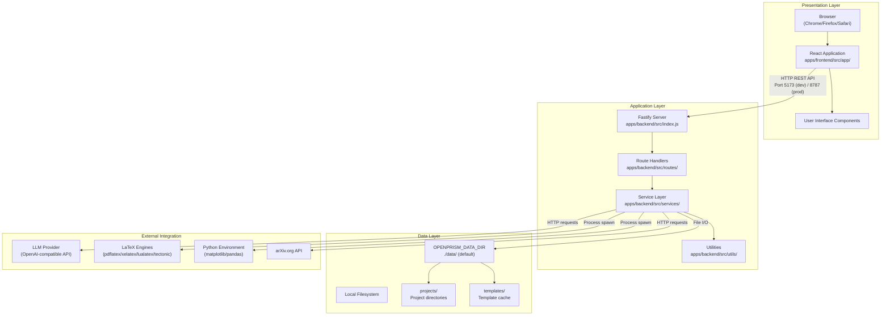
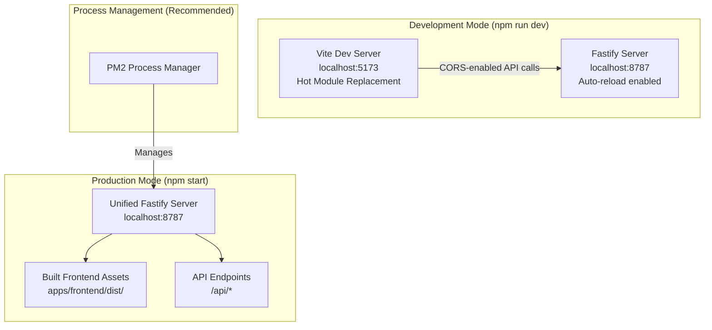
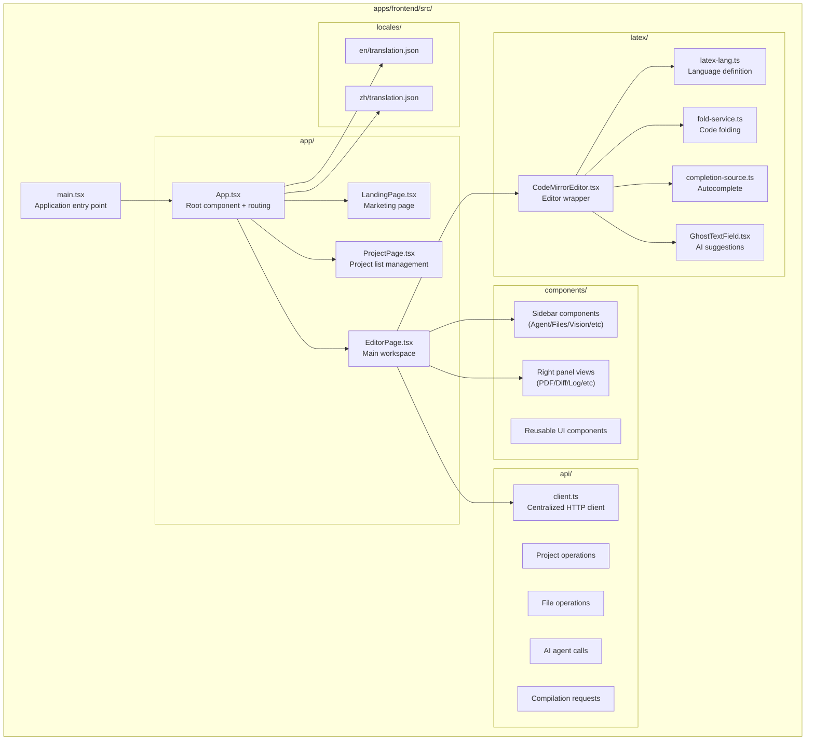
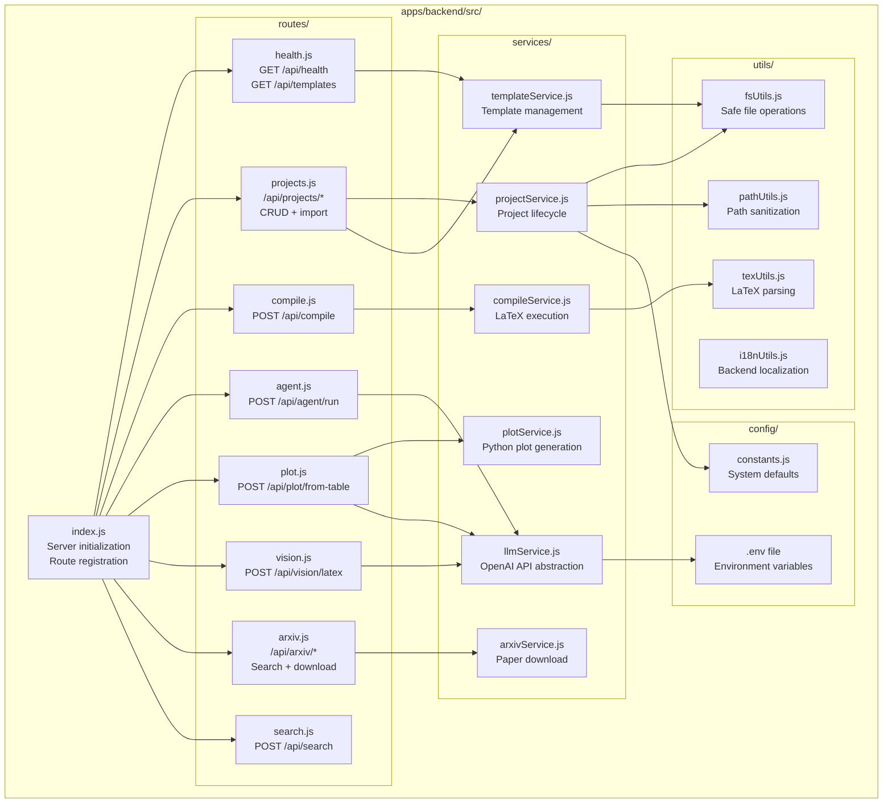
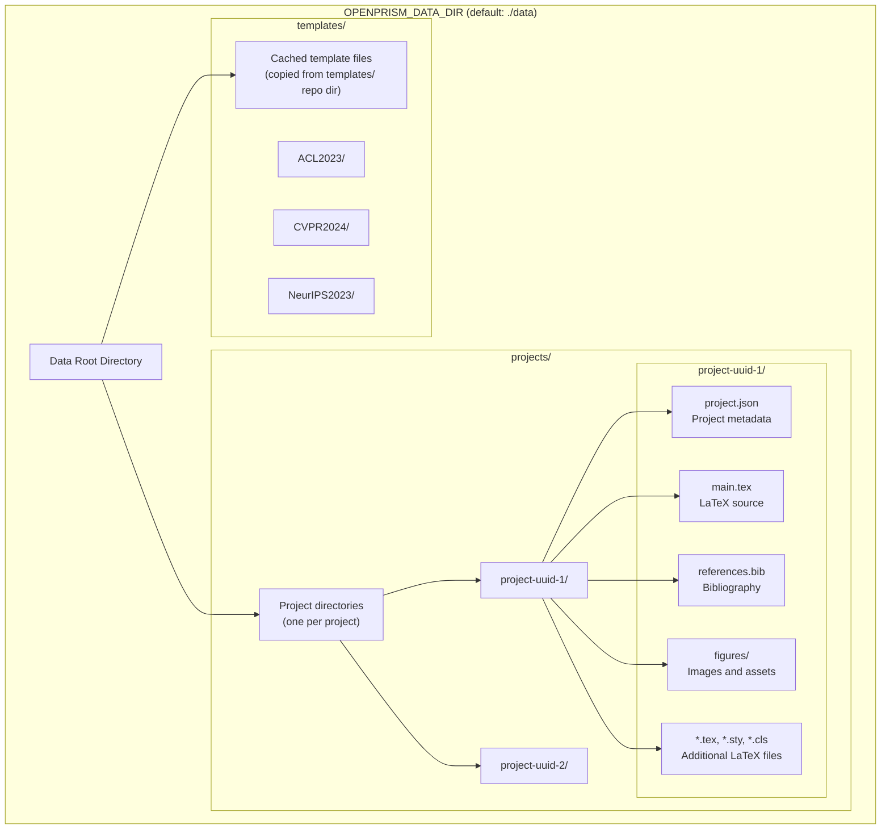
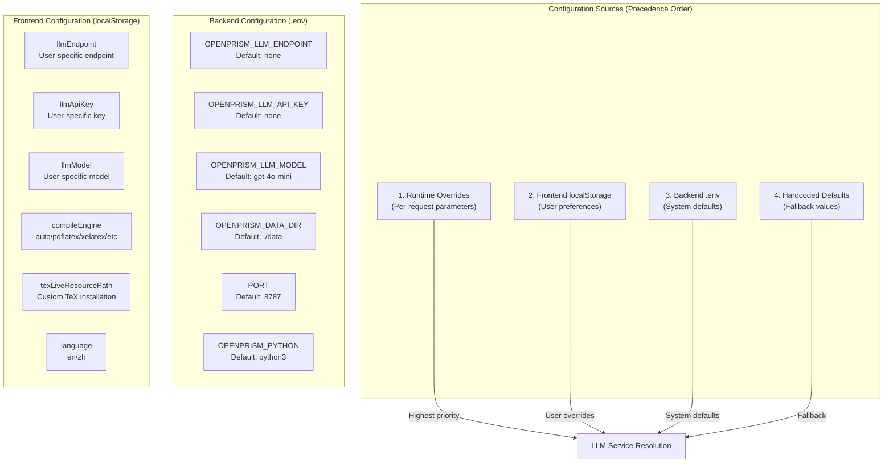
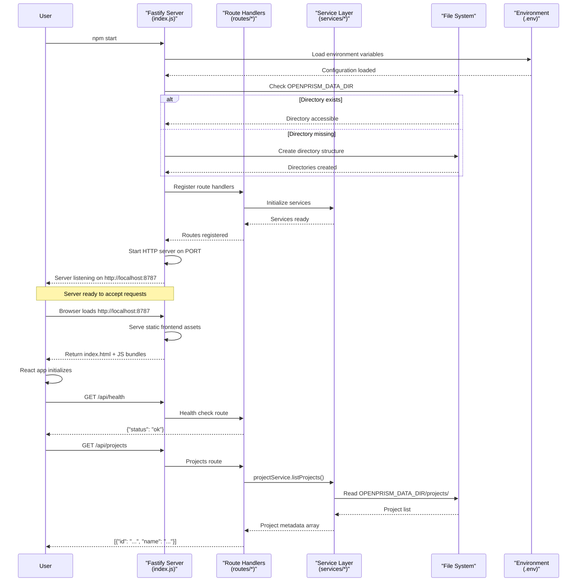

<!-- source: DeepWiki mcp.deepwiki.com · repo OpenDCAI/OpenPrism · page 1 Overview · fetched 2026-11-02 -->

# Overview

<details>
<summary>Relevant source files</summary>

The following files were used as context for generating this wiki page:

- [README.md](README.md)
- [README_ZH.md](README_ZH.md)

</details>


## Purpose and Scope

This document provides a comprehensive overview of the OpenPrism system architecture, its core components, and design principles. OpenPrism is a local-first LaTeX workspace integrated with AI capabilities for academic writing. This page covers the system's high-level organization, technology stack, and component relationships.

For detailed information about specific subsystems:
- Installation and environment setup: see [Installation](#2.1)
- Frontend application structure and UI components: see [Frontend Architecture](#3.2)
- Backend services and API design: see [Backend Architecture](#3.3)
- Individual feature implementations: see [Features](#6)
- Development workflows and contribution guidelines: see [Development Guide](#7)

**Sources**: [README.md:1-65]()

---

## What is OpenPrism

OpenPrism is a **local-first LaTeX + AI workspace** designed for academic writing. It combines traditional LaTeX editing capabilities with modern AI-powered assistance while maintaining complete data sovereignty through local deployment. The system runs entirely on user-controlled infrastructure, with no mandatory cloud dependencies.

**Key Characteristics**:
- **Local-First Architecture**: All project data stored in configurable local filesystem directory
- **AI-Augmented Editing**: Three AI interaction modes (Chat, Agent, Tools) with OpenAI-compatible LLM integration
- **Full-Featured LaTeX Environment**: Supports multiple compilation engines (TexLive, Tectonic) with automatic fallback
- **Academic-Focused**: Built-in templates for major conferences (ACL, CVPR, NeurIPS, ICML), paper search integration, and citation management

**Sources**: [README.md:65-117]()

---

## System Architecture

### Three-Tier Architecture

OpenPrism implements a classic three-tier architecture with clear separation between presentation, application logic, and data persistence layers.



**Sources**: [README.md:427-442]()

---

### Deployment Modes

OpenPrism supports two distinct deployment configurations with different process topologies.



**Configuration Commands**:

| Mode | Command | Frontend Port | Backend Port |
|------|---------|---------------|--------------|
| Development | `npm run dev` | 5173 | 8787 |
| Production | `npm start` | - | 8787 (unified) |

**Sources**: [README.md:260-328](), [package.json scripts]()

---

## Core Components

### Frontend Application Structure

The frontend is a React single-page application built with Vite, organized into distinct functional modules.



**Key Files**:

| Component | File Path | Responsibility |
|-----------|-----------|----------------|
| Application Root | `apps/frontend/src/app/App.tsx` | Routing, global state, layout |
| Editor Workspace | `apps/frontend/src/app/EditorPage.tsx` | Three-panel layout, editor state management |
| API Client | `apps/frontend/src/api/client.ts` | HTTP communication with backend |
| CodeMirror Integration | `apps/frontend/src/latex/CodeMirrorEditor.tsx` | LaTeX editor instantiation |
| Language Support | `apps/frontend/src/latex/latex-lang.ts` | LaTeX syntax highlighting |

**Sources**: [README.md:427-442]()

---

### Backend Service Architecture

The backend is a Fastify-based Node.js server with modular route handlers and service layers.



**API Endpoints**:

| Endpoint | Method | Route Handler | Purpose |
|----------|--------|---------------|---------|
| `/api/health` | GET | `routes/health.js` | Server health check |
| `/api/templates` | GET | `routes/health.js` | List available templates |
| `/api/projects` | GET | `routes/projects.js` | List user projects |
| `/api/projects/:id` | GET/PUT/DELETE | `routes/projects.js` | Project operations |
| `/api/projects/:id/files` | GET/PUT | `routes/projects.js` | File operations |
| `/api/compile` | POST | `routes/compile.js` | LaTeX compilation |
| `/api/agent/run` | POST | `routes/agent.js` | AI agent execution |
| `/api/plot/from-table` | POST | `routes/plot.js` | Generate plot from table |
| `/api/vision/latex` | POST | `routes/vision.js` | Image to LaTeX OCR |
| `/api/arxiv/search` | GET | `routes/arxiv.js` | Search arXiv papers |

**Sources**: [README.md:427-442]()

---

## Technology Stack

### Core Dependencies

The system is built on modern JavaScript ecosystem tools with minimal external dependencies for core functionality.

**Frontend**:
| Technology | Version Requirement | Purpose |
|------------|---------------------|---------|
| React | Latest | UI framework |
| Vite | Latest | Build tool and dev server |
| CodeMirror 6 | Latest | Code editor core |
| PDF.js | Latest | PDF rendering in browser |
| i18next | Latest | Internationalization |
| react-router-dom | Latest | Client-side routing |

**Backend**:
| Technology | Version Requirement | Purpose |
|------------|---------------------|---------|
| Node.js | >= 18.0.0 | Runtime environment |
| Fastify | Latest | HTTP server framework |
| axios | Latest | HTTP client for external APIs |

**External Dependencies** (Runtime):
| Dependency | Installation Method | Purpose |
|------------|---------------------|---------|
| TexLive or Tectonic | System package manager | LaTeX compilation |
| Python 3.x | System package manager | Optional: plot generation |

**Sources**: [README.md:224-258](), [apps/frontend/package.json](), [apps/backend/package.json]()

---

## Data Storage Model

### Filesystem Organization

OpenPrism uses a directory-based storage model with a configurable root path.



**Project Metadata Schema** (`project.json`):
```json
{
  "id": "uuid-string",
  "name": "Project Name",
  "createdAt": "ISO-8601-timestamp",
  "updatedAt": "ISO-8601-timestamp",
  "mainFile": "main.tex",
  "template": "ACL2023",
  "tags": ["tag1", "tag2"]
}
```

**Storage Configuration**:
- Environment variable: `OPENPRISM_DATA_DIR`
- Default value: `./data` (relative to project root)
- Example custom path: `/var/openprism/data`

**Sources**: [README.md:395-413]()

---

## Configuration System

### Multi-Layer Configuration

OpenPrism implements a hierarchical configuration system with clear precedence rules.



**Environment Variables**:
| Variable | Purpose | Example Value |
|----------|---------|---------------|
| `OPENPRISM_LLM_ENDPOINT` | OpenAI-compatible API endpoint | `https://api.openai.com/v1/chat/completions` |
| `OPENPRISM_LLM_API_KEY` | API authentication key | `sk-...` |
| `OPENPRISM_LLM_MODEL` | Default model name | `gpt-4o-mini` |
| `OPENPRISM_DATA_DIR` | Project storage root | `./data` |
| `PORT` | Backend server port | `8787` |
| `OPENPRISM_PYTHON` | Python executable path | `python3` |

**Sources**: [README.md:332-402]()

---

## Key Design Principles

### Local-First Architecture

**Data Sovereignty**: All user data persists in the local filesystem with no mandatory cloud synchronization. The `OPENPRISM_DATA_DIR` directory contains complete project state, enabling easy backup, version control integration, and migration.

**Privacy-Preserving AI**: LLM integration is abstracted through the `llmService.js` module, allowing users to:
- Use self-hosted LLM endpoints
- Configure per-request in frontend without backend restart
- Operate entirely offline (compilation, editing) when AI features are not needed

**Sources**: [README.md:65]()

---

### Modular Service Design

**Separation of Concerns**: Backend services are isolated in dedicated modules:
- `projectService.js`: Project lifecycle (create, read, update, delete)
- `compileService.js`: LaTeX compilation pipeline (engine selection, execution, error parsing)
- `llmService.js`: LLM provider abstraction (API calls, response parsing)
- `plotService.js`: Python-based visualization (code generation, execution, asset management)

This isolation enables:
- Independent testing of each service
- Easy extension with new AI capabilities
- Safe error handling (e.g., LaTeX compilation failures don't crash the server)

**Sources**: [apps/backend/src/services/]()

---

### OpenAI-Compatible LLM Integration

**Provider Agnostic**: The system uses the OpenAI Chat Completions API format as the standardized interface, supporting:
- OpenAI official endpoint: `https://api.openai.com/v1`
- Azure OpenAI: Custom deployment URLs
- Third-party providers: Any OpenAI-compatible service
- Self-hosted models: Local inference servers (e.g., vLLM, Ollama with OpenAI compatibility layer)

**Configuration Flexibility**: Users can override LLM settings at three levels:
1. System-wide defaults in `.env`
2. Per-user settings in browser `localStorage`
3. Per-request overrides in API calls

**Sources**: [README.md:352-380]()

---

### Multi-Engine LaTeX Support

**Automatic Fallback**: The compilation service (`compileService.js`) attempts multiple LaTeX engines in sequence:
1. User-specified engine (if configured)
2. `pdflatex` (standard)
3. `xelatex` (Unicode support)
4. `lualatex` (Lua scripting)
5. `tectonic` (lightweight fallback)

This ensures maximum compatibility across different system configurations without requiring manual engine selection.

**Sources**: [README.md:381-393]()

---

## System Initialization Flow

The following diagram shows the complete startup sequence from server launch to ready state.



**Sources**: [apps/backend/src/index.js](), [apps/frontend/src/main.tsx]()

---

