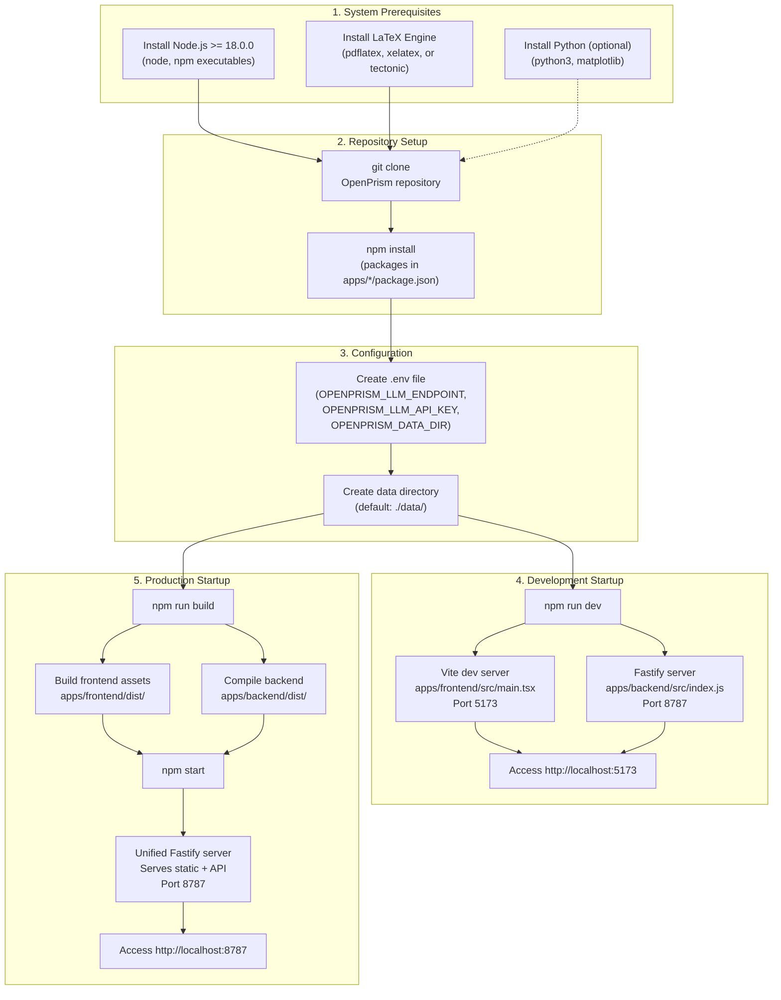
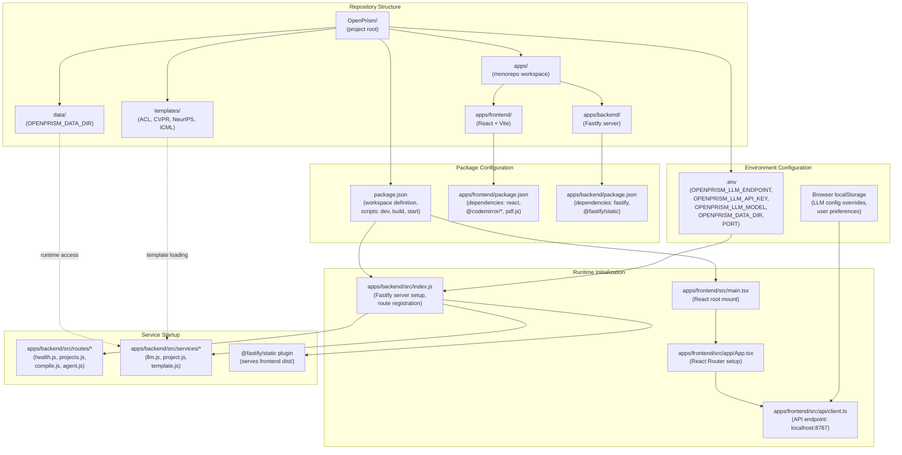

<!-- source: DeepWiki mcp.deepwiki.com · repo OpenDCAI/OpenPrism · page 2 Getting Started · fetched 2026-11-02 -->

# Getting Started

<details>
<summary>Relevant source files</summary>

The following files were used as context for generating this wiki page:

- [README.md](README.md)

</details>


This document provides an overview of the initial setup process for OpenPrism, including prerequisites, installation workflow, and basic configuration. It serves as an entry point for new users and developers getting the system running for the first time.

For detailed installation instructions for specific operating systems, see [Installation](#2.1). For comprehensive configuration options and LLM setup, see [Configuration](#2.2). For running development and production servers, see [Running the Application](#2.3).

**Sources:** [README.md:1-509]()

---

## Prerequisites Overview

OpenPrism requires three primary components to function: a Node.js runtime environment, a LaTeX compilation engine, and an OpenAI-compatible LLM endpoint for AI features. The following table summarizes the core requirements:

| Component | Requirement | Purpose |
|-----------|-------------|---------|
| **Node.js** | >= 18.0.0 | Runtime for frontend and backend applications |
| **npm** | >= 9.0.0 | Package manager for dependency installation |
| **LaTeX Engine** | TexLive or Tectonic | PDF compilation from LaTeX source |
| **LLM Provider** | OpenAI-compatible API | AI assistant, autocomplete, and agent features |
| **Python** | 3.x (optional) | Plot generation from tables using matplotlib/seaborn |

**Sources:** [README.md:224-229](), [README.md:232-258]()

---

## Getting Started Workflow

The following diagram illustrates the complete setup and startup process, mapping user actions to specific system commands and components:



**Sources:** [README.md:260-328](), [README.md:427-442]()

---

## Quick Start Summary

The table below compares development and production deployment modes:

| Aspect | Development Mode | Production Mode |
|--------|------------------|-----------------|
| **Command** | `npm run dev` | `npm run build && npm start` |
| **Frontend** | Vite dev server (port 5173) with HMR | Static assets served by Fastify |
| **Backend** | Fastify (port 8787) with auto-reload | Fastify (port 8787) compiled |
| **Entry Points** | `apps/frontend/src/main.tsx`<br/>`apps/backend/src/index.js` | `apps/frontend/dist/`<br/>`apps/backend/dist/index.js` |
| **Access URL** | http://localhost:5173 | http://localhost:8787 |
| **Hot Reload** | Yes (both frontend and backend) | No |
| **Build Output** | None (in-memory) | `dist/` directories in both apps |
| **Use Case** | Local development and testing | Production deployment |

**Sources:** [README.md:262-278](), [README.md:280-288]()

---

## Initial Setup Process

This diagram details the specific code paths and configuration files involved in the initial setup, bridging system concepts to code entities:



**Sources:** [README.md:427-442](), [README.md:334-414]()

---

## Configuration Resolution

OpenPrism uses a multi-layered configuration system with clear precedence rules. The following diagram illustrates how configuration values are resolved at runtime:

```mermaid
graph TB
    subgraph "Configuration Sources (Precedence Order)"
        P1["1. Runtime Overrides<br/>(API request parameters,<br/>e.g., POST /api/agent/run body)"]
        P2["2. Frontend localStorage<br/>(Settings panel inputs,<br/>keys: llmEndpoint, llmApiKey, llmModel)"]
        P3["3. Backend .env File<br/>(OPENPRISM_LLM_ENDPOINT,<br/>OPENPRISM_LLM_API_KEY,<br/>OPENPRISM_LLM_MODEL)"]
        P4["4. System Defaults<br/>(Hardcoded in apps/backend/src/services/llm.js)"]
    end
    
    subgraph "Configuration Categories"
        LLMConfig["LLM Configuration<br/>(endpoint, apiKey, model)"]
        DataConfig["Data Storage<br/>(OPENPRISM_DATA_DIR)"]
        ServerConfig["Server Settings<br/>(PORT: 8787)"]
        LatexConfig["LaTeX Engine<br/>(pdflatex, xelatex, tectonic)"]
        PythonConfig["Python Path<br/>(OPENPRISM_PYTHON)"]
    end
    
    subgraph "Resolution Process"
        AgentRequest["User triggers AI task<br/>(e.g., Polish, Rewrite)"]
        CheckRuntime["Check request body<br/>for llmConfig override"]
        CheckLocalStorage["Read from localStorage<br/>(apps/frontend/src/api/client.ts)"]
        CheckEnv["Read process.env<br/>(apps/backend/src/services/llm.js)"]
        UseDefaults["Use hardcoded defaults"]
        ExecuteLLM["Call LLM endpoint with<br/>resolved configuration"]
    end
    
    P1 --> LLMConfig
    P2 --> LLMConfig
    P3 --> LLMConfig
    P3 --> DataConfig
    P3 --> ServerConfig
    P3 --> PythonConfig
    P4 --> LLMConfig
    
    AgentRequest --> CheckRuntime
    CheckRuntime -->|"exists"| ExecuteLLM
    CheckRuntime -->|"not found"| CheckLocalStorage
    CheckLocalStorage -->|"exists"| ExecuteLLM
    CheckLocalStorage -->|"not found"| CheckEnv
    CheckEnv -->|"exists"| ExecuteLLM
    CheckEnv -->|"not found"| UseDefaults
    UseDefaults --> ExecuteLLM
```



**Sources:** [README.md:334-394]()

---

## Verification Steps

After completing the setup process, verify the installation by checking the following:

| Check | Command | Expected Output |
|-------|---------|----------------|
| **Node.js version** | `node --version` | `v18.0.0` or higher |
| **npm version** | `npm --version` | `9.0.0` or higher |
| **LaTeX engine** | `pdflatex --version` or `tectonic --version` | Version information without errors |
| **Backend health** | `curl http://localhost:8787/api/health` | `{"status":"ok"}` |
| **Frontend access** | Open `http://localhost:5173` (dev) or `http://localhost:8787` (prod) | OpenPrism landing page loads |
| **Data directory** | `ls -la data/` | Directory exists with `projects/` and `templates/` subdirectories |

**Sources:** [README.md:301-303]()

---

## Common Setup Patterns

### Minimal Development Setup

For local development with minimal configuration:

```bash
# Install dependencies
npm install

# Start development servers
npm run dev
```

Frontend configuration via Settings panel (no `.env` file required):
- LLM Endpoint: `https://api.openai.com/v1/chat/completions`
- API Key: (enter your key)
- Model: `gpt-4o-mini`

**Sources:** [README.md:262-278](), [README.md:363-374]()

### Linux Server Production Setup

Complete production deployment with PM2 process management:

```bash
# 1. Install system dependencies
sudo apt-get install -y nodejs texlive-full

# 2. Clone and build
git clone https://github.com/OpenDCAI/OpenPrism.git
cd OpenPrism
npm install
npm run build

# 3. Configure environment
cat > .env << EOF
OPENPRISM_LLM_ENDPOINT=https://api.openai.com/v1/chat/completions
OPENPRISM_LLM_API_KEY=sk-your-key
OPENPRISM_LLM_MODEL=gpt-4o-mini
OPENPRISM_DATA_DIR=/var/openprism/data
PORT=8787
EOF

# 4. Start with PM2
npm install -g pm2
pm2 start npm --name "openprism" -- start
pm2 save
pm2 startup
```

**Sources:** [README.md:290-328]()

### Azure OpenAI Configuration

For Azure OpenAI deployments, configure via `.env`:

```bash
OPENPRISM_LLM_ENDPOINT=https://your-resource.openai.azure.com/openai/deployments/your-deployment
OPENPRISM_LLM_API_KEY=your-azure-api-key
OPENPRISM_LLM_MODEL=gpt-4o
```

**Sources:** [README.md:376-379]()

---

## Startup Command Reference

The following table documents the npm scripts defined in the root [package.json]():

| Script | Command | Description |
|--------|---------|-------------|
| **dev** | `npm run dev` | Starts both frontend (5173) and backend (8787) in development mode with hot reload |
| **dev:frontend** | `npm run dev:frontend` | Starts only Vite dev server for frontend development |
| **dev:backend** | `npm run dev:backend` | Starts only Fastify server for backend development |
| **build** | `npm run build` | Builds both frontend and backend for production |
| **start** | `npm start` | Starts unified production server (port 8787) |

**Sources:** [README.md:464-470]()

---

## File System Layout

After successful setup, the OpenPrism directory structure appears as follows:

```
OpenPrism/
├── .env                          # Backend environment configuration (optional)
├── package.json                  # Root workspace configuration
├── apps/
│   ├── frontend/
│   │   ├── src/
│   │   │   ├── main.tsx          # React application entry point
│   │   │   ├── app/
│   │   │   │   ├── App.tsx       # Main application component
│   │   │   │   ├── EditorPage.tsx
│   │   │   │   └── ProjectPage.tsx
│   │   │   └── api/
│   │   │       └── client.ts     # API client (baseURL: localhost:8787)
│   │   ├── package.json
│   │   └── dist/                 # Production build output
│   └── backend/
│       ├── src/
│       │   ├── index.js          # Fastify server entry point
│       │   ├── routes/           # API route handlers
│       │   │   ├── health.js     # GET /api/health
│       │   │   ├── projects.js   # /api/projects/*
│       │   │   ├── compile.js    # POST /api/compile
│       │   │   └── agent.js      # POST /api/agent/run
│       │   └── services/         # Business logic layer
│       │       ├── llm.js        # LLM provider abstraction
│       │       ├── project.js    # Project CRUD operations
│       │       └── template.js   # Template management
│       ├── package.json
│       └── dist/                 # Production build output
├── templates/                    # Built-in LaTeX templates
│   ├── acl/
│   ├── cvpr/
│   ├── neurips/
│   └── icml/
└── data/                         # User data directory (OPENPRISM_DATA_DIR)
    ├── projects/                 # User LaTeX projects
    │   └── <project-id>/
    │       ├── main.tex
    │       ├── references.bib
    │       └── project.json      # Project metadata
    └── templates/                # Template cache (optional)
```

**Sources:** [README.md:427-442](), [README.md:404-413]()

---

## Next Steps

After completing the initial setup:

1. **Verify Installation**: Follow the [Verification Steps](#verification-steps) above to ensure all components are working correctly.

2. **Configure LLM Provider**: Set up your OpenAI-compatible endpoint. See [Configuration](#2.2) for detailed LLM configuration options including Azure OpenAI and custom providers.

3. **Create Your First Project**: Navigate to `http://localhost:5173` (dev) or `http://localhost:8787` (prod) and create a new project from the Projects panel. Select a template (ACL, CVPR, NeurIPS, ICML) or start from scratch.

4. **Explore Features**: Familiarize yourself with the three-panel workspace (sidebar, editor, preview), AI assistant modes (Chat, Agent, Tools), and compilation workflow. See [Features](#6) for comprehensive feature documentation.

5. **Development Workflow**: If you plan to contribute or extend OpenPrism, see [Development Guide](#7) for development patterns, project structure, and contribution guidelines.

**Sources:** [README.md:417-424]()

---

