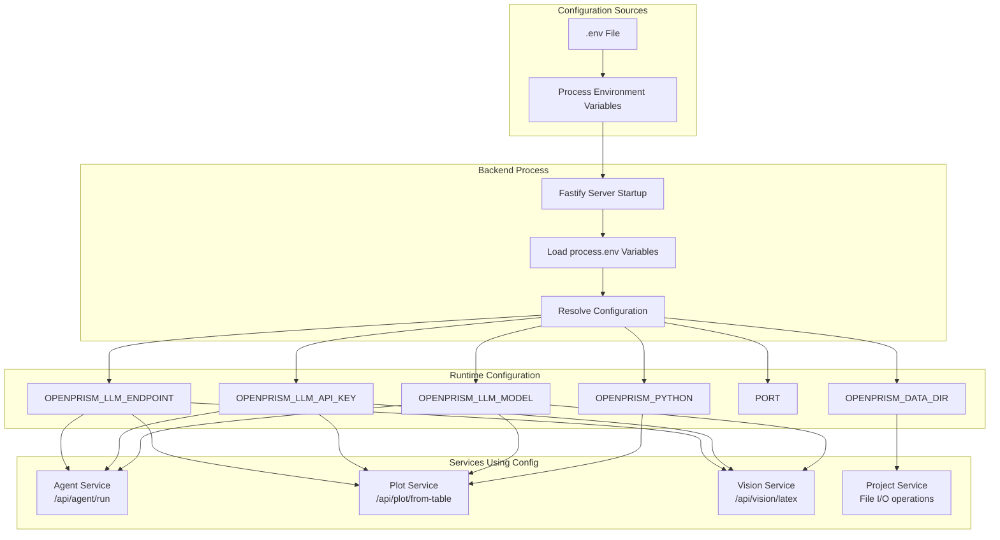
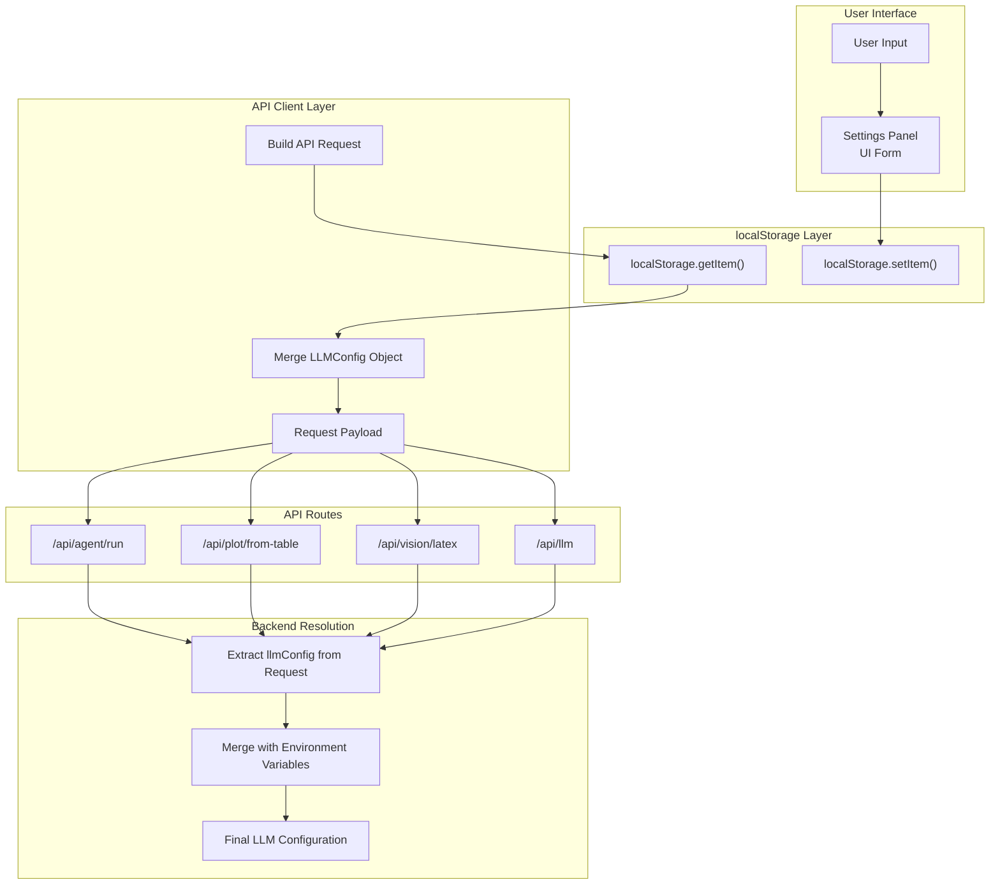
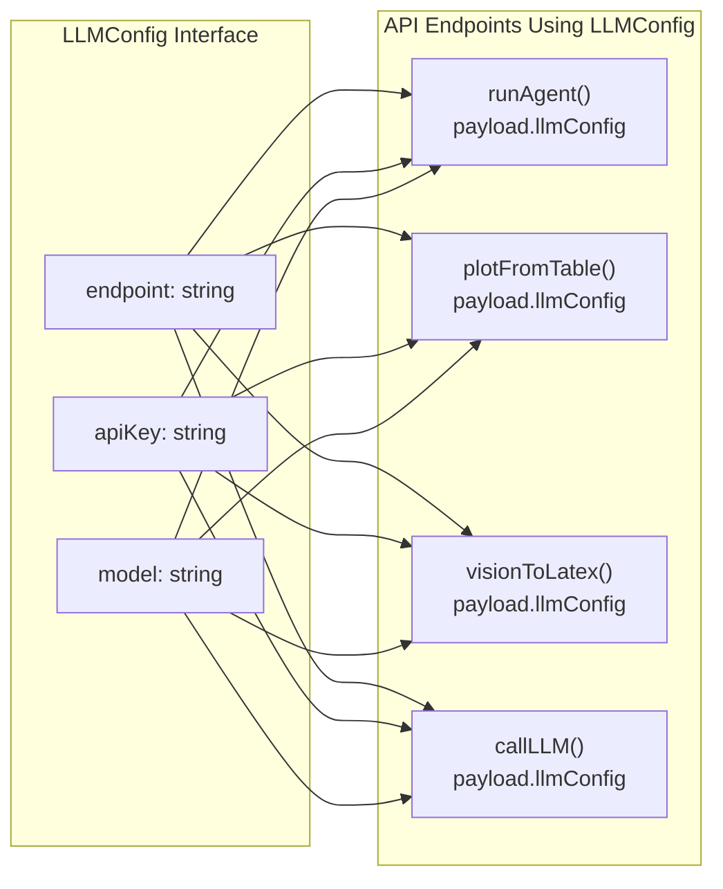
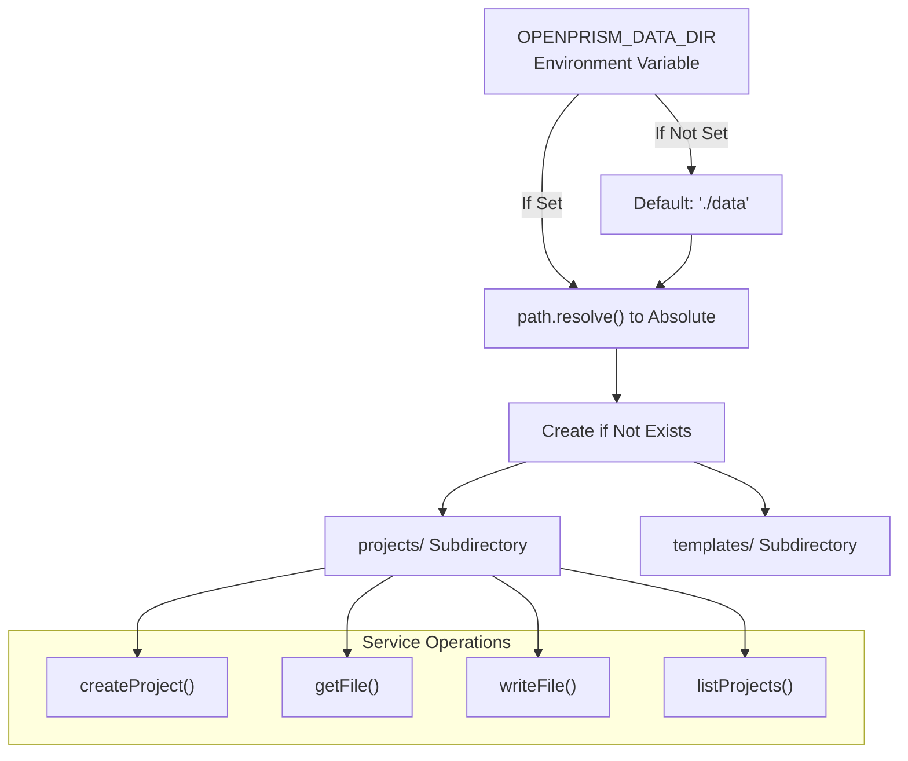
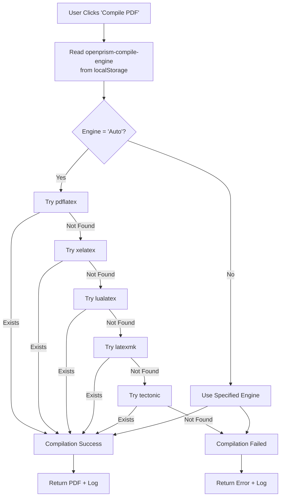
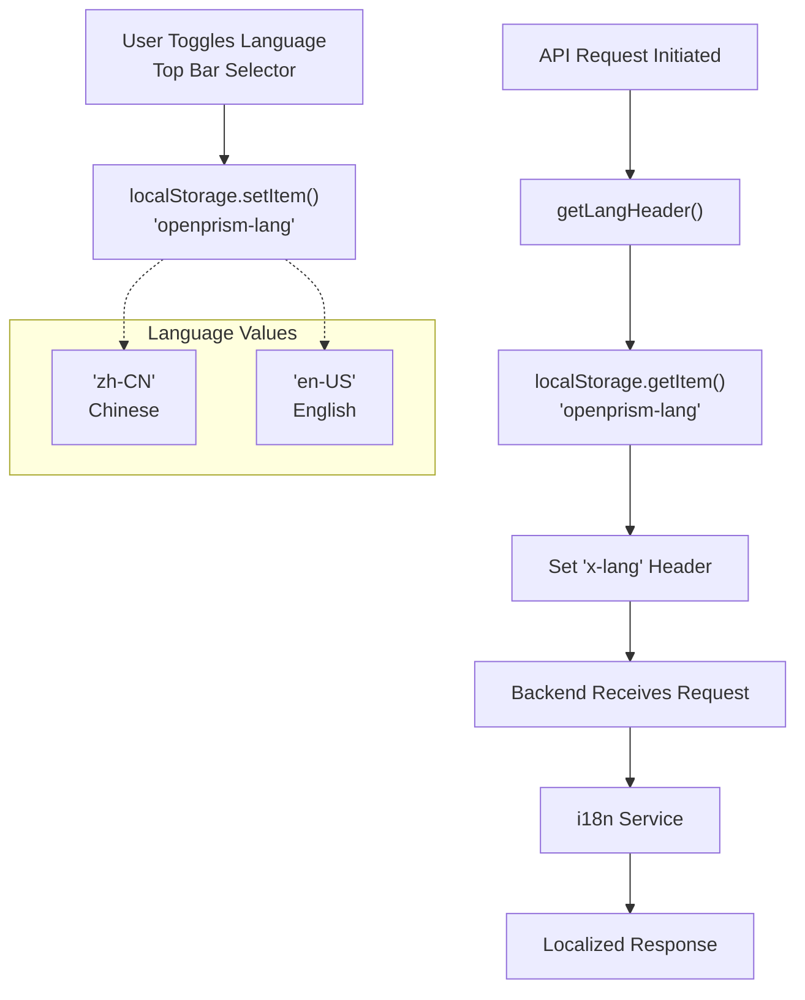
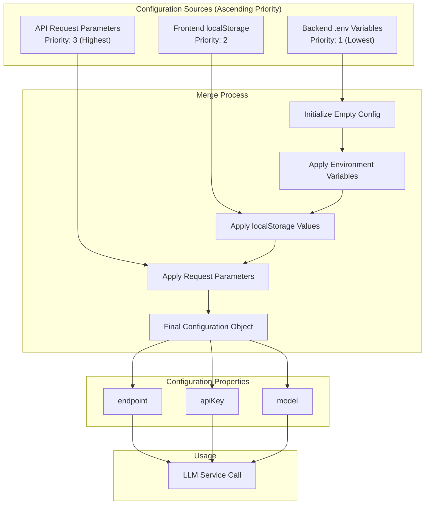

<!-- source: DeepWiki mcp.deepwiki.com · repo OpenDCAI/OpenPrism · page 2.2 Configuration · fetched 2026-11-02 -->

# Configuration

<details>
<summary>Relevant source files</summary>

The following files were used as context for generating this wiki page:

- [README.md](README.md)
- [apps/frontend/src/api/client.ts](apps/frontend/src/api/client.ts)

</details>


This document explains how to configure OpenPrism through environment variables, frontend settings, and runtime parameters. Configuration controls LLM provider integration, data storage location, LaTeX compilation engines, and user interface preferences.

For installation prerequisites, see [Installation](#2.1). For instructions on running the configured application, see [Running the Application](#2.3).

---

## Configuration Architecture

OpenPrism implements a multi-layer configuration system with clear precedence rules. Configuration originates from three sources:

1. **Backend Environment Variables** - System-level defaults defined in `.env` file
2. **Frontend localStorage** - User-specific preferences persisted in browser storage
3. **Runtime Overrides** - Per-request parameters passed through API calls

**Sources**: [README.md:332-413](), [apps/frontend/src/api/client.ts:21-25]()

---

## Backend Environment Variables

Backend configuration is defined in a `.env` file at the project root. This file is optional; the system uses sensible defaults when variables are not specified.

### Creating the .env File

Create a `.env` file in the OpenPrism root directory:

```bash
# LLM Provider Configuration
OPENPRISM_LLM_ENDPOINT=https://api.openai.com/v1/chat/completions
OPENPRISM_LLM_API_KEY=sk-your-api-key-here
OPENPRISM_LLM_MODEL=gpt-4o-mini

# Data Storage
OPENPRISM_DATA_DIR=./data

# Server Port
PORT=8787

# Python Environment (optional)
OPENPRISM_PYTHON=python3
```

### Environment Variable Reference

| Variable | Description | Default | Required |
|----------|-------------|---------|----------|
| `OPENPRISM_LLM_ENDPOINT` | OpenAI-compatible API endpoint URL | None | No |
| `OPENPRISM_LLM_API_KEY` | Authentication key for LLM provider | None | No |
| `OPENPRISM_LLM_MODEL` | Model identifier (e.g., `gpt-4o-mini`) | None | No |
| `OPENPRISM_DATA_DIR` | Absolute or relative path to data storage | `./data` | No |
| `PORT` | Backend server HTTP port | `8787` | No |
| `OPENPRISM_PYTHON` | Python executable path for plot generation | `python3` | No |

### Configuration Flow Diagram



**Sources**: [README.md:334-349](), [README.md:312-318]()

---

## Frontend Configuration (localStorage)

Frontend configuration persists in browser `localStorage`, allowing per-user customization without modifying server settings. Users configure these through the Settings panel in the UI.

### localStorage Keys

The frontend stores configuration using the following localStorage keys:

| Key | Value Type | Description |
|-----|------------|-------------|
| `openprism-llm-endpoint` | string | LLM API endpoint override |
| `openprism-llm-key` | string | User's LLM API key |
| `openprism-llm-model` | string | Preferred model name |
| `openprism-lang` | string | UI language (`zh-CN` or `en-US`) |
| `openprism-compile-engine` | string | LaTeX engine preference |
| `openprism-texlive-path` | string | Custom TexLive resource path |

### Settings Panel Access

Users access configuration through the Settings button in the frontend interface. This panel provides forms for:

- LLM Endpoint URL
- API Key (masked input)
- Model selection
- LaTeX engine selection
- TexLive resource path
- Language toggle

### localStorage to API Request Flow



**Sources**: [apps/frontend/src/api/client.ts:54-60](), [apps/frontend/src/api/client.ts:200-217](), [README.md:363-374]()

---

## LLM Configuration

OpenPrism supports any OpenAI-compatible LLM endpoint. Configuration can be set at three levels with clear precedence.

### Supported LLM Providers

| Provider | Endpoint Format | Notes |
|----------|----------------|-------|
| OpenAI | `https://api.openai.com/v1/chat/completions` | Native support |
| Azure OpenAI | `https://your-resource.openai.azure.com/openai/deployments/your-deployment` | Requires deployment-specific URL |
| Custom Providers | `https://api.apiyi.com/v1` (example) | Must implement OpenAI-compatible API |

### Configuration Methods

#### Method 1: Environment Variables (System Default)

Define in `.env` file:

```bash
OPENPRISM_LLM_ENDPOINT=https://api.openai.com/v1/chat/completions
OPENPRISM_LLM_API_KEY=sk-your-api-key
OPENPRISM_LLM_MODEL=gpt-4o-mini
```

#### Method 2: Frontend Settings Panel (User Override)

1. Open Settings panel in UI
2. Enter Endpoint URL
3. Enter API Key
4. Select Model from dropdown
5. Configuration automatically saves to localStorage

#### Method 3: Runtime API Parameters (Request Override)

API requests can include optional `llmConfig` parameter:

```typescript
// Example from client.ts interface
interface LLMConfig {
  endpoint: string;
  apiKey: string;
  model: string;
}

// Usage in API call
runAgent({
  task: "polish",
  prompt: "Improve clarity",
  // ... other parameters
  llmConfig: {
    endpoint: "https://custom-api.example.com/v1",
    apiKey: "custom-key",
    model: "gpt-4"
  }
})
```

### LLM Configuration Interface



**Sources**: [apps/frontend/src/api/client.ts:21-25](), [apps/frontend/src/api/client.ts:209](), [apps/frontend/src/api/client.ts:265](), [apps/frontend/src/api/client.ts:279](), [apps/frontend/src/api/client.ts:344](), [README.md:351-379]()

---

## Data Directory Configuration

The data directory stores all project files, templates, and generated assets. Configure via `OPENPRISM_DATA_DIR` environment variable.

### Default Directory Structure

```
data/
├── projects/              # User LaTeX projects
│   ├── project-abc123/
│   │   ├── main.tex
│   │   ├── references.bib
│   │   ├── figures/
│   │   └── project.json  # Project metadata
│   └── project-def456/
└── templates/             # Template cache (optional)
```

### Configuration Example

```bash
# Relative path (default)
OPENPRISM_DATA_DIR=./data

# Absolute path (recommended for production)
OPENPRISM_DATA_DIR=/var/openprism/data

# Custom location
OPENPRISM_DATA_DIR=/home/user/openprism-projects
```

### Directory Resolution Flow



**Sources**: [README.md:344-345](), [README.md:395-413]()

---

## LaTeX Compilation Configuration

LaTeX compilation engine selection supports both automatic detection and manual override. Configuration affects PDF generation quality and compilation speed.

### Supported Engines

| Engine | Command | Use Case | CJK Support |
|--------|---------|----------|-------------|
| `pdflatex` | `pdflatex` | Standard LaTeX documents | No |
| `xelatex` | `xelatex` | Unicode, custom fonts, Chinese | Yes |
| `lualatex` | `lualatex` | Lua scripting, advanced typography | Yes |
| `latexmk` | `latexmk` | Automated multi-pass compilation | Via flags |
| `tectonic` | `tectonic` | Modern, lightweight, automatic packages | Limited |

### Configuration Methods

#### Frontend Engine Selection

Users select compilation engine in the Settings panel:

1. **Auto Mode** - System attempts engines in order: `pdflatex` → `xelatex` → `lualatex` → `latexmk` → `tectonic`
2. **Manual Mode** - User specifies exact engine
3. **Custom TexLive Path** - Override system TexLive installation location

Configuration persists to `localStorage` key `openprism-compile-engine`.

#### Compilation Request Structure

```typescript
// From client.ts compileProject function
compileProject({
  projectId: string,
  mainFile: string,
  engine: 'pdflatex' | 'xelatex' | 'lualatex' | 'latexmk' | 'tectonic'
})
```

### Engine Selection Flow



**Sources**: [apps/frontend/src/api/client.ts:219-231](), [README.md:381-394]()

---

## Internationalization Settings

OpenPrism supports bilingual interface: Chinese (Simplified) and English. Language configuration affects UI text, API responses, and error messages.

### Language Configuration

Language is stored in `localStorage` key `openprism-lang` with values:
- `zh-CN` - Chinese (Simplified)
- `en-US` - English

### Language Switching

Users toggle language via the language selector in the top navigation bar. Changes take effect immediately without page reload.

### API Request Language Header

All API requests include an `x-lang` header derived from localStorage:

```typescript
// From client.ts getLangHeader function
function getLangHeader() {
  if (typeof window === 'undefined') return 'zh-CN';
  const stored = window.localStorage.getItem('openprism-lang');
  return stored === 'en-US' ? 'en-US' : 'zh-CN';
}

// Header included in all requests
async function request<T>(url: string, options?: RequestInit): Promise<T> {
  const lang = getLangHeader();
  const mergedHeaders = {
    'Content-Type': 'application/json',
    'x-lang': lang,
    ...(options?.headers || {})
  };
  // ... fetch request
}
```

### Internationalization Flow



**Sources**: [apps/frontend/src/api/client.ts:54-60](), [apps/frontend/src/api/client.ts:56-60](), [apps/frontend/src/api/client.ts:62-77](), [README.md:98]()

---

## Configuration Precedence

OpenPrism resolves configuration using a three-tier precedence system. Higher-priority sources override lower-priority defaults.

### Precedence Order

**Priority 1 (Highest)**: Runtime API Parameters
- Passed directly in request payload as `llmConfig` object
- Affects only the specific API call
- Example: Per-task model override

**Priority 2**: Frontend localStorage
- User-specific settings from Settings panel
- Persists across browser sessions
- Affects all requests from that browser

**Priority 3 (Lowest)**: Backend Environment Variables
- System-wide defaults from `.env` file
- Fallback when no user override exists
- Affects all users and requests

### Precedence Resolution Example

```
User requests AI polish with custom API key:

1. Request payload contains:
   llmConfig: { apiKey: "user-override-key" }
   
2. localStorage contains:
   openprism-llm-key: "browser-stored-key"
   
3. .env contains:
   OPENPRISM_LLM_API_KEY=system-default-key

Result: System uses "user-override-key"
```

### Configuration Merge Logic



### Precedence Table

| Configuration | Source | Priority | Scope | Persistence |
|---------------|--------|----------|-------|-------------|
| Runtime `llmConfig` | API request payload | 1 (Highest) | Single request | None |
| localStorage values | Settings panel | 2 | Per-browser user | Browser storage |
| Environment variables | `.env` file | 3 (Lowest) | System-wide | Process environment |

**Sources**: [apps/frontend/src/api/client.ts:209](), [apps/frontend/src/api/client.ts:265](), [apps/frontend/src/api/client.ts:344](), [README.md:351-380]()

---

## Configuration Examples

### Example 1: Development Environment Setup

```bash
# .env file for development
OPENPRISM_LLM_ENDPOINT=https://api.openai.com/v1/chat/completions
OPENPRISM_LLM_API_KEY=sk-development-key
OPENPRISM_LLM_MODEL=gpt-4o-mini
OPENPRISM_DATA_DIR=./data
PORT=8787
OPENPRISM_PYTHON=python3
```

### Example 2: Production Server with Azure OpenAI

```bash
# .env file for production
OPENPRISM_LLM_ENDPOINT=https://mycompany.openai.azure.com/openai/deployments/gpt-4o/chat/completions?api-version=2024-02-15-preview
OPENPRISM_LLM_API_KEY=azure-api-key-here
OPENPRISM_LLM_MODEL=gpt-4o
OPENPRISM_DATA_DIR=/var/openprism/data
PORT=8787
```

### Example 3: User-Specific Override in Browser

User configures via Settings panel:
- Endpoint: `https://api.anthropic.com/v1/chat/completions`
- API Key: `user-personal-key`
- Model: `claude-3-opus`

These values save to localStorage and override system defaults for that user's browser.

### Example 4: Per-Request Custom Configuration

```typescript
// Client code making API request
import { runAgent } from './api/client';

await runAgent({
  task: "translate",
  prompt: "Translate to Spanish",
  selection: selectedText,
  content: fullDocument,
  mode: "direct",
  // Override LLM configuration for this request only
  llmConfig: {
    endpoint: "https://api.openai.com/v1/chat/completions",
    apiKey: "project-specific-key",
    model: "gpt-4"
  }
});
```

### Example 5: Custom Data Directory with Absolute Path

```bash
# .env for shared server environment
OPENPRISM_DATA_DIR=/mnt/shared-storage/openprism-data
PORT=8787
```

This configuration places all user projects on a mounted network drive, enabling multi-instance deployments with shared storage.

**Sources**: [README.md:312-328](), [README.md:338-349](), [README.md:356-361](), [README.md:376-379]()

---

