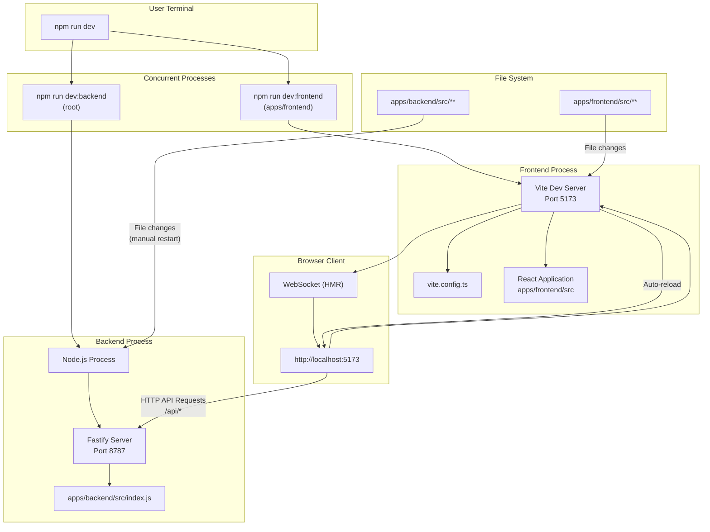
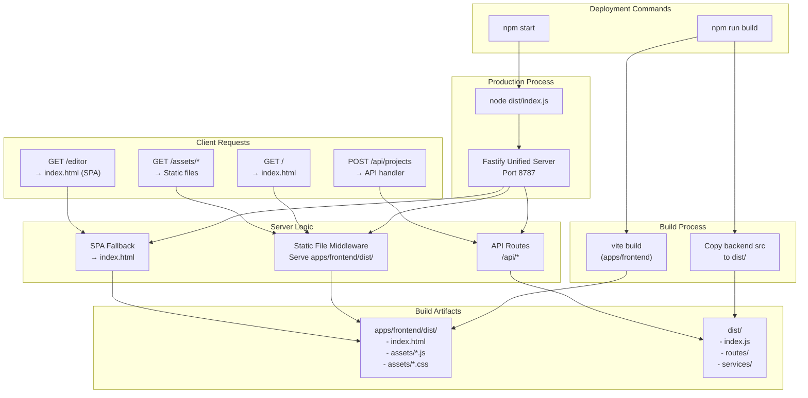
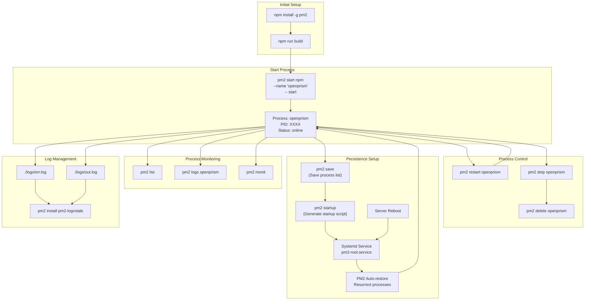

<!-- source: DeepWiki mcp.deepwiki.com · repo OpenDCAI/OpenPrism · page 2.3 Running the Application · fetched 2026-11-02 -->

# Running the Application

<details>
<summary>Relevant source files</summary>

The following files were used as context for generating this wiki page:

- [README.md](README.md)
- [apps/frontend/package.json](apps/frontend/package.json)

</details>


## Purpose and Scope

This document provides instructions for starting and managing OpenPrism in both development and production environments. It covers the execution of frontend and backend processes, their configuration, and process management strategies.

For installation prerequisites and environment setup, see [Installation](#2.1). For configuration of environment variables and system settings, see [Configuration](#2.2). For building production artifacts, see [Building for Production](#7.3).

---

## Development Mode

Development mode runs separate frontend and backend processes with hot module reloading and auto-restart capabilities for rapid development.

### Starting Development Servers

The monorepo provides scripts to start both services simultaneously or independently:

| Command | Purpose | Frontend Port | Backend Port |
|---------|---------|---------------|--------------|
| `npm run dev` | Start both services | 5173 | 8787 |
| `npm run dev:frontend` | Frontend only | 5173 | - |
| `npm run dev:backend` | Backend only | - | 8787 |

**Starting both services:**
```bash
npm run dev
```

This executes concurrent processes defined in [package.json:10]() which runs `npm run dev:frontend` and `npm run dev:backend` in parallel.

**Frontend Development Server:**
The frontend runs a Vite development server with Hot Module Replacement (HMR):
```bash
npm run dev:frontend
# Executes: vite
# Location: apps/frontend/package.json:6
```

The Vite server listens on `http://localhost:5173` and provides:
- Hot module replacement for React components
- Fast refresh for state preservation during edits
- Source map support for debugging
- Proxy configuration for API requests to backend

**Backend Development Server:**
The backend runs Fastify with auto-reload on file changes:
```bash
npm run dev:backend
# Executes: node apps/backend/src/index.js
# Location: package.json (root)
```

The Fastify server listens on `http://localhost:8787` (configurable via `PORT` environment variable) and provides:
- RESTful API endpoints under `/api/*`
- CORS headers for cross-origin requests from frontend
- Request logging and error handling

### Development Architecture Diagram



**Sources:** [README.md:260-279](), [package.json (root)](), [apps/frontend/package.json:6]()

### Access Points in Development

Once both servers are running:

- **Frontend Application:** `http://localhost:5173`
  - Landing page, project management, editor workspace
  - All UI interactions
  
- **Backend API:** `http://localhost:8787`
  - Direct API access (typically not accessed directly)
  - Health check: `http://localhost:8787/api/health`
  
- **API Proxying:** Frontend automatically proxies API requests to backend
  - Frontend makes requests to `/api/*`
  - Vite proxies to `http://localhost:8787/api/*`

**Sources:** [README.md:276-278]()

---

## Production Mode

Production mode builds optimized static assets and runs a unified server that serves both frontend and backend from a single process.

### Building for Production

Before running in production, build both frontend and backend:

```bash
npm run build
```

This command executes:
1. `npm run build:frontend` - Builds optimized React bundle
2. `npm run build:backend` - Copies backend source to `dist/`

The build process creates:

| Artifact | Location | Purpose |
|----------|----------|---------|
| Frontend bundle | `apps/frontend/dist/` | Optimized HTML, JS, CSS |
| Backend files | `dist/` | Server code for production |

**Frontend Build Process:**
```bash
# Executed by: npm run build:frontend
vite build
# Input: apps/frontend/src/
# Output: apps/frontend/dist/
```

The Vite build process performs:
- Tree-shaking to remove unused code
- Minification of JavaScript and CSS
- Code splitting for lazy loading
- Asset hashing for cache busting

**Backend Build Process:**
The backend uses JavaScript directly without transpilation. The build script copies source files to the distribution directory for unified deployment.

**Sources:** [README.md:283-288](), [apps/frontend/package.json:7]()

### Starting Production Server

After building, start the production server:

```bash
npm start
```

This executes `node dist/index.js` which runs a unified Fastify server that:
1. Serves static frontend assets from `apps/frontend/dist/`
2. Handles API requests on `/api/*` routes
3. Falls back to `index.html` for client-side routing

The production server listens on the port specified by the `PORT` environment variable (default: 8787).

**Access in Production:**
- **Application URL:** `http://localhost:8787`
  - Frontend and API unified on same origin
  - No CORS issues
  - No separate ports

**Sources:** [README.md:286-288]()

### Production Architecture Diagram



**Sources:** [README.md:282-288](), [README.md:430-442]()

---

## Process Management with PM2

PM2 is the recommended process manager for production deployments, providing automatic restarts, log management, and startup scripts.

### Installing PM2

Install PM2 globally:

```bash
sudo npm install -g pm2
```

**Sources:** [README.md:324]()

### Starting with PM2

Start OpenPrism as a PM2-managed process:

```bash
pm2 start npm --name "openprism" -- start
```

This command:
- Creates a process named `openprism`
- Executes `npm start`
- Manages the process lifecycle automatically

**Alternative: Using ecosystem file**

Create `ecosystem.config.js` in the project root:

```javascript
module.exports = {
  apps: [{
    name: 'openprism',
    script: 'npm',
    args: 'start',
    env: {
      NODE_ENV: 'production',
      PORT: 8787,
      OPENPRISM_DATA_DIR: '/var/openprism/data'
    },
    error_file: './logs/err.log',
    out_file: './logs/out.log',
    log_date_format: 'YYYY-MM-DD HH:mm:ss Z'
  }]
};
```

Then start with:
```bash
pm2 start ecosystem.config.js
```

**Sources:** [README.md:324-327]()

### PM2 Command Reference

| Command | Purpose |
|---------|---------|
| `pm2 start npm --name "openprism" -- start` | Start the application |
| `pm2 stop openprism` | Stop the application |
| `pm2 restart openprism` | Restart the application |
| `pm2 delete openprism` | Remove from PM2 |
| `pm2 logs openprism` | View logs in real-time |
| `pm2 monit` | Monitor CPU/memory usage |
| `pm2 list` | List all PM2 processes |

**Sources:** [README.md:323-327]()

### PM2 Startup Configuration

Configure PM2 to automatically start OpenPrism on system boot:

```bash
# Save current PM2 process list
pm2 save

# Generate and configure startup script
pm2 startup
```

The `pm2 startup` command outputs a system-specific command that must be executed with sudo privileges. This creates a systemd/init.d service that:
1. Starts PM2 on system boot
2. Restores saved process list
3. Ensures application availability after server restarts

**Sources:** [README.md:325-327]()

### PM2 Process Management Flow



**Sources:** [README.md:323-327]()

---

## Environment Variables for Runtime

Runtime behavior is controlled by environment variables that can be set before starting the application:

| Variable | Default | Purpose |
|----------|---------|---------|
| `PORT` | `8787` | Backend server port |
| `OPENPRISM_DATA_DIR` | `./data` | Project storage directory |
| `OPENPRISM_LLM_ENDPOINT` | (none) | LLM API endpoint URL |
| `OPENPRISM_LLM_API_KEY` | (none) | LLM API authentication key |
| `OPENPRISM_LLM_MODEL` | (none) | Default LLM model identifier |
| `OPENPRISM_PYTHON` | `python3` | Python executable path |

**Setting variables for npm start:**
```bash
PORT=3000 OPENPRISM_DATA_DIR=/var/data npm start
```

**Setting variables for PM2:**
```bash
pm2 start npm --name "openprism" -- start \
  --update-env \
  --env PORT=3000 \
  --env OPENPRISM_DATA_DIR=/var/data
```

**Using .env file:**
Create `.env` in project root:
```bash
PORT=3000
OPENPRISM_DATA_DIR=/var/data
OPENPRISM_LLM_ENDPOINT=https://api.openai.com/v1/chat/completions
OPENPRISM_LLM_API_KEY=sk-your-api-key
OPENPRISM_LLM_MODEL=gpt-4o-mini
```

The backend automatically loads `.env` files using environment variable parsing at startup.

**Sources:** [README.md:334-349](), [README.md:312-318]()

---

## Script Reference

The following npm scripts are available at different levels of the monorepo:

### Root Package Scripts

Located in the root `package.json`:

| Script | Command | Purpose |
|--------|---------|---------|
| `dev` | Concurrent dev:frontend + dev:backend | Start both servers in development |
| `dev:frontend` | `npm run dev --workspace=@openprism/frontend` | Start frontend dev server only |
| `dev:backend` | `node apps/backend/src/index.js` | Start backend dev server only |
| `build` | `npm run build --workspaces` | Build all workspaces |
| `start` | `node dist/index.js` | Start production server |

### Frontend Package Scripts

Located in [apps/frontend/package.json:5-8]():

| Script | Command | Purpose |
|--------|---------|---------|
| `dev` | `vite` | Start Vite dev server (port 5173) |
| `build` | `vite build` | Build optimized production bundle |
| `preview` | `vite preview` | Preview production build locally |

**Sources:** [README.md:464-470](), [apps/frontend/package.json:5-8]()

---

## Troubleshooting

### Common Startup Issues

**Port Already in Use:**
```
Error: listen EADDRINUSE: address already in use :::8787
```
Solution: Change port via environment variable or kill process using the port:
```bash
# Linux/macOS
lsof -ti:8787 | xargs kill -9

# Or use different port
PORT=8788 npm start
```

**Build Directory Not Found:**
```
Error: Cannot find module 'dist/index.js'
```
Solution: Run build before starting production:
```bash
npm run build
npm start
```

**Frontend Assets 404 in Production:**
The production server expects frontend build artifacts at `apps/frontend/dist/`. Ensure the build completed successfully:
```bash
ls -la apps/frontend/dist/
# Should contain: index.html, assets/, etc.
```

**PM2 Process Crashes Immediately:**
Check PM2 logs for errors:
```bash
pm2 logs openprism --lines 50
```

Common causes:
- Missing `.env` configuration
- LaTeX engine not installed
- Insufficient permissions for data directory
- Port conflict

**Sources:** [README.md:222-328]()

### Verifying Successful Startup

**Development Mode:**
```bash
# Terminal output should show:
# Frontend: VITE v5.x.x ready in XXX ms
# Frontend: ➜ Local: http://localhost:5173/
# Backend: Server listening at http://localhost:8787
```

**Production Mode:**
```bash
# Terminal output should show:
# Server listening at http://localhost:8787
# (Single unified server)
```

**PM2 Mode:**
```bash
pm2 list
# Should show:
# │ openprism │ online │ XXXX │ 0 │ ...
```

**Health Check:**
```bash
# Development
curl http://localhost:8787/api/health

# Production
curl http://localhost:8787/api/health

# Expected response: {"status":"ok"}
```

**Sources:** [README.md:260-328]()

---

