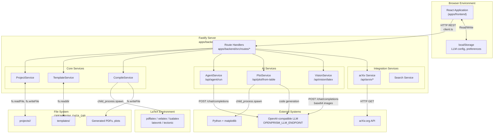
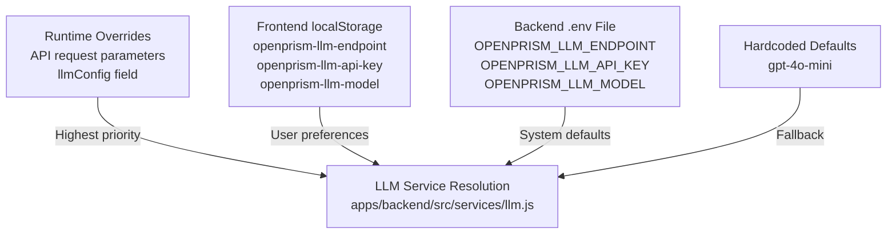
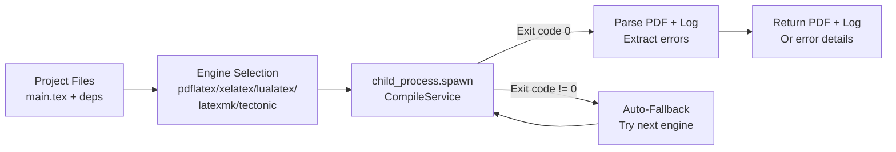
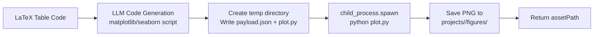
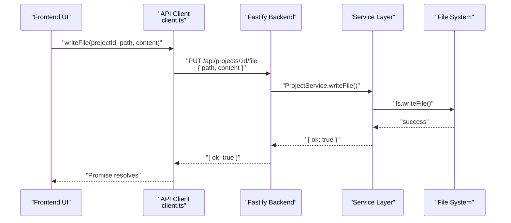
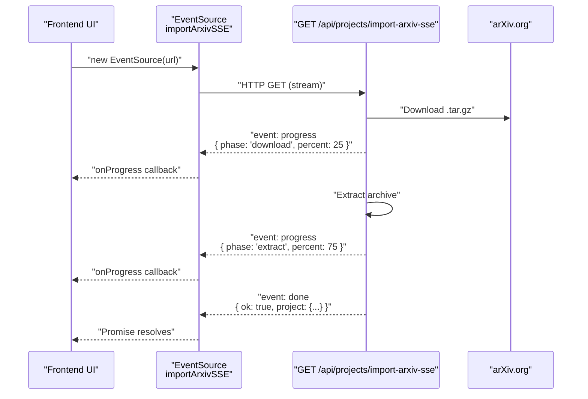
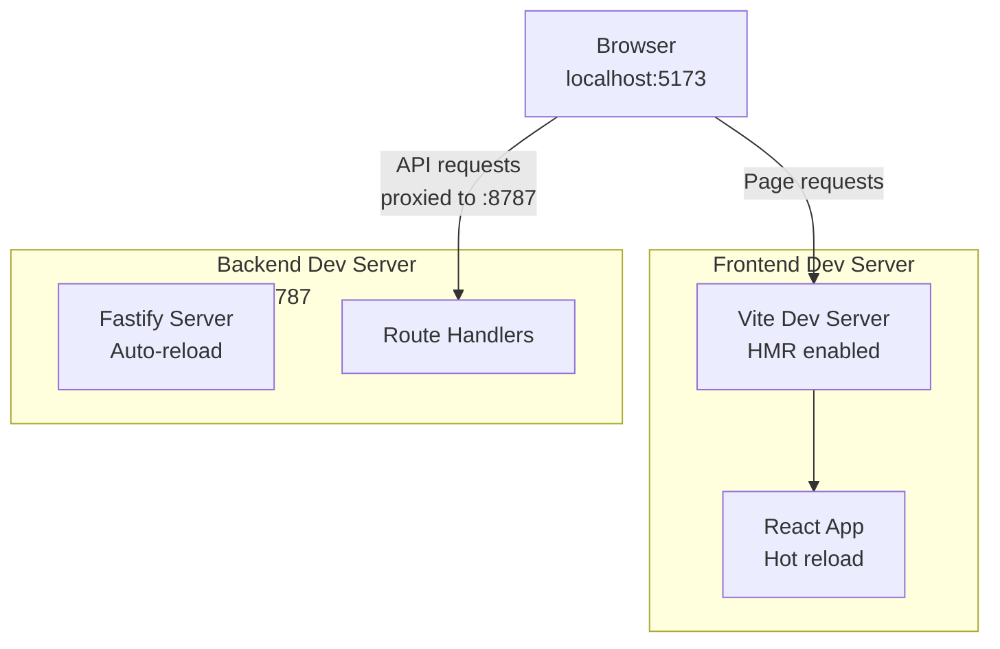
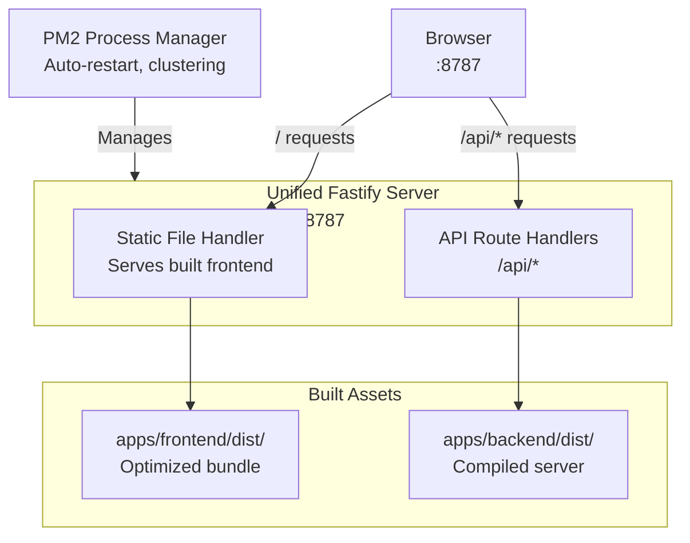

<!-- source: DeepWiki mcp.deepwiki.com · repo OpenDCAI/OpenPrism · page 3.1 System Overview · fetched 2026-11-02 -->

# System Overview

<details>
<summary>Relevant source files</summary>

The following files were used as context for generating this wiki page:

- [README.md](README.md)
- [apps/frontend/src/api/client.ts](apps/frontend/src/api/client.ts)

</details>


## Purpose and Scope

This document describes the high-level architecture of OpenPrism, a local-first LaTeX + AI workspace. It covers the three-tier system design, major component relationships, deployment modes, and data flow patterns. For detailed frontend component structure, see [Frontend Architecture](#3.2). For backend service implementation details, see [Backend Architecture](#3.3). For API contracts and communication patterns, see [API Design](#3.5).

**Sources**: [README.md:63-117]()

---

## Three-Tier Architecture

OpenPrism implements a clean separation between presentation, business logic, and external integrations:

| Layer | Technology | Port (Dev) | Entry Point |
|-------|-----------|------------|-------------|
| **Frontend** | React + Vite | 5173 | [apps/frontend/src/main.tsx]() |
| **Backend** | Fastify | 8787 | [apps/backend/src/index.js]() |
| **External** | LLM APIs, arXiv, LaTeX engines | N/A | Various services |

**Deployment Modes**:
- **Development**: Separate processes on different ports with hot-reload
- **Production**: Unified Fastify server serving both static assets and API endpoints

**Sources**: [README.md:262-288](), [README.md:427-442]()

---

## Overall System Architecture



**Description**: OpenPrism's architecture separates concerns across three primary tiers. The React frontend ([apps/frontend/src/app/App.tsx]()) communicates with the Fastify backend exclusively through REST APIs defined in [apps/frontend/src/api/client.ts](). The backend orchestrates multiple specialized services: project/template/compilation for LaTeX operations, agent/plot/vision for AI-powered features, and arxiv/search for external content integration. All user data persists in `OPENPRISM_DATA_DIR` (default: `./data`), supporting the local-first philosophy. External process execution (LaTeX engines, Python scripts) is isolated through `child_process.spawn` to contain failures and enable engine auto-fallback.

**Sources**: [README.md:63-117](), [apps/frontend/src/api/client.ts:1-368](), [README.md:332-349]()

---

## Core Backend Routes and Services

The backend exposes RESTful endpoints through Fastify route handlers that delegate to service-layer components:

### Project Management Routes

| Route | Method | Handler Location | Service |
|-------|--------|------------------|---------|
| `/api/projects` | GET | [apps/backend/src/routes/projects.js]() | `ProjectService.listProjects()` |
| `/api/projects` | POST | [apps/backend/src/routes/projects.js]() | `ProjectService.createProject()` |
| `/api/projects/:id/tree` | GET | [apps/backend/src/routes/projects.js]() | `ProjectService.getProjectTree()` |
| `/api/projects/:id/file` | GET/PUT | [apps/backend/src/routes/projects.js]() | `ProjectService.readFile()`, `writeFile()` |
| `/api/projects/:id/upload` | POST | [apps/backend/src/routes/projects.js]() | `ProjectService.uploadFiles()` |
| `/api/projects/import-zip` | POST | [apps/backend/src/routes/projects.js]() | `ProjectService.importFromZip()` |
| `/api/projects/import-arxiv-sse` | GET | [apps/backend/src/routes/projects.js]() | `ArxivService.importProject()` (SSE) |

### AI and Compilation Routes

| Route | Method | Service Component | Purpose |
|-------|--------|------------------|---------|
| `/api/agent/run` | POST | [apps/backend/src/routes/agent.js]() | LLM-powered document editing |
| `/api/compile` | POST | [apps/backend/src/routes/compile.js]() | LaTeX compilation with engine auto-fallback |
| `/api/plot/from-table` | POST | [apps/backend/src/routes/plot.js]() | Python plot generation from LaTeX tables |
| `/api/vision/latex` | POST | [apps/backend/src/routes/vision.js]() | Image-to-LaTeX OCR using vision models |
| `/api/arxiv/search` | POST | [apps/backend/src/routes/arxiv.js]() | arXiv paper search |
| `/api/arxiv/bibtex` | POST | [apps/backend/src/routes/arxiv.js]() | BibTeX generation from arXiv ID |
| `/api/templates` | GET | [apps/backend/src/routes/health.js]() | Template listing from manifest |

**Sources**: [apps/frontend/src/api/client.ts:79-367](), [README.md:427-442]()

---

## Frontend Application Structure

```mermaid
graph TB
    subgraph Routing["React Router<br/>apps/frontend/src/app/App.tsx"]
        Routes["Route Definitions"]
    end
    
    subgraph Pages["Page Components"]
        Landing["LandingPage<br/>apps/frontend/src/app/LandingPage.tsx"]
        Projects["ProjectPage<br/>apps/frontend/src/app/ProjectPage.tsx"]
        Editor["EditorPage<br/>apps/frontend/src/app/EditorPage.tsx"]
    end
    
    subgraph EditorCore["Editor Workspace<br/>Three-Panel Layout"]
        Sidebar["Sidebar<br/>7 tab modes"]
        CM6["CodeMirror 6<br/>LaTeX editing"]
        RightPanel["Right Panel<br/>6 view modes"]
    end
    
    subgraph SidebarTabs["Sidebar Tabs"]
        Files["Files<br/>Tree + outline"]
        Agent["Agent<br/>Chat/Tools modes"]
        Vision["Vision<br/>Image OCR"]
        ArxivTab["arXiv Search"]
        WebTab["Web Search"]
        Plot["Plot<br/>Table to chart"]
        Review["Review<br/>Quality checks"]
    end
    
    subgraph RightViews["Right Panel Views"]
        PDF["PDF Preview<br/>PDF.js"]
        Diff["Diff Viewer<br/>Split view"]
        Log["Compile Log<br/>Error parsing"]
        TOC["Table of Contents"]
        Figs["Figures Gallery"]
        ReviewView["Review Report"]
    end
    
    subgraph State["State Management"]
        CMState["CodeMirror State<br/>EditorState API"]
        ReactState["React State<br/>useState, useEffect"]
        LocalCfg["localStorage<br/>openprism-llm-*"]
    end
    
    subgraph APILayer["API Client<br/>apps/frontend/src/api/client.ts"]
        ProjectAPI["Project Operations<br/>listProjects, createProject"]
        FileAPI["File Operations<br/>getFile, writeFile"]
        AgentAPI["AI Operations<br/>runAgent, visionToLatex"]
        CompileAPI["Compilation<br/>compileProject"]
    end
    
    Routes --> Landing
    Routes --> Projects
    Routes --> Editor
    
    Editor --> Sidebar
    Editor --> CM6
    Editor --> RightPanel
    
    Sidebar --> Files
    Sidebar --> Agent
    Sidebar --> Vision
    Sidebar --> ArxivTab
    Sidebar --> WebTab
    Sidebar --> Plot
    Sidebar --> Review
    
    RightPanel --> PDF
    RightPanel --> Diff
    RightPanel --> Log
    RightPanel --> TOC
    RightPanel --> Figs
    RightPanel --> ReviewView
    
    CM6 --> CMState
    Editor --> ReactState
    Editor --> LocalCfg
    Editor --> APILayer
    
    APILayer --> ProjectAPI
    APILayer --> FileAPI
    APILayer --> AgentAPI
    APILayer --> CompileAPI
```



**Description**: The frontend is structured as a single-page React application with three primary routes defined in [apps/frontend/src/app/App.tsx](). The `EditorPage` component implements a sophisticated three-panel workspace where the left sidebar provides 7 operational modes, the center hosts a CodeMirror 6 editor with LaTeX-specific extensions, and the right panel offers 6 different views. State management is distributed across three layers: CodeMirror's internal `EditorState` for document editing, React's `useState/useEffect` hooks for UI state, and browser `localStorage` for persistent configuration (LLM endpoints, language preferences). All backend communication is abstracted through [apps/frontend/src/api/client.ts](), which exports typed functions for each API endpoint.

**Sources**: [README.md:427-442](), [apps/frontend/src/api/client.ts:1-368]()

---

## Data Storage Organization

OpenPrism uses a file-system-based storage model with all data residing in `OPENPRISM_DATA_DIR`:

```
OPENPRISM_DATA_DIR/
├── projects/
│   ├── <projectId-1>/
│   │   ├── project.json          # ProjectMeta: name, tags, timestamps
│   │   ├── fileOrder.json        # UI file ordering preferences
│   │   ├── main.tex              # LaTeX source files
│   │   ├── references.bib        # Bibliography
│   │   └── figures/              # Project assets
│   └── <projectId-2>/
│       └── ...
└── templates/
    ├── template-manifest.json    # TemplateMeta array
    ├── acl2023/
    │   ├── main.tex
    │   └── acl.sty
    ├── cvpr2024/
    └── neurips2024/
```

### ProjectMeta Schema

```typescript
interface ProjectMeta {
  id: string;                     // UUID
  name: string;                   // User-defined project name
  createdAt: string;              // ISO timestamp
  updatedAt: string;              // ISO timestamp
  tags: string[];                 // User-defined tags
  archived: boolean;              // Archive status
  trashed: boolean;               // Soft-delete flag
  trashedAt: string | null;       // Trash timestamp
}
```

**Sources**: [apps/frontend/src/api/client.ts:1-10](), [README.md:395-413]()

---

## Configuration Resolution

OpenPrism implements a multi-layer configuration system with clear precedence:



### Configuration Layers

| Layer | Storage | Scope | Example Variables |
|-------|---------|-------|-------------------|
| **Runtime** | API request payload | Per-request | `runAgent({ llmConfig: { model: "gpt-4" } })` |
| **Frontend** | Browser localStorage | Per-user | `openprism-llm-endpoint`, `openprism-llm-api-key` |
| **Backend** | `.env` file | System-wide | `OPENPRISM_LLM_ENDPOINT`, `OPENPRISM_DATA_DIR` |
| **Defaults** | Source code | Fallback | `gpt-4o-mini`, `./data` |

**Precedence Order**: Runtime overrides > Frontend localStorage > Backend .env > Hardcoded defaults

**Sources**: [README.md:332-403](), [apps/frontend/src/api/client.ts:21-25]()

---

## External Process Execution

OpenPrism executes external processes (LaTeX engines, Python scripts) through isolated `child_process.spawn` calls to contain failures and enable engine fallback:

### LaTeX Compilation Pipeline



### Python Plot Generation Pipeline



**Isolation Benefits**:
- **Failure containment**: LaTeX/Python crashes don't affect backend process
- **Engine fallback**: Automatically try alternative LaTeX engines on failure
- **Timeout control**: Kill runaway processes after configurable timeout
- **Resource limits**: OS-level process constraints apply

**Sources**: [README.md:383-394](), [apps/frontend/src/api/client.ts:256-274]()

---

## Communication Patterns

### REST API Communication

Standard request-response pattern for most operations:



### Server-Sent Events (SSE) for Long Operations

Used for operations requiring progress updates (arXiv import):



**Sources**: [apps/frontend/src/api/client.ts:306-337](), [apps/frontend/src/api/client.ts:62-77]()

---

## Deployment Architecture

### Development Mode



**Commands**:
- Start both: `npm run dev`
- Frontend only: `npm run dev:frontend`
- Backend only: `npm run dev:backend`

### Production Mode



**Commands**:
- Build: `npm run build`
- Start: `npm start`
- PM2: `pm2 start npm --name openprism -- start`

**Sources**: [README.md:260-328](), [README.md:464-470]()

---

## Key Integration Points

### LLM Integration

All AI features route through a unified LLM service abstraction that supports OpenAI-compatible endpoints:

| Feature | Route | LLM Usage |
|---------|-------|-----------|
| **AI Agent** | `/api/agent/run` | Direct mode (single-shot) or Tools mode (multi-turn with file operations) |
| **Vision OCR** | `/api/vision/latex` | GPT-4 Vision API with base64-encoded images |
| **Plot Generation** | `/api/plot/from-table` | Code generation: table data → Python matplotlib script |
| **Web Search** | `/api/search` (via agent) | Query expansion and result summarization |

**Configuration Flow**:
1. Frontend reads LLM config from localStorage (`openprism-llm-*` keys)
2. Passes config in API request payload as `llmConfig` field
3. Backend merges with `.env` defaults (precedence: request > env > defaults)
4. Makes POST request to configured `OPENPRISM_LLM_ENDPOINT`

### arXiv Integration

Direct integration with arXiv.org API for academic paper workflows:

| Operation | Endpoint | Purpose |
|-----------|----------|---------|
| **Search** | `/api/arxiv/search` | Query arXiv, return paper metadata |
| **BibTeX** | `/api/arxiv/bibtex` | Generate BibTeX entry from arXiv ID |
| **Import** | `/api/projects/import-arxiv-sse` | Download .tar.gz source, create project (with SSE progress) |

**Sources**: [apps/frontend/src/api/client.ts:200-217](), [apps/frontend/src/api/client.ts:237-255](), [apps/frontend/src/api/client.ts:306-337]()

---

## Summary

OpenPrism's architecture achieves a clean separation of concerns through:

1. **Three-tier design**: React frontend, Fastify backend, external services
2. **Local-first storage**: All user data in `OPENPRISM_DATA_DIR` file system
3. **Service-oriented backend**: Specialized services for projects, compilation, AI, plotting, arXiv
4. **Unified API client**: Type-safe frontend abstraction over REST endpoints
5. **Multi-layer configuration**: Runtime > localStorage > .env > defaults
6. **Isolated process execution**: LaTeX/Python as child processes with auto-fallback
7. **Flexible LLM integration**: OpenAI-compatible endpoint with per-request overrides

This design supports the system's core goals: fast editing, controlled AI-driven changes, local privacy, and minimal external dependencies.

**Sources**: [README.md:63-117](), [README.md:427-442](), [apps/frontend/src/api/client.ts:1-368]()

---

