<!-- source: DeepWiki mcp.deepwiki.com · repo OpenDCAI/OpenPrism · page 3.2 Frontend Architecture · fetched 2026-11-02 -->

# Frontend Architecture

<details>
<summary>Relevant source files</summary>

The following files were used as context for generating this wiki page:

- [apps/frontend/package.json](apps/frontend/package.json)
- [apps/frontend/src/app/EditorPage.tsx](apps/frontend/src/app/EditorPage.tsx)
- [apps/frontend/src/app/ProjectPage.tsx](apps/frontend/src/app/ProjectPage.tsx)

</details>


## Purpose and Scope

This document describes the technical architecture of the OpenPrism frontend application, including its routing structure, state management patterns, editor integration, and component organization. The frontend is a React-based single-page application (SPA) built with Vite that provides a LaTeX editing workspace with AI-assisted features.

For details on specific user-facing features and UI components, see [Frontend Application](#4). For information on API communication patterns, see [API Client Layer](#4.7). For backend service architecture, see [Backend Architecture](#3.3).

---

## Application Structure

### Routing and Page Components

The frontend application is organized around three primary routes, each implemented as a dedicated page component:

**Route Structure Diagram**

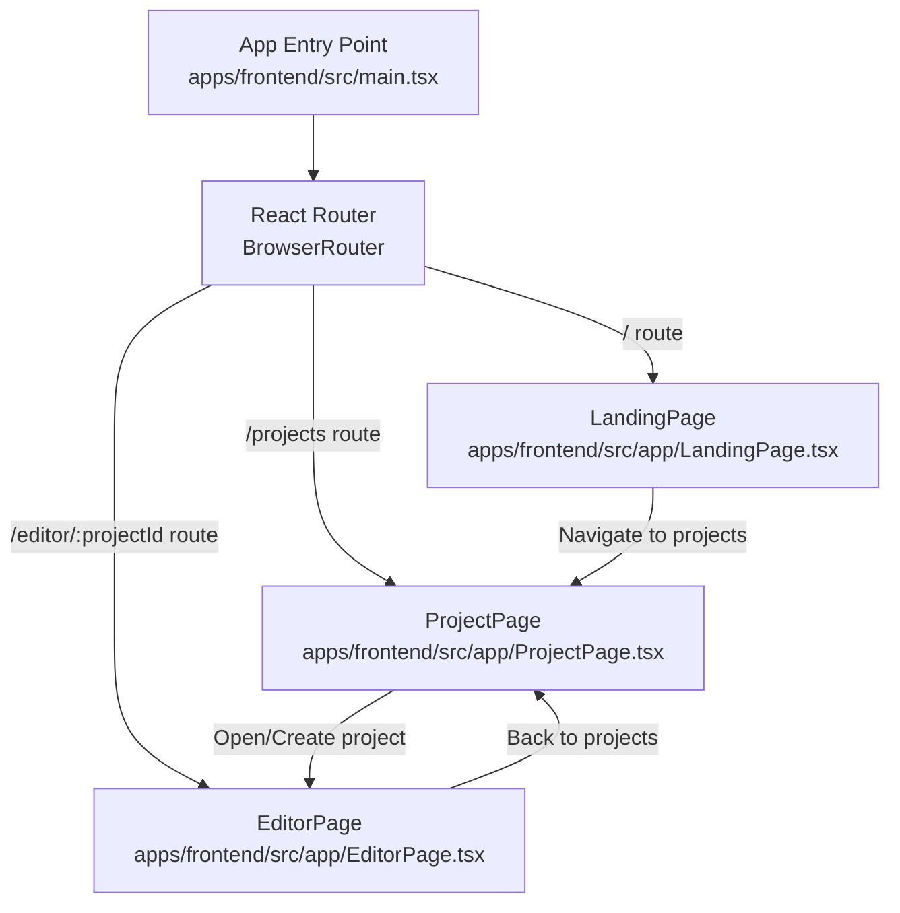

**Sources:** [apps/frontend/src/app/LandingPage.tsx](), [apps/frontend/src/app/ProjectPage.tsx:1-796](), [apps/frontend/src/app/EditorPage.tsx:1094-1095]()

### Page Component Responsibilities

| Component | Route | Primary Responsibilities |
|-----------|-------|-------------------------|
| `LandingPage` | `/` | Marketing content, feature showcase, language selection, navigation to projects |
| `ProjectPage` | `/projects` | Project listing, filtering, sorting, CRUD operations, template gallery, import workflows |
| `EditorPage` | `/editor/:projectId` | LaTeX editing workspace, three-panel layout, file management, compilation, AI features |

The routing logic follows a standard React Router pattern where `useNavigate()` and `useParams()` hooks handle navigation and route parameter extraction.

**Sources:** [apps/frontend/src/app/ProjectPage.tsx:33-35](), [apps/frontend/src/app/EditorPage.tsx:1094-1098]()

---

## State Management Architecture

### Multi-Layer State Model

The frontend employs a three-layer state management architecture, each serving distinct purposes:

**State Management Layers Diagram**

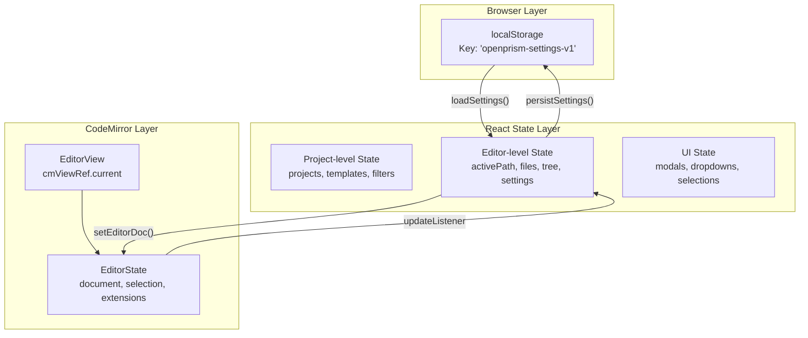

**Sources:** [apps/frontend/src/app/EditorPage.tsx:69-80](), [apps/frontend/src/app/EditorPage.tsx:114-143](), [apps/frontend/src/app/EditorPage.tsx:1421-1436]()

### State Persistence Strategy

#### localStorage Configuration

User preferences and LLM configuration are persisted to `localStorage` using the key `openprism-settings-v1`. The `AppSettings` type defines the persisted schema:

```typescript
type AppSettings = {
  llmEndpoint: string;
  llmApiKey: string;
  llmModel: string;
  searchEndpoint: string;
  searchApiKey: string;
  searchModel: string;
  visionEndpoint: string;
  visionApiKey: string;
  visionModel: string;
  compileEngine: CompileEngine;
};
```

The `loadSettings()` function [apps/frontend/src/app/EditorPage.tsx:114-134]() reads from localStorage at component mount, merging with `DEFAULT_SETTINGS` [apps/frontend/src/app/EditorPage.tsx:101-112]() for any missing keys. The `persistSettings()` function [apps/frontend/src/app/EditorPage.tsx:136-143]() writes changes back on every settings update via a `useEffect` hook [apps/frontend/src/app/EditorPage.tsx:1249-1251]().

**Sources:** [apps/frontend/src/app/EditorPage.tsx:69-143](), [apps/frontend/src/app/EditorPage.tsx:1249-1251]()

#### React State Organization

React state in `EditorPage` is organized into functional groupings using the `useState` hook:

| State Category | Example Variables | Purpose |
|---------------|------------------|---------|
| Project Context | `projectName`, `tree`, `activePath`, `fileOrder` | Track current project metadata and file structure |
| File Content | `files`, `editorValue` | Cache file contents in memory, track unsaved changes |
| Editor UI | `selectedPath`, `openFolders`, `fileFilter` | Manage file tree expansion and selection |
| AI Features | `chatMessages`, `agentMessages`, `pendingChanges` | Track AI interaction state and proposed edits |
| Compilation | `pdfUrl`, `compileLog`, `isCompiling` | Manage PDF rendering and build status |
| UI Modals | `settingsOpen`, `createOpen`, `importOpen` | Control modal visibility |

**Sources:** [apps/frontend/src/app/EditorPage.tsx:1099-1234]()

#### CodeMirror State Integration

CodeMirror maintains its own immutable state tree via `EditorState` [apps/frontend/src/app/EditorPage.tsx:1421-1436](). The integration is bidirectional:

1. **React → CodeMirror:** The `setEditorDoc()` callback [apps/frontend/src/app/EditorPage.tsx:1492-1501]() dispatches document changes to CodeMirror when loading a new file.

2. **CodeMirror → React:** An `updateListener` extension [apps/frontend/src/app/EditorPage.tsx:1328-1363]() observes document changes and selection updates, synchronizing them back to React state via `setEditorValue()` and `setSelectionRange()`.

3. **Dirty Flag Management:** The `isDirty` flag is set when CodeMirror reports a document change (unless `suppressDirtyRef.current` is true), triggering auto-save logic [apps/frontend/src/app/EditorPage.tsx:1695-1709]().

**Sources:** [apps/frontend/src/app/EditorPage.tsx:1325-1459](), [apps/frontend/src/app/EditorPage.tsx:1492-1501](), [apps/frontend/src/app/EditorPage.tsx:1695-1709]()

---

## Editor Integration

### CodeMirror 6 Setup

The editor workspace uses CodeMirror 6 as its core editing engine. The setup occurs in a `useEffect` hook that runs once on component mount:

**CodeMirror Initialization Flow**

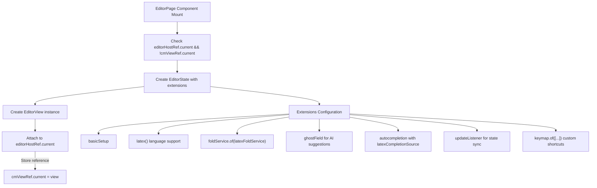

**Sources:** [apps/frontend/src/app/EditorPage.tsx:1325-1459]()

### Extension Architecture

The CodeMirror instance is configured with the following extension stack:

#### 1. Language Support

The `latex()` extension provides LaTeX-specific syntax highlighting and parsing. It is imported from `apps/frontend/src/latex/lang` (not shown in provided files but referenced at [apps/frontend/src/app/EditorPage.tsx:8]()).

#### 2. Code Folding Service

A custom `latexFoldService` [apps/frontend/src/app/EditorPage.tsx:288-316]() implements intelligent folding for LaTeX constructs:

- **Environments:** Folds `\begin{...}` to matching `\end{...}` by tracking depth
- **Sections:** Folds `\section`, `\subsection`, etc. based on hierarchy levels
- **Control Flow:** Folds `\if*` to `\fi` and `\begingroup` to `\endgroup`
- **Display Math:** Folds `$$...$$` and `\[...\]` blocks

The implementation uses `stripLatexComment()` [apps/frontend/src/app/EditorPage.tsx:165-178]() to exclude commented portions of lines during fold detection.

**Sources:** [apps/frontend/src/app/EditorPage.tsx:165-316]()

#### 3. Autocompletion

The `latexCompletionSource` function [apps/frontend/src/app/EditorPage.tsx:590-649]() provides context-aware completions for LaTeX commands:

- Triggers on `\` prefix (but not after `:` to avoid URL false positives)
- Offers completions like `\section{}`, `\cite{}`, `\begin{itemize}`, `\begin{figure}`
- Uses `apply` functions to position cursor inside braces after insertion
- Validates context using `context.matchBefore()` and preceding character checks

**Sources:** [apps/frontend/src/app/EditorPage.tsx:590-649]()

#### 4. Ghost Text Field

The `ghostField` StateField [apps/frontend/src/app/EditorPage.tsx:670-695]() manages inline AI suggestions:

- Displays ghost text at a specific position using `GhostWidget` [apps/frontend/src/app/EditorPage.tsx:653-668]()
- Responds to `setGhostEffect` StateEffect for showing/hiding suggestions
- Automatically clears on document changes or selection changes
- Styled via `.cm-ghost` CSS class for visual differentiation

**Sources:** [apps/frontend/src/app/EditorPage.tsx:651-695]()

#### 5. Custom Keymaps

Key bindings are registered via `keymap.of([...])` [apps/frontend/src/app/EditorPage.tsx:1365-1419]():

| Key Binding | Function | Purpose |
|-------------|----------|---------|
| `Mod-s` | `saveActiveFileRef.current()` | Save current file |
| `Alt-/` or `Mod-Space` | `requestSuggestionRef.current()` | Request AI autocomplete |
| `Tab` | `acceptSuggestionRef.current()` | Accept full inline suggestion |
| `ArrowRight` | `acceptChunkRef.current()` | Accept next word/token of suggestion |
| `Escape` | `clearSuggestionRef.current()` | Dismiss inline suggestion |
| `Mod-/` | `toggleComment` | Toggle line comments |

These refs are updated via `useEffect` [apps/frontend/src/app/EditorPage.tsx:1658-1663]() to ensure they reference the latest closures.

**Sources:** [apps/frontend/src/app/EditorPage.tsx:1365-1419](), [apps/frontend/src/app/EditorPage.tsx:1658-1663]()

### Editor Theme Customization

The `editorTheme` [apps/frontend/src/app/EditorPage.tsx:697-730]() applies custom styling:

- Transparent background to blend with glassmorphism UI
- Monospace font stack: `"JetBrains Mono", "SF Mono", "Menlo"`
- Font size controlled by `--editor-font-size` CSS variable
- Active line highlighting with subtle orange tint (`rgba(180, 74, 47, 0.08)`)
- Custom gutter styling with transparent background

**Sources:** [apps/frontend/src/app/EditorPage.tsx:697-730]()

---

## Component Organization

### EditorPage Three-Panel Layout

The `EditorPage` component implements a sophisticated three-panel workspace with resizable columns:

**EditorPage Layout Structure**

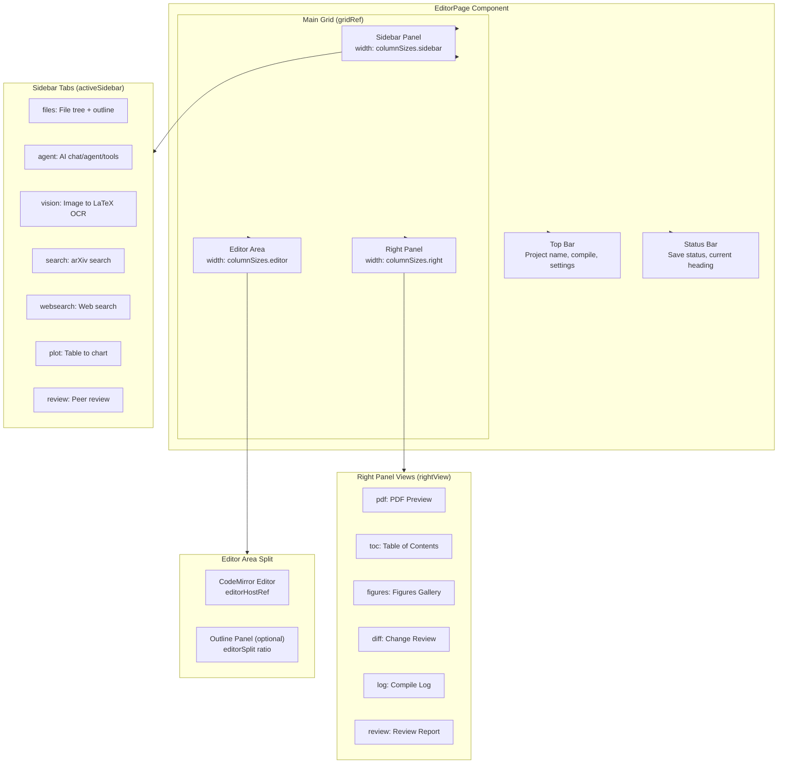

**Sources:** [apps/frontend/src/app/EditorPage.tsx:1094](), [apps/frontend/src/app/EditorPage.tsx:1154-1156]()

### Sidebar Tab Implementation

The sidebar switches between 7 operational modes controlled by the `activeSidebar` state:

1. **files:** File tree with drag-and-drop reordering, inline create/rename, file outline
2. **agent:** AI assistant with chat/agent/tools modes, task selection, prompt input
3. **vision:** Image upload for OCR, equation/table/algorithm recognition modes
4. **search:** arXiv paper search with LLM-based or direct API queries
5. **websearch:** Multi-point web search with automatic query splitting
6. **plot:** Table-to-chart generation with matplotlib/seaborn code generation
7. **review:** Document quality checks and AI-generated review reports

Each tab renders conditionally based on the `activeSidebar` value, following the pattern:

```jsx
{activeSidebar === 'files' && (
  // File tree UI
)}
{activeSidebar === 'agent' && (
  // Agent UI
)}
// ... etc
```

**Sources:** [apps/frontend/src/app/EditorPage.tsx:1154]()

### Right Panel View Implementation

The right panel displays 6 different views based on the `rightView` state:

| View | Key | Component/Logic | Primary Use Case |
|------|-----|----------------|-----------------|
| PDF Preview | `pdf` | `<PdfPreview>` component with PDF.js rendering | Real-time compilation output |
| Table of Contents | `toc` | Extracted from PDF outline + LaTeX document outline | Navigation within document |
| Figures Gallery | `figures` | Lists files with figure extensions, allows insertion | Asset management |
| Diff Viewer | `diff` | `<SplitDiffView>` with synchronized scrolling | Review AI-proposed changes |
| Compile Log | `log` | Parsed compilation errors with clickable line numbers | Debug LaTeX errors |
| Review Report | `review` | Markdown-rendered AI review with quality checks | Document improvement |

The view is selected via a dropdown in the top-right corner, implemented with `rightViewDropdownOpen` state and the `RIGHT_VIEW_OPTIONS` constant [apps/frontend/src/app/EditorPage.tsx:91-98]().

**Sources:** [apps/frontend/src/app/EditorPage.tsx:91-98](), [apps/frontend/src/app/EditorPage.tsx:1151]()

### ProjectPage Component Structure

The `ProjectPage` component uses a sidebar + main content layout:

**ProjectPage Organization Diagram**

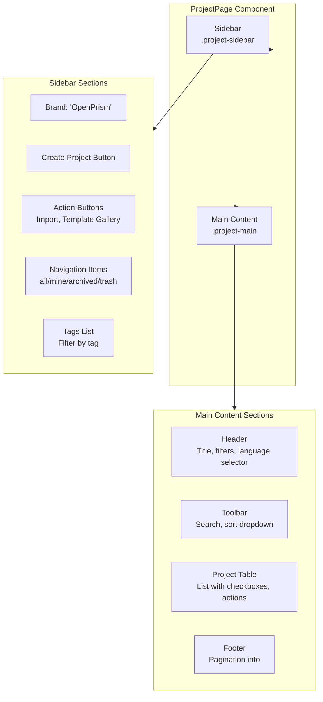

**Sources:** [apps/frontend/src/app/ProjectPage.tsx:322-583]()

The project table implements batch operations via checkboxes and `selectedIds` Set state, allowing multi-select actions like batch archiving or deletion.

**Sources:** [apps/frontend/src/app/ProjectPage.tsx:46](), [apps/frontend/src/app/ProjectPage.tsx:464-471]()

---

## Key Libraries Integration

### PDF.js Integration

PDF rendering is handled by the `pdfjs-dist` library with a custom `<PdfPreview>` component:

**PDF.js Rendering Pipeline**

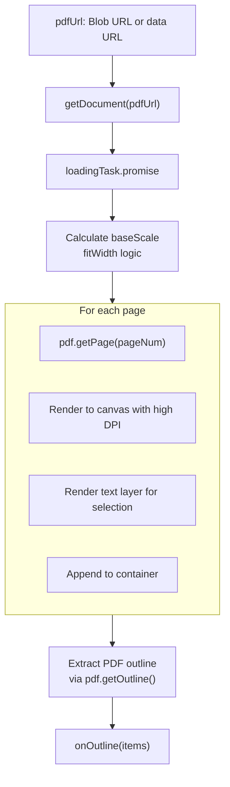

**Sources:** [apps/frontend/src/app/EditorPage.tsx:882-1092]()

Key implementation details:

- **Worker Configuration:** PDF.js worker is loaded from `pdfjs-dist/build/pdf.worker.min?url` [apps/frontend/src/app/EditorPage.tsx:15-16](), [apps/frontend/src/app/EditorPage.tsx:40]()
- **Fit Width Scaling:** The `fitWidth` prop triggers automatic scale calculation based on container width [apps/frontend/src/app/EditorPage.tsx:922-937]()
- **Quality Boost:** Canvas rendering uses device pixel ratio * 1.25 for crisp text [apps/frontend/src/app/EditorPage.tsx:942]()
- **Text Layer:** The `renderTextLayer()` function enables text selection within the PDF [apps/frontend/src/app/EditorPage.tsx:968-973]()
- **Spread Mode:** Two-page spread layout for book-style viewing [apps/frontend/src/app/EditorPage.tsx:991-1000]()

**Sources:** [apps/frontend/src/app/EditorPage.tsx:882-1092]()

### i18next Internationalization

The application uses `react-i18next` for multi-language support:

**i18next Usage Pattern**

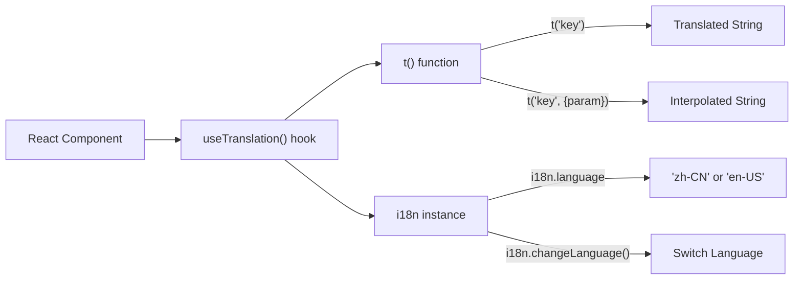

The `t()` function supports interpolation for dynamic values:

```typescript
t('已保存 {{path}}', { path: activePath })
t('{{n}} 分钟前', { n: Math.floor(diff / 60_000) })
```

Language switching is implemented via `i18n.changeLanguage(val)` in language selector dropdowns [apps/frontend/src/app/ProjectPage.tsx:414]().

**Sources:** [apps/frontend/src/app/EditorPage.tsx:4](), [apps/frontend/src/app/EditorPage.tsx:1096](), [apps/frontend/src/app/ProjectPage.tsx:35](), [apps/frontend/src/app/ProjectPage.tsx:414]()

### react-markdown for AI Responses

The `react-markdown` library with `remark-gfm` plugin renders Markdown content in AI assistant responses:

```jsx
<ReactMarkdown remarkPlugins={[remarkGfm]}>
  {reviewReport}
</ReactMarkdown>
```

This enables formatted output for review reports, search summaries, and other LLM-generated content.

**Sources:** [apps/frontend/src/app/EditorPage.tsx:5-6](), [apps/frontend/package.json:26-28]()

### Diff Library for Change Review

The `diff` library provides line-based diffing for the change review workflow:

1. **Unified Diff Generation:** `createTwoFilesPatch()` generates diff strings for file patches [apps/frontend/src/app/EditorPage.tsx:37]()
2. **Split Diff Display:** `diffLines()` splits content into added/removed/context lines [apps/frontend/src/app/EditorPage.tsx:732-767]()
3. **Visual Rendering:** The `<SplitDiffView>` component renders side-by-side before/after views [apps/frontend/src/app/EditorPage.tsx:834-880]()

The implementation uses synchronized scrolling via `lockRef` to keep left and right panels aligned.

**Sources:** [apps/frontend/src/app/EditorPage.tsx:19](), [apps/frontend/src/app/EditorPage.tsx:732-880]()

---

## Data Flow Patterns

### File Loading and Caching

**File Access Pattern**

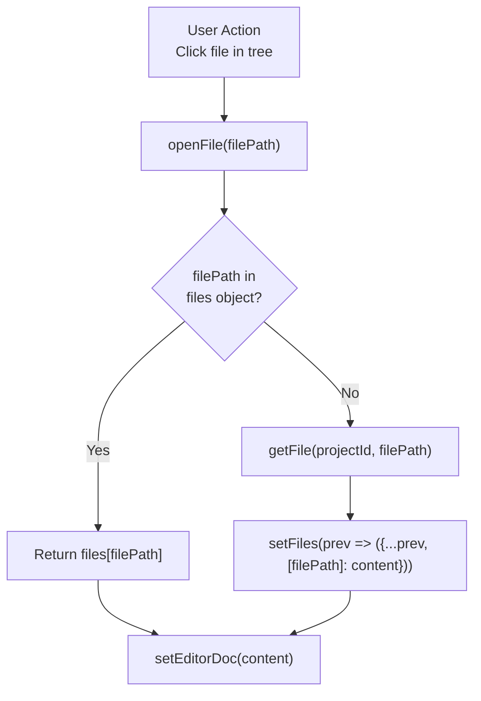

**Sources:** [apps/frontend/src/app/EditorPage.tsx:1461-1490]()

The `files` object [apps/frontend/src/app/EditorPage.tsx:1105]() serves as an in-memory cache. The `ensureFileContent()` helper [apps/frontend/src/app/EditorPage.tsx:1788-1798]() abstracts cache-or-fetch logic for use in AI workflows that need to read project files.

**Sources:** [apps/frontend/src/app/EditorPage.tsx:1105](), [apps/frontend/src/app/EditorPage.tsx:1788-1798]()

### Auto-Save Mechanism

The editor implements debounced auto-save using a combination of the `isDirty` flag and a timer:

**Auto-Save Flow**

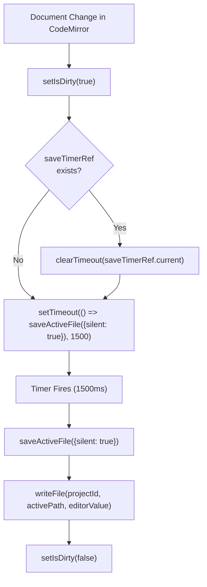

**Sources:** [apps/frontend/src/app/EditorPage.tsx:1695-1709]()

The debounce delay is 1500ms, balancing responsiveness with API call efficiency. Manual save via `Mod-s` bypasses the timer and saves immediately [apps/frontend/src/app/EditorPage.tsx:1367-1371]().

**Sources:** [apps/frontend/src/app/EditorPage.tsx:1367-1371]()

### AI Agent Execution Flow

The AI agent execution follows a request-response pattern with context gathering:

**AI Agent Request Flow**

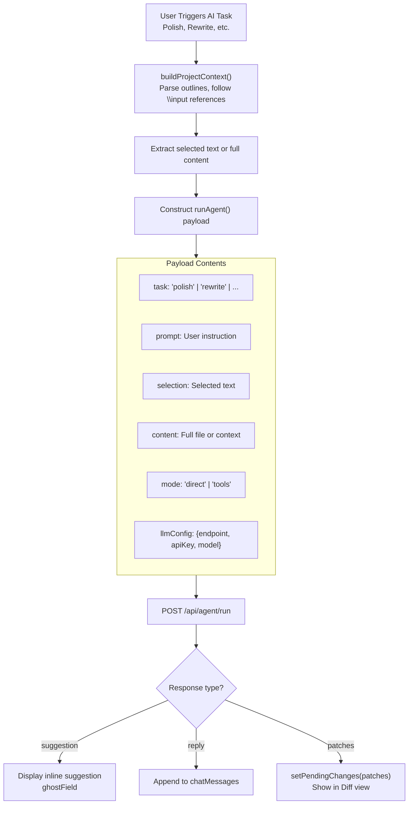

**Sources:** [apps/frontend/src/app/EditorPage.tsx:1579-1627](), [apps/frontend/src/app/EditorPage.tsx:1800-1835]()

The `buildProjectContext()` function [apps/frontend/src/app/EditorPage.tsx:1800-1835]() recursively follows `\input` and `\include` directives to build a comprehensive context summary for the LLM, including document structure and file relationships.

**Sources:** [apps/frontend/src/app/EditorPage.tsx:1800-1835]()

### Compilation Pipeline

The compilation process merges in-memory edits with saved files before sending to the backend:

**Compilation Data Flow**

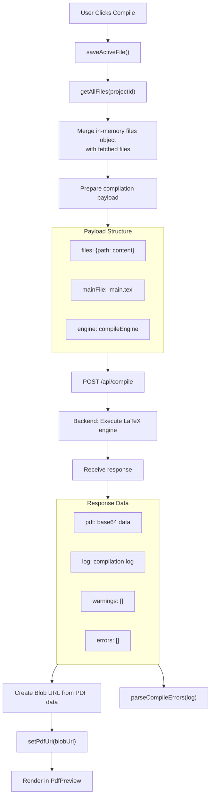

**Sources:** API client calls at [apps/frontend/src/api/client.ts](), referenced in [apps/frontend/src/app/EditorPage.tsx:22]()

The `parseCompileErrors()` function [apps/frontend/src/app/EditorPage.tsx:776-815]() extracts error messages and line numbers from the LaTeX log, enabling clickable error navigation in the log view.

**Sources:** [apps/frontend/src/app/EditorPage.tsx:776-815]()

### Tree Refresh and File Order

The file tree maintains custom ordering via the `fileOrder` object, which maps folder paths to ordered arrays of child names:

**Tree Refresh Flow**

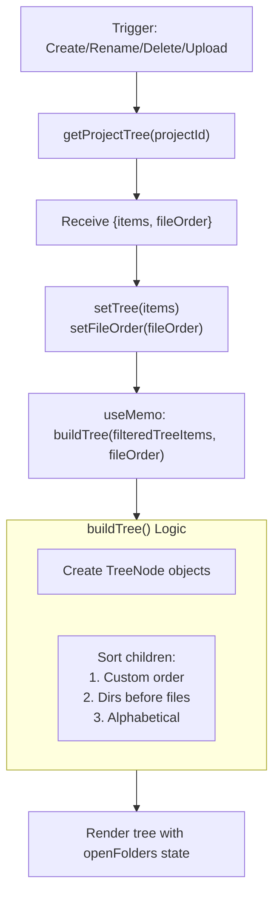

**Sources:** [apps/frontend/src/app/EditorPage.tsx:362-411](), [apps/frontend/src/app/EditorPage.tsx:1302-1314](), [apps/frontend/src/app/EditorPage.tsx:2500]()

The `updateFileOrder()` API call [apps/frontend/src/app/EditorPage.tsx:28]() persists reordering to the backend when users drag-and-drop files in the tree.

**Sources:** [apps/frontend/src/app/EditorPage.tsx:2481-2492]()

---

## Dependencies and Build Configuration

### Core Dependencies

The frontend uses modern React and editor libraries:

| Dependency | Version | Purpose |
|------------|---------|---------|
| `react` | ^18.2.0 | UI framework |
| `react-dom` | ^18.2.0 | React rendering |
| `react-router-dom` | ^6.22.3 | Client-side routing |
| `codemirror` | ^6.0.1 | Core editor library |
| `@codemirror/*` | ^6.x | Editor extensions (autocomplete, commands, language, search, state, view) |
| `pdfjs-dist` | ^3.11.174 | PDF rendering |
| `i18next` | ^23.12.2 | Internationalization core |
| `react-i18next` | ^14.1.3 | React i18next bindings |
| `react-markdown` | ^10.1.0 | Markdown rendering |
| `diff` | ^5.2.0 | Diffing library |

**Sources:** [apps/frontend/package.json:10-29]()

### Build Tooling

Vite is used as the build tool with React plugin:

- **Dev Server:** `vite` command starts dev server on port 5173 (default)
- **Production Build:** `vite build` outputs to `dist/`
- **Preview:** `vite preview` serves production build

The Vite configuration uses `@vitejs/plugin-react` for Fast Refresh during development.

**Sources:** [apps/frontend/package.json:5-8](), [apps/frontend/package.json:34]()

---

