<!-- source: DeepWiki mcp.deepwiki.com · repo OpenDCAI/OpenPrism · page 3.3 Backend Architecture · fetched 2026-11-02 -->

# Backend Architecture

<details>
<summary>Relevant source files</summary>

The following files were used as context for generating this wiki page:

- [apps/backend/src/routes/health.js](apps/backend/src/routes/health.js)
- [apps/backend/src/routes/plot.js](apps/backend/src/routes/plot.js)
- [apps/backend/src/routes/projects.js](apps/backend/src/routes/projects.js)
- [apps/backend/src/services/plotService.js](apps/backend/src/services/plotService.js)
- [apps/backend/src/services/templateService.js](apps/backend/src/services/templateService.js)

</details>


## Purpose and Scope

This document describes the architecture of OpenPrism's backend server, including its Fastify-based API gateway, route handler organization, service layer patterns, utility modules, and external process execution mechanisms. The backend implements a layered architecture that separates HTTP concerns (routes) from business logic (services) and cross-cutting concerns (utilities).

For frontend-backend communication patterns, see [API Design](#3.5). For data storage organization, see [Data Storage](#3.4). For detailed documentation of individual API endpoints, see [Backend Application](#5).

## Server Foundation

The backend uses Fastify as its HTTP server framework, providing a lightweight and performant foundation for the API gateway layer.

### Fastify Server Initialization

The server initializes by registering route handlers for each feature domain. Route registration follows a consistent pattern where each domain exports a `registerXRoutes(fastify)` function that attaches handlers to the Fastify instance.

**Route Registration Pattern**

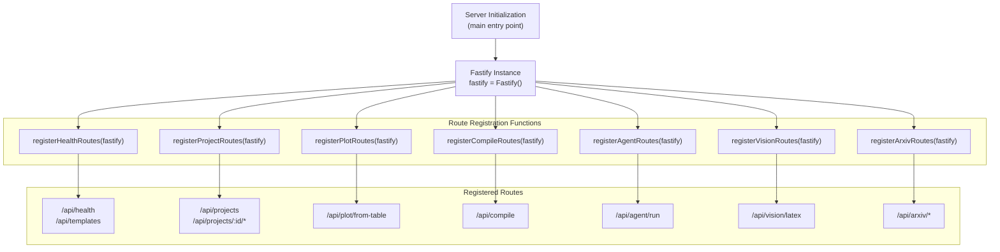

**Sources:** [apps/backend/src/routes/health.js:3-10](), [apps/backend/src/routes/projects.js:16-434](), [apps/backend/src/routes/plot.js:8-77]()

## Route Handlers

Route handlers form the API gateway layer, receiving HTTP requests and orchestrating service calls. Each route handler file focuses on a specific feature domain.

### Health and Template Routes

The health route module provides system status checks and template manifest queries.

| Route | Method | Handler Function | Purpose |
|-------|--------|-----------------|---------|
| `/api/health` | GET | `fastify.get('/api/health', ...)` | Health check endpoint |
| `/api/templates` | GET | `fastify.get('/api/templates', ...)` | Retrieve template manifest |

**Handler Implementation Map**

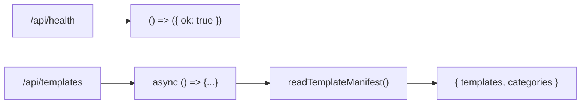

**Sources:** [apps/backend/src/routes/health.js:1-10]()

### Project Management Routes

The project route module handles the complete project lifecycle, including CRUD operations, file management, and import mechanisms.

**Project Route Endpoints**

| Endpoint | Method | Handler Line | Functionality |
|----------|--------|--------------|---------------|
| `/api/projects` | GET | [apps/backend/src/routes/projects.js:17-39]() | List all projects |
| `/api/projects` | POST | [apps/backend/src/routes/projects.js:41-54]() | Create new project |
| `/api/projects/import-zip` | POST | [apps/backend/src/routes/projects.js:56-103]() | Import project from ZIP |
| `/api/projects/import-arxiv-sse` | GET | [apps/backend/src/routes/projects.js:105-167]() | Import arXiv project with SSE |
| `/api/projects/:id/rename-project` | POST | [apps/backend/src/routes/projects.js:169-179]() | Rename project |
| `/api/projects/:id/copy` | POST | [apps/backend/src/routes/projects.js:181-200]() | Duplicate project |
| `/api/projects/:id` | DELETE | [apps/backend/src/routes/projects.js:202-210]() | Soft delete (trash) |
| `/api/projects/:id/permanent` | DELETE | [apps/backend/src/routes/projects.js:212-217]() | Permanent deletion |
| `/api/projects/:id/tags` | PATCH | [apps/backend/src/routes/projects.js:219-229]() | Update project tags |
| `/api/projects/:id/archive` | PATCH | [apps/backend/src/routes/projects.js:231-240]() | Archive/unarchive |
| `/api/projects/:id/trash` | PATCH | [apps/backend/src/routes/projects.js:242-256]() | Trash/restore |
| `/api/projects/:id/tree` | GET | [apps/backend/src/routes/projects.js:258-270]() | Get file tree |
| `/api/projects/:id/file-order` | POST | [apps/backend/src/routes/projects.js:272-284]() | Update file ordering |
| `/api/projects/:id/file` | GET | [apps/backend/src/routes/projects.js:286-294]() | Read file content |
| `/api/projects/:id/file` | PUT | [apps/backend/src/routes/projects.js:334-349]() | Write file content |
| `/api/projects/:id/files` | GET | [apps/backend/src/routes/projects.js:351-367]() | Get all files |
| `/api/projects/:id/blob` | GET | [apps/backend/src/routes/projects.js:296-315]() | Serve binary assets |
| `/api/projects/:id/upload` | POST | [apps/backend/src/routes/projects.js:317-332]() | Upload files |
| `/api/projects/:id/convert-template` | POST | [apps/backend/src/routes/projects.js:369-401]() | Convert to template |
| `/api/projects/:id/template` | POST | [apps/backend/src/routes/projects.js:403-411]() | Apply template |
| `/api/projects/:id/folder` | POST | [apps/backend/src/routes/projects.js:413-421]() | Create folder |
| `/api/projects/:id/rename` | POST | [apps/backend/src/routes/projects.js:423-433]() | Rename file/folder |

**Project Creation Flow**

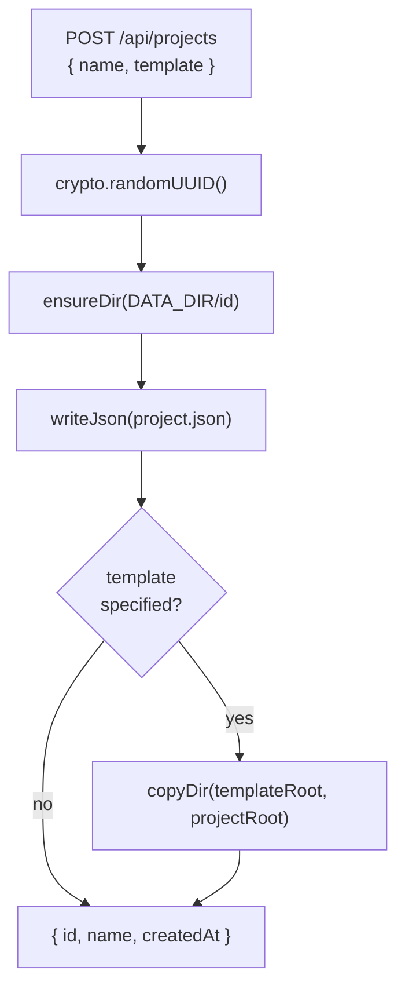

**Sources:** [apps/backend/src/routes/projects.js:16-434]()

### Plot Generation Routes

The plot route module orchestrates AI-powered chart generation from LaTeX tables using Python visualization libraries.

**Plot Generation Pipeline**

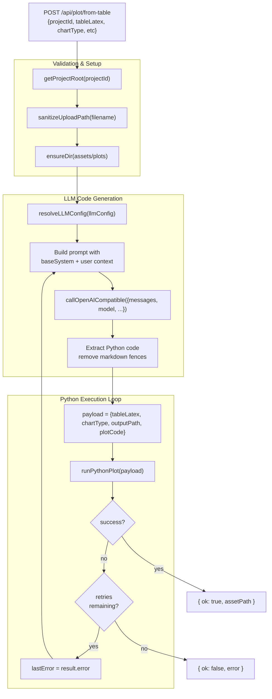

**Sources:** [apps/backend/src/routes/plot.js:1-77]()

## Service Layer

The service layer encapsulates business logic and provides reusable operations that route handlers invoke. Services abstract implementation details and manage interactions with external systems.

### Service Architecture Pattern

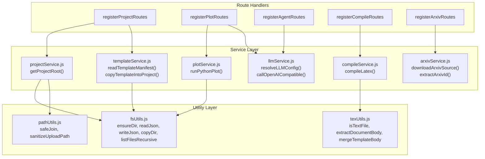

**Sources:** [apps/backend/src/routes/projects.js:1-14](), [apps/backend/src/routes/plot.js:1-6]()

### Template Service

The `templateService` module manages template operations, including manifest reading and template application to projects.

**Key Functions:**

- `readTemplateManifest()` - Parses [TEMPLATE_MANIFEST]() JSON file to retrieve available templates and categories
- `copyTemplateIntoProject(templateRoot, projectRoot)` - Recursively copies template files into a project directory with selective overwrite logic

**Template Copy Logic**

The copy operation implements intelligent file handling:
- Skips `main.tex` to preserve user content
- Overwrites non-`.tex` files (e.g., `.cls`, `.bst`, images)
- Preserves existing `.tex` files to avoid data loss

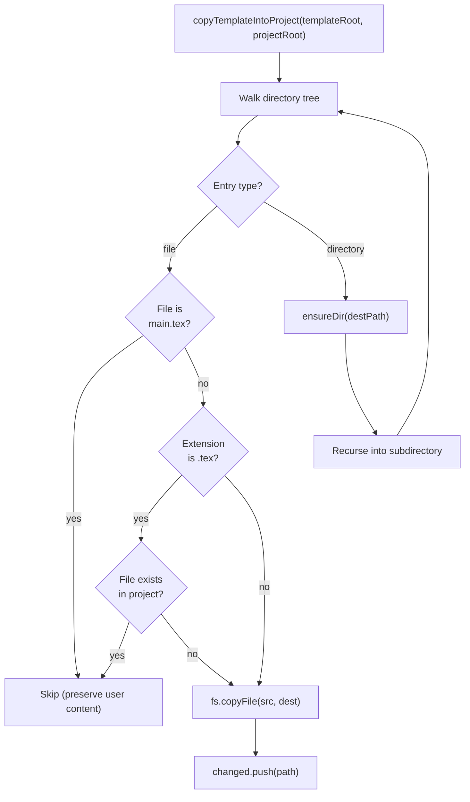

**Sources:** [apps/backend/src/services/templateService.js:1-47]()

### Plot Service

The `plotService` module executes Python scripts for data visualization using matplotlib and seaborn.

**Key Function:** `runPythonPlot(payload)`

This service creates an isolated execution environment for each plot generation:

1. **Temporary Directory Creation:** Generates unique directory in `/tmp/openprism_plot_{uuid}`
2. **Payload Serialization:** Writes plot parameters to `payload.json`
3. **Python Script Generation:** Embeds complete plotting script with table parsing logic
4. **Process Spawning:** Executes Python interpreter with script and payload
5. **Cleanup:** Removes temporary directory regardless of outcome

**Python Executable Resolution**

The service resolves the Python executable in priority order:
1. `process.env.OPENPRISM_PYTHON` - Explicit override
2. `process.env.CONDA_PREFIX/bin/python` - Conda environment detection
3. `'python3'` - System default

**Python Script Components**

The embedded Python script [apps/backend/src/services/plotService.js:19-139]() includes:

- **Dependency Detection:** Checks for pandas and seaborn availability
- **Table Parser:** Extracts data from LaTeX `tabular` environment using regex
- **Multicolumn/Multirow Support:** Handles complex table structures
- **DataFrame Construction:** Creates pandas DataFrame for numeric operations
- **Code Execution:** Executes LLM-generated plotting code via `exec()`
- **Figure Export:** Saves plot to specified output path at 150 DPI

**Plot Execution Flow**

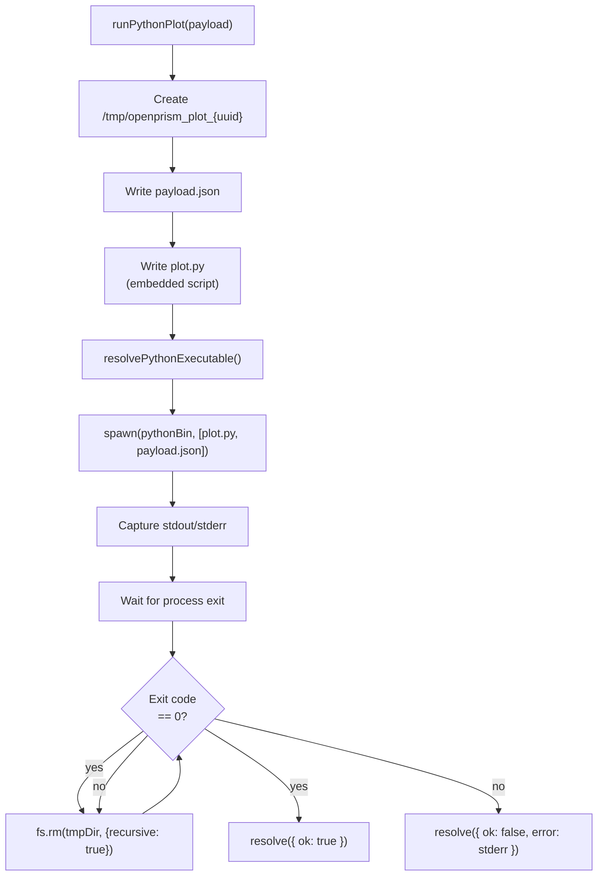

**Sources:** [apps/backend/src/services/plotService.js:1-163]()

## Utility Layer

Utility modules provide cross-cutting functionality used throughout the backend, including file system operations, path security, LaTeX parsing, and internationalization.

### Utility Module Organization

| Module | Location | Key Functions | Purpose |
|--------|----------|---------------|---------|
| `fsUtils` | Referenced in imports | `ensureDir`, `readJson`, `writeJson`, `copyDir`, `listFilesRecursive` | Safe file system operations |
| `pathUtils` | Referenced in imports | `safeJoin`, `sanitizeUploadPath` | Path traversal prevention |
| `texUtils` | Referenced in imports | `isTextFile`, `extractDocumentBody`, `mergeTemplateBody` | LaTeX document manipulation |
| `i18n` | Referenced in imports | `getLang`, `t` | Internationalization support |

**Utility Function Usage Patterns**

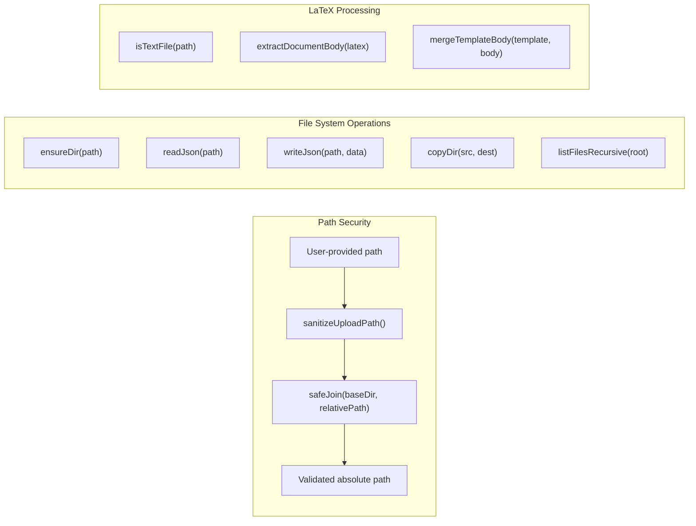

### Path Security Implementation

The `pathUtils` module implements security measures to prevent directory traversal attacks:

**`safeJoin(baseDir, relativePath)`**
- Resolves absolute path from base directory and relative path
- Ensures result is within base directory bounds
- Throws error if path escapes base directory

**`sanitizeUploadPath(filename)`**
- Removes path traversal sequences (`..`, absolute paths)
- Filters directory separators from user input
- Returns safe relative path or empty string

These functions are critical for security, used in all file operations where user input determines file paths: [apps/backend/src/routes/projects.js:76](), [apps/backend/src/routes/projects.js:81](), [apps/backend/src/routes/projects.js:291](), [apps/backend/src/routes/projects.js:301](), [apps/backend/src/routes/projects.js:326](), [apps/backend/src/routes/projects.js:339]()

**Sources:** [apps/backend/src/routes/projects.js:9]()

### LaTeX Utilities

The `texUtils` module provides LaTeX document manipulation capabilities:

**`isTextFile(path)`**
- Determines if file should be treated as text (e.g., `.tex`, `.bib`) or binary
- Used when reading project files to choose encoding: [apps/backend/src/routes/projects.js:360-364]()

**`extractDocumentBody(latex)`**
- Extracts content between `\begin{document}` and `\end{document}`
- Used in template conversion to preserve user content

**`mergeTemplateBody(templateTex, body)`**
- Injects user content into new template's document body
- Enables seamless template switching while preserving work

**Sources:** [apps/backend/src/routes/projects.js:10](), [apps/backend/src/routes/projects.js:392-393]()

## External Process Management

The backend spawns external processes for computationally intensive tasks that require specialized tools: LaTeX compilation engines and Python plotting scripts.

### Process Execution Architecture

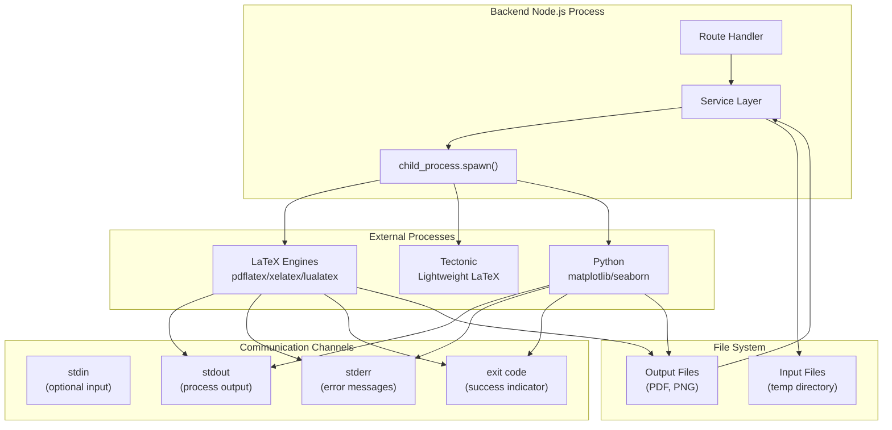

### Python Process Execution

The plot service demonstrates the backend's process execution pattern:

**Process Lifecycle:**

1. **Environment Preparation:** Creates isolated temporary directory [apps/backend/src/services/plotService.js:15-16]()
2. **Input Staging:** Writes payload and script to temp directory [apps/backend/src/services/plotService.js:17-141]()
3. **Process Spawning:** Invokes Python with arguments [apps/backend/src/services/plotService.js:145]()
4. **Stream Capture:** Buffers stdout and stderr [apps/backend/src/services/plotService.js:146-153]()
5. **Exit Handling:** Waits for process close, checks exit code [apps/backend/src/services/plotService.js:154-161]()
6. **Cleanup:** Removes temporary directory [apps/backend/src/services/plotService.js:155]()

**Process Spawn Implementation**

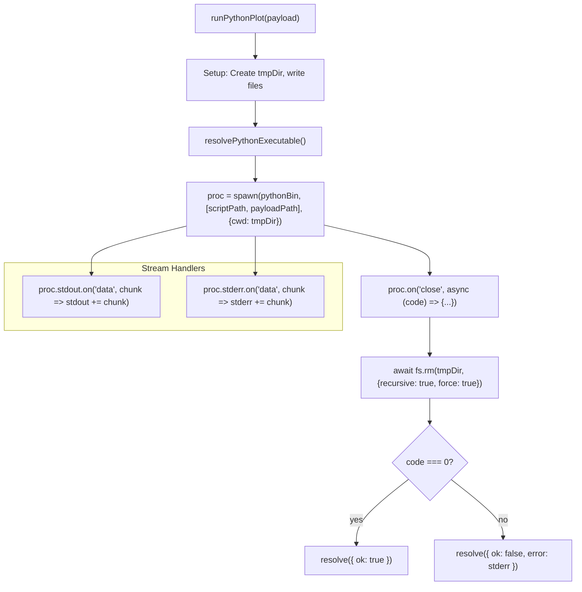

**Sources:** [apps/backend/src/services/plotService.js:13-162]()

### Error Handling and Isolation

External process execution implements robust error handling:

- **Timeout Protection:** Node.js can kill long-running processes (implementation in compile service)
- **Resource Cleanup:** Temporary directories deleted with `force: true` to handle permission errors
- **Error Propagation:** stderr captured and returned to client for debugging
- **Exit Code Checking:** Non-zero exit codes treated as failures with error details

**Sources:** [apps/backend/src/services/plotService.js:154-161]()

## Request Lifecycle

The backend implements a consistent request-response pattern across all endpoints, with standardized error handling and response formats.

### Typical Request Flow

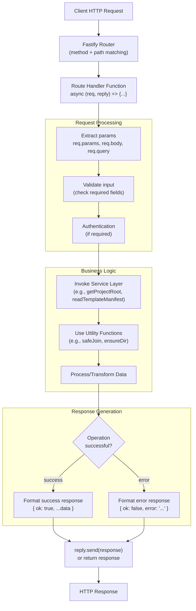

### Response Format Conventions

The backend uses consistent response structures:

**Success Response:**
```json
{
  "ok": true,
  "data": { /* endpoint-specific data */ }
}
```

**Error Response:**
```json
{
  "ok": false,
  "error": "Human-readable error message"
}
```

**Examples:**

- Project creation success: [apps/backend/src/routes/projects.js:53]()
- Project creation with template: [apps/backend/src/routes/projects.js:49-52]()
- ZIP import error: [apps/backend/src/routes/projects.js:93]()
- Plot generation success: [apps/backend/src/routes/plot.js:71]()
- Plot generation error: [apps/backend/src/routes/plot.js:75]()

### Server-Sent Events (SSE) Pattern

For long-running operations, the backend implements SSE to stream progress updates:

**arXiv Import SSE Flow**

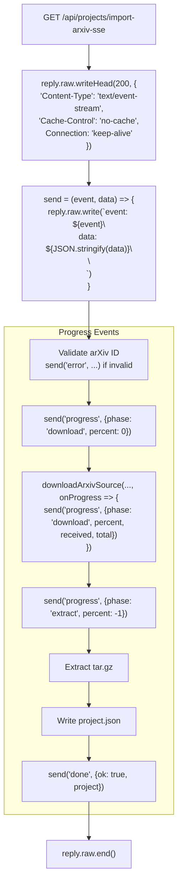

**Event Types:**
- `progress` - Download/extraction progress with percent complete
- `error` - Operation failure with error message
- `done` - Operation complete with result data

**Sources:** [apps/backend/src/routes/projects.js:105-167]()

### Error Handling Patterns

The backend implements multiple error handling strategies:

**Try-Catch with Cleanup:**
```javascript
try {
  // Operation that may fail
  const result = await riskyOperation();
  return { ok: true, result };
} catch (err) {
  await cleanup(); // Ensure resources released
  return { ok: false, error: String(err) };
}
```

**Silent Failure for Non-Critical Operations:**
- Project listing ignores unparseable metadata: [apps/backend/src/routes/projects.js:34-36]()
- Metadata update failures ignored during file writes: [apps/backend/src/routes/projects.js:342-347]()

**Input Validation:**
- Early return with error for missing required fields: [apps/backend/src/routes/plot.js:11-12]()
- Type checking and fallback values: [apps/backend/src/routes/projects.js:222]()

**Sources:** [apps/backend/src/routes/projects.js:91-94](), [apps/backend/src/routes/projects.js:154-161](), [apps/backend/src/routes/plot.js:9-76]()

## Configuration Management

The backend resolves configuration from multiple sources with defined precedence, enabling both system-wide defaults and per-request overrides.

### Configuration Sources

| Source | Scope | Priority | Example |
|--------|-------|----------|---------|
| Hardcoded Defaults | System | Lowest | Default model names, paths |
| Environment Variables | Server Instance | Medium | `OPENPRISM_LLM_ENDPOINT`, `OPENPRISM_DATA_DIR` |
| Request Parameters | Individual Request | Highest | `llmConfig` in request body |

### Environment Variable Reference

Based on configuration imports and usage patterns:

| Variable | Purpose | Used In |
|----------|---------|---------|
| `OPENPRISM_DATA_DIR` | Root directory for project storage | [apps/backend/src/routes/projects.js:7]() |
| `OPENPRISM_TEMPLATE_DIR` | Built-in template location | [apps/backend/src/routes/projects.js:7]() |
| `OPENPRISM_LLM_ENDPOINT` | OpenAI-compatible API endpoint | Referenced in `resolveLLMConfig` |
| `OPENPRISM_LLM_API_KEY` | Authentication for LLM API | Referenced in `resolveLLMConfig` |
| `OPENPRISM_LLM_MODEL` | Default model name | Referenced in `resolveLLMConfig` |
| `OPENPRISM_PYTHON` | Python executable path | [apps/backend/src/services/plotService.js:8]() |
| `CONDA_PREFIX` | Conda environment path | [apps/backend/src/services/plotService.js:9]() |
| `PORT` | Backend server port | Server initialization |

### Configuration Resolution Pattern

The `resolveLLMConfig(overrides)` function demonstrates configuration precedence:

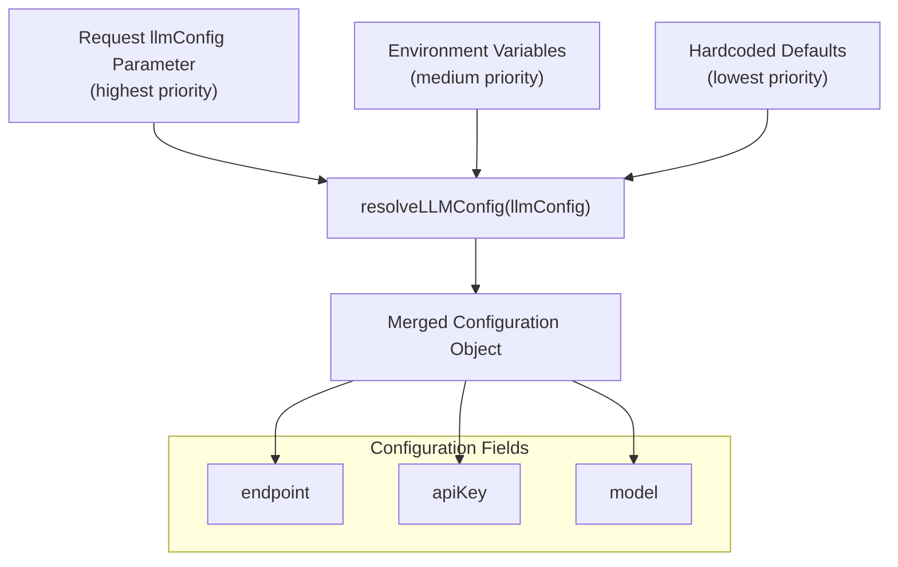

**Usage Example:**

The plot generation route allows per-request LLM overrides:
1. Request includes `llmConfig` parameter: [apps/backend/src/routes/plot.js:10]()
2. Service resolves with environment fallback: [apps/backend/src/routes/plot.js:21-24]()
3. Merged config used for API call: [apps/backend/src/routes/plot.js:45-53]()

**Sources:** [apps/backend/src/routes/plot.js:5](), [apps/backend/src/routes/plot.js:21](), [apps/backend/src/services/plotService.js:7-11]()

---

