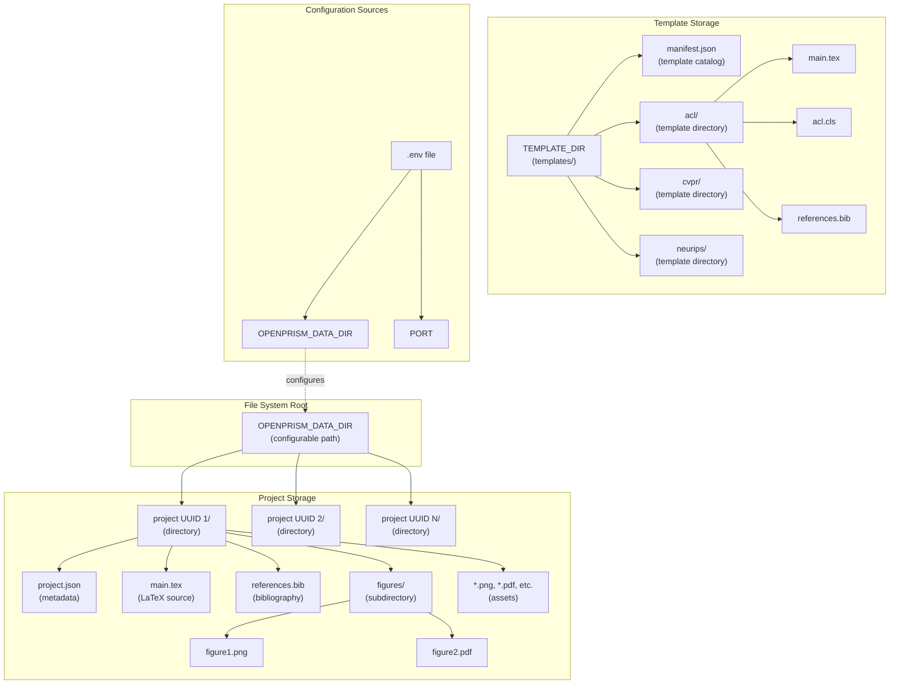
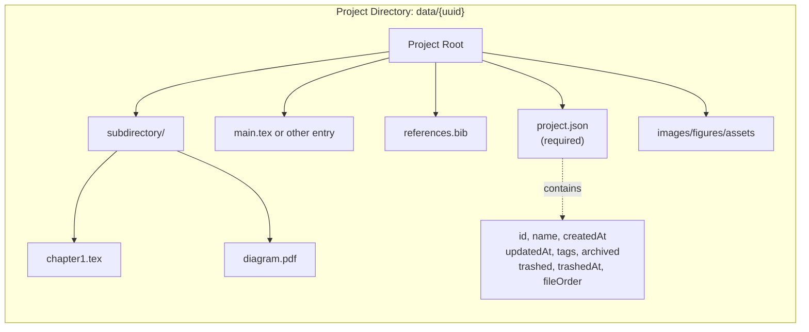
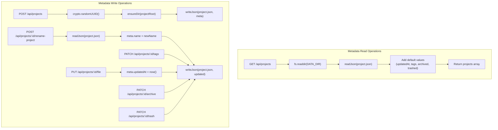
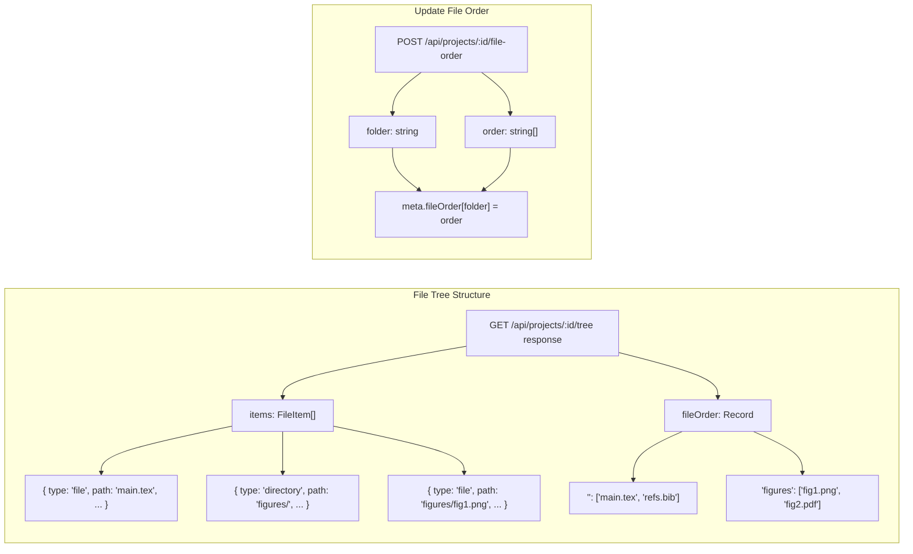
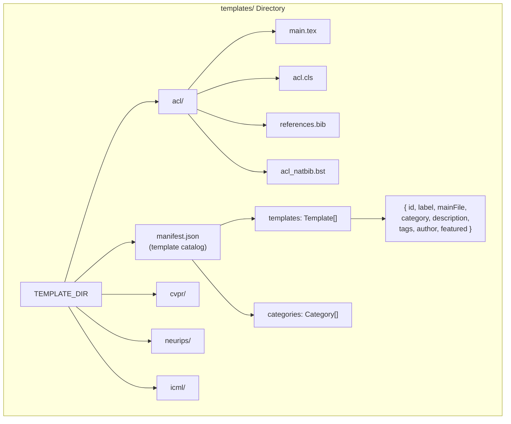
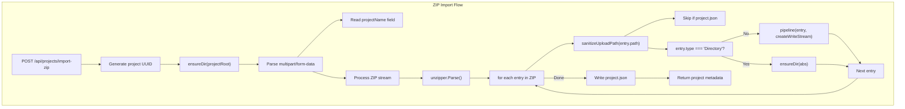

<!-- source: DeepWiki mcp.deepwiki.com · repo OpenDCAI/OpenPrism · page 3.4 Data Storage · fetched 2026-11-02 -->

# Data Storage

Relevant source files

The following files were used as context for generating this wiki page:

- [README.md](README.md)
- [apps/backend/src/routes/projects.js](apps/backend/src/routes/projects.js)
- [templates/manifest.json](templates/manifest.json)

## Purpose and Scope

This document describes the file system-based data storage architecture in OpenPrism, including the organization of user projects, metadata structures, template storage, and file management operations. OpenPrism uses a local-first storage model where all data resides on the server's file system without requiring external databases.

For API endpoints that interact with this storage layer, see [API Design](#3.5). For the Template System's manifest format and template operations, see [Template System](#5.5). For project lifecycle operations, see [Project Management API](#5.1).

---

## Storage Architecture Overview

OpenPrism implements a flat directory-based storage model where each project is a self-contained directory with its own metadata file. The system uses environment variables to configure storage locations and relies on Node.js file system APIs for all storage operations.

### Data Directory Structure

**Sources:** [README.md:395-413](), [apps/backend/src/routes/projects.js:1-434]()

---

## Project Storage

### Project Directory Organization

Each project is stored in a dedicated directory named by its UUID identifier. The directory structure is flexible and mirrors the user's file organization, with the exception of the mandatory `project.json` metadata file.

**Sources:** [apps/backend/src/routes/projects.js:41-54](), [README.md:404-413]()

### Project Metadata Format

The `project.json` file stores all metadata for a project. This file is created during project initialization and updated by various operations throughout the project lifecycle.

| Field | Type | Description | Set By |
|-------|------|-------------|--------|
| `id` | `string` (UUID) | Unique project identifier | Creation |
| `name` | `string` | User-visible project name | Creation / Rename |
| `createdAt` | `string` (ISO 8601) | Project creation timestamp | Creation |
| `updatedAt` | `string` (ISO 8601) | Last modification timestamp | File writes |
| `tags` | `string[]` | User-assigned tags | Tag operations |
| `archived` | `boolean` | Archive status | Archive operation |
| `trashed` | `boolean` | Trash status (soft delete) | Delete operation |
| `trashedAt` | `string` or `null` | Trash timestamp | Delete operation |
| `fileOrder` | `object` | Custom file ordering per folder | Drag-and-drop |

**Sources:** [apps/backend/src/routes/projects.js:17-39](), [apps/backend/src/routes/projects.js:169-179]()

### Project Metadata Operations

**Sources:** [apps/backend/src/routes/projects.js:17-39](), [apps/backend/src/routes/projects.js:169-179](), [apps/backend/src/routes/projects.js:219-256](), [apps/backend/src/routes/projects.js:334-349]()

---

## File Storage Within Projects

### File Organization

Projects support arbitrary file hierarchies with no enforced structure beyond the `project.json` metadata file. Users can organize LaTeX sources, bibliography files, images, and other assets in any directory structure.

```mermaid
graph TB
    subgraph "File Operations API"
        GetFile["GET /api/projects/:id/file"]
        PutFile["PUT /api/projects/:id/file"]
        GetBlob["GET /api/projects/:id/blob"]
        GetFiles["GET /api/projects/:id/files"]
        GetTree["GET /api/projects/:id/tree"]
        Upload["POST /api/projects/:id/upload"]
        Rename["POST /api/projects/:id/rename"]
        CreateFolder["POST /api/projects/:id/folder"]
    end
    
    subgraph "File System Operations"
        GetFile --> ReadFile["fs.readFile(safeJoin(projectRoot, path))"]
        PutFile --> WriteFile["fs.writeFile(safeJoin(projectRoot, path))"]
        PutFile --> UpdateMeta["Update project.json updatedAt"]
        GetBlob --> ReadBinary["fs.readFile(abs) + Content-Type header"]
        GetFiles --> ListRecursive["listFilesRecursive(projectRoot)"]
        ListRecursive --> ReadAllFiles["Read each file (text or base64)"]
        GetTree --> ListRecursive2["listFilesRecursive(projectRoot)"]
        Upload --> StreamPipeline["pipeline(part.file, createWriteStream)"]
        Rename --> FsRename["fs.rename(absFrom, absTo)"]
        CreateFolder --> EnsureDir["ensureDir(abs)"]
    end
    
    subgraph "Path Safety"
        SafeJoin["safeJoin(base, relative)"]
        SanitizeUpload["sanitizeUploadPath(filename)"]
        
        ReadFile --> SafeJoin
        WriteFile --> SafeJoin
        ReadBinary --> SafeJoin
        StreamPipeline --> SanitizeUpload
    end
```

**Sources:** [apps/backend/src/routes/projects.js:286-349](), [apps/backend/src/routes/projects.js:351-367](), [apps/backend/src/routes/projects.js:317-332]()

### Text vs Binary File Handling

OpenPrism distinguishes between text and binary files when serving file contents. Text files are returned as UTF-8 strings, while binary files are base64-encoded.

**Text File Detection:** The `isTextFile` utility function determines file type based on extension. Common LaTeX-related extensions (`.tex`, `.bib`, `.cls`, `.sty`) are treated as text, while images (`.png`, `.jpg`, `.pdf`) are binary.

**Binary File Serving:** The `/api/projects/:id/blob` endpoint serves binary assets with appropriate `Content-Type` headers for in-browser rendering (e.g., `image/png`, `application/pdf`).

**Sources:** [apps/backend/src/routes/projects.js:296-315](), [apps/backend/src/routes/projects.js:351-367]()

### File Tree and Ordering

The file tree is dynamically generated by recursively scanning the project directory. Custom file ordering is stored in the `fileOrder` field of `project.json` as a mapping of folder paths to ordered filename arrays.

**Sources:** [apps/backend/src/routes/projects.js:258-270](), [apps/backend/src/routes/projects.js:272-284]()

---

## Template Storage

### Template Directory Structure

Templates are stored in the `templates/` directory (configured as `TEMPLATE_DIR`) and are read-only resources managed by the system. Each template is a directory containing a complete LaTeX project structure.

**Sources:** [templates/manifest.json:1-58](), [README.md:404-413]()

### Template Manifest Schema

The `manifest.json` file defines all available templates and their metadata. This file is loaded during template operations and API responses.

**Template Object Fields:**

| Field | Type | Description |
|-------|------|-------------|
| `id` | `string` | Template identifier (matches directory name) |
| `label` | `string` | Display name for UI |
| `mainFile` | `string` | Entry point file (e.g., `main.tex`) |
| `category` | `string` | Category ID (e.g., `academic`) |
| `description` | `string` | Chinese description |
| `descriptionEn` | `string` | English description |
| `tags` | `string[]` | Searchable tags |
| `author` | `string` | Template author |
| `featured` | `boolean` | Show in featured templates |

**Category Object Fields:**

| Field | Type | Description |
|-------|------|-------------|
| `id` | `string` | Category identifier |
| `label` | `string` | Chinese label |
| `labelEn` | `string` | English label |

**Sources:** [templates/manifest.json:1-58]()

### Template Application

Templates can be applied to projects at creation time or converted afterward. The application process copies template files into the project directory.

```mermaid
graph TB
    subgraph "Template at Creation"
        CreateWithTemplate["POST /api/projects<br/>(with template param)"]
        CreateWithTemplate --> CreateDir["Create project directory"]
        CreateDir --> WriteMeta["Write project.json"]
        WriteMeta --> CopyTemplate["copyDir(TEMPLATE_DIR/template, projectRoot)"]
        CopyTemplate --> ReturnMeta["Return project metadata"]
    end
    
    subgraph "Template Conversion"
        ConvertTemplate["POST /api/projects/:id/convert-template"]
        ConvertTemplate --> ReadManifest["readTemplateManifest()"]
        ReadManifest --> ExtractBody["extractDocumentBody(current main.tex)"]
        ExtractBody --> ReadTemplateTex["Read template main.tex"]
        ReadTemplateTex --> MergeBody["mergeTemplateBody(template, body)"]
        MergeBody --> CopyFiles["copyTemplateIntoProject(templateRoot, projectRoot)"]
        CopyFiles --> WriteMerged["Write merged main.tex"]
        WriteMerged --> ReturnChanged["Return changed files list"]
    end
    
    subgraph "Direct Template Copy"
        ApplyTemplate["POST /api/projects/:id/template"]
        ApplyTemplate --> CopyDirect["copyDir(TEMPLATE_DIR/template, projectRoot)"]
        CopyDirect --> ReturnOk["Return ok: true"]
    end
```

**Sources:** [apps/backend/src/routes/projects.js:369-401](), [apps/backend/src/routes/projects.js:403-411](), [apps/backend/src/routes/projects.js:41-54]()

---

## Project Import Operations

### ZIP File Import

Users can import existing LaTeX projects by uploading ZIP archives. The import process extracts files while sanitizing paths to prevent directory traversal attacks.

**Sources:** [apps/backend/src/routes/projects.js:56-103]()

### arXiv Project Import

OpenPrism supports importing papers directly from arXiv by downloading the LaTeX source archive and extracting it into a new project. This operation uses Server-Sent Events (SSE) to stream progress updates.

```mermaid
graph TB
    subgraph "arXiv Import with SSE"
        ArxivImport["GET /api/projects/import-arxiv-sse"]
        ArxivImport --> ParseArxivId["extractArxivId(arxivIdOrUrl)"]
        ParseArxivId --> ValidateId["Validate arXiv ID"]
        ValidateId --> SetupSSE["Setup SSE response headers"]
        SetupSSE --> GenProjectID["Generate project UUID"]
        GenProjectID --> CreateDir["ensureDir(projectRoot)"]
        CreateDir --> CreateMeta["Create project metadata"]
        CreateMeta --> DownloadTar["downloadArxivSource(arxivId, tmpTar, progressCallback)"]
        DownloadTar --> SendDownloadProgress["send('progress', {phase: 'download', percent})"]
        DownloadTar --> SendExtractStart["send('progress', {phase: 'extract'})"]
        SendExtractStart --> ExtractTar["tar.x({file: tmpTar, cwd: projectRoot})"]
        ExtractTar --> FilterPaths["Filter paths (no .., no absolute)"]
        FilterPaths --> CleanupTar["fs.rm(tmpTar)"]
        CleanupTar --> WriteMeta["writeJson(project.json)"]
        WriteMeta --> SendDone["send('done', {ok: true, project})"]
        SendDone --> CloseSSE["Close SSE connection"]
    end
```

**Sources:** [apps/backend/src/routes/projects.js:105-167]()

---

## Storage Utilities

### Path Safety Functions

OpenPrism implements path sanitization utilities to prevent directory traversal attacks and ensure all file operations remain within project boundaries.

**`safeJoin(base, relative)`:** Joins a base path with a relative path and validates that the result is within the base directory. Throws an error if path traversal is attempted.

**`sanitizeUploadPath(filename)`:** Sanitizes uploaded filenames by removing path components, filtering out unsafe characters, and validating the result is a valid relative path.

**Sources:** [apps/backend/src/routes/projects.js:9]()

### File System Utilities

The `fsUtils` module provides promise-based wrappers and convenience functions for file system operations.

**Core Functions:**

| Function | Purpose | Used By |
|----------|---------|---------|
| `ensureDir(path)` | Create directory if not exists | All write operations |
| `readJson(path)` | Read and parse JSON file | Metadata operations |
| `writeJson(path, data)` | Write object as formatted JSON | Metadata updates |
| `copyDir(src, dest)` | Recursively copy directory | Template application |
| `listFilesRecursive(dir)` | List all files in tree | File tree API |

**Sources:** [apps/backend/src/routes/projects.js:8]()

---

## Configuration

### Environment Variables

Storage paths are configured through environment variables defined in the `.env` file or system environment.

| Variable | Default | Description |
|----------|---------|-------------|
| `OPENPRISM_DATA_DIR` | `./data` | Root directory for all project data |
| `PORT` | `8787` | Backend server port |

**Data Directory Initialization:** The system automatically creates `OPENPRISM_DATA_DIR` if it doesn't exist during the first API call that requires it.

**Sources:** [README.md:395-402](), [apps/backend/src/routes/projects.js:7]()

### Constants

The backend defines path constants that are used throughout the storage layer:

- **`DATA_DIR`:** Resolved from `OPENPRISM_DATA_DIR` environment variable
- **`TEMPLATE_DIR`:** Hardcoded to `templates/` in the project root

**Sources:** [apps/backend/src/routes/projects.js:7]()

---

## Storage Operations Reference

### Project Lifecycle Operations

| Endpoint | Method | Operation | Storage Effect |
|----------|--------|-----------|----------------|
| `/api/projects` | GET | List projects | Read all `project.json` files |
| `/api/projects` | POST | Create project | Create UUID directory + `project.json` |
| `/api/projects/:id/rename-project` | POST | Rename project | Update `name` in `project.json` |
| `/api/projects/:id/copy` | POST | Copy project | Copy entire directory tree with new UUID |
| `/api/projects/:id` | DELETE | Soft delete project | Set `trashed: true` in `project.json` |
| `/api/projects/:id/permanent` | DELETE | Hard delete project | Remove entire project directory |
| `/api/projects/:id/tags` | PATCH | Update tags | Update `tags` array in `project.json` |
| `/api/projects/:id/archive` | PATCH | Archive project | Update `archived` field in `project.json` |
| `/api/projects/:id/trash` | PATCH | Trash/untrash | Update `trashed` and `trashedAt` fields |

**Sources:** [apps/backend/src/routes/projects.js:17-256]()

### File Operations

| Endpoint | Method | Operation | Storage Effect |
|----------|--------|-----------|----------------|
| `/api/projects/:id/tree` | GET | Get file tree | Recursive directory scan |
| `/api/projects/:id/file-order` | POST | Set file order | Update `fileOrder` in `project.json` |
| `/api/projects/:id/file` | GET | Read file | Read file as UTF-8 text |
| `/api/projects/:id/blob` | GET | Read binary file | Read file as binary with Content-Type |
| `/api/projects/:id/file` | PUT | Write file | Write file + update `updatedAt` |
| `/api/projects/:id/files` | GET | Get all files | Read all files (text + base64) |
| `/api/projects/:id/upload` | POST | Upload files | Write files from multipart upload |
| `/api/projects/:id/folder` | POST | Create folder | Create directory |
| `/api/projects/:id/rename` | POST | Rename file/folder | Move file system path |

**Sources:** [apps/backend/src/routes/projects.js:258-433]()

### Template Operations

| Endpoint | Method | Operation | Storage Effect |
|----------|--------|-----------|----------------|
| `/api/projects/:id/template` | POST | Apply template | Copy template directory to project |
| `/api/projects/:id/convert-template` | POST | Convert template | Merge template + preserve document body |

**Sources:** [apps/backend/src/routes/projects.js:369-411]()

### Import Operations

| Endpoint | Method | Operation | Storage Effect |
|----------|--------|-----------|----------------|
| `/api/projects/import-zip` | POST | Import ZIP | Extract ZIP into new project directory |
| `/api/projects/import-arxiv-sse` | GET | Import arXiv | Download + extract tar.gz into new project |

**Sources:** [apps/backend/src/routes/projects.js:56-167]()

---

