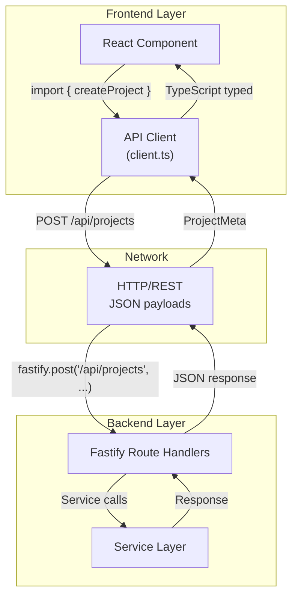
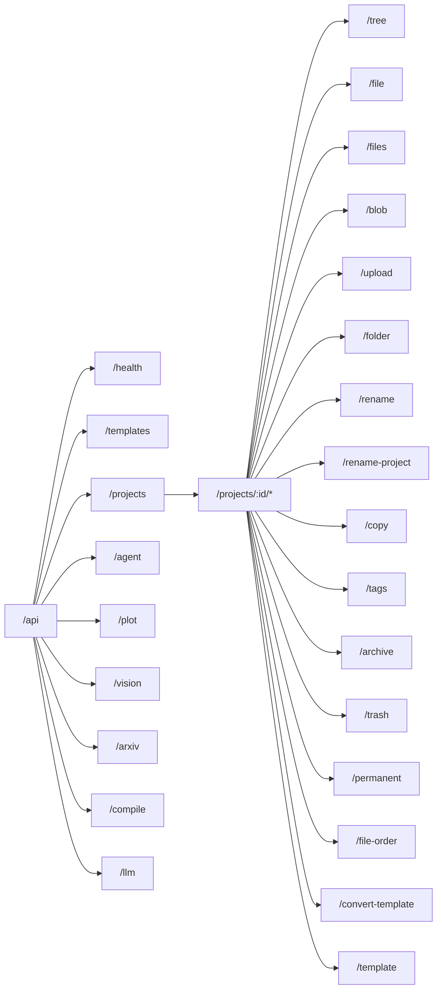
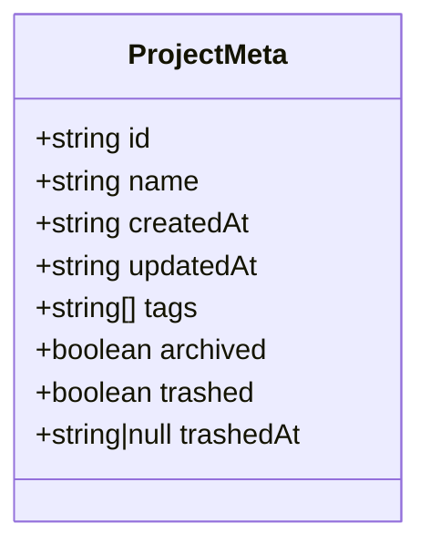
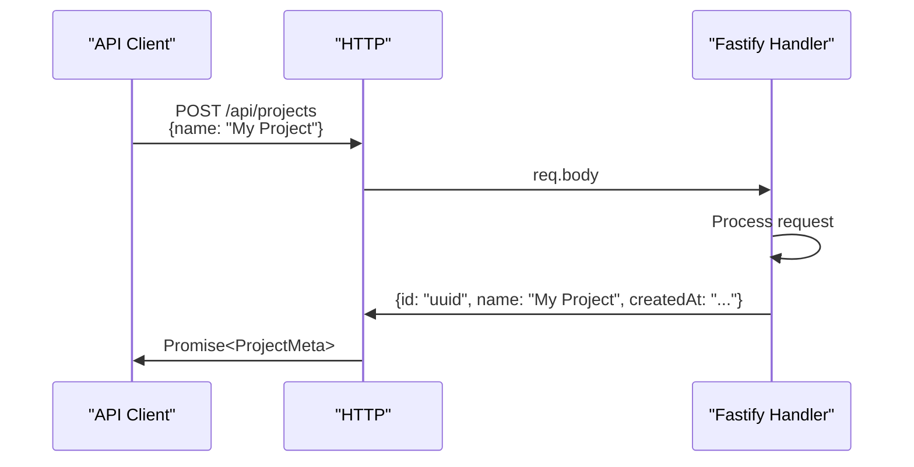
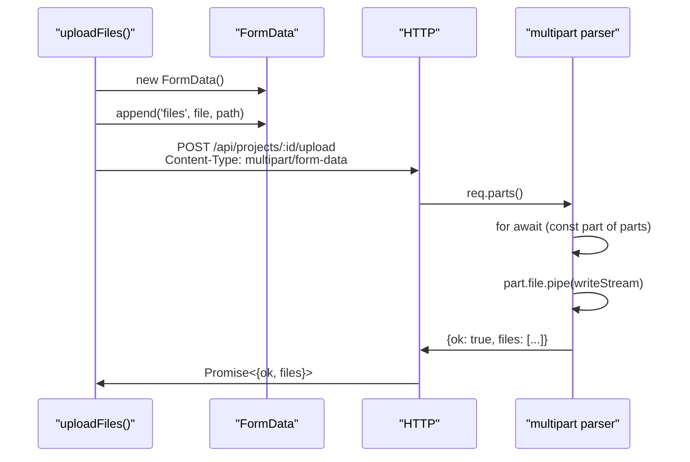
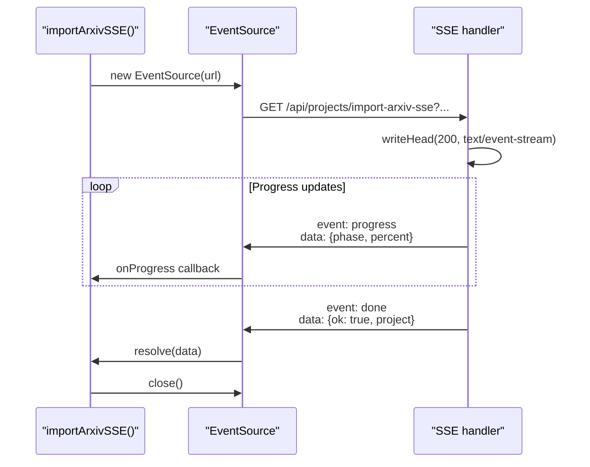
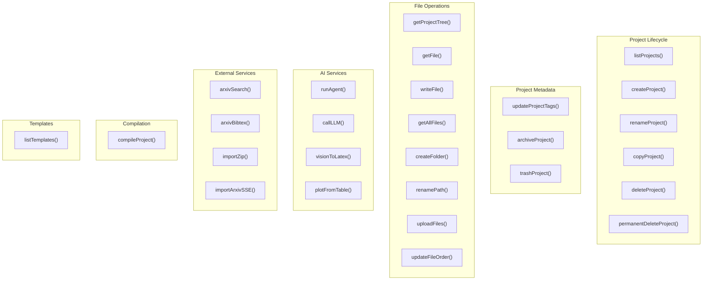
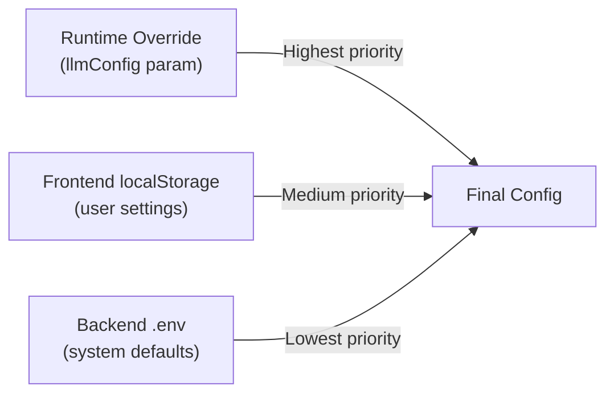

<!-- source: DeepWiki mcp.deepwiki.com · repo OpenDCAI/OpenPrism · page 3.5 API Design · fetched 2026-11-02 -->

# API Design

<details>
<summary>Relevant source files</summary>

The following files were used as context for generating this wiki page:

- [apps/backend/src/routes/projects.js](apps/backend/src/routes/projects.js)
- [apps/frontend/src/api/client.ts](apps/frontend/src/api/client.ts)

</details>


## Purpose and Scope

This document describes OpenPrism's RESTful API design, including endpoint conventions, data models, request/response patterns, and client-side abstraction layer. It covers the contract between the React frontend and Fastify backend, focusing on API structure, type definitions, and communication patterns.

For backend implementation details of specific services, see [Backend Architecture](#3.3). For frontend API consumption patterns in components, see [API Client Layer](#4.7). For data persistence mechanisms, see [Data Storage](#3.4).

**Sources:** [apps/frontend/src/api/client.ts:1-368](), [apps/backend/src/routes/projects.js:1-434]()

---

## API Architecture Overview

OpenPrism implements a RESTful HTTP API with JSON payloads. The frontend uses a centralized client module that abstracts all backend communication, providing type-safe interfaces for each operation. The backend uses Fastify route handlers that delegate to service-layer components.



**Key architectural properties:**

- **Base URL**: Empty string (`API_BASE = ''`) enables unified server deployment where backend serves frontend assets
- **Content Type**: All endpoints accept and return `application/json` except multipart routes (file uploads)
- **Language Header**: `x-lang` header sent with all requests for i18n support
- **Type Safety**: TypeScript interfaces define all request/response shapes
- **Error Convention**: Non-2xx responses throw errors with text content

**Sources:** [apps/frontend/src/api/client.ts:53-77]()

---

## RESTful Resource Organization

The API follows RESTful conventions with resources organized under `/api/*` paths. Primary resource hierarchies are:

### Endpoint Structure



**HTTP Verbs:**

| Verb | Usage | Examples |
|------|-------|----------|
| `GET` | Retrieve resources | List projects, get file tree, read file content |
| `POST` | Create resources or actions | Create project, upload files, run agent, compile |
| `PUT` | Update entire resource | Write file content |
| `PATCH` | Partial update | Update tags, archive status, trash status |
| `DELETE` | Remove resources | Delete project (trash), permanent delete |

**Sources:** [apps/frontend/src/api/client.ts:79-367](), [apps/backend/src/routes/projects.js:16-434]()

---

## Core Data Models

TypeScript interfaces define the shape of data exchanged between frontend and backend. These interfaces provide compile-time type safety and serve as API documentation.

### ProjectMeta



Represents project metadata stored in `project.json`. The `id` field is a UUID generated by `crypto.randomUUID()`.

**Sources:** [apps/frontend/src/api/client.ts:1-10](), [apps/backend/src/routes/projects.js:44-48]()

### FileItem

```typescript
interface FileItem {
  path: string;       // Relative path within project
  type: 'file' | 'dir';
}
```

Represents a file or directory entry in the project file tree. Returned by `/api/projects/:id/tree`.

**Sources:** [apps/frontend/src/api/client.ts:12-15]()

### LLMConfig

```typescript
interface LLMConfig {
  endpoint: string;   // OpenAI-compatible API endpoint
  apiKey: string;     // Authentication key
  model: string;      // Model identifier (e.g., "gpt-4o-mini")
}
```

Runtime LLM configuration overrides. Can be passed as `Partial<LLMConfig>` to allow selective overrides of environment defaults.

**Sources:** [apps/frontend/src/api/client.ts:21-25]()

### TemplateMeta

```typescript
interface TemplateMeta {
  id: string;         // Template directory name
  label: string;      // Chinese label
  mainFile: string;   // Entry point (e.g., "main.tex")
  category: string;   // Category ID
  description: string;      // Chinese description
  descriptionEn: string;    // English description
  tags: string[];
  author: string;
  featured: boolean;
}
```

Template metadata from `templates/manifest.json`. Used for template gallery display and project initialization.

**Sources:** [apps/frontend/src/api/client.ts:27-37]()

### ArxivPaper

```typescript
interface ArxivPaper {
  title: string;
  abstract: string;
  authors: string[];
  url: string;
  arxivId: string;
}
```

Structured arXiv paper metadata returned by search and BibTeX endpoints.

**Sources:** [apps/frontend/src/api/client.ts:45-51]()

---

## Request/Response Patterns

### Standard JSON Pattern

Most endpoints follow a request/response pattern with JSON bodies:



**Implementation:**

Frontend ([apps/frontend/src/api/client.ts:62-77]()):
```typescript
async function request<T>(url: string, options?: RequestInit): Promise<T> {
  const lang = getLangHeader();
  const mergedHeaders = {
    'Content-Type': 'application/json',
    'x-lang': lang,
    ...(options?.headers || {})
  };
  const res = await fetch(`${API_BASE}${url}`, {
    ...options,
    headers: mergedHeaders
  });
  if (!res.ok) {
    throw new Error(await res.text());
  }
  return res.json() as Promise<T>;
}
```

Backend ([apps/backend/src/routes/projects.js:41-54]()):
```javascript
fastify.post('/api/projects', async (req, reply) => {
  await ensureDir(DATA_DIR);
  const { name = 'Untitled', template } = req.body || {};
  const id = crypto.randomUUID();
  const projectRoot = path.join(DATA_DIR, id);
  await ensureDir(projectRoot);
  const meta = { id, name, createdAt: new Date().toISOString() };
  await writeJson(path.join(projectRoot, 'project.json'), meta);
  // ... template handling
  reply.send(meta);
});
```

**Sources:** [apps/frontend/src/api/client.ts:62-88](), [apps/backend/src/routes/projects.js:41-54]()

### Multipart Form Data Pattern

File uploads use `multipart/form-data` encoding. The frontend uses native `FormData` API, and the backend uses Fastify's multipart plugin.



**Frontend implementation** ([apps/frontend/src/api/client.ts:180-198]()):
```typescript
export async function uploadFiles(projectId: string, files: File[], basePath?: string) {
  const form = new FormData();
  files.forEach((file) => {
    const rel = (file as File & { webkitRelativePath?: string }).webkitRelativePath || file.name;
    const finalPath = basePath ? `${basePath}/${rel}` : rel;
    form.append('files', file, finalPath);
  });
  const res = await fetch(`/api/projects/${projectId}/upload`, {
    method: 'POST',
    body: form,
    headers: { 'x-lang': getLangHeader() }
  });
  // ... error handling
}
```

**Backend implementation** ([apps/backend/src/routes/projects.js:317-332]()):
```javascript
fastify.post('/api/projects/:id/upload', async (req) => {
  const { id } = req.params;
  const projectRoot = await getProjectRoot(id);
  const saved = [];
  const parts = req.parts();
  for await (const part of parts) {
    if (part.type !== 'file') continue;
    const relPath = sanitizeUploadPath(part.filename);
    const abs = safeJoin(projectRoot, relPath);
    await ensureDir(path.dirname(abs));
    await pipeline(part.file, createWriteStream(abs));
    saved.push(relPath);
  }
  return { ok: true, files: saved };
});
```

**Sources:** [apps/frontend/src/api/client.ts:180-198](), [apps/backend/src/routes/projects.js:317-332]()

### Server-Sent Events (SSE) Pattern

Long-running operations use SSE for progress streaming. The `importArxivSSE` function demonstrates this pattern:



**Frontend implementation** ([apps/frontend/src/api/client.ts:306-337]()):
```typescript
export function importArxivSSE(
  payload: { arxivIdOrUrl: string; projectName?: string },
  onProgress?: (data: { phase: string; percent: number }) => void
): Promise<{ ok: boolean; project?: ProjectMeta; error?: string }> {
  return new Promise((resolve, reject) => {
    const params = new URLSearchParams({ arxivIdOrUrl: payload.arxivIdOrUrl });
    const es = new EventSource(`/api/projects/import-arxiv-sse?${params.toString()}`);

    es.addEventListener('progress', (e) => {
      if (onProgress) {
        try { onProgress(JSON.parse(e.data)); } catch {}
      }
    });
    es.addEventListener('done', (e) => {
      es.close();
      resolve(JSON.parse(e.data));
    });
    es.addEventListener('error', (e) => {
      es.close();
      reject(new Error('SSE connection failed'));
    });
  });
}
```

**Backend implementation** ([apps/backend/src/routes/projects.js:105-167]()):
```javascript
fastify.get('/api/projects/import-arxiv-sse', async (req, reply) => {
  reply.raw.writeHead(200, {
    'Content-Type': 'text/event-stream',
    'Cache-Control': 'no-cache',
    Connection: 'keep-alive'
  });
  const send = (event, data) => {
    reply.raw.write(`event: ${event}\ndata: ${JSON.stringify(data)}\n\n`);
  };
  
  send('progress', { phase: 'download', percent: 0 });
  await downloadArxivSource(arxivId, tmpTar, ({ received, total }) => {
    send('progress', { phase: 'download', percent: Math.round((received/total)*100) });
  });
  
  send('progress', { phase: 'extract', percent: -1 });
  await tar.x({ file: tmpTar, cwd: projectRoot });
  
  send('done', { ok: true, project: meta });
  reply.raw.end();
});
```

**Sources:** [apps/frontend/src/api/client.ts:306-337](), [apps/backend/src/routes/projects.js:105-167]()

---

## Error Handling Strategy

Errors follow a consistent pattern across all endpoints:

### Frontend Error Handling

The `request()` helper throws on non-2xx responses:

```typescript
if (!res.ok) {
  throw new Error(await res.text());
}
```

Components must catch these errors:

```typescript
try {
  const project = await createProject({ name: 'New Project' });
} catch (err) {
  // Display error message to user
  console.error(err);
}
```

**Sources:** [apps/frontend/src/api/client.ts:73-75]()

### Backend Error Responses

Endpoints return structured error responses with `ok: false` and `error` field:

```typescript
// Type-safe error responses
return { ok: false, error: 'Missing required field' };

// Localized error messages
return { ok: false, error: t(lang, 'error_key', { param: value }) };
```

Examples from backend:

```javascript
// Missing parameter
if (!name) return { ok: false, error: 'Missing name' };

// Validation failure
if (!Array.isArray(tags)) return { ok: false, error: 'tags must be an array' };

// Operation failure with context
return { ok: false, error: `Template convert failed: ${String(err)}` };
```

**Sources:** [apps/backend/src/routes/projects.js:172, 222, 399]()

### HTTP Status Codes

| Code | Usage | Example |
|------|-------|---------|
| 200 | Successful operation | Project created, file saved |
| 400 | Bad request | Missing required parameters |
| 404 | Resource not found | Project ID doesn't exist |
| 500 | Server error | File system error, external service failure |

Status codes are implicit in Fastify - throwing errors or returning error objects triggers appropriate codes.

**Sources:** [apps/backend/src/routes/projects.js:56-103, 299]()

---

## API Client Abstraction

The `client.ts` module provides a complete abstraction layer over HTTP communication, exposing type-safe functions for each operation.

### Client Function Organization



### Function Signatures

Each client function is strongly typed with request payload and response types:

```typescript
// Simple GET requests
export function listProjects() {
  return request<{ projects: ProjectMeta[] }>('/api/projects');
}

// POST with payload
export function createProject(payload: { name: string; template?: string }) {
  return request<ProjectMeta>('/api/projects', {
    method: 'POST',
    body: JSON.stringify(payload)
  });
}

// PATCH for partial updates
export function updateProjectTags(id: string, tags: string[]) {
  return request<{ ok: boolean; project?: ProjectMeta }>(`/api/projects/${id}/tags`, {
    method: 'PATCH',
    body: JSON.stringify({ tags })
  });
}

// Query parameters
export function getFile(id: string, filePath: string) {
  const qs = new URLSearchParams({ path: filePath }).toString();
  return request<{ content: string }>(`/api/projects/${id}/file?${qs}`);
}
```

**Key design principles:**

1. **Single Responsibility**: Each function maps to exactly one API endpoint
2. **Type Safety**: All inputs and outputs are strongly typed
3. **Consistent Naming**: Function names describe the operation (verb + noun)
4. **Parameter Organization**: IDs in function parameters, complex data in payload objects
5. **Promise-Based**: All functions return promises for consistent async handling

**Sources:** [apps/frontend/src/api/client.ts:79-367]()

---

## Internationalization Support

All API requests include an `x-lang` header for server-side localization:

```typescript
function getLangHeader() {
  if (typeof window === 'undefined') return 'zh-CN';
  const stored = window.localStorage.getItem(LANG_KEY);
  return stored === 'en-US' ? 'en-US' : 'zh-CN';
}
```

The header is automatically included in all requests:

```typescript
const mergedHeaders = {
  'Content-Type': 'application/json',
  'x-lang': lang,
  ...(options?.headers || {})
};
```

Backend handlers access the language via utility function:

```javascript
import { getLang, t } from '../i18n/index.js';

fastify.post('/api/route', async (req) => {
  const lang = getLang(req);
  return { error: t(lang, 'error_key', { param: value }) };
});
```

This enables server-side error messages, SSE progress updates, and other text to be localized based on user preference.

**Sources:** [apps/frontend/src/api/client.ts:54-60, 64-67](), [apps/backend/src/routes/projects.js:14, 57, 93]()

---

## Agent and AI Service APIs

AI-related endpoints follow special patterns to support streaming, file attachments, and complex payloads.

### Agent Execution API

The `runAgent` function supports both direct LLM calls and tool-based multi-turn execution:

```typescript
export function runAgent(payload: {
  task: string;              // Task identifier (e.g., "polish", "translate")
  prompt: string;            // User instruction
  selection: string;         // Selected text
  content: string;           // Full document content
  mode: 'direct' | 'tools';  // Execution mode
  projectId?: string;        // Project context
  activePath?: string;       // Active file path
  compileLog?: string;       // Compilation errors for fix task
  llmConfig?: Partial<LLMConfig>;  // Runtime LLM override
  interaction?: 'chat' | 'agent';  // UI interaction mode
  history?: { role: 'user' | 'assistant'; content: string }[];  // Conversation history
}) {
  return request<{
    ok: boolean;
    reply: string;           // Conversational response
    suggestion: string;      // Inline suggestion for autocomplete
    patches?: { path: string; diff: string; content: string }[];  // File modifications
  }>(`/api/agent/run`, {
    method: 'POST',
    body: JSON.stringify(payload)
  });
}
```

**Response type variations:**

| Interaction | Mode | Returns |
|-------------|------|---------|
| `chat` | `direct` | `reply` with conversational text |
| `agent` | `tools` | `patches` with file modifications |
| autocomplete | `direct` | `suggestion` with ghost text |

**Sources:** [apps/frontend/src/api/client.ts:200-217]()

### Vision OCR API

Image-to-LaTeX conversion uses multipart form data with multiple fields:

```typescript
export async function visionToLatex(payload: {
  projectId: string;
  file: File;
  mode: string;              // 'formula' | 'table' | 'general'
  prompt?: string;
  llmConfig?: Partial<LLMConfig>;
}) {
  const form = new FormData();
  form.append('image', payload.file);
  form.append('projectId', payload.projectId);
  form.append('mode', payload.mode);
  if (payload.prompt) form.append('prompt', payload.prompt);
  if (payload.llmConfig) form.append('llmConfig', JSON.stringify(payload.llmConfig));
  
  const res = await fetch('/api/vision/latex', {
    method: 'POST',
    body: form,
    headers: { 'x-lang': getLangHeader() }
  });
  // ...
}
```

**Sources:** [apps/frontend/src/api/client.ts:339-367]()

### Plot Generation API

Chart generation from LaTeX tables includes retry logic and asset path tracking:

```typescript
export function plotFromTable(payload: {
  projectId: string;
  tableLatex: string;        // LaTeX table source
  chartType: string;         // 'bar' | 'line' | 'scatter' | 'heatmap'
  title?: string;
  prompt?: string;           // Additional instructions
  filename?: string;         // Output filename
  retries?: number;          // Retry count for LLM failures
  llmConfig?: Partial<LLMConfig>;
}) {
  return request<{
    ok: boolean;
    assetPath?: string;      // Relative path to generated image
    error?: string;
  }>('/api/plot/from-table', {
    method: 'POST',
    body: JSON.stringify(payload)
  });
}
```

**Sources:** [apps/frontend/src/api/client.ts:257-274]()

---

## Compilation API

The compilation endpoint supports multiple LaTeX engines with auto-fallback logic:

```typescript
export function compileProject(payload: {
  projectId: string;
  mainFile: string;          // Entry point (e.g., "main.tex")
  engine: 'pdflatex' | 'xelatex' | 'lualatex' | 'latexmk' | 'tectonic';
}) {
  return request<{
    ok: boolean;
    pdf?: string;            // Base64-encoded PDF data
    log?: string;            // Compilation log with errors
    status?: number;         // Exit code
    engine?: string;         // Actual engine used (after fallback)
    error?: string;
  }>('/api/compile', {
    method: 'POST',
    body: JSON.stringify(payload)
  });
}
```

The backend attempts primary engine first, then falls back to Tectonic if configured. Response includes actual engine used for client-side tracking.

**Sources:** [apps/frontend/src/api/client.ts:219-231]()

---

## File Operations API Patterns

File-related operations demonstrate various access patterns and safety mechanisms.

### Query-Based File Access

Reading single files uses query parameters for path specification:

```typescript
export function getFile(id: string, filePath: string) {
  const qs = new URLSearchParams({ path: filePath }).toString();
  return request<{ content: string }>(`/api/projects/${id}/file?${qs}`);
}
```

Backend uses `safeJoin()` to prevent directory traversal attacks:

```javascript
fastify.get('/api/projects/:id/file', async (req) => {
  const { id } = req.params;
  const { path: filePath } = req.query;
  const projectRoot = await getProjectRoot(id);
  const abs = safeJoin(projectRoot, filePath);  // Security: prevents ../../../etc/passwd
  const content = await fs.readFile(abs, 'utf8');
  return { content };
});
```

**Sources:** [apps/frontend/src/api/client.ts:141-144](), [apps/backend/src/routes/projects.js:286-294]()

### Bulk File Access

Retrieving all project files for compilation includes encoding metadata:

```typescript
export function getAllFiles(id: string) {
  return request<{
    files: {
      path: string;
      content: string;
      encoding?: 'utf8' | 'base64';  // Binary files use base64
    }[]
  }>(`/api/projects/${id}/files`);
}
```

Backend implementation:

```javascript
fastify.get('/api/projects/:id/files', async (req) => {
  const { id } = req.params;
  const projectRoot = await getProjectRoot(id);
  const items = await listFilesRecursive(projectRoot);
  const files = [];
  for (const item of items) {
    if (item.type !== 'file') continue;
    const abs = path.join(projectRoot, item.path);
    const buffer = await fs.readFile(abs);
    if (isTextFile(item.path)) {
      files.push({ path: item.path, content: buffer.toString('utf8'), encoding: 'utf8' });
    } else {
      files.push({ path: item.path, content: buffer.toString('base64'), encoding: 'base64' });
    }
  }
  return { files };
});
```

This enables compilation to work with mixed text/binary assets (images, fonts, etc.).

**Sources:** [apps/frontend/src/api/client.ts:153-157](), [apps/backend/src/routes/projects.js:351-367]()

### Batch File Writes

The `uploadFiles` function supports directory uploads with preserved structure:

```typescript
export async function uploadFiles(projectId: string, files: File[], basePath?: string) {
  const form = new FormData();
  files.forEach((file) => {
    const rel = (file as File & { webkitRelativePath?: string }).webkitRelativePath || file.name;
    const finalPath = basePath ? `${basePath}/${rel}` : rel;
    form.append('files', file, finalPath);  // Third param preserves path
  });
  // ... fetch call
}
```

Backend processes streaming upload without loading entire payload into memory:

```javascript
fastify.post('/api/projects/:id/upload', async (req) => {
  const parts = req.parts();
  for await (const part of parts) {
    if (part.type !== 'file') continue;
    const relPath = sanitizeUploadPath(part.filename);
    await pipeline(part.file, createWriteStream(abs));  // Stream-to-disk
  }
});
```

**Sources:** [apps/frontend/src/api/client.ts:180-198](), [apps/backend/src/routes/projects.js:317-332]()

---

## Configuration Precedence

LLM configuration follows a three-tier precedence system:



**Implementation pattern:**

```typescript
// Frontend: User can override per-request
await runAgent({
  task: 'polish',
  prompt: '...',
  llmConfig: {
    endpoint: 'https://custom.api',  // Override system default
    model: 'gpt-4'
  }
});

// Backend: Merges configurations
const finalConfig = {
  endpoint: payload.llmConfig?.endpoint || process.env.OPENPRISM_LLM_ENDPOINT,
  apiKey: payload.llmConfig?.apiKey || process.env.OPENPRISM_LLM_API_KEY,
  model: payload.llmConfig?.model || process.env.OPENPRISM_LLM_MODEL
};
```

This allows system administrators to set defaults while giving individual users flexibility to use their own API keys and endpoints.

**Sources:** [apps/frontend/src/api/client.ts:21-25, 209, 265, 279, 344]()

---

