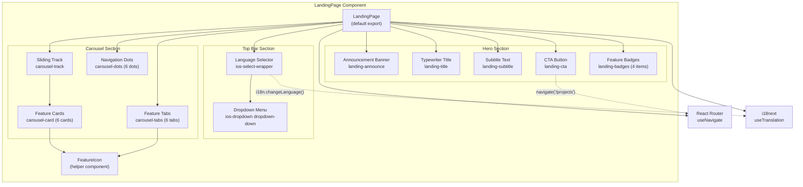
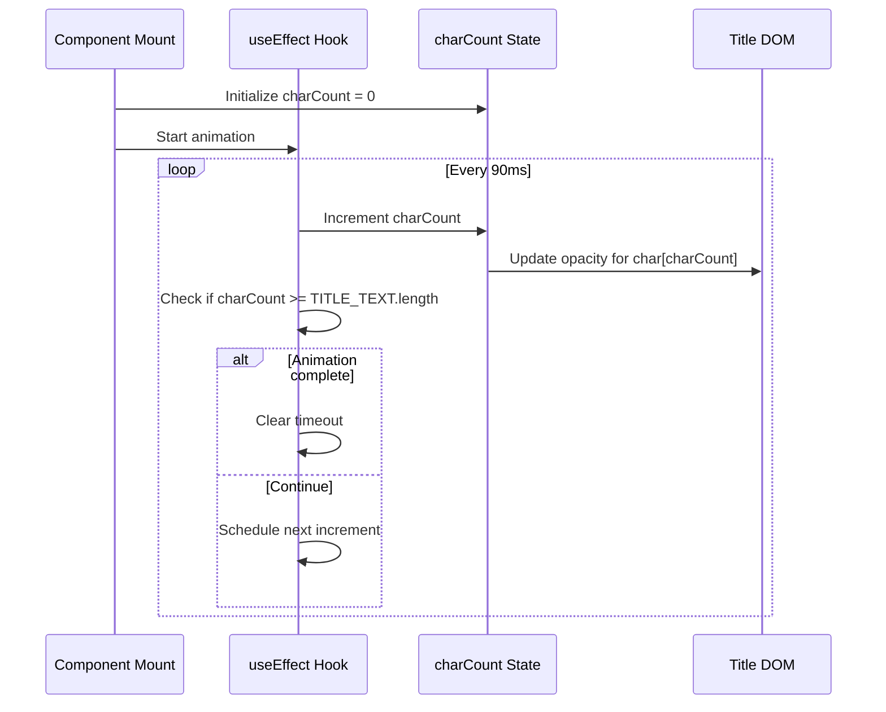
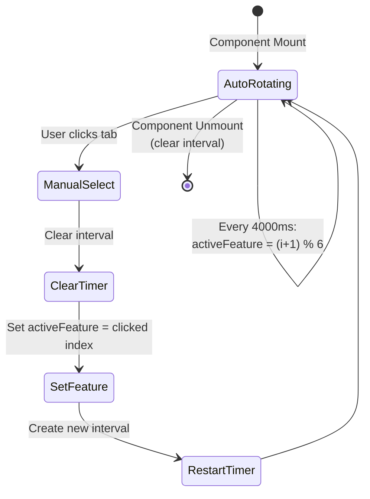
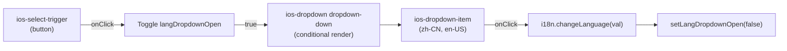
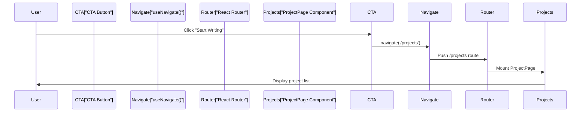
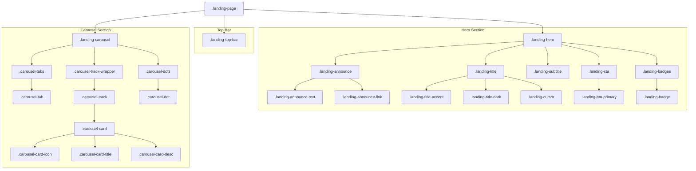

<!-- source: DeepWiki mcp.deepwiki.com · repo OpenDCAI/OpenPrism · page 4.1 Landing Page · fetched 2026-11-02 -->

# Landing Page

<details>
<summary>Relevant source files</summary>

The following files were used as context for generating this wiki page:

- [apps/frontend/src/app/App.css](apps/frontend/src/app/App.css)
- [apps/frontend/src/app/LandingPage.tsx](apps/frontend/src/app/LandingPage.tsx)
- [apps/frontend/src/i18n/locales/en-US.json](apps/frontend/src/i18n/locales/en-US.json)
- [apps/frontend/src/i18n/locales/zh-CN.json](apps/frontend/src/i18n/locales/zh-CN.json)

</details>


## Purpose and Scope

The Landing Page serves as the marketing and onboarding entry point for OpenPrism. It provides an interactive showcase of the system's six core features (AI completion, vision recognition, plotting, paper search, AI agent, and quality review) through an auto-rotating carousel interface. The page handles initial user engagement, language selection, and navigation to the main application workspace.

For information about the project management interface that users navigate to after the landing page, see [Project Management Interface](#4.2). For details on the complete frontend architecture, see [Frontend Architecture](#3.2).

---

## Component Architecture

The landing page is implemented as a single-page React component with three primary UI sections: a language selector top bar, a hero section with branding and call-to-action, and an interactive feature carousel.



**Sources:** [apps/frontend/src/app/LandingPage.tsx:1-222]()

---

## Component State and Constants

The `LandingPage` component manages four pieces of local state and references two key constants that drive its behavior.

| State Variable | Type | Purpose |
|----------------|------|---------|
| `charCount` | `number` | Controls typewriter animation progress for title |
| `activeFeature` | `number` | Index of currently displayed feature in carousel (0-5) |
| `langDropdownOpen` | `boolean` | Controls visibility of language selection dropdown |
| `timerRef` | `MutableRefObject` | Stores interval ID for auto-carousel rotation |

| Constant | Value | Purpose |
|----------|-------|---------|
| `TITLE_TEXT` | `"OpenPrism is Here"` | Text displayed in typewriter animation |
| `FEATURE_KEYS` | `['completion', 'vision', 'plot', 'search', 'agent', 'review']` | Array of feature identifiers for carousel |
| `AUTO_INTERVAL` | `4000` | Milliseconds between automatic carousel transitions |

**Sources:** [apps/frontend/src/app/LandingPage.tsx:5-7](), [apps/frontend/src/app/LandingPage.tsx:12-15]()

---

## Typewriter Animation System

The landing page title implements a character-by-character reveal animation using a state-driven approach. Each character's opacity transitions based on its position relative to `charCount`.



The implementation splits `TITLE_TEXT` into individual characters, applying conditional CSS classes:
- Characters 0-8 (inclusive): `landing-title-accent` class
- Characters 9-18: `landing-title-dark` class
- All characters: opacity controlled by `i < charCount ? 1 : 0`

A blinking cursor element (`landing-cursor`) is appended after the text to simulate terminal-style typing.

**Sources:** [apps/frontend/src/app/LandingPage.tsx:17-21](), [apps/frontend/src/app/LandingPage.tsx:82-100]()

---

## Carousel Auto-Rotation Logic

The feature carousel automatically advances through the six features on a timer while allowing manual tab selection to interrupt and restart the auto-rotation cycle.



The `timerRef` maintains a reference to the active `setInterval` ID, enabling cleanup on unmount and interruption on manual selection via the `selectFeature` function [apps/frontend/src/app/LandingPage.tsx:30-36]().

**Sources:** [apps/frontend/src/app/LandingPage.tsx:23-28](), [apps/frontend/src/app/LandingPage.tsx:30-36]()

---

## Internationalization Integration

The landing page fully supports multi-language rendering through the i18next library, with language selection persisted across sessions.

### Translation Key Structure

All user-facing text uses translation keys prefixed with `landing.`:

| Translation Key Pattern | Example Usage | Purpose |
|------------------------|---------------|---------|
| `landing.announce` | Announcement banner text | Top banner content |
| `landing.subtitle` | Subtitle with HTML | Main tagline (supports `<b>` tags) |
| `landing.startWriting` | CTA button text | Primary action button |
| `landing.featureX` | Badge labels | Hero section feature badges |
| `landing.feat.X.tab` | Carousel tab labels | Tab navigation text |
| `landing.feat.X.title` | Feature card titles | Card heading text |
| `landing.feat.X.desc` | Feature card descriptions | Card body text |

### Language Switcher Implementation

The top-bar language selector implements an iOS-style dropdown pattern:



Active language items display a checkmark icon. Current language is read from `i18n.language` and mapped to display labels via the translation system.

**Sources:** [apps/frontend/src/app/LandingPage.tsx:11](), [apps/frontend/src/app/LandingPage.tsx:40-62](), [apps/frontend/src/i18n/locales/zh-CN.json:378-404](), [apps/frontend/src/i18n/locales/en-US.json:378-404]()

---

## Feature Carousel Architecture

The carousel displays six features in a horizontally-scrolling track with synchronized tab navigation and dot indicators.

### Carousel Components Mapping

```mermaid
graph TB
    Container["landing-carousel<br/>(section element)"]
    
    subgraph "Tab Navigation"
        TabsWrapper["carousel-tabs<br/>(div container)"]
        Tab0["carousel-tab<br/>(button: completion)"]
        Tab1["carousel-tab<br/>(button: vision)"]
        Tab2["carousel-tab<br/>(button: plot)"]
        Tab3["carousel-tab<br/>(button: search)"]
        Tab4["carousel-tab<br/>(button: agent)"]
        Tab5["carousel-tab<br/>(button: review)"]
    end
    
    subgraph "Sliding Track System"
        TrackWrapper["carousel-track-wrapper<br/>(overflow container)"]
        Track["carousel-track<br/>(transform: translateX)"]
        Card0["carousel-card<br/>(FeatureIcon + text)"]
        Card1["carousel-card"]
        Card2["carousel-card"]
        Card3["carousel-card"]
        Card4["carousel-card"]
        Card5["carousel-card"]
    end
    
    subgraph "Dot Indicators"
        DotsWrapper["carousel-dots<br/>(div container)"]
        Dot0["carousel-dot<br/>(button indicator)"]
        Dot1["carousel-dot"]
        Dot2["carousel-dot"]
        Dot3["carousel-dot"]
        Dot4["carousel-dot"]
        Dot5["carousel-dot"]
    end
    
    Container --> TabsWrapper
    Container --> TrackWrapper
    Container --> DotsWrapper
    
    TabsWrapper --> Tab0
    TabsWrapper --> Tab1
    TabsWrapper --> Tab2
    TabsWrapper --> Tab3
    TabsWrapper --> Tab4
    TabsWrapper --> Tab5
    
    TrackWrapper --> Track
    Track --> Card0
    Track --> Card1
    Track --> Card2
    Track --> Card3
    Track --> Card4
    Track --> Card5
    
    DotsWrapper --> Dot0
    DotsWrapper --> Dot1
    DotsWrapper --> Dot2
    DotsWrapper --> Dot3
    DotsWrapper --> Dot4
    DotsWrapper --> Dot5
```



### Transform-Based Sliding Animation

The carousel uses CSS transforms to slide the track horizontally. The `activeFeature` state index directly controls the `translateX` percentage:

- `activeFeature = 0` → `translateX(0%)`
- `activeFeature = 1` → `translateX(-100%)`
- `activeFeature = 2` → `translateX(-200%)`
- ... and so on

Each card occupies 100% of the wrapper width. The calculation `translateX(-${activeFeature * 100}%)` positions the selected card in the viewport [apps/frontend/src/app/LandingPage.tsx:169-172]().

**Sources:** [apps/frontend/src/app/LandingPage.tsx:154-198]()

---

## FeatureIcon Component

The `FeatureIcon` helper renders SVG icons for each feature using a switch statement on the feature name. All icons share consistent SVG properties and styling attributes.

| Feature Key | SVG Paths |
|-------------|-----------|
| `completion` | Three stacked layers (AI model visualization) |
| `vision` | Rectangle frame with circle and line (image recognition) |
| `plot` | Three vertical bars of varying heights (chart visualization) |
| `search` | Circle with diagonal line (search icon) |
| `agent` | Rectangle with face elements (AI assistant) |
| `review` | Circle with checkmark polyline (quality check) |

All icons use these standardized props:
```typescript
{
  width: 32,
  height: 32,
  viewBox: '0 0 24 24',
  fill: 'none',
  stroke: 'currentColor',
  strokeWidth: 1.8,
  strokeLinecap: 'round',
  strokeLinejoin: 'round'
}
```

**Sources:** [apps/frontend/src/app/LandingPage.tsx:203-221]()

---

## Navigation Integration

The landing page integrates with React Router to transition users to the main application workspace.



The primary call-to-action button invokes `navigate('/projects')` on click [apps/frontend/src/app/LandingPage.tsx:110-116](), transitioning to the project management interface where users can create or open LaTeX projects.

**Sources:** [apps/frontend/src/app/LandingPage.tsx:10](), [apps/frontend/src/app/LandingPage.tsx:110-116]()

---

## CSS Class Hierarchy

The landing page styling follows a hierarchical class naming convention with a `landing-` prefix for the main container and section-specific prefixes for child elements.



**Note:** The actual CSS rules are defined in the global stylesheet but not included in the provided file excerpts. The class structure is inferred from JSX className attributes.

**Sources:** [apps/frontend/src/app/LandingPage.tsx:39-199]()

---

## Accessibility Considerations

The landing page implements several accessibility patterns:

- **Semantic HTML**: Uses `<section>`, `<button>`, and `<h1>` elements appropriately
- **Interactive elements**: All clickable areas use `<button>` elements with onClick handlers
- **SVG icons**: Decorative icons use `aria-hidden` implicitly (no text alternatives needed for visual enhancements)
- **Keyboard navigation**: All interactive buttons are focusable via tab key
- **Language identification**: The `i18n.language` value can be used to set `lang` attributes on parent elements

**Sources:** [apps/frontend/src/app/LandingPage.tsx:38-200]()

---

## Summary: Code-to-UI Mapping

| Code Entity | UI Element | Primary Interaction |
|-------------|-----------|-------------------|
| `LandingPage` component | Root container | None (container only) |
| `charCount` state | Title character opacity | Animated typewriter effect |
| `activeFeature` state | Carousel position | Tab/dot clicks, auto-rotation |
| `langDropdownOpen` state | Language selector | Dropdown toggle |
| `selectFeature(i)` function | Tab/dot clicks | Manual feature selection |
| `navigate('/projects')` call | CTA button | Navigation to projects |
| `i18n.changeLanguage(val)` call | Language dropdown items | Language switching |
| `FeatureIcon` component | Carousel card icons | Visual feature representation |
| `FEATURE_KEYS` array | Carousel iteration | Drives all feature loops |
| Translation keys `landing.*` | All text content | i18next rendering |

**Sources:** [apps/frontend/src/app/LandingPage.tsx:1-222]()

---

