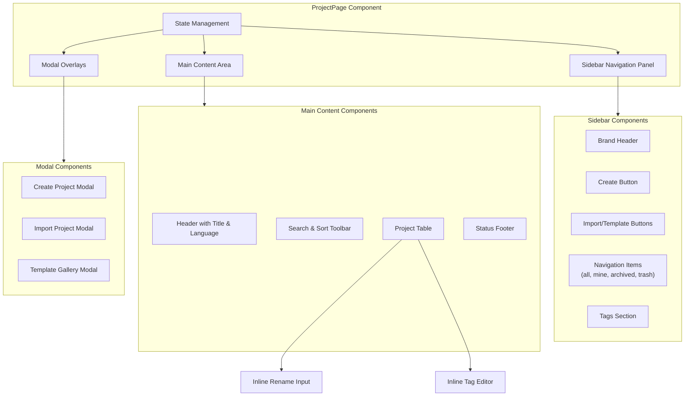
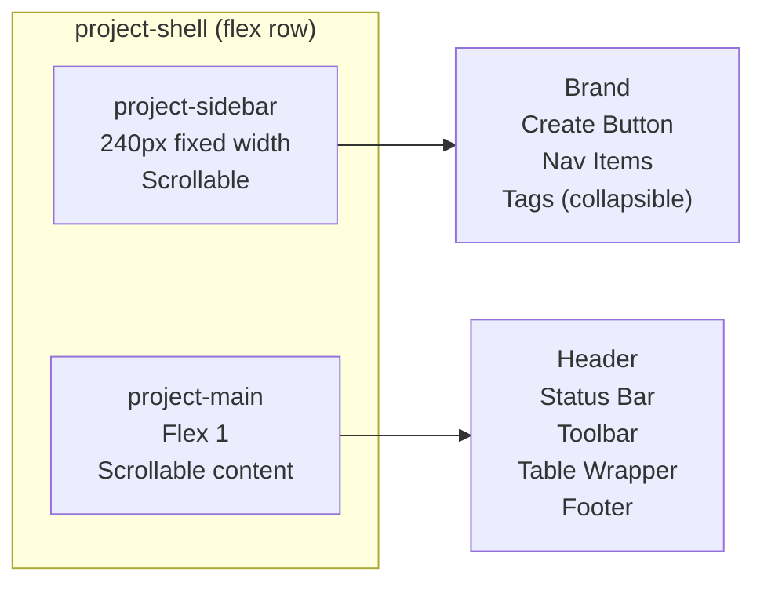
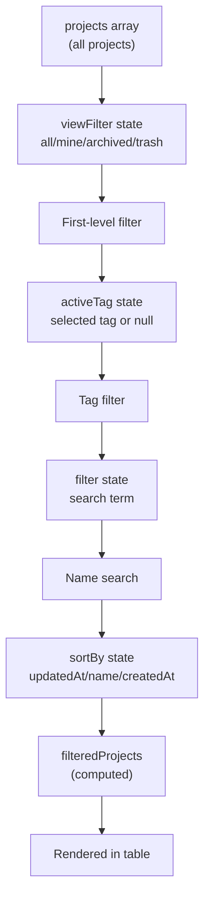
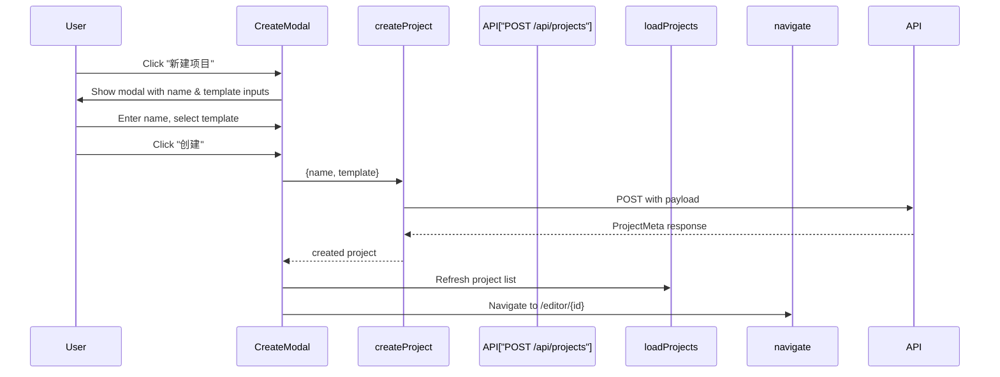
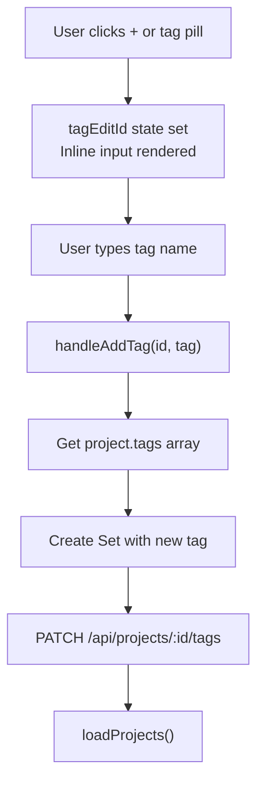
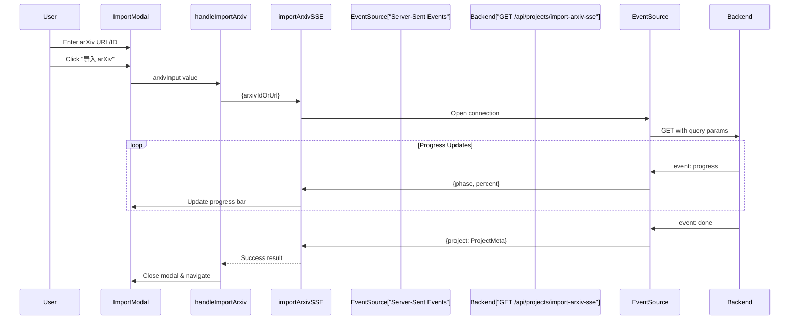
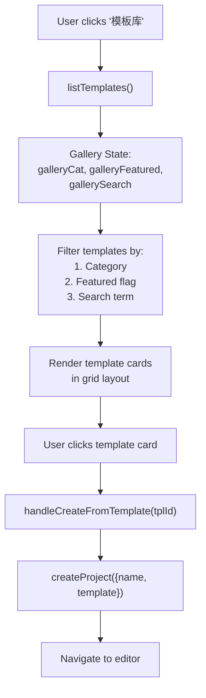
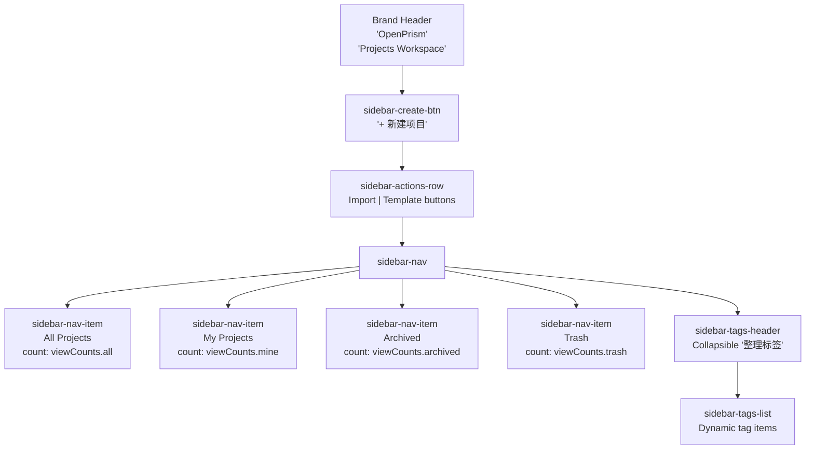

<!-- source: DeepWiki mcp.deepwiki.com · repo OpenDCAI/OpenPrism · page 4.2 Project Management Interface · fetched 2026-11-02 -->

# Project Management Interface

<details>
<summary>Relevant source files</summary>

The following files were used as context for generating this wiki page:

- [apps/frontend/src/api/client.ts](apps/frontend/src/api/client.ts)
- [apps/frontend/src/app/App.css](apps/frontend/src/app/App.css)
- [apps/frontend/src/app/ProjectPage.tsx](apps/frontend/src/app/ProjectPage.tsx)

</details>


## Purpose and Scope

The Project Management Interface provides a centralized workspace for users to view, organize, and manage their LaTeX projects. This interface is implemented in the `ProjectPage` component and serves as the landing area after initial authentication or when navigating away from the editor.

This page covers the project listing UI, filtering/sorting mechanisms, CRUD operations, project import workflows, and template selection. For information about editing individual projects, see [Editor Workspace](#4.3). For initial landing page content, see [Landing Page](#4.1).

**Sources:** [apps/frontend/src/app/ProjectPage.tsx:1-796]()

---

## Component Architecture

The project management interface is built as a single-page component with a two-panel layout and multiple modal overlays for complex operations.



**Sources:** [apps/frontend/src/app/ProjectPage.tsx:33-795](), [apps/frontend/src/app/App.css:2921-3441]()

---

## Layout Structure



The layout uses a two-column flex container (`.project-shell`) with a fixed-width sidebar (`.project-sidebar`, 240px) and a flexible main content area (`.project-main`). The sidebar is vertically scrollable and contains navigation and organizational tools. The main content area is also scrollable and contains the project table.

**Sources:** [apps/frontend/src/app/ProjectPage.tsx:322-393](), [apps/frontend/src/app/App.css:2922-3144]()

---

## Data Model

### ProjectMeta Interface

The core data structure representing a project is defined in the API client:

| Field | Type | Description |
|-------|------|-------------|
| `id` | `string` | Unique project identifier |
| `name` | `string` | User-facing project name |
| `createdAt` | `string` | ISO timestamp of creation |
| `updatedAt` | `string` | ISO timestamp of last modification |
| `tags` | `string[]` | Array of user-defined tags |
| `archived` | `boolean` | Whether project is archived |
| `trashed` | `boolean` | Whether project is in trash |
| `trashedAt` | `string \| null` | ISO timestamp of trash action |

**Sources:** [apps/frontend/src/api/client.ts:1-10]()

### Component State Variables

| State Variable | Type | Purpose |
|----------------|------|---------|
| `projects` | `ProjectMeta[]` | Full list of user projects |
| `templates` | `TemplateMeta[]` | Available project templates |
| `categories` | `TemplateCategory[]` | Template category definitions |
| `viewFilter` | `'all' \| 'mine' \| 'archived' \| 'trash'` | Current view mode |
| `activeTag` | `string \| null` | Selected tag for filtering |
| `sortBy` | `'updatedAt' \| 'name' \| 'createdAt'` | Active sort criterion |
| `selectedIds` | `Set<string>` | Checked project IDs for bulk operations |
| `filter` | `string` | Search query text |
| `renameState` | `{id: string, value: string} \| null` | Inline rename editor state |
| `tagEditId` | `string \| null` | Project ID with active tag input |

**Sources:** [apps/frontend/src/app/ProjectPage.tsx:37-70]()

---

## View Filtering and Organization

The interface provides multiple levels of filtering and organization:



### View Filters

The `viewFilter` state determines which projects are visible based on their archive/trash status:

- **all**: All projects except trashed (`!p.trashed`)
- **mine**: Active projects only (`!p.archived && !p.trashed`)
- **archived**: Archived but not trashed (`p.archived && !p.trashed`)
- **trash**: Only trashed projects (`p.trashed`)

**Sources:** [apps/frontend/src/app/ProjectPage.tsx:98-113]()

### Tag-Based Filtering

When `activeTag` is set, projects are filtered to only those containing that tag in their `tags` array. Tags are displayed in the sidebar with counts derived from all projects.

**Sources:** [apps/frontend/src/app/ProjectPage.tsx:92-96, 104]()

### Search and Sort

The `filter` state applies a case-insensitive substring match on project names. The `sortBy` state controls the sort order:

- **updatedAt**: Most recently modified first (default)
- **name**: Alphabetical by name
- **createdAt**: Most recently created first

**Sources:** [apps/frontend/src/app/ProjectPage.tsx:105-111]()

---

## CRUD Operations

### Project Creation Flow



The creation flow is handled by `handleCreate()` at [apps/frontend/src/app/ProjectPage.tsx:135-150](). It calls the API endpoint through `createProject()` at [apps/frontend/src/api/client.ts:83-88]().

**Sources:** [apps/frontend/src/app/ProjectPage.tsx:135-150](), [apps/frontend/src/api/client.ts:83-88]()

### Inline Rename Operation

```mermaid
sequenceDiagram
    participant User
    participant Table["Project Table"]
    participant renameState
    participant handleRename
    participant API["POST /api/projects/:id/rename-project"]
    
    User->>Table: Click "重命名" button
    Table->>renameState: Set {id, value: current name}
    renameState->>Table: Render inline input
    User->>Table: Edit name
    User->>Table: Press Enter or blur
    Table->>handleRename: Trigger save
    handleRename->>API: {name: new value}
    API-->>handleRename: Success response
    handleRename->>renameState: Clear state
    handleRename->>loadProjects: Refresh list
```

Inline rename is implemented with conditional rendering in the table cell. When `renameState.id` matches the project ID, an `<input>` replaces the project name display.

**Sources:** [apps/frontend/src/app/ProjectPage.tsx:152-166, 494-505](), [apps/frontend/src/api/client.ts:90-95]()

### Delete and Trash Operations

The interface supports two deletion workflows:

1. **Soft Delete (Trash)**: Sets `trashed: true` via `PATCH /api/projects/:id/trash`
2. **Permanent Delete**: Removes project entirely via `DELETE /api/projects/:id/permanent`

Users can restore trashed projects by setting `trashed: false`, or permanently delete them from the trash view.

**Sources:** [apps/frontend/src/app/ProjectPage.tsx:168-213](), [apps/frontend/src/api/client.ts:104-114, 130-135]()

### Archive Operation

Archiving toggles the `archived` boolean via `PATCH /api/projects/:id/archive`. Archived projects are excluded from the "mine" view but remain searchable in "all" and "archived" views.

**Sources:** [apps/frontend/src/app/ProjectPage.tsx:178-185](), [apps/frontend/src/api/client.ts:123-128]()

### Copy Operation

The copy operation creates a duplicate project with "(Copy)" appended to the name:

**Sources:** [apps/frontend/src/app/ProjectPage.tsx:253-261](), [apps/frontend/src/api/client.ts:97-102]()

---

## Tag Management



Tags are managed through inline editors in the table. Each project row shows its tags as pills, and clicking the "+" button activates an input field for adding new tags. Tags can be removed by clicking the "×" on each pill.

The `allTags` computed value extracts all unique tags across all projects for display in the sidebar.

**Sources:** [apps/frontend/src/app/ProjectPage.tsx:92-96, 215-237, 513-548](), [apps/frontend/src/api/client.ts:116-121]()

---

## Import Mechanisms

### ZIP Import Flow

```mermaid
sequenceDiagram
    participant User
    participant ImportModal
    participant FileInput["<input type=file>"]
    participant handleImportZip
    participant FormData
    participant API["POST /api/projects/import-zip"]
    participant navigate
    
    User->>ImportModal: Click "导入项目"
    ImportModal->>User: Show modal
    User->>ImportModal: Click "选择文件"
    ImportModal->>FileInput: Trigger click()
    FileInput->>User: OS file picker
    User->>FileInput: Select .zip file
    FileInput->>handleImportZip: File object
    handleImportZip->>FormData: Append file & projectName
    FormData->>API: POST multipart/form-data
    API-->>handleImportZip: {project: ProjectMeta}
    handleImportZip->>navigate: /editor/{project.id}
```

ZIP import uses a hidden file input (ref `zipInputRef`) that is programmatically clicked. The selected file is sent via FormData to the backend.

**Sources:** [apps/frontend/src/app/ProjectPage.tsx:263-278, 585-599](), [apps/frontend/src/api/client.ts:287-304]()

### arXiv Import with Server-Sent Events



arXiv import uses Server-Sent Events (SSE) for real-time progress tracking. The `importArxivSSE()` function establishes an EventSource connection and listens for "progress" and "done" events. The UI displays a progress bar that updates as the download and extraction proceed.

**Sources:** [apps/frontend/src/app/ProjectPage.tsx:280-305](), [apps/frontend/src/api/client.ts:306-337]()

---

## Template Gallery

The template gallery modal provides a browsable interface for selecting project templates:



### Template Data Structure

Templates are defined by the `TemplateMeta` interface:

| Field | Type | Description |
|-------|------|-------------|
| `id` | `string` | Template identifier |
| `label` | `string` | Display name |
| `mainFile` | `string` | Entry point file |
| `category` | `string` | Category ID for grouping |
| `description` | `string` | Chinese description |
| `descriptionEn` | `string` | English description |
| `tags` | `string[]` | Template tags |
| `author` | `string` | Template author |
| `featured` | `boolean` | Featured flag for prominence |

**Sources:** [apps/frontend/src/api/client.ts:27-37](), [apps/frontend/src/app/ProjectPage.tsx:122-133, 239-251, 726-792]()

---

## API Integration

All operations in the Project Management Interface communicate with the backend through the centralized API client. Below is a complete mapping of UI operations to API endpoints:

| Operation | Function | HTTP Method | Endpoint | Request Body | Response |
|-----------|----------|-------------|----------|--------------|----------|
| Load projects | `listProjects()` | GET | `/api/projects` | — | `{projects: ProjectMeta[]}` |
| Create project | `createProject()` | POST | `/api/projects` | `{name, template?}` | `ProjectMeta` |
| Rename project | `renameProject()` | POST | `/api/projects/:id/rename-project` | `{name}` | `{ok, project?, error?}` |
| Copy project | `copyProject()` | POST | `/api/projects/:id/copy` | `{name?}` | `{ok, project?, error?}` |
| Delete project | `deleteProject()` | DELETE | `/api/projects/:id` | — | `{ok, error?}` |
| Permanent delete | `permanentDeleteProject()` | DELETE | `/api/projects/:id/permanent` | — | `{ok}` |
| Update tags | `updateProjectTags()` | PATCH | `/api/projects/:id/tags` | `{tags: string[]}` | `{ok, project?}` |
| Archive/unarchive | `archiveProject()` | PATCH | `/api/projects/:id/archive` | `{archived: boolean}` | `{ok, project?}` |
| Trash/restore | `trashProject()` | PATCH | `/api/projects/:id/trash` | `{trashed: boolean}` | `{ok, project?}` |
| Import ZIP | `importZip()` | POST | `/api/projects/import-zip` | FormData with file | `{ok, project?, error?}` |
| Import arXiv | `importArxivSSE()` | GET (SSE) | `/api/projects/import-arxiv-sse` | Query params | SSE stream → `{ok, project?, error?}` |
| Load templates | `listTemplates()` | GET | `/api/templates` | — | `{templates: TemplateMeta[], categories?: TemplateCategory[]}` |

**Sources:** [apps/frontend/src/api/client.ts:79-337]()

---

## UI Component Mapping

### Sidebar Navigation Structure

The sidebar uses a custom navigation pattern with icon-labeled items and counts:



Each navigation item has an active state that applies the `.active` class, changing its background and text color. The active item is determined by comparing `viewFilter` state and `activeTag`.

**Sources:** [apps/frontend/src/app/ProjectPage.tsx:308-392](), [apps/frontend/src/app/App.css:2989-3092]()

### Project Table Structure

The table uses a traditional HTML `<table>` element with custom styling:

| Column Class | Width | Content | Sortable |
|--------------|-------|---------|----------|
| `.col-check` | 40px | Checkbox for selection | No |
| `.col-name` | 35% | Project name (clickable or inline input) | Yes |
| `.col-tags` | 200px | Tag pills with add/remove controls | No |
| `.col-modified` | 120px | Relative time since last update | Yes |
| `.col-actions` | 280px | Action buttons (open, rename, copy, etc.) | No |

The table header includes a "select all" checkbox that toggles all visible projects. Individual rows show a selected state with background color change when checked.

**Sources:** [apps/frontend/src/app/ProjectPage.tsx:459-578](), [apps/frontend/src/app/App.css:3174-3273]()

---

## Internationalization

The interface supports English and Chinese through `react-i18next`. All user-facing strings are wrapped in `t()` calls:

```typescript
// Example translations
t('新建项目')       // "New Project" in EN
t('所有项目')       // "All Projects" in EN
t('重命名')         // "Rename" in EN
t('删除项目 {{name}}？此操作不可撤销。', { name })
```

The language selector is displayed in the main header using an `ios-select-wrapper` dropdown. Language preference is stored in localStorage and affects both UI strings and template descriptions.

**Sources:** [apps/frontend/src/app/ProjectPage.tsx:35, 404-424]()

---

## Modal Components

All modal dialogs use a consistent structure with backdrop click-to-close:

```
.modal-backdrop (fixed, full screen, semi-transparent)
  └─ .modal (centered card)
       ├─ .modal-header (title + close button)
       ├─ .modal-body (form fields or content)
       └─ .modal-actions (cancel + confirm buttons)
```

The template gallery modal uses a larger size (`.template-gallery-modal`) with a grid layout for template cards.

**Sources:** [apps/frontend/src/app/ProjectPage.tsx:601-792](), [apps/frontend/src/app/App.css:2136-2184, 3275-3414]()

---

