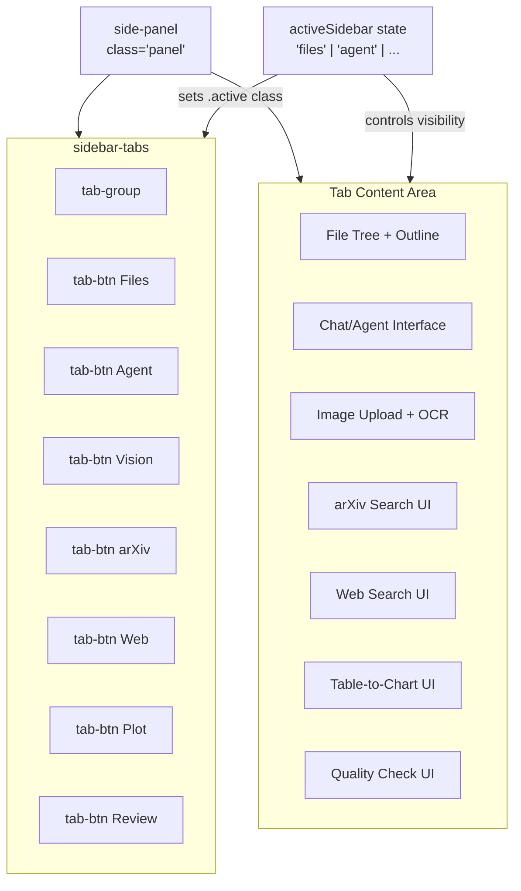
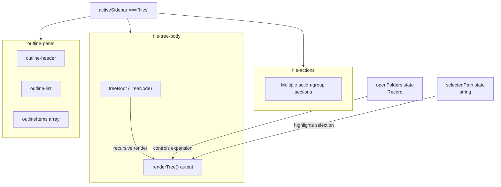
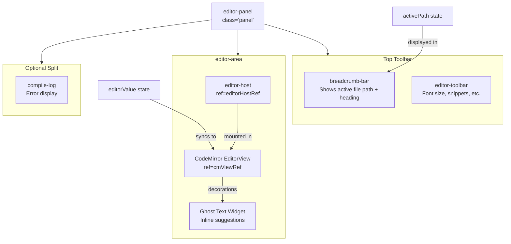
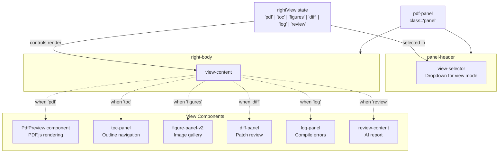
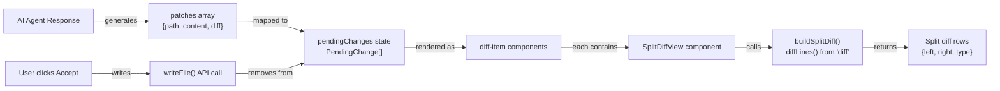
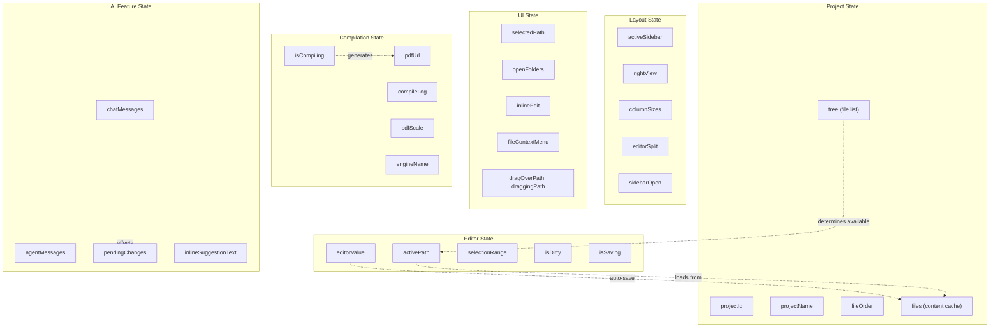

<!-- source: DeepWiki mcp.deepwiki.com · repo OpenDCAI/OpenPrism · page 4.3 Editor Workspace · fetched 2026-11-02 -->

# Editor Workspace

<details>
<summary>Relevant source files</summary>

The following files were used as context for generating this wiki page:

- [apps/frontend/src/app/App.css](apps/frontend/src/app/App.css)
- [apps/frontend/src/app/EditorPage.tsx](apps/frontend/src/app/EditorPage.tsx)

</details>


## Purpose and Scope

The Editor Workspace is the primary user interface for document editing in OpenPrism. It implements a three-panel layout with an adjustable sidebar (left), a CodeMirror-based LaTeX editor (center), and a context-sensitive right panel. This page documents the workspace architecture, layout management, panel organization, and state coordination.

For details on the CodeMirror editor integration and extensions, see [CodeMirror Integration](#4.4). For UI components and styling patterns, see [UI Components and Styling](#4.5). For backend compilation services, see [Compilation Service](#5.2).

**Sources:** [apps/frontend/src/app/EditorPage.tsx:1-2884](), [apps/frontend/src/app/App.css:171-220]()

---

## Layout Architecture

### Three-Panel Grid System

The workspace uses CSS Grid to define three primary regions: sidebar, editor, and right panel. The layout is defined by the `.workspace` CSS class with dynamic column sizing controlled by CSS custom properties.

**Diagram: Workspace Grid Layout**

```mermaid
graph TB
    subgraph Workspace["workspace (CSS Grid)"]
        direction LR
        Sidebar["side-panel<br/>(--col-sidebar)"]
        HandleL["drag-handle.sidebar-handle<br/>(--col-sidebar-gap)"]
        Editor["editor-panel<br/>(--col-editor)"]
        HandleR["drag-handle.main-handle<br/>(10px fixed)"]
        RightPanel["pdf-panel<br/>(--col-right)"]
    end
    
    Sidebar -->|"grid-column: 1"| HandleL
    HandleL -->|"grid-column: 2"| Editor
    Editor -->|"grid-column: 3"| HandleR
    HandleR -->|"grid-column: 4"| RightPanel
    RightPanel -.->|"grid-column: 5"| End[""]
    
    State["columnSizes state<br/>{sidebar, editor, right}"]
    State -->|"generates CSS vars"| Workspace
```

**Sources:** [apps/frontend/src/app/App.css:171-179](), [apps/frontend/src/app/EditorPage.tsx:1157]()

The grid template is defined as:
```
grid-template-columns: var(--col-sidebar) var(--col-sidebar-gap) minmax(360px, var(--col-editor)) 10px minmax(var(--col-right), 1fr);
```

Column sizes are stored in the `columnSizes` state object and applied as CSS custom properties dynamically.

**Sources:** [apps/frontend/src/app/App.css:173](), [apps/frontend/src/app/EditorPage.tsx:1157]()

### Drag Handle System

Two vertical drag handles enable manual resizing of panels:

| Handle | Grid Column | CSS Class | Purpose |
|--------|-------------|-----------|---------|
| Sidebar Handle | 2 | `.drag-handle.sidebar-handle` | Resize sidebar width |
| Main Handle | 4 | `.drag-handle.main-handle` | Resize editor vs right panel |

Drag handles implement `cursor: col-resize` and transition background color on hover. The resizing logic is implemented through mouse event handlers that calculate new column sizes based on cursor position.

**Sources:** [apps/frontend/src/app/App.css:201-229]()

---

## Sidebar Panel

The sidebar is the leftmost panel containing seven tab modes for different workflows. It uses the `activeSidebar` state to track the current tab and conditionally renders tab-specific content.

### Sidebar Tab Architecture

**Diagram: Sidebar Tab System**



**Sources:** [apps/frontend/src/app/App.css:296-366](), [apps/frontend/src/app/EditorPage.tsx:1154]()

### Tab Implementation Details

Each tab button has:
- Base class: `.tab-btn`
- Active state class: `.tab-btn.active` (applied when `activeSidebar` matches tab value)
- Icon + text labels with responsive behavior (icon-only on narrow sidebars via container queries)

**Tab State Management:**

```typescript
// State tracking current tab
const [activeSidebar, setActiveSidebar] = useState<'files' | 'agent' | 'vision' | 'search' | 'websearch' | 'plot' | 'review'>('files');
```

**Sources:** [apps/frontend/src/app/EditorPage.tsx:1154]()

### Sidebar Tab Modes

| Tab | State Value | Primary Purpose | Key Components |
|-----|-------------|-----------------|----------------|
| Files | `'files'` | File tree navigation, outline view | TreeNode rendering, outline items |
| Agent | `'agent'` | AI assistant (chat/agent/tools modes) | Chat messages, prompt input, task selector |
| Vision | `'vision'` | Image-to-LaTeX OCR | Image upload, vision mode selector, result display |
| arXiv | `'search'` | Academic paper search and import | Search input, result list, BibTeX management |
| Web | `'websearch'` | Multi-point web search and summarization | Query input, log display, result aggregation |
| Plot | `'plot'` | Table-to-chart generation | Chart type selector, Python plotting integration |
| Review | `'review'` | Document quality checks | Review buttons, diagnostic tools |

**Sources:** [apps/frontend/src/app/EditorPage.tsx:1154](), [apps/frontend/src/app/App.css:296-557]()

### Files Tab Structure

The Files tab combines a file tree with an optional outline panel:

**Diagram: Files Tab Components**



**Sources:** [apps/frontend/src/app/App.css:875-1042](), [apps/frontend/src/app/EditorPage.tsx:1159-1168, 2718-2884]()

The file tree is built from a flat list of paths into a hierarchical `TreeNode` structure using the `buildTree()` function. Each node tracks:
- `name`: Display name
- `path`: Full path
- `type`: `'file'` or `'dir'`
- `children`: Array of child nodes

**Sources:** [apps/frontend/src/app/EditorPage.tsx:348-411]()

---

## Editor Panel

The center panel hosts the CodeMirror 6 editor instance with LaTeX language support, custom extensions, and inline suggestion display.

### Editor Component Hierarchy

**Diagram: Editor Panel Structure**



**Sources:** [apps/frontend/src/app/App.css:695-1270](), [apps/frontend/src/app/EditorPage.tsx:1214-1231]()

### CodeMirror Integration Points

The editor is initialized in a `useEffect` hook and stored in `cmViewRef`:

**Key References:**
- Editor DOM container: `editorHostRef` [apps/frontend/src/app/EditorPage.tsx:1214]()
- CodeMirror instance: `cmViewRef` [apps/frontend/src/app/EditorPage.tsx:1216]()
- Editor state creation: [apps/frontend/src/app/EditorPage.tsx:1421-1442]()

Extensions loaded:
1. `basicSetup` - Core editor features
2. `latex()` - LaTeX language support
3. `foldService.of(latexFoldService)` - LaTeX-aware folding
4. `ghostField` - Inline suggestion decorations
5. `autocompletion({ override: [latexCompletionSource] })` - LaTeX completions
6. Custom keymaps for save, comment toggle, suggestion control

**Sources:** [apps/frontend/src/app/EditorPage.tsx:1325-1442]()

### Breadcrumb System

The breadcrumb bar displays:
1. Active file path (split by `/` separators)
2. Current heading context (nearest section/subsection/subsubsection)

The current heading is tracked by the `currentHeading` state, updated on selection changes via `findNearestHeading()`.

**Sources:** [apps/frontend/src/app/App.css:703-736](), [apps/frontend/src/app/EditorPage.tsx:1190, 1346-1347, 477-491]()

### Editor Toolbar Actions

The toolbar provides quick-insert snippets and font size controls:

| Action Group | Buttons |
|--------------|---------|
| Structure | Section, Subsection, Subsubsection |
| Lists | Itemize, Enumerate |
| Math | Equation |
| Tables | Table template |
| Code | Listing, Algorithm |
| References | Cite, Ref, Label |
| Figures | Figure template |

Each button calls a corresponding `insert*Snippet()` function that uses `insertAtCursor()` to inject LaTeX code.

**Sources:** [apps/frontend/src/app/App.css:738-820](), [apps/frontend/src/app/EditorPage.tsx:1758-1786]()

---

## Right Panel

The right panel displays context-sensitive views based on the `rightView` state. It supports six distinct view modes.

### Right Panel View System

**Diagram: Right Panel Architecture**



**Sources:** [apps/frontend/src/app/App.css:1410-1442](), [apps/frontend/src/app/EditorPage.tsx:1151]()

### View Mode Details

| View | State Value | Purpose | Key State Dependencies |
|------|-------------|---------|------------------------|
| PDF | `'pdf'` | Render compiled PDF with PDF.js | `pdfUrl`, `pdfScale`, `pdfFitWidth`, `pdfSpread` |
| TOC | `'toc'` | Display PDF outline/bookmarks | `pdfOutline` |
| Figures | `'figures'` | Gallery of project images | `selectedFigure`, figure files from tree |
| Diff | `'diff'` | Review AI-generated patches | `pendingChanges`, `diffFocus` |
| Log | `'log'` | Show compilation errors | `compileLog`, parsed errors |
| Review | `'review'` | AI-generated quality report | `reviewReport`, `reviewReportBusy` |

**Sources:** [apps/frontend/src/app/EditorPage.tsx:91-98, 1151, 1136-1150]()

### PDF Preview Component

The `PdfPreview` component is a complex sub-component that:
1. Loads PDF using `getDocument()` from `pdfjs-dist`
2. Renders each page to canvas with text layer
3. Supports zoom, fit-width, spread mode
4. Extracts outline for TOC view
5. Handles annotations and click events

**Component Interface:**

```typescript
function PdfPreview({
  pdfUrl,
  scale,
  fitWidth,
  spread,
  onFitScale,
  onTextClick,
  onOutline,
  annotations,
  annotateMode,
  onAddAnnotation,
  containerRef
}: { ... })
```

**Sources:** [apps/frontend/src/app/EditorPage.tsx:882-1092]()

The component uses a `useEffect` hook to trigger re-rendering when `pdfUrl`, `scale`, `fitWidth`, or `spread` change. Each page is rendered with a high-DPI canvas scaled by `devicePixelRatio` for sharp display.

**Sources:** [apps/frontend/src/app/EditorPage.tsx:911-1048]()

### Diff Panel Structure

The diff panel displays pending changes from AI agents using a split-view diff:

**Diagram: Diff Panel Data Flow**



**Sources:** [apps/frontend/src/app/EditorPage.tsx:56-61, 135, 732-767, 834-880]()

Each `PendingChange` object contains:
- `filePath`: Target file path
- `original`: Original content
- `proposed`: Proposed content
- `diff`: Unified diff string

The `SplitDiffView` component renders side-by-side comparison with synchronized scrolling.

**Sources:** [apps/frontend/src/app/EditorPage.tsx:56-61, 834-880]()

---

## Workspace State Management

The `EditorPage` component manages extensive state for coordinating all workspace panels.

### State Categories

**Diagram: State Organization**



**Sources:** [apps/frontend/src/app/EditorPage.tsx:1099-1234]()

### Critical State References

| State Variable | Type | Line Reference | Purpose |
|----------------|------|----------------|---------|
| `activePath` | `string` | 1104 | Currently open file in editor |
| `editorValue` | `string` | 1106 | Current editor content |
| `files` | `Record<string, string>` | 1105 | Cached file contents |
| `activeSidebar` | Tab union type | 1154 | Active sidebar tab |
| `rightView` | View union type | 1151 | Active right panel view |
| `columnSizes` | `{sidebar, editor, right}` | 1157 | Panel widths in pixels |
| `cmViewRef` | `RefObject<EditorView>` | 1216 | CodeMirror instance reference |
| `pendingChanges` | `PendingChange[]` | 135 | AI-generated patches awaiting review |

**Sources:** [apps/frontend/src/app/EditorPage.tsx:1099-1234]()

### State Synchronization Patterns

**Editor-to-File Sync:**
The editor content is synchronized to the `files` cache and persisted to backend via auto-save:

```typescript
// Update on doc change
if (update.docChanged) {
  const value = update.state.doc.toString();
  setEditorValue(value);
  const path = activePathRef.current;
  if (path) {
    setFiles((prev) => ({ ...prev, [path]: value }));
  }
}
```

**Sources:** [apps/frontend/src/app/EditorPage.tsx:1330-1342]()

**Auto-Save Logic:**
Debounced save triggered 1500ms after content change:

```typescript
useEffect(() => {
  if (!isDirty || !activePath) return;
  if (saveTimerRef.current) {
    window.clearTimeout(saveTimerRef.current);
  }
  saveTimerRef.current = window.setTimeout(() => {
    saveActiveFile({ silent: true });
  }, 1500);
  // cleanup...
}, [activePath, editorValue, isDirty, saveActiveFile]);
```

**Sources:** [apps/frontend/src/app/EditorPage.tsx:1695-1709]()

---

## Layout Customization

### Resizable Columns

Column resizing is implemented through drag handlers that update `columnSizes` state, which is then applied as CSS custom properties to the `.workspace` grid.

**Resize Implementation Pattern:**

1. User drags `.drag-handle` element
2. Mouse move handler calculates new column widths
3. `setColumnSizes()` updates state
4. React re-renders workspace with new CSS variables
5. Grid columns adjust accordingly

**Sources:** [apps/frontend/src/app/App.css:201-229]()

### Responsive Behavior

On narrow viewports (< 1100px), the layout collapses to single-column:

```css
@media (max-width: 1100px) {
  .workspace {
    grid-template-columns: 1fr;
  }
  .drag-handle.vertical {
    display: none;
  }
}
```

**Sources:** [apps/frontend/src/app/App.css:2199-2214]()

### Container Queries for Sidebar

The sidebar tabs use container queries to switch to icon-only mode on narrow widths:

```css
@container sidebar (max-width: 280px) {
  .tab-icon {
    display: inline-flex;
  }
  .tab-text {
    display: none;
  }
}
```

**Sources:** [apps/frontend/src/app/App.css:2398-2408]()

---

## Integration Points

The Editor Workspace integrates with multiple backend services and other frontend components:

**Diagram: Workspace Integration Map**

```mermaid
graph TB
    Workspace["EditorPage Component"]
    
    subgraph Backend["Backend API Routes"]
        GetFile["/api/projects/:id/file"]
        WriteFile["/api/projects/:id/file"]
        CompileAPI["/api/compile"]
        AgentAPI["/api/agent/run"]
        PlotAPI["/api/plot/from-table"]
        VisionAPI["/api/vision/latex"]
        ArxivAPI["/api/arxiv/*"]
    end
    
    subgraph State["State Persistence"]
        LocalStorage["localStorage<br/>Settings, LLM config"]
    end
    
    subgraph External["External Libraries"]
        PDFjs["pdfjs-dist<br/>PDF rendering"]
        Diff["diff library<br/>Text diffing"]
        CMir["@codemirror/*<br/>Editor core"]
    end
    
    Workspace -->|"getFile()<br/>writeFile()"| GetFile
    Workspace -->|"writeFile()"| WriteFile
    Workspace -->|"compileProject()"| CompileAPI
    Workspace -->|"runAgent()"| AgentAPI
    Workspace -->|"plotFromTable()"| PlotAPI
    Workspace -->|"visionToLatex()"| VisionAPI
    Workspace -->|"arxivSearch()<br/>arxivBibtex()"| ArxivAPI
    
    Workspace -->|"loadSettings()<br/>persistSettings()"| LocalStorage
    
    Workspace -->|"getDocument()"| PDFjs
    Workspace -->|"diffLines()<br/>createTwoFilesPatch()"| Diff
    Workspace -->|"EditorView<br/>EditorState"| CMir
```



**Sources:** [apps/frontend/src/app/EditorPage.tsx:18-40, 114-143]()

### API Client Integration

All backend communication goes through the centralized API client defined in [apps/frontend/src/api/client.ts](). The workspace imports and calls functions like:

- `getProjectTree()` - Fetch file tree
- `getFile()` - Load file content
- `writeFile()` - Save file content
- `compileProject()` - Trigger compilation
- `runAgent()` - Execute AI tasks
- `plotFromTable()` - Generate charts
- `visionToLatex()` - OCR processing
- `arxivSearch()` / `arxivBibtex()` - Academic search

**Sources:** [apps/frontend/src/app/EditorPage.tsx:18-35]()

### Settings Persistence

User settings (LLM config, compile engine, etc.) are persisted to localStorage using the key `'openprism-settings-v1'`:

```typescript
const SETTINGS_KEY = 'openprism-settings-v1';

function loadSettings(): AppSettings {
  const raw = window.localStorage.getItem(SETTINGS_KEY);
  // parse and validate...
}

function persistSettings(settings: AppSettings) {
  window.localStorage.setItem(SETTINGS_KEY, JSON.stringify(settings));
}
```

**Sources:** [apps/frontend/src/app/EditorPage.tsx:100-143]()

---

**Sources:** [apps/frontend/src/app/EditorPage.tsx:1-2884](), [apps/frontend/src/app/App.css:1-3441]()

---

