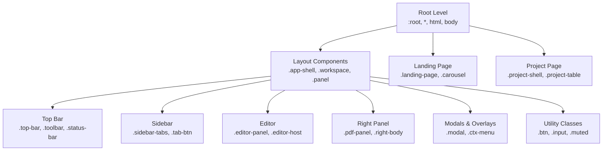
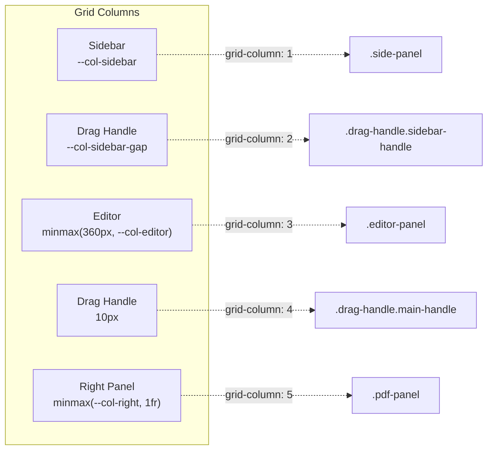
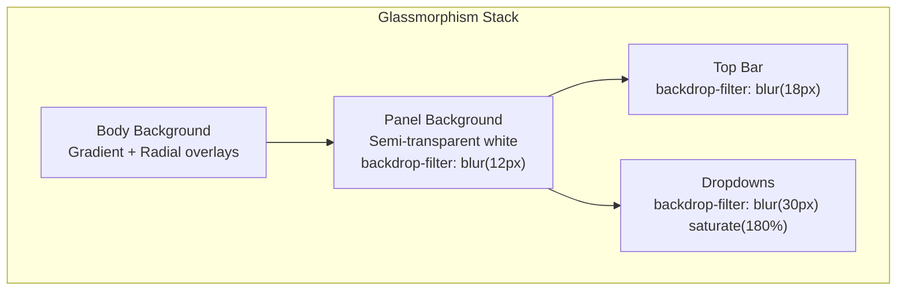
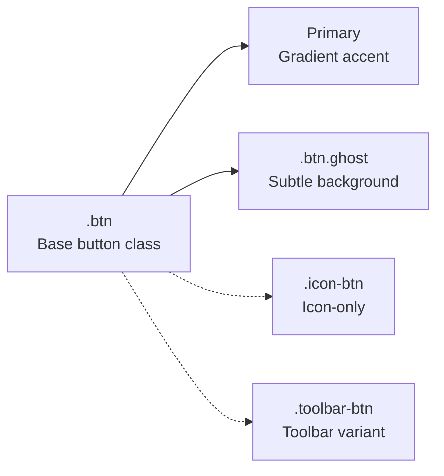
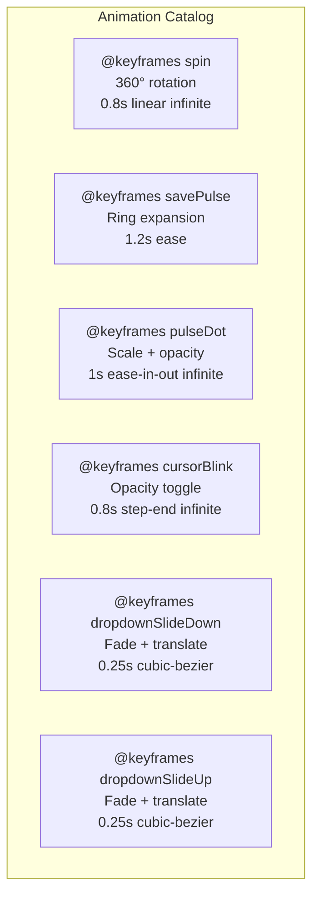
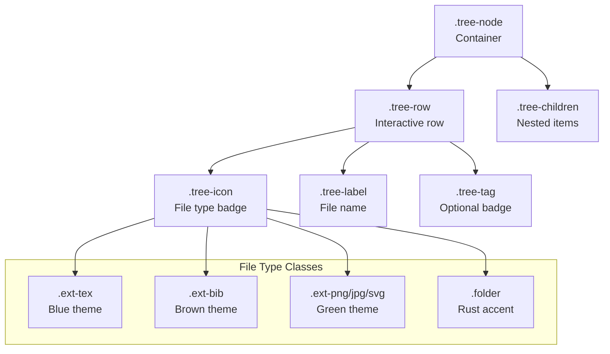

<!-- source: DeepWiki mcp.deepwiki.com · repo OpenDCAI/OpenPrism · page 4.5 UI Components and Styling · fetched 2026-11-02 -->

# UI Components and Styling

<details>
<summary>Relevant source files</summary>

The following files were used as context for generating this wiki page:

- [apps/frontend/src/app/App.css](apps/frontend/src/app/App.css)
- [apps/frontend/src/app/EditorPage.tsx](apps/frontend/src/app/EditorPage.tsx)

</details>


## Purpose and Scope

This page documents the CSS-based styling system and UI component patterns used throughout the OpenPrism frontend. It covers the design system architecture, component styling conventions, glassmorphism effects, responsive design patterns, and animation systems. For information about the React component structure and workspace layout, see [Editor Workspace](#4.3). For internationalization and UI text management, see [Internationalization](#4.6).

**Sources:** [apps/frontend/src/app/App.css:1-3441]()

---

## Design System Overview

OpenPrism implements a custom CSS design system using CSS custom properties (CSS variables) defined at the `:root` level. The design follows a warm, academic aesthetic with a focus on readability and reduced eye strain.

### Color Palette

The color system is defined through CSS variables and establishes a cohesive visual identity:

```css
:root {
  --bg: #f4efe6;                    /* Background gradient base */
  --paper: #fbf8f2;                 /* Panel backgrounds */
  --panel: rgba(255, 255, 255, 0.9); /* Translucent panels */
  --panel-muted: rgba(252, 248, 241, 0.92);
  --text: #2b2522;                  /* Primary text color */
  --muted: #7a6f67;                 /* Secondary text */
  --accent: #b44a2f;                /* Primary accent (rust) */
  --accent-strong: #933623;         /* Darker accent variant */
  --accent-soft: rgba(180, 74, 47, 0.16); /* Soft accent background */
  --border: rgba(120, 98, 83, 0.22); /* Border color */
  --shadow: 0 24px 48px rgba(68, 50, 38, 0.18); /* Shadow definition */
  --glass: rgba(252, 248, 241, 0.76); /* Glassmorphism base */
}
```

The palette uses earthy tones with a rust/terracotta accent color (`#b44a2f`), creating a warm, scholarly aesthetic reminiscent of academic papers and libraries.

**Sources:** [apps/frontend/src/app/App.css:3-16]()

### Typography System

OpenPrism uses three font families for different purposes:

| Context | Font Family | Usage |
|---------|-------------|-------|
| **UI Text** | IBM Plex Sans | Body text, buttons, labels |
| **Headings** | Source Serif 4 | Titles, section headers |
| **Code/Editor** | JetBrains Mono | Code editor, monospace data |

```css
body {
  font-family: "IBM Plex Sans", "Helvetica Neue", sans-serif;
  font-size: 12.5px;
  color: var(--text);
}

.brand-title {
  font-family: "Source Serif 4", "Times New Roman", serif;
  font-size: 20px;
  font-weight: 700;
}
```

The base font size is `12.5px`, designed to maximize information density while maintaining readability. The editor font size is dynamically adjustable via the `--editor-font-size` CSS variable, defaulting to `11px`.

**Sources:** [apps/frontend/src/app/App.css:1](), [apps/frontend/src/app/App.css:27-36](), [apps/frontend/src/app/App.css:65-74]()

---

## Component Styling Architecture

### CSS Organization Pattern

The stylesheet follows a component-based organization pattern where styles are grouped by functional area rather than alphabetically:



**Sources:** [apps/frontend/src/app/App.css:44-2214]()

### Panel Component Pattern

Panels are the fundamental building block of the UI. All major interface sections use the `.panel` base class with glassmorphism effects:

```css
.panel {
  background: var(--panel);
  border-radius: 18px;
  box-shadow: var(--shadow);
  display: flex;
  flex-direction: column;
  overflow: visible;
  border: 1px solid rgba(255, 255, 255, 0.7);
  backdrop-filter: blur(12px);
}
```

Panels always include:
- Rounded corners (`border-radius: 18px`)
- Drop shadows for depth
- Semi-transparent backgrounds
- Backdrop blur for glassmorphism
- Flexbox layout with column direction

**Sources:** [apps/frontend/src/app/App.css:181-190]()

---

## Layout System

### Three-Panel Grid Architecture

The main workspace uses a CSS Grid layout with five columns to create the three-panel interface:



The grid template is defined with CSS custom properties for dynamic resizing:

```css
.workspace {
  display: grid;
  grid-template-columns: var(--col-sidebar) var(--col-sidebar-gap) 
                         minmax(360px, var(--col-editor)) 10px 
                         minmax(var(--col-right), 1fr);
  gap: 0;
  padding: 10px 0 14px 14px;
  flex: 1;
  min-height: 0;
  overflow: hidden;
}
```

Column widths are stored in React state and applied as inline CSS variables, enabling interactive resizing via drag handles.

**Sources:** [apps/frontend/src/app/App.css:171-179](), [apps/frontend/src/app/EditorPage.tsx:1157]()

### Responsive Breakpoint

The layout collapses to a single-column stack on narrow screens:

```css
@media (max-width: 1100px) {
  .workspace {
    grid-template-columns: 1fr;
  }
  .drag-handle.vertical {
    display: none;
  }
}
```

**Sources:** [apps/frontend/src/app/App.css:2199-2214]()

---

## Glassmorphism and Visual Effects

### Backdrop Filter System

OpenPrism extensively uses backdrop filters to create depth and visual hierarchy through glassmorphism:



**Body Background Pattern:**

```css
body {
  background:
    radial-gradient(circle at top, rgba(255, 255, 255, 0.7), 
                    rgba(244, 239, 230, 0.8) 60%),
    linear-gradient(135deg, #f6f1e7 0%, #efe6d8 50%, #f5efe6 100%);
  min-height: 100vh;
}
```

**Top Bar Glassmorphism:**

```css
.top-bar {
  background: var(--glass);
  backdrop-filter: blur(18px);
  -webkit-backdrop-filter: blur(18px);
  border-bottom: 1px solid var(--border);
}
```

**Dropdown Glassmorphism (Maximum Effect):**

```css
.ios-dropdown {
  background: rgba(252, 248, 241, 0.98);
  backdrop-filter: blur(30px) saturate(180%);
  -webkit-backdrop-filter: blur(30px) saturate(180%);
  box-shadow: 0 -4px 20px rgba(68, 50, 38, 0.15), 
              0 -2px 8px rgba(68, 50, 38, 0.08);
}
```

**Sources:** [apps/frontend/src/app/App.css:32-36](), [apps/frontend/src/app/App.css:52-63](), [apps/frontend/src/app/App.css:2275-2293]()

### Shadow System

Shadows create depth through multiple layers with varying opacity and blur:

```css
--shadow: 0 24px 48px rgba(68, 50, 38, 0.18);

/* Panel shadows */
box-shadow: var(--shadow);

/* Card hover shadows */
box-shadow: 0 8px 20px rgba(68, 50, 38, 0.12);

/* PDF page shadows */
box-shadow: 0 12px 24px rgba(68, 50, 38, 0.16);
```

**Sources:** [apps/frontend/src/app/App.css:14](), [apps/frontend/src/app/App.css:184]()

---

## Button Component System

### Button Variants

OpenPrism defines three primary button styles through CSS classes:



**Primary Button (Default):**

```css
.btn {
  border: none;
  background: linear-gradient(135deg, var(--accent), var(--accent-strong));
  color: white;
  padding: 7px 14px;
  border-radius: 12px;
  font-weight: 600;
  font-size: 12px;
  cursor: pointer;
  transition: transform 0.2s ease, box-shadow 0.2s ease;
}

.btn:hover {
  transform: translateY(-1px);
  box-shadow: 0 10px 20px rgba(180, 74, 47, 0.3);
}
```

**Ghost Button:**

```css
.btn.ghost {
  background: rgba(120, 98, 83, 0.16);
  color: #4e453f;
}
```

**Icon Button:**

```css
.icon-btn {
  border: none;
  background: transparent;
  color: var(--muted);
  font-size: 12px;
  cursor: pointer;
  padding: 4px 6px;
  border-radius: 8px;
}

.icon-btn:hover {
  color: var(--accent-strong);
  background: rgba(180, 74, 47, 0.1);
}
```

**Sources:** [apps/frontend/src/app/App.css:2070-2100](), [apps/frontend/src/app/App.css:368-381]()

### iOS-Style Dropdown Component

The custom dropdown system implements iOS-inspired design patterns with smooth animations:

```css
.ios-select-trigger {
  height: 36px;
  padding: 0 32px 0 12px;
  background: rgba(252, 248, 241, 0.88);
  backdrop-filter: blur(20px) saturate(180%);
  border: 1px solid rgba(120, 98, 83, 0.22);
  border-radius: 10px;
  transition: all 0.25s cubic-bezier(0.4, 0, 0.2, 1);
  box-shadow: 0 1px 3px rgba(68, 50, 38, 0.08);
}

.ios-dropdown {
  animation: dropdownSlideDown 0.25s cubic-bezier(0.4, 0, 0.2, 1);
}
```

**Sources:** [apps/frontend/src/app/App.css:2216-2396]()

---

## Input Component Patterns

### Standard Input Fields

All text inputs share a consistent base style:

```css
.input {
  width: 100%;
  border-radius: 12px;
  border: 1px solid rgba(120, 98, 83, 0.3);
  padding: 8px 10px;
  font-size: 12px;
  background: #fffdf9;
  transition: border-color 0.2s ease, box-shadow 0.2s ease;
}

.input:focus {
  outline: none;
  border-color: rgba(180, 74, 47, 0.4);
  box-shadow: 0 0 0 3px rgba(180, 74, 47, 0.1);
}
```

Focus states use a ring effect with `box-shadow` rather than outlines for smoother visual feedback.

**Sources:** [apps/frontend/src/app/App.css:619-633]()

### Inline Edit Pattern

Inline editing uses a specialized input variant for in-place file/folder renaming:

```css
.inline-input {
  width: 100%;
  border: 1px solid rgba(120, 98, 83, 0.35);
  border-radius: 8px;
  padding: 4px 6px;
  font-size: 12px;
  background: #fffdf9;
}

.tree-row.inline {
  background: rgba(180, 74, 47, 0.08);
}
```

**Sources:** [apps/frontend/src/app/App.css:606-617]()

---

## Animation System

### Keyframe Animations

OpenPrism defines several keyframe animations for micro-interactions:



**Spinner Animation:**

```css
.spinner {
  width: 14px;
  height: 14px;
  border-radius: 50%;
  border: 2px solid rgba(180, 74, 47, 0.2);
  border-top-color: var(--accent);
  animation: spin 0.8s linear infinite;
}

@keyframes spin {
  to { transform: rotate(360deg); }
}
```

**Save Indicator Pulse:**

```css
.save-indicator.pulse {
  animation: savePulse 1.2s ease;
}

@keyframes savePulse {
  0% {
    box-shadow: 0 0 0 0 rgba(75, 124, 80, 0.4);
  }
  100% {
    box-shadow: 0 0 0 10px rgba(75, 124, 80, 0);
  }
}
```

**Sources:** [apps/frontend/src/app/App.css:1237-1250](), [apps/frontend/src/app/App.css:151-169](), [apps/frontend/src/app/App.css:2331-2362]()

### Transition System

Component transitions use cubic-bezier easing for natural motion:

```css
/* Standard transitions */
transition: all 0.2s ease;

/* Interactive elements */
transition: transform 0.2s ease, box-shadow 0.2s ease;

/* Dropdown animations */
transition: all 0.25s cubic-bezier(0.4, 0, 0.2, 1);
```

**Sources:** [apps/frontend/src/app/App.css:114](), [apps/frontend/src/app/App.css:2079]()

---

## File Tree Styling System

### Tree Node Component Structure

The file tree implements a hierarchical visual system with file type indicators:



**File Type Badge System:**

```css
.tree-icon {
  width: 28px;
  height: 18px;
  border-radius: 6px;
  font-size: 9px;
  font-weight: 700;
  border: 1px solid rgba(120, 98, 83, 0.2);
  background: rgba(255, 255, 255, 0.9);
  color: #5a4e46;
  text-transform: uppercase;
}

.tree-icon.ext-tex {
  background: rgba(54, 134, 197, 0.12);
  border-color: rgba(54, 134, 197, 0.35);
  color: #2b5f86;
}

.tree-icon.ext-bib {
  background: rgba(120, 98, 83, 0.12);
  border-color: rgba(120, 98, 83, 0.35);
  color: #5a4e46;
}

.tree-icon.ext-png, .tree-icon.ext-jpg, .tree-icon.ext-svg {
  background: rgba(68, 166, 124, 0.14);
  border-color: rgba(68, 166, 124, 0.4);
  color: #2f6c53;
}

.tree-icon.folder {
  background: rgba(180, 74, 47, 0.12);
  border-color: rgba(180, 74, 47, 0.35);
}
```

**Sources:** [apps/frontend/src/app/App.css:1066-1118]()

### Drag-and-Drop Visual Feedback

Tree rows provide visual feedback during drag operations:

```css
.tree-row.dragging {
  opacity: 0.6;
  transform: scale(0.98);
}

.tree-row.drag-over {
  background: rgba(180, 74, 47, 0.1);
}

.tree-row.folder.drag-over {
  background: rgba(180, 74, 47, 0.12);
  color: var(--accent-strong);
}

.tree-row.file.drag-over-file {
  background: rgba(180, 74, 47, 0.08);
  box-shadow: inset 0 2px 0 rgba(180, 74, 47, 0.5);
}
```

A floating hint overlay follows the cursor during drag:

```css
.drag-hint-overlay {
  position: absolute;
  z-index: 5;
  padding: 6px 10px;
  border-radius: 10px;
  background: rgba(43, 37, 34, 0.92);
  color: #fff;
  font-size: 10px;
  pointer-events: none;
  transform: translate(10px, 10px);
  box-shadow: 0 8px 18px rgba(0, 0, 0, 0.2);
  max-width: 220px;
}
```

**Sources:** [apps/frontend/src/app/App.css:1120-1169]()

---

## Modal and Overlay System

### Modal Component Structure

Modals use a backdrop + dialog pattern with smooth animations:

```css
.modal-backdrop {
  position: fixed;
  inset: 0;
  background: rgba(43, 37, 34, 0.35);
  display: flex;
  align-items: center;
  justify-content: center;
  z-index: 100;
}

.modal {
  width: min(620px, 92vw);
  background: var(--paper);
  border-radius: 18px;
  box-shadow: 0 30px 60px rgba(43, 37, 34, 0.35);
  border: 1px solid rgba(120, 98, 83, 0.25);
  display: flex;
  flex-direction: column;
}

.modal-header {
  padding: 14px 16px;
  font-family: "Source Serif 4", "Times New Roman", serif;
  font-size: 16px;
  font-weight: 700;
  border-bottom: 1px solid var(--border);
  background: rgba(255, 255, 255, 0.7);
  border-radius: 18px 18px 0 0;
}
```

**Sources:** [apps/frontend/src/app/App.css:2136-2168]()

### Context Menu System

Right-click context menus use high-blur glassmorphism:

```css
.ctx-menu-backdrop {
  position: fixed;
  inset: 0;
  z-index: 10000;
}

.ctx-menu {
  position: fixed;
  min-width: 160px;
  background: rgba(252, 248, 241, 0.98);
  backdrop-filter: blur(30px) saturate(180%);
  -webkit-backdrop-filter: blur(30px) saturate(180%);
  border: 1px solid rgba(120, 98, 83, 0.22);
  border-radius: 10px;
  box-shadow: 0 4px 20px rgba(68, 50, 38, 0.15), 
              0 2px 8px rgba(68, 50, 38, 0.08);
  padding: 4px;
  animation: dropdownSlideDown 0.18s cubic-bezier(0.4, 0, 0.2, 1);
}

.ctx-menu-item {
  padding: 6px 10px;
  border-radius: 6px;
  font-size: 12px;
  color: var(--text);
  transition: background 0.15s ease;
}

.ctx-menu-item:hover {
  background: rgba(180, 74, 47, 0.1);
  color: var(--accent-strong);
}
```

**Sources:** [apps/frontend/src/app/App.css:904-957]()

---

## Status Indicators and Badges

### Save Status Indicator

The save status indicator in the status bar uses color-coded states:

```css
.save-indicator {
  display: inline-flex;
  align-items: center;
  gap: 6px;
  font-size: 10px;
  padding: 2px 8px;
  border-radius: 999px;
  background: rgba(255, 255, 255, 0.8);
  border: 1px solid rgba(120, 98, 83, 0.2);
  color: var(--muted);
  transition: all 0.2s ease;
}

.save-indicator .dot {
  width: 6px;
  height: 6px;
  border-radius: 999px;
  background: rgba(120, 98, 83, 0.4);
}

/* States */
.save-indicator.saving {
  color: var(--accent-strong);
  border-color: rgba(180, 74, 47, 0.4);
}

.save-indicator.saving .dot {
  background: var(--accent);
  animation: pulseDot 1s ease-in-out infinite;
}

.save-indicator.dirty .dot {
  background: #9b4a35;
}

.save-indicator.saved .dot {
  background: #4b7c50;
}
```

**Sources:** [apps/frontend/src/app/App.css:104-145]()

### Badge Components

Various badge styles for metadata display:

```css
/* Context tags */
.context-tag {
  font-size: 10px;
  padding: 4px 8px;
  border-radius: 999px;
  background: rgba(120, 98, 83, 0.12);
  color: var(--muted);
  border: 1px solid rgba(120, 98, 83, 0.2);
}

/* Tree tags */
.tree-tag {
  background: rgba(120, 98, 83, 0.12);
  color: #5a4e46;
  font-size: 9px;
  padding: 2px 5px;
  border-radius: 999px;
}

/* Project tag pills */
.project-tag-pill {
  display: inline-block;
  padding: 2px 8px;
  border-radius: 10px;
  font-size: 11px;
  background: var(--accent-soft);
  color: var(--accent-strong);
}
```

**Sources:** [apps/frontend/src/app/App.css:288-295](), [apps/frontend/src/app/App.css:1181-1187](), [apps/frontend/src/app/App.css:3249-3258]()

---

## Responsive Design Patterns

### Container Query for Sidebar Tabs

The sidebar uses CSS container queries to switch between text and icon-only display:

```css
.side-panel {
  container-type: inline-size;
  container-name: sidebar;
}

@container sidebar (max-width: 280px) {
  .tab-icon {
    display: inline-flex;
  }
  .tab-text {
    display: none;
  }
  .tab-btn {
    padding: 6px 8px;
  }
}
```

This allows the sidebar to gracefully degrade when resized narrow, showing only icons instead of text labels.

**Sources:** [apps/frontend/src/app/App.css:192-198](), [apps/frontend/src/app/App.css:2398-2408]()

### Mobile Breakpoint

The main layout collapses to single-column on screens narrower than 1100px:

```css
@media (max-width: 1100px) {
  .workspace {
    grid-template-columns: 1fr;
  }
  .drag-handle.vertical {
    display: none;
  }
  .side-panel,
  .editor-panel,
  .pdf-panel {
    grid-column: auto;
  }
  .pdf-frame {
    min-height: 300px;
  }
}
```

**Sources:** [apps/frontend/src/app/App.css:2199-2214]()

---

## Split Diff Viewer Styling

The diff viewer implements a synchronized two-column layout:

```css
.split-diff {
  display: grid;
  grid-template-columns: 1fr 1fr;
  gap: 12px;
  border: 1px solid rgba(120, 98, 83, 0.3);
  border-radius: 12px;
  background: #fffaf3;
  color: #2b2522;
  overflow: hidden;
}

.split-column {
  display: flex;
  flex-direction: column;
  max-height: 240px;
  overflow: auto;
}

.split-row {
  display: grid;
  grid-template-columns: 40px 1fr;
  gap: 8px;
  padding: 4px 10px;
  font-family: "JetBrains Mono", "SF Mono", monospace;
  font-size: 11px;
  line-height: 1.4;
}

.split-row.added {
  background: rgba(16, 185, 129, 0.12);
}

.split-row.removed {
  background: rgba(239, 68, 68, 0.12);
}
```

**Sources:** [apps/frontend/src/app/App.css:1992-2046]()

---

## Markdown Rendering Styles

The `.markdown-body` class provides GitHub-like markdown rendering:

```css
.markdown-body {
  font-size: 13px;
  line-height: 1.6;
  color: var(--text);
  word-wrap: break-word;
}

.markdown-body h1 { font-size: 1.4em; }
.markdown-body h2 { font-size: 1.25em; }
.markdown-body h3 { font-size: 1.1em; }

.markdown-body code {
  font-family: 'SF Mono', 'Fira Code', monospace;
  font-size: 0.9em;
  padding: 2px 5px;
  background: rgba(120, 98, 83, 0.1);
  border-radius: 4px;
  color: var(--accent-strong);
}

.markdown-body pre {
  margin: 10px 0;
  padding: 12px;
  background: rgba(120, 98, 83, 0.08);
  border-radius: 8px;
  overflow-x: auto;
}

.markdown-body blockquote {
  margin: 10px 0;
  padding: 4px 12px;
  border-left: 3px solid var(--accent);
  color: var(--muted);
  background: rgba(180, 74, 47, 0.04);
  border-radius: 0 6px 6px 0;
}
```

This is used for rendering AI-generated review reports, chat messages, and other markdown content.

**Sources:** [apps/frontend/src/app/App.css:2772-2920]()

---

## Landing Page Styling

### Hero Section

The landing page uses large typography and soft gradients:

```css
.landing-page {
  position: fixed;
  inset: 0;
  background:
    radial-gradient(ellipse at 50% 0%, rgba(255, 255, 255, 0.7) 0%, transparent 60%),
    radial-gradient(ellipse at 80% 20%, rgba(244, 239, 230, 0.5) 0%, transparent 50%),
    radial-gradient(ellipse at 20% 80%, rgba(239, 230, 216, 0.3) 0%, transparent 50%),
    linear-gradient(180deg, #f6f1e7 0%, #efe6d8 40%, #f5efe6 100%);
}

.landing-title {
  font-family: "Source Serif 4", "Times New Roman", serif;
  font-size: clamp(48px, 8vw, 80px);
  font-weight: 700;
  line-height: 1.1;
  letter-spacing: -0.02em;
}

.landing-title-accent {
  color: var(--accent);
}
```

**Sources:** [apps/frontend/src/app/App.css:2410-2425](), [apps/frontend/src/app/App.css:2484-2495]()

### Feature Carousel

The carousel uses CSS transforms for sliding animations:

```css
.carousel-track {
  display: flex;
  transition: transform 0.5s cubic-bezier(0.4, 0, 0.2, 1);
}

.carousel-card {
  min-width: 100%;
  padding: 48px 36px;
  background: rgba(255, 255, 255, 0.55);
  backdrop-filter: blur(12px);
  border: 1px solid var(--border);
}

.carousel-dots {
  display: flex;
  gap: 8px;
}

.carousel-dot {
  width: 8px;
  height: 8px;
  border-radius: 50%;
  transition: all 0.25s ease;
}

.carousel-dot.active {
  background: var(--accent);
  transform: scale(1.25);
}
```

**Sources:** [apps/frontend/src/app/App.css:2654-2770]()

---

## Project Page Styling

### Sidebar Navigation

The project page uses a persistent sidebar with navigation items:

```css
.project-sidebar {
  width: 240px;
  min-width: 240px;
  background: var(--panel);
  border-right: 1px solid var(--border);
  padding: 16px 14px;
  gap: 12px;
}

.sidebar-nav-item {
  display: flex;
  align-items: center;
  gap: 8px;
  padding: 8px 10px;
  border-radius: 10px;
  cursor: pointer;
  font-size: 13px;
  transition: background 0.15s;
}

.sidebar-nav-item.active {
  background: var(--accent-soft);
  color: var(--accent-strong);
  font-weight: 600;
}
```

**Sources:** [apps/frontend/src/app/App.css:2929-2046]()

### Project Table

The project table uses a clean, minimal design:

```css
.project-table-wrapper {
  flex: 1;
  overflow-y: auto;
  background: rgba(255, 255, 255, 0.85);
  border: 1px solid var(--border);
  border-radius: 14px;
}

.project-table {
  width: 100%;
  border-collapse: collapse;
  font-size: 13px;
}

.project-table-row:hover td {
  background: rgba(120, 98, 83, 0.04);
}

.project-table-row.selected td {
  background: rgba(180, 74, 47, 0.06);
}
```

**Sources:** [apps/frontend/src/app/App.css:3174-3210]()

---

## Theme Integration with CodeMirror

The editor theme is defined using CodeMirror's `EditorView.theme()` API:

```typescript
const editorTheme = EditorView.theme(
  {
    '&': {
      height: '100%',
      background: 'transparent'
    },
    '.cm-scroller': {
      fontFamily: '"JetBrains Mono", "SF Mono", "Menlo", monospace',
      fontSize: 'var(--editor-font-size, 11px)',
      lineHeight: '1.6'
    },
    '.cm-gutters': {
      background: 'transparent',
      border: 'none',
      color: 'rgba(122, 111, 103, 0.6)'
    },
    '.cm-activeLine': {
      background: 'rgba(180, 74, 47, 0.08)'
    },
    '.cm-selectionBackground': {
      background: 'rgba(180, 74, 47, 0.18)'
    }
  },
  { dark: false }
);
```

This integrates the CodeMirror editor with the application's color palette and uses the `--editor-font-size` CSS variable for dynamic font sizing.

**Sources:** [apps/frontend/src/app/EditorPage.tsx:697-730]()

---

## Summary

The OpenPrism UI styling system demonstrates several key architectural patterns:

1. **CSS Variables for Theming**: Centralized color and spacing definitions enable consistent design
2. **Component-Based Organization**: Styles grouped by functional area rather than alphabetically
3. **Glassmorphism Effects**: Extensive use of backdrop filters and semi-transparent backgrounds
4. **Responsive Design**: Container queries and media queries for adaptive layouts
5. **Smooth Animations**: Cubic-bezier easing functions for natural motion
6. **File Type Visual System**: Color-coded badges for instant file recognition
7. **State-Driven Styling**: Visual feedback for hover, active, drag, and focus states

The system balances aesthetic appeal with functional clarity, creating a workspace that feels both modern and academically grounded.

**Sources:** [apps/frontend/src/app/App.css:1-3441](), [apps/frontend/src/app/EditorPage.tsx:697-730]()

---

