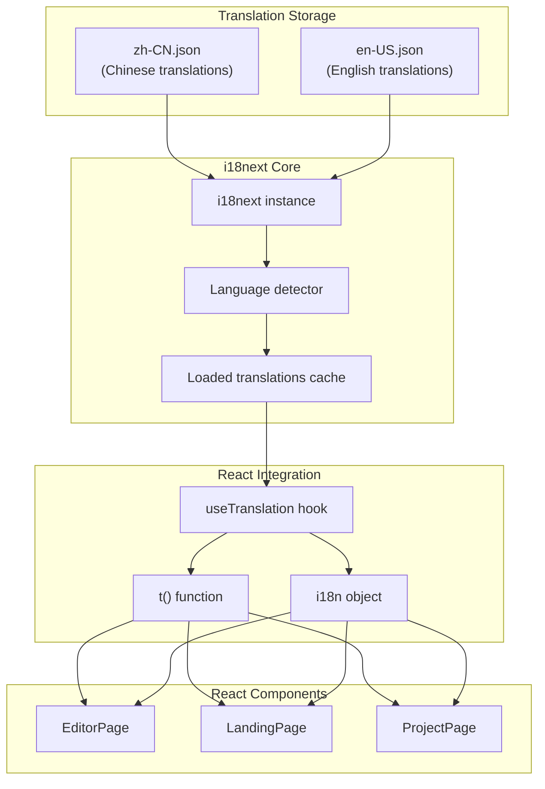
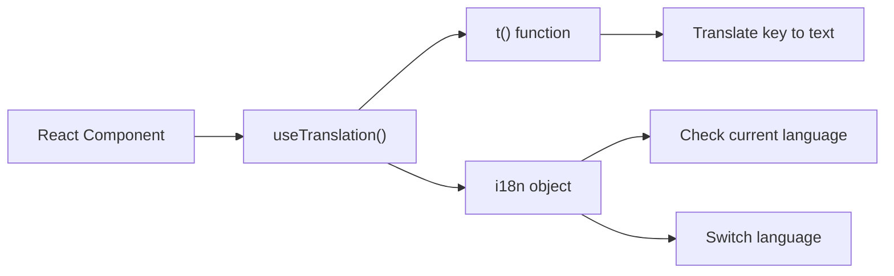
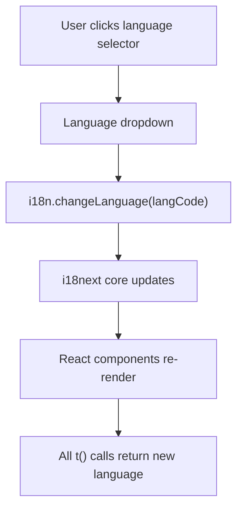
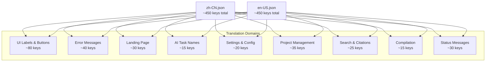
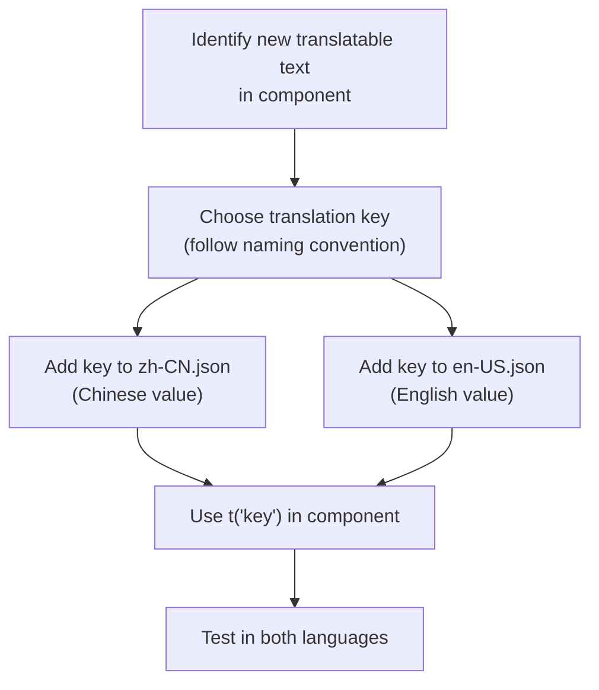

<!-- source: DeepWiki mcp.deepwiki.com · repo OpenDCAI/OpenPrism · page 4.6 Internationalization · fetched 2026-11-02 -->

# Internationalization

<details>
<summary>Relevant source files</summary>

The following files were used as context for generating this wiki page:

- [apps/frontend/src/app/EditorPage.tsx](apps/frontend/src/app/EditorPage.tsx)
- [apps/frontend/src/app/LandingPage.tsx](apps/frontend/src/app/LandingPage.tsx)
- [apps/frontend/src/i18n/locales/en-US.json](apps/frontend/src/i18n/locales/en-US.json)
- [apps/frontend/src/i18n/locales/zh-CN.json](apps/frontend/src/i18n/locales/zh-CN.json)

</details>


## Purpose and Scope

This document describes OpenPrism's internationalization (i18n) system, which provides multi-language support for the frontend application. It covers the translation file structure, how translations are accessed in React components, language switching mechanisms, and conventions for managing translation keys. For backend API development, see [Backend Development](#7.5). For frontend component development patterns, see [Frontend Development](#7.4).

---

## Technology Stack

OpenPrism uses the **i18next** ecosystem for internationalization:

| Library | Purpose |
|---------|---------|
| `i18next` | Core i18n framework for translation management and interpolation |
| `react-i18next` | React bindings providing hooks and components for i18n |

The system is client-side only; all translations are bundled with the frontend application. The backend does not perform localization.

**Sources:** [apps/frontend/src/app/EditorPage.tsx:4](), [apps/frontend/src/app/LandingPage.tsx:3]()

---

## Translation File Architecture



### Translation File Structure

Translation files are located at:
- **Chinese:** `apps/frontend/src/i18n/locales/zh-CN.json`
- **English:** `apps/frontend/src/i18n/locales/en-US.json`

Both files follow identical key structures with language-specific values. The JSON schema is flat (single-level key-value pairs), with keys using either English or Chinese characters.

**Example structure:**

```json
{
  "保存": "Save",
  "编译 PDF": "Compile PDF",
  "landing.subtitle": "AI-powered <b>academic writing</b>",
  "请求失败: {{error}}": "Request failed: {{error}}"
}
```

**Sources:** [apps/frontend/src/i18n/locales/zh-CN.json:1-450](), [apps/frontend/src/i18n/locales/en-US.json:1-450]()

---

## Using Translations in Components

### Basic Translation Pattern



Components access translations via the `useTranslation` hook from `react-i18next`:

```typescript
import { useTranslation } from 'react-i18next';

function MyComponent() {
  const { t, i18n } = useTranslation();
  
  // Simple translation
  const saveLabel = t('保存'); // Returns "保存" (zh-CN) or "Save" (en-US)
  
  // Check current language
  const currentLang = i18n.language; // "zh-CN" or "en-US"
  
  return <button>{saveLabel}</button>;
}
```

**Sources:** [apps/frontend/src/app/EditorPage.tsx:4,1096](), [apps/frontend/src/app/LandingPage.tsx:3,11]()

### Translation with Interpolation

The `t()` function supports variable interpolation using double-brace syntax:

```typescript
// Translation key: "请求失败: {{error}}"
// English: "Request failed: {{error}}"

const errorMsg = t('请求失败: {{error}}', { error: 'Network timeout' });
// Returns: "请求失败: Network timeout" (zh-CN)
// Returns: "Request failed: Network timeout" (en-US)
```

**Common interpolation patterns in the codebase:**

| Pattern | Example Key | Example Usage |
|---------|-------------|---------------|
| Error messages | `"编译失败: {{error}}"` | `t('编译失败: {{error}}', { error: err.message })` |
| Status updates | `"下载中... {{percent}}%"` | `t('下载中... {{percent}}%', { percent: 75 })` |
| Item counts | `"显示 {{shown}} / {{total}} 个项目"` | `t('显示 {{shown}} / {{total}} 个项目', { shown: 5, total: 20 })` |
| File paths | `"已保存 {{path}}"` | `t('已保存 {{path}}', { path: 'main.tex' })` |

**Sources:** [apps/frontend/src/i18n/locales/zh-CN.json:152,318,420,200](), [apps/frontend/src/i18n/locales/en-US.json:152,318,420,200]()

### HTML Content in Translations

Some translations contain HTML markup for rich formatting:

```typescript
// Translation key: "landing.subtitle"
// Value: "AI 驱动的 <b>学术写作</b> — 轻量、快速、无忧。"

<p dangerouslySetInnerHTML={{ __html: t('landing.subtitle') }} />
```

**Sources:** [apps/frontend/src/app/LandingPage.tsx:105]()

### Dynamic Translation Lists

Components that generate options dynamically pass the `t()` function to factory functions:

```typescript
const DEFAULT_TASKS = (t: (key: string) => string) => [
  { value: 'polish', label: t('润色') },
  { value: 'rewrite', label: t('改写') },
  { value: 'structure', label: t('结构调整') },
  { value: 'translate', label: t('翻译') },
  { value: 'websearch', label: t('检索 (arXiv)') },
  { value: 'custom', label: t('自定义') }
];

// Usage in component:
const tasks = DEFAULT_TASKS(t);
```

This pattern ensures labels are re-evaluated when the language changes.

**Sources:** [apps/frontend/src/app/EditorPage.tsx:82-89]()

---

## Language Switching Mechanism



### Implementation in LandingPage

The language selector is implemented as a custom dropdown in the LandingPage component:

```typescript
const [langDropdownOpen, setLangDropdownOpen] = useState(false);

// Display current language
<button onClick={() => setLangDropdownOpen(!langDropdownOpen)}>
  <span>{i18n.language === 'en-US' ? t('English') : t('中文')}</span>
</button>

// Language options
{langDropdownOpen && (
  <div className="ios-dropdown dropdown-down">
    {[['zh-CN', t('中文')], ['en-US', t('English')]].map(([val, label]) => (
      <div 
        className={`ios-dropdown-item ${i18n.language === val ? 'active' : ''}`}
        onClick={() => { 
          i18n.changeLanguage(val); 
          setLangDropdownOpen(false); 
        }}
      >
        {label}
        {i18n.language === val && <CheckmarkIcon />}
      </div>
    ))}
  </div>
)}
```

**Key methods:**
- `i18n.language` - Returns the current active language code
- `i18n.changeLanguage(langCode)` - Switches to the specified language and triggers re-render

**Sources:** [apps/frontend/src/app/LandingPage.tsx:15,43-60]()

### Language Persistence

Language selection is typically persisted to `localStorage` by i18next's language detector plugin (configuration not shown in provided files). When the user returns, their language preference is automatically restored.

---

## Translation Key Conventions

### Key Naming Patterns

OpenPrism uses multiple key naming conventions:

| Pattern | Example Keys | Usage Context |
|---------|--------------|---------------|
| Chinese characters | `"保存"`, `"编译 PDF"`, `"新建项目"` | UI labels and buttons |
| Dot notation | `"landing.subtitle"`, `"landing.feat.completion.title"` | Hierarchical organization (e.g., landing page sections) |
| Sentence templates | `"请求失败: {{error}}"` | Error messages with interpolation |
| Descriptive phrases | `"Chat 模式仅对话，不会改动文件。"` | Help text and descriptions |
| Enum values | `"Polish"`, `"Rewrite"`, `"Translate"` | Task names and options |

### Hierarchical Keys (Landing Page)

The landing page uses dot-separated namespaces for organization:

```json
{
  "landing.announce": "OpenDCAI: 更多开源项目",
  "landing.subtitle": "AI 驱动的 <b>学术写作</b>",
  "landing.startWriting": "开始写作",
  "landing.feat.completion.tab": "智能补全",
  "landing.feat.completion.title": "AI 智能补全",
  "landing.feat.completion.desc": "基于上下文的 LaTeX 智能续写..."
}
```

This structure groups related translations together and makes the JSON file easier to navigate.

**Sources:** [apps/frontend/src/i18n/locales/zh-CN.json:378-404]()

### Special Characters in Keys

Keys may contain:
- Spaces: `"编译 PDF"`
- Parentheses: `"检索 (arXiv)"`
- Colons: `"Engine: {{engine}}"`
- Forward slashes: `"写入 Bib / 插入引用"`
- Question marks: `"删除项目 {{name}}？此操作不可撤销。"`

**Sources:** [apps/frontend/src/i18n/locales/zh-CN.json:21,32,159,167]()

---

## Translation Coverage by Feature Area



### Key Distribution

Both translation files contain approximately **450 translation keys** covering:

1. **General UI Elements** - Save, delete, create, cancel, close, etc.
2. **Editor Interface** - Files, agent, vision, search tabs; PDF, diff, log views
3. **AI Features** - Task names (polish, rewrite, translate), mode labels (chat, agent, tools)
4. **Project Management** - New project, import, archive, delete, tags
5. **Compilation** - Engine names, compile status, error messages
6. **Search & Citations** - arXiv search, web search, BibTeX generation
7. **Error Messages** - Compilation errors, network errors, validation errors
8. **Status Messages** - Saving, uploading, downloading, processing states
9. **Landing Page** - Marketing copy, feature descriptions, CTAs
10. **Settings** - LLM configuration, API keys, preferences

**Sources:** [apps/frontend/src/i18n/locales/zh-CN.json:1-450](), [apps/frontend/src/i18n/locales/en-US.json:1-450]()

---

## Adding New Translations

### Workflow for New Translation Keys



### Step-by-Step Process

1. **Identify translatable content**: Any user-facing text should be translatable
2. **Choose a key name**: 
   - Use Chinese characters for simple labels
   - Use dot notation for hierarchical content
   - Include placeholders for dynamic content: `{{variable}}`
3. **Add to both language files**: Ensure keys are identical in both files
4. **Replace hardcoded text** with `t('key')` calls
5. **Test language switching** to verify both translations display correctly

### Example: Adding a New Button Label

**Before:**
```typescript
<button>Export PDF</button>
```

**After:**

1. Add to `zh-CN.json`:
```json
{
  "导出 PDF": "导出 PDF"
}
```

2. Add to `en-US.json`:
```json
{
  "导出 PDF": "Export PDF"
}
```

3. Update component:
```typescript
<button>{t('导出 PDF')}</button>
```

### Example: Adding an Error Message with Interpolation

1. Add to `zh-CN.json`:
```json
{
  "导出失败: {{error}}": "导出失败: {{error}}"
}
```

2. Add to `en-US.json`:
```json
{
  "导出失败: {{error}}": "Export failed: {{error}}"
}
```

3. Use in component:
```typescript
setStatus(t('导出失败: {{error}}', { error: err.message }));
```

**Sources:** [apps/frontend/src/i18n/locales/zh-CN.json:152,318](), [apps/frontend/src/i18n/locales/en-US.json:152,318]()

---

## Supported Languages

OpenPrism currently supports **two languages**:

| Language Code | Language Name | Translation File | Completeness |
|---------------|---------------|------------------|--------------|
| `zh-CN` | Simplified Chinese | `zh-CN.json` | 100% (~450 keys) |
| `en-US` | English (US) | `en-US.json` | 100% (~450 keys) |

### Language Code Usage

- Language codes follow the **BCP 47** standard: `language-REGION`
- `zh-CN`: Chinese as used in Mainland China
- `en-US`: English as used in the United States

### Fallback Language

If a key is missing from the active language file, i18next will attempt to:
1. Display the key itself (default behavior)
2. Fall back to a configured fallback language (typically `en-US`)

The exact fallback configuration is defined in the i18n initialization file (not provided in the excerpts).

**Sources:** [apps/frontend/src/app/LandingPage.tsx:51-52]()

---

## Best Practices

### 1. Always Translate User-Facing Text

**Do:**
```typescript
<button>{t('保存')}</button>
<div className="status">{t('编译中...')}</div>
```

**Don't:**
```typescript
<button>Save</button>  // Hardcoded English
<div className="status">Compiling...</div>
```

### 2. Use Interpolation for Dynamic Content

**Do:**
```typescript
t('已保存 {{path}}', { path: filename })
t('显示 {{shown}} / {{total}} 个项目', { shown: 5, total: 20 })
```

**Don't:**
```typescript
t('已保存 ') + filename  // String concatenation breaks translation context
`${t('显示')} ${shown} / ${total} ${t('个项目')}`  // Split translations are hard to localize
```

### 3. Keep Keys Synchronized

Both `zh-CN.json` and `en-US.json` must have **identical keys**. Use the same key name in both files, with language-specific values:

```json
// zh-CN.json
{ "保存": "保存" }

// en-US.json
{ "保存": "Save" }
```

### 4. Use Descriptive Keys for Complex Content

For longer text or hierarchical content, use dot notation:

```json
{
  "landing.feat.completion.title": "AI 智能补全",
  "landing.feat.completion.desc": "基于上下文的 LaTeX 智能续写..."
}
```

### 5. Preserve Formatting Across Languages

When translations contain LaTeX commands, HTML tags, or special formatting, ensure both languages maintain the same structure:

```json
// zh-CN
"使用 \\\\cite{{{keys}}}。": "使用 \\\\cite{{{keys}}}。"

// en-US
"使用 \\\\cite{{{keys}}}。": "Use \\\\cite{{{keys}}}."
```

**Sources:** [apps/frontend/src/i18n/locales/zh-CN.json:97](), [apps/frontend/src/i18n/locales/en-US.json:97]()

---

## Common Translation Patterns in the Codebase

### Pattern 1: Dynamic Options Arrays

```typescript
const RIGHT_VIEW_OPTIONS = (t: (key: string) => string) => [
  { value: 'pdf', label: 'PDF' },
  { value: 'toc', label: t('目录') },
  { value: 'figures', label: 'FIG' },
  { value: 'diff', label: 'DIFF' },
  { value: 'log', label: 'LOG' },
  { value: 'review', label: t('评审报告') }
];
```

This pattern allows option labels to update when language changes.

**Sources:** [apps/frontend/src/app/EditorPage.tsx:91-98]()

### Pattern 2: Conditional Language Display

```typescript
{i18n.language === 'en-US' ? t('English') : t('中文')}
```

Used for displaying the current language name in the UI.

**Sources:** [apps/frontend/src/app/LandingPage.tsx:44]()

### Pattern 3: Status Messages with State Updates

```typescript
setStatus(t('加载项目信息失败: {{error}}', { error: String(err) }));
setStatus(t('编译完成 ({{engine}})', { engine: engineName }));
```

Common pattern for displaying operation results to users.

**Sources:** [apps/frontend/src/app/EditorPage.tsx:1295,1663]()

### Pattern 4: Inline Translation in JSX

```typescript
<div className="status">{t('保存中...')}</div>
<button onClick={handleSave}>{t('保存')}</button>
```

Direct translation calls within JSX expressions.

**Sources:** Throughout [apps/frontend/src/app/EditorPage.tsx]()

---

## Summary

OpenPrism's internationalization system provides:
- **Bilingual support** (Chinese and English) via i18next
- **Simple API** using the `t()` function and `useTranslation` hook
- **Flat JSON structure** with ~450 keys per language
- **Runtime language switching** without page reload
- **Variable interpolation** for dynamic content
- **Hierarchical key organization** for structured content

The system is fully client-side, with no server-side localization. All translations are bundled with the frontend application and loaded at startup.

**Sources:** [apps/frontend/src/app/EditorPage.tsx:4,1096](), [apps/frontend/src/app/LandingPage.tsx:3,11,43-60](), [apps/frontend/src/i18n/locales/zh-CN.json:1-450](), [apps/frontend/src/i18n/locales/en-US.json:1-450]()

---

