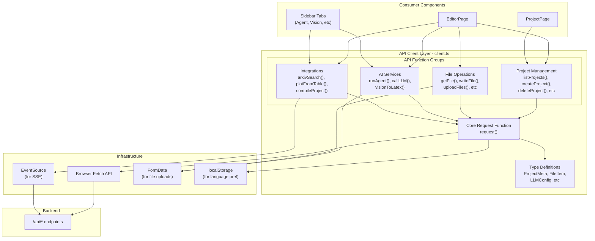
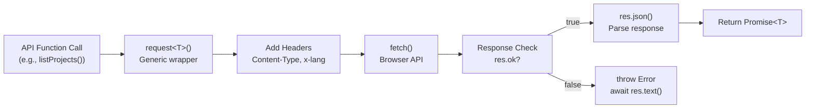
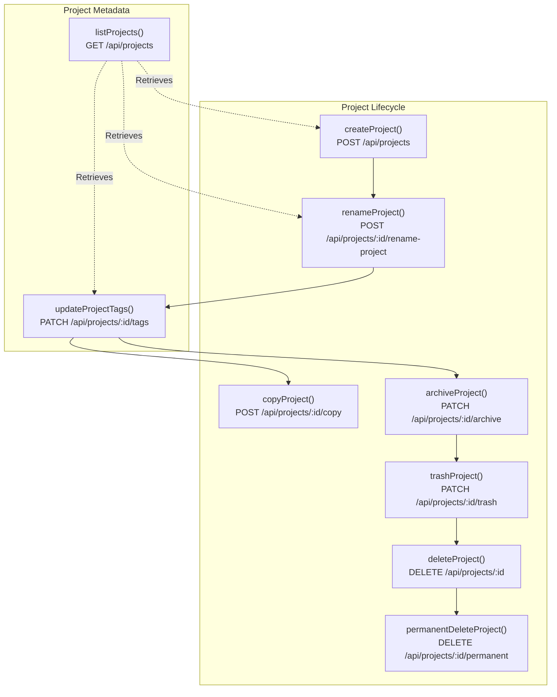
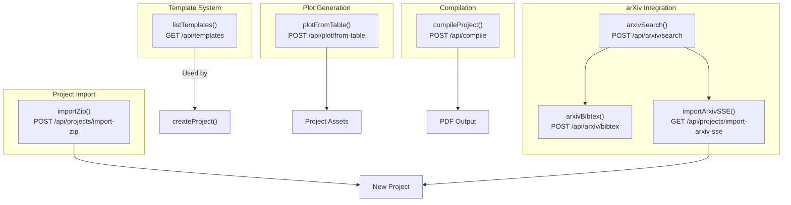
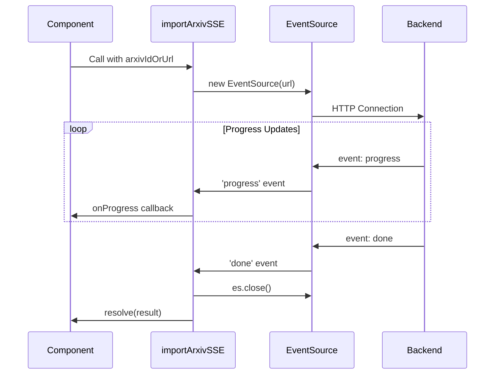

<!-- source: DeepWiki mcp.deepwiki.com · repo OpenDCAI/OpenPrism · page 4.7 API Client Layer · fetched 2026-11-02 -->

# API Client Layer

<details>
<summary>Relevant source files</summary>

The following files were used as context for generating this wiki page:

- [apps/frontend/src/api/client.ts](apps/frontend/src/api/client.ts)
- [apps/frontend/src/vite-env.d.ts](apps/frontend/src/vite-env.d.ts)

</details>


## Purpose and Scope

The API Client Layer provides a centralized, type-safe interface for all frontend-to-backend communication in OpenPrism. This module abstracts HTTP requests, handles authentication headers, manages error responses, and exports TypeScript interfaces that define the data contracts between frontend and backend. All API functions in this layer are implemented in [apps/frontend/src/api/client.ts:1-368]().

For information about the backend API implementation, see [Backend Architecture](#3.3). For details on how the Editor Workspace consumes these API functions, see [Editor Workspace](#4.3).

**Sources**: [apps/frontend/src/api/client.ts:1-368]()

---

## Architecture Overview

The API client is structured as a single module that exports typed functions and interfaces. It consists of four primary layers:



**Diagram: API Client Layer Architecture**

The client layer acts as a facade between React components and backend endpoints, providing strongly-typed function signatures that abstract HTTP details.

**Sources**: [apps/frontend/src/api/client.ts:1-368]()

---

## Type Definitions

The module exports TypeScript interfaces that define data structures exchanged between frontend and backend. These types enforce compile-time safety and serve as documentation for API contracts.

### Core Data Types

| Interface | Purpose | Key Fields | Defined At |
|-----------|---------|-----------|------------|
| `ProjectMeta` | Project metadata | `id`, `name`, `tags`, `archived`, `trashed`, `createdAt`, `updatedAt` | [apps/frontend/src/api/client.ts:1-10]() |
| `FileItem` | File tree node | `path`, `type` (file/dir) | [apps/frontend/src/api/client.ts:12-15]() |
| `FileOrderMap` | Custom file ordering | `[folder: string]: string[]` | [apps/frontend/src/api/client.ts:17-19]() |
| `LLMConfig` | LLM configuration | `endpoint`, `apiKey`, `model` | [apps/frontend/src/api/client.ts:21-25]() |
| `TemplateMeta` | Template metadata | `id`, `label`, `mainFile`, `category`, `description`, `tags` | [apps/frontend/src/api/client.ts:27-37]() |
| `TemplateCategory` | Template category | `id`, `label`, `labelEn` | [apps/frontend/src/api/client.ts:39-43]() |
| `ArxivPaper` | arXiv paper data | `title`, `abstract`, `authors`, `url`, `arxivId` | [apps/frontend/src/api/client.ts:45-51]() |

### Type Usage Example

```typescript
// ProjectMeta structure
interface ProjectMeta {
  id: string;              // Unique project identifier
  name: string;            // Display name
  createdAt: string;       // ISO timestamp
  updatedAt: string;       // ISO timestamp
  tags: string[];          // User-defined tags
  archived: boolean;       // Archive status
  trashed: boolean;        // Trash status
  trashedAt: string | null; // Trash timestamp or null
}
```

**Sources**: [apps/frontend/src/api/client.ts:1-51]()

---

## Request Infrastructure

### Core Request Function

The `request<T>()` function serves as the foundation for all HTTP communication. It wraps the browser's `fetch` API with OpenPrism-specific behavior.



**Diagram: Request Flow Through `request<T>()` Function**

The function implementation at [apps/frontend/src/api/client.ts:62-77]() performs these operations:

1. **Language Header Injection**: Retrieves language preference from `localStorage` using key `'openprism-lang'` and sets `x-lang` header to `'zh-CN'` or `'en-US'`
2. **Header Merging**: Combines default headers (`Content-Type: application/json`, `x-lang`) with caller-provided headers
3. **Fetch Execution**: Constructs full URL from `API_BASE` (empty string, meaning relative paths) and invokes `fetch()`
4. **Error Handling**: Throws an `Error` with response text if `res.ok` is false
5. **JSON Parsing**: Returns parsed JSON response as `Promise<T>`

**Sources**: [apps/frontend/src/api/client.ts:53-77]()

### Configuration Constants

```typescript
const API_BASE = '';                    // Relative URLs (empty base)
const LANG_KEY = 'openprism-lang';      // localStorage key for language
```

The empty `API_BASE` means all requests are relative to the current origin. In development, the frontend dev server (port 5173) proxies `/api/*` requests to the backend (port 8787). In production, the unified server serves both frontend assets and API endpoints.

**Sources**: [apps/frontend/src/api/client.ts:53-54]()

---

## API Function Categories

### Project Management Functions

Functions for project lifecycle operations, organized by CRUD semantics:

| Function | HTTP Method | Endpoint | Purpose | Defined At |
|----------|-------------|----------|---------|------------|
| `listProjects()` | GET | `/api/projects` | List all projects | [apps/frontend/src/api/client.ts:79-81]() |
| `createProject()` | POST | `/api/projects` | Create new project | [apps/frontend/src/api/client.ts:83-88]() |
| `renameProject()` | POST | `/api/projects/:id/rename-project` | Rename project | [apps/frontend/src/api/client.ts:90-95]() |
| `copyProject()` | POST | `/api/projects/:id/copy` | Duplicate project | [apps/frontend/src/api/client.ts:97-102]() |
| `deleteProject()` | DELETE | `/api/projects/:id` | Move to trash | [apps/frontend/src/api/client.ts:104-108]() |
| `permanentDeleteProject()` | DELETE | `/api/projects/:id/permanent` | Permanently delete | [apps/frontend/src/api/client.ts:110-114]() |
| `updateProjectTags()` | PATCH | `/api/projects/:id/tags` | Update tags | [apps/frontend/src/api/client.ts:116-121]() |
| `archiveProject()` | PATCH | `/api/projects/:id/archive` | Toggle archive | [apps/frontend/src/api/client.ts:123-128]() |
| `trashProject()` | PATCH | `/api/projects/:id/trash` | Toggle trash | [apps/frontend/src/api/client.ts:130-135]() |



**Diagram: Project Management Function Relationships**

**Sources**: [apps/frontend/src/api/client.ts:79-135]()

### File Operations Functions

Functions for manipulating project files and directory structure:

| Function | HTTP Method | Endpoint | Purpose | Defined At |
|----------|-------------|----------|---------|------------|
| `getProjectTree()` | GET | `/api/projects/:id/tree` | Get file tree | [apps/frontend/src/api/client.ts:137-139]() |
| `getFile()` | GET | `/api/projects/:id/file?path=...` | Read file content | [apps/frontend/src/api/client.ts:141-144]() |
| `writeFile()` | PUT | `/api/projects/:id/file` | Write file content | [apps/frontend/src/api/client.ts:146-151]() |
| `getAllFiles()` | GET | `/api/projects/:id/files` | Get all files | [apps/frontend/src/api/client.ts:153-157]() |
| `createFolder()` | POST | `/api/projects/:id/folder` | Create directory | [apps/frontend/src/api/client.ts:159-164]() |
| `renamePath()` | POST | `/api/projects/:id/rename` | Rename file/folder | [apps/frontend/src/api/client.ts:166-171]() |
| `updateFileOrder()` | POST | `/api/projects/:id/file-order` | Update custom order | [apps/frontend/src/api/client.ts:173-178]() |
| `uploadFiles()` | POST | `/api/projects/:id/upload` | Upload files via FormData | [apps/frontend/src/api/client.ts:180-198]() |

#### Special Handling: File Upload

The `uploadFiles()` function at [apps/frontend/src/api/client.ts:180-198]() differs from other functions because it:

1. Uses `FormData` instead of JSON payload
2. Handles `webkitRelativePath` for directory uploads
3. Supports optional `basePath` parameter for upload target
4. Manually constructs `fetch()` call (bypasses `request()` function)

```typescript
// FormData construction for file uploads
const form = new FormData();
files.forEach((file) => {
  const rel = file.webkitRelativePath || file.name;
  const finalPath = basePath ? `${basePath}/${rel}` : rel;
  form.append('files', file, finalPath);
});
```

**Sources**: [apps/frontend/src/api/client.ts:137-198]()

### AI Service Functions

Functions that invoke AI capabilities:

| Function | HTTP Method | Endpoint | Purpose | Payload Keys | Defined At |
|----------|-------------|----------|---------|--------------|------------|
| `runAgent()` | POST | `/api/agent/run` | Execute AI agent task | `task`, `prompt`, `mode`, `llmConfig` | [apps/frontend/src/api/client.ts:200-217]() |
| `callLLM()` | POST | `/api/llm` | Direct LLM call | `messages`, `model`, `llmConfig` | [apps/frontend/src/api/client.ts:276-285]() |
| `visionToLatex()` | POST | `/api/vision/latex` | Image to LaTeX OCR | `image` (FormData), `mode`, `llmConfig` | [apps/frontend/src/api/client.ts:339-367]() |

#### Agent Execution Payload

The `runAgent()` function at [apps/frontend/src/api/client.ts:200-217]() accepts a complex payload structure:

```typescript
interface AgentPayload {
  task: string;                  // Task type (e.g., 'polish', 'translate')
  prompt: string;                // User instruction
  selection: string;             // Selected text
  content: string;               // Full document content
  mode: 'direct' | 'tools';      // Execution mode
  projectId?: string;            // Current project ID
  activePath?: string;           // Active file path
  compileLog?: string;           // Compilation log for context
  llmConfig?: Partial<LLMConfig>; // Override LLM settings
  interaction?: 'chat' | 'agent'; // UI interaction mode
  history?: Array<{              // Conversation history
    role: 'user' | 'assistant';
    content: string;
  }>;
}
```

The function returns structured patches for file modifications:

```typescript
interface AgentResponse {
  ok: boolean;
  reply: string;                 // Conversational response
  suggestion: string;            // Inline suggestion text
  patches?: Array<{              // File modifications
    path: string;
    diff: string;
    content: string;
  }>;
}
```

**Sources**: [apps/frontend/src/api/client.ts:200-217](), [apps/frontend/src/api/client.ts:276-285](), [apps/frontend/src/api/client.ts:339-367]()

### Integration Functions

Functions for external service integrations:



**Diagram: Integration Function Dependencies**

| Function | HTTP Method | Endpoint | Purpose | Defined At |
|----------|-------------|----------|---------|------------|
| `compileProject()` | POST | `/api/compile` | Compile LaTeX to PDF | [apps/frontend/src/api/client.ts:219-231]() |
| `listTemplates()` | GET | `/api/templates` | List available templates | [apps/frontend/src/api/client.ts:233-235]() |
| `arxivSearch()` | POST | `/api/arxiv/search` | Search arXiv papers | [apps/frontend/src/api/client.ts:237-245]() |
| `arxivBibtex()` | POST | `/api/arxiv/bibtex` | Get BibTeX entry | [apps/frontend/src/api/client.ts:247-255]() |
| `plotFromTable()` | POST | `/api/plot/from-table` | Generate plot from table | [apps/frontend/src/api/client.ts:257-274]() |
| `importZip()` | POST | `/api/projects/import-zip` | Import ZIP archive | [apps/frontend/src/api/client.ts:287-304]() |
| `importArxivSSE()` | GET (SSE) | `/api/projects/import-arxiv-sse` | Import arXiv project | [apps/frontend/src/api/client.ts:306-337]() |

**Sources**: [apps/frontend/src/api/client.ts:219-337]()

---

## Special Communication Patterns

### Server-Sent Events (SSE)

The `importArxivSSE()` function at [apps/frontend/src/api/client.ts:306-337]() implements Server-Sent Events for long-running operations with progress tracking:



**Diagram: Server-Sent Events Flow for arXiv Import**

The function registers three event listeners:

1. **`progress`**: Fires during download/extraction with phase, percent, received, and total bytes
2. **`done`**: Fires when import completes successfully with resulting `ProjectMeta`
3. **`error`**: Fires on failure, attempts to parse error message from event data

**Sources**: [apps/frontend/src/api/client.ts:306-337]()

### FormData Uploads

Three functions use `FormData` for file uploads instead of JSON payloads:

1. **`uploadFiles()`** [apps/frontend/src/api/client.ts:180-198](): Uploads multiple files with optional `basePath`
2. **`importZip()`** [apps/frontend/src/api/client.ts:287-304](): Uploads ZIP archive with optional `projectName`
3. **`visionToLatex()`** [apps/frontend/src/api/client.ts:339-367](): Uploads image with mode, prompt, and `llmConfig` serialized to JSON string

All three bypass the `request()` function and manually construct `fetch()` calls because:
- `FormData` requires omitting the `Content-Type` header (browser sets it automatically with boundary)
- Language header still needs to be injected via `getLangHeader()`

**Sources**: [apps/frontend/src/api/client.ts:180-198](), [apps/frontend/src/api/client.ts:287-304](), [apps/frontend/src/api/client.ts:339-367]()

---

## Error Handling

### Error Propagation Strategy

The API client uses exception-based error handling. The `request()` function at [apps/frontend/src/api/client.ts:73-75]() throws an `Error` when `res.ok` is false:

```typescript
if (!res.ok) {
  throw new Error(await res.text());
}
```

This means all API functions return `Promise<T>` that may reject. Calling code must handle errors:

```typescript
// Example consumer pattern
try {
  const result = await createProject({ name: 'New Project' });
  // Handle success
} catch (err) {
  // Handle error
  console.error('Project creation failed:', err.message);
}
```

### Response Error Structure

Some functions return structured error objects instead of throwing:

```typescript
// Functions with error field in response
interface ErrorResponse {
  ok: boolean;
  error?: string;
  // ... other fields
}
```

Functions using this pattern:

- `renameProject()`: Returns `{ ok, project?, error? }`
- `copyProject()`: Returns `{ ok, project?, error? }`
- `deleteProject()`: Returns `{ ok, error? }`
- `arxivSearch()`: Returns `{ ok, papers?, error? }`
- `arxivBibtex()`: Returns `{ ok, bibtex?, entry?, error? }`
- `plotFromTable()`: Returns `{ ok, assetPath?, error? }`
- `callLLM()`: Returns `{ ok, content?, error? }`
- `importZip()`: Returns `{ ok, project?, error? }`
- `importArxivSSE()`: Resolves with `{ ok, project?, error? }`
- `visionToLatex()`: Returns `{ ok, latex?, assetPath?, error? }`

This dual error handling strategy (throw vs. return error field) reflects evolution of the API design. Newer endpoints tend to use the structured response pattern for more predictable error handling.

**Sources**: [apps/frontend/src/api/client.ts:73-75](), [apps/frontend/src/api/client.ts:91](), [apps/frontend/src/api/client.ts:98](), [apps/frontend/src/api/client.ts:105](), [apps/frontend/src/api/client.ts:238](), [apps/frontend/src/api/client.ts:248](), [apps/frontend/src/api/client.ts:267](), [apps/frontend/src/api/client.ts:281](), [apps/frontend/src/api/client.ts:303](), [apps/frontend/src/api/client.ts:309](), [apps/frontend/src/api/client.ts:366]()

---

## API Endpoint Mapping

Complete mapping of client functions to backend endpoints:

| Function Name | Endpoint Pattern | Backend Implementation Reference |
|---------------|------------------|----------------------------------|
| `listProjects()` | `GET /api/projects` | [Project Management API](#5.1) |
| `createProject()` | `POST /api/projects` | [Project Management API](#5.1) |
| `renameProject()` | `POST /api/projects/:id/rename-project` | [Project Management API](#5.1) |
| `copyProject()` | `POST /api/projects/:id/copy` | [Project Management API](#5.1) |
| `deleteProject()` | `DELETE /api/projects/:id` | [Project Management API](#5.1) |
| `permanentDeleteProject()` | `DELETE /api/projects/:id/permanent` | [Project Management API](#5.1) |
| `updateProjectTags()` | `PATCH /api/projects/:id/tags` | [Project Management API](#5.1) |
| `archiveProject()` | `PATCH /api/projects/:id/archive` | [Project Management API](#5.1) |
| `trashProject()` | `PATCH /api/projects/:id/trash` | [Project Management API](#5.1) |
| `getProjectTree()` | `GET /api/projects/:id/tree` | [Project Management API](#5.1) |
| `getFile()` | `GET /api/projects/:id/file` | [Project Management API](#5.1) |
| `writeFile()` | `PUT /api/projects/:id/file` | [Project Management API](#5.1) |
| `getAllFiles()` | `GET /api/projects/:id/files` | [Project Management API](#5.1) |
| `createFolder()` | `POST /api/projects/:id/folder` | [Project Management API](#5.1) |
| `renamePath()` | `POST /api/projects/:id/rename` | [Project Management API](#5.1) |
| `updateFileOrder()` | `POST /api/projects/:id/file-order` | [Project Management API](#5.1) |
| `uploadFiles()` | `POST /api/projects/:id/upload` | [Project Management API](#5.1) |
| `importZip()` | `POST /api/projects/import-zip` | [Project Management API](#5.1) |
| `importArxivSSE()` | `GET /api/projects/import-arxiv-sse` | [arXiv Integration](#5.6) |
| `runAgent()` | `POST /api/agent/run` | [AI Agent Service](#5.3) |
| `compileProject()` | `POST /api/compile` | [Compilation Service](#5.2) |
| `listTemplates()` | `GET /api/templates` | [Template System](#5.5) |
| `arxivSearch()` | `POST /api/arxiv/search` | [arXiv Integration](#5.6) |
| `arxivBibtex()` | `POST /api/arxiv/bibtex` | [arXiv Integration](#5.6) |
| `plotFromTable()` | `POST /api/plot/from-table` | [Plot Generation Service](#5.4) |
| `callLLM()` | `POST /api/llm` | [AI Agent Service](#5.3) |
| `visionToLatex()` | `POST /api/vision/latex` | [AI Agent Service](#5.3) |

**Sources**: [apps/frontend/src/api/client.ts:1-368]()

---

## Usage Patterns

### Consuming API Functions in Components

Components import specific functions from the client module:

```typescript
// Typical import pattern
import { listProjects, createProject, deleteProject } from '@/api/client';

// Usage in component
async function handleCreateProject(name: string) {
  try {
    const project = await createProject({ name });
    // Update UI state with new project
  } catch (err) {
    // Display error to user
  }
}
```

### LLM Configuration Override

Functions that interact with AI services accept optional `llmConfig` parameter for per-request overrides:

```typescript
// Using default LLM config from backend .env
await runAgent({
  task: 'polish',
  prompt: 'Improve grammar',
  // ... other params
});

// Overriding with user's custom config
await runAgent({
  task: 'polish',
  prompt: 'Improve grammar',
  llmConfig: {
    endpoint: 'https://api.openai.com/v1/chat/completions',
    apiKey: userApiKey,
    model: 'gpt-4'
  }
  // ... other params
});
```

This pattern enables the configuration precedence described in [Configuration](#2.2): Runtime overrides > Frontend localStorage > Backend .env > System defaults.

**Sources**: [apps/frontend/src/api/client.ts:209](), [apps/frontend/src/api/client.ts:265](), [apps/frontend/src/api/client.ts:279](), [apps/frontend/src/api/client.ts:344]()

---

## Type Safety and Contract Enforcement

The API client enforces type safety at compile-time through TypeScript generics. The `request<T>()` function's type parameter ensures response parsing matches expected structure:

```typescript
// Compile-time type checking
const response = await request<{ projects: ProjectMeta[] }>('/api/projects');
// response.projects is typed as ProjectMeta[]
// Accessing response.invalidField would be a compile error
```

This prevents runtime type errors and serves as living documentation of API contracts. When backend response structures change, TypeScript compiler will flag mismatches in consuming code.

**Sources**: [apps/frontend/src/api/client.ts:62-77]()

---

