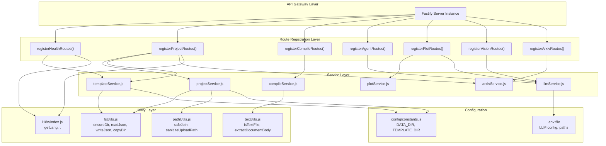
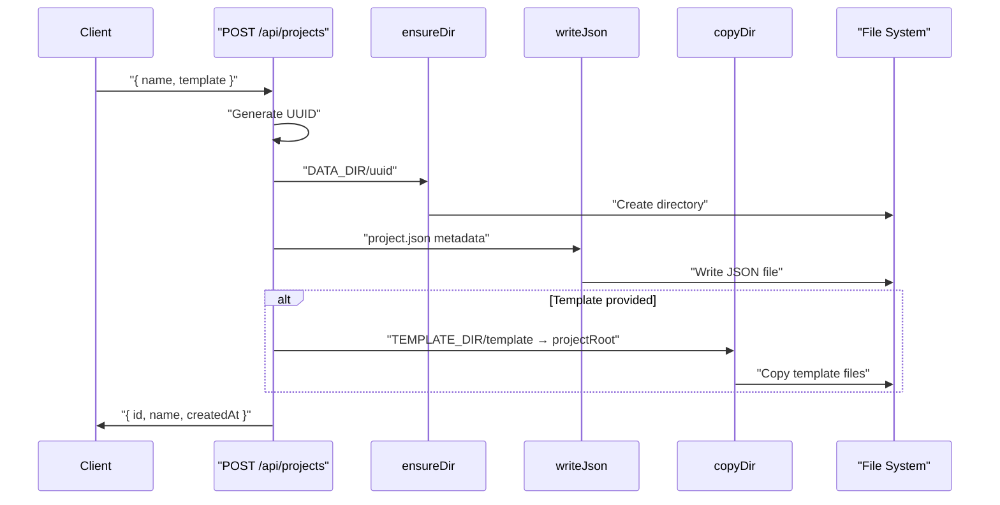
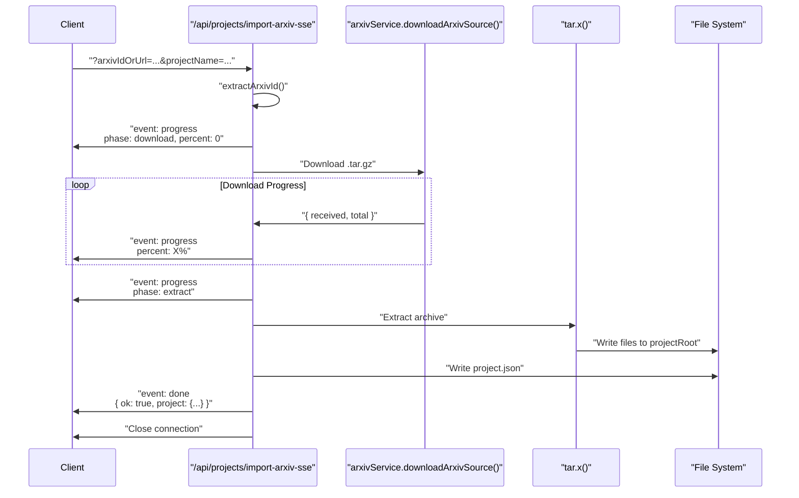
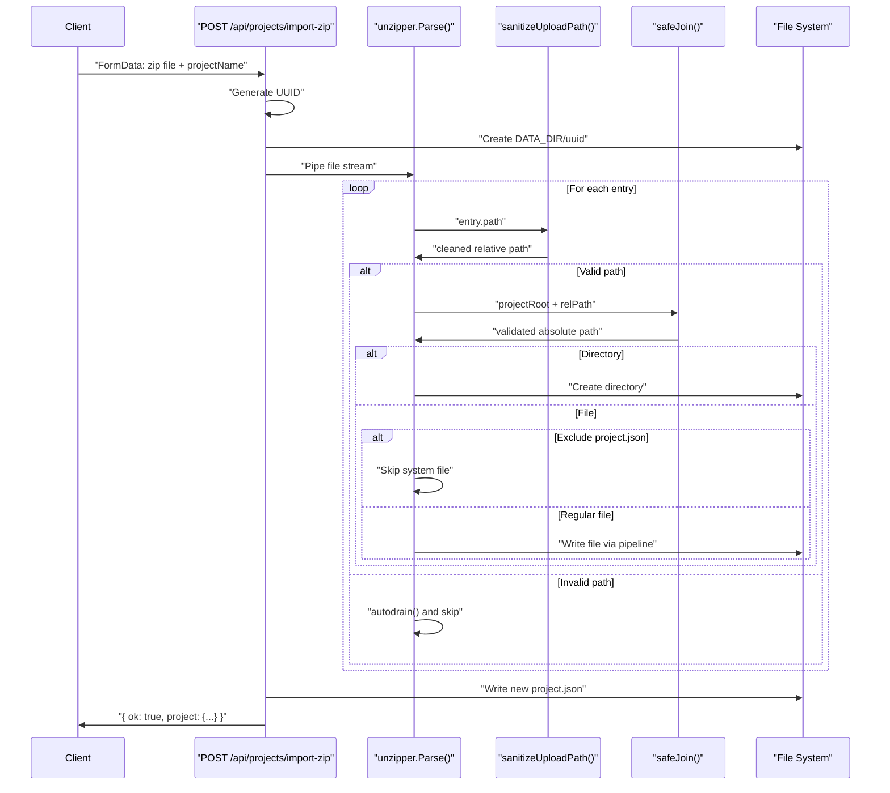
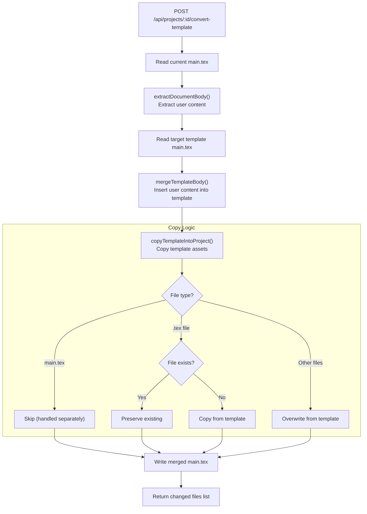

<!-- source: DeepWiki mcp.deepwiki.com · repo OpenDCAI/OpenPrism · page 5 Backend Application · fetched 2026-11-02 -->

# Backend Application

<details>
<summary>Relevant source files</summary>

The following files were used as context for generating this wiki page:

- [apps/backend/src/routes/health.js](apps/backend/src/routes/health.js)
- [apps/backend/src/routes/projects.js](apps/backend/src/routes/projects.js)
- [apps/backend/src/services/templateService.js](apps/backend/src/services/templateService.js)

</details>


## Purpose and Scope

The Backend Application is a Fastify-based HTTP server that provides RESTful API endpoints for all OpenPrism functionality. It runs on port 8787 (configurable via `PORT` environment variable) and handles project management, file operations, LaTeX compilation, AI agent execution, plotting, vision OCR, and external service integrations.

This page covers the backend server architecture, route organization, service layer, and utility modules. For specific feature implementations, see:
- Project-specific operations: [Project Management API](#5.1)
- LaTeX compilation: [Compilation Service](#5.2)
- AI functionality: [AI Agent Service](#5.3)
- Python plotting: [Plot Generation Service](#5.4)
- Template operations: [Template System](#5.5)
- arXiv integration: [arXiv Integration](#5.6)

**Sources:** [apps/backend/src/routes/projects.js:1-434](), [apps/backend/src/routes/health.js:1-10]()

---

## Server Architecture Overview

The backend follows a three-layer architecture: API Gateway (Fastify), Route Handlers, and Service Layer, with a cross-cutting Utility Layer for common operations.

### Layer Architecture Diagram



**Sources:** [apps/backend/src/routes/health.js:1-10](), [apps/backend/src/routes/projects.js:1-434](), [apps/backend/src/services/templateService.js:1-47]()

---

## Route Organization

All routes are registered through modular registration functions. The backend exposes routes under the `/api` prefix.

### Route Registration Pattern

Each route module exports a registration function that receives the Fastify instance:

```javascript
export function registerXxxRoutes(fastify) {
  fastify.get('/api/xxx', async (req, reply) => { ... });
  fastify.post('/api/xxx', async (req, reply) => { ... });
}
```

### Core Route Modules

| Module | Registration Function | Primary Routes | Purpose |
|--------|----------------------|----------------|---------|
| `health.js` | `registerHealthRoutes()` | `GET /api/health`, `GET /api/templates` | Health checks and template manifest |
| `projects.js` | `registerProjectRoutes()` | `GET/POST /api/projects`, `/api/projects/:id/*` | Project CRUD and file management |
| `compile.js` | `registerCompileRoutes()` | `POST /api/compile` | LaTeX compilation |
| `agent.js` | `registerAgentRoutes()` | `POST /api/agent/run` | AI agent execution |
| `plot.js` | `registerPlotRoutes()` | `POST /api/plot/from-table` | Python plot generation |
| `vision.js` | `registerVisionRoutes()` | `POST /api/vision/latex` | Image to LaTeX OCR |
| `arxiv.js` | `registerArxivRoutes()` | `GET /api/arxiv/*` | arXiv paper search and metadata |

**Sources:** [apps/backend/src/routes/health.js:3-10](), [apps/backend/src/routes/projects.js:16-434]()

---

## Project Management Routes

The `registerProjectRoutes()` function in `projects.js` implements comprehensive project lifecycle management with 20+ endpoints.

### Project Routes Diagram

```mermaid
graph TB
    subgraph "Project Lifecycle"
        listProjects["GET /api/projects<br/>List all projects"]
        createProject["POST /api/projects<br/>Create new project"]
        renameProject["POST /api/projects/:id/rename-project<br/>Rename project"]
        copyProject["POST /api/projects/:id/copy<br/>Duplicate project"]
        deleteProject["DELETE /api/projects/:id<br/>Move to trash"]
        permanentDelete["DELETE /api/projects/:id/permanent<br/>Permanent deletion"]
    end
    
    subgraph "Project Metadata"
        updateTags["PATCH /api/projects/:id/tags<br/>Update tags array"]
        archiveProject["PATCH /api/projects/:id/archive<br/>Archive/unarchive"]
        trashProject["PATCH /api/projects/:id/trash<br/>Trash/restore"]
    end
    
    subgraph "File Operations"
        getTree["GET /api/projects/:id/tree<br/>Get file tree"]
        getFile["GET /api/projects/:id/file<br/>Read text file"]
        getBlob["GET /api/projects/:id/blob<br/>Read binary file"]
        getAllFiles["GET /api/projects/:id/files<br/>Read all files"]
        putFile["PUT /api/projects/:id/file<br/>Write file"]
        uploadFile["POST /api/projects/:id/upload<br/>Upload multipart"]
        createFolder["POST /api/projects/:id/folder<br/>Create directory"]
        renameFile["POST /api/projects/:id/rename<br/>Rename file/folder"]
        setFileOrder["POST /api/projects/:id/file-order<br/>Set file ordering"]
    end
    
    subgraph "Import Operations"
        importZip["POST /api/projects/import-zip<br/>Import ZIP archive"]
        importArxiv["GET /api/projects/import-arxiv-sse<br/>Import arXiv paper"]
    end
    
    subgraph "Template Operations"
        applyTemplate["POST /api/projects/:id/template<br/>Apply template"]
        convertTemplate["POST /api/projects/:id/convert-template<br/>Convert to template"]
    end
    
    subgraph "Data Storage"
        projectJson["project.json<br/>metadata file"]
        dataDir["DATA_DIR/projectId/<br/>project directory"]
    end
    
    listProjects --> dataDir
    createProject --> dataDir
    createProject --> projectJson
    renameProject --> projectJson
    updateTags --> projectJson
    
    getTree --> dataDir
    getFile --> dataDir
    getAllFiles --> dataDir
    putFile --> dataDir
    putFile --> projectJson
```



**Sources:** [apps/backend/src/routes/projects.js:16-434]()

### Project Metadata Structure

Every project has a `project.json` file with the following schema:

```javascript
{
  id: "uuid",                    // Unique project identifier
  name: "string",                // Display name
  createdAt: "ISO 8601",         // Creation timestamp
  updatedAt: "ISO 8601",         // Last modification timestamp
  tags: ["string"],              // User-defined tags
  archived: boolean,             // Archive status
  trashed: boolean,              // Trash status
  trashedAt: "ISO 8601" | null,  // Trash timestamp
  fileOrder: {                   // Custom file ordering per folder
    "folder/path": ["file1", "file2"]
  }
}
```

The metadata is read via `readJson()` at [apps/backend/src/routes/projects.js:25]() and written via `writeJson()` at [apps/backend/src/routes/projects.js:48]().

**Sources:** [apps/backend/src/routes/projects.js:23-38](), [apps/backend/src/routes/projects.js:169-179]()

### Project Creation Flow



**Sources:** [apps/backend/src/routes/projects.js:41-54]()

### File Security

All file paths are validated using `safeJoin()` and `sanitizeUploadPath()` to prevent directory traversal attacks:

- `safeJoin(projectRoot, userPath)` ensures the resolved path stays within `projectRoot`
- `sanitizeUploadPath(path)` removes leading slashes, `..` segments, and absolute paths

**Sources:** [apps/backend/src/routes/projects.js:9](), [apps/backend/src/routes/projects.js:76](), [apps/backend/src/routes/projects.js:291]()

---

## Import Operations

### ZIP Import

`POST /api/projects/import-zip` accepts multipart form data with a ZIP archive and optional project name:

1. Generate new project UUID
2. Create project directory
3. Parse multipart stream with `unzipper.Parse()`
4. Filter and sanitize entry paths
5. Extract files to project directory (excluding `project.json`)
6. Write new `project.json` with metadata

**Sources:** [apps/backend/src/routes/projects.js:56-103]()

### arXiv Import with Server-Sent Events

`GET /api/projects/import-arxiv-sse` implements long-polling import with real-time progress updates:



The SSE implementation at [apps/backend/src/routes/projects.js:105-167]() sends events in this format:

```javascript
reply.raw.write(`event: ${event}\ndata: ${JSON.stringify(data)}\n\n`);
```

Event types:
- `progress`: `{ phase: "download"|"extract", percent: number, received?, total? }`
- `error`: `{ error: string }`
- `done`: `{ ok: true, project: ProjectMeta }`

**Sources:** [apps/backend/src/routes/projects.js:105-167](), [apps/backend/src/routes/projects.js:13]()

---

## Template System Integration

### Template Application

`POST /api/projects/:id/template` copies all files from a template directory into an existing project:

```javascript
const templateRoot = path.join(TEMPLATE_DIR, template);
await copyDir(templateRoot, projectRoot);
```

**Sources:** [apps/backend/src/routes/projects.js:403-411]()

### Template Conversion

`POST /api/projects/:id/convert-template` implements sophisticated template switching:

1. Read current `main.tex` content
2. Extract document body using `extractDocumentBody()`
3. Read target template's main file
4. Merge body into template structure using `mergeTemplateBody()`
5. Copy all template files (excluding original `main.tex`) via `copyTemplateIntoProject()`
6. Write merged main file
7. Return list of changed files

This preserves the user's document content while adopting the new template's structure and styling.

**Sources:** [apps/backend/src/routes/projects.js:369-401]()

---

## File Operations

### Text File Reading

`GET /api/projects/:id/file?path=...` reads a single text file:

```javascript
const abs = safeJoin(projectRoot, filePath);
const content = await fs.readFile(abs, 'utf8');
return { content };
```

**Sources:** [apps/backend/src/routes/projects.js:286-294]()

### Binary File Reading

`GET /api/projects/:id/blob?path=...` reads binary files with appropriate MIME types:

```javascript
const contentTypes = {
  '.png': 'image/png',
  '.jpg': 'image/jpeg',
  '.jpeg': 'image/jpeg',
  '.svg': 'image/svg+xml',
  '.pdf': 'application/pdf',
  '.eps': 'application/postscript'
};
```

**Sources:** [apps/backend/src/routes/projects.js:296-315]()

### Bulk File Reading

`GET /api/projects/:id/files` returns all project files for compilation:

```javascript
for (const item of items) {
  if (item.type !== 'file') continue;
  const buffer = await fs.readFile(abs);
  if (isTextFile(item.path)) {
    files.push({ path, content: buffer.toString('utf8'), encoding: 'utf8' });
  } else {
    files.push({ path, content: buffer.toString('base64'), encoding: 'base64' });
  }
}
```

This endpoint is used by the compilation service to gather all files before sending to LaTeX engines.

**Sources:** [apps/backend/src/routes/projects.js:351-367](), [apps/backend/src/routes/projects.js:10]()

### File Writing

`PUT /api/projects/:id/file` writes file content and updates project metadata:

```javascript
await fs.writeFile(abs, content ?? '', 'utf8');
// Update project.json updatedAt timestamp
const meta = await readJson(metaPath);
meta.updatedAt = new Date().toISOString();
await writeJson(metaPath, meta);
```

**Sources:** [apps/backend/src/routes/projects.js:334-349]()

### File Upload

`POST /api/projects/:id/upload` handles multipart file uploads:

```javascript
const parts = req.parts();
for await (const part of parts) {
  if (part.type !== 'file') continue;
  const relPath = sanitizeUploadPath(part.filename);
  const abs = safeJoin(projectRoot, relPath);
  await ensureDir(path.dirname(abs));
  await pipeline(part.file, createWriteStream(abs));
  saved.push(relPath);
}
```

**Sources:** [apps/backend/src/routes/projects.js:317-332]()

---

## Service Layer

### Template Service

The `templateService.js` module provides two core functions:

#### `readTemplateManifest()`

Reads `templates/manifest.json` containing template metadata:

```javascript
{
  templates: [{
    id: "string",
    name: "string",
    description: "string",
    category: "string",
    mainFile: "string"
  }],
  categories: ["string"]
}
```

Returns empty arrays on error to ensure graceful degradation.

**Sources:** [apps/backend/src/services/templateService.js:6-15]()

#### `copyTemplateIntoProject(templateRoot, projectRoot)`

Recursively copies template files with smart overwrite logic:

- Skip `main.tex` (handled separately by template conversion)
- Overwrite non-`.tex` files (assets, style files)
- Preserve existing `.tex` files (user content)

```javascript
const shouldOverwrite = ext && ext !== '.tex';
try {
  await fs.access(destPath);
  if (!shouldOverwrite) continue; // File exists, don't overwrite .tex
} catch {
  // File missing; proceed to copy
}
```

Returns array of changed file paths.

**Sources:** [apps/backend/src/services/templateService.js:17-47]()

### Project Service

While not fully visible in the provided files, `projectService.js` exports at minimum:

- `getProjectRoot(id)`: Resolves project directory from ID with validation

This is used throughout routes to ensure project existence before operations.

**Sources:** [apps/backend/src/routes/projects.js:12](), [apps/backend/src/routes/projects.js:173]()

---

## Utility Modules

### File System Utilities (`fsUtils.js`)

Core filesystem abstractions used throughout the backend:

| Function | Purpose |
|----------|---------|
| `ensureDir(path)` | Create directory recursively if missing |
| `readJson(path)` | Read and parse JSON file |
| `writeJson(path, data)` | Write JSON with formatting |
| `copyDir(src, dest)` | Recursively copy directory |
| `listFilesRecursive(root)` | Walk directory tree, return file metadata |

**Sources:** [apps/backend/src/routes/projects.js:8]()

### Path Utilities (`pathUtils.js`)

Security-critical path validation:

| Function | Purpose |
|----------|---------|
| `safeJoin(base, ...parts)` | Join paths and validate result stays within base |
| `sanitizeUploadPath(path)` | Remove dangerous path components from user input |

These prevent directory traversal vulnerabilities.

**Sources:** [apps/backend/src/routes/projects.js:9]()

### TeX Utilities (`texUtils.js`)

LaTeX-specific parsing and manipulation:

| Function | Purpose |
|----------|---------|
| `isTextFile(path)` | Detect if file is text based on extension |
| `extractDocumentBody(tex)` | Extract content between `\begin{document}` and `\end{document}` |
| `mergeTemplateBody(templateTex, body)` | Replace template body with user content |

**Sources:** [apps/backend/src/routes/projects.js:10]()

### Internationalization (`i18n/index.js`)

Localization support for error messages and responses:

```javascript
const lang = getLang(req);  // Extract language from request
const errorMsg = t(lang, 'zip_extract_failed', { error: String(err) });
```

Supports context-aware translation with variable interpolation.

**Sources:** [apps/backend/src/routes/projects.js:14](), [apps/backend/src/routes/projects.js:93]()

---

## Configuration and Constants

### Constants Module (`config/constants.js`)

Exports path constants used throughout the backend:

```javascript
export const DATA_DIR;           // User project storage directory
export const TEMPLATE_DIR;       // Built-in templates directory
export const TEMPLATE_MANIFEST;  // templates/manifest.json path
```

These are derived from environment variables with sensible defaults.

**Sources:** [apps/backend/src/routes/projects.js:7](), [apps/backend/src/services/templateService.js:3]()

### Environment Variables

Key configuration via `.env`:

| Variable | Purpose | Example |
|----------|---------|---------|
| `OPENPRISM_DATA_DIR` | Project storage path | `/var/lib/openprism/data` |
| `OPENPRISM_LLM_ENDPOINT` | LLM API base URL | `https://api.openai.com/v1` |
| `OPENPRISM_LLM_API_KEY` | LLM authentication | `sk-...` |
| `OPENPRISM_LLM_MODEL` | Default model name | `gpt-4o-mini` |
| `PORT` | Backend server port | `8787` |
| `OPENPRISM_PYTHON` | Python executable path | `/usr/bin/python3` |

**Sources:** Referenced in service modules (not visible in provided files but documented in architecture diagrams)

---

## Request/Response Patterns

### Standard Success Response

```javascript
return { ok: true, ...data };
```

### Standard Error Response

```javascript
return { ok: false, error: "Error message" };
```

### Async Route Handlers

All route handlers are async functions allowing direct use of `await`:

```javascript
fastify.post('/api/projects', async (req, reply) => {
  const { name } = req.body;
  const id = crypto.randomUUID();
  await ensureDir(path.join(DATA_DIR, id));
  reply.send({ id, name });
});
```

**Sources:** [apps/backend/src/routes/projects.js:41-54]()

### Error Handling Pattern

Errors are caught and converted to user-friendly messages with i18n support:

```javascript
try {
  // operation
} catch (err) {
  await cleanup();
  return { ok: false, error: t(lang, 'operation_failed', { error: String(err) }) };
}
```

**Sources:** [apps/backend/src/routes/projects.js:91-94](), [apps/backend/src/routes/projects.js:154-158]()

---

## Health and Template Routes

### Health Check Endpoint

`GET /api/health` provides simple service availability:

```javascript
fastify.get('/api/health', async () => ({ ok: true }));
```

**Sources:** [apps/backend/src/routes/health.js:4]()

### Template Manifest Endpoint

`GET /api/templates` returns available templates and categories:

```javascript
fastify.get('/api/templates', async () => {
  const { templates, categories } = await readTemplateManifest();
  return { templates, categories };
});
```

This is called by the frontend to populate template selection UI.

**Sources:** [apps/backend/src/routes/health.js:6-9]()

---

## Data Flow: Project Import

### Complete Import Pipeline



**Sources:** [apps/backend/src/routes/projects.js:56-103]()

---

## Data Flow: Template Conversion

### Template Switching Process



**Sources:** [apps/backend/src/routes/projects.js:369-401](), [apps/backend/src/services/templateService.js:17-47]()

---

## Security Considerations

### Path Traversal Prevention

All user-provided paths are validated through multiple layers:

1. **Upload Sanitization**: `sanitizeUploadPath()` removes:
   - Leading slashes
   - `..` segments
   - Absolute paths
   - Hidden files (starting with `.`)

2. **Safe Join**: `safeJoin(base, ...parts)` ensures:
   - Resolved path is within base directory
   - Throws error if path escapes base

3. **File Filtering**: Archive extraction filters entries:
   ```javascript
   filter: (entryPath) => {
     if (!entryPath) return false;
     if (path.isAbsolute(entryPath)) return false;
     return !entryPath.split('/').some((part) => part === '..');
   }
   ```

**Sources:** [apps/backend/src/routes/projects.js:76](), [apps/backend/src/routes/projects.js:148-152]()

### System File Protection

Critical system files are explicitly excluded from user operations:

- `project.json` cannot be overwritten during imports
- Template conversion skips `main.tex` during bulk copy to preserve merge logic

**Sources:** [apps/backend/src/routes/projects.js:77-79](), [apps/backend/src/services/templateService.js:24]()

---

## Extension Points

The backend architecture supports extension through:

1. **New Route Modules**: Add `registerXxxRoutes(fastify)` functions
2. **New Service Modules**: Implement service logic in `services/` directory
3. **New Utility Modules**: Add reusable functions in `utils/` directory
4. **Template Extensions**: Add templates to `TEMPLATE_DIR` and update manifest

All routes automatically receive:
- Request logging (via Fastify)
- Error handling (via async/await)
- Multipart parsing (via `@fastify/multipart`)
- CORS support (if configured)

**Sources:** [apps/backend/src/routes/health.js:3](), [apps/backend/src/routes/projects.js:16]()

---

