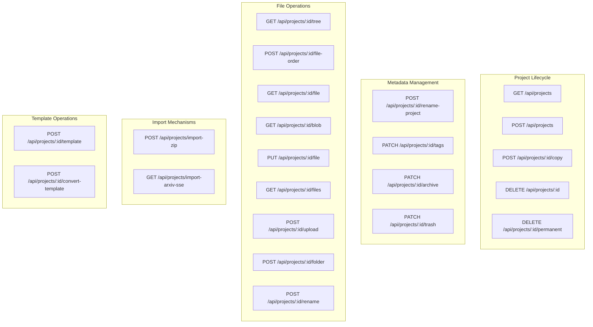
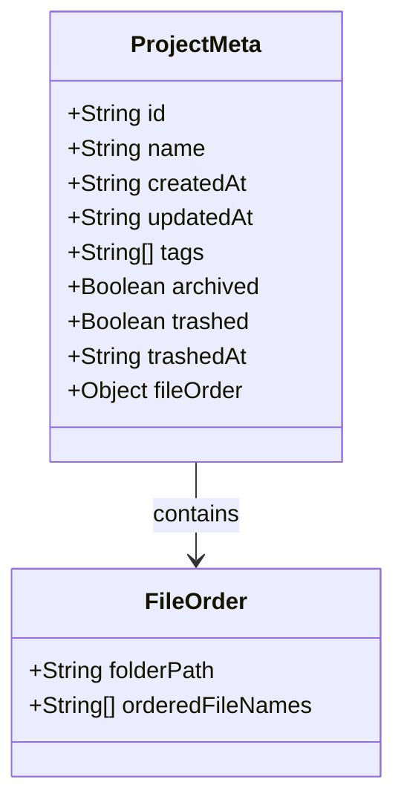
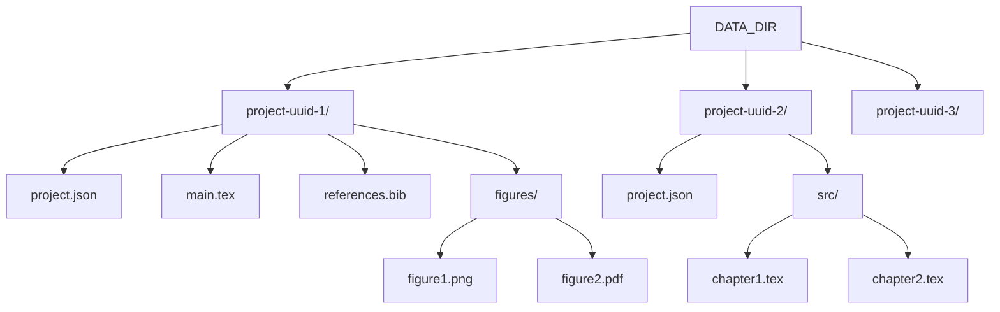
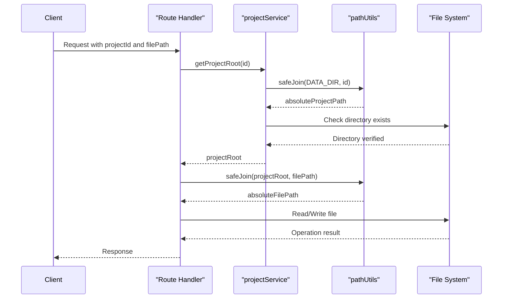
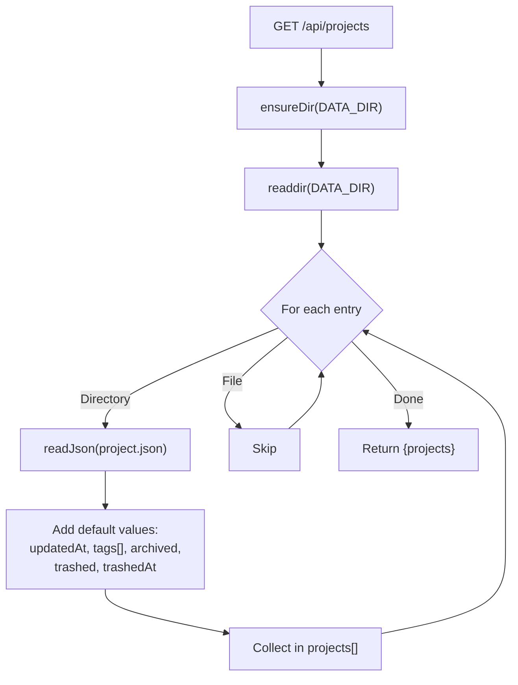
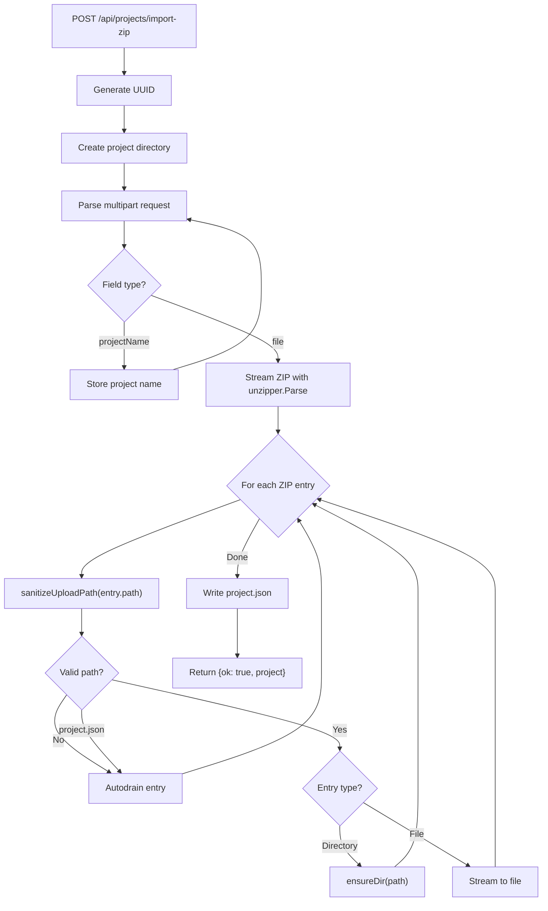
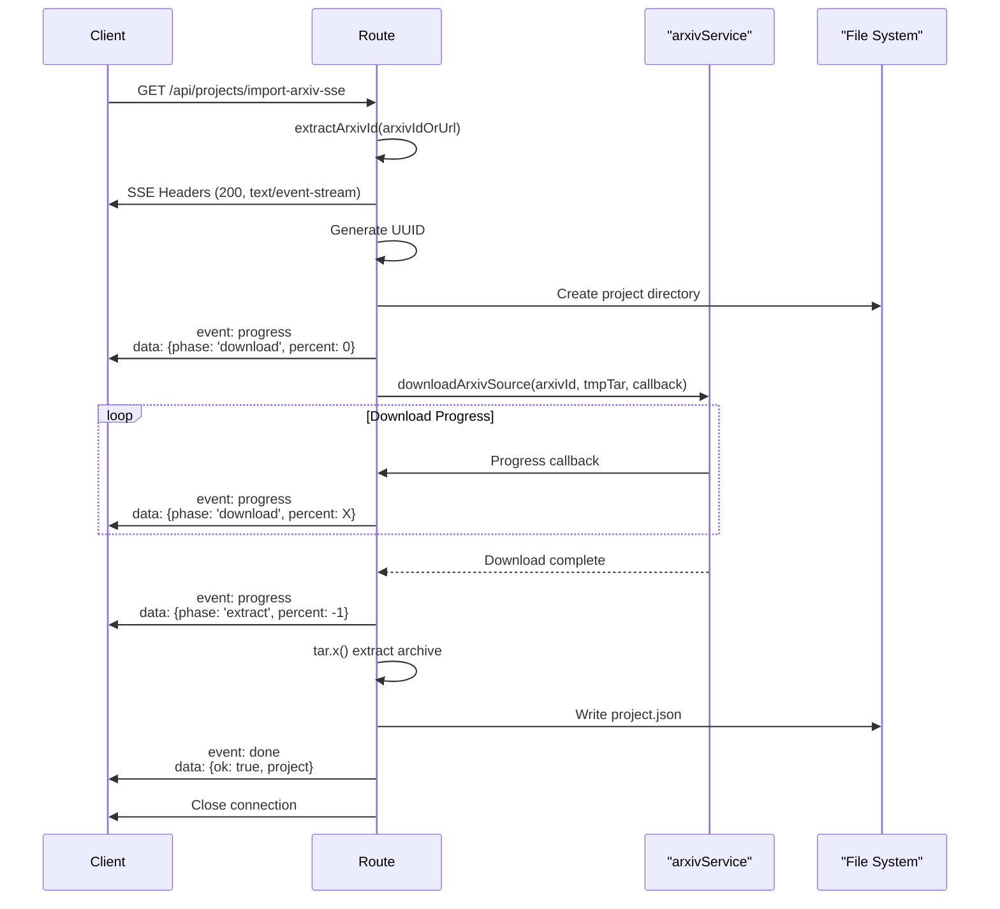
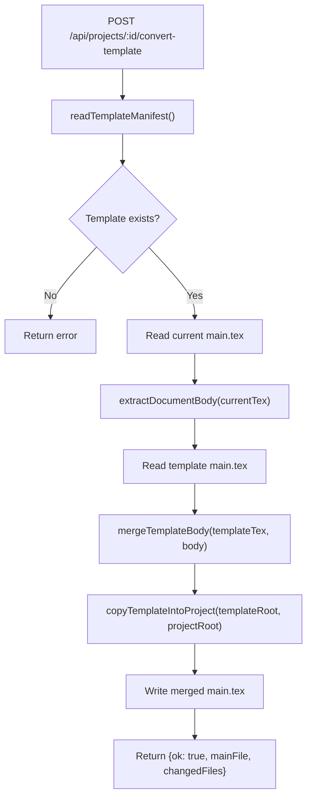
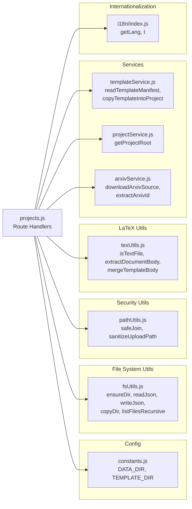

<!-- source: DeepWiki mcp.deepwiki.com · repo OpenDCAI/OpenPrism · page 5.1 Project Management API · fetched 2026-11-02 -->

# Project Management API

<details>
<summary>Relevant source files</summary>

The following files were used as context for generating this wiki page:

- [README.md](README.md)
- [apps/backend/src/routes/projects.js](apps/backend/src/routes/projects.js)

</details>


## Purpose and Scope

The Project Management API provides RESTful endpoints for managing LaTeX projects in OpenPrism. This includes project lifecycle operations (create, read, update, delete), file operations within projects (read, write, upload), project import mechanisms (ZIP, arXiv), and metadata management (tags, archiving, trash). The API is implemented as Fastify route handlers in [apps/backend/src/routes/projects.js:16-434]().

For information about LaTeX compilation operations, see [Compilation Service](#5.2). For template-specific operations beyond basic application, see [Template System](#5.5). For arXiv metadata and search operations, see [arXiv Integration](#5.6).

**Sources:** [apps/backend/src/routes/projects.js:1-434]()

---

## API Endpoints Overview

The Project Management API exposes 22 endpoints organized into five functional categories: project lifecycle, file operations, metadata management, import mechanisms, and template operations.

### Endpoint Categories



**Sources:** [apps/backend/src/routes/projects.js:16-434]()

---

## Route Registration

All project routes are registered through the `registerProjectRoutes` function, which receives a Fastify instance and attaches route handlers.

| Endpoint | Method | Handler Lines | Purpose |
|----------|--------|---------------|---------|
| `/api/projects` | GET | 17-39 | List all projects |
| `/api/projects` | POST | 41-54 | Create new project |
| `/api/projects/import-zip` | POST | 56-103 | Import ZIP archive |
| `/api/projects/import-arxiv-sse` | GET | 105-167 | Import from arXiv with SSE |
| `/api/projects/:id/rename-project` | POST | 169-179 | Rename project |
| `/api/projects/:id/copy` | POST | 181-200 | Duplicate project |
| `/api/projects/:id` | DELETE | 202-210 | Soft delete (trash) |
| `/api/projects/:id/permanent` | DELETE | 212-217 | Permanent delete |
| `/api/projects/:id/tags` | PATCH | 219-229 | Update tags |
| `/api/projects/:id/archive` | PATCH | 231-240 | Archive/unarchive |
| `/api/projects/:id/trash` | PATCH | 242-256 | Trash/restore |
| `/api/projects/:id/tree` | GET | 258-270 | Get file tree |
| `/api/projects/:id/file-order` | POST | 272-284 | Update file order |
| `/api/projects/:id/file` | GET | 286-294 | Read text file |
| `/api/projects/:id/blob` | GET | 296-315 | Read binary file |
| `/api/projects/:id/upload` | POST | 317-332 | Upload files |
| `/api/projects/:id/file` | PUT | 334-349 | Write file |
| `/api/projects/:id/files` | GET | 351-367 | Get all files |
| `/api/projects/:id/convert-template` | POST | 369-401 | Convert to template |
| `/api/projects/:id/template` | POST | 403-411 | Apply template |
| `/api/projects/:id/folder` | POST | 413-421 | Create folder |
| `/api/projects/:id/rename` | POST | 423-434 | Rename file/folder |

**Sources:** [apps/backend/src/routes/projects.js:16-434]()

---

## Project Metadata Structure

Each project directory contains a `project.json` file that stores project metadata. This file is read and written by most API endpoints to maintain project state.

### Metadata Schema



| Field | Type | Required | Description |
|-------|------|----------|-------------|
| `id` | String (UUID) | Yes | Unique project identifier |
| `name` | String | Yes | Project display name |
| `createdAt` | String (ISO 8601) | Yes | Creation timestamp |
| `updatedAt` | String (ISO 8601) | No | Last modification timestamp |
| `tags` | String[] | No | User-defined tags for organization |
| `archived` | Boolean | No | Archive status (default: false) |
| `trashed` | Boolean | No | Trash status (default: false) |
| `trashedAt` | String (ISO 8601) | No | Trash timestamp |
| `fileOrder` | Object | No | Custom file ordering per folder |

The `fileOrder` field maps folder paths to arrays of file names, allowing users to customize the display order in the file tree. An empty string key (`""`) represents the root folder.

**Sources:** [apps/backend/src/routes/projects.js:17-39](), [apps/backend/src/routes/projects.js:169-256]()

---

## File System Organization

Projects are stored in a flat directory structure under `DATA_DIR`, with each project identified by its UUID. The system uses path sanitization utilities to prevent directory traversal attacks.

### Directory Structure



### Path Resolution Flow



The `getProjectRoot` function from `projectService` validates that a project directory exists before returning its path. The `safeJoin` function from `pathUtils` prevents directory traversal attacks by normalizing paths and ensuring they remain within the project directory.

**Sources:** [apps/backend/src/routes/projects.js:1-14](), [apps/backend/src/routes/projects.js:258-270](), [apps/backend/src/routes/projects.js:286-349]()

---

## Project Lifecycle Operations

### List All Projects

**Endpoint:** `GET /api/projects`

Returns an array of all project metadata objects. The handler scans `DATA_DIR` for subdirectories, reads each `project.json` file, and includes default values for optional fields.



**Default Values Applied:**
- `updatedAt`: Falls back to `createdAt` if not present
- `tags`: Empty array if not present
- `archived`: `false` if not present
- `trashed`: `false` if not present
- `trashedAt`: `null` if not present

**Sources:** [apps/backend/src/routes/projects.js:17-39]()

### Create New Project

**Endpoint:** `POST /api/projects`

Creates a new project directory with a generated UUID, writes initial metadata, and optionally copies template files.

**Request Body:**
```typescript
{
  name?: string,        // Default: "Untitled"
  template?: string     // Optional template ID
}
```

**Process:**
1. Generate UUID using `crypto.randomUUID()`
2. Create directory at `DATA_DIR/{uuid}`
3. Write `project.json` with minimal metadata
4. If `template` provided, copy from `TEMPLATE_DIR/{template}`

**Sources:** [apps/backend/src/routes/projects.js:41-54]()

### Copy Project

**Endpoint:** `POST /api/projects/:id/copy`

Creates a duplicate of an existing project with a new UUID. All files are copied, and metadata is updated with new identifiers and timestamps.

**Metadata Transformations:**
- `id`: New UUID generated
- `name`: Appended with " (Copy)" if not provided
- `createdAt`: Current timestamp
- `updatedAt`: Current timestamp
- `trashed`: Reset to `false`
- `trashedAt`: Reset to `null`

**Sources:** [apps/backend/src/routes/projects.js:181-200]()

### Delete Operations

OpenPrism implements a two-stage deletion system: soft delete (trash) and permanent delete.

**Soft Delete:** `DELETE /api/projects/:id`
- Sets `trashed: true` and `trashedAt: <timestamp>`
- Project remains on disk and can be restored
- Used by default for user-initiated deletions

**Permanent Delete:** `DELETE /api/projects/:id/permanent`
- Recursively removes project directory
- Irreversible operation
- Should only be called after user confirmation

**Sources:** [apps/backend/src/routes/projects.js:202-217]()

---

## File Operations

### File Tree Retrieval

**Endpoint:** `GET /api/projects/:id/tree`

Returns a recursive listing of all files and directories within a project, along with custom file ordering metadata.

**Response Structure:**
```typescript
{
  items: Array<{
    path: string,
    type: 'file' | 'directory',
    size?: number,
    modifiedAt?: string
  }>,
  fileOrder: {
    [folderPath: string]: string[]
  }
}
```

The `listFilesRecursive` utility function from `fsUtils` traverses the directory tree and excludes the `project.json` file from the listing.

**Sources:** [apps/backend/src/routes/projects.js:258-270]()

### File Reading

**Text Files:** `GET /api/projects/:id/file`

Reads a single text file and returns its content as a UTF-8 string. Used for LaTeX source files, BibTeX files, and other text-based assets.

**Query Parameters:**
- `path`: Relative path within project (e.g., `"main.tex"`, `"src/chapter1.tex"`)

**Binary Files:** `GET /api/projects/:id/blob`

Reads binary files (images, PDFs, EPS files) and returns them with appropriate `Content-Type` headers.

**Supported Content Types:**

| Extension | Content-Type |
|-----------|--------------|
| `.png` | `image/png` |
| `.jpg`, `.jpeg` | `image/jpeg` |
| `.svg` | `image/svg+xml` |
| `.pdf` | `application/pdf` |
| `.eps` | `application/postscript` |
| Other | `application/octet-stream` |

**Sources:** [apps/backend/src/routes/projects.js:286-315]()

### File Writing

**Endpoint:** `PUT /api/projects/:id/file`

Writes content to a file, creating parent directories as needed. Automatically updates the project's `updatedAt` timestamp.

**Request Body:**
```typescript
{
  path: string,       // Relative path within project
  content: string     // File content (empty string if not provided)
}
```

**Side Effects:**
1. Creates parent directories if they don't exist
2. Writes file content to disk
3. Updates `project.json` with current timestamp

This endpoint is used by the auto-save mechanism in the frontend editor.

**Sources:** [apps/backend/src/routes/projects.js:334-349]()

### Bulk File Retrieval

**Endpoint:** `GET /api/projects/:id/files`

Returns all project files in a single response. Text files are returned as UTF-8 strings, binary files as base64-encoded strings. This endpoint is used by the compilation service to gather all files for LaTeX processing.

**Response Structure:**
```typescript
{
  files: Array<{
    path: string,
    content: string,
    encoding: 'utf8' | 'base64'
  }>
}
```

The `isTextFile` utility from `texUtils` determines encoding based on file extension.

**Sources:** [apps/backend/src/routes/projects.js:351-367]()

### File Upload

**Endpoint:** `POST /api/projects/:id/upload`

Handles multipart file uploads. Accepts multiple files and saves them to the project directory using their uploaded filenames.

**Security Measures:**
1. `sanitizeUploadPath` from `pathUtils` prevents directory traversal
2. Parent directories are created automatically
3. Files are streamed directly to disk using `pipeline` to avoid memory issues with large files

**Response:**
```typescript
{
  ok: boolean,
  files: string[]  // Relative paths of saved files
}
```

**Sources:** [apps/backend/src/routes/projects.js:317-332]()

### File and Folder Management

**Create Folder:** `POST /api/projects/:id/folder`
- Creates a directory at the specified path
- Parent directories created automatically

**Rename:** `POST /api/projects/:id/rename`
- Renames or moves a file/folder
- Request body: `{ from: string, to: string }`
- Creates parent directories as needed

**File Order:** `POST /api/projects/:id/file-order`
- Updates custom file ordering for a folder
- Request body: `{ folder: string, order: string[] }`
- Stored in `project.json` under `fileOrder`

**Sources:** [apps/backend/src/routes/projects.js:272-284](), [apps/backend/src/routes/projects.js:413-434]()

---

## Import Mechanisms

### ZIP Import

**Endpoint:** `POST /api/projects/import-zip`

Imports a LaTeX project from a ZIP archive using multipart form upload. The endpoint streams the ZIP file for extraction to avoid loading the entire archive into memory.



**Error Handling:**
- If ZIP extraction fails, the project directory is removed to prevent partial imports
- Missing ZIP file returns an error response
- Malformed ZIP paths are silently skipped

**Excluded Files:**
- Any file named `project.json` is excluded to prevent metadata conflicts
- Invalid paths (containing `..` or absolute paths) are skipped

**Sources:** [apps/backend/src/routes/projects.js:56-103]()

### arXiv Import with Server-Sent Events

**Endpoint:** `GET /api/projects/import-arxiv-sse`

Imports a LaTeX project from arXiv using Server-Sent Events (SSE) to stream progress updates to the client during the long-running download and extraction process.

**Query Parameters:**
- `arxivIdOrUrl`: arXiv identifier (e.g., `"2301.12345"`) or full URL
- `projectName`: Optional custom project name

**SSE Event Types:**

| Event | Data Structure | Description |
|-------|----------------|-------------|
| `progress` | `{ phase: 'download', percent: number, received: number, total: number }` | Download progress |
| `progress` | `{ phase: 'extract', percent: -1 }` | Extraction in progress |
| `done` | `{ ok: true, project: ProjectMeta }` | Import completed |
| `error` | `{ error: string }` | Import failed |



**Security Filtering:**
During extraction, the tar filter prevents:
- Absolute paths
- Paths containing `..` components
- Empty paths

**Cleanup:**
The temporary `.tar.gz` file is removed regardless of success or failure.

**Sources:** [apps/backend/src/routes/projects.js:105-167]()

---

## Template Operations

### Apply Template

**Endpoint:** `POST /api/projects/:id/template`

Copies all files from a template directory into an existing project. This is a simple bulk copy operation without merging logic.

**Request Body:**
```typescript
{
  template: string  // Template ID (e.g., "acl2023")
}
```

**Process:**
1. Resolve template directory: `TEMPLATE_DIR/{template}`
2. Copy entire directory to project root
3. Overwrites existing files with template versions

**Sources:** [apps/backend/src/routes/projects.js:403-411]()

### Convert Template

**Endpoint:** `POST /api/projects/:id/convert-template`

Performs intelligent template conversion that preserves the document body while replacing the preamble and structure with a new template. This is more sophisticated than simple file copying.

**Request Body:**
```typescript
{
  targetTemplate: string,    // Template ID to convert to
  mainFile?: string          // Current main file (default: "main.tex")
}
```



**Key Functions:**

1. **`extractDocumentBody`** (from `texUtils`):
   - Extracts content between `\begin{document}` and `\end{document}`
   - Preserves user-written content

2. **`mergeTemplateBody`** (from `texUtils`):
   - Replaces template's document body with user's content
   - Keeps template's preamble and structure

3. **`copyTemplateIntoProject`** (from `templateService`):
   - Copies template files excluding main file
   - Returns list of changed files

**Sources:** [apps/backend/src/routes/projects.js:369-401]()

---

## Metadata Management

### Rename Project

**Endpoint:** `POST /api/projects/:id/rename-project`

Updates the project's display name in its metadata file.

**Request Body:**
```typescript
{
  name: string  // New project name
}
```

**Sources:** [apps/backend/src/routes/projects.js:169-179]()

### Tag Management

**Endpoint:** `PATCH /api/projects/:id/tags`

Updates the project's tag array. Tags are used for organization and filtering in the project list interface.

**Request Body:**
```typescript
{
  tags: string[]  // Complete array of tags
}
```

**Side Effects:**
- Updates `updatedAt` timestamp
- Replaces entire tag array (not a merge operation)

**Sources:** [apps/backend/src/routes/projects.js:219-229]()

### Archive Status

**Endpoint:** `PATCH /api/projects/:id/archive`

Sets or clears the archive flag. Archived projects can be filtered from the main project list in the UI.

**Request Body:**
```typescript
{
  archived: boolean
}
```

**Sources:** [apps/backend/src/routes/projects.js:231-240]()

### Trash Status

**Endpoint:** `PATCH /api/projects/:id/trash`

Manages the trash state of a project, allowing soft delete and restoration.

**Request Body:**
```typescript
{
  trashed: boolean
}
```

**Behavior:**
- When `trashed: true`, sets `trashedAt` to current timestamp
- When `trashed: false`, clears `trashedAt` (restoration)
- Updates `updatedAt` timestamp

**Sources:** [apps/backend/src/routes/projects.js:242-256]()

---

## Dependencies and Utilities

### External Libraries

| Library | Usage | Import |
|---------|-------|--------|
| `tar` | Extract `.tar.gz` archives from arXiv | [apps/backend/src/routes/projects.js:4]() |
| `unzipper` | Parse and extract ZIP archives | [apps/backend/src/routes/projects.js:5]() |
| `crypto` | Generate UUIDs for project IDs | [apps/backend/src/routes/projects.js:6]() |

### Internal Utilities



**Key Utility Functions:**

- **`ensureDir`**: Creates directory if it doesn't exist (recursive)
- **`readJson`**: Reads and parses JSON file with error handling
- **`writeJson`**: Writes JSON with pretty formatting
- **`copyDir`**: Recursively copies directory contents
- **`listFilesRecursive`**: Returns flat list of all files in directory tree
- **`safeJoin`**: Joins paths and prevents directory traversal
- **`sanitizeUploadPath`**: Validates and normalizes uploaded file paths
- **`getProjectRoot`**: Resolves project directory and verifies existence

**Sources:** [apps/backend/src/routes/projects.js:1-14]()

---

## Error Handling

### Error Response Pattern

Most endpoints return a consistent error response format:

```typescript
{
  ok: false,
  error: string  // Human-readable error message
}
```

### Common Error Scenarios

**Project Not Found:**
- Thrown by `getProjectRoot` when project directory doesn't exist
- Results in 500 error if not caught by route handler

**Invalid Paths:**
- `safeJoin` throws error if path traversal detected
- `sanitizeUploadPath` returns `null` for invalid paths (silently skipped)

**File System Errors:**
- Read operations throw errors caught by try-catch blocks
- Write operations create parent directories to prevent ENOENT errors

**Validation Errors:**
- Missing required parameters (e.g., `name`, `path`, `order`) return explicit error messages
- Type validation performed inline (e.g., `Array.isArray(tags)`)

### Internationalization

Error messages are localized using the `i18n` system. The `getLang` function extracts the language preference from request headers, and `t` performs translation lookups.

**Example Usage:**
```javascript
const lang = getLang(req);
return { ok: false, error: t(lang, 'zip_extract_failed', { error: String(err) }) };
```

**Sources:** [apps/backend/src/routes/projects.js:14](), [apps/backend/src/routes/projects.js:93](), [apps/backend/src/routes/projects.js:156]()

---

## Security Considerations

### Path Traversal Prevention

All file operations use `safeJoin` from `pathUtils` to prevent directory traversal attacks. This function:
1. Normalizes paths to remove `.` and `..` components
2. Ensures resolved path remains within the project directory
3. Throws error if traversal detected

**Protected Operations:**
- File read: [apps/backend/src/routes/projects.js:291]()
- File write: [apps/backend/src/routes/projects.js:339]()
- File upload: [apps/backend/src/routes/projects.js:326]()
- Folder operations: [apps/backend/src/routes/projects.js:418-431]()

### Upload Sanitization

The `sanitizeUploadPath` function prevents malicious file uploads:
- Rejects absolute paths
- Removes path traversal sequences
- Normalizes path separators
- Returns `null` for invalid paths (silently skipped)

### Archive Extraction Filtering

Both ZIP and tar extraction implement filters to prevent:
- Extraction outside project directory
- Absolute path entries
- Symlink attacks
- Overwriting `project.json` metadata

**ZIP Filter:** [apps/backend/src/routes/projects.js:76-79]()
**Tar Filter:** [apps/backend/src/routes/projects.js:148-152]()

**Sources:** [apps/backend/src/routes/projects.js:9]()

---

