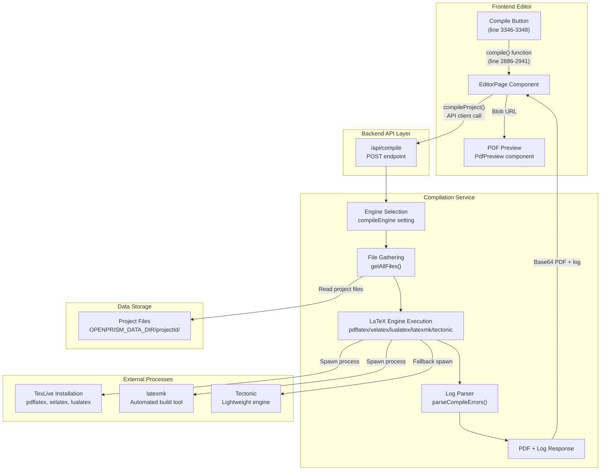
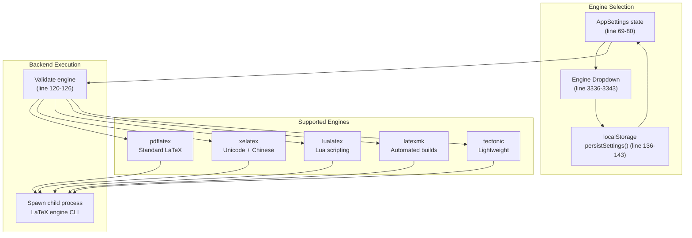
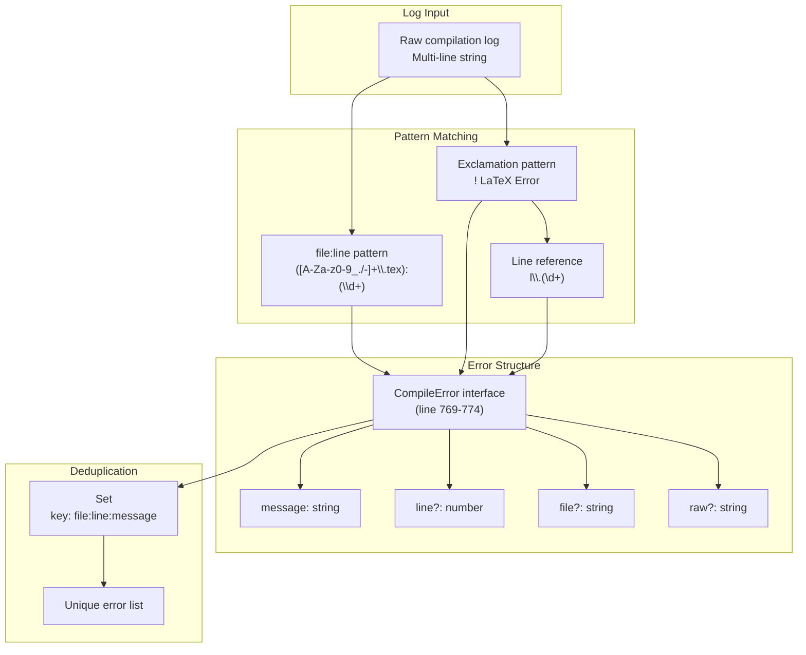
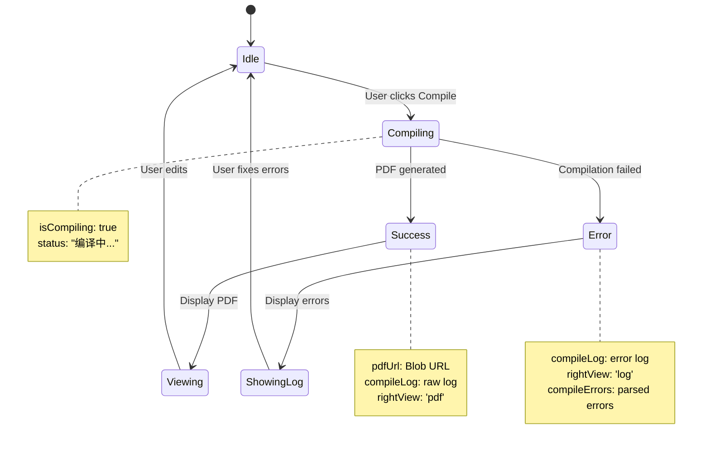
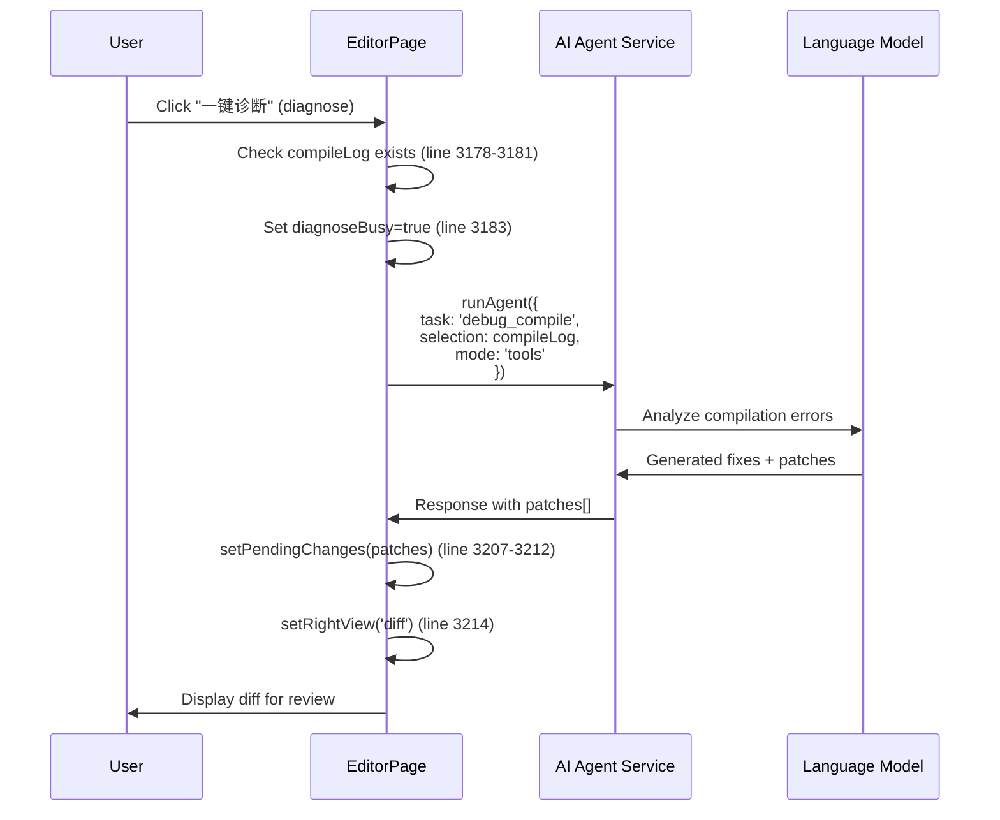
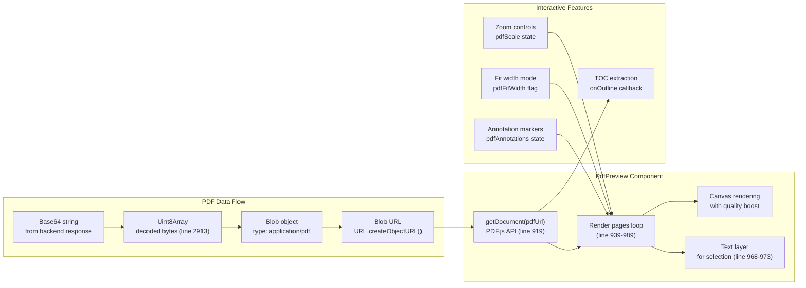
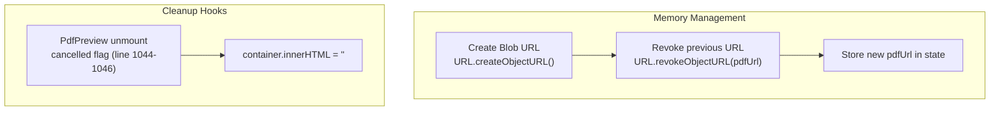

<!-- source: DeepWiki mcp.deepwiki.com · repo OpenDCAI/OpenPrism · page 5.2 Compilation Service · fetched 2026-11-02 -->

# Compilation Service

<details>
<summary>Relevant source files</summary>

The following files were used as context for generating this wiki page:

- [README.md](README.md)
- [apps/frontend/src/app/EditorPage.tsx](apps/frontend/src/app/EditorPage.tsx)

</details>


## Purpose and Scope

The Compilation Service is a core backend component responsible for converting LaTeX source files into PDF documents. It orchestrates the execution of LaTeX engines (pdflatex, xelatex, lualatex, latexmk, or tectonic), processes compilation logs, and returns the generated PDF along with diagnostic information. This service handles engine selection, automatic fallback between engines, and structured error parsing for user-facing diagnostics.

For information about the Project Management API that provides file storage and retrieval for compilation, see [Project Management API](#5.1). For details about AI-assisted error diagnosis, see [AI Agent Service](#5.3).

---

## System Context

The Compilation Service operates as a dedicated service within the Fastify backend, processing compilation requests from the frontend editor interface. It is invoked when users click "Compile PDF" or when automated compilation workflows trigger.



**Sources:** [apps/frontend/src/app/EditorPage.tsx:2886-2941](), [README.md:76-80](), [README.md:383-389]()

---

## Compilation Pipeline

The compilation process follows a multi-stage pipeline that transforms LaTeX source files into a viewable PDF document.

### Pipeline Stages

```mermaid
graph LR
    subgraph "Stage 1: Request Preparation"
        A1["User triggers compile"]
        A2["Save current file<br/>(line 2890)"]
        A3["Gather all files<br/>getAllFiles() (line 2891)"]
        A4["Merge in-memory edits<br/>(line 2892-2903)"]
    end
    
    subgraph "Stage 2: Backend Execution"
        B1["POST /api/compile<br/>Request payload"]
        B2["Validate mainFile exists<br/>(line 2904-2906)"]
        B3["Execute LaTeX engine<br/>compileEngine setting"]
        B4["Capture stdout/stderr"]
    end
    
    subgraph "Stage 3: Response Processing"
        C1["Receive PDF bytes<br/>Base64 encoded"]
        C2["Parse compilation log<br/>parseCompileErrors() (line 776-815)"]
        C3["Create Blob URL<br/>(line 2926-2931)"]
        C4["Update UI state"]
    end
    
    subgraph "Stage 4: Error Handling"
        D1["Extract error locations<br/>file:line patterns"]
        D2["Display in LOG panel<br/>rightView='log'"]
        D3["Enable jump-to-error<br/>jumpToError() (line 2697-2716)"]
    end
    
    A1 --> A2
    A2 --> A3
    A3 --> A4
    A4 --> B1
    B1 --> B2
    B2 --> B3
    B3 --> B4
    B4 --> C1
    C1 --> C2
    C2 --> C3
    C3 --> C4
    C2 --> D1
    D1 --> D2
    D2 --> D3
```



**Sources:** [apps/frontend/src/app/EditorPage.tsx:2886-2941](), [apps/frontend/src/app/EditorPage.tsx:776-815](), [apps/frontend/src/app/EditorPage.tsx:2697-2716]()

### File Synchronization

Before compilation, the frontend ensures all file state is synchronized:

| Step | Function | Purpose |
|------|----------|---------|
| **1. Save Active** | `saveActiveFile()` [line 2890]() | Persist current editor buffer to backend |
| **2. Fetch All** | `getAllFiles(projectId)` [line 2891]() | Retrieve all project files from server |
| **3. Merge Edits** | In-memory override [line 2892-2903]() | Apply unsaved in-memory edits to file map |
| **4. Main File Check** | Validation [line 2904-2906]() | Ensure specified mainFile exists |

This approach allows users to compile without explicit save operations, as unsaved changes in the editor are automatically included in the compilation request.

**Sources:** [apps/frontend/src/app/EditorPage.tsx:2886-2906]()

---

## LaTeX Engine Support

The Compilation Service supports five LaTeX engines, each with different capabilities and use cases.

### Engine Configuration

Users select the compilation engine through the frontend settings interface, which is persisted to `localStorage` under the key `SETTINGS_KEY` ("openprism-settings-v1").



**Sources:** [apps/frontend/src/app/EditorPage.tsx:69-80](), [apps/frontend/src/app/EditorPage.tsx:114-134](), [apps/frontend/src/app/EditorPage.tsx:3336-3343]()

### Engine Characteristics

| Engine | Use Case | Strengths | Installation |
|--------|----------|-----------|--------------|
| **pdflatex** | Standard documents | Fast, widely compatible | TexLive package |
| **xelatex** | Unicode/CJK support | Native font handling, Chinese/Japanese | TexLive package |
| **lualatex** | Advanced scripting | Lua scripting, modern features | TexLive package |
| **latexmk** | Complex projects | Automatic multi-pass compilation | TexLive package |
| **tectonic** | Lightweight setup | Self-contained, automatic package downloads | Standalone installer |

**Sources:** [README.md:383-389]()

### Auto-Fallback Mechanism

While the current implementation does not explicitly show auto-fallback logic in the provided code, the README documentation [line 77]() references "Auto fallback" between engines. This suggests the backend compilation service attempts alternative engines if the primary engine fails or is unavailable, with tectonic typically serving as the fallback option due to its lightweight nature and self-contained package management.

**Sources:** [README.md:76-80](), [README.md:233-258]()

---

## API Interface

The Compilation Service exposes a POST endpoint for compilation requests.

### Request Format

```typescript
// Inferred from frontend usage
POST /api/compile

Request Body:
{
  projectId: string,        // Project identifier
  mainFile: string,         // Entry point file (e.g., "main.tex")
  engine: CompileEngine     // One of: "pdflatex" | "xelatex" | "lualatex" | "latexmk" | "tectonic"
}
```

### Response Format

```typescript
// Inferred from frontend handling (line 2907-2917)
Response:
{
  ok: boolean,              // Success flag
  pdf?: string,             // Base64-encoded PDF bytes
  log?: string,             // Raw compilation log output
  status?: number,          // Exit status code
  error?: string,           // Error message if ok=false
  engine?: string           // Engine used for compilation
}
```

### Frontend Client Integration

The frontend invokes the compilation service through the `compileProject` API client function:

```typescript
// From apps/frontend/src/api/client.ts
const res = await compileProject({ 
  projectId, 
  mainFile, 
  engine: compileEngine 
});

if (!res.ok || !res.pdf) {
  throw new Error(res.error || "Backend compilation failed");
}

// Convert base64 to Uint8Array
const pdfBytes = Uint8Array.from(atob(res.pdf), c => c.charCodeAt(0));
```

**Sources:** [apps/frontend/src/app/EditorPage.tsx:2907-2917](), [apps/frontend/src/app/EditorPage.tsx:2912-2917]()

---

## Error Parsing and Diagnostics

The Compilation Service provides structured error information through log parsing, enabling users to identify and fix compilation issues quickly.

### Error Extraction

The `parseCompileErrors` function [line 776-815]() extracts error information from LaTeX log output using pattern matching:



**Sources:** [apps/frontend/src/app/EditorPage.tsx:776-815](), [apps/frontend/src/app/EditorPage.tsx:769-774]()

### Error Display and Navigation

Parsed errors are displayed in the LOG view panel, with clickable entries that jump to the error location:

| Component | Function | Description |
|-----------|----------|-------------|
| **LOG Panel** | `rightView='log'` [line 2932]() | Displays parsed errors in right panel |
| **Error List** | `compileErrors` memo [line 2949]() | Memoized list of parsed CompileError objects |
| **Jump Handler** | `jumpToError()` [line 2697-2716]() | Opens file and scrolls to error line |
| **Line Offset** | `findLineOffset()` [line 817-828]() | Converts line number to document offset |

The jump-to-error flow:

1. User clicks error in LOG panel
2. `jumpToError` determines target file (error.file or activePath)
3. If different file, loads content via `openFile()`
4. Calculates byte offset using `findLineOffset()`
5. Dispatches CodeMirror selection update with `scrollIntoView: true`

**Sources:** [apps/frontend/src/app/EditorPage.tsx:2697-2716](), [apps/frontend/src/app/EditorPage.tsx:817-828](), [apps/frontend/src/app/EditorPage.tsx:2949]()

---

## Compilation State Management

The frontend maintains several state variables to track compilation status and results:



### State Variables

| Variable | Type | Purpose | Lines |
|----------|------|---------|-------|
| `isCompiling` | `boolean` | Disables compile button during execution | [line 1146]() |
| `compileLog` | `string` | Raw LaTeX log output | [line 1136]() |
| `pdfUrl` | `string` | Blob URL for PDF preview | [line 1137]() |
| `engineName` | `string` | Engine used for last compilation | [line 1145]() |
| `compileErrors` | `CompileError[]` | Parsed error list (memo) | [line 2949]() |
| `rightView` | `'pdf' \| 'log' \| ...` | Active right panel view | [line 1151]() |

**Sources:** [apps/frontend/src/app/EditorPage.tsx:1136-1151](), [apps/frontend/src/app/EditorPage.tsx:2949]()

---

## AI-Assisted Diagnosis

The Compilation Service integrates with the AI Agent Service to provide intelligent error diagnosis and fix suggestions.

### Diagnose Flow



The `diagnoseCompile` function [line 3177-3221]() wraps the compilation log in an agent request with the task type `'debug_compile'` and mode `'tools'`, enabling the LLM to generate file patches that can be reviewed and applied through the diff viewer interface.

**Sources:** [apps/frontend/src/app/EditorPage.tsx:3177-3221]()

---

## PDF Rendering

After successful compilation, the PDF is rendered using PDF.js in the right panel.

### Rendering Pipeline



**Sources:** [apps/frontend/src/app/EditorPage.tsx:2912-2932](), [apps/frontend/src/app/EditorPage.tsx:882-1092](), [apps/frontend/src/app/EditorPage.tsx:911-1048]()

### Quality Rendering

The `PdfPreview` component implements high-DPI rendering by applying a quality boost multiplier:

```typescript
// From line 942-943
const qualityBoost = Math.min(2.4, (window.devicePixelRatio || 1) * 1.25);
const renderViewport = page.getViewport({ scale: baseScale * qualityBoost });
```

This renders to a larger canvas but displays at the target CSS size, ensuring sharp text and graphics on high-DPI displays.

**Sources:** [apps/frontend/src/app/EditorPage.tsx:939-975]()

---

## Configuration and Settings

### Environment Variables

The backend reads optional environment variables to configure LaTeX execution:

| Variable | Purpose | Default |
|----------|---------|---------|
| `OPENPRISM_DATA_DIR` | Project storage directory | `./data` |
| `PORT` | Backend server port | `8787` |
| `OPENPRISM_PYTHON` | Python executable path (for plotting) | System `python` |

**Sources:** [README.md:334-349]()

### Frontend Settings Storage

Compilation engine preference is stored in browser `localStorage`:

```typescript
// Settings structure (line 69-80)
type AppSettings = {
  llmEndpoint: string;
  llmApiKey: string;
  llmModel: string;
  searchEndpoint: string;
  searchApiKey: string;
  searchModel: string;
  visionEndpoint: string;
  visionApiKey: string;
  visionModel: string;
  compileEngine: CompileEngine;  // Compilation engine setting
};

const SETTINGS_KEY = 'openprism-settings-v1';
```

The `compileEngine` field is validated against the allowed engine list [line 121-126]() to prevent invalid values from persisted settings.

**Sources:** [apps/frontend/src/app/EditorPage.tsx:69-80](), [apps/frontend/src/app/EditorPage.tsx:100-112](), [apps/frontend/src/app/EditorPage.tsx:114-143]()

---

## Performance Considerations

### Compilation Optimization

- **In-Memory Merging**: Unsaved editor changes are merged into the file map on the frontend before sending to backend, avoiding unnecessary disk writes [line 2892-2903]()
- **Binary File Handling**: Images and other binary assets are base64-encoded for transmission and decoded on backend [line 2893-2896]()
- **Blob URL Management**: Previous PDF blob URLs are revoked to prevent memory leaks [line 2928-2930]()

### Resource Management



The PDF preview component sets a `cancelled` flag [line 914]() that prevents state updates after unmount, avoiding React warnings and memory leaks during long rendering operations.

**Sources:** [apps/frontend/src/app/EditorPage.tsx:2926-2932](), [apps/frontend/src/app/EditorPage.tsx:911-1048]()

---

