<!-- source: DeepWiki mcp.deepwiki.com · repo OpenDCAI/OpenPrism · page 5.3 AI Agent Service · fetched 2026-11-02 -->

# AI Agent Service

<details>
<summary>Relevant source files</summary>

The following files were used as context for generating this wiki page:

- [README.md](README.md)
- [apps/frontend/src/app/EditorPage.tsx](apps/frontend/src/app/EditorPage.tsx)

</details>


## Purpose and Scope

The AI Agent Service is the core intelligence layer of OpenPrism, providing LLM-powered assistance for LaTeX document editing, analysis, and generation. This service orchestrates communication between the frontend editor and OpenAI-compatible language models, handling context extraction, task execution, and result formatting.

This document covers the agent service architecture, execution modes, task types, and integration patterns. For compilation-related diagnostics, see [Compilation Service](#5.2). For vision-based LaTeX generation, see [Vision OCR](#6.10). For template-based project initialization, see [Template System](#5.5).

**Sources:** [README.md:63-117](), [apps/frontend/src/app/EditorPage.tsx:1-100]()

---

## Overview

The AI Agent Service operates as a stateless request-response system that accepts task descriptions, document context, and configuration, then returns either conversational responses (chat mode) or structured file modifications (agent mode). The service supports two execution paradigms:

- **Direct Mode**: Single-shot LLM invocation for simple transformations (polish, rewrite, translate)
- **Tools Mode**: Multi-turn execution with file read/write capabilities for complex multi-file edits

The service is invoked via the `/api/agent/run` endpoint and integrates with the frontend's CodeMirror editor, project file system, and diff visualization components.

**Sources:** [apps/frontend/src/app/EditorPage.tsx:29](), [README.md:67-73]()

---

## System Architecture

### Component Interaction

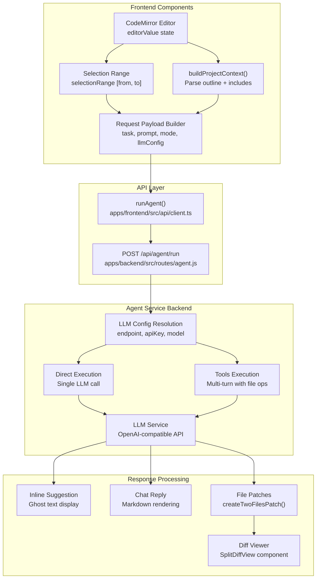

**Sources:** [apps/frontend/src/app/EditorPage.tsx:1800-1835](), [apps/frontend/src/app/EditorPage.tsx:3083-3175]()

---

## Execution Modes

### Direct Mode

Direct mode performs a single synchronous LLM call without file system access. This is the default for simple text transformations.

**Use Cases:**
- Text polishing and rewriting
- Translation of selected content
- Single-file modifications
- Autocomplete suggestions

**Characteristics:**
- No intermediate tool calls
- Fast execution (single round-trip)
- Returns either `suggestion` (for replacement) or `reply` (for chat)
- Limited to provided context (no file reads)

**Sources:** [apps/frontend/src/app/EditorPage.tsx:1116](), [apps/frontend/src/app/EditorPage.tsx:3142]()

---

### Tools Mode

Tools mode enables multi-turn execution where the LLM can invoke file system operations during task execution. The agent iteratively reads files, generates modifications, and writes results.

**Available Tools:**
- `read_file`: Fetch content from project files
- `write_file`: Persist modifications
- `list_files`: Enumerate project structure
- `arxiv_search`: Query academic papers (when configured)
- `arxiv_bibtex`: Generate bibliography entries

**Execution Flow:**

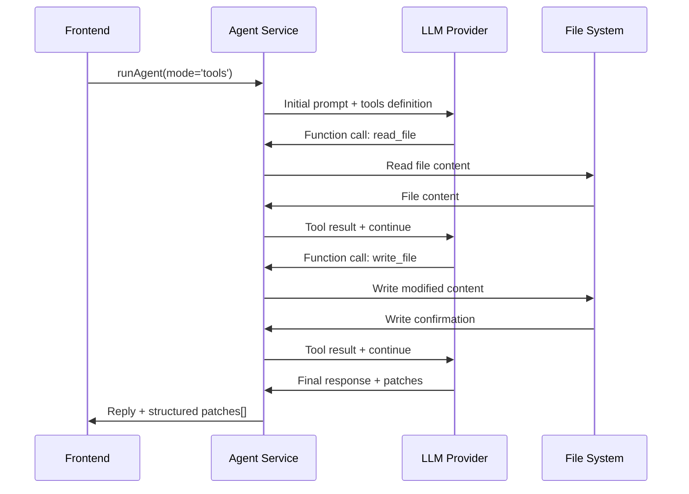

**Use Cases:**
- Multi-file refactoring
- Project-wide translation
- Context-aware edits requiring file reads
- Compile error diagnosis and fixes

**Sources:** [apps/frontend/src/app/EditorPage.tsx:3107-3128](), [apps/frontend/src/app/EditorPage.tsx:3186-3200]()

---

## Task Types

The agent service supports predefined task types that configure prompt templates and execution strategies:

| Task | Mode | Description | Frontend Location |
|------|------|-------------|-------------------|
| `polish` | direct/tools | Improve writing clarity and style | [EditorPage.tsx:83]() |
| `rewrite` | direct/tools | Restructure content while preserving meaning | [EditorPage.tsx:84]() |
| `structure` | direct/tools | Reorganize document sections | [EditorPage.tsx:85]() |
| `translate` | direct/tools | Multi-language translation with scope control | [EditorPage.tsx:86]() |
| `custom` | direct/tools | User-defined arbitrary instructions | [EditorPage.tsx:88]() |
| `websearch` | tools | arXiv search with citation generation | [EditorPage.tsx:87]() |
| `autocomplete` | direct | Inline code continuation | [EditorPage.tsx:1593-1627]() |
| `debug_compile` | tools | Analyze and fix LaTeX compilation errors | [EditorPage.tsx:3177-3221]() |

### Task Configuration Example

The translate task demonstrates scope-based execution configuration:

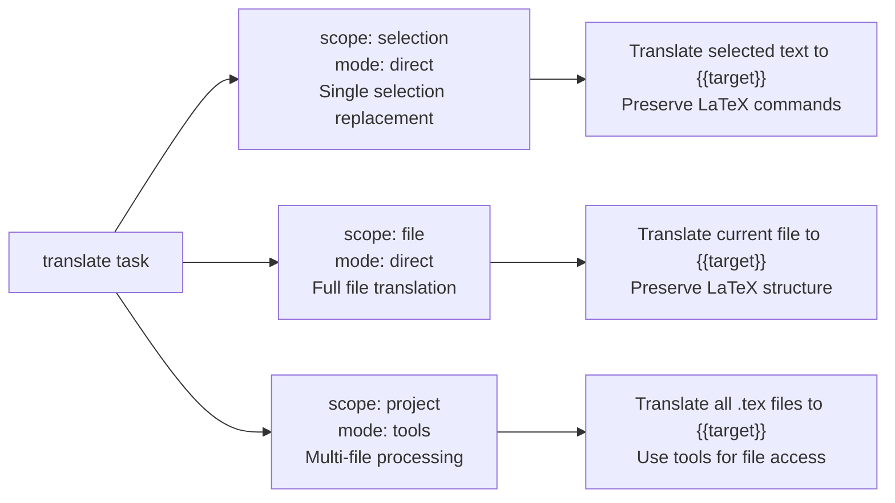

**Sources:** [apps/frontend/src/app/EditorPage.tsx:3086-3118](), [apps/frontend/src/app/EditorPage.tsx:1117-1118]()

---

## Context Building

The `buildProjectContext` function extracts hierarchical document structure to provide the LLM with project-level awareness:

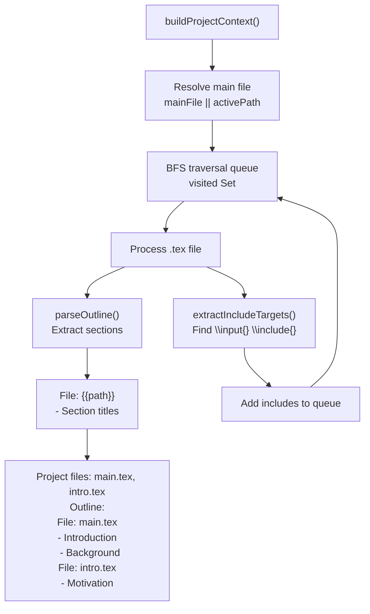

**Key Functions:**

- `parseOutline(text)`: Extracts `\section`, `\subsection`, `\subsubsection` headings with line numbers [EditorPage.tsx:438-460]()
- `extractIncludeTargets(text)`: Identifies `\input{}` and `\include{}` references [EditorPage.tsx:462-475]()
- `ensureFileContent(path)`: Lazy-loads file content from cache or backend [EditorPage.tsx:1788-1798]()

**Output Format:**
```
Project files: main.tex, sections/intro.tex, sections/method.tex
Outline:
File: main.tex
- Introduction
  - Background
  - Related Work
File: sections/intro.tex
- Motivation
```

**Sources:** [apps/frontend/src/app/EditorPage.tsx:1800-1835](), [apps/frontend/src/app/EditorPage.tsx:438-475]()

---

## LLM Configuration Resolution

Configuration follows a three-tier precedence hierarchy:

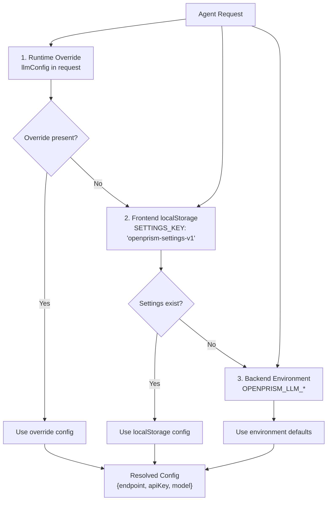

**Configuration Object Structure:**

```typescript
interface LLMConfig {
  endpoint: string;    // e.g., 'https://api.openai.com/v1/chat/completions'
  apiKey?: string;     // Optional authentication token
  model: string;       // e.g., 'gpt-4o-mini'
}
```

**Specialized Configurations:**

The system maintains separate LLM configurations for different task categories:

- **Primary LLM** (`llmConfig`): Default configuration for editing tasks [EditorPage.tsx:1253-1260]()
- **Search LLM** (`searchLlmConfig`): Websearch and arXiv queries [EditorPage.tsx:1262-1269]()
- **Vision LLM** (`visionLlmConfig`): Image-to-LaTeX OCR [EditorPage.tsx:1271-1278]()

**Sources:** [apps/frontend/src/app/EditorPage.tsx:100-143](), [apps/frontend/src/app/EditorPage.tsx:1253-1278]()

---

## Response Processing

### Response Types

The agent service returns three distinct response formats:

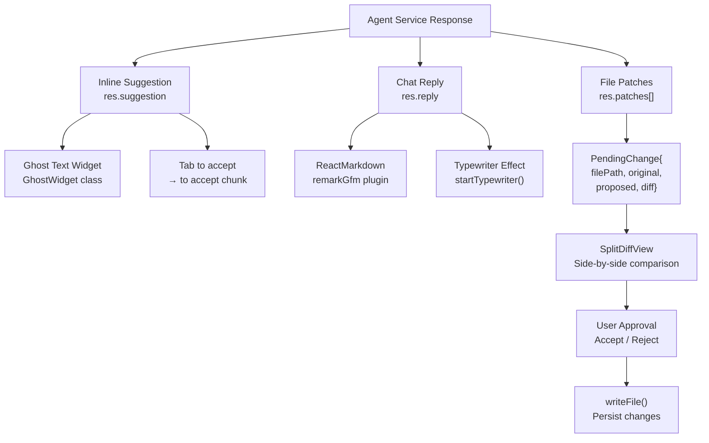

**Sources:** [apps/frontend/src/app/EditorPage.tsx:56-61](), [apps/frontend/src/app/EditorPage.tsx:3151-3175]()

---

### Inline Suggestion Workflow

Autocomplete suggestions display as non-intrusive ghost text at the cursor position:

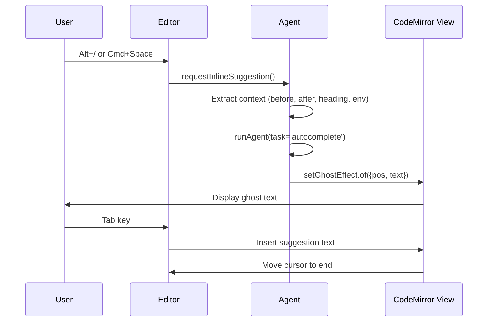

**Key Implementation Details:**

- **Ghost Text Field**: Custom StateField that decorates the editor with translucent suggestion text [EditorPage.tsx:670-695]()
- **Context Extraction**: Captures 4000 chars before and 400 chars after cursor, plus current section and environment [EditorPage.tsx:1584-1588]()
- **Chunked Acceptance**: Right arrow key accepts one word at a time [EditorPage.tsx:1392-1400](), [EditorPage.tsx:1532-1552]()

**Sources:** [apps/frontend/src/app/EditorPage.tsx:1580-1627](), [apps/frontend/src/app/EditorPage.tsx:651-695]()

---

### Patch-Based Modifications

Agent mode generates structured patches that flow through a review interface:

**Patch Data Structure:**

```typescript
interface PendingChange {
  filePath: string;      // Target file path
  original: string;      // Current content
  proposed: string;      // Modified content
  diff: string;          // Unified diff format
}
```

**Diff Visualization:**

The `SplitDiffView` component renders line-by-line comparisons:

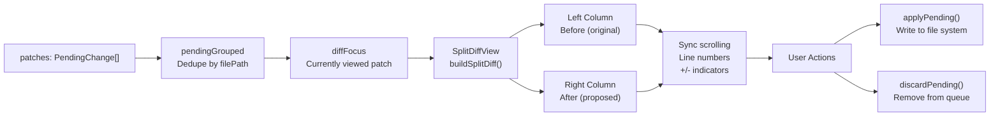

**Apply Logic:**

When a user accepts a patch:
1. Call `writeFile(projectId, filePath, proposed)` to persist [EditorPage.tsx:3226]()
2. Update in-memory files cache [EditorPage.tsx:3227]()
3. If patch targets active file, update editor view with `setEditorDoc()` [EditorPage.tsx:3228-3230]()
4. Remove from pending changes list [EditorPage.tsx:3233]()

**Sources:** [apps/frontend/src/app/EditorPage.tsx:3223-3254](), [apps/frontend/src/app/EditorPage.tsx:732-767](), [apps/frontend/src/app/EditorPage.tsx:834-880]()

---

## Common Workflows

### Polish Selected Text

**User Action:** Select paragraph, choose "polish" task, click "Generate Suggestion"

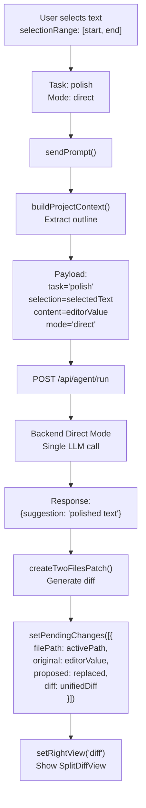

**Sources:** [apps/frontend/src/app/EditorPage.tsx:3083-3175](), [apps/frontend/src/app/EditorPage.tsx:3164-3170]()

---

### Diagnose Compile Errors

**User Action:** Click "Diagnose" button after compilation failure

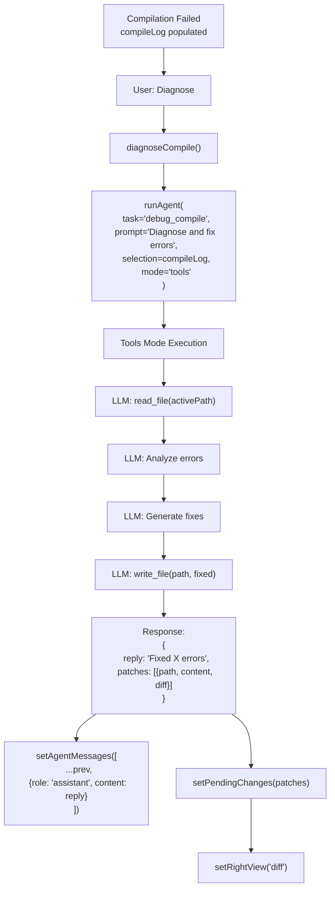

**Sources:** [apps/frontend/src/app/EditorPage.tsx:3177-3221](), [apps/frontend/src/app/EditorPage.tsx:3186-3200]()

---

### Translate Entire Project

**User Action:** Select "translate" task, scope "project", target "中文", click "Generate Suggestion"

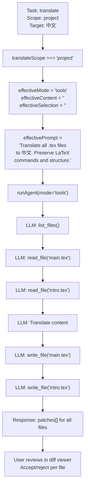

**Sources:** [apps/frontend/src/app/EditorPage.tsx:3106-3118](), [apps/frontend/src/app/EditorPage.tsx:3724-3803]()

---

## Integration Points

### Editor Integration

- **Selection State**: `selectionRange` state tracks cursor/selection for context-aware operations [EditorPage.tsx:1107]()
- **Content State**: `editorValue` provides current document text [EditorPage.tsx:1106]()
- **Dirty Tracking**: `isDirty` and auto-save ensure coherence between editor and file system [EditorPage.tsx:1148](), [EditorPage.tsx:1696-1709]()

### File System Integration

- **File Cache**: In-memory `files` state reduces backend round-trips [EditorPage.tsx:1105]()
- **Write Operations**: `writeFile()` persists changes and updates cache [EditorPage.tsx:34]()
- **Tree Refresh**: `refreshTree()` synchronizes UI after file modifications [EditorPage.tsx:1302-1314]()

### UI State Management

- **Assistant Mode**: `assistantMode` toggles between 'chat' and 'agent' interactions [EditorPage.tsx:1112]()
- **Execution Mode**: `mode` controls 'direct' vs 'tools' execution strategy [EditorPage.tsx:1116]()
- **Pending Changes**: `pendingChanges` queues patches for user review [EditorPage.tsx:1135]()
- **Right Panel**: `rightView` state switches between 'pdf', 'diff', 'log', etc. [EditorPage.tsx:1151]()

**Sources:** [apps/frontend/src/app/EditorPage.tsx:1094-1167](), [apps/frontend/src/app/EditorPage.tsx:1302-1314]()

---

## Configuration and Settings

### Settings Storage

Agent-related settings persist in browser localStorage under key `openprism-settings-v1`:

```typescript
type AppSettings = {
  llmEndpoint: string;           // Primary LLM endpoint
  llmApiKey: string;             // Primary API key
  llmModel: string;              // Primary model name
  searchEndpoint: string;        // Search-specific endpoint override
  searchApiKey: string;          // Search-specific API key override
  searchModel: string;           // Search-specific model override
  visionEndpoint: string;        // Vision-specific endpoint override
  visionApiKey: string;          // Vision-specific API key override
  visionModel: string;           // Vision-specific model override
  compileEngine: CompileEngine;  // LaTeX engine preference
};
```

**Persistence Functions:**

- `loadSettings()`: Reads from localStorage with fallback to defaults [EditorPage.tsx:114-134]()
- `persistSettings(settings)`: Writes to localStorage [EditorPage.tsx:136-143]()
- `useEffect(() => persistSettings(settings), [settings])`: Auto-save on change [EditorPage.tsx:1249-1251]()

**Sources:** [apps/frontend/src/app/EditorPage.tsx:69-143]()

---

## Error Handling

### Common Error Scenarios

| Scenario | Detection | Handling |
|----------|-----------|----------|
| LLM API failure | `catch` block in `sendPrompt()` | Append error message to chat history [EditorPage.tsx:3172-3174]() |
| Invalid JSON response | `safeJsonParse()` returns null | Display parse error, allow manual correction [EditorPage.tsx:574-584]() |
| Empty suggestion | Check `res.suggestion` truthiness | Skip patch generation, show status message [EditorPage.tsx:1612]() |
| File write failure | `writeFile()` rejects | Display error in status bar [EditorPage.tsx:1678]() |
| Context build timeout | Async timeout in `buildProjectContext()` | Proceed without full context |

### Status Feedback

The `status` state variable provides user-facing error messages:

```typescript
setStatus(t('请求失败: {{error}}', { error: String(err) }))
```

Displayed in status bar at [EditorPage.tsx:3362-3374]()

**Sources:** [apps/frontend/src/app/EditorPage.tsx:1665-1684](), [apps/frontend/src/app/EditorPage.tsx:3172-3174]()

---

## Performance Considerations

### Context Size Limits

- **Autocomplete**: 4000 chars before + 400 chars after cursor [EditorPage.tsx:1585-1586]()
- **Project Context**: First 12 outline items per file [EditorPage.tsx:1817]()
- **History**: Last 8 messages only [EditorPage.tsx:3149]()

### Caching Strategies

- **File Content**: `ensureFileContent()` checks in-memory cache before fetching [EditorPage.tsx:1788-1798]()
- **BibTeX Entries**: `arxivBibtexCache` prevents redundant API calls [EditorPage.tsx:1184](), [EditorPage.tsx:1948-1951]()
- **Settings**: localStorage reduces configuration latency [EditorPage.tsx:114-134]()

### Debouncing

- **Auto-save**: 1.5 second debounce on document edits [EditorPage.tsx:1702]()
- **Ghost Text Update**: Cleared on every doc/selection change [EditorPage.tsx:1349-1358]()

**Sources:** [apps/frontend/src/app/EditorPage.tsx:1696-1709](), [apps/frontend/src/app/EditorPage.tsx:1585-1586](), [apps/frontend/src/app/EditorPage.tsx:1788-1798]()

---

