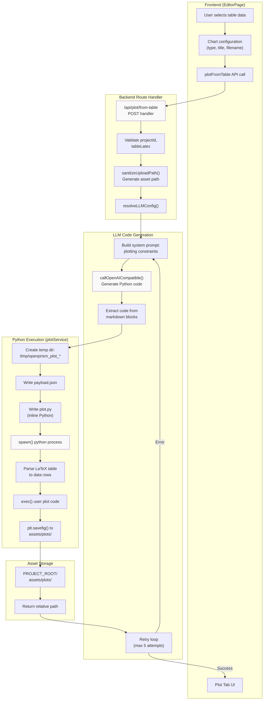
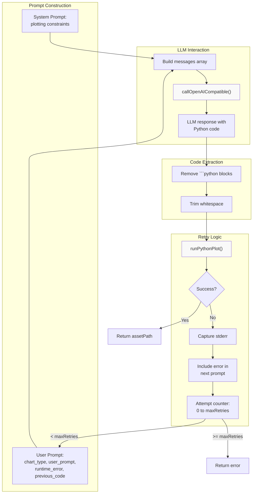
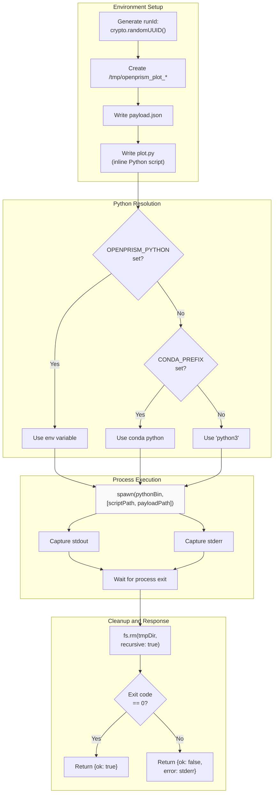
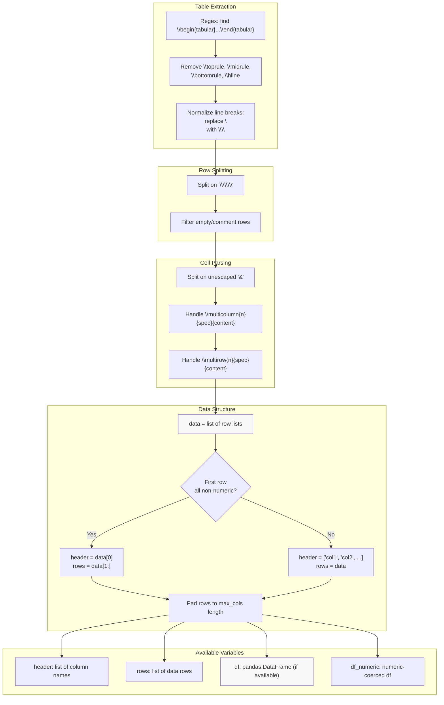
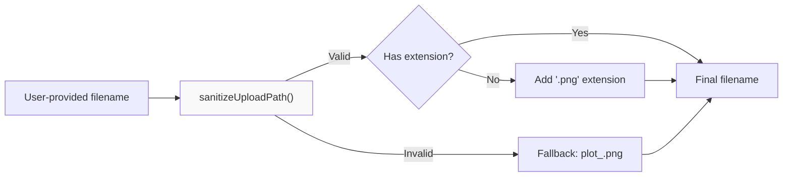
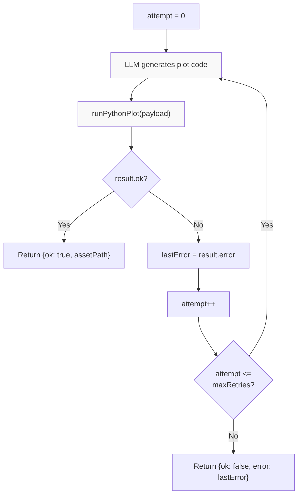
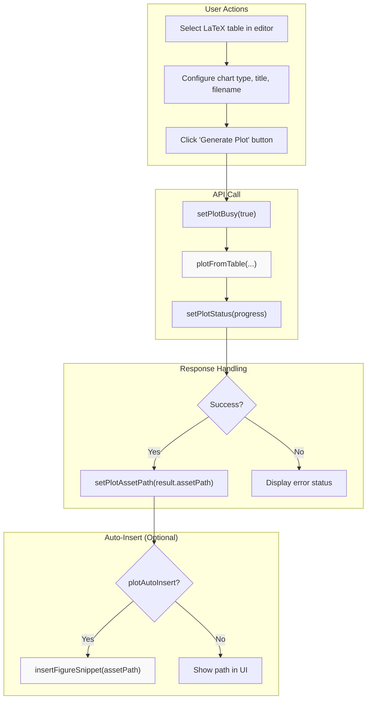

<!-- source: DeepWiki mcp.deepwiki.com · repo OpenDCAI/OpenPrism · page 5.4 Plot Generation Service · fetched 2026-11-02 -->

# Plot Generation Service

<details>
<summary>Relevant source files</summary>

The following files were used as context for generating this wiki page:

- [apps/backend/src/routes/plot.js](apps/backend/src/routes/plot.js)
- [apps/backend/src/services/plotService.js](apps/backend/src/services/plotService.js)
- [apps/frontend/src/app/EditorPage.tsx](apps/frontend/src/app/EditorPage.tsx)

</details>


## Purpose and Scope

The Plot Generation Service enables users to convert LaTeX table data into publication-ready visualizations using AI-generated Python plotting code. This service orchestrates LLM-based code generation, Python script execution, and asset management to produce matplotlib/seaborn charts from tabular data. The service operates as a backend component that accepts LaTeX table markup, generates appropriate plotting code via an LLM, executes it in a sandboxed Python environment, and returns the generated image asset path.

For document compilation and PDF generation, see [Compilation Service](#5.2). For other AI-powered features, see [AI Agent Service](#5.3).

---

## System Architecture

The Plot Generation Service follows a multi-stage pipeline: the frontend submits a LaTeX table with chart specifications, the backend uses an LLM to generate Python plotting code, executes the code in a temporary environment, and stores the resulting image in the project's asset directory.



**Sources**: [apps/backend/src/routes/plot.js:1-78](), [apps/backend/src/services/plotService.js:1-164]()

---

## API Endpoint

### POST /api/plot/from-table

The plot generation endpoint accepts LaTeX table data and chart specifications, returning the path to the generated image asset.

**Request Body**:

| Field | Type | Required | Description |
|-------|------|----------|-------------|
| `projectId` | string | Yes | Target project identifier |
| `tableLatex` | string | Yes | LaTeX table markup (tabular environment) |
| `chartType` | string | No | Chart type hint (bar, line, heatmap) |
| `title` | string | No | Chart title |
| `filename` | string | No | Output filename (default: plot_timestamp.png) |
| `prompt` | string | No | Additional user instructions for plotting |
| `llmConfig` | object | No | LLM configuration override |
| `retries` | number | No | Max retry attempts (default: 2, max: 5) |

**Response**:

```json
{
  "ok": true,
  "assetPath": "assets/plots/my_chart.png"
}
```

**Error Response**:

```json
{
  "ok": false,
  "error": "Error message"
}
```

The endpoint performs the following operations:

1. **Path sanitization**: Uses `sanitizeUploadPath()` to prevent directory traversal attacks
2. **Asset directory creation**: Ensures `assets/plots/` exists in project root
3. **LLM configuration resolution**: Merges request config with environment defaults
4. **Code generation loop**: Iterates with error feedback until success or max retries

**Sources**: [apps/backend/src/routes/plot.js:8-77]()

---

## LLM-Based Code Generation

The service uses an LLM to generate Python plotting code tailored to the input table structure and user specifications. This approach provides flexibility for diverse chart types and customization requirements without hardcoded templates.



### System Prompt Template

The system prompt establishes plotting constraints and available variables:

```
You generate python plotting code using matplotlib (and seaborn if available).
You are given: rows (list of rows), header (list of column names).
If pandas is available, df and df_numeric are provided; otherwise df is None.
Do not import packages. Do not call plt.savefig().
Use chart_type if helpful.
Return ONLY python code.
```

These constraints ensure the generated code integrates cleanly with the execution environment.

### User Prompt Construction

The user prompt varies across retry attempts:

- **Initial attempt**: `chart_type`, `user_prompt` (if provided)
- **Retry attempts**: Includes `runtime_error` and `previous_code` for error-aware refinement

This feedback loop enables the LLM to self-correct syntax errors, invalid operations, or mismatched data assumptions.

**Sources**: [apps/backend/src/routes/plot.js:25-53]()

---

## Python Execution Environment

The `runPythonPlot()` function in `plotService.js` manages Python script execution in isolated temporary directories.

### Execution Flow



### Python Executable Resolution

The service resolves the Python executable in the following precedence order:

1. `process.env.OPENPRISM_PYTHON` - Explicit override
2. `process.env.CONDA_PREFIX/bin/python` - Conda environment
3. `python3` - System default

This allows administrators to specify custom Python installations with required plotting libraries.

### Temporary Directory Lifecycle

Each plot generation creates a unique temporary directory using `crypto.randomUUID()`:

- **Path**: `/tmp/openprism_plot_<uuid>`
- **Contents**: `payload.json`, `plot.py`
- **Cleanup**: Removed after process exit regardless of success/failure

This isolation prevents interference between concurrent plot requests.

**Sources**: [apps/backend/src/services/plotService.js:7-11](), [apps/backend/src/services/plotService.js:13-163]()

---

## LaTeX Table Parsing

The inline Python script contains a sophisticated LaTeX table parser that extracts data from `\begin{tabular}...\end{tabular}` environments.

### Parsing Algorithm



### Supported LaTeX Constructs

| Construct | Handling |
|-----------|----------|
| `\toprule`, `\midrule`, `\bottomrule` | Stripped (booktabs package) |
| `\hline` | Stripped |
| `\multicolumn{n}{spec}{content}` | Expanded to n cells (first with content, rest empty) |
| `\multirow{n}{spec}{content}` | Content extracted, rowspan ignored |
| Unescaped `&` | Cell delimiter |
| `\\` | Row delimiter |
| Comment lines (`%`) | Skipped |

### Header Detection

The parser automatically detects whether the first row is a header:

- **Header row**: All cells are non-numeric
- **No header**: First row contains numeric data; generates default column names (`col1`, `col2`, ...)

### Data Frame Construction

If pandas is available (checked via `importlib.util.find_spec("pandas")`), the parser creates:

- **`df`**: Pandas DataFrame with original string values
- **`df_numeric`**: DataFrame with `pd.to_numeric(errors='coerce')` applied to all columns

This dual structure allows plotting code to choose between categorical and numeric interpretations.

**Sources**: [apps/backend/src/services/plotService.js:35-128]()

---

## Asset Management

Generated plots are stored in the project's asset directory with consistent naming conventions.

### Asset Path Structure

```
PROJECT_ROOT/
  assets/
    plots/
      plot_1234567890.png
      custom_chart.png
      heatmap_results.png
```

### Path Sanitization

The `sanitizeUploadPath()` utility prevents directory traversal attacks:

- Removes `..` path segments
- Strips leading slashes
- Validates against malicious patterns

### Filename Generation



### Asset Path Response

The API returns a **relative path** from the project root:

```json
{
  "assetPath": "assets/plots/my_chart.png"
}
```

This relative path format enables:

- **LaTeX inclusion**: `\includegraphics{assets/plots/my_chart.png}`
- **Frontend preview**: Constructed via project file API
- **Version control**: Paths remain valid across deployments

**Sources**: [apps/backend/src/routes/plot.js:13-18]()

---

## Code Execution Context

The generated Python code executes within a controlled namespace with predefined variables and constraints.

### Available Globals

The `exec()` call provides the following namespace:

```python
{
    "df": df,              # pandas.DataFrame or None
    "df_numeric": df_numeric,  # numeric-coerced DataFrame or None
    "rows": rows,          # list of row lists (all data)
    "header": header,      # list of column name strings
    "sns": sns,            # seaborn module or None
    "plt": plt             # matplotlib.pyplot
}
```

### Pre-configured Environment

Before user code execution:

```python
matplotlib.use("Agg")              # Non-interactive backend
plt.figure(figsize=(6, 4))         # Create figure
```

After user code execution:

```python
if title:
    plt.title(title)               # Apply user title
plt.tight_layout()                 # Optimize layout
plt.savefig(output_path, dpi=150)  # Save to project assets
```

### Dependency Detection

The script checks for optional dependencies at runtime:

```python
HAS_PANDAS = importlib.util.find_spec("pandas") is not None
HAS_SEABORN = importlib.util.find_spec("seaborn") is not None
```

This allows graceful degradation: LLM-generated code can use `sns` and `df` when available, or fall back to `rows`/`header` with raw matplotlib.

### Execution Constraints

**Allowed**:
- All matplotlib plotting functions
- Seaborn statistical plotting (if installed)
- Pandas data manipulation (if installed)
- NumPy operations (if installed)

**Prohibited** (enforced by prompt, not sandbox):
- Package imports (`import` statements)
- File I/O outside plot output
- Network requests
- System calls

The Python process runs with standard system permissions; malicious code could theoretically escape constraints. Production deployments should consider additional sandboxing (containers, restricted users).

**Sources**: [apps/backend/src/services/plotService.js:90-138]()

---

## Error Handling and Retry Mechanism

The service implements a sophisticated retry loop that uses runtime error feedback to guide LLM corrections.

### Retry Flow



### Error Feedback Loop

On retry attempts, the LLM receives:

| Field | Content |
|-------|---------|
| `user_prompt` | Original user instructions (preserved) |
| `chart_type` | Desired chart type (preserved) |
| `runtime_error` | Python stderr output from previous attempt |
| `previous_code` | Code that caused the error |

This context enables the LLM to:

- Fix syntax errors (missing colons, incorrect indentation)
- Correct data access patterns (invalid column names)
- Adjust plotting calls (unsupported arguments)
- Handle edge cases (empty data, all-NaN columns)

### Retry Limits

```javascript
const maxRetries = Math.min(5, Math.max(0, Number(retries ?? 2)));
```

- **Default**: 2 retries (3 total attempts)
- **Client-configurable**: Request can override via `retries` parameter
- **Maximum**: 5 retries (6 total attempts) to prevent infinite loops

### Common Error Patterns

| Error Type | LLM Fix Strategy |
|------------|------------------|
| `KeyError: 'column_name'` | Use actual column names from `header` |
| `NameError: name 'sns' is not defined` | Remove seaborn calls or check `sns is not None` |
| `TypeError: unsupported operand type(s)` | Convert strings to numeric via `df_numeric` |
| `ValueError: invalid literal for int()` | Add error handling or use pandas type coercion |
| Matplotlib API errors | Adjust function arguments or plot type |

**Sources**: [apps/backend/src/routes/plot.js:43-74]()

---

## Frontend Integration

The frontend Plot tab provides a user interface for table selection and chart generation.

### Plot Tab State

The `EditorPage` component manages plot-related state:

```typescript
const [plotType, setPlotType] = useState<'bar' | 'line' | 'heatmap'>('bar');
const [plotTitle, setPlotTitle] = useState('');
const [plotFilename, setPlotFilename] = useState('');
const [plotPrompt, setPlotPrompt] = useState('');
const [plotRetries, setPlotRetries] = useState(2);
const [plotBusy, setPlotBusy] = useState(false);
const [plotStatus, setPlotStatus] = useState('');
const [plotAssetPath, setPlotAssetPath] = useState('');
const [plotAutoInsert, setPlotAutoInsert] = useState(true);
```

### Workflow Integration



### Figure Snippet Auto-Insertion

When `plotAutoInsert` is enabled, the frontend automatically generates a LaTeX figure environment:

```latex
\begin{figure}[t]
\centering
\includegraphics[width=0.9\linewidth]{assets/plots/my_chart.png}
\caption{Caption.}
\label{fig:assets-plots-my-chart-png}
\end{figure}
```

This reduces manual boilerplate for inserting generated charts into documents.

**Sources**: [apps/frontend/src/app/EditorPage.tsx:1191-1199](), [apps/frontend/src/app/EditorPage.tsx:1745-1756]()

---

## Configuration

### Environment Variables

| Variable | Purpose | Default |
|----------|---------|---------|
| `OPENPRISM_PYTHON` | Python executable path | (none) |
| `CONDA_PREFIX` | Conda environment prefix | (none) |
| `OPENPRISM_LLM_ENDPOINT` | LLM API endpoint | Required |
| `OPENPRISM_LLM_API_KEY` | LLM API key | Required |
| `OPENPRISM_LLM_MODEL` | LLM model name | Required |

### Python Environment Requirements

**Required packages**:
- `matplotlib` - Core plotting library

**Optional packages** (recommended):
- `pandas` - Enables DataFrame operations and type coercion
- `seaborn` - Statistical plotting enhancements
- `numpy` - Numerical operations (indirect dependency)

**Installation**:
```bash
pip install matplotlib pandas seaborn
```

### LLM Configuration Override

Clients can override LLM settings per request:

```json
{
  "projectId": "proj123",
  "tableLatex": "...",
  "llmConfig": {
    "endpoint": "https://custom-api.example.com/v1/chat/completions",
    "apiKey": "custom-key",
    "model": "gpt-4"
  }
}
```

This allows users to use more capable models for complex plotting tasks.

**Sources**: [apps/backend/src/services/plotService.js:7-11](), [apps/backend/src/routes/plot.js:21-24]()

---

## Performance Considerations

### Execution Time

Typical plot generation requires:

- **LLM code generation**: 1-3 seconds (depends on model)
- **Python process spawn**: 100-300ms
- **Table parsing**: <50ms
- **Plot rendering**: 200-500ms (depends on complexity)

**Total**: ~2-5 seconds for first attempt, +2-3 seconds per retry

### Concurrency

Each plot generation:

- Creates isolated temporary directory (UUID-based, no conflicts)
- Spawns independent Python process
- Writes to unique project asset path

The service supports concurrent plot generation without coordination locks.

### Resource Cleanup

Temporary directories are cleaned up in the `close` event handler regardless of exit code. Failed cleanups (disk full, permission errors) log warnings but don't fail the request.

**Sources**: [apps/backend/src/services/plotService.js:154-162]()

---

## Limitations and Known Issues

1. **No sandboxing**: Python code runs with full process permissions. Malicious LLM-generated code could theoretically access filesystem or network.

2. **Limited error recovery**: If Python consistently fails after max retries, the service returns the last error without deeper diagnostics.

3. **No plot preview**: Frontend receives only the asset path; users must compile to PDF or view in Figures gallery to see results.

4. **Matplotlib backend fixed**: Uses `Agg` backend (non-interactive); cannot generate interactive plots.

5. **DPI hardcoded**: Plot resolution fixed at 150 DPI; high-resolution requirements need manual adjustment.

6. **Package availability**: If pandas/seaborn are missing, LLM must generate code using only raw data structures, which may produce lower-quality plots.

**Sources**: [apps/backend/src/services/plotService.js:19-139]()

---

