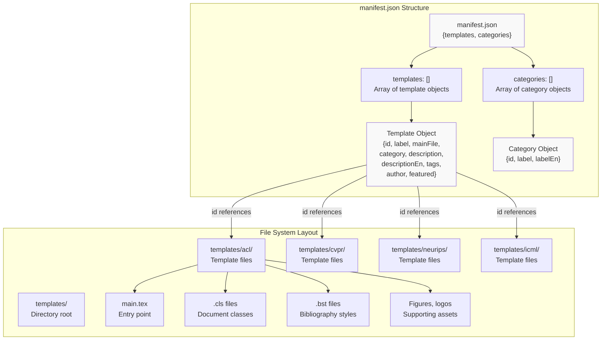
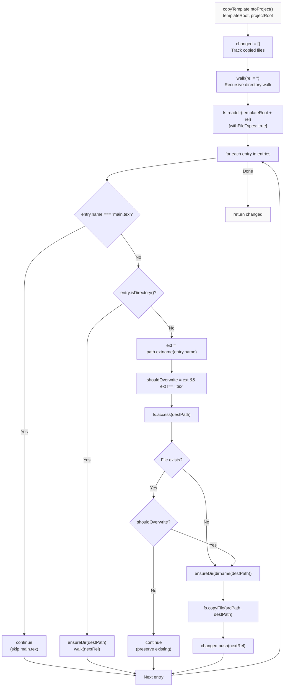

<!-- source: DeepWiki mcp.deepwiki.com · repo OpenDCAI/OpenPrism · page 5.5 Template System · fetched 2026-11-02 -->

# Template System

<details>
<summary>Relevant source files</summary>

The following files were used as context for generating this wiki page:

- [README.md](README.md)
- [apps/backend/src/routes/health.js](apps/backend/src/routes/health.js)
- [apps/backend/src/services/templateService.js](apps/backend/src/services/templateService.js)
- [templates/manifest.json](templates/manifest.json)

</details>


The Template System provides a manifest-driven architecture for managing and applying LaTeX document templates to projects. It supports built-in academic conference templates (ACL, CVPR, NeurIPS, ICML) and enables users to initialize projects with pre-configured document classes, bibliography styles, and supporting files. The system handles template metadata, categorization, and selective file copying with content preservation logic.

For information about project initialization workflows that utilize templates, see [Project Management API](#5.1). For details on how projects are structured and stored, see [Data Storage](#3.4).

---

## Template Manifest Structure

The template system is driven by a central manifest file located at [templates/manifest.json:1-58](). This JSON document defines all available templates and their categorization scheme.

### Template Definition Schema

Each template entry in the manifest contains the following fields:

| Field | Type | Purpose |
|-------|------|---------|
| `id` | string | Unique identifier for the template (e.g., "acl", "cvpr") |
| `label` | string | Display name shown to users |
| `mainFile` | string | Entry point LaTeX file, typically "main.tex" |
| `category` | string | Category ID for filtering (e.g., "academic") |
| `description` | string | Chinese description of the template |
| `descriptionEn` | string | English description of the template |
| `tags` | string[] | Searchable keywords and conference names |
| `author` | string | Template creator attribution |
| `featured` | boolean | Whether to highlight in template gallery |

**Sources**: [templates/manifest.json:2-46]()

### Category Definition Schema

Categories organize templates into logical groupings:

| Field | Type | Purpose |
|-------|------|---------|
| `id` | string | Unique category identifier |
| `label` | string | Chinese category name |
| `labelEn` | string | English category name |

Available categories include: `all`, `academic`, `thesis`, `resume`, `presentation`, `book`, `letter`, `report`.

**Sources**: [templates/manifest.json:48-57]()

### Manifest Data Model



**Diagram**: Template manifest structure and file system organization. The manifest JSON maps template IDs to directory names under `templates/`, where each directory contains the template's LaTeX source files and assets.

**Sources**: [templates/manifest.json:1-58]()

---

## Template Service Architecture

The template service layer provides two primary operations: reading the manifest and copying template files into project directories.

### Service Components

```mermaid
graph TB
    subgraph "API Layer"
        HealthRoute["/api/templates<br/>GET endpoint"]
    end
    
    subgraph "Service Layer"
        TemplateService["templateService.js"]
        ReadManifest["readTemplateManifest()<br/>Returns {templates, categories}"]
        CopyTemplate["copyTemplateIntoProject()<br/>templateRoot, projectRoot"]
    end
    
    subgraph "Utility Layer"
        FSUtils["fsUtils.js"]
        ReadJson["readJson()<br/>Parse JSON files"]
        EnsureDir["ensureDir()<br/>Create directories"]
    end
    
    subgraph "Constants"
        Constants["constants.js"]
        TemplateManifest["TEMPLATE_MANIFEST<br/>Path to manifest.json"]
    end
    
    subgraph "File System"
        ManifestFile["templates/manifest.json"]
        TemplateDir["templates/{templateId}/<br/>Source files"]
        ProjectDir["data/projects/{projectId}/<br/>Destination"]
    end
    
    HealthRoute --> ReadManifest
    ReadManifest --> TemplateService
    CopyTemplate --> TemplateService
    
    ReadManifest --> ReadJson
    ReadManifest --> TemplateManifest
    CopyTemplate --> EnsureDir
    
    ReadJson --> FSUtils
    EnsureDir --> FSUtils
    TemplateManifest --> Constants
    
    ReadManifest --> ManifestFile
    CopyTemplate --> TemplateDir
    CopyTemplate --> ProjectDir
    
    style TemplateService fill:#f9f9f9
    style ReadManifest fill:#f9f9f9
    style CopyTemplate fill:#f9f9f9
```

**Diagram**: Template service architecture showing the relationship between API routes, service functions, utilities, and file system operations.

**Sources**: [apps/backend/src/routes/health.js:1-10](), [apps/backend/src/services/templateService.js:1-47]()

### Core Functions

#### readTemplateManifest()

Located in [apps/backend/src/services/templateService.js:6-15](), this function reads and parses the template manifest file.

**Behavior**:
- Reads JSON from path defined by `TEMPLATE_MANIFEST` constant
- Validates that `templates` and `categories` are arrays
- Returns empty arrays if file is missing or malformed
- Never throws exceptions; returns safe defaults

**Return Type**:
```javascript
{
  templates: Array<TemplateObject>,
  categories: Array<CategoryObject>
}
```

**Sources**: [apps/backend/src/services/templateService.js:6-15]()

#### copyTemplateIntoProject()

Located in [apps/backend/src/services/templateService.js:17-47](), this function recursively copies template files into a project directory with selective overwrite logic.

**Parameters**:
- `templateRoot` (string): Source template directory path
- `projectRoot` (string): Destination project directory path

**Copy Logic**:

| File Type | Behavior | Rationale |
|-----------|----------|-----------|
| `main.tex` | **Skip** (never copied) | Entry point already exists in project |
| `.tex` files | **Preserve** (no overwrite) | User content must not be lost |
| Non-`.tex` files (`.cls`, `.bst`, etc.) | **Overwrite** | Supporting files should update |
| Directories | **Recurse** | Preserve directory structure |

**Return Value**: Array of relative paths for files that were copied or overwritten.

**Sources**: [apps/backend/src/services/templateService.js:17-47]()

---

## Template Application Process

When a user applies a template to a project, the system performs a selective file copy operation that preserves user content while updating supporting files.

### Copy Operation Flow



**Diagram**: Template copy operation flow showing the selective overwrite logic that preserves `.tex` files while updating supporting files like `.cls` and `.bst`.

**Sources**: [apps/backend/src/services/templateService.js:17-47]()

### File Processing Rules

The copy operation implements a three-tier decision tree:

1. **Filename Check**: If the file is `main.tex`, skip entirely regardless of location in directory tree ([line 24]())
2. **Directory Check**: If entry is a directory, create it in destination and recurse ([lines 27-29]())
3. **File Extension Check**: 
   - Extract file extension ([line 31]())
   - Set `shouldOverwrite = true` for non-`.tex` files with extensions ([line 32]())
   - If destination file exists and `shouldOverwrite = false`, skip ([lines 33-36]())
   - Otherwise, copy the file ([lines 39-41]())

This ensures that:
- Document class files (`.cls`) are always updated
- Bibliography styles (`.bst`) are always updated
- Supporting assets (images, logos) are always updated
- User-written LaTeX content (`.tex` files except main.tex) is preserved
- The main entry point (`main.tex`) is never overwritten

**Sources**: [apps/backend/src/services/templateService.js:24-42]()

---

## Template Categories

The manifest defines eight template categories for organizing templates in the UI.

### Category Definitions

| ID | Chinese Label | English Label | Purpose |
|----|---------------|---------------|---------|
| `all` | 所有 | All | Show all templates (filter bypass) |
| `academic` | 学术论文 | Academic | Conference and journal papers |
| `thesis` | 学位论文 | Thesis | Master's and PhD dissertations |
| `resume` | 简历 | Resume | Curriculum vitae |
| `presentation` | 演示文稿 | Presentation | Beamer slides |
| `book` | 书籍 | Book | Book manuscripts |
| `letter` | 信件 | Letter | Formal correspondence |
| `report` | 报告 | Report | Technical reports |

Currently, all four built-in templates (ACL, CVPR, NeurIPS, ICML) are categorized as `academic`. The category system is designed to be extensible for future template additions.

**Sources**: [templates/manifest.json:48-57]()

---

## Built-in Templates

OpenPrism ships with four featured academic conference templates.

### Template Specifications

| Template ID | Label | Conference | Field | Tags |
|-------------|-------|------------|-------|------|
| `acl` | ACL | Association for Computational Linguistics | Natural Language Processing | ACL, NLP |
| `cvpr` | CVPR (skeleton) | Conference on Computer Vision and Pattern Recognition | Computer Vision | CVPR, Computer Vision |
| `neurips` | NeurIPS (skeleton) | Neural Information Processing Systems | Machine Learning | NeurIPS, Machine Learning |
| `icml` | ICML (skeleton) | International Conference on Machine Learning | Machine Learning | ICML, Machine Learning |

All templates:
- Use `main.tex` as the entry point ([templates/manifest.json:6,17,28,39]())
- Are marked as `featured: true` for prominent display ([templates/manifest.json:12,23,34,45]())
- Include bilingual descriptions (Chinese and English) ([templates/manifest.json:8-9,19-20,30-31,41-42]())
- Are attributed to "OpenPrism" as author ([templates/manifest.json:11,22,33,44]())

**Sources**: [templates/manifest.json:2-46](), [README.md:84-85]()

---

## API Endpoints

The template system exposes one public API endpoint for retrieving available templates.

### GET /api/templates

**Route Registration**: [apps/backend/src/routes/health.js:6-9]()

**Handler Logic**:
```javascript
fastify.get('/api/templates', async () => {
  const { templates, categories } = await readTemplateManifest();
  return { templates, categories };
});
```

**Response Schema**:
```json
{
  "templates": [
    {
      "id": "acl",
      "label": "ACL",
      "mainFile": "main.tex",
      "category": "academic",
      "description": "ACL 会议论文模板，适用于自然语言处理领域",
      "descriptionEn": "ACL conference paper template for NLP research",
      "tags": ["ACL", "NLP"],
      "author": "OpenPrism",
      "featured": true
    }
  ],
  "categories": [
    {
      "id": "all",
      "label": "所有",
      "labelEn": "All"
    }
  ]
}
```

**Error Handling**: If the manifest file cannot be read, the service returns empty arrays rather than throwing an error ([apps/backend/src/services/templateService.js:12-13]()). This ensures the endpoint always returns a valid response.

**Usage Pattern**: The frontend calls this endpoint on application initialization to populate the template gallery in the project creation dialog.

**Sources**: [apps/backend/src/routes/health.js:6-9](), [apps/backend/src/services/templateService.js:6-15]()

---

## Template Integration Points

The template system integrates with other OpenPrism subsystems at three key points:

### Project Creation

When a user creates a new project with a template:
1. Frontend sends template ID to project creation endpoint
2. Backend creates project directory structure
3. Backend calls `copyTemplateIntoProject()` to populate the project
4. Project metadata records the template ID for reference

For details on the project creation flow, see [Project Management API](#5.1).

### Template Conversion

Users can switch templates on existing projects:
1. Backend identifies the new template directory
2. Backend calls `copyTemplateIntoProject()` with existing project as destination
3. Supporting files (`.cls`, `.bst`) are updated
4. User content (`.tex` files) is preserved
5. Changed file list is returned for UI feedback

This enables users to migrate between conference formats (e.g., ACL → CVPR) while preserving their written content.

**Sources**: [README.md:85]() (mentions "one-click conversion")

### Template Gallery UI

The frontend template gallery uses the manifest data for:
- Filtering templates by category
- Displaying template descriptions in user's language
- Highlighting featured templates
- Showing template tags and metadata

The gallery fetches templates via the `/api/templates` endpoint and caches the results in application state.

**Sources**: [apps/backend/src/routes/health.js:6-9](), [templates/manifest.json:1-58]()

---

