<!-- source: DeepWiki mcp.deepwiki.com · repo OpenDCAI/OpenPrism · page 6.1 LaTeX Editing · fetched 2026-11-02 -->

# LaTeX Editing

Relevant source files

The following files were used as context for generating this wiki page:

- [README.md](README.md)
- [apps/frontend/src/app/EditorPage.tsx](apps/frontend/src/app/EditorPage.tsx)

LaTeX Editing encompasses the core text editing experience in OpenPrism, including the CodeMirror-based editor, file tree navigation, syntax highlighting, code folding, autocompletion, and auto-save functionality. This page documents the user-facing editing features and their implementation.

For AI-powered editing assistance, see [AI Autocomplete](#6.3). For document compilation and PDF generation, see [Document Compilation](#6.4). For the overall editor workspace layout, see [Editor Workspace](#4.3).

---

## Editor Architecture Overview

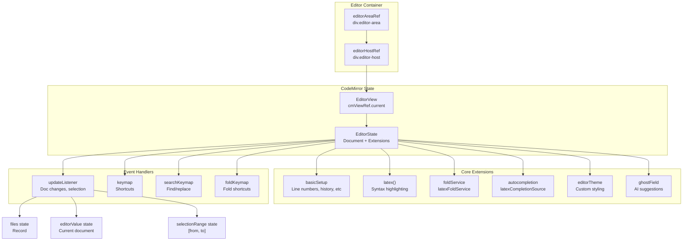

**Sources:** [apps/frontend/src/app/EditorPage.tsx:1325-1459]()

---

## CodeMirror Integration

### Editor Initialization

The editor is initialized on mount using CodeMirror 6 with a custom configuration:

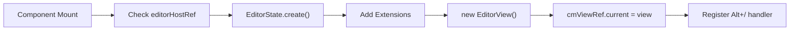

The editor state includes:
- **basicSetup**: Line numbers, bracket matching, search, undo/redo, and other standard editor features
- **latex()**: LaTeX language support with syntax highlighting
- **indentOnInput()**: Auto-indent on new lines
- **foldService**: Custom LaTeX-aware code folding
- **EditorView.lineWrapping**: Wrap long lines
- **editorTheme**: Custom theme with transparent background
- **ghostField**: Display AI-generated suggestions
- **search()**: Built-in search functionality
- **autocompletion**: LaTeX command completion

**Sources:** [apps/frontend/src/app/EditorPage.tsx:1325-1443](), [apps/frontend/src/latex/lang.ts]()

---

### Editor Theme

The editor uses a custom theme with the following characteristics:

| Feature | Configuration |
|---------|---------------|
| Font Family | `"JetBrains Mono", "SF Mono", "Menlo"` |
| Font Size | Controlled by `--editor-font-size` CSS variable (default 11px) |
| Line Height | 1.6 |
| Background | Transparent (inherits from parent) |
| Gutters | Transparent with subtle text color |
| Active Line | Subtle red-orange highlight (rgba(180, 74, 47, 0.08)) |
| Selection | Red-orange highlight (rgba(180, 74, 47, 0.18)) |

**Sources:** [apps/frontend/src/app/EditorPage.tsx:697-730]()

---

## File Tree Navigation

### Tree Structure and Rendering

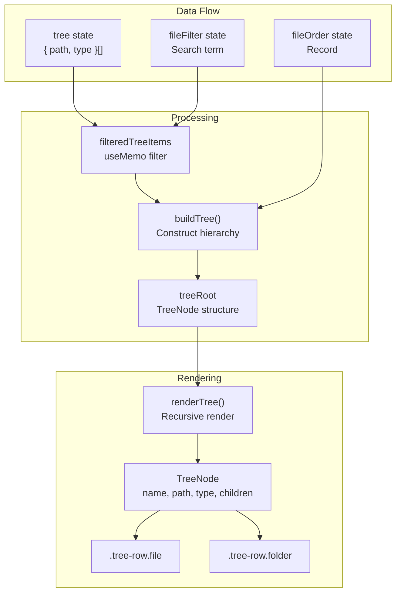

The file tree is built from a flat list of file paths into a hierarchical tree structure. Each node contains:
- `name`: File/folder name
- `path`: Full path from project root
- `type`: "file" or "dir"
- `children`: Array of child TreeNode objects

**Sources:** [apps/frontend/src/app/EditorPage.tsx:362-411](), [apps/frontend/src/app/EditorPage.tsx:2494-2500](), [apps/frontend/src/app/EditorPage.tsx:2718-2884]()

---

### File Operations

#### Opening Files

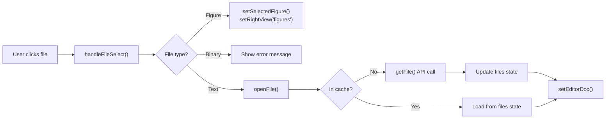

File type detection:
- **Text files**: `.tex`, `.bib`, `.sty`, `.cls`, `.bst`, `.txt`, `.md`, `.json`, `.yaml`, `.csv`, `.tsv`
- **Figure files**: `.png`, `.jpg`, `.jpeg`, `.pdf`, `.svg`, `.eps`
- **Binary files**: All others (read-only)

**Sources:** [apps/frontend/src/app/EditorPage.tsx:2653-2665](), [apps/frontend/src/app/EditorPage.tsx:1461-1490](), [apps/frontend/src/app/EditorPage.tsx:318-326]()

---

#### Drag and Drop File Management

The file tree supports drag-and-drop for reordering and moving files:

| Drag Target | Behavior |
|-------------|----------|
| Same folder | Reorder within folder |
| Different folder | Move file to target folder |
| File-to-file | Insert before target file |
| Folder | Move into folder |
| Root area | Move to project root |

Drag operations are disabled when file filter is active to prevent conflicts.

**Sources:** [apps/frontend/src/app/EditorPage.tsx:2440-2470](), [apps/frontend/src/app/EditorPage.tsx:2502-2526](), [apps/frontend/src/app/EditorPage.tsx:2804-2856]()

---

#### Inline File Creation and Renaming

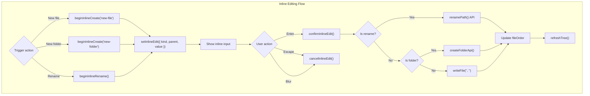

**Sources:** [apps/frontend/src/app/EditorPage.tsx:2368-2436]()

---

## Code Intelligence Features

### LaTeX Syntax Highlighting

Syntax highlighting is provided by the `latex()` language extension, which recognizes:
- LaTeX commands (`\section`, `\begin`, etc.)
- Environments (`\begin{...}` ... `\end{...}`)
- Math mode (inline `$...$` and display `$$...$$`)
- Comments (`%...`)
- Special characters and escape sequences

**Sources:** [apps/frontend/src/app/EditorPage.tsx:8](), [apps/frontend/src/latex/lang.ts]()

---

### Code Folding

The custom `latexFoldService` provides intelligent code folding for:

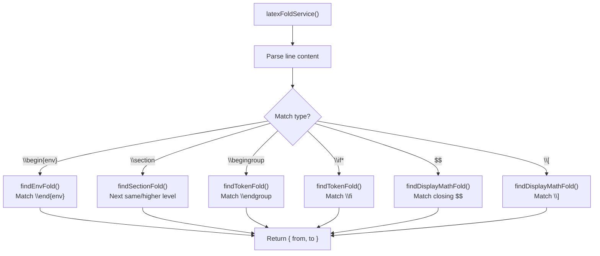

**Folding Rules:**

| Construct | Start Pattern | End Pattern | Nesting |
|-----------|--------------|-------------|---------|
| Environment | `\begin{name}` | `\end{name}` | Tracked by depth |
| Section | `\section`, `\subsection`, etc. | Next equal/higher section | Hierarchical |
| Group | `\begingroup` | `\endgroup` | Tracked by depth |
| Conditional | `\if*` | `\fi` | Tracked by depth |
| Display Math | `$$` | `$$` | No nesting |
| Display Math | `\[` | `\]` | No nesting |

**Sources:** [apps/frontend/src/app/EditorPage.tsx:288-316](), [apps/frontend/src/app/EditorPage.tsx:180-286]()

---

### Autocompletion

The `latexCompletionSource` provides command and environment completion:

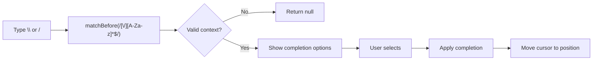

**Available Completions:**

| Category | Commands | Behavior |
|----------|----------|----------|
| Sectioning | `\section{}`, `\subsection{}`, `\subsubsection{}`, `\paragraph{}` | Cursor moves inside braces |
| References | `\cite{}`, `\ref{}`, `\label{}` | Cursor moves inside braces |
| Lists | `\begin{itemize}`, `\begin{enumerate}` | Insert full environment with `\item` |
| Figures | `\begin{figure}` | Insert full figure template |
| Tables | `\begin{table}` | Insert full table template |

The completion system checks the previous character to prevent false triggers (e.g., `://` in URLs).

**Sources:** [apps/frontend/src/app/EditorPage.tsx:590-649]()

---

## Document Outline Navigation

### Outline Extraction

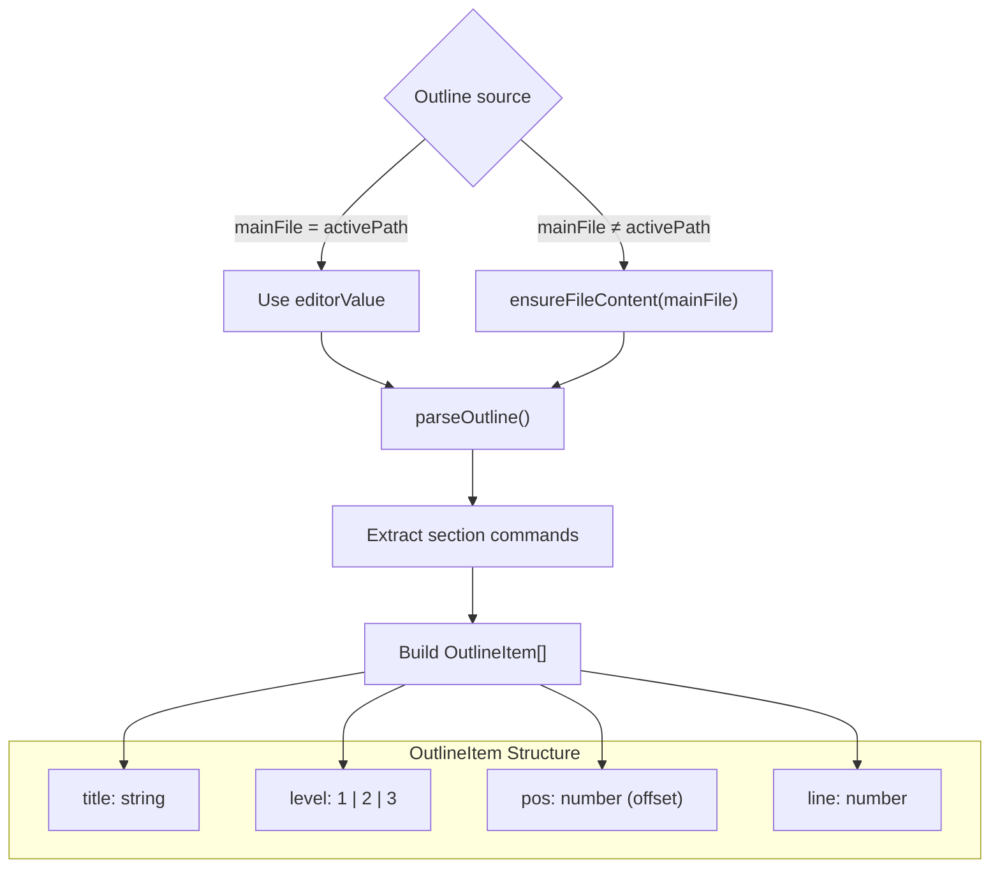

The outline parser recognizes:
- `\section` (level 1)
- `\subsection` (level 2)
- `\subsubsection` (level 3)

It handles optional arguments (`\section*{}`, `\section[short]{long}`) and extracts the section title from the mandatory braces.

**Sources:** [apps/frontend/src/app/EditorPage.tsx:438-460](), [apps/frontend/src/app/EditorPage.tsx:2551-2578]()

---

### Outline Panel UI

The outline panel displays:
- Collapsible header showing main file name
- Hierarchical list of sections with indentation
- Line numbers for each section
- Click-to-navigate functionality

Clicking an outline item:
1. Opens the main file if not already active
2. Moves cursor to section position using `view.dispatch()`
3. Scrolls section into view
4. Focuses the editor

**Sources:** [apps/frontend/src/app/EditorPage.tsx:3532-3574]()

---

## Auto-Save Functionality

### Save Flow

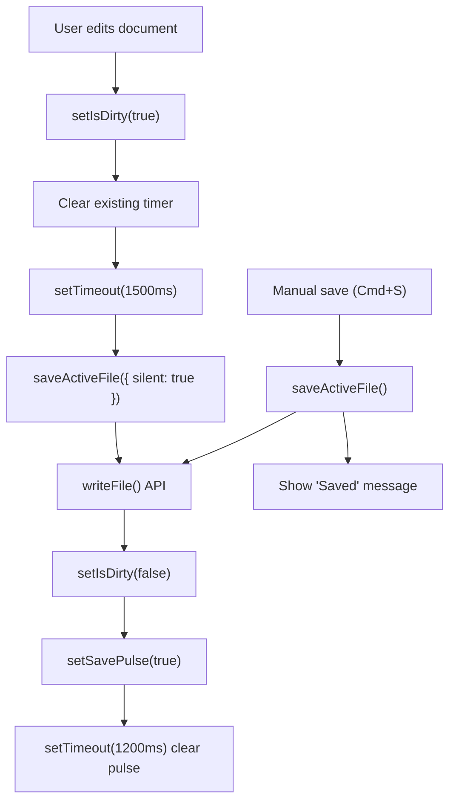

**Save Indicator States:**

| State | CSS Class | Display | Meaning |
|-------|-----------|---------|---------|
| Saved | `saved` | Green dot + "已保存" | File is saved |
| Dirty | `dirty` | Yellow dot + "未保存" | Unsaved changes |
| Saving | `saving` | Blue dot + "保存中..." | Save in progress |
| Pulse | `pulse` | Animation | Save just completed |

**Sources:** [apps/frontend/src/app/EditorPage.tsx:1665-1709](), [apps/frontend/src/app/EditorPage.tsx:3366-3369]()

---

## Keyboard Shortcuts

### Editor Keybindings

| Shortcut | Function | Implementation |
|----------|----------|----------------|
| `Cmd/Ctrl+S` | Save current file | `saveActiveFileRef.current()` |
| `Alt+/` | Trigger AI autocomplete | `requestSuggestionRef.current()` |
| `Cmd/Ctrl+Space` | Trigger AI autocomplete | `requestSuggestionRef.current()` |
| `Cmd/Ctrl+/` | Toggle comment | `toggleComment` from CodeMirror |
| `Tab` | Accept AI suggestion | `acceptSuggestionRef.current()` |
| `ArrowRight` | Accept suggestion chunk | `acceptChunkRef.current()` (at cursor) |
| `Escape` | Clear AI suggestion | `clearSuggestionRef.current()` |

Additional keymaps:
- **foldKeymap**: Standard code folding shortcuts
- **searchKeymap**: Find and replace shortcuts

**Sources:** [apps/frontend/src/app/EditorPage.tsx:1365-1419]()

---

## Editor State Management

### Multi-file Caching

```mermaid
graph TB
    subgraph "State Variables"
        ActivePath["activePath: string<br/>Current file path"]
        Files["files: Record<string, string><br/>All opened files cache"]
        EditorValue["editorValue: string<br/>Current editor content"]
        IsDirty["isDirty: boolean<br/>Unsaved changes flag"]
    end
    
    subgraph "Synchronization"
        DocChange["Document changed"] --> UpdateValue["setEditorValue()"]
        UpdateValue --> UpdateCache["setFiles({ [path]: value })"]
        UpdateCache --> SetDirty["setIsDirty(true)"]
    end
    
    subgraph "File Switching"
        SwitchFile["Switch to new file"] --> CheckCache{In files cache?}
        CheckCache -->|Yes| LoadCached["Load from cache"]
        CheckCache -->|No| FetchAPI["Fetch from API"]
        FetchAPI --> AddToCache["Add to files cache"]
        AddToCache --> UpdateEditor["Update editor"]
        LoadCached --> UpdateEditor
    end
    
    ActivePath --> Files
    Files --> EditorValue
    EditorValue --> IsDirty
```

The editor maintains a cache of all opened files in memory to enable instant switching between files without API calls. The cache is updated on every document change.

**Sources:** [apps/frontend/src/app/EditorPage.tsx:1105-1106](), [apps/frontend/src/app/EditorPage.tsx:1328-1342](), [apps/frontend/src/app/EditorPage.tsx:1477-1489]()

---

## Editor Customization

### Font Size Control

The editor font size is controlled via the `--editor-font-size` CSS variable. Users can adjust it through the `editorFontSize` state variable, which defaults to 11px.

**Sources:** [apps/frontend/src/app/EditorPage.tsx:1169](), [apps/frontend/src/app/EditorPage.tsx:705]()

---

### Breadcrumb Navigation

Breadcrumbs display the active file path as clickable segments:

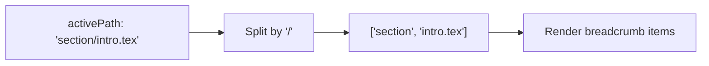

Each breadcrumb segment is interactive and provides visual context for the current file location in the project hierarchy.

**Sources:** [apps/frontend/src/app/EditorPage.tsx:2987]()

---

## Helper Utilities

### Text Manipulation Functions

| Function | Purpose | Usage |
|----------|---------|-------|
| `stripLatexComment(text)` | Remove LaTeX comments from line | Code folding analysis |
| `stripLineComment(line)` | Remove comment from single line | Outline parsing |
| `findNearestHeading(text, pos)` | Find section before cursor | Context awareness |
| `findCurrentEnvironment(text)` | Detect enclosing environment | AI context |
| `extractIncludeTargets(text)` | Parse `\input` and `\include` | Project context building |
| `parseOutline(text)` | Extract section hierarchy | Outline panel |

**Sources:** [apps/frontend/src/app/EditorPage.tsx:165-178](), [apps/frontend/src/app/EditorPage.tsx:426-436](), [apps/frontend/src/app/EditorPage.tsx:477-491](), [apps/frontend/src/app/EditorPage.tsx:493-515](), [apps/frontend/src/app/EditorPage.tsx:462-475](), [apps/frontend/src/app/EditorPage.tsx:438-460]()

---

## File Type Detection

File types are detected by extension for proper handling:

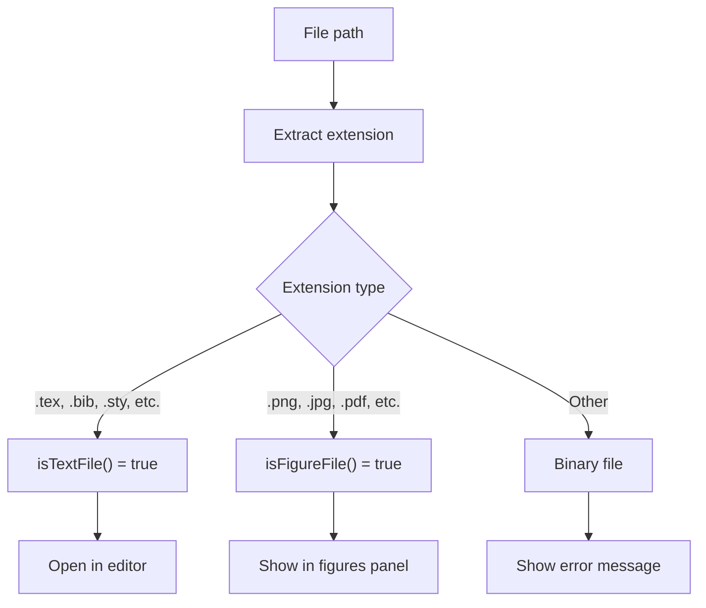

**File Type Labels:**

| Extension | Label | Type |
|-----------|-------|------|
| `.tex` | TEX | Text |
| `.bib` | BIB | Text |
| `.cls` | CLS | Text |
| `.sty` | STY | Text |
| `.png` | PNG | Figure |
| `.jpg` | JPG | Figure |
| `.svg` | SVG | Figure |
| `.pdf` | PDF | Figure/Binary |
| Other | FILE | Binary |

**Sources:** [apps/frontend/src/app/EditorPage.tsx:318-340]()

---

