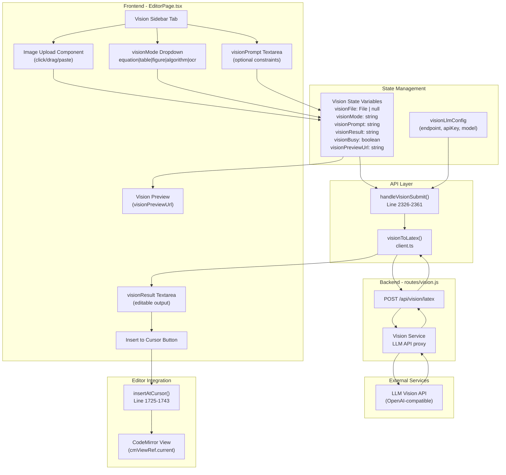
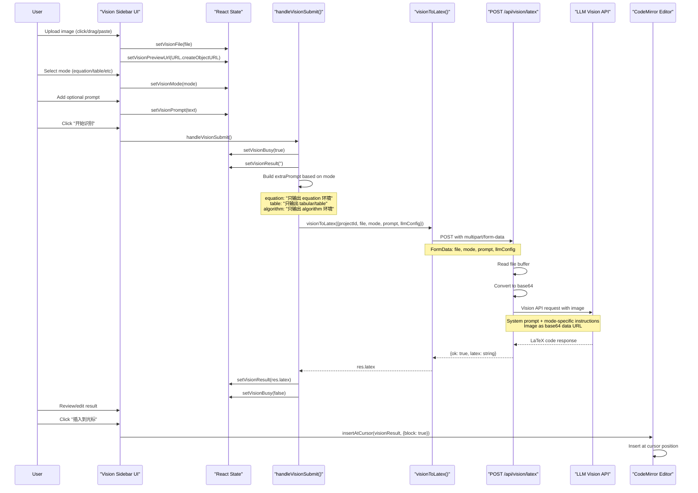
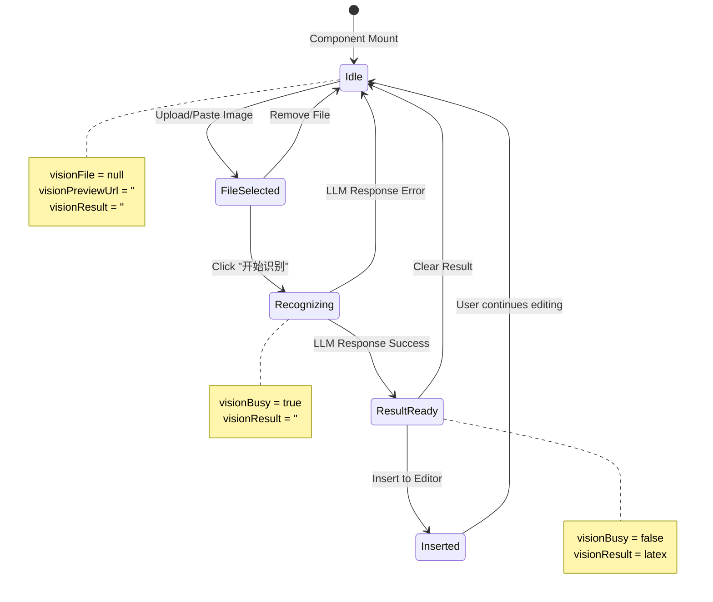
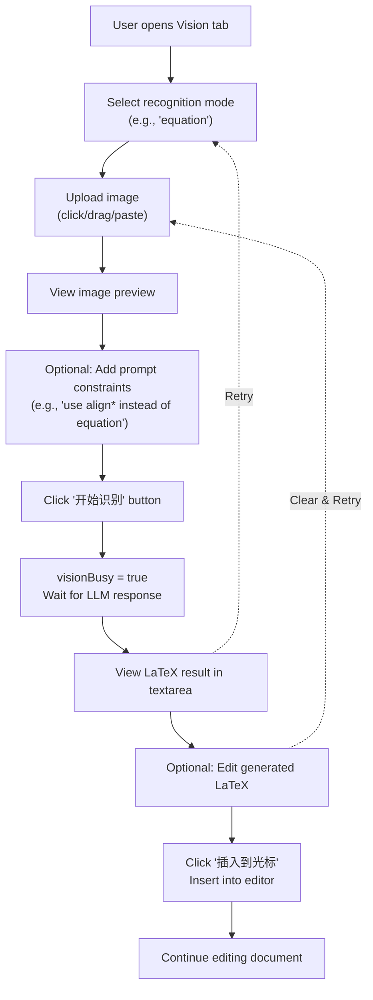

<!-- source: DeepWiki mcp.deepwiki.com · repo OpenDCAI/OpenPrism · page 6.10 Vision OCR · fetched 2026-11-02 -->

# Vision OCR

<details>
<summary>Relevant source files</summary>

The following files were used as context for generating this wiki page:

- [README.md](README.md)
- [apps/frontend/src/app/EditorPage.tsx](apps/frontend/src/app/EditorPage.tsx)

</details>


## Purpose and Overview

The Vision OCR feature enables users to convert images containing mathematical formulas, tables, algorithms, figures, and general text into editable LaTeX code. This feature uses Large Language Models with vision capabilities to recognize and transcribe visual content from uploaded images, supporting academic writing workflows where authors need to incorporate content from scanned documents, screenshots, or handwritten notes.

This page covers the image-to-LaTeX conversion functionality. For AI-powered text editing and suggestions, see [AI Assistant Modes](#6.2). For general LaTeX editing features, see [LaTeX Editing](#6.1).

**Sources:** [README.md:105-109](), [README.md:191-198]()

## Architecture Overview

The Vision OCR system follows a client-server architecture where the frontend manages image upload and preview, while the backend proxies vision requests to an LLM provider with multimodal capabilities.

### System Components



**Sources:** [apps/frontend/src/app/EditorPage.tsx:1170-1176](), [apps/frontend/src/app/EditorPage.tsx:3821-3940](), [apps/frontend/src/app/EditorPage.tsx:2326-2361]()

## Data Flow Pipeline

The Vision OCR feature processes images through the following pipeline:



**Sources:** [apps/frontend/src/app/EditorPage.tsx:2326-2361](), [apps/frontend/src/app/EditorPage.tsx:1725-1743](), [apps/frontend/src/app/EditorPage.tsx:3363-3366]()

## Recognition Modes

The Vision OCR feature supports five distinct recognition modes, each optimized for different types of visual content:

| Mode | Value | Description | Output Format | Use Case |
|------|-------|-------------|---------------|----------|
| **Formula** | `equation` | Mathematical equations and expressions | `\begin{equation}...\end{equation}` | Converting handwritten or scanned mathematical formulas |
| **Table** | `table` | Tabular data structures | `\begin{tabular}...\end{tabular}` or `\begin{table}...\end{table}` | Transcribing data tables from papers or screenshots |
| **Figure** | `figure` | Images with captions | `\begin{figure}...\includegraphics...\caption...\end{figure}` | Generating figure LaTeX from image + caption |
| **Algorithm** | `algorithm` | Pseudocode and algorithms | `\begin{algorithm}...\begin{algorithmic}...\end{algorithmic}\end{algorithm}` | Converting algorithm screenshots to LaTeX pseudocode |
| **OCR** | `ocr` | Plain text extraction | Raw text content | General text recognition without LaTeX structure |

### Mode-Specific Prompt Generation

The system automatically generates mode-specific prompts to guide the LLM's output format:

```typescript
// From handleVisionSubmit() - Line 2335-2343
let extraPrompt = visionPrompt.trim();
if (!extraPrompt) {
  if (visionMode === 'table') {
    extraPrompt = t('只输出表格的 LaTeX（tabular 或 table），不要包含文档结构。');
  } else if (visionMode === 'algorithm') {
    extraPrompt = t('只输出 algorithm/algorithmic 环境，不要包含文档结构。');
  } else if (visionMode === 'equation') {
    extraPrompt = t('只输出 equation 环境，不要包含文档结构。');
  }
}
```

**Sources:** [apps/frontend/src/app/EditorPage.tsx:1170](), [apps/frontend/src/app/EditorPage.tsx:2335-2343](), [apps/frontend/src/app/EditorPage.tsx:3834-3848]()

## User Interface Components

### Vision Sidebar Tab

The Vision tab is accessible from the left sidebar navigation and provides a dedicated workspace for image-to-LaTeX conversion:

```mermaid
graph TB
    subgraph "Vision Sidebar - activeSidebar === 'vision'"
        PanelHeader["Panel Header<br/>'图像识别'<br/>Clear button"]
        
        subgraph "Tool Section"
            ModeField["Mode Selector Field<br/>ios-select-wrapper"]
            ModeDropdown["visionModeDropdownOpen<br/>5 options"]
            
            UploadField["Image Upload Field<br/>image-drop-zone"]
            DropZone["Drop Zone UI<br/>click/drag/paste support"]
            FileInput["<input type='file' accept='image/*'><br/>id='vision-file-input'"]
            FilePreview["File Preview<br/>visionFile.name + remove button"]
            
            PreviewImg["Vision Preview<br/><img src=visionPreviewUrl>"]
            
            PromptField["Constraint Field<br/>visionPrompt textarea"]
            
            ActionButtons["Action Buttons Row"]
            RecognizeBtn["'开始识别' Button<br/>disabled=visionBusy"]
            InsertBtn["'插入到光标' Button<br/>disabled=!visionResult"]
            
            ResultField["Result Field<br/>visionResult textarea<br/>rows=6, editable"]
        end
    end
    
    PanelHeader --> ModeField
    ModeField --> ModeDropdown
    ModeField --> UploadField
    
    UploadField --> DropZone
    DropZone --> FileInput
    DropZone --> FilePreview
    
    UploadField --> PreviewImg
    PreviewImg --> PromptField
    PromptField --> ActionButtons
    
    ActionButtons --> RecognizeBtn
    ActionButtons --> InsertBtn
    InsertBtn --> ResultField
```



**Sources:** [apps/frontend/src/app/EditorPage.tsx:3821-3940]()

### Image Upload Component

The image upload component supports three input methods, providing flexibility for different user workflows:

**1. Click to Upload**
```typescript
// Line 3883-3892
<input
  type="file"
  accept="image/*"
  onChange={(e) => {
    const file = e.target.files?.[0] || null;
    setVisionFile(file);
    setVisionResult('');
  }}
  style={{ display: 'none' }}
  id="vision-file-input"
/>
```

**2. Drag-and-Drop**
```typescript
// Line 3854-3865
onDragOver={(e) => { 
  e.preventDefault(); 
  e.currentTarget.classList.add('drag-over'); 
}}
onDrop={(e) => {
  e.preventDefault();
  e.currentTarget.classList.remove('drag-over');
  const file = e.dataTransfer.files?.[0];
  if (file && file.type.startsWith('image/')) {
    setVisionFile(file);
    setVisionResult('');
  }
}}
```

**3. Paste from Clipboard**
```typescript
// Line 3866-3880
onPaste={(e) => {
  const items = e.clipboardData?.items;
  if (!items) return;
  for (const item of items) {
    if (item.type.startsWith('image/')) {
      const file = item.getAsFile();
      if (file) {
        setVisionFile(file);
        setVisionResult('');
      }
      break;
    }
  }
}}
```

**Sources:** [apps/frontend/src/app/EditorPage.tsx:3851-3904]()

### Image Preview

The component automatically generates and manages preview URLs for uploaded images:

```typescript
// Line 2580-2590
useEffect(() => {
  if (!visionFile) {
    setVisionPreviewUrl('');
    return;
  }
  const url = URL.createObjectURL(visionFile);
  setVisionPreviewUrl(url);
  return () => {
    URL.revokeObjectURL(url);
  };
}, [visionFile]);
```

This effect ensures proper memory management by revoking the object URL when the component unmounts or when a new file is selected.

**Sources:** [apps/frontend/src/app/EditorPage.tsx:2580-2590](), [apps/frontend/src/app/EditorPage.tsx:3906-3910]()

## API Integration

### Frontend API Call

The `handleVisionSubmit` function orchestrates the recognition request:

```typescript
// From EditorPage.tsx - Line 2326-2361
const handleVisionSubmit = async () => {
  if (!projectId) return;
  if (!visionFile) {
    setStatus(t('请先选择图片。'));
    return;
  }
  setVisionBusy(true);
  setVisionResult('');
  try {
    let extraPrompt = visionPrompt.trim();
    if (!extraPrompt) {
      // Generate mode-specific prompts
      if (visionMode === 'table') {
        extraPrompt = t('只输出表格的 LaTeX（tabular 或 table），不要包含文档结构。');
      } else if (visionMode === 'algorithm') {
        extraPrompt = t('只输出 algorithm/algorithmic 环境，不要包含文档结构。');
      } else if (visionMode === 'equation') {
        extraPrompt = t('只输出 equation 环境，不要包含文档结构。');
      }
    }
    const res = await visionToLatex({
      projectId,
      file: visionFile,
      mode: visionMode,
      prompt: extraPrompt,
      llmConfig: visionLlmConfig
    });
    if (!res.ok) {
      throw new Error(res.error || t('识别失败'));
    }
    setVisionResult(res.latex || '');
  } catch (err) {
    setStatus(t('识别失败: {{error}}', { error: String(err) }));
  } finally {
    setVisionBusy(false);
  }
};
```

**Sources:** [apps/frontend/src/app/EditorPage.tsx:2326-2361]()

### API Request Structure

The `visionToLatex` function in the API client is expected to handle the following request structure:

| Parameter | Type | Description |
|-----------|------|-------------|
| `projectId` | string | Current project identifier |
| `file` | File | Image file object from browser |
| `mode` | string | Recognition mode (equation/table/figure/algorithm/ocr) |
| `prompt` | string | Optional user-specified or mode-specific prompt |
| `llmConfig` | object | Vision LLM configuration (endpoint, apiKey, model) |

### Response Structure

The API returns a response object with the following structure:

```typescript
interface VisionResponse {
  ok: boolean;
  latex?: string;
  error?: string;
}
```

- **Success case**: `{ ok: true, latex: "\\begin{equation}..." }`
- **Error case**: `{ ok: false, error: "Error message" }`

**Sources:** [apps/frontend/src/app/EditorPage.tsx:33](), [apps/frontend/src/app/EditorPage.tsx:2345-2355]()

## Configuration

### Vision-Specific LLM Configuration

The Vision OCR feature supports separate LLM configuration from the main AI assistant, allowing users to use specialized vision-capable models:

```typescript
// From EditorPage.tsx - Line 1271-1278
const visionLlmConfig = useMemo(() => {
  const hasOverride = Boolean(visionEndpoint || visionApiKey || visionModel);
  return {
    endpoint: (hasOverride ? visionEndpoint : llmEndpoint) || llmEndpoint,
    apiKey: (hasOverride ? visionApiKey : llmApiKey) || undefined,
    model: (hasOverride ? visionModel : llmModel) || llmModel
  };
}, [llmEndpoint, llmApiKey, llmModel, visionEndpoint, visionApiKey, visionModel]);
```

### Configuration Hierarchy

The configuration follows a fallback pattern:

1. **Vision-specific settings** (if any are set): `visionEndpoint`, `visionApiKey`, `visionModel`
2. **General LLM settings** (fallback): `llmEndpoint`, `llmApiKey`, `llmModel`
3. **System defaults** (final fallback)

This allows users to:
- Use the same LLM for all features (default behavior)
- Configure a specialized vision model (e.g., GPT-4 Vision) for OCR while using a cheaper model for text tasks
- Override individual parameters without changing all settings

### Settings State Management

Vision configuration is stored in the application settings:

```typescript
// From EditorPage.tsx - Line 69-80
type AppSettings = {
  llmEndpoint: string;
  llmApiKey: string;
  llmModel: string;
  searchEndpoint: string;
  searchApiKey: string;
  searchModel: string;
  visionEndpoint: string;  // Vision-specific override
  visionApiKey: string;    // Vision-specific override
  visionModel: string;     // Vision-specific override
  compileEngine: CompileEngine;
};
```

**Sources:** [apps/frontend/src/app/EditorPage.tsx:69-80](), [apps/frontend/src/app/EditorPage.tsx:101-112](), [apps/frontend/src/app/EditorPage.tsx:1271-1278]()

## Editor Integration

### Result Insertion

The Vision OCR results can be inserted directly into the LaTeX editor at the cursor position:

```typescript
// From EditorPage.tsx - Line 3363-3366
const handleVisionInsert = () => {
  if (!visionResult) return;
  insertAtCursor(visionResult, { block: true });
};
```

The `insertAtCursor` function handles the insertion with proper formatting:

```typescript
// From EditorPage.tsx - Line 1725-1743
const insertAtCursor = (text: string, opts?: { block?: boolean }) => {
  if (!activePath) return;
  const view = cmViewRef.current;
  if (!view) return;
  const sel = view.state.selection.main;
  let insert = text;
  if (opts?.block) {
    const before = sel.from > 0 ? view.state.doc.sliceString(sel.from - 1, sel.from) : '';
    if (before && before !== '\n') {
      insert = `\n${insert}`;
    }
    if (!insert.endsWith('\n\n')) {
      insert = insert.endsWith('\n') ? `${insert}\n` : `${insert}\n\n`;
    }
  }
  view.dispatch({
    changes: { from: sel.from, to: sel.to, insert },
    selection: { anchor: sel.from + insert.length }
  });
};
```

### Block Insertion Behavior

When `block: true` is specified:
1. Ensures a newline before the insertion if not already present
2. Adds double newline after the insertion for proper spacing
3. Positions cursor immediately after the inserted content
4. Maintains proper LaTeX document structure

**Sources:** [apps/frontend/src/app/EditorPage.tsx:3363-3366](), [apps/frontend/src/app/EditorPage.tsx:1725-1743]()

## State Management

### Vision State Variables

The Vision OCR feature maintains the following React state:

| State Variable | Type | Initial Value | Purpose |
|----------------|------|---------------|---------|
| `visionMode` | `'equation' \| 'table' \| 'figure' \| 'algorithm' \| 'ocr'` | `'equation'` | Selected recognition mode |
| `visionFile` | `File \| null` | `null` | Currently uploaded image file |
| `visionPrompt` | `string` | `''` | User-specified prompt constraints |
| `visionResult` | `string` | `''` | Generated LaTeX code (editable) |
| `visionBusy` | `boolean` | `false` | Recognition request in progress |
| `visionPreviewUrl` | `string` | `''` | Object URL for image preview |

### State Transitions



**Sources:** [apps/frontend/src/app/EditorPage.tsx:1170-1176]()

## Error Handling and Edge Cases

### Validation and Error Cases

The Vision OCR implementation includes several validation checks:

**1. Missing Image File**
```typescript
// Line 2328-2331
if (!visionFile) {
  setStatus(t('请先选择图片。'));
  return;
}
```

**2. API Request Failure**
```typescript
// Line 2352-2354
if (!res.ok) {
  throw new Error(res.error || t('识别失败'));
}
```

**3. Network/Exception Handling**
```typescript
// Line 2356-2360
catch (err) {
  setStatus(t('识别失败: {{error}}', { error: String(err) }));
} finally {
  setVisionBusy(false);
}
```

### Empty Result Handling

The system gracefully handles empty or missing LaTeX output:

```typescript
// Line 2355
setVisionResult(res.latex || '');
```

If the LLM returns an empty response, an empty string is set, and the user can retry with different prompts or settings.

### Insert Button State

The insert button is disabled when no result is available:

```typescript
// Line 3925
<button className="ios-btn primary" onClick={handleVisionInsert} disabled={!visionResult}>
  {t('插入到光标')}
</button>
```

This prevents attempting to insert empty content into the editor.

**Sources:** [apps/frontend/src/app/EditorPage.tsx:2326-2361](), [apps/frontend/src/app/EditorPage.tsx:3925]()

## User Workflow Example

A typical Vision OCR workflow follows these steps:



**Sources:** [apps/frontend/src/app/EditorPage.tsx:3821-3940]()

## Performance Considerations

### Memory Management

The component implements proper cleanup for object URLs to prevent memory leaks:

```typescript
// Line 2580-2590
useEffect(() => {
  if (!visionFile) {
    setVisionPreviewUrl('');
    return;
  }
  const url = URL.createObjectURL(visionFile);
  setVisionPreviewUrl(url);
  return () => {
    URL.revokeObjectURL(url);  // Cleanup on unmount or file change
  };
}, [visionFile]);
```

### State Reset on Mode Change

When changing recognition modes, the system clears previous results to avoid confusion:

```typescript
// Line 3842
onClick={() => { 
  setVisionMode(val as 'equation'|'table'|'figure'|'algorithm'|'ocr'); 
  setVisionResult('');  // Clear previous result
  setVisionModeDropdownOpen(false); 
}}
```

This ensures that users understand a new recognition request will be needed with the new mode.

**Sources:** [apps/frontend/src/app/EditorPage.tsx:2580-2590](), [apps/frontend/src/app/EditorPage.tsx:3842]()

## Integration with Other Features

The Vision OCR feature integrates seamlessly with other OpenPrism capabilities:

- **Editor Integration**: Results insert at cursor position with proper block formatting via `insertAtCursor()` [#6.1](#6.1)
- **Project Context**: Uses current `projectId` for API requests
- **Status Bar**: Reports recognition progress and errors via `setStatus()`
- **Settings System**: Supports separate LLM configuration via `visionLlmConfig`
- **Internationalization**: All UI text supports translation via `t()` function

**Sources:** [apps/frontend/src/app/EditorPage.tsx:1725-1743](), [apps/frontend/src/app/EditorPage.tsx:2326-2361]()

---

