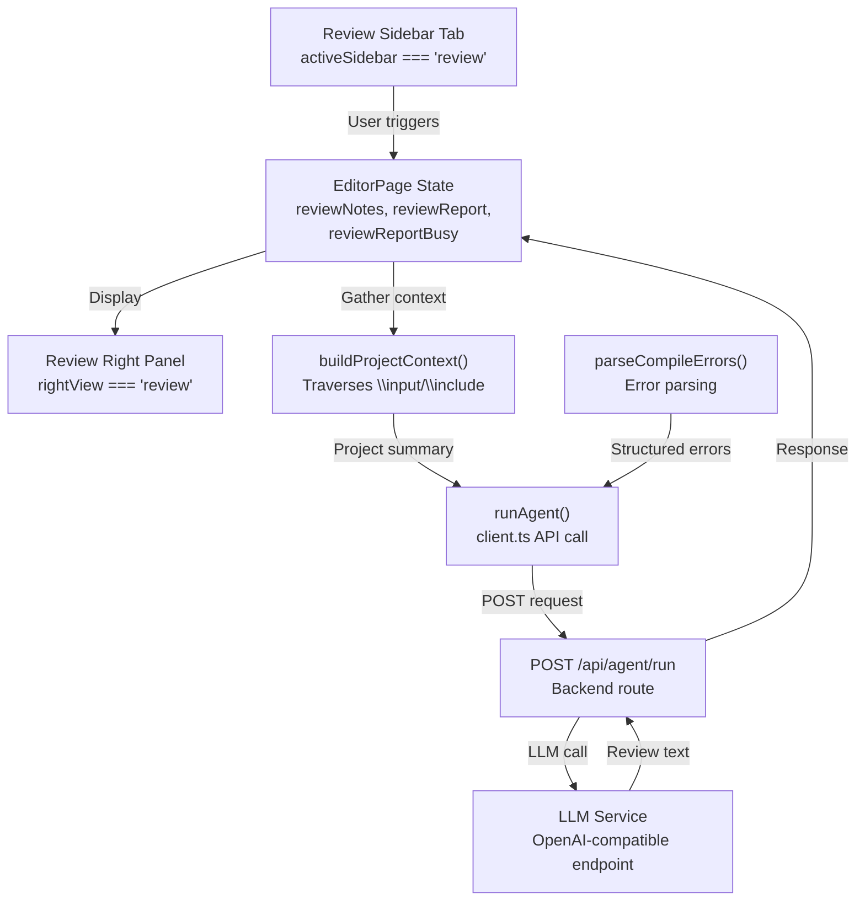
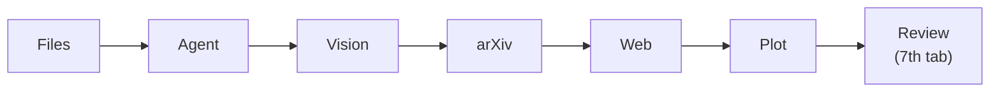
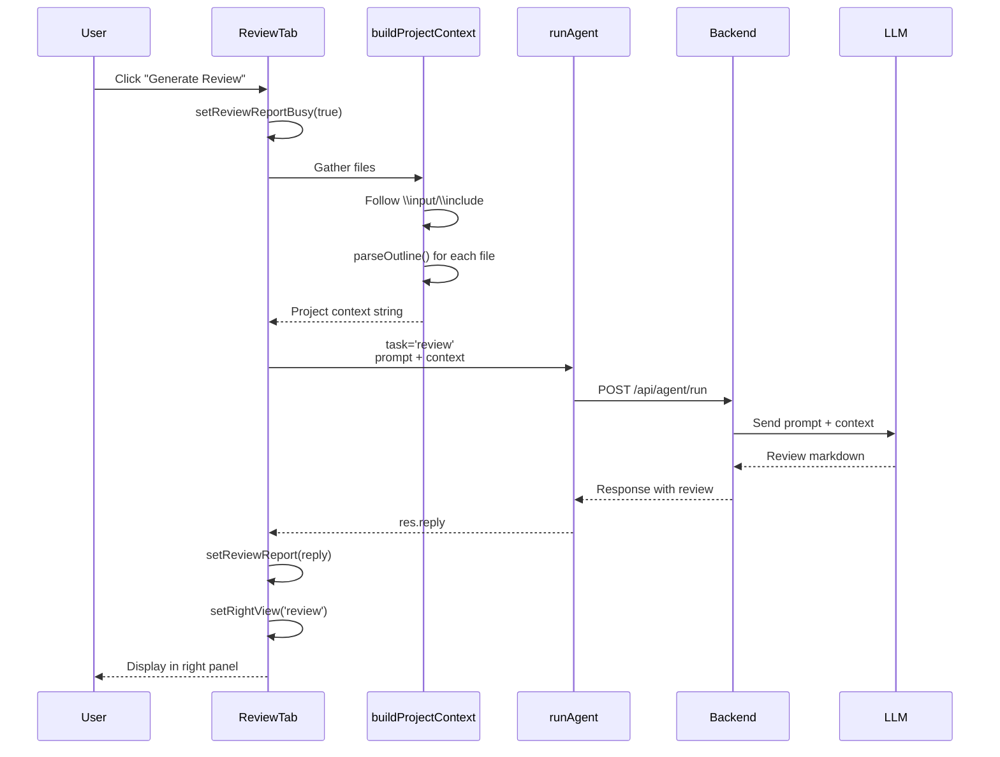
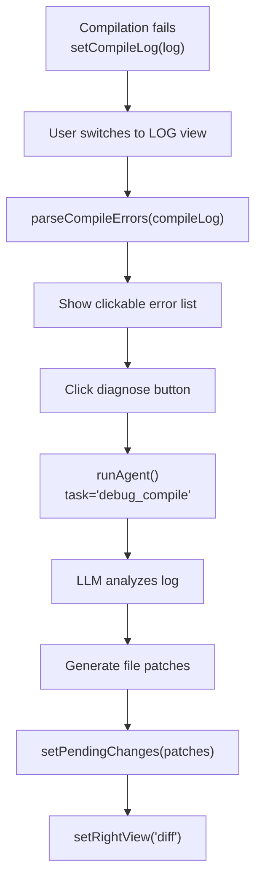

<!-- source: DeepWiki mcp.deepwiki.com · repo OpenDCAI/OpenPrism · page 6.11 Peer Review · fetched 2026-11-02 -->

# Peer Review

<details>
<summary>Relevant source files</summary>

The following files were used as context for generating this wiki page:

- [README.md](README.md)
- [apps/frontend/src/app/EditorPage.tsx](apps/frontend/src/app/EditorPage.tsx)

</details>


## Purpose and Scope

This document describes the Peer Review feature in OpenPrism, which provides AI-powered quality assessment and review capabilities for LaTeX documents. The feature analyzes document quality, consistency, citations, and compilation issues to generate reviewer-style feedback. For information about AI-driven editing and suggestions, see [AI Assistant Modes](#6.2). For details about compilation error diagnostics, see [Document Compilation](#6.4).

**Sources:** [README.md:110-117](), [apps/frontend/src/app/EditorPage.tsx:1209-1212]()

---

## Overview

The Peer Review feature provides four primary analysis capabilities:

| Review Type | Description | Output |
|------------|-------------|--------|
| **Full Review Report** | Comprehensive reviewer-style assessment including strengths, weaknesses, and suggestions | Structured markdown report |
| **Consistency Check** | Analyzes terminology and symbol usage across all files | List of inconsistencies |
| **Missing Citations** | Identifies statements requiring citation support | Locations needing references |
| **Compile Log Summary** | AI-generated explanation of compilation errors with fix suggestions | Diagnostic report with patches |

All review operations integrate with the AI Agent Service and support OpenAI-compatible LLM endpoints.

**Sources:** [README.md:110-117](), [apps/frontend/src/app/EditorPage.tsx:91-98]()

---

## Architecture

### Component Structure



**Sources:** [apps/frontend/src/app/EditorPage.tsx:1209-1212](), [apps/frontend/src/app/EditorPage.tsx:1800-1835](), [apps/frontend/src/app/EditorPage.tsx:29](), [apps/frontend/src/app/EditorPage.tsx:776-815]()

---

## State Management

### Review State Variables

The review feature maintains state in `EditorPage` component:

```typescript
const [reviewNotes, setReviewNotes] = useState<{ title: string; content: string }[]>([]);
const [reviewReport, setReviewReport] = useState('');
const [reviewReportBusy, setReviewReportBusy] = useState(false);
const [diagnoseBusy, setDiagnoseBusy] = useState(false);
```

| State Variable | Type | Purpose |
|---------------|------|---------|
| `reviewNotes` | `Array<{title: string, content: string}>` | Collection of individual review findings |
| `reviewReport` | `string` | Full review report markdown text |
| `reviewReportBusy` | `boolean` | Loading state for report generation |
| `diagnoseBusy` | `boolean` | Loading state for compile diagnostics |

**Sources:** [apps/frontend/src/app/EditorPage.tsx:1209-1212]()

### Right View Integration

The review report is one of six right panel views:

```typescript
const RIGHT_VIEW_OPTIONS = (t: (key: string) => string) => [
  { value: 'pdf', label: 'PDF' },
  { value: 'toc', label: t('目录') },
  { value: 'figures', label: 'FIG' },
  { value: 'diff', label: 'DIFF' },
  { value: 'log', label: 'LOG' },
  { value: 'review', label: t('评审报告') }
];
```

The right panel displays review content when `rightView === 'review'`.

**Sources:** [apps/frontend/src/app/EditorPage.tsx:91-98](), [apps/frontend/src/app/EditorPage.tsx:1151]()

---

## User Interface

### Sidebar Tab Structure

The Review tab is the seventh sidebar option:



Tab button implementation:

```typescript
<button
  className={`tab-btn ${activeSidebar === 'review' ? 'active' : ''}`}
  onClick={() => setActiveSidebar('review')}
  title={t('Review')}
>
  <span className="tab-icon">
    <svg width="14" height="14" viewBox="0 0 24 24">
      <path d="M22 11.08V12a10 10 0 1 1-5.93-9.14"/>
      <polyline points="22 4 12 14.01 9 11.01"/>
    </svg>
  </span>
  <span className="tab-text">{t('Review')}</span>
</button>
```

**Sources:** [apps/frontend/src/app/EditorPage.tsx:3438-3445](), [apps/frontend/src/app/EditorPage.tsx:1154]()

### Panel Layout

When `activeSidebar === 'review'`, the sidebar displays:
- Panel header with "Review" title
- Action buttons for triggering different review types
- Results area showing generated reports

Results are rendered using `ReactMarkdown` with `remarkGfm` plugin for GitHub Flavored Markdown support.

**Sources:** [apps/frontend/src/app/EditorPage.tsx:5-6](), [apps/frontend/src/app/EditorPage.tsx:3614-3621]()

---

## Review Types and Workflows

### Quality Check Workflow



**Sources:** [apps/frontend/src/app/EditorPage.tsx:1800-1835](), [apps/frontend/src/app/EditorPage.tsx:3083-3175](), [apps/frontend/src/api/client.ts:29]()

### Project Context Building

The `buildProjectContext()` function gathers comprehensive project information:

```typescript
const buildProjectContext = useCallback(async () => {
  const root = mainFile || activePath;
  if (!root) return '';
  const visited = new Set<string>();
  const queue: string[] = [root];
  const summaries: string[] = [];
  
  while (queue.length > 0) {
    const current = queue.shift();
    if (!current || visited.has(current)) continue;
    visited.add(current);
    if (!current.toLowerCase().endsWith('.tex')) continue;
    
    let content = await ensureFileContent(current);
    const outline = parseOutline(content).slice(0, 12);
    const headings = outline.map((item) => 
      `${'  '.repeat(item.level - 1)}- ${item.title}`
    );
    summaries.push(
      t('File: {{file}}\n{{headings}}', { 
        file: current, 
        headings: headings.join('\n') 
      })
    );
    
    const includes = extractIncludeTargets(content);
    includes.forEach((target) => {
      // ... resolve and queue included files
    });
  }
  
  return t('Project files: {{files}}\nOutline:\n{{summaries}}', {
    files: Array.from(visited).join(', '),
    summaries: summaries.join('\n')
  });
}, [activePath, ensureFileContent, mainFile, t]);
```

This function:
1. Starts from `mainFile` (typically `main.tex`)
2. Recursively follows `\input{}` and `\include{}` directives via `extractIncludeTargets()`
3. Extracts document structure via `parseOutline()` for each file
4. Returns formatted context summary with file list and section headings

**Sources:** [apps/frontend/src/app/EditorPage.tsx:1800-1835](), [apps/frontend/src/app/EditorPage.tsx:438-460](), [apps/frontend/src/app/EditorPage.tsx:462-475]()

### Outline Parsing

The `parseOutline()` function extracts section structure:

```typescript
function parseOutline(text: string): OutlineItem[] {
  const items: OutlineItem[] = [];
  const lines = text.split(/\r?\n/);
  let offset = 0;
  
  lines.forEach((line, index) => {
    const clean = stripLineComment(line);
    const regex = /\\(section|subsection|subsubsection)\*?\s*(?:\[[^\]]*\])?\s*\{([^}]*)\}/g;
    let match: RegExpExecArray | null;
    
    while ((match = regex.exec(clean))) {
      const name = match[1];
      const title = (match[2] || '').trim() || '(untitled)';
      const level = name === 'section' ? 1 : 
                    name === 'subsection' ? 2 : 3;
      items.push({
        title,
        level,
        pos: offset + (match.index ?? 0),
        line: index + 1
      });
    }
    offset += line.length + 1;
  });
  return items;
}
```

**Sources:** [apps/frontend/src/app/EditorPage.tsx:438-460]()

---

## Compile Diagnostics

### Error Parsing and Diagnosis



**Sources:** [apps/frontend/src/app/EditorPage.tsx:2886-2941](), [apps/frontend/src/app/EditorPage.tsx:3177-3221](), [apps/frontend/src/app/EditorPage.tsx:776-815]()

### CompileError Type and Parsing

```typescript
type CompileError = {
  message: string;
  line?: number;
  file?: string;
  raw?: string;
};

function parseCompileErrors(log: string): CompileError[] {
  if (!log) return [];
  const lines = log.split('\n');
  const errors: CompileError[] = [];
  const seen = new Set<string>();

  for (let i = 0; i < lines.length; i += 1) {
    const line = lines[i];
    
    // Parse file:line references (e.g., main.tex:42)
    const fileLineMatch = line.match(/([A-Za-z0-9_./-]+\.tex):(\d+)/);
    if (fileLineMatch) {
      errors.push({
        message: line.trim(),
        file: fileLineMatch[1],
        line: Number(fileLineMatch[2]),
        raw: line
      });
    }
    
    // Parse LaTeX error markers (lines starting with !)
    if (line.startsWith('!')) {
      const message = line.replace(/^!+\s*/, '').trim();
      let lineNo: number | undefined;
      
      // Look ahead for line number (e.g., l.123)
      for (let j = i + 1; j < Math.min(i + 4, lines.length); j += 1) {
        const match = lines[j].match(/l\.(\d+)/);
        if (match) {
          lineNo = Number(match[1]);
          break;
        }
      }
      errors.push({ message, line: lineNo, raw: line });
    }
  }
  
  return errors;
}
```

The parser extracts:
- File path and line number from patterns like `main.tex:42`
- Error messages from lines starting with `!`
- Line indicators from patterns like `l.123`

**Sources:** [apps/frontend/src/app/EditorPage.tsx:769-815]()

### Diagnose Function

The `diagnoseCompile()` function triggers AI-based error analysis:

```typescript
const diagnoseCompile = async () => {
  if (!compileLog) {
    setStatus(t('暂无编译日志可诊断。'));
    return;
  }
  if (!activePath) return;
  
  setDiagnoseBusy(true);
  const userMsg: Message = { 
    role: 'user', 
    content: t('诊断并修复编译错误') 
  };
  const nextHistory = [...agentMessages, userMsg];
  setAgentMessages(nextHistory);
  
  try {
    const res = await runAgent({
      task: 'debug_compile',
      prompt: t('基于编译日志诊断并修复错误，给出可应用的 diff。'),
      selection: compileLog,
      content: editorValue,
      mode: 'tools',
      projectId,
      activePath,
      compileLog,
      llmConfig,
      interaction: 'agent',
      history: nextHistory.slice(-8)
    });
    
    const assistant: Message = {
      role: 'assistant',
      content: res.reply || t('已生成编译修复建议。')
    };
    setAgentMessages((prev) => [...prev, assistant]);
    
    if (res.patches && res.patches.length > 0) {
      const nextPending = res.patches.map((patch) => ({
        filePath: patch.path,
        original: files[patch.path] ?? '',
        proposed: patch.content,
        diff: patch.diff
      }));
      setPendingChanges(nextPending);
      setRightView('diff');
    }
  } catch (err) {
    setAgentMessages((prev) => [...prev, { 
      role: 'assistant', 
      content: t('请求失败: {{error}}', { error: String(err) }) 
    }]);
  } finally {
    setDiagnoseBusy(false);
  }
};
```

The function:
1. Validates `compileLog` is available
2. Adds user message to agent history
3. Calls `runAgent()` with `task='debug_compile'` and `mode='tools'`
4. Displays AI response in agent chat
5. If patches are generated, routes to Diff panel for review

**Sources:** [apps/frontend/src/app/EditorPage.tsx:3177-3221]()

---

## Backend Integration

### Agent API Request

Review requests are sent via `runAgent()` to the backend:

```typescript
const res = await runAgent({
  task: 'review',              // Task type identifier
  prompt: reviewPromptText,    // Review instructions
  selection: '',               // Selected text or log content
  content: editorValue,        // Current file content
  mode: 'direct',              // Single-shot analysis
  projectId,
  activePath,
  compileLog,
  llmConfig: {
    endpoint: llmEndpoint,
    apiKey: llmApiKey || undefined,
    model: llmModel
  },
  interaction: 'agent',
  history: nextHistory.slice(-8)  // Last 8 messages for context
});
```

Request payload structure:

| Field | Type | Description |
|-------|------|-------------|
| `task` | `string` | Task identifier: `'review'`, `'debug_compile'`, etc. |
| `prompt` | `string` | Review instructions and context |
| `selection` | `string` | Selected text or compile log for analysis |
| `content` | `string` | Current file content |
| `mode` | `'direct' \| 'tools'` | Execution mode (single-shot vs. multi-turn) |
| `projectId` | `string` | Current project ID |
| `activePath` | `string` | Current file path |
| `compileLog` | `string` | Latest compilation log |
| `llmConfig` | `object` | LLM endpoint configuration |
| `interaction` | `'agent'` | Interaction type identifier |
| `history` | `Message[]` | Conversation history (last 8 messages) |

**Sources:** [apps/frontend/src/app/EditorPage.tsx:3083-3175](), [apps/frontend/src/api/client.ts:29]()

### Backend Route and Service

The agent route handler processes review requests:

- **Route:** `POST /api/agent/run`
- **Handler:** [apps/backend/src/routes/* (importance: 1.25-1.88)]()
- **Service:** LLM Service for OpenAI-compatible API calls

The backend:
1. Receives review request
2. Constructs LLM prompt with project context
3. Calls configured LLM endpoint
4. Parses response (plain text or structured patches)
5. Returns review report or file modifications

**Sources:** [README.md:Diagram 3 (Backend Service Architecture)](), [apps/backend/src/routes/* (importance: 1.25-1.88)]()

---

## Result Display and Interaction

### Markdown Rendering

Review reports are displayed using `ReactMarkdown` with GitHub Flavored Markdown:

```typescript
import ReactMarkdown from 'react-markdown';
import remarkGfm from 'remark-gfm';

// In chat/agent message display:
{msg.role === 'assistant' ? (
  <ReactMarkdown remarkPlugins={[remarkGfm]}>
    {msg.content}
  </ReactMarkdown>
) : (
  msg.content
)}
```

Supported markdown features:
- Headers (`#`, `##`, `###`)
- Bullet and numbered lists
- Code blocks with language highlighting
- Tables
- Emphasis (`*italic*`, `**bold**`)
- Links and inline code

**Sources:** [apps/frontend/src/app/EditorPage.tsx:5-6](), [apps/frontend/src/app/EditorPage.tsx:3614-3621]()

### Right Panel View Switching

Users toggle between views using the right panel selector:

```typescript
const [rightView, setRightView] = useState<
  'pdf' | 'figures' | 'diff' | 'log' | 'toc' | 'review'
>('pdf');
```

The review report appears when `rightView === 'review'`. The system automatically switches to relevant views:
- `'diff'` when patches are generated
- `'log'` after compilation
- `'review'` when review report is ready

**Sources:** [apps/frontend/src/app/EditorPage.tsx:1151]()

### Integration with Diff Viewer

When diagnostics or reviews generate file patches, they flow to the Diff viewer:

```typescript
if (res.patches && res.patches.length > 0) {
  const nextPending = res.patches.map((patch) => ({
    filePath: patch.path,
    original: files[patch.path] ?? '',
    proposed: patch.content,
    diff: patch.diff
  }));
  setPendingChanges(nextPending);
  setRightView('diff');
}
```

This creates a `PendingChange` for each modified file:

```typescript
interface PendingChange {
  filePath: string;
  original: string;
  proposed: string;
  diff: string;
}
```

Users can then review changes in split-diff view and selectively apply or discard them. For detailed diff workflow, see [Diff Viewer](#6.6).

**Sources:** [apps/frontend/src/app/EditorPage.tsx:56-61](), [apps/frontend/src/app/EditorPage.tsx:3206-3215]()

---

## Configuration and Settings

### LLM Configuration

Review requests use the same LLM configuration as other AI features:

```typescript
const llmConfig = useMemo(
  () => ({
    endpoint: llmEndpoint,
    apiKey: llmApiKey || undefined,
    model: llmModel
  }),
  [llmEndpoint, llmApiKey, llmModel]
);
```

Configuration is loaded from `localStorage` and managed via the Settings panel:

```typescript
const SETTINGS_KEY = 'openprism-settings-v1';
const DEFAULT_SETTINGS: AppSettings = {
  llmEndpoint: 'https://api.openai.com/v1/chat/completions',
  llmApiKey: '',
  llmModel: 'gpt-4o-mini',
  searchEndpoint: '',
  searchApiKey: '',
  searchModel: '',
  visionEndpoint: '',
  visionApiKey: '',
  visionModel: '',
  compileEngine: 'pdflatex'
};

function loadSettings(): AppSettings {
  if (typeof window === 'undefined') return DEFAULT_SETTINGS;
  try {
    const raw = window.localStorage.getItem(SETTINGS_KEY);
    if (!raw) return DEFAULT_SETTINGS;
    const parsed = JSON.parse(raw) as Partial<AppSettings>;
    return { ...DEFAULT_SETTINGS, ...parsed };
  } catch {
    return DEFAULT_SETTINGS;
  }
}
```

**Sources:** [apps/frontend/src/app/EditorPage.tsx:100-143](), [apps/frontend/src/app/EditorPage.tsx:1253-1260]()

### Settings Persistence

Settings are saved to localStorage on change:

```typescript
useEffect(() => {
  persistSettings(settings);
}, [settings]);

function persistSettings(settings: AppSettings) {
  if (typeof window === 'undefined') return;
  try {
    window.localStorage.setItem(SETTINGS_KEY, JSON.stringify(settings));
  } catch {
    // ignore
  }
}
```

**Sources:** [apps/frontend/src/app/EditorPage.tsx:136-143](), [apps/frontend/src/app/EditorPage.tsx:1249-1251]()

---

## Error Handling and Loading States

### Loading State Management

Review operations display loading indicators:

```typescript
const [reviewReportBusy, setReviewReportBusy] = useState(false);
const [diagnoseBusy, setDiagnoseBusy] = useState(false);

// In button:
<button disabled={reviewReportBusy}>
  {reviewReportBusy ? t('生成中...') : t('生成评审报告')}
</button>

<button disabled={diagnoseBusy}>
  {diagnoseBusy ? t('诊断中...') : t('诊断')}
</button>
```

**Sources:** [apps/frontend/src/app/EditorPage.tsx:1211-1212]()

### Error Handling Pattern

Review functions use try-catch with user-facing error messages:

```typescript
try {
  const res = await runAgent({...});
  // ... process response
} catch (err) {
  setAgentMessages((prev) => [...prev, { 
    role: 'assistant', 
    content: t('请求失败: {{error}}', { error: String(err) }) 
  }]);
} finally {
  setReviewReportBusy(false);  // or setDiagnoseBusy(false)
}
```

Failed requests:
1. Append error message to agent chat history
2. Reset busy state
3. Display localized error message

**Sources:** [apps/frontend/src/app/EditorPage.tsx:3216-3220]()

---

## Localization

All review UI text is internationalized using `i18next`:

```typescript
import { useTranslation } from 'react-i18next';

const { t, i18n } = useTranslation();

// Examples:
t('Review')                    // "Review" or "评审"
t('评审报告')                   // "Review Report"
t('生成评审报告')                // "Generate Review Report"
t('诊断并修复编译错误')          // "Diagnose and Fix Compile Errors"
t('请求失败: {{error}}', { error })  // Parameterized error message
```

Supported languages:
- English (`en`)
- Chinese (`zh-CN`)

Language toggle is available in the top bar. For more details, see [Internationalization](#4.6).

**Sources:** [apps/frontend/src/app/EditorPage.tsx:4](), [apps/frontend/src/app/EditorPage.tsx:1096]()

---

