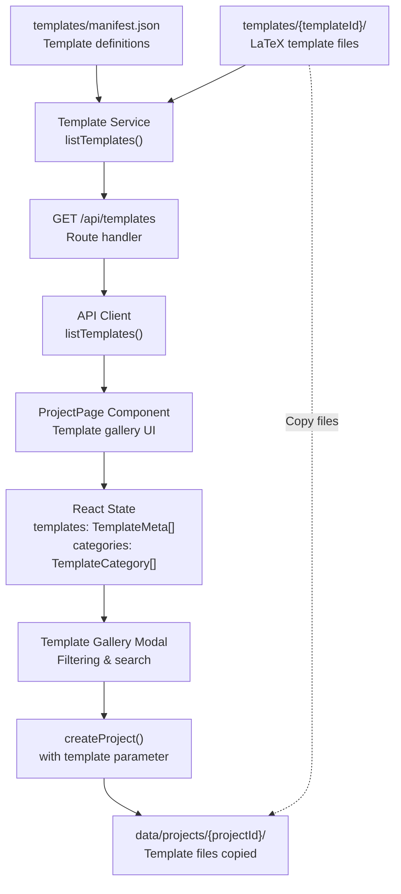
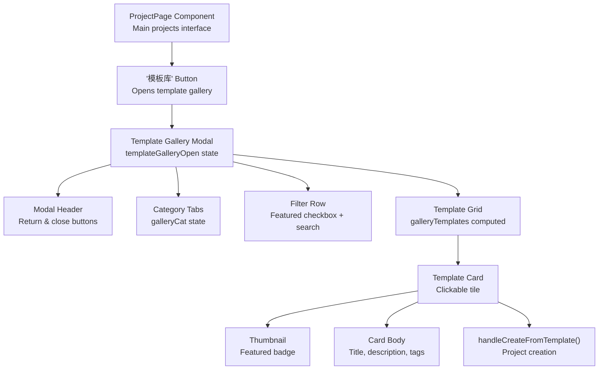
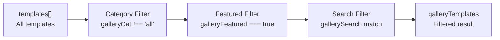
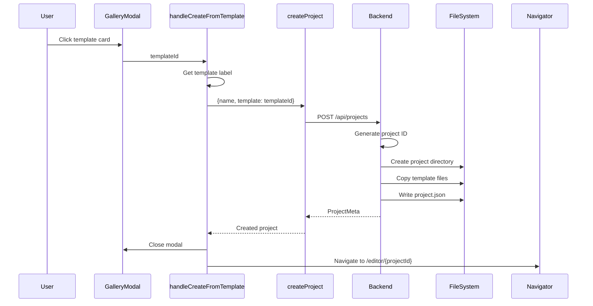
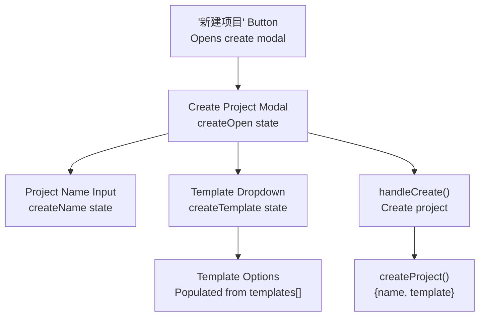
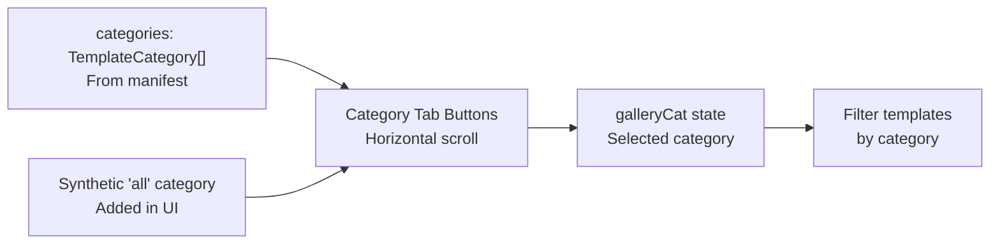
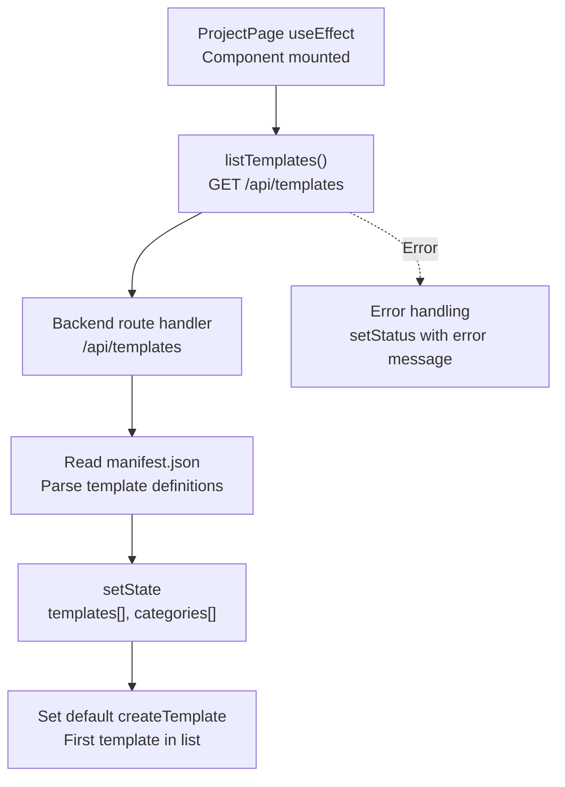
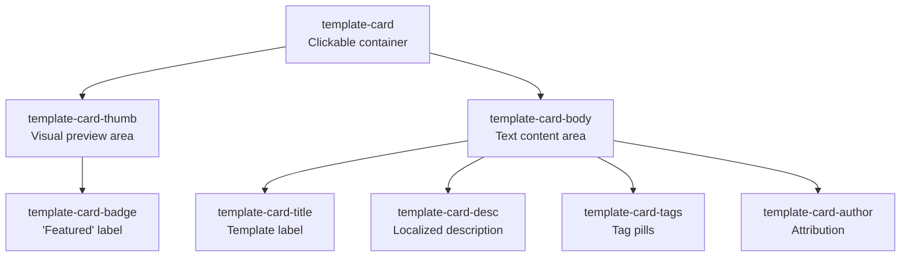

<!-- source: DeepWiki mcp.deepwiki.com · repo OpenDCAI/OpenPrism · page 6.12 Template Management · fetched 2026-11-02 -->

# Template Management

<details>
<summary>Relevant source files</summary>

The following files were used as context for generating this wiki page:

- [README.md](README.md)
- [apps/frontend/src/app/ProjectPage.tsx](apps/frontend/src/app/ProjectPage.tsx)
- [templates/manifest.json](templates/manifest.json)

</details>


## Purpose and Scope

Template Management provides a manifest-based system for organizing, browsing, and applying LaTeX templates to new or existing projects. This document covers the template manifest structure, template gallery user interface, template selection workflow, and integration with project creation. For information about project creation workflows, see [Project Import](#6.13). For details on converting existing projects to different templates, see the Template Conversion section below.

---

## System Architecture

The Template Management system consists of three primary components: a manifest file that defines available templates, a backend service that reads and serves template data, and a frontend gallery interface for browsing and selecting templates.

### Template Management Data Flow



**Sources**: [templates/manifest.json:1-59](), [apps/frontend/src/app/ProjectPage.tsx:33-795](), [README.md:82-86]()

---

## Template Manifest Structure

The template system is defined by a central manifest file located at `templates/manifest.json`. This file contains two primary arrays: `templates` and `categories`.

### Manifest Schema

| Field | Type | Description |
|-------|------|-------------|
| `templates` | `TemplateMeta[]` | Array of template definitions |
| `categories` | `TemplateCategory[]` | Array of category definitions for organization |

### Template Metadata (TemplateMeta)

Each template in the manifest contains the following properties:

| Property | Type | Required | Description |
|----------|------|----------|-------------|
| `id` | string | Yes | Unique identifier matching directory name in `templates/` |
| `label` | string | Yes | Display name shown in UI |
| `mainFile` | string | Yes | Entry point LaTeX file (typically `main.tex`) |
| `category` | string | Yes | Category ID for filtering |
| `description` | string | Yes | Chinese description of template purpose |
| `descriptionEn` | string | Yes | English description of template purpose |
| `tags` | string[] | No | Keywords for search and display |
| `author` | string | No | Template author attribution |
| `featured` | boolean | No | Whether to highlight in gallery |

**Example template definition**:

```json
{
  "id": "acl",
  "label": "ACL",
  "mainFile": "main.tex",
  "category": "academic",
  "description": "ACL 会议论文模板，适用于自然语言处理领域",
  "descriptionEn": "ACL conference paper template for NLP research",
  "tags": ["ACL", "NLP"],
  "author": "OpenPrism",
  "featured": true
}
```

### Category Metadata (TemplateCategory)

Categories organize templates into logical groups:

| Property | Type | Description |
|----------|------|-------------|
| `id` | string | Unique category identifier |
| `label` | string | Chinese category name |
| `labelEn` | string | English category name |

**Sources**: [templates/manifest.json:1-59](), [apps/frontend/src/app/ProjectPage.tsx:18]()

---

## Template Gallery User Interface

The template gallery provides a modal interface for browsing and selecting templates with filtering, search, and categorization capabilities.

### Gallery Component Structure



**Sources**: [apps/frontend/src/app/ProjectPage.tsx:725-792](), [apps/frontend/src/app/ProjectPage.tsx:61-64]()

### Gallery State Management

The template gallery maintains several pieces of state for filtering and interaction:

| State Variable | Type | Purpose |
|----------------|------|---------|
| `templates` | `TemplateMeta[]` | All templates loaded from backend |
| `categories` | `TemplateCategory[]` | Category definitions for tabs |
| `templateGalleryOpen` | boolean | Controls modal visibility |
| `galleryCat` | string | Active category filter (`'all'` or category ID) |
| `galleryFeatured` | boolean | Whether to show only featured templates |
| `gallerySearch` | string | Search term for filtering templates |

**Sources**: [apps/frontend/src/app/ProjectPage.tsx:37-64]()

### Gallery Filtering Logic

The `galleryTemplates` computed value applies three levels of filtering:



Search matching checks template `label`, `description`, and `descriptionEn` fields in a case-insensitive manner.

**Sources**: [apps/frontend/src/app/ProjectPage.tsx:122-133]()

---

## Template Selection and Project Creation

When a user selects a template from the gallery, the system creates a new project with template files copied into the project directory.

### Template Creation Flow



**Sources**: [apps/frontend/src/app/ProjectPage.tsx:239-251]()

### Template Selection from Create Dialog

In addition to the template gallery, users can select templates when creating a project via the standard create dialog:



The dropdown is populated with all available templates, and defaults to the first template in the list if no selection is made.

**Sources**: [apps/frontend/src/app/ProjectPage.tsx:601-648](), [apps/frontend/src/app/ProjectPage.tsx:135-150]()

---

## Template Categories

Template categories provide hierarchical organization for the template library. The system includes predefined categories covering common LaTeX document types.

### Built-in Categories

| Category ID | Label (ZH) | Label (EN) | Purpose |
|-------------|------------|------------|---------|
| `all` | 所有 | All | Special filter showing all templates |
| `academic` | 学术论文 | Academic | Conference and journal papers |
| `thesis` | 学位论文 | Thesis | Undergraduate, master's, PhD theses |
| `resume` | 简历 | Resume | Curriculum vitae templates |
| `presentation` | 演示文稿 | Presentation | Beamer and presentation slides |
| `book` | 书籍 | Book | Book and multi-chapter documents |
| `letter` | 信件 | Letter | Formal letters and correspondence |
| `report` | 报告 | Report | Technical reports and documentation |

**Sources**: [templates/manifest.json:48-57]()

### Category Tab Interface

The template gallery displays category tabs dynamically based on the `categories` array, with special handling for the `'all'` pseudo-category:



The UI renders localized category labels based on the current language setting (`i18n.language`).

**Sources**: [apps/frontend/src/app/ProjectPage.tsx:739-749]()

---

## Built-in Templates

OpenPrism ships with four featured academic templates for major machine learning and NLP conferences:

| Template ID | Conference | Field | Featured | Main File |
|-------------|------------|-------|----------|-----------|
| `acl` | ACL | Natural Language Processing | Yes | `main.tex` |
| `cvpr` | CVPR (skeleton) | Computer Vision | Yes | `main.tex` |
| `neurips` | NeurIPS (skeleton) | Machine Learning | Yes | `main.tex` |
| `icml` | ICML (skeleton) | Machine Learning | Yes | `main.tex` |

All built-in templates are categorized under `"academic"` and include appropriate tags for searchability. The templates are stored in the `templates/` directory at the repository root, with each template in its own subdirectory matching the template ID.

**Sources**: [templates/manifest.json:2-46](), [README.md:82-86]()

---

## Template Conversion

The template system supports one-click conversion of existing projects to different templates, preserving document content while changing the document structure and formatting:

**Feature**: Convert existing project to new template with content preserved

**User Flow**:
1. User opens existing project in editor
2. User selects new template from conversion UI
3. System applies new template files while preserving main content
4. Project compiles with new conference/journal format

This feature is referenced in the README but the implementation details for conversion (as opposed to initial template selection) are not fully visible in the provided files. The conversion mechanism likely involves selective file copying and content merging strategies.

**Sources**: [README.md:82-86]()

---

## Template Data Loading

Templates are loaded from the backend when the `ProjectPage` component mounts:



The backend returns both the `templates` array and `categories` array in a single response object. If template loading fails, an error status message is displayed to the user.

**Sources**: [apps/frontend/src/app/ProjectPage.tsx:80-90]()

---

## Template Metadata Display

Each template card in the gallery displays comprehensive metadata to help users make informed selections:

### Template Card Components



**Localization**: The description field uses `descriptionEn` for English users and `description` for Chinese users, with fallback logic to ensure a description is always displayed.

**Featured Badge**: Templates marked with `featured: true` display a "Featured" badge overlay on the thumbnail area, helping users identify recommended templates.

**Sources**: [apps/frontend/src/app/ProjectPage.tsx:767-783]()

---

## Integration with Project Creation API

The template management system integrates with the project creation API through the `template` parameter:

**API Call Structure**:
```typescript
createProject({ 
  name: string,
  template?: string  // Optional template ID
})
```

When a template ID is provided:
1. Backend generates new project ID
2. Creates project directory at `data/projects/{projectId}/`
3. Copies all files from `templates/{templateId}/` to project directory
4. Writes `project.json` metadata with project information
5. Returns `ProjectMeta` object with project details

If no template is specified, the backend creates an empty project structure.

**Sources**: [apps/frontend/src/app/ProjectPage.tsx:5-17](), [apps/frontend/src/app/ProjectPage.tsx:135-150](), [README.md:406-413]()

---

