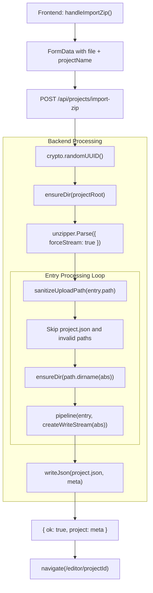
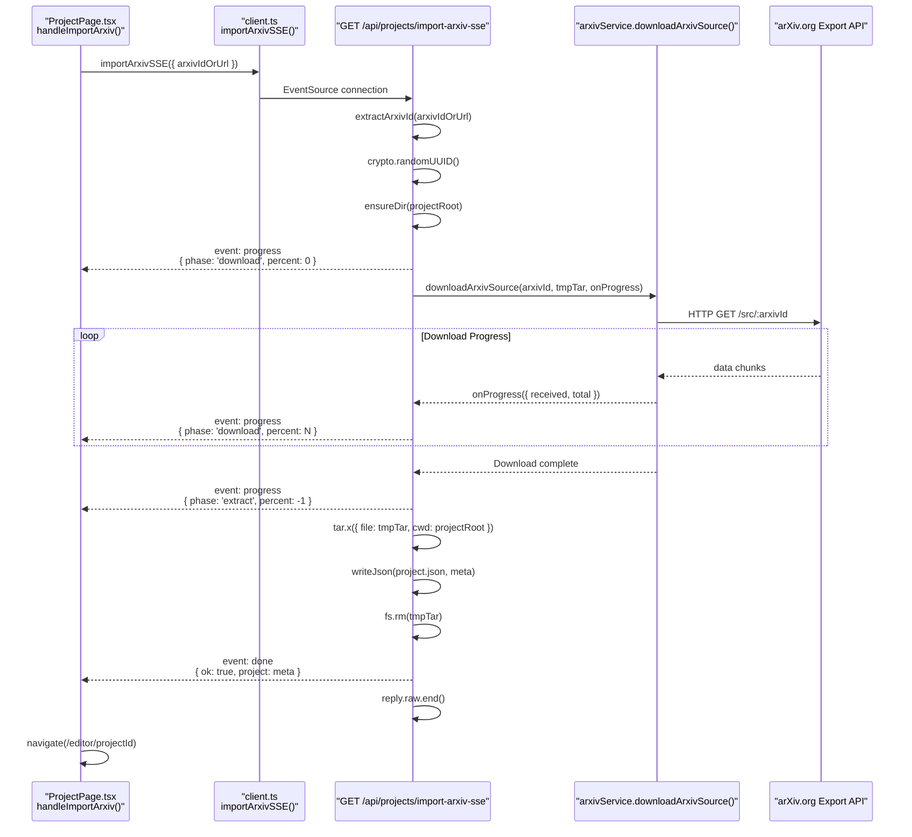
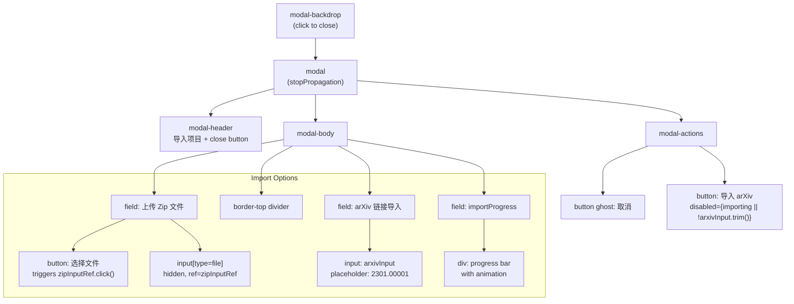

<!-- source: DeepWiki mcp.deepwiki.com · repo OpenDCAI/OpenPrism · page 6.13 Project Import · fetched 2026-11-02 -->

# Project Import

<details>
<summary>Relevant source files</summary>

The following files were used as context for generating this wiki page:

- [apps/backend/src/routes/projects.js](apps/backend/src/routes/projects.js)
- [apps/frontend/src/app/ProjectPage.tsx](apps/frontend/src/app/ProjectPage.tsx)

</details>


## Purpose and Scope

This document describes the Project Import feature in OpenPrism, which enables users to bring external LaTeX projects into the system through two mechanisms: ZIP file upload and arXiv paper import. The import process creates new projects with unique identifiers, extracts or downloads source files, and initializes project metadata.

For information about general project management operations (creation, deletion, archiving), see [Project Management API](#5.1). For details about the arXiv integration service, see [arXiv Integration](#5.6). For the user interface that manages projects, see [Project Management Interface](#4.2).

---

## Overview

OpenPrism provides two distinct import workflows:

| Import Method | Use Case | Progress Tracking | API Endpoint |
|--------------|----------|-------------------|--------------|
| **ZIP Import** | Upload local LaTeX project archives | None (synchronous) | `POST /api/projects/import-zip` |
| **arXiv Import** | Download published papers from arXiv | Server-Sent Events (SSE) | `GET /api/projects/import-arxiv-sse` |

Both methods create a new project directory under `DATA_DIR` with a UUID identifier, extract the project files, and generate a `project.json` metadata file. The key difference is that ZIP import is a direct multipart file upload, while arXiv import streams progress updates to the client during the download and extraction phases.

**Sources:** [apps/backend/src/routes/projects.js:56-167]()

---

## ZIP Import Process

### Backend Implementation

The ZIP import endpoint accepts multipart form data with two fields:
- `projectName` (optional): Custom name for the imported project
- A file field containing the ZIP archive

**ZIP Import Data Flow:**



**Sources:** [apps/backend/src/routes/projects.js:56-103](), [apps/frontend/src/app/ProjectPage.tsx:263-278]()

### Key Implementation Details

The backend processes the ZIP archive as a stream using the `unzipper` library:

1. **Multipart Parsing**: Iterates through `req.parts()` to extract form fields and file streams [apps/backend/src/routes/projects.js:66-72]()
2. **Path Sanitization**: Calls `sanitizeUploadPath(entry.path)` to prevent directory traversal attacks [apps/backend/src/routes/projects.js:76]()
3. **project.json Exclusion**: Skips any existing `project.json` file to prevent metadata conflicts [apps/backend/src/routes/projects.js:77-80]()
4. **Directory Handling**: Creates directories using `ensureDir(abs)` for directory entries [apps/backend/src/routes/projects.js:82-85]()
5. **File Streaming**: Uses `pipeline(entry, createWriteStream(abs))` for memory-efficient file writing [apps/backend/src/routes/projects.js:88]()

If extraction fails, the entire project directory is removed with `fs.rm(projectRoot, { recursive: true, force: true })` to maintain consistency [apps/backend/src/routes/projects.js:92]().

**Sources:** [apps/backend/src/routes/projects.js:56-103]()

### Error Handling

ZIP import uses internationalized error messages through the `t()` function:

```javascript
// Error response structure
return { ok: false, error: t(lang, 'zip_extract_failed', { error: String(err) }) };
```

The frontend displays errors in the status bar: `t('Zip 导入失败: {{error}}', { error: String(err) })` [apps/frontend/src/app/ProjectPage.tsx:274]().

**Sources:** [apps/backend/src/routes/projects.js:93](), [apps/frontend/src/app/ProjectPage.tsx:263-278]()

---

## arXiv Import Process

### Server-Sent Events (SSE) Architecture

The arXiv import uses Server-Sent Events to provide real-time progress updates during the multi-phase download and extraction process. This is critical for large papers (can be 100+ MB) to prevent client timeouts and provide user feedback.

**arXiv Import SSE Flow:**



**Sources:** [apps/backend/src/routes/projects.js:105-167](), [apps/frontend/src/app/ProjectPage.tsx:280-305]()

### Backend SSE Implementation

The SSE endpoint sets specific headers to establish a persistent connection:

```javascript
reply.raw.writeHead(200, {
  'Content-Type': 'text/event-stream',
  'Cache-Control': 'no-cache',
  Connection: 'keep-alive'
});
```

Events are sent using a helper function that formats SSE protocol messages [apps/backend/src/routes/projects.js:117-119]():

```javascript
const send = (event, data) => {
  reply.raw.write(`event: ${event}\ndata: ${JSON.stringify(data)}\n\n`);
};
```

**Sources:** [apps/backend/src/routes/projects.js:105-167]()

### Event Types

| Event Type | Data Structure | Purpose |
|-----------|----------------|---------|
| `progress` | `{ phase: 'download', percent: number, received?: number, total?: number }` | Download progress with percentage |
| `progress` | `{ phase: 'extract', percent: -1 }` | Extraction phase (indeterminate) |
| `done` | `{ ok: true, project: ProjectMeta }` | Successful completion |
| `error` | `{ error: string }` | Failure message |

The frontend receives these events through the `importArxivSSE()` client function, which wraps the EventSource API and calls a progress callback [apps/frontend/src/app/ProjectPage.tsx:288-290]().

**Sources:** [apps/backend/src/routes/projects.js:138-164](), [apps/frontend/src/app/ProjectPage.tsx:280-305]()

### Tar Archive Extraction

After downloading, the `.tar.gz` archive is extracted using the `tar` library with a security filter:

```javascript
await tar.x({
  file: tmpTar,
  cwd: projectRoot,
  filter: (entryPath) => {
    if (!entryPath) return false;
    if (path.isAbsolute(entryPath)) return false;
    return !entryPath.split('/').some((part) => part === '..');
  }
});
```

This filter prevents:
- Absolute path entries that could write outside the project directory
- Path traversal using `..` segments

**Sources:** [apps/backend/src/routes/projects.js:145-153]()

### Cleanup and Error Recovery

The implementation includes robust cleanup:

1. **Temporary file removal**: Always removes `tmpTar` in the `finally` block [apps/backend/src/routes/projects.js:160]()
2. **Project directory rollback**: On error, removes the entire project directory [apps/backend/src/routes/projects.js:155]()
3. **Error events**: Sends internationalized error messages through SSE before closing the connection [apps/backend/src/routes/projects.js:156-158]()

**Sources:** [apps/backend/src/routes/projects.js:154-161]()

---

## Frontend Import Interface

### Import Modal Structure

The import modal provides a unified interface for both import methods within a single dialog:

**Import Modal Component Structure:**



**Sources:** [apps/frontend/src/app/ProjectPage.tsx:650-723]()

### State Management

The import modal manages several pieces of React state:

| State Variable | Type | Purpose |
|---------------|------|---------|
| `importOpen` | `boolean` | Controls modal visibility |
| `arxivInput` | `string` | Stores user-entered arXiv ID or URL |
| `importing` | `boolean` | Disables UI during import operations |
| `importProgress` | `{ phase: string; percent: number } \| null` | Stores SSE progress data |
| `zipInputRef` | `React.RefObject<HTMLInputElement>` | References hidden file input |

**Sources:** [apps/frontend/src/app/ProjectPage.tsx:53-57]()

### ZIP Import Interaction

The ZIP import uses a hidden file input pattern:

1. **Hidden input**: A file input is rendered with `display: none` [apps/frontend/src/app/ProjectPage.tsx:585-599]()
2. **Button trigger**: Clicking the visible button triggers `zipInputRef.current?.click()` [apps/frontend/src/app/ProjectPage.tsx:663]()
3. **File selection**: On `onChange`, the selected file is passed to `handleImportZip(file)` [apps/frontend/src/app/ProjectPage.tsx:590-597]()
4. **Cleanup**: The input value is reset after handling to allow re-selection of the same file [apps/frontend/src/app/ProjectPage.tsx:595-597]()

**Sources:** [apps/frontend/src/app/ProjectPage.tsx:585-669]()

### Progress Bar Rendering

The progress bar has two rendering modes:

**Determinate Progress (Download):**
```javascript
<div style={{
  width: importProgress.percent >= 0 ? `${importProgress.percent}%` : '100%',
  height: '100%',
  background: 'var(--accent, #4a90d9)',
  transition: 'width 0.3s ease'
}} />
```

**Indeterminate Progress (Extraction):**
```javascript
animation: importProgress.percent < 0 ? 'indeterminate 1.5s infinite linear' : undefined
```

The label dynamically updates based on phase and progress:
- Download with percentage: `t('下载中... {{percent}}%', { percent: importProgress.percent })`
- Download without percentage: `t('下载中...')`
- Extraction: `t('解压中...')`

**Sources:** [apps/frontend/src/app/ProjectPage.tsx:686-712]()

### Keyboard Shortcuts

The arXiv input supports Enter key submission:

```javascript
onKeyDown={(event) => {
  if (event.key === 'Enter') {
    event.preventDefault();
    handleImportArxiv();
  }
}}
```

This allows users to paste an arXiv URL and immediately press Enter to start the import.

**Sources:** [apps/frontend/src/app/ProjectPage.tsx:678-683]()

---

## API Client Integration

### importZip Function

The `importZip()` function constructs a multipart form data payload:

```javascript
export async function importZip({ file, projectName }: { 
  file: File; 
  projectName?: string 
}): Promise<{ ok: boolean; error?: string; project?: ProjectMeta }> {
  const formData = new FormData();
  formData.append('file', file);
  if (projectName) formData.append('projectName', projectName);
  
  const res = await fetch(`${API_BASE}/projects/import-zip`, {
    method: 'POST',
    body: formData
  });
  return await res.json();
}
```

The function name defaults to the file name with `.zip` extension removed: `file.name.replace(/\.zip$/i, '')` [apps/frontend/src/app/ProjectPage.tsx:266]().

**Sources:** [apps/frontend/src/api/client.ts]()

### importArxivSSE Function

The `importArxivSSE()` function wraps the EventSource API for type-safe progress callbacks:

```javascript
export function importArxivSSE(
  { arxivIdOrUrl, projectName }: { arxivIdOrUrl: string; projectName?: string },
  onProgress: (progress: { phase: string; percent: number }) => void
): Promise<{ ok: boolean; error?: string; project?: ProjectMeta }> {
  return new Promise((resolve, reject) => {
    const url = new URL(`${API_BASE}/projects/import-arxiv-sse`);
    url.searchParams.set('arxivIdOrUrl', arxivIdOrUrl);
    if (projectName) url.searchParams.set('projectName', projectName);
    
    const eventSource = new EventSource(url.toString());
    
    eventSource.addEventListener('progress', (event) => {
      const data = JSON.parse(event.data);
      onProgress(data);
    });
    
    eventSource.addEventListener('done', (event) => {
      const data = JSON.parse(event.data);
      eventSource.close();
      resolve(data);
    });
    
    eventSource.addEventListener('error', (event) => {
      const data = JSON.parse(event.data);
      eventSource.close();
      reject(new Error(data.error));
    });
  });
}
```

**Sources:** [apps/frontend/src/api/client.ts]()

---

## Post-Import Project Structure

After successful import, the project directory structure follows this pattern:

```
DATA_DIR/
  └── {uuid}/
      ├── project.json          # Generated metadata
      ├── main.tex              # Typical main file (varies by source)
      ├── sections/             # Extracted directories
      │   └── ...
      ├── figures/              # Extracted assets
      │   └── ...
      └── ...                   # All other extracted files
```

### Generated Metadata

Both import methods create a minimal `project.json` with these fields:

| Field | Type | Source |
|-------|------|--------|
| `id` | `string` | `crypto.randomUUID()` |
| `name` | `string` | User input or arXiv ID (e.g., `arxiv-2301.00001`) |
| `createdAt` | `string` | `new Date().toISOString()` |

ZIP import: [apps/backend/src/routes/projects.js:100-101]()  
arXiv import: [apps/backend/src/routes/projects.js:130-134]()

Additional fields like `updatedAt`, `tags`, `archived`, and `trashed` are added on first modification [apps/backend/src/routes/projects.js:26-32]().

**Sources:** [apps/backend/src/routes/projects.js:100-101, 130-134]()

### Navigation After Import

Both import workflows navigate to the editor upon success:

```javascript
navigate(`/editor/${res.project.id}`);
```

This immediately opens the imported project in the editor workspace, allowing users to start working without returning to the project list.

**Sources:** [apps/frontend/src/app/ProjectPage.tsx:272, 298]()

---

## Security Considerations

### Path Traversal Prevention

Both import methods use `sanitizeUploadPath()` and `safeJoin()` utilities to prevent directory traversal attacks:

- **ZIP Import**: `sanitizeUploadPath(entry.path)` filters malicious paths [apps/backend/src/routes/projects.js:76]()
- **arXiv Import**: `tar.x()` filter rejects absolute paths and `..` segments [apps/backend/src/routes/projects.js:148-152]()

These checks prevent attackers from writing files outside the project directory, which could otherwise overwrite system files or access sensitive data.

**Sources:** [apps/backend/src/routes/projects.js:76, 148-152](), [apps/backend/src/utils/pathUtils.js]()

### Metadata Isolation

Both import methods explicitly skip or overwrite any existing `project.json` file in the imported archive:

- **ZIP Import**: Skips entries where `relPath.endsWith('project.json')` [apps/backend/src/routes/projects.js:77-80]()
- **Both methods**: Generate fresh metadata after extraction [apps/backend/src/routes/projects.js:100-101, 163]()

This prevents imported projects from specifying arbitrary project IDs, timestamps, or other metadata that could conflict with OpenPrism's internal state.

**Sources:** [apps/backend/src/routes/projects.js:77-80, 100-101, 163]()

---

## Error Scenarios and Recovery

### Common Error Cases

| Error Scenario | Detection | User Feedback | Recovery |
|---------------|-----------|---------------|----------|
| Invalid ZIP format | `unzipper.Parse()` throws | `t('zip_extract_failed')` | Project directory removed |
| Invalid arXiv ID | `extractArxivId()` returns null | `'Invalid arXiv ID.'` | No directory created |
| arXiv download failure | HTTP error or timeout | `t('arxiv_download_failed')` | Project directory removed, tmpTar cleaned |
| Network interruption | EventSource error | Connection terminated | Frontend shows error in status |
| Missing file input | `!hasZip` after parts iteration | `'Missing zip file.'` | Returns error response |

**Sources:** [apps/backend/src/routes/projects.js:91-94, 121-125, 154-161]()

### Rollback Mechanism

Both import methods implement atomic rollback on failure:

```javascript
try {
  // Import operations...
} catch (err) {
  await fs.rm(projectRoot, { recursive: true, force: true });
  // Send error response...
}
```

This ensures no partial projects are left in the system if import fails midway through extraction or download.

**Sources:** [apps/backend/src/routes/projects.js:92, 155]()

---

