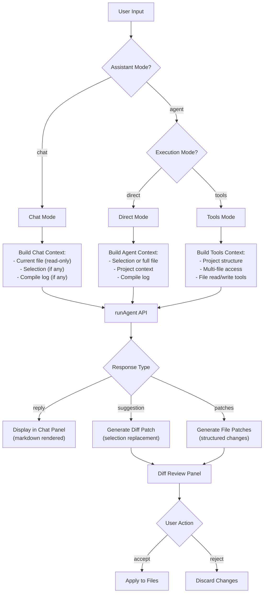

<!-- source: DeepWiki mcp.deepwiki.com · repo OpenDCAI/OpenPrism · page 6.2 AI Assistant Modes · fetched 2026-11-02 -->

# AI Assistant Modes

<details>
<summary>Relevant source files</summary>

The following files were used as context for generating this wiki page:

- [README.md](README.md)
- [README_ZH.md](README_ZH.md)
- [apps/frontend/src/app/EditorPage.tsx](apps/frontend/src/app/EditorPage.tsx)

</details>


## Purpose and Scope

This document describes the AI assistant execution modes in OpenPrism: **Chat**, **Agent**, and **Tools**. These modes determine how user requests are processed, what context is provided to the LLM, and how responses are applied to project files. 

For information about the underlying LLM service integration, see [AI Agent Service](#5.3). For details on inline autocompletion (separate from these modes), see [AI Autocomplete](#6.3). For the diff review workflow used by Agent mode, see [Diff Viewer](#6.6).

---

## Mode Overview

OpenPrism provides three distinct interaction patterns for AI assistance, each with different capabilities and constraints:

| Mode | File Modifications | Multi-turn | Tool Access | Use Case |
|------|-------------------|------------|-------------|----------|
| **Chat** | No (read-only) | Yes | No | Q&A, explanations, suggestions |
| **Agent (Direct)** | Yes (via diff) | No | No | Single-file edits, polish, rewrite |
| **Agent (Tools)** | Yes (via diff) | Yes | Yes | Multi-file operations, complex refactoring |

The mode is selected through the sidebar UI in [apps/frontend/src/app/EditorPage.tsx:3576-3596](). The `assistantMode` state variable toggles between `'chat'` and `'agent'`, while the `mode` state variable selects between `'direct'` and `'tools'` for agent operations.

**Sources:** [apps/frontend/src/app/EditorPage.tsx:1111-1116](), [README.md:67-73]()

---

## Mode Architecture



**Diagram: AI Assistant Mode Selection and Execution Flow**

**Sources:** [apps/frontend/src/app/EditorPage.tsx:3083-3175](), [apps/frontend/src/app/EditorPage.tsx:3576-3819]()

---

## Chat Mode

### Behavior

Chat mode provides **read-only** conversational assistance. The LLM has access to the current file content, any selected text, and compilation logs, but **cannot modify files**. This mode is useful for:

- Asking questions about LaTeX syntax
- Getting explanations of document structure
- Requesting suggestions without automatic application
- Debugging compilation errors

### Implementation

Chat mode is activated when `assistantMode === 'chat'` in [apps/frontend/src/app/EditorPage.tsx:3084](). The message history is stored in the `chatMessages` state array [apps/frontend/src/app/EditorPage.tsx:1112](). 

When a prompt is sent, the `sendPrompt` function [apps/frontend/src/app/EditorPage.tsx:3083-3175]() builds context:

```typescript
const effectiveMode = mode;  // Always 'direct' for chat
const interaction = isChat ? 'chat' : 'agent';
```

The API call to `runAgent` includes `interaction: 'chat'`, which instructs the backend to return only conversational replies without file modifications [apps/frontend/src/app/EditorPage.tsx:3148]().

### Context Provided

Chat mode provides three types of context:

1. **Current file content**: The full text of `editorValue` [apps/frontend/src/app/EditorPage.tsx:3100]()
2. **Selection**: If text is selected, `selectionText` is included [apps/frontend/src/app/EditorPage.tsx:3099]()
3. **Compile log**: If available, `compileLog` provides error context [apps/frontend/src/app/EditorPage.tsx:3147]()

The UI displays active context tags in [apps/frontend/src/app/EditorPage.tsx:3597-3602]():

```xml
<div className="context-tags">
  <span className="context-tag">{t('只读当前文件')}</span>
  {selectionText && <span className="context-tag">{t('只读选区')}</span>}
  {compileLog && <span className="context-tag">{t('只读编译日志')}</span>}
</div>
```

### Response Handling

Chat responses are rendered as Markdown using `react-markdown` with GFM (GitHub Flavored Markdown) support [apps/frontend/src/app/EditorPage.tsx:3614-3620]():

```jsx
{msg.role === 'assistant' ? (
  <ReactMarkdown remarkPlugins={[remarkGfm]}>{msg.content}</ReactMarkdown>
) : (
  msg.content
)}
```

Messages are displayed with a typewriter effect via `startTypewriter` [apps/frontend/src/app/EditorPage.tsx:3039-3073](), which progressively reveals characters at 16ms intervals.

**Sources:** [apps/frontend/src/app/EditorPage.tsx:3083-3175](), [apps/frontend/src/app/EditorPage.tsx:3597-3622](), [apps/frontend/src/app/EditorPage.tsx:3039-3073]()

---

## Agent Mode: Direct

### Behavior

Direct mode executes a **single-shot** LLM call without tool access. The model receives the full context in one request and must generate a complete response. This mode is efficient for:

- Polishing a paragraph
- Rewriting a section
- Translating text
- Applying style adjustments

Direct mode **can modify files**, but only through a single suggestion or patch that the user reviews in the diff panel.

### Implementation

Direct mode is selected when `assistantMode === 'agent'` and `mode === 'direct'` [apps/frontend/src/app/EditorPage.tsx:1116](). The mode dropdown UI is in [apps/frontend/src/app/EditorPage.tsx:3664-3709]().

The key difference from chat is that `interaction: 'agent'` is passed to `runAgent` [apps/frontend/src/app/EditorPage.tsx:3148](), signaling the backend to expect file modification requests.

### Context Building

Direct mode builds **project context** by traversing included files. The `buildProjectContext` function [apps/frontend/src/app/EditorPage.tsx:1800-1835]() performs a breadth-first search starting from `mainFile`:

1. Parse `\input` and `\include` directives from each `.tex` file
2. Extract section headings via `parseOutline` [apps/frontend/src/app/EditorPage.tsx:438-460]()
3. Build a hierarchical summary of the project structure
4. Return formatted context string

This context is appended to the user prompt [apps/frontend/src/app/EditorPage.tsx:3130-3135]():

```typescript
const context = await buildProjectContext();
if (context) {
  effectivePrompt = `${effectivePrompt}\n\n[Project Context]\n${context}`;
}
```

### Response Types

Direct mode responses come in two forms:

**1. Suggestion (inline replacement)**

If the response contains a `suggestion` field, it replaces the selected text [apps/frontend/src/app/EditorPage.tsx:3164-3171]():

```typescript
const proposed = selectionText
  ? replaceSelection(editorValue, selectionRange[0], selectionRange[1], res.suggestion)
  : res.suggestion;
const diff = createTwoFilesPatch(activePath, activePath, editorValue, proposed, 'current', 'suggested');
setPendingChanges([{ filePath: activePath, original: editorValue, proposed, diff }]);
```

**2. Patches (structured file changes)**

If the response contains a `patches` array, each patch specifies a file and its new content [apps/frontend/src/app/EditorPage.tsx:3155-3163]():

```typescript
const nextPending = res.patches.map((patch) => ({
  filePath: patch.path,
  original: files[patch.path] ?? '',
  proposed: patch.content,
  diff: patch.diff
}));
setPendingChanges(nextPending);
```

Both response types trigger the diff viewer by setting `setRightView('diff')` [apps/frontend/src/app/EditorPage.tsx:3163]().

**Sources:** [apps/frontend/src/app/EditorPage.tsx:3083-3175](), [apps/frontend/src/app/EditorPage.tsx:1800-1835](), [apps/frontend/src/app/EditorPage.tsx:438-460]()

---

## Agent Mode: Tools

### Behavior

Tools mode enables **multi-turn execution** where the LLM can invoke file operations mid-conversation. This allows:

- Reading additional files during execution
- Making changes to multiple files
- Iterative refinement based on intermediate results
- Complex operations like cross-file refactoring

The backend's Agent Service (see [AI Agent Service](#5.3)) provides tool functions that the LLM can call, such as `read_file`, `write_file`, and `list_files`.

### Implementation

Tools mode is activated when `assistantMode === 'agent'` and `mode === 'tools'` [apps/frontend/src/app/EditorPage.tsx:1116](). The mode is passed directly to the `runAgent` API call [apps/frontend/src/app/EditorPage.tsx:3143]():

```typescript
const res = await runAgent({
  task: effectiveTask,
  prompt: effectivePrompt,
  selection: effectiveSelection,
  content: effectiveContent,
  mode: isChat ? 'direct' : effectiveMode,  // 'tools' here
  projectId,
  activePath,
  compileLog,
  llmConfig: effectiveLlmConfig,
  interaction: isChat ? 'chat' : 'agent',
  history: nextHistory.slice(-8)
});
```

### Tool Execution Flow

```mermaid
sequenceDiagram
    participant User
    participant Frontend
    participant Backend["Agent Service<br/>(Backend)"]
    participant LLM
    participant FileSystem

    User->>Frontend: "Translate all .tex files"
    Frontend->>Frontend: "buildProjectContext()<br/>(file tree summary)"
    Frontend->>Backend: "POST /api/agent/run<br/>mode: tools"
    Backend->>LLM: "Initial prompt + tools schema"
    
    LLM->>Backend: "tool_call: list_files"
    Backend->>FileSystem: "Read project files"
    FileSystem-->>Backend: "File list"
    Backend->>LLM: "tool_result: [files...]"
    
    LLM->>Backend: "tool_call: read_file('intro.tex')"
    Backend->>FileSystem: "Read intro.tex"
    FileSystem-->>Backend: "File content"
    Backend->>LLM: "tool_result: content"
    
    LLM->>Backend: "tool_call: write_file('intro.tex', translated)"
    Backend->>FileSystem: "Write translated content"
    FileSystem-->>Backend: "Success"
    Backend->>LLM: "tool_result: ok"
    
    LLM-->>Backend: "Final response + patches"
    Backend-->>Frontend: "response.patches: [{path, content, diff}]"
    Frontend->>User: "Show diff review panel"
```

**Diagram: Tools Mode Multi-turn Execution**

The backend handles tool calls internally, so the frontend receives only the final result with patches. The number of turns is limited by the backend's execution logic in the Agent Service.

### Automatic Mode Selection

Certain tasks automatically force tools mode regardless of user selection. This happens in the `sendPrompt` function [apps/frontend/src/app/EditorPage.tsx:3106-3128]():

**Translation with project scope:**

```typescript
if (translateScope === 'project') {
  effectiveMode = 'tools';
  effectiveSelection = '';
  effectiveContent = '';
  effectivePrompt = t('Translate all .tex files in the project to {{target}}...', 
                      { target: translateTarget, note });
}
```

**Web search task:**

```typescript
if (!isChat && task === 'websearch') {
  effectiveMode = 'tools';
  effectiveSelection = '';
  effectiveContent = '';
  effectivePrompt = prompt
    ? t('Search arXiv and return 3-5 relevant papers...')
    : t('Search arXiv and return 3-5 relevant papers...');
}
```

This ensures operations that require file traversal or external API calls have the necessary capabilities.

**Sources:** [apps/frontend/src/app/EditorPage.tsx:3083-3175](), [apps/frontend/src/app/EditorPage.tsx:3106-3128]()

---

## Task Types

### Available Tasks

Tasks define the **intent** of the AI operation and shape the system prompt sent to the LLM. They are defined in `DEFAULT_TASKS` [apps/frontend/src/app/EditorPage.tsx:82-89]():

| Task Value | Label | Typical Mode | Description |
|-----------|-------|--------------|-------------|
| `polish` | 润色 | Direct | Improve writing quality, fix grammar |
| `rewrite` | 改写 | Direct | Restructure content, alternative phrasing |
| `structure` | 结构调整 | Direct/Tools | Reorganize sections, improve flow |
| `translate` | 翻译 | Direct/Tools | Convert text to target language |
| `websearch` | 检索 (arXiv) | Tools | Search papers, fetch BibTeX |
| `custom` | 自定义 | Direct/Tools | User-defined task via prompt |

### Task-Specific Behavior

**Translation Task**

When `task === 'translate'` [apps/frontend/src/app/EditorPage.tsx:3086-3117](), the UI shows scope and target language selectors:

```typescript
// Scope dropdown in UI at line 3724-3765
<div className="ios-select-wrapper">
  <button className="ios-select-trigger" onClick={() => { ... }}>
    <span>
      {translateScope === 'selection' ? t('选区') : 
       translateScope === 'file' ? t('当前文件') : t('整个项目')}
    </span>
  </button>
  {translateScopeDropdownOpen && (
    <div className="ios-dropdown">
      {[
        { value: 'selection', label: t('选区') },
        { value: 'file', label: t('当前文件') },
        { value: 'project', label: t('整个项目') }
      ].map((item) => ( ... ))}
    </div>
  )}
</div>
```

The prompt is constructed based on scope [apps/frontend/src/app/EditorPage.tsx:3105-3117]():

- **Selection**: `"Translate the selected text to {{target}}. Preserve LaTeX commands..."`
- **File**: `"Translate the current file to {{target}}. Preserve LaTeX commands..."`
- **Project**: `"Translate all .tex files in the project to {{target}}..."` (forces `mode: 'tools'`)

**Web Search Task**

The `websearch` task [apps/frontend/src/app/EditorPage.tsx:3120-3128]() always uses tools mode and a specialized LLM config (`searchLlmConfig`) that may have different endpoint/model settings. This allows using a cheaper/faster model for search tasks.

### Task Selection UI

The task dropdown is rendered in [apps/frontend/src/app/EditorPage.tsx:3628-3661]():

```jsx
<div className="ios-select-wrapper">
  <button className="ios-select-trigger" onClick={() => { setTaskDropdownOpen(!taskDropdownOpen); }}>
    <span>{DEFAULT_TASKS(t).find((item) => item.value === task)?.label || t('选择任务')}</span>
    <svg width="12" height="12" viewBox="0 0 12 12" fill="none" 
         className={taskDropdownOpen ? 'rotate' : ''}>
      <path d="M3 7L6 4L9 7" stroke="currentColor" strokeWidth="1.5" 
            strokeLinecap="round" strokeLinejoin="round"/>
    </svg>
  </button>
  {taskDropdownOpen && (
    <div className="ios-dropdown">
      {DEFAULT_TASKS(t).map((item) => (
        <div key={item.value} className={`ios-dropdown-item ${task === item.value ? 'active' : ''}`}
             onClick={() => { setTask(item.value); setTaskDropdownOpen(false); }}>
          {item.label}
          {task === item.value && ( /* checkmark SVG */ )}
        </div>
      ))}
    </div>
  )}
</div>
```

**Sources:** [apps/frontend/src/app/EditorPage.tsx:82-89](), [apps/frontend/src/app/EditorPage.tsx:3086-3128](), [apps/frontend/src/app/EditorPage.tsx:3628-3661]()

---

## Message History and Context

### History Management

Both chat and agent modes maintain **separate message histories**:

- **Chat**: `chatMessages` state [apps/frontend/src/app/EditorPage.tsx:1112]()
- **Agent**: `agentMessages` state [apps/frontend/src/app/EditorPage.tsx:1113]()

When a prompt is sent, the user message is appended to the appropriate history [apps/frontend/src/app/EditorPage.tsx:3092-3096]():

```typescript
const userMsg: Message = { role: 'user', content: prompt || t('(empty)') };
const setHistory = isChat ? setChatMessages : setAgentMessages;
const history = isChat ? chatMessages : agentMessages;
const nextHistory = [...history, userMsg];
setHistory(nextHistory);
```

The last **8 messages** are sent to the API for context [apps/frontend/src/app/EditorPage.tsx:3149]():

```typescript
history: nextHistory.slice(-8)
```

This prevents token limit issues while maintaining conversational continuity.

### Context Hierarchy

The LLM receives context in the following order of precedence:

1. **Task-specific instructions**: Generated based on `task` value
2. **User prompt**: Direct user input from the textarea
3. **Project context**: File structure and outlines (Agent mode only)
4. **Selection/Content**: Current file or selected text
5. **Compile log**: If available and relevant
6. **Message history**: Previous conversation turns (last 8)

This is assembled in [apps/frontend/src/app/EditorPage.tsx:3098-3149]():

```typescript
let effectivePrompt = prompt;
let effectiveSelection = selectionText;
let effectiveContent = editorValue;

// Task-specific modifications
if (!isChat && task === 'translate') {
  // ... modify prompt based on translateScope
}

if (!isChat && task === 'websearch') {
  // ... modify prompt for search
}

// Add project context
if (!isChat && effectiveTask !== 'websearch') {
  const context = await buildProjectContext();
  if (context) {
    effectivePrompt = `${effectivePrompt}\n\n[Project Context]\n${context}`;
  }
}

// Send to API
const res = await runAgent({
  task: effectiveTask,
  prompt: effectivePrompt,
  selection: effectiveSelection,
  content: effectiveContent,
  mode: isChat ? 'direct' : effectiveMode,
  projectId,
  activePath,
  compileLog,
  llmConfig: effectiveLlmConfig,
  interaction: isChat ? 'chat' : 'agent',
  history: nextHistory.slice(-8)
});
```

**Sources:** [apps/frontend/src/app/EditorPage.tsx:3092-3149](), [apps/frontend/src/app/EditorPage.tsx:1112-1113]()

---

## Diff Review and Application

### Pending Changes Structure

When Agent mode (Direct or Tools) generates file modifications, they are stored in the `pendingChanges` state [apps/frontend/src/app/EditorPage.tsx:1135](). Each change has:

```typescript
interface PendingChange {
  filePath: string;     // Target file
  original: string;     // Original content
  proposed: string;     // Modified content
  diff: string;        // Unified diff format
}
```

The diff is generated using the `diff` library's `createTwoFilesPatch` function [apps/frontend/src/app/EditorPage.tsx:3168]():

```typescript
const diff = createTwoFilesPatch(
  activePath, 
  activePath, 
  editorValue, 
  proposed, 
  'current', 
  'suggested'
);
```

### Split Diff Display

Pending changes are displayed in a **split diff viewer** in the right panel when `rightView === 'diff'` [apps/frontend/src/app/EditorPage.tsx:3162](). The `buildSplitDiff` function [apps/frontend/src/app/EditorPage.tsx:732-767]() converts line-by-line differences into a two-column layout:

```typescript
function buildSplitDiff(original: string, proposed: string) {
  const parts = diffLines(original, proposed);
  let leftLine = 1;
  let rightLine = 1;
  const rows: {
    left?: string;
    right?: string;
    leftNo?: number;
    rightNo?: number;
    type: 'context' | 'added' | 'removed';
  }[] = [];

  parts.forEach((part) => {
    const lines = part.value.split('\n');
    // ... populate rows with line numbers and content
  });

  return rows;
}
```

The `SplitDiffView` component [apps/frontend/src/app/EditorPage.tsx:834-880]() renders this with synchronized scrolling between left (before) and right (after) columns.

### Applying Changes

Users can apply changes **individually** or **all at once**. The `applyPending` function [apps/frontend/src/app/EditorPage.tsx:3223-3242]() handles both:

```typescript
const applyPending = async (change?: PendingChange) => {
  const list = change ? [change] : pendingChanges;  // Single or all
  for (const item of list) {
    await writeFile(projectId, item.filePath, item.proposed);
    setFiles((prev) => ({ ...prev, [item.filePath]: item.proposed }));
    if (activePath === item.filePath) {
      setEditorDoc(item.proposed);
    }
  }
  // ... cleanup pending state
  setStatus(t('已应用修改'));
};
```

The UI provides "Apply" and "Discard" buttons in the diff panel (implementation varies by whether a specific change is focused).

**Sources:** [apps/frontend/src/app/EditorPage.tsx:732-767](), [apps/frontend/src/app/EditorPage.tsx:834-880](), [apps/frontend/src/app/EditorPage.tsx:3223-3254](), [apps/frontend/src/app/EditorPage.tsx:56-61]()

---

## Special Operations

### Compile Diagnostics

The `diagnoseCompile` function [apps/frontend/src/app/EditorPage.tsx:3177-3221]() is a specialized Agent operation that analyzes compilation errors:

```typescript
const diagnoseCompile = async () => {
  if (!compileLog) {
    setStatus(t('暂无编译日志可诊断。'));
    return;
  }
  setDiagnoseBusy(true);
  
  const res = await runAgent({
    task: 'debug_compile',
    prompt: t('基于编译日志诊断并修复错误，给出可应用的 diff。'),
    selection: compileLog,  // Compile log as selection
    content: editorValue,
    mode: 'tools',
    projectId,
    activePath,
    compileLog,
    llmConfig,
    interaction: 'agent',
    history: nextHistory.slice(-8)
  });
  
  // ... generate patches for diff review
};
```

This operation:
1. Uses tools mode for multi-file error fixes
2. Provides the compile log as the "selection"
3. Passes the current file content for context
4. Generates patches that appear in the diff viewer

The "One-Click Diagnose" button triggers this from the compile log panel.

### Citation Insertion

For arXiv search results, Agent mode can automatically insert citations into a target file [apps/frontend/src/app/EditorPage.tsx:1997-2036](). This uses tools mode to:

1. Locate or create a "Related Work" section
2. Insert `\cite{}` commands with appropriate keys
3. Preserve document structure and formatting

The operation is triggered when `autoInsertToMain === true` after applying BibTeX entries [apps/frontend/src/app/EditorPage.tsx:1984]().

**Sources:** [apps/frontend/src/app/EditorPage.tsx:3177-3221](), [apps/frontend/src/app/EditorPage.tsx:1997-2036]()

---

## Configuration

### LLM Endpoints

The system supports **three separate LLM configurations** for different operations:

| Config | Use Case | State Variables | Default Fallback |
|--------|----------|-----------------|------------------|
| `llmConfig` | Chat, Agent, Autocomplete | `llmEndpoint`, `llmApiKey`, `llmModel` | Primary LLM |
| `searchLlmConfig` | Web search, arXiv search | `searchEndpoint`, `searchApiKey`, `searchModel` | Falls back to `llmConfig` |
| `visionLlmConfig` | Image OCR | `visionEndpoint`, `visionApiKey`, `visionModel` | Falls back to `llmConfig` |

These are computed as memoized values [apps/frontend/src/app/EditorPage.tsx:1253-1278]():

```typescript
const llmConfig = useMemo(
  () => ({
    endpoint: llmEndpoint,
    apiKey: llmApiKey || undefined,
    model: llmModel
  }),
  [llmEndpoint, llmApiKey, llmModel]
);

const searchLlmConfig = useMemo(() => {
  const hasOverride = Boolean(searchEndpoint || searchApiKey || searchModel);
  return {
    endpoint: (hasOverride ? searchEndpoint : llmEndpoint) || llmEndpoint,
    apiKey: (hasOverride ? searchApiKey : llmApiKey) || undefined,
    model: (hasOverride ? searchModel : llmModel) || llmModel
  };
}, [llmEndpoint, llmApiKey, llmModel, searchEndpoint, searchApiKey, searchModel]);
```

This allows using different models (e.g., GPT-4 for writing, GPT-3.5 for search) to optimize cost/quality tradeoffs.

### Settings Persistence

Settings are stored in browser `localStorage` under the key `'openprism-settings-v1'` [apps/frontend/src/app/EditorPage.tsx:100](). The `loadSettings` and `persistSettings` functions [apps/frontend/src/app/EditorPage.tsx:114-143]() handle serialization:

```typescript
function loadSettings(): AppSettings {
  try {
    const raw = window.localStorage.getItem(SETTINGS_KEY);
    if (!raw) return DEFAULT_SETTINGS;
    const parsed = JSON.parse(raw) as Partial<AppSettings>;
    // ... validation and merging
    return { ...DEFAULT_SETTINGS, ...parsed, compileEngine };
  } catch {
    return DEFAULT_SETTINGS;
  }
}
```

Settings are persisted on every change via a `useEffect` hook [apps/frontend/src/app/EditorPage.tsx:1249-1251]().

**Sources:** [apps/frontend/src/app/EditorPage.tsx:1253-1278](), [apps/frontend/src/app/EditorPage.tsx:114-143](), [apps/frontend/src/app/EditorPage.tsx:100-112](), [apps/frontend/src/app/EditorPage.tsx:1249-1251]()

---

## Summary Table: Mode Comparison

| Aspect | Chat | Direct | Tools |
|--------|------|--------|-------|
| **UI State** | `assistantMode: 'chat'` | `assistantMode: 'agent'`<br/>`mode: 'direct'` | `assistantMode: 'agent'`<br/>`mode: 'tools'` |
| **API Parameter** | `interaction: 'chat'`<br/>`mode: 'direct'` | `interaction: 'agent'`<br/>`mode: 'direct'` | `interaction: 'agent'`<br/>`mode: 'tools'` |
| **Project Context** | No | Yes (via `buildProjectContext`) | Yes (via `buildProjectContext`) |
| **File Modifications** | No | Yes (single patch) | Yes (multi-file patches) |
| **LLM Turns** | 1 | 1 | Multiple |
| **Tool Access** | None | None | File operations |
| **Response Format** | `reply` (string) | `suggestion` or `patches` | `patches` (array) |
| **Diff Review** | N/A | Required | Required |
| **History Tracking** | `chatMessages` | `agentMessages` | `agentMessages` |

**Sources:** [apps/frontend/src/app/EditorPage.tsx:3083-3175](), [apps/frontend/src/app/EditorPage.tsx:1111-1116]()

---

