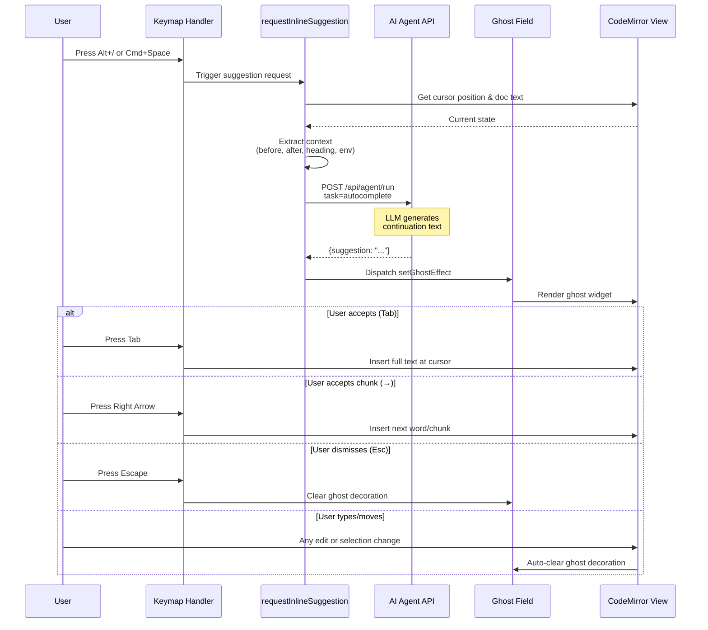
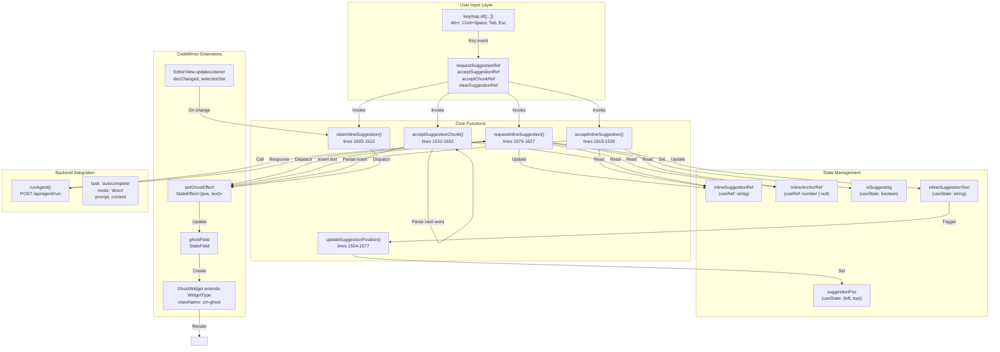
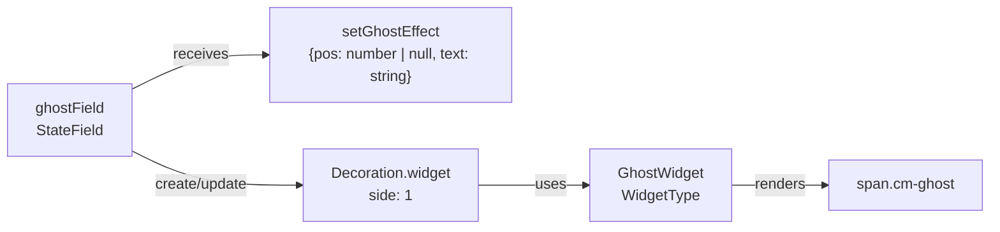

<!-- source: DeepWiki mcp.deepwiki.com · repo OpenDCAI/OpenPrism · page 6.3 AI Autocomplete · fetched 2026-11-02 -->

# AI Autocomplete

<details>
<summary>Relevant source files</summary>

The following files were used as context for generating this wiki page:

- [README.md](README.md)
- [apps/frontend/src/app/EditorPage.tsx](apps/frontend/src/app/EditorPage.tsx)

</details>


## Purpose and Scope

This page documents the AI-powered autocomplete feature in OpenPrism's LaTeX editor. AI Autocomplete provides inline, contextual text suggestions while the user is writing, allowing them to accept or reject AI-generated continuations with keyboard shortcuts. The feature uses ghost text rendering to display suggestions non-intrusively at the cursor position.

For information about other AI-assisted editing modes, see [AI Assistant Modes](#6.2). For details on the underlying agent execution system, see [AI Agent Service](#5.3).

---

## Overview

AI Autocomplete generates 1-2 paragraph continuations based on the current cursor position, surrounding context, and document structure. Unlike Agent mode (which generates diffs for review) or Chat mode (which provides conversational responses), Autocomplete provides instant inline suggestions that appear as semi-transparent "ghost text" immediately after the cursor.

The feature operates entirely within the CodeMirror editor using custom decorations and state effects, ensuring smooth integration with the editor's existing functionality.

**Key characteristics:**
- **Trigger**: `Alt+/` or `Cmd/Ctrl+Space`
- **Acceptance**: `Tab` (full suggestion) or `→` (word-by-word)
- **Dismissal**: `Escape`, typing, or cursor movement
- **Context window**: 4000 characters before cursor, 400 after
- **Response format**: Plain LaTeX text continuation

**Sources**: [README.md:73](), [README.md:200-208](), [apps/frontend/src/app/EditorPage.tsx:1579-1627]()

---

## User Interaction Flow



**Sources**: [apps/frontend/src/app/EditorPage.tsx:1365-1419](), [apps/frontend/src/app/EditorPage.tsx:1579-1627](), [apps/frontend/src/app/EditorPage.tsx:1519-1552]()

---

## Technical Architecture

The autocomplete system integrates with CodeMirror's extension system and state management. The following diagram maps the key code entities involved in the suggestion lifecycle:



**Sources**: [apps/frontend/src/app/EditorPage.tsx:651-695](), [apps/frontend/src/app/EditorPage.tsx:1108-1110](), [apps/frontend/src/app/EditorPage.tsx:1365-1419](), [apps/frontend/src/app/EditorPage.tsx:1503-1577](), [apps/frontend/src/app/EditorPage.tsx:1579-1627]()

---

## Keyboard Shortcuts

The autocomplete system registers custom keymaps within the CodeMirror editor instance:

| Shortcut | Action | Implementation |
|----------|--------|----------------|
| `Alt+/` | Trigger suggestion request | Captured by `keydown` event listener, calls `requestSuggestionRef.current()` |
| `Mod-Space` | Trigger suggestion request | CodeMirror keymap entry, calls `requestSuggestionRef.current()` |
| `Tab` | Accept full suggestion | CodeMirror keymap entry, calls `acceptSuggestionRef.current()` |
| `ArrowRight` | Accept next word/chunk | CodeMirror keymap entry with condition, calls `acceptChunkRef.current()` |
| `Escape` | Dismiss suggestion | CodeMirror keymap entry, calls `clearSuggestionRef.current()` |

The `Alt+/` shortcut requires special handling because CodeMirror's keymap system doesn't reliably capture it on all platforms. A separate `keydown` event listener is attached directly to the editor DOM [apps/frontend/src/app/EditorPage.tsx:1444-1452]():

```typescript
const handleAltSlash = (event: KeyboardEvent) => {
  if (!event.altKey) return;
  if (event.key === '/' || event.key === '÷' || event.code === 'Slash') {
    event.preventDefault();
    event.stopPropagation();
    requestSuggestionRef.current();
  }
};
view.dom.addEventListener('keydown', handleAltSlash, true);
```

**Sources**: [apps/frontend/src/app/EditorPage.tsx:1365-1419](), [apps/frontend/src/app/EditorPage.tsx:1444-1452]()

---

## Context Gathering

Before sending a completion request, the system gathers contextual information to help the LLM generate relevant continuations:

### Context Components

1. **Document Context**
   - **Before text**: 4000 characters preceding the cursor
   - **After text**: 400 characters following the cursor
   - Location: [apps/frontend/src/app/EditorPage.tsx:1584-1586]()

2. **Section Heading**
   - Extracted using `findNearestHeading()` which searches backwards for the most recent `\section`, `\subsection`, or `\subsubsection` command
   - Includes both title and level (e.g., "Introduction (section)")
   - Location: [apps/frontend/src/app/EditorPage.tsx:477-491](), [apps/frontend/src/app/EditorPage.tsx:1587]()

3. **Current Environment**
   - Detected using `findCurrentEnvironment()` which tracks `\begin{...}` and `\end{...}` pairs
   - Examples: `itemize`, `equation`, `figure`, `table`
   - Location: [apps/frontend/src/app/EditorPage.tsx:493-515](), [apps/frontend/src/app/EditorPage.tsx:1588]()

### Prompt Construction

The system constructs a targeted prompt that instructs the LLM on expected behavior [apps/frontend/src/app/EditorPage.tsx:1595-1602]():

```
You are a LaTeX writing assistant.
Continue after <CURSOR> with a coherent next block (1-2 paragraphs or a full environment).
Current section: {title} ({level}).
You are inside environment: {env}.
Preserve style and formatting.
Return only the continuation text, no commentary.
```

The actual document content is formatted with a `<CURSOR>` marker: `{before}<CURSOR>{after}`

**Sources**: [apps/frontend/src/app/EditorPage.tsx:1579-1627](), [apps/frontend/src/app/EditorPage.tsx:477-491](), [apps/frontend/src/app/EditorPage.tsx:493-515]()

---

## LLM Integration

### API Request

The autocomplete request is sent through the `runAgent` API client function with the following parameters:

| Parameter | Value | Purpose |
|-----------|-------|---------|
| `task` | `'autocomplete'` | Identifies the operation type |
| `mode` | `'direct'` | Single-shot LLM call without tools |
| `prompt` | Context instructions | Guides LLM behavior |
| `selection` | `''` (empty) | No selection for autocomplete |
| `content` | `{before}<CURSOR>{after}` | Document context |
| `projectId` | Current project ID | Project scope |
| `activePath` | Current file path | File context |
| `compileLog` | Latest compile log | Error context (if available) |
| `llmConfig` | User's LLM settings | Endpoint, API key, model |

Location: [apps/frontend/src/app/EditorPage.tsx:1593-1610]()

### Response Handling

The agent response contains a `suggestion` or `reply` field with the generated text. The system:

1. Extracts and trims the suggestion text
2. Stores it in `inlineSuggestionRef.current`
3. Records the cursor position in `inlineAnchorRef.current`
4. Updates state to trigger UI rendering
5. Dispatches `setGhostEffect` to CodeMirror

If the request fails or returns empty, the suggestion state remains cleared.

**Sources**: [apps/frontend/src/app/EditorPage.tsx:1611-1618](), [apps/frontend/src/api/client.ts:29]()

---

## Ghost Text Rendering

The ghost text system uses CodeMirror's decoration API to render suggestions inline without modifying the document content.

### StateField Definition



Implementation details:

1. **StateField** [apps/frontend/src/app/EditorPage.tsx:670-695]():
   - Maintains a `DecorationSet` containing at most one ghost text decoration
   - Clears automatically on document changes or selection changes
   - Only the `setGhostEffect` can add a new decoration

2. **GhostWidget** [apps/frontend/src/app/EditorPage.tsx:653-668]():
   - Extends `WidgetType` from CodeMirror
   - Renders a `<span class="cm-ghost">` element
   - Sets `ignoreEvent()` to true so clicks/selections pass through

3. **CSS Styling** [apps/frontend/src/app/EditorPage.tsx:697-730]():
   - Not explicitly shown in the code, but ghost text typically has:
     - `opacity: 0.4` or similar for semi-transparent appearance
     - `color: gray` or theme-specific muted color
     - `pointer-events: none` to avoid interaction

### Positioning Popover

In addition to the inline ghost text, a floating popover displays keyboard hints. The `updateSuggestionPosition()` function [apps/frontend/src/app/EditorPage.tsx:1554-1577]():

1. Gets cursor coordinates using `view.coordsAtPos(anchor)`
2. Converts to container-relative coordinates
3. Clamps horizontal position to fit within editor bounds
4. Adjusts vertical position if near bottom edge (shows above cursor instead)
5. Updates `suggestionPos` state to position the popover via CSS

**Sources**: [apps/frontend/src/app/EditorPage.tsx:651-695](), [apps/frontend/src/app/EditorPage.tsx:1554-1577](), [apps/frontend/src/app/EditorPage.tsx:697-730]()

---

## Suggestion Acceptance Patterns

### Full Acceptance

When the user presses `Tab`, `acceptInlineSuggestion()` is invoked [apps/frontend/src/app/EditorPage.tsx:1519-1530]():

1. Reads `inlineSuggestionRef.current` (suggestion text)
2. Reads `inlineAnchorRef.current` (insertion position)
3. Sets `applyingSuggestionRef.current = true` to prevent automatic clearing
4. Dispatches editor transaction:
   - `changes`: Insert suggestion text at anchor position
   - `selection`: Move cursor to end of inserted text
5. Calls `clearInlineSuggestion()` to reset state

### Word-by-Word Acceptance

When the user presses `→` (Right Arrow) while a suggestion is active, `acceptSuggestionChunk()` is invoked [apps/frontend/src/app/EditorPage.tsx:1532-1552]():

1. Extracts the next "chunk" using `nextSuggestionChunk()` [apps/frontend/src/app/EditorPage.tsx:1514-1517]():
   - Uses regex `/^(\s*\S+\s*)/` to match one word plus surrounding whitespace
   - Falls back to entire remaining text if no match
2. Inserts the chunk at the anchor position
3. Updates `inlineSuggestionRef.current` with remaining text
4. Updates `inlineAnchorRef.current` to new position
5. Dispatches new `setGhostEffect` with updated position and remaining text

This allows users to accept suggestions incrementally, word by word, while maintaining the inline preview of remaining text.

### Automatic Dismissal

The suggestion is automatically dismissed in these scenarios:

| Event | Trigger Location | Reason |
|-------|-----------------|---------|
| Document edited | `updateListener` → `update.docChanged` | User is typing over the suggestion |
| Selection moved | `updateListener` → `update.selectionSet` | User moved cursor away |
| Escape pressed | Keymap handler | Explicit dismissal |
| New suggestion requested | Start of `requestInlineSuggestion()` | Replace old suggestion |

The dismissal is implemented by dispatching `setGhostEffect.of({ pos: null, text: '' })`, which causes the `ghostField` to return `Decoration.none`.

**Sources**: [apps/frontend/src/app/EditorPage.tsx:1519-1552](), [apps/frontend/src/app/EditorPage.tsx:674-692](), [apps/frontend/src/app/EditorPage.tsx:1503-1512]()

---

## Suggestion Position Tracking

The autocomplete system tracks and updates the floating popover position in response to various events:

### Position Calculation

The `updateSuggestionPosition()` function [apps/frontend/src/app/EditorPage.tsx:1554-1577]() performs these steps:

1. **Coordinate Retrieval**: Gets screen coordinates of the anchor position using `view.coordsAtPos(anchor)`
2. **Container-Relative**: Converts to coordinates relative to the editor container using `getBoundingClientRect()`
3. **Horizontal Clamping**: Ensures popover stays within container bounds (12px padding, 320px width)
4. **Vertical Adjustment**: If popover would overflow bottom, positions it above cursor instead
5. **State Update**: Sets `suggestionPos` to trigger React re-render

### Update Triggers

The position is recalculated when:

- Suggestion text changes [apps/frontend/src/app/EditorPage.tsx:1629-1635]()
- User scrolls the editor [apps/frontend/src/app/EditorPage.tsx:1637-1651]()
- Window is resized [apps/frontend/src/app/EditorPage.tsx:1637-1651]()
- Column sizes change (sidebar/editor panel resize) [apps/frontend/src/app/EditorPage.tsx:1653-1656]()

### Popover Rendering

When `suggestionPos` is set and `inlineSuggestionText` is not empty, the UI renders a floating hint element showing keyboard shortcuts for accepting or dismissing the suggestion. The exact JSX is not shown in the provided code excerpts, but it would be positioned using absolute positioning with the calculated `left` and `top` values.

**Sources**: [apps/frontend/src/app/EditorPage.tsx:1554-1577](), [apps/frontend/src/app/EditorPage.tsx:1629-1656]()

---

## State Lifecycle

The following table summarizes the state variables and their roles:

| State Variable | Type | Purpose | Updated By |
|----------------|------|---------|------------|
| `inlineSuggestionRef` | `useRef<string>` | Current suggestion text (persistent) | `requestInlineSuggestion`, `acceptSuggestionChunk` |
| `inlineAnchorRef` | `useRef<number \| null>` | Cursor position where suggestion starts | `requestInlineSuggestion`, `acceptSuggestionChunk` |
| `applyingSuggestionRef` | `useRef<boolean>` | Flag to prevent auto-clear during acceptance | `acceptInlineSuggestion`, `acceptSuggestionChunk` |
| `isSuggesting` | `useState<boolean>` | Loading state during API call | `requestInlineSuggestion` |
| `inlineSuggestionText` | `useState<string>` | Suggestion text (triggers re-render) | `requestInlineSuggestion`, `clearInlineSuggestion` |
| `suggestionPos` | `useState<{left, top} \| null>` | Popover position | `updateSuggestionPosition`, `clearInlineSuggestion` |

**Sources**: [apps/frontend/src/app/EditorPage.tsx:1108-1110](), [apps/frontend/src/app/EditorPage.tsx:1218-1220]()

---

## Configuration

AI Autocomplete uses the same LLM configuration as other AI features. Users configure:

| Setting | Location | Default |
|---------|----------|---------|
| LLM Endpoint | Settings panel / localStorage | `https://api.openai.com/v1/chat/completions` |
| API Key | Settings panel / localStorage | Empty (must be set by user) |
| Model | Settings panel / localStorage | `gpt-4o-mini` |

The configuration is loaded from `localStorage` on mount [apps/frontend/src/app/EditorPage.tsx:114-143]() and passed to the `runAgent` API call via the `llmConfig` parameter.

**Sources**: [apps/frontend/src/app/EditorPage.tsx:100-112](), [apps/frontend/src/app/EditorPage.tsx:114-143](), [apps/frontend/src/app/EditorPage.tsx:1253-1260]()

---

