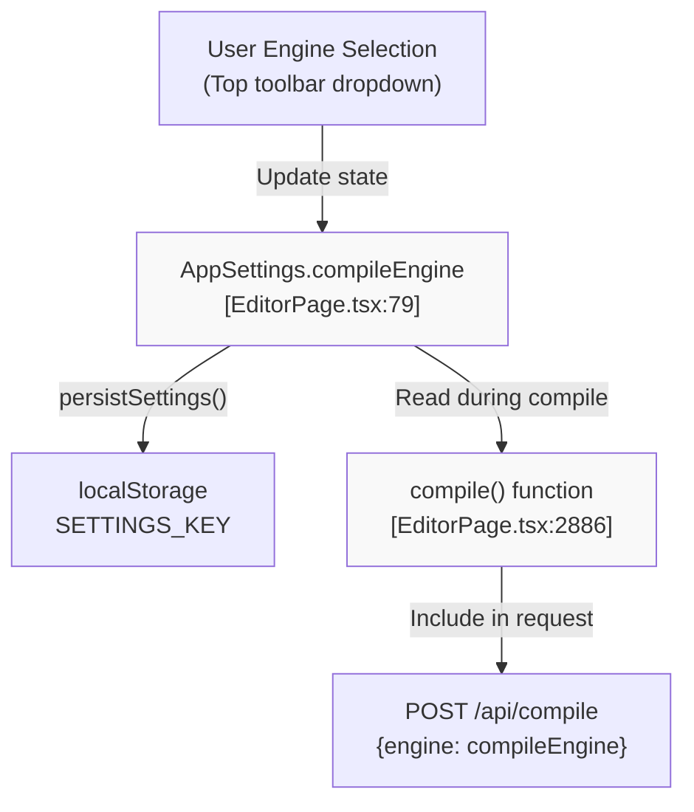
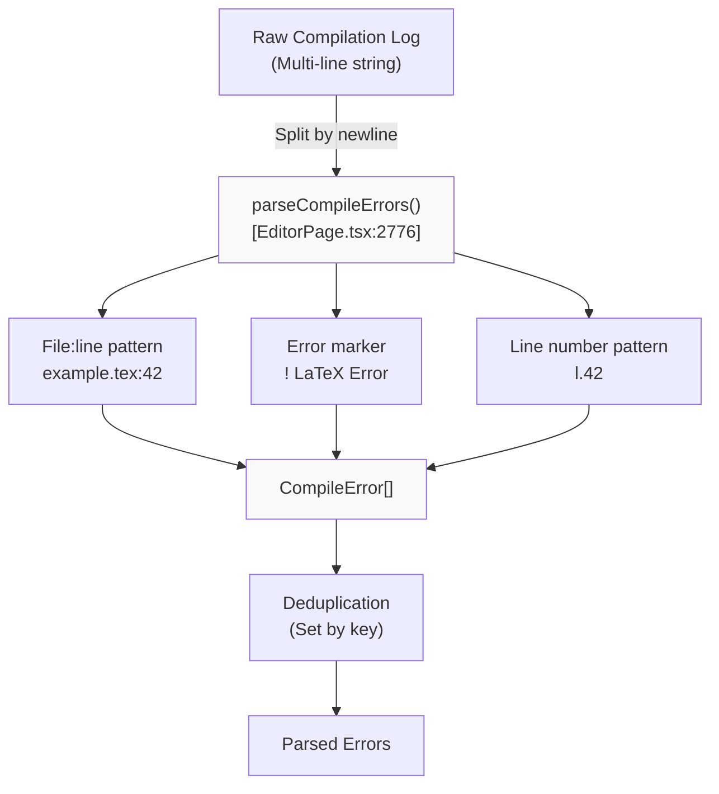
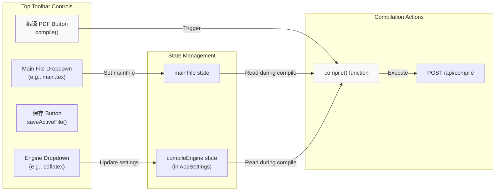
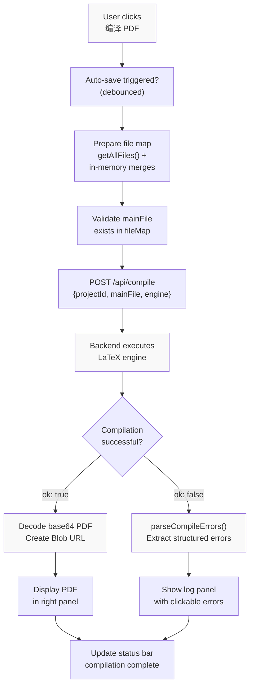

<!-- source: DeepWiki mcp.deepwiki.com · repo OpenDCAI/OpenPrism · page 6.4 Document Compilation · fetched 2026-11-02 -->

# Document Compilation

<details>
<summary>Relevant source files</summary>

The following files were used as context for generating this wiki page:

- [README.md](README.md)
- [apps/frontend/src/app/EditorPage.tsx](apps/frontend/src/app/EditorPage.tsx)

</details>


## Purpose and Scope

This document describes the LaTeX document compilation system in OpenPrism, including engine selection, compilation workflow, error handling, and user interface components. The compilation system transforms LaTeX source files into PDF documents using configurable LaTeX engines with automatic error detection and diagnosis capabilities.

For information about the compilation service implementation on the backend, see [Compilation Service](#5.2). For details about PDF preview and rendering, see [PDF Preview](#6.5).

---

## Overview

OpenPrism provides a flexible compilation system that supports multiple LaTeX engines with automatic fallback, in-memory file management, and intelligent error parsing. The system operates as a request-response pipeline where the frontend prepares project files, the backend executes the selected LaTeX engine, and results (PDF or errors) are returned for display.

**Key capabilities:**
- Multiple engine support: `pdflatex`, `xelatex`, `lualatex`, `latexmk`, `tectonic`
- Engine auto-selection and fallback
- In-memory file merging with unsaved edits
- Structured error parsing with file/line attribution
- AI-powered error diagnosis
- Real-time compilation status tracking

Sources: [README.md:75-80](), [apps/frontend/src/app/EditorPage.tsx:67-68]()

---

## Compilation Engines

OpenPrism supports five LaTeX compilation engines, each with different capabilities and use cases:

| Engine | Type | Use Case | Unicode Support | Auto-download Packages |
|--------|------|----------|-----------------|------------------------|
| `pdflatex` | Traditional | Standard LaTeX documents | Limited | No |
| `xelatex` | Extended | Unicode text, Chinese/Japanese/Korean | Full | No |
| `lualatex` | Lua-enabled | Lua scripting, advanced typography | Full | No |
| `latexmk` | Build automation | Multi-pass compilation, automatic reruns | Depends on driver | No |
| `tectonic` | Modern lightweight | Minimal installation, auto-package download | Full | Yes |

The engine is configured via:
1. **Frontend settings panel**: User-selectable dropdown in the top toolbar
2. **Environment variable**: `OPENPRISM_LLM_ENDPOINT` (backend default)
3. **localStorage**: Persisted user preference in browser



**Engine Selection Logic**

The `compileEngine` value is validated on load against a whitelist of valid engines:

[apps/frontend/src/app/EditorPage.tsx:120-125]()

Sources: [README.md:383-393](), [apps/frontend/src/app/EditorPage.tsx:67-68](), [apps/frontend/src/app/EditorPage.tsx:100-112]()

---

## Compilation Process

### Compilation Workflow Diagram

```mermaid
sequenceDiagram
    participant User
    participant compile["compile()<br/>[EditorPage.tsx:2886]"]
    participant getAllFiles["getAllFiles()<br/>[client.ts]"]
    participant fileMap["fileMap<br/>(In-memory merge)"]
    participant compileProject["POST /api/compile<br/>[client.ts]"]
    participant Backend["Backend Compilation<br/>Service"]
    participant LaTeX["LaTeX Engine<br/>(pdflatex/xelatex/etc)"]
    
    User->>compile: Click "编译 PDF"
    compile->>compile: setIsCompiling(true)
    compile->>getAllFiles: Fetch all server files
    getAllFiles-->>compile: {files: [...]}
    
    compile->>fileMap: Build fileMap with merges
    Note over compile,fileMap: Merge unsaved edits<br/>from activePath
    compile->>fileMap: Add in-memory changes
    
    compile->>compileProject: {projectId, mainFile, engine}
    compileProject->>Backend: HTTP POST
    Backend->>LaTeX: Execute engine
    LaTeX-->>Backend: PDF + log + status
    Backend-->>compileProject: {ok, pdf (base64), log, status}
    
    compileProject-->>compile: Response
    compile->>compile: Parse PDF from base64
    compile->>compile: parseCompileErrors(log)
    compile->>compile: Create Blob URL
    compile->>compile: setPdfUrl(url)
    compile->>User: Display PDF/errors
```

### File Preparation

Before compilation, the frontend prepares a complete file map that includes both saved files from the server and unsaved in-memory edits:

[apps/frontend/src/app/EditorPage.tsx:2891-2906]()

**File merge strategy:**
1. Fetch all files from server via `getAllFiles(projectId)`
2. Decode base64-encoded binary files (images, PDFs)
3. Override with in-memory cached content from `files` state
4. Apply current editor unsaved changes for `activePath`
5. Validate that `mainFile` exists in the merged map

This ensures that compilation always uses the latest content, even if the user hasn't explicitly saved.

### Backend Execution

The compiled request is sent to the backend compilation service:

[apps/frontend/src/app/EditorPage.tsx:2907]()

**Request payload:**
```typescript
{
  projectId: string,
  mainFile: string,     // Entry point (e.g., "main.tex")
  engine: CompileEngine // Selected engine
}
```

**Response structure:**
```typescript
{
  ok: boolean,
  pdf?: string,         // Base64-encoded PDF bytes
  log?: string,         // Compilation log
  status?: number,      // Exit code
  error?: string        // Error message if compilation failed
}
```

The backend compilation service (see [Compilation Service](#5.2)) handles:
- Writing files to a temporary directory
- Executing the selected LaTeX engine
- Capturing stdout/stderr logs
- Reading the generated PDF
- Cleaning up temporary files

### PDF Rendering

Upon successful compilation, the PDF is rendered in the right panel:

[apps/frontend/src/app/EditorPage.tsx:2912-2933]()

**PDF handling workflow:**
1. Decode base64 PDF string to `Uint8Array`
2. Create `Blob` with MIME type `application/pdf`
3. Generate object URL with `URL.createObjectURL()`
4. Revoke previous URL to prevent memory leaks
5. Update `pdfUrl` state, triggering PdfPreview component
6. Switch right panel view to `'pdf'`

Sources: [apps/frontend/src/app/EditorPage.tsx:2886-2941](), [apps/frontend/src/api/client.ts:22-24]()

---

## Error Handling

### Compilation Log Structure

Compilation logs contain three types of information:
1. **Metadata**: Engine name, main file path
2. **Engine output**: Raw stdout/stderr from LaTeX
3. **Parsed errors**: Structured error objects with file/line attribution

[apps/frontend/src/app/EditorPage.tsx:2919-2924]()

### Error Parsing

The `parseCompileErrors()` function extracts structured error information from raw LaTeX logs:



**Error detection patterns:**

[apps/frontend/src/app/EditorPage.tsx:2789-2811]()

**CompileError structure:**
```typescript
interface CompileError {
  message: string,  // Error description
  line?: number,    // Line number in file
  file?: string,    // File path (relative)
  raw?: string      // Original log line
}
```

The parser handles two main patterns:
1. **File:line errors**: `example.tex:42: Undefined control sequence`
2. **Exclamation mark errors**: `! LaTeX Error: ...` followed by `l.42` line markers

### Error Navigation

Users can click on errors in the log viewer to jump to the error location in the editor:

[apps/frontend/src/app/EditorPage.tsx:2697-2716]()

**Navigation workflow:**
1. User clicks error item in log panel
2. `jumpToError(error)` is called
3. If `error.file` differs from `activePath`, open that file
4. Calculate byte offset for `error.line` using `findLineOffset()`
5. Dispatch CodeMirror selection change to position
6. Scroll editor to make line visible
7. Focus editor for immediate keyboard interaction

### AI-Powered Diagnosis

OpenPrism includes an AI diagnosis feature that analyzes compilation errors and suggests fixes:

[apps/frontend/src/app/EditorPage.tsx:3177-3221]()

**Diagnosis workflow:**
1. User clicks "诊断" (Diagnose) button in log panel
2. Frontend calls `runAgent()` with task `'debug_compile'`
3. LLM receives:
   - Full compilation log as `selection`
   - Current file content as `content`
   - Project context
   - Mode: `'tools'` (allows multi-file edits)
4. Agent generates structured patches with fixes
5. Patches are displayed in diff viewer for user review
6. User can accept or reject each change

The diagnosis leverages the agent system (see [AI Agent Service](#5.3)) to provide context-aware suggestions.

Sources: [apps/frontend/src/app/EditorPage.tsx:2776-2815](), [apps/frontend/src/app/EditorPage.tsx:2697-2716](), [apps/frontend/src/app/EditorPage.tsx:3177-3221]()

---

## User Interface

### Compile Controls

The compilation interface consists of several interconnected UI elements in the top toolbar:



**Main file selection:**

[apps/frontend/src/app/EditorPage.tsx:3326-3334]()

The main file dropdown automatically populates with `.tex` files and defaults to `main.tex` if available.

**Engine selection:**

[apps/frontend/src/app/EditorPage.tsx:3336-3344]()

Engine names are displayed with human-readable labels (e.g., "pdfLaTeX" instead of "pdflatex").

**Compile button:**

[apps/frontend/src/app/EditorPage.tsx:3346-3348]()

The button shows loading state during compilation and is disabled to prevent duplicate requests.

### Status Indicators

OpenPrism provides real-time feedback about compilation state through multiple UI indicators:

| Indicator | Location | States | Purpose |
|-----------|----------|--------|---------|
| `isCompiling` | Compile button | `true`/`false` | Disables button during execution |
| `status` | Status bar (left) | Dynamic text | Shows current operation |
| `engineName` | Status bar (right) | Engine identifier | Shows which engine compiled |
| `compileLog` | Right panel (LOG view) | Log text | Full compilation output |
| Save indicator | Status bar (left) | Saving/Dirty/Saved | File save status |

[apps/frontend/src/app/EditorPage.tsx:3362-3374]()

**Status bar display:**
- Left side: Current status message + save indicator with colored dot
- Right side: Compile configuration (engine) + last used engine

### Log Viewer

The compilation log is displayed in the right panel when view mode is set to `'log'`:

**Log panel structure:**
1. **Header**: "LOG" tab button in right view selector
2. **Metadata section**: Engine and main file information
3. **Raw log**: Scrollable text area with full compilation output
4. **Parsed errors**: Clickable list of structured errors
5. **Actions**: "诊断" (Diagnose) button for AI analysis

**Error list rendering:**

[apps/frontend/src/app/EditorPage.tsx:2949]()

Each error is displayed as a clickable item that triggers `jumpToError()` when clicked. Errors include:
- Error message text
- File path (if available)
- Line number (if available)
- Raw log line excerpt

Sources: [apps/frontend/src/app/EditorPage.tsx:3326-3360](), [apps/frontend/src/app/EditorPage.tsx:3362-3374]()

---

## Configuration

### Engine Configuration

Engines are configured through three layers:

**1. Application Settings (localStorage)**

[apps/frontend/src/app/EditorPage.tsx:100-112]()

The `DEFAULT_SETTINGS` object defines fallback values. User selections persist across sessions via localStorage.

**2. Settings Panel**

Users can modify engine selection through the settings modal (opened by clicking "设置" button). Changes are immediately persisted:

[apps/frontend/src/app/EditorPage.tsx:136-143]()

**3. Validation**

Engine values are validated on load to prevent invalid configurations:

[apps/frontend/src/app/EditorPage.tsx:121-125]()

If an invalid engine is found in localStorage, the system falls back to `DEFAULT_SETTINGS.compileEngine` (`'pdflatex'`).

### Main File Selection

The main file (entry point for compilation) is automatically detected or can be manually selected:

**Auto-detection logic:**

[apps/frontend/src/app/EditorPage.tsx:2592-2598]()

**Selection priority:**
1. User explicitly selects a `.tex` file from dropdown
2. Auto-detect first `.tex` file named `main.tex`
3. Fall back to first `.tex` file alphabetically
4. Default to `'main.tex'` if no `.tex` files exist

### Compile Log Retention

Compilation logs are retained in component state and persist across navigations within the editor:

- **State variable**: `compileLog` (string)
- **Updated**: After each compilation attempt (success or failure)
- **Cleared**: Never (until page reload or project change)
- **Used by**: Log viewer, AI diagnosis, agent context

This allows users to reference previous compilation results when making changes.

Sources: [apps/frontend/src/app/EditorPage.tsx:100-143](), [apps/frontend/src/app/EditorPage.tsx:2592-2598]()

---

## Compilation Flow Summary



Sources: [apps/frontend/src/app/EditorPage.tsx:2886-2941]()

---

