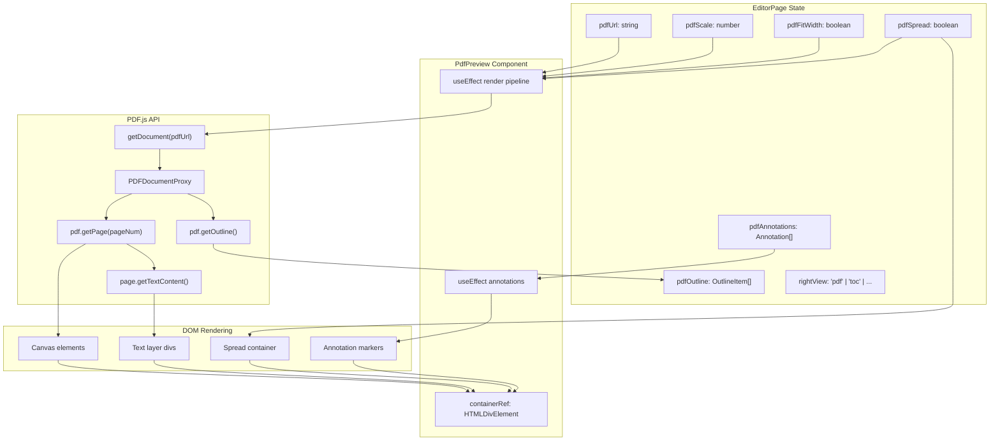
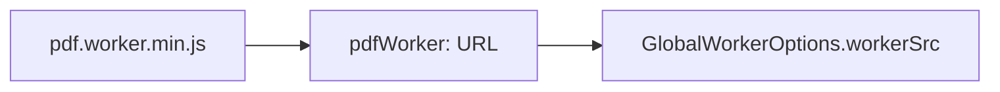
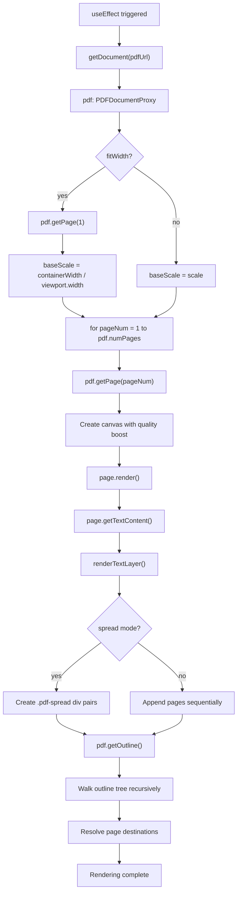
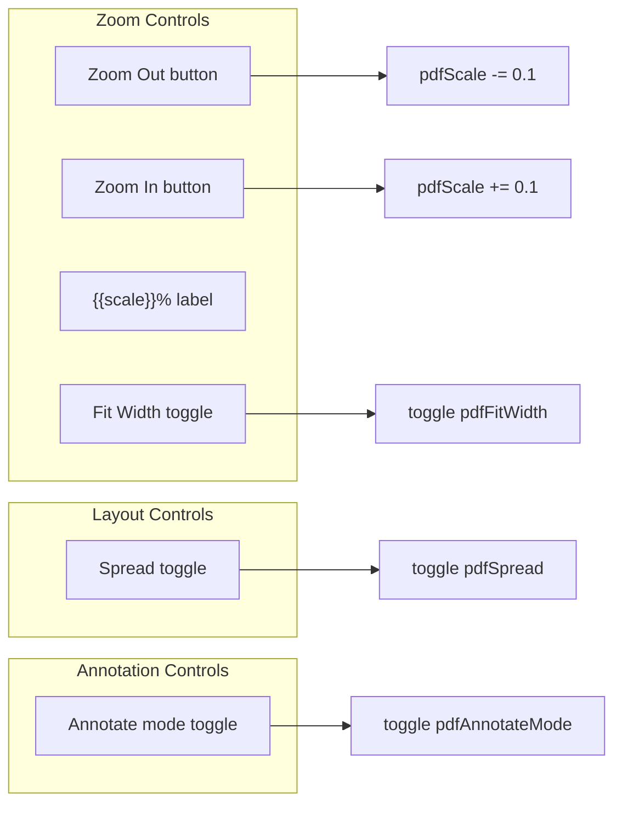
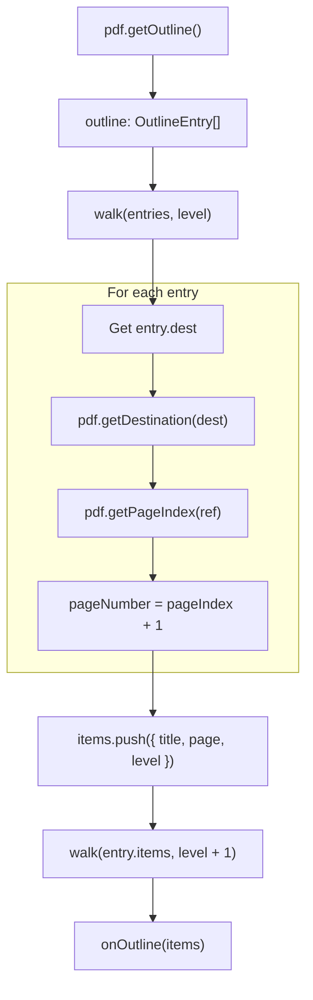
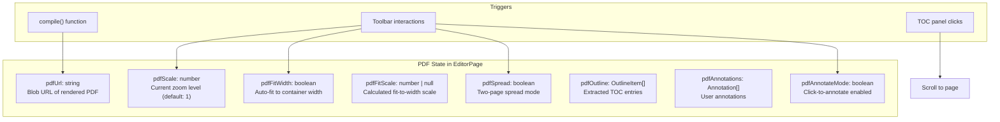
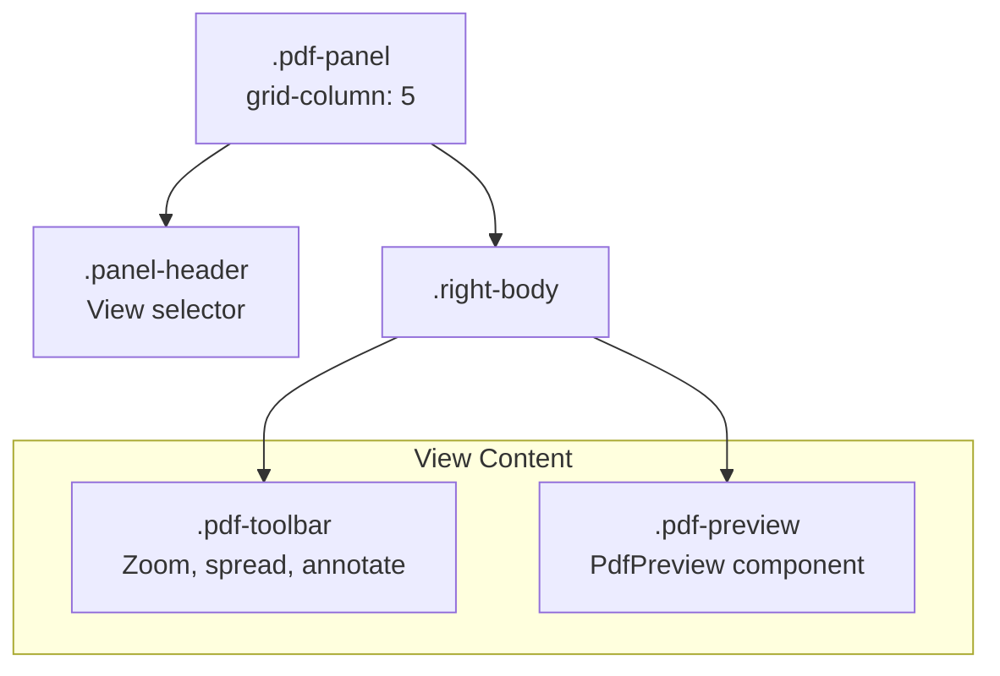

<!-- source: DeepWiki mcp.deepwiki.com · repo OpenDCAI/OpenPrism · page 6.5 PDF Preview · fetched 2026-11-02 -->

# PDF Preview

<details>
<summary>Relevant source files</summary>

The following files were used as context for generating this wiki page:

- [apps/frontend/src/app/App.css](apps/frontend/src/app/App.css)
- [apps/frontend/src/app/EditorPage.tsx](apps/frontend/src/app/EditorPage.tsx)

</details>


## Purpose and Scope

The PDF Preview feature provides real-time PDF rendering and interaction capabilities in the OpenPrism editor workspace. This page documents the PDF.js-based rendering system, viewing controls, outline extraction, annotation functionality, and text layer interaction. For information about the compilation process that generates PDFs, see [Document Compilation](#6.4). For the right panel layout that hosts the PDF preview, see [Editor Workspace](#4.3).

**Sources**: [apps/frontend/src/app/EditorPage.tsx:882-1092]()

---

## Architecture Overview

The PDF preview system integrates PDF.js as the core rendering engine, providing a canvas-based display with text overlay, navigation controls, and metadata extraction. The preview is rendered in the right panel of the editor workspace and updates automatically after successful compilation.



**Sources**: [apps/frontend/src/app/EditorPage.tsx:882-1092](), [apps/frontend/src/app/EditorPage.tsx:1136-1144]()

---

## PDF.js Integration

OpenPrism uses PDF.js as the rendering engine, initialized with a dedicated web worker to handle PDF parsing and rendering off the main thread.

### Worker Configuration



The worker is configured at module initialization:

```typescript
import { GlobalWorkerOptions, getDocument, renderTextLayer } from 'pdfjs-dist';
import pdfWorker from 'pdfjs-dist/build/pdf.worker.min?url';

GlobalWorkerOptions.workerSrc = pdfWorker;
```

**Sources**: [apps/frontend/src/app/EditorPage.tsx:15-16](), [apps/frontend/src/app/EditorPage.tsx:40]()

### Component Props

The `PdfPreview` component accepts the following interface:

| Prop | Type | Description |
|------|------|-------------|
| `pdfUrl` | `string` | Blob URL of the PDF to render |
| `scale` | `number` | Base zoom scale (1.0 = 100%) |
| `fitWidth` | `boolean` | Auto-calculate scale to fit container width |
| `spread` | `boolean` | Two-page spread layout mode |
| `onFitScale` | `(value: number \| null) => void` | Callback with calculated fit-to-width scale |
| `onTextClick` | `(text: string) => void` | Callback when text is clicked in text layer |
| `onOutline` | `(items: OutlineItem[]) => void` | Callback with extracted PDF outline |
| `annotations` | `Annotation[]` | Array of user-added annotations |
| `annotateMode` | `boolean` | Enable click-to-annotate mode |
| `onAddAnnotation` | `(page, x, y) => void` | Callback to add annotation at position |
| `containerRef` | `RefObject<HTMLDivElement>` | Optional external ref for container |

**Sources**: [apps/frontend/src/app/EditorPage.tsx:882-906]()

---

## Rendering Pipeline

The rendering pipeline executes asynchronously within a `useEffect` hook, triggered when `pdfUrl`, `scale`, `fitWidth`, `spread`, or `onOutline` change.



**Sources**: [apps/frontend/src/app/EditorPage.tsx:911-1048]()

### Quality Boost Rendering

The rendering system uses a quality boost factor to render at higher resolution than display size, improving visual clarity on high-DPI displays:

```typescript
const cssViewport = page.getViewport({ scale: baseScale });
const qualityBoost = Math.min(2.4, (window.devicePixelRatio || 1) * 1.25);
const renderViewport = page.getViewport({ scale: baseScale * qualityBoost });

canvas.width = renderViewport.width;
canvas.height = renderViewport.height;
canvas.style.width = `${cssViewport.width}px`;
canvas.style.height = `${cssViewport.height}px`;
```

This creates a canvas with higher pixel density while maintaining CSS dimensions, resulting in sharper rendering on retina displays.

**Sources**: [apps/frontend/src/app/EditorPage.tsx:940-956]()

---

## Viewing Controls

The PDF toolbar provides controls for zoom, scale, layout, and navigation.

### Toolbar Controls



The toolbar is rendered in the right panel's view content when `rightView === 'pdf'`:

**Sources**: [apps/frontend/src/app/App.css:1755-1766]()

### Fit-to-Width Calculation

When `fitWidth` is enabled, the preview calculates an optimal scale to fit the page width within the container:

```typescript
const containerWidth = container.clientWidth - 24; // subtract padding
const pageTargetWidth = spread 
  ? Math.max(200, (containerWidth - 16) / 2) 
  : containerWidth;

const firstPage = await pdf.getPage(1);
const originalViewport = firstPage.getViewport({ scale: 1.0 });
baseScale = pageTargetWidth / originalViewport.width;

if (onFitScale) {
  onFitScale(baseScale);
}
```

In spread mode, the target width is halved to accommodate two pages side-by-side.

**Sources**: [apps/frontend/src/app/EditorPage.tsx:922-937]()

### Spread Mode

Spread mode arranges pages in pairs within `.pdf-spread` containers:

```typescript
if (spread) {
  for (let idx = 0; idx < wrappers.length; idx += 2) {
    const row = document.createElement('div');
    row.className = 'pdf-spread';
    row.appendChild(wrappers[idx]);
    if (wrappers[idx + 1]) {
      row.appendChild(wrappers[idx + 1]);
    }
    container.appendChild(row);
  }
} else {
  wrappers.forEach((wrapper) => container.appendChild(wrapper));
}
```

**Sources**: [apps/frontend/src/app/EditorPage.tsx:991-1003](), [apps/frontend/src/app/App.css:1802-1808]()

---

## Outline Extraction

The PDF preview extracts the document's outline (table of contents) from embedded PDF metadata and passes it to the parent component for display in the TOC panel.



### Outline Item Structure

Each extracted outline item has the following structure:

```typescript
{
  title: string;      // Section title from PDF metadata
  page?: number;      // Page number (1-indexed), if resolvable
  level: number;      // Nesting level (1 = top-level)
}
```

The outline extraction handles nested sections recursively:

**Sources**: [apps/frontend/src/app/EditorPage.tsx:1005-1032]()

---

## Annotations

The annotation system allows users to mark specific locations on PDF pages with clickable markers.

### Annotation Data Model

```typescript
interface Annotation {
  id: string;         // Unique identifier
  page: number;       // Page number (1-indexed)
  x: number;          // Horizontal position (0.0-1.0 relative)
  y: number;          // Vertical position (0.0-1.0 relative)
  text: string;       // Annotation text/note
}
```

### Annotation Rendering

Annotations are rendered as absolutely positioned markers on each page:

```typescript
annotations.forEach((note) => {
  const pageEl = container.querySelector(
    `.pdf-page[data-page-number="${note.page}"]`
  ) as HTMLElement | null;
  if (!pageEl) return;
  
  const marker = document.createElement('div');
  marker.className = 'pdf-annotation';
  marker.style.left = `${note.x * 100}%`;
  marker.style.top = `${note.y * 100}%`;
  marker.title = note.text;
  marker.dataset.annotationId = note.id;
  pageEl.appendChild(marker);
});
```

**Sources**: [apps/frontend/src/app/EditorPage.tsx:1050-1065]()

### Annotation Creation

When `annotateMode` is enabled, clicking on a page creates a new annotation:

```typescript
if (annotateMode && onAddAnnotation) {
  const pageEl = target.closest('.pdf-page') as HTMLElement | null;
  if (pageEl) {
    const rect = pageEl.getBoundingClientRect();
    const x = (event.clientX - rect.left) / rect.width;
    const y = (event.clientY - rect.top) / rect.height;
    const page = Number(pageEl.dataset.pageNumber || 1);
    onAddAnnotation(page, x, y);
  }
}
```

The `x` and `y` coordinates are normalized to 0.0-1.0 range for resolution-independent positioning.

**Sources**: [apps/frontend/src/app/EditorPage.tsx:1074-1083]()

### Annotation Styling

Annotations appear as circular markers with a subtle shadow:

```css
.pdf-annotation {
  position: absolute;
  width: 10px;
  height: 10px;
  border-radius: 50%;
  background: var(--accent);
  border: 2px solid #fff;
  box-shadow: 0 2px 6px rgba(0, 0, 0, 0.2);
  transform: translate(-50%, -50%);
  cursor: pointer;
}
```

**Sources**: [apps/frontend/src/app/App.css:1810-1820]()

---

## Text Layer

The text layer enables text selection and interaction within the rendered PDF. PDF.js's `renderTextLayer` function overlays invisible text spans positioned to match the PDF's text content.

### Text Layer Rendering

For each page, a text layer div is created and populated:

```typescript
const textLayer = document.createElement('div');
textLayer.className = 'textLayer';
textLayer.style.width = `${cssViewport.width}px`;
textLayer.style.height = `${cssViewport.height}px`;
pageWrapper.appendChild(textLayer);

const textContent = await page.getTextContent();
renderTextLayer({
  textContentSource: textContent,
  container: textLayer,
  viewport: cssViewport
});
```

**Sources**: [apps/frontend/src/app/EditorPage.tsx:959-973]()

### Text Click Handling

The preview captures clicks on text spans and passes the clicked text to the parent component:

```typescript
if (target.tagName !== 'SPAN') return;
const text = (target.textContent || '').trim();
if (text.length < 3) return;
onTextClick(text);
```

This enables features like searching for clicked terms or triggering AI-powered lookups.

**Sources**: [apps/frontend/src/app/EditorPage.tsx:1085-1089]()

### Text Layer Styling

The text layer is positioned absolutely over the canvas with reduced opacity:

```css
.textLayer {
  position: absolute;
  inset: 0;
  opacity: 0.2;
  pointer-events: auto;
}

.textLayer span {
  cursor: pointer;
  pointer-events: auto;
}
```

**Sources**: [apps/frontend/src/app/App.css:1918-1929]()

---

## State Management

The PDF preview state is managed in the `EditorPage` component and updated through user interactions and compilation events.

### Core State Variables



**Sources**: [apps/frontend/src/app/EditorPage.tsx:1136-1144]()

### Compilation Integration

After successful compilation, the PDF blob URL is created and assigned:

```typescript
const blob = new Blob([result.pdf], { type: 'application/pdf' });
const nextUrl = URL.createObjectURL(blob);
if (pdfUrl) {
  URL.revokeObjectURL(pdfUrl); // Clean up previous URL
}
setPdfUrl(nextUrl);
setRightView('pdf');
```

**Sources**: [apps/frontend/src/app/EditorPage.tsx:2926-2932]()

---

## UI Components and Layout

The PDF preview is integrated into the right panel of the editor workspace.

### Panel Structure



### Toolbar Layout

The PDF toolbar uses flexbox for responsive layout:

```css
.pdf-toolbar {
  display: flex;
  align-items: center;
  justify-content: space-between;
  gap: 12px;
  padding: 10px 12px;
  margin: 12px 12px 0;
  border-radius: 12px;
  border: 1px solid rgba(120, 98, 83, 0.2);
  background: rgba(255, 255, 255, 0.9);
  flex-wrap: wrap;
}
```

**Sources**: [apps/frontend/src/app/App.css:1755-1766]()

### Preview Container

The preview container uses flexbox with scrolling:

```css
.pdf-preview {
  flex: 1;
  overflow: auto;
  padding: 12px;
  border-radius: 12px;
  background: rgba(255, 255, 255, 0.78);
  border: 1px solid rgba(120, 98, 83, 0.3);
  display: flex;
  flex-direction: column;
  align-items: flex-end;
}

.pdf-preview.annotate {
  cursor: crosshair;
}
```

**Sources**: [apps/frontend/src/app/App.css:1739-1753]()

---

## Error Handling

The rendering pipeline includes error handling for common failure scenarios:

```typescript
try {
  const loadingTask = getDocument(pdfUrl);
  const pdf = await loadingTask.promise;
  // ... rendering logic
} catch (err) {
  console.error('PDF render error:', err);
  container.innerHTML = `<div class="muted">${t('PDF 渲染失败')}</div>`;
}
```

The component also handles cancellation when the effect is re-triggered:

```typescript
let cancelled = false;

// ... async rendering

if (cancelled) return; // Check before state updates

return () => {
  cancelled = true;
  container.innerHTML = '';
};
```

**Sources**: [apps/frontend/src/app/EditorPage.tsx:917-1047]()

---

## Performance Considerations

### Rendering Optimization

1. **Progressive Rendering**: Pages are rendered sequentially in a loop, allowing the first page to display quickly while subsequent pages load
2. **Quality Boost Limit**: The quality multiplier is capped at 2.4 to prevent excessive memory usage on very high-DPI displays
3. **Async Processing**: PDF.js worker processes PDF parsing off the main thread
4. **Blob URL Management**: Previous PDF blob URLs are revoked to prevent memory leaks

### Re-rendering Triggers

The `useEffect` dependency array controls when the entire PDF is re-rendered:

```typescript
useEffect(() => {
  // ... rendering logic
}, [pdfUrl, fitWidth, onFitScale, scale, spread, onOutline, t]);
```

Changes to `pdfAnnotations` trigger a separate, lighter effect that only updates annotation markers without re-rendering the entire PDF:

```typescript
useEffect(() => {
  // Remove existing annotations
  container.querySelectorAll('.pdf-annotation').forEach((node) => node.remove());
  // Re-add current annotations
  // ...
}, [annotations, pdfUrl, spread]);
```

**Sources**: [apps/frontend/src/app/EditorPage.tsx:911-1048](), [apps/frontend/src/app/EditorPage.tsx:1050-1065]()

---

