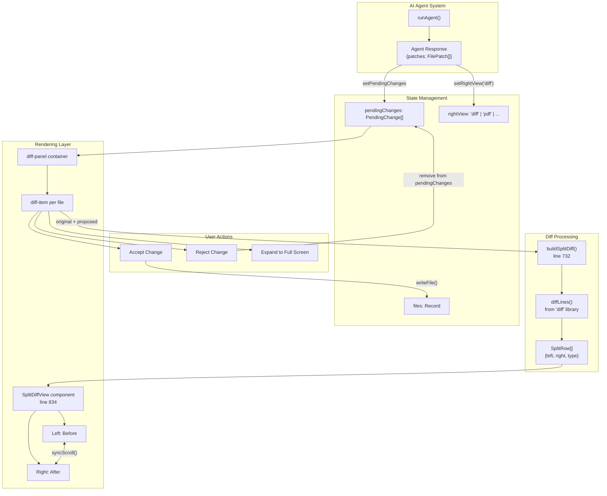
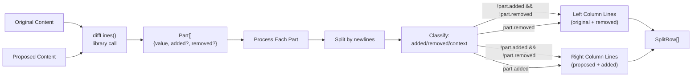
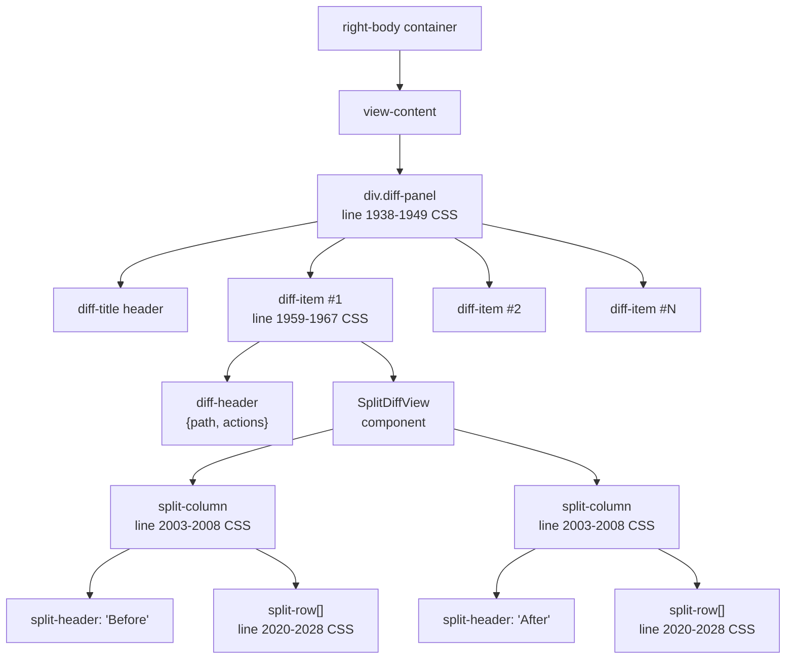
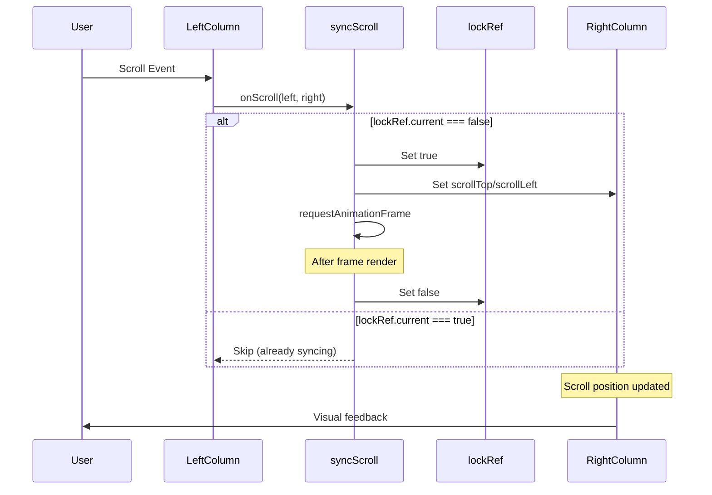
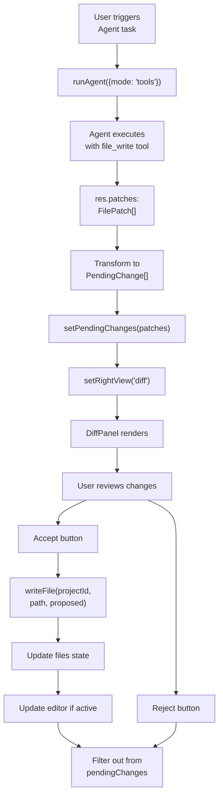
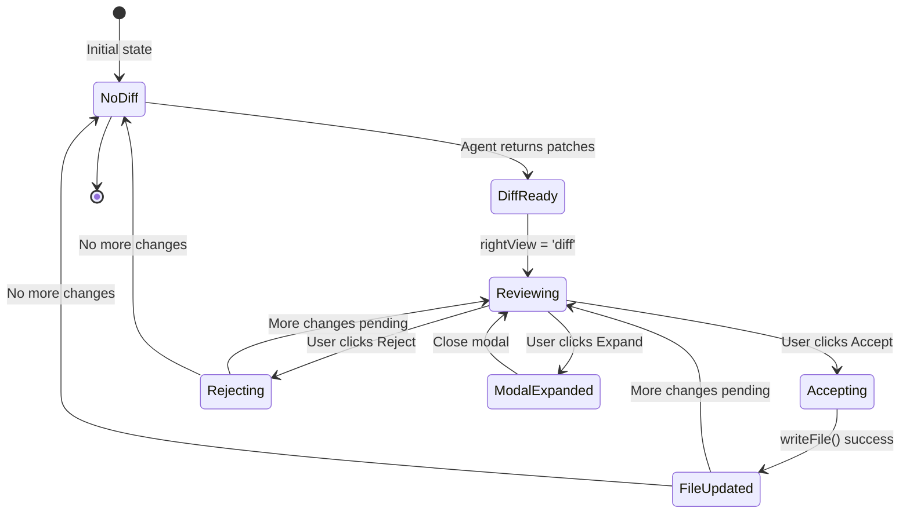

<!-- source: DeepWiki mcp.deepwiki.com · repo OpenDCAI/OpenPrism · page 6.6 Diff Viewer · fetched 2026-11-02 -->

# Diff Viewer

<details>
<summary>Relevant source files</summary>

The following files were used as context for generating this wiki page:

- [apps/frontend/src/app/App.css](apps/frontend/src/app/App.css)
- [apps/frontend/src/app/EditorPage.tsx](apps/frontend/src/app/EditorPage.tsx)

</details>


## Purpose and Scope

The Diff Viewer is a specialized interface component within the Editor workspace that displays side-by-side comparisons of file changes generated by AI agents. It enables users to review proposed modifications line-by-line before accepting or rejecting them. The viewer implements synchronized scrolling and color-coded change highlighting to facilitate quick review of multi-file edits.

For information about the overall editor workspace layout, see [Editor Workspace](#4.3). For details on AI agent execution that generates these changes, see [AI Agent Service](#5.3).

---

## System Architecture



**Sources**: [apps/frontend/src/app/EditorPage.tsx:732-880](), [apps/frontend/src/app/EditorPage.tsx:1135]()

---

## Data Structures

### PendingChange Interface

The `PendingChange` interface represents a single file modification awaiting user approval:

```typescript
interface PendingChange {
  filePath: string;    // Relative path in project
  original: string;    // Original file content
  proposed: string;    // Proposed modified content
  diff: string;        // Unified diff string (legacy)
}
```

**Sources**: [apps/frontend/src/app/EditorPage.tsx:56-61]()

### Split Row Structure

The `buildSplitDiff` function produces an array of row objects for rendering:

| Field | Type | Description |
|-------|------|-------------|
| `left` | `string \| undefined` | Line content for left column (removed/context) |
| `right` | `string \| undefined` | Line content for right column (added/context) |
| `leftNo` | `number \| undefined` | Line number in original file |
| `rightNo` | `number \| undefined` | Line number in proposed file |
| `type` | `'context' \| 'added' \| 'removed'` | Change classification |

**Sources**: [apps/frontend/src/app/EditorPage.tsx:736-742]()

---

## Split Diff Algorithm

### Line-by-Line Comparison

The `buildSplitDiff` function converts file content pairs into a structured diff representation:



### Processing Logic

The algorithm maintains separate line counters for left and right columns:

1. **Context lines** (unchanged): Appear in both columns with incrementing line numbers
2. **Removed lines**: Appear only in left column, increment left counter
3. **Added lines**: Appear only in right column, increment right counter

**Sources**: [apps/frontend/src/app/EditorPage.tsx:732-767]()

---

## UI Components and Rendering

### Component Hierarchy



### SplitDiffView Component

The `SplitDiffView` component implements the dual-column rendering with synchronized scrolling:

| Feature | Implementation |
|---------|---------------|
| Scroll Sync | Uses `useRef` for both columns, `lockRef` prevents infinite loops |
| Rendering | Maps each row to paired `split-row` elements in both columns |
| Styling | `split-row.added` (green tint), `split-row.removed` (red tint) |
| Line Numbers | `line-no` span with right-aligned text |
| Line Content | `line-text` span with `pre-wrap` whitespace handling |

**Sources**: [apps/frontend/src/app/EditorPage.tsx:834-880](), [apps/frontend/src/app/App.css:1992-2046]()

---

## Synchronized Scrolling Implementation

### Scroll Lock Mechanism

The component uses a frame-based lock to prevent scroll event loops:



The `lockRef` is set to `true` during synchronization and reset to `false` in the next animation frame, preventing reciprocal scroll events from triggering infinite loops.

**Sources**: [apps/frontend/src/app/EditorPage.tsx:836-848]()

---

## Integration with AI Agent Workflow

### Patch Generation to Display



**Example code locations**:
- Agent execution: [apps/frontend/src/app/EditorPage.tsx:2007-2020]()
- Patch transformation: [apps/frontend/src/app/EditorPage.tsx:2022-2028]()
- State updates: [apps/frontend/src/app/EditorPage.tsx:2029-2030]()

**Sources**: [apps/frontend/src/app/EditorPage.tsx:1996-2044]()

---

## User Interaction Flows

### Accept Change Flow

When a user clicks the "Accept" button on a diff item:

1. Extract `filePath` and `proposed` from the `PendingChange`
2. Call `writeFile(projectId, filePath, proposed)` to persist changes
3. Update `files` state: `setFiles((prev) => ({ ...prev, [filePath]: proposed }))`
4. If `filePath === activePath`, update editor: `setEditorValue(proposed)` and `setEditorDoc(proposed)`
5. Remove the change from `pendingChanges` array
6. If all changes accepted, `pendingChanges` becomes empty and diff panel shows no items

### Reject Change Flow

When a user clicks the "Reject" button:

1. Filter out the rejected `PendingChange` from `pendingChanges` array
2. No file writes occur
3. Original file content remains unchanged

### Full-Screen Modal

The diff viewer supports an expanded modal view for detailed review:

- Modal class: `diff-modal` with dimensions `min(1200px, 96vw) × min(86vh, 900px)`
- Columns expand to full modal height: `max-height: none; height: 100%`
- Same synchronized scrolling behavior as inline view

**Sources**: [apps/frontend/src/app/App.css:2047-2064]()

---

## CSS Styling Classes

### Color-Coded Change Types

| Class | Background Color | Purpose |
|-------|-----------------|---------|
| `.split-row` | Default (transparent) | Base row styling |
| `.split-row.added` | `rgba(16, 185, 129, 0.12)` | Green tint for additions |
| `.split-row.removed` | `rgba(239, 68, 68, 0.12)` | Red tint for deletions |
| `.split-row` (context) | No special background | Unchanged lines |

### Container Styling

| Class | Key Properties |
|-------|---------------|
| `.diff-panel` | `flex-direction: column`, `overflow: auto`, dashed border |
| `.diff-item` | Rounded corners, soft background, individual file container |
| `.split-diff` | `display: grid`, `grid-template-columns: 1fr 1fr`, two-column layout |
| `.split-column` | `max-height: 240px`, `overflow: auto`, scrollable |
| `.split-header` | Uppercase labels, sticky header styling |

**Sources**: [apps/frontend/src/app/App.css:1938-2064]()

---

## State Management Summary

### Key State Variables

| State Variable | Type | Purpose |
|---------------|------|---------|
| `pendingChanges` | `PendingChange[]` | Queue of file modifications awaiting approval |
| `rightView` | `'pdf' \| 'diff' \| ...` | Active right panel view mode |
| `diffFocus` | `PendingChange \| null` | Currently focused diff for modal expansion |
| `files` | `Record<string, string>` | In-memory cache of file contents |
| `activePath` | `string` | Currently open file in editor |

### State Transitions



**Sources**: [apps/frontend/src/app/EditorPage.tsx:1135](), [apps/frontend/src/app/EditorPage.tsx:1151]()

---

## Related Components

- **Right Panel View Selector**: [apps/frontend/src/app/EditorPage.tsx:91-98]() - Defines available right panel modes including 'diff'
- **Agent Interaction**: See [AI Assistant Modes](#6.2) for information on how agents generate patches
- **File Management**: See [LaTeX Editing](#6.1) for file tree and editor integration

---

