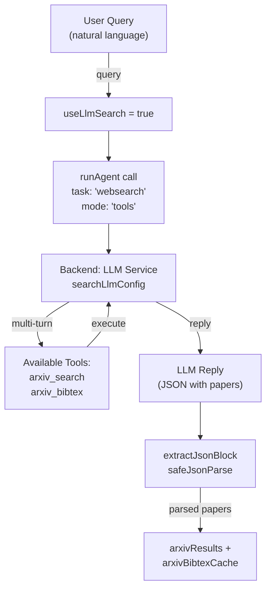
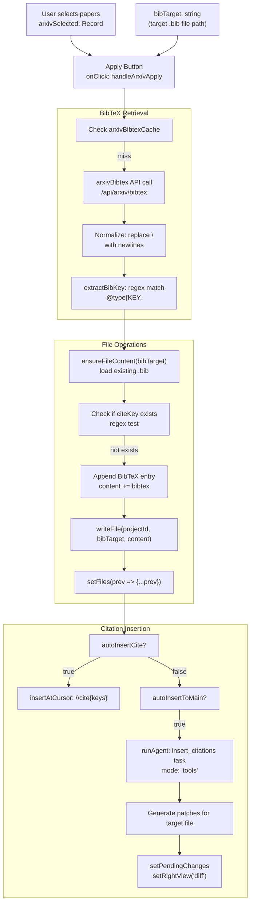
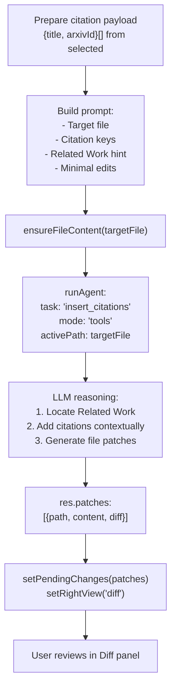
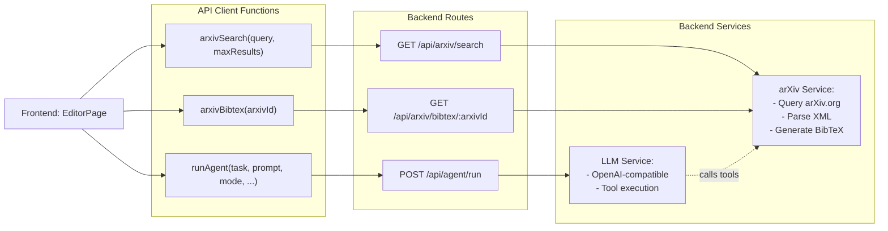
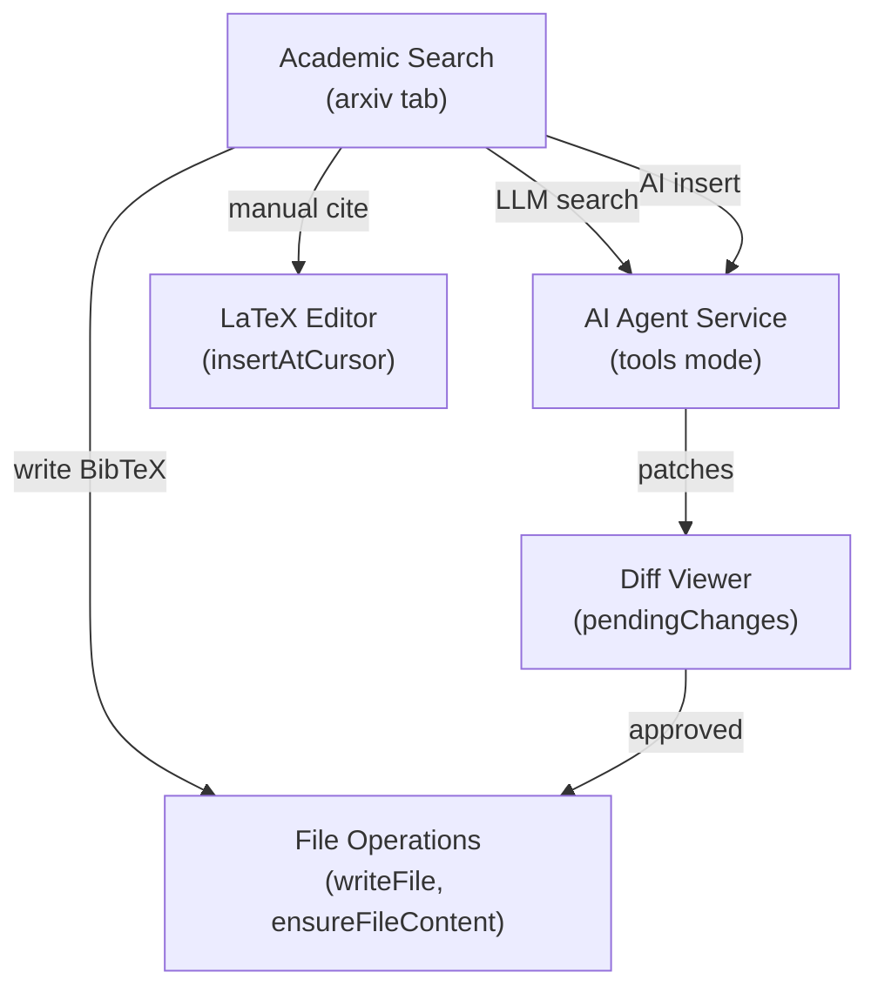

<!-- source: DeepWiki mcp.deepwiki.com · repo OpenDCAI/OpenPrism · page 6.7 Academic Search · fetched 2026-11-02 -->

# Academic Search

<details>
<summary>Relevant source files</summary>

The following files were used as context for generating this wiki page:

- [README.md](README.md)
- [apps/frontend/src/app/EditorPage.tsx](apps/frontend/src/app/EditorPage.tsx)

</details>


This page documents the **Academic Search** feature, which enables users to search for academic papers on arXiv and automatically insert citations into their LaTeX documents. The feature provides two search modes—direct arXiv API queries and LLM-powered semantic search—and supports automated BibTeX generation and citation insertion workflows.

For web search functionality (non-academic sources), see [Web Search](#6.8). For arXiv project import (downloading full paper sources), see [arXiv Integration](#5.6).

---

## Purpose and Scope

The Academic Search feature allows users to:
- Search arXiv for papers using keywords or natural language queries
- Preview paper metadata (title, authors, abstract, arXiv ID)
- Generate BibTeX entries automatically
- Write BibTeX entries to `.bib` files
- Insert `\cite{}` commands into LaTeX documents
- Optionally use AI to intelligently insert citations into Related Work sections

This feature is accessed via the **"论文检索" (Paper Search)** sidebar tab in the editor workspace.

---

## User Interface Components

### Sidebar Panel Layout

The Academic Search panel is located in the left sidebar and activated by clicking the search icon tab.

**Panel Structure:**

| Component | Description |
|-----------|-------------|
| **Query Input** | Text field for entering search keywords |
| **Max Results** | Number input (1-10) to limit result count |
| **LLM Search Toggle** | Checkbox to enable LLM-powered search mode |
| **Search Button** | Triggers search operation |
| **Results List** | Displays papers with checkboxes for selection |
| **Bib Target Selector** | Dropdown to choose destination `.bib` file |
| **Auto-insert Options** | Checkboxes for automatic citation insertion |
| **Apply Button** | Writes BibTeX and inserts citations |

**Sources:** [apps/frontend/src/app/EditorPage.tsx:3942-4083]()

---

## Search Modes

### Direct arXiv Search

The default search mode queries the arXiv API directly using the `arxivSearch` function.

```mermaid
graph TB
    User["User Input<br/>(keywords)"]
    QueryInput["arxivQuery state<br/>string"]
    SearchBtn["Search Button<br/>onClick: handleArxivSearch"]
    DirectCall["arxivSearch API call<br/>/api/arxiv/search"]
    Backend["Backend: arxivSearch route<br/>GET /api/arxiv/search"]
    ArxivAPI["arXiv.org API<br/>Query & Parse XML"]
    Results["arxivResults state<br/>ArxivPaper[]"]
    Display["Results List<br/>with checkboxes"]
    
    User -->|types| QueryInput
    QueryInput --> SearchBtn
    SearchBtn -->|useLlmSearch=false| DirectCall
    DirectCall --> Backend
    Backend --> ArxivAPI
    ArxivAPI -->|papers metadata| Backend
    Backend -->|{ok, papers}| DirectCall
    DirectCall -->|setArxivResults| Results
    Results --> Display
```

**Flow:**
1. User enters keywords (e.g., "diffusion transformer compression")
2. `handleArxivSearch` checks `useLlmSearch` is `false`
3. Calls `arxivSearch({ query, maxResults })` API client function
4. Backend queries arXiv.org and parses XML response
5. Returns array of `ArxivPaper` objects with `{ title, abstract, authors, url, arxivId }`
6. Frontend updates `arxivResults` state and displays list

**Sources:** [apps/frontend/src/app/EditorPage.tsx:1842-1921](), [apps/frontend/src/api/client.ts:20]()

---

### LLM-Powered Search

When **"使用 Websearch 模型"** checkbox is enabled, the system uses an AI agent with tool-calling capabilities to perform semantic search.



**Prompt Structure:**
```typescript
prompt: [
  'Search arXiv for the user query.',
  'Return at most {{max}} papers.',
  'Use arxiv_search and arxiv_bibtex tools.',
  'Return JSON ONLY in this schema:',
  '{"papers":[{"title":"","authors":[],"arxivId":"","bibtex":""}]}.'
].join(' ')
```

**Expected Output Format:**
```json
{
  "papers": [
    {
      "title": "Paper Title",
      "authors": ["Author A", "Author B"],
      "arxivId": "2301.12345",
      "bibtex": "@article{key2023,\n  title={...}\n}"
    }
  ]
}
```

**Parsing Logic:**
1. Extract JSON block from LLM response using `extractJsonBlock(raw)`
2. Parse JSON with `safeJsonParse<T>()` helper (handles malformed JSON)
3. If BibTeX is pre-generated, cache it in `arxivBibtexCache`
4. Update `arxivResults` with parsed papers

**Sources:** [apps/frontend/src/app/EditorPage.tsx:1850-1904](), [apps/frontend/src/app/EditorPage.tsx:517-584]()

---

## BibTeX Generation and Insertion

### Data Flow: Search to Citation



**Sources:** [apps/frontend/src/app/EditorPage.tsx:1923-2045]()

---

## BibTeX File Management

### File Selection Logic

**Dropdown Options:**
1. **"(新建/选择 Bib 文件)"** - Empty state, triggers creation
2. **Existing .bib files** - From `bibFiles` memoized array

**Auto-selection:**
```typescript
// Auto-select first .bib file if none chosen
useEffect(() => {
  if (!bibTarget && bibFiles.length > 0) {
    setBibTarget(bibFiles[0]);
  }
}, [bibFiles, bibTarget]);
```

**File Creation:**
```typescript
const createBibFile = async () => {
  const parent = selectedPath && tree.find(item => 
    item.path === selectedPath && item.type === 'dir'
  ) ? selectedPath : getParentPath(selectedPath || activePath || '');
  const path = parent ? `${parent}/references.bib` : 'references.bib';
  const content = '% Add BibTeX entries here\n';
  await writeFile(projectId, path, content);
  await refreshTree();
  await openFile(path);
  return path;
};
```

**Sources:** [apps/frontend/src/app/EditorPage.tsx:1711-1722](), [apps/frontend/src/app/EditorPage.tsx:2625-2629]()

---

## Citation Insertion Workflows

### Workflow 1: Manual Insertion at Cursor

**Precondition:** `autoInsertCite = true` AND active file is `.tex`

**Process:**
1. Extract citation keys from BibTeX entries: `extractBibKey(bibtex)`
2. Format cite command: `\cite{key1,key2,key3}`
3. Insert at cursor position: `insertAtCursor(citeCmd)`

**Helper Function:**
```typescript
const extractBibKey = (bibtex: string) => {
  const match = bibtex.match(/@\w+\s*{\s*([^,\s]+)\s*,/);
  return match ? match[1].trim() : '';
};
```

**Sources:** [apps/frontend/src/app/EditorPage.tsx:1837-1840](), [apps/frontend/src/app/EditorPage.tsx:1975-1983]()

---

### Workflow 2: AI-Powered Citation Insertion

**Precondition:** `autoInsertToMain = true`

**Target File:** `citeTargetFile` (defaults to `mainFile` or first `.tex`)

**Agent Task Configuration:**



**Prompt Template:**
```typescript
const prompt = [
  'Insert citations into the target TeX file.',
  'Target file: {{file}}.',
  'Use \\cite{{{keys}}}.',
  'If a Related Work section exists, add the citations there.',
  'Otherwise add a Related Work subsection near the end and cite the papers.',
  'Keep edits minimal and preserve formatting.',
  'Papers: {{payload}}'
].filter(Boolean).join(' ');
```

**Response Handling:**
- If `res.patches` exists: Display in Diff Viewer for approval
- If no patches: Show message "未生成可应用的引用修改"
- User must explicitly accept changes before they're applied

**Sources:** [apps/frontend/src/app/EditorPage.tsx:1997-2037](), [apps/frontend/src/app/EditorPage.tsx:3223-3243]()

---

## State Management

### Key State Variables

| Variable | Type | Purpose |
|----------|------|---------|
| `arxivQuery` | `string` | User search query input |
| `arxivMaxResults` | `number` | Max papers to return (1-10) |
| `arxivResults` | `ArxivPaper[]` | Search results array |
| `arxivSelected` | `Record<string, boolean>` | Selected papers by arxivId |
| `useLlmSearch` | `boolean` | Toggle LLM vs direct search |
| `llmSearchOutput` | `string` | Raw LLM response for debugging |
| `arxivBibtexCache` | `Record<string, string>` | Cache arxivId → BibTeX |
| `bibTarget` | `string` | Target `.bib` file path |
| `autoInsertCite` | `boolean` | Auto-insert at cursor |
| `autoInsertToMain` | `boolean` | Use AI to insert citations |
| `citeTargetFile` | `string` | Target `.tex` for AI insertion |
| `arxivStatus` | `string` | Status message display |
| `arxivBusy` | `boolean` | Loading/processing indicator |

**Sources:** [apps/frontend/src/app/EditorPage.tsx:1176-1189]()

---

## Backend Integration

### API Endpoints Used



**ArxivPaper Type Definition:**
```typescript
interface ArxivPaper {
  title: string;
  abstract: string;
  authors: string[];
  url: string;
  arxivId: string;
}
```

**Sources:** [apps/frontend/src/api/client.ts:19-20](), [apps/frontend/src/app/EditorPage.tsx:36]()

---

## Configuration and Settings

### LLM Configuration Override

The Academic Search feature can use a separate LLM configuration from the main agent settings.

**Configuration Hierarchy:**
1. **Search-specific config** (if any of `searchEndpoint`, `searchApiKey`, `searchModel` set)
2. **Fallback to main config** (`llmEndpoint`, `llmApiKey`, `llmModel`)

**Memo Logic:**
```typescript
const searchLlmConfig = useMemo(() => {
  const hasOverride = Boolean(searchEndpoint || searchApiKey || searchModel);
  return {
    endpoint: (hasOverride ? searchEndpoint : llmEndpoint) || llmEndpoint,
    apiKey: (hasOverride ? searchApiKey : llmApiKey) || undefined,
    model: (hasOverride ? searchModel : llmModel) || llmModel
  };
}, [llmEndpoint, llmApiKey, llmModel, searchEndpoint, searchApiKey, searchModel]);
```

**Settings Panel Fields:**
- `searchEndpoint` - Custom endpoint for search operations
- `searchApiKey` - Dedicated API key
- `searchModel` - Model name override (e.g., `gpt-4o-mini`)

**Sources:** [apps/frontend/src/app/EditorPage.tsx:1262-1269](), [apps/frontend/src/app/EditorPage.tsx:69-80]()

---

## Error Handling and Status Messages

### Status Message Patterns

| Scenario | Message (Chinese) | Message Key |
|----------|------------------|-------------|
| Empty query | `请输入检索关键词。` | User must enter keywords |
| No results | `没有匹配结果。` | Search returned empty |
| Search in progress | Status updates via `setArxivStatus` | Real-time feedback |
| BibTeX write success | `已写入 Bib。` | Success confirmation |
| Citation insert success | `已写入 Bib。打开 TeX 文件后可插入引用。` | Partial success |
| LLM parsing error | `LLM 输出无法解析为 JSON。` | Invalid LLM response |
| Selection required | `请选择要导入的论文。` | User must select papers |
| BibTeX generation error | `生成 BibTeX 失败: {{id}}` | API error |

**Error Recovery:**
```typescript
try {
  // Search or apply operation
} catch (err) {
  setArxivStatus(t('检索失败: {{error}}', { error: String(err) }));
} finally {
  setArxivBusy(false);
}
```

**Sources:** [apps/frontend/src/app/EditorPage.tsx:1842-1921](), [apps/frontend/src/app/EditorPage.tsx:1923-2045]()

---

## UI Component References

### Search Panel Code Structure

```typescript
// Sidebar tab activation
<button
  className={`tab-btn ${activeSidebar === 'search' ? 'active' : ''}`}
  onClick={() => setActiveSidebar('search')}
  title={t('论文检索')}
>
  {/* Search icon SVG */}
  <span className="tab-text">{t('论文检索')}</span>
</button>

// Main panel body
{activeSidebar === 'search' ? (
  <>
    <div className="panel-header">
      <div>{t('论文检索')}</div>
    </div>
    <div className="tools-body">
      <div className="tool-section">
        {/* Query input, search button, results list */}
      </div>
    </div>
  </>
) : null}
```

**Result Item Template:**
```typescript
<label key={paper.arxivId} className="tool-item">
  <input
    type="checkbox"
    checked={Boolean(arxivSelected[paper.arxivId])}
    onChange={(event) => {
      setArxivSelected((prev) => ({ ...prev, [paper.arxivId]: event.target.checked }));
    }}
  />
  <div>
    <div className="tool-item-title">{paper.title}</div>
    <div className="muted">{paper.authors?.join(', ') || t('Unknown authors')}</div>
    <div className="muted">{paper.arxivId}</div>
  </div>
</label>
```

**Sources:** [apps/frontend/src/app/EditorPage.tsx:3414-3421](), [apps/frontend/src/app/EditorPage.tsx:3991-4009]()

---

## Integration Points

### Related Features

1. **Agent System** ([AI Agent Service](#5.3)): LLM-powered search uses agent infrastructure with tool calling
2. **Diff Viewer** ([Diff Viewer](#6.6)): AI citation insertion generates patches for review
3. **File Management** ([Project Management API](#5.1)): BibTeX files created and updated via project file operations
4. **LaTeX Editor** ([LaTeX Editing](#6.1)): Citation insertion uses `insertAtCursor` helper

### Cross-Feature Data Flow



**Sources:** [apps/frontend/src/app/EditorPage.tsx:1725-1783](), [apps/frontend/src/app/EditorPage.tsx:3223-3243]()

---

