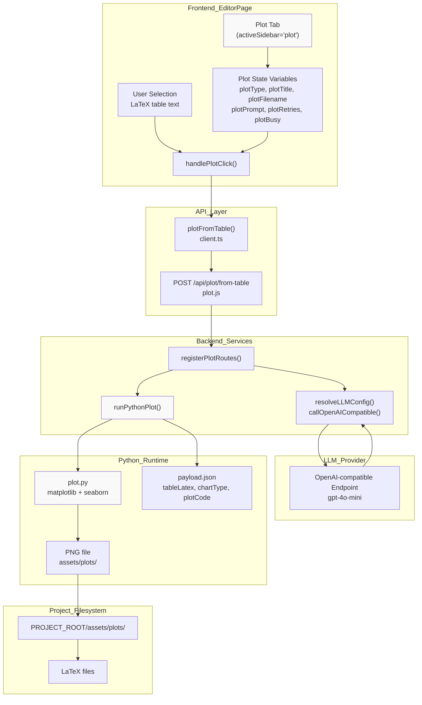
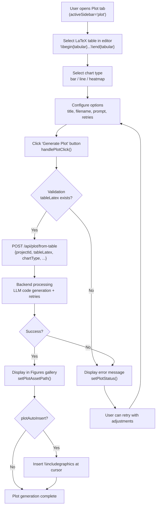
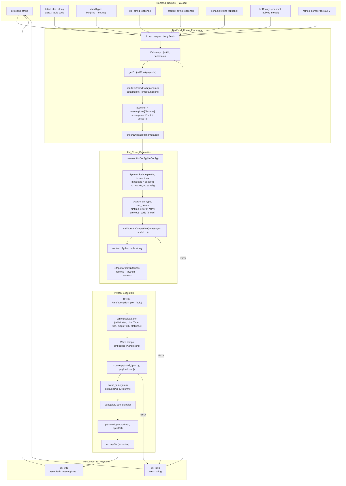
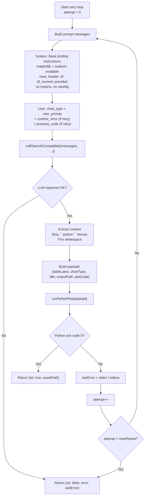
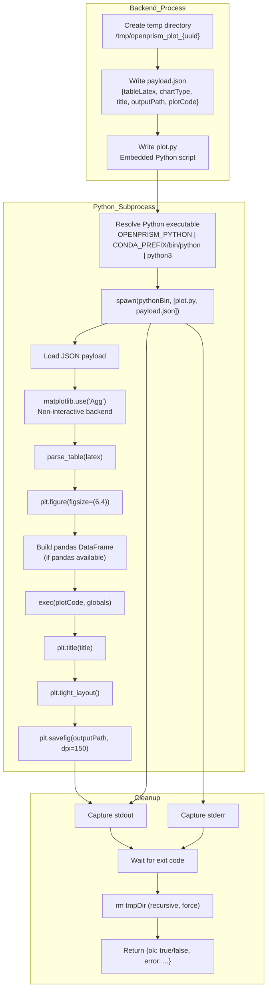
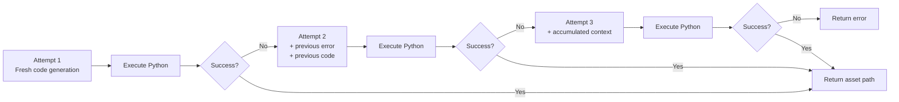
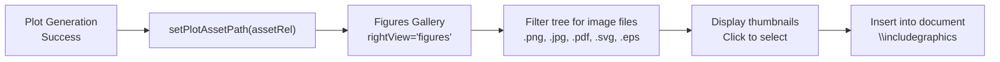

<!-- source: DeepWiki mcp.deepwiki.com · repo OpenDCAI/OpenPrism · page 6.9 Plot Generation · fetched 2026-11-02 -->

# Plot Generation

<details>
<summary>Relevant source files</summary>

The following files were used as context for generating this wiki page:

- [README.md](README.md)
- [apps/backend/src/routes/plot.js](apps/backend/src/routes/plot.js)
- [apps/backend/src/services/plotService.js](apps/backend/src/services/plotService.js)
- [apps/frontend/src/app/EditorPage.tsx](apps/frontend/src/app/EditorPage.tsx)

</details>


## Purpose and Scope

The Plot Generation feature enables users to convert LaTeX table data into publication-ready charts and figures using AI-generated Python plotting code. This feature bridges the gap between tabular data in LaTeX manuscripts and visual representations by leveraging LLM-based code generation and matplotlib/seaborn execution.

This page documents the technical implementation of the table-to-chart conversion pipeline. For AI-driven text editing capabilities, see [AI Assistant Modes](#6.2). For general asset management and file operations, see [Project Management API](#5.1).

**Sources**: [README.md:105-108](), [apps/frontend/src/app/EditorPage.tsx:1191-1199]()

---

## Feature Overview

Plot Generation allows users to select LaTeX table code from their document and automatically generate bar charts, line charts, or heatmaps through a multi-step AI pipeline. The system parses the LaTeX tabular structure, generates appropriate Python plotting code via LLM, executes the code in an isolated environment, and saves the resulting image as a project asset.

| Capability | Description |
|------------|-------------|
| **Input Format** | LaTeX `\begin{tabular}...\end{tabular}` blocks |
| **Supported Charts** | Bar, Line, Heatmap |
| **Plotting Libraries** | matplotlib (required), seaborn (optional), pandas (optional) |
| **Output Format** | PNG images at 150 DPI |
| **Asset Location** | `assets/plots/` directory within project |
| **LLM Integration** | OpenAI-compatible endpoint for code generation |
| **Retry Mechanism** | Configurable retry attempts (default: 2, max: 5) |

**Sources**: [apps/backend/src/routes/plot.js:9-12](), [apps/backend/src/services/plotService.js:122-138]()

---

## System Architecture



**Analysis**: The plot generation system implements a three-stage pipeline: (1) Frontend collection of user input and LaTeX table selection, (2) Backend LLM-based Python code generation with retry logic, and (3) Isolated Python execution producing image assets. The `EditorPage` component maintains plot-specific state variables and invokes `plotFromTable()` which calls the `/api/plot/from-table` endpoint. The backend's `registerPlotRoutes()` orchestrates LLM code generation via `callOpenAICompatible()` and execution via `runPythonPlot()`, which spawns a Python subprocess in a temporary directory.

**Sources**: [apps/frontend/src/app/EditorPage.tsx:1191-1199](), [apps/backend/src/routes/plot.js:8-77](), [apps/backend/src/services/plotService.js:13-163]()

---

## User Workflow

The complete user workflow for generating a plot from LaTeX table data involves the following steps:



**Sources**: [apps/frontend/src/app/EditorPage.tsx:2688-2782]()

---

## Request/Response Data Flow

The following diagram maps the complete data flow from user input to generated asset:



**Sources**: [apps/backend/src/routes/plot.js:9-76](), [apps/backend/src/services/plotService.js:13-163]()

---

## LaTeX Table Parsing

The Python execution environment includes a sophisticated table parser that extracts structured data from LaTeX tabular blocks. The `parse_table()` function handles common LaTeX constructs:

| LaTeX Construct | Handling Strategy |
|-----------------|-------------------|
| `\begin{tabular}{...}\end{tabular}` | Extract block, strip begin/end |
| `\toprule`, `\midrule`, `\bottomrule` | Remove (booktabs rules) |
| `\hline` | Remove (horizontal lines) |
| `\\` (row separator) | Split into rows |
| `&` (column separator) | Split into cells (respecting escapes) |
| `\multicolumn{n}{...}{content}` | Expand to `n` cells with content |
| `\multirow{...}{...}{content}` | Extract content |
| `%` (comments) | Skip commented rows |

The parser distinguishes between header rows (all non-numeric) and data rows (contain numeric values), auto-generating column names like `col1`, `col2`, etc. when no header is detected.

**Sources**: [apps/backend/src/services/plotService.js:35-65]()

---

## LLM Code Generation Pipeline

The backend implements a retry-based code generation loop with error feedback:



**Key Implementation Details**:

- **System Prompt**: Instructs the LLM to generate only Python code using `matplotlib` and optional `seaborn`, with access to `rows`, `header`, `df`, and `df_numeric` variables. Explicitly forbids `import` statements and `plt.savefig()` calls.

- **User Prompt Construction**: Combines `chartType`, optional `user_prompt`, previous errors (`runtime_error`), and previous code attempts (`previous_code`) to provide iterative feedback.

- **Retry Logic**: Configurable retry count (default 2, max 5). Each retry includes the previous error and code, allowing the LLM to self-correct.

- **Code Sanitization**: Removes markdown code fences (` ```python ` and ` ``` `) from LLM responses.

**Sources**: [apps/backend/src/routes/plot.js:25-75]()

---

## Python Execution Environment

### Process Isolation

The plot service spawns an isolated Python subprocess for each plot generation request:



### Python Executable Resolution

The system resolves the Python executable in the following priority order:

1. `process.env.OPENPRISM_PYTHON` - Explicit override via environment variable
2. `process.env.CONDA_PREFIX/bin/python` - Auto-detect Conda environment
3. `python3` - System default

**Sources**: [apps/backend/src/services/plotService.js:7-11](), [apps/backend/src/services/plotService.js:143-162]()

### Available Libraries and Variables

The executed Python environment provides:

| Variable | Type | Description |
|----------|------|-------------|
| `rows` | `list[list[str]]` | Raw table rows (2D list) |
| `header` | `list[str]` | Column names |
| `df` | `pandas.DataFrame \| None` | DataFrame (if pandas installed) |
| `df_numeric` | `pandas.DataFrame \| None` | Numeric-coerced DataFrame |
| `sns` | `module \| None` | seaborn module (if installed) |
| `plt` | `module` | matplotlib.pyplot |

**Sources**: [apps/backend/src/services/plotService.js:90-132]()

---

## Chart Types and Customization

### Supported Chart Types

The system supports three primary chart types, specified via the `chartType` parameter:

- **`bar`**: Bar charts for categorical comparisons
- **`line`**: Line charts for trends and time series
- **`heatmap`**: Heatmaps for correlation matrices and 2D distributions

The LLM receives the chart type in the prompt but has flexibility to interpret the data and generate appropriate plotting code.

### User Customization Options

The frontend exposes the following customization controls:

| Control | State Variable | Default | Description |
|---------|---------------|---------|-------------|
| Chart Type | `plotType` | `'bar'` | Dropdown: bar / line / heatmap |
| Title | `plotTitle` | `''` | Text input for chart title |
| Filename | `plotFilename` | `''` | Output filename (default: `plot_{timestamp}.png`) |
| Custom Prompt | `plotPrompt` | `''` | Additional instructions for LLM |
| Retries | `plotRetries` | `2` | Number of retry attempts (0-5) |
| Auto-Insert | `plotAutoInsert` | `true` | Automatically insert `\includegraphics` at cursor |

**Sources**: [apps/frontend/src/app/EditorPage.tsx:1191-1199]()

---

## Error Handling and Retry Mechanism

### Retry Loop Implementation

The backend implements a retry loop that feeds execution errors back to the LLM:

1. **Initial Attempt**: Generate code based on user prompt and chart type
2. **Execution**: Run Python script and capture stdout/stderr
3. **Error Check**: If exit code ≠ 0, capture error message
4. **Retry Decision**: If attempts < maxRetries, regenerate code with error context
5. **Feedback Loop**: Include previous code and error in next LLM prompt



### Common Error Scenarios

| Error Type | Cause | LLM Self-Correction Strategy |
|------------|-------|------------------------------|
| `NameError: name 'np' is not defined` | LLM generated `import numpy` | Retry reminds: no imports allowed |
| `ValueError: could not convert string to float` | Incorrect column type assumption | Retry includes error, LLM adjusts code |
| `KeyError: 'column_name'` | Wrong column name used | Retry with error prompts column check |
| `IndexError: list index out of range` | Incorrect data access | Retry guides safer indexing |

**Sources**: [apps/backend/src/routes/plot.js:43-75]()

---

## Asset Management

### File Path Generation

The backend generates a sanitized file path for each plot:

1. **User Input**: Optional `filename` parameter from frontend
2. **Default Fallback**: `plot_{timestamp}.png` if not provided
3. **Sanitization**: `sanitizeUploadPath()` prevents directory traversal
4. **Extension Check**: Auto-append `.png` if no extension provided
5. **Final Path**: `assets/plots/{sanitized_filename}`

### Storage Structure

Plot assets are stored within the project directory:

```
PROJECT_ROOT/
├── main.tex
├── references.bib
└── assets/
    └── plots/
        ├── plot_1703123456789.png
        ├── experiment_results.png
        └── accuracy_comparison.png
```

### Auto-Insert to Document

When `plotAutoInsert` is enabled, the frontend automatically inserts a `\includegraphics` command at the current cursor position:

```latex
\begin{figure}[t]
  \centering
  \includegraphics[width=0.8\linewidth]{assets/plots/experiment_results.png}
  \caption{}
  \label{fig:}
\end{figure}
```

**Sources**: [apps/backend/src/routes/plot.js:13-19](), [apps/frontend/src/app/EditorPage.tsx:2770-2780]()

---

## Frontend State Management

The `EditorPage` component maintains the following plot-related state variables:

| State Variable | Type | Purpose |
|----------------|------|---------|
| `plotType` | `'bar' \| 'line' \| 'heatmap'` | Selected chart type |
| `plotTitle` | `string` | User-provided chart title |
| `plotFilename` | `string` | Output filename |
| `plotPrompt` | `string` | Additional LLM instructions |
| `plotRetries` | `number` | Number of retry attempts |
| `plotBusy` | `boolean` | Loading state during generation |
| `plotStatus` | `string` | Status message / error text |
| `plotAssetPath` | `string` | Generated asset path (on success) |
| `plotAutoInsert` | `boolean` | Auto-insert toggle |
| `plotTypeDropdownOpen` | `boolean` | Dropdown visibility |

### Event Handlers

- **`handlePlotClick`**: Validates selection, calls API, handles response
- **Dropdown Handlers**: Manage UI state for chart type selection
- **Auto-Insert Logic**: Conditionally inserts figure code after successful generation

**Sources**: [apps/frontend/src/app/EditorPage.tsx:1191-1199](), [apps/frontend/src/app/EditorPage.tsx:2688-2782]()

---

## Integration with Figures Gallery

Generated plots automatically appear in the Figures Gallery (right panel, `rightView='figures'`). The gallery displays all image assets in the project, including plots:



Users can click on any figure thumbnail to insert it into their document at the cursor position.

**Sources**: [apps/frontend/src/app/EditorPage.tsx:3825-3885](), [apps/frontend/src/app/EditorPage.tsx:145]()

---

## API Endpoint Reference

### POST `/api/plot/from-table`

**Request Body**:
```typescript
{
  projectId: string;          // Required: Project identifier
  tableLatex: string;         // Required: LaTeX table code
  chartType: string;          // 'bar' | 'line' | 'heatmap'
  title?: string;             // Optional: Chart title
  prompt?: string;            // Optional: Additional LLM instructions
  filename?: string;          // Optional: Output filename
  llmConfig?: {               // Optional: Override LLM config
    endpoint?: string;
    apiKey?: string;
    model?: string;
  };
  retries?: number;           // Optional: Retry count (0-5, default 2)
}
```

**Response** (Success):
```typescript
{
  ok: true;
  assetPath: string;          // Relative path: 'assets/plots/filename.png'
}
```

**Response** (Error):
```typescript
{
  ok: false;
  error: string;              // Error message
}
```

**Sources**: [apps/backend/src/routes/plot.js:9-76]()

---

## Configuration

### Environment Variables

The plot service respects the following environment variable:

- **`OPENPRISM_PYTHON`**: Full path to Python executable (e.g., `/usr/bin/python3.11`)
- Fallback: `${CONDA_PREFIX}/bin/python` (if in Conda environment)
- Default: `python3`

### Python Dependencies

**Required**:
- `matplotlib` - Core plotting library

**Optional** (enhanced functionality):
- `pandas` - DataFrame support for easier data manipulation
- `seaborn` - Advanced statistical visualizations

The embedded Python script gracefully handles missing optional dependencies by setting variables to `None`.

**Sources**: [apps/backend/src/services/plotService.js:7-11](), [apps/backend/src/services/plotService.js:25-32]()

---

## Limitations and Considerations

| Limitation | Details | Workaround |
|------------|---------|------------|
| **Python Version** | Requires Python 3.x with matplotlib | Install via `pip install matplotlib` |
| **Execution Timeout** | No explicit timeout (relies on OS) | Process will eventually timeout at OS level |
| **Memory Limits** | Large tables may cause OOM errors | Reduce table size or increase system memory |
| **LaTeX Parsing** | Complex nested structures may not parse correctly | Simplify table structure before generation |
| **LLM Hallucination** | Generated code may be incorrect | Retry mechanism usually corrects issues |
| **Output Format** | Only PNG at 150 DPI | Manually adjust in generated code if needed |

**Sources**: [apps/backend/src/services/plotService.js:1-163]()

---

