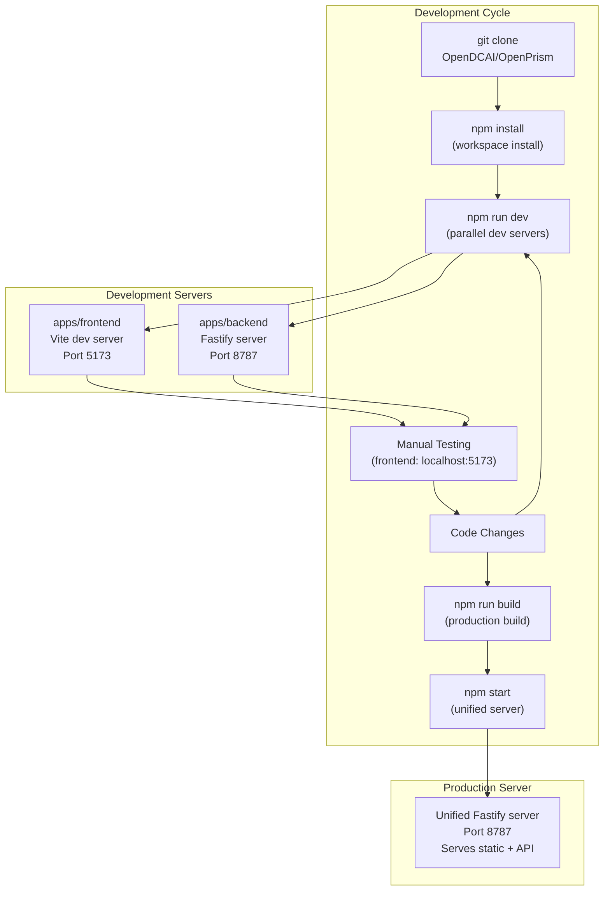
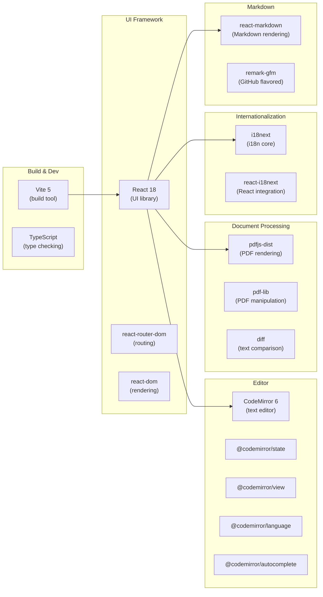
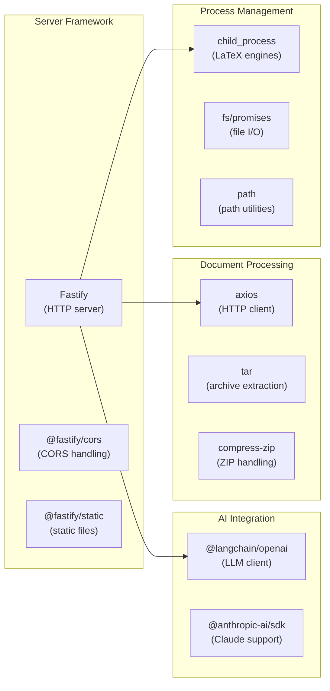
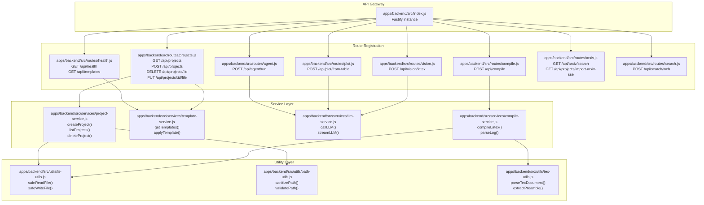
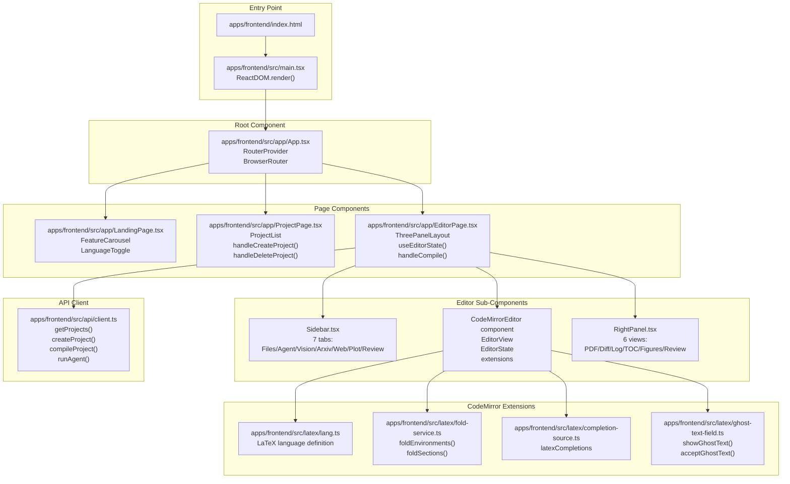
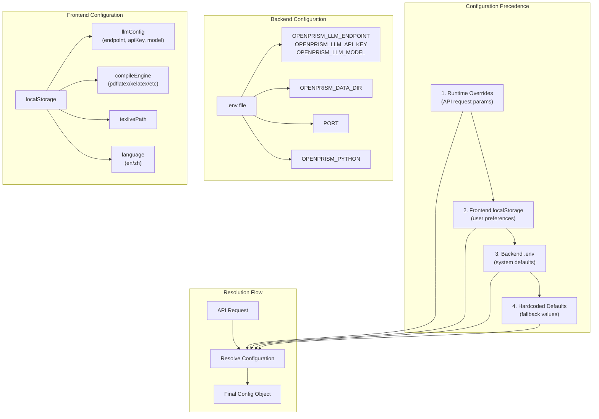

<!-- source: DeepWiki mcp.deepwiki.com · repo OpenDCAI/OpenPrism · page 7 Development Guide · fetched 2026-11-02 -->

# Development Guide

<details>
<summary>Relevant source files</summary>

The following files were used as context for generating this wiki page:

- [README.md](README.md)
- [apps/frontend/package.json](apps/frontend/package.json)

</details>


## Purpose and Scope

This document provides an overview of OpenPrism's development architecture, workflow, and common patterns for developers contributing to or extending the codebase. It covers the monorepo structure, development commands, key technologies, and architectural patterns that govern the system.

For detailed setup instructions, see [Development Setup](#7.1). For production deployment, see [Building for Production](#7.3). For feature-specific development guides, see [Frontend Development](#7.4), [Backend Development](#7.5), and [Adding AI Features](#7.6).

**Sources:** [README.md:427-443]()

---

## Development Workflow Overview

OpenPrism uses a **monorepo architecture** with separate frontend and backend applications coordinated through npm workspaces. The development process follows a three-tier pattern:



### Development Commands

| Command | Purpose | Description |
|---------|---------|-------------|
| `npm install` | Workspace install | Installs dependencies for both apps via npm workspaces |
| `npm run dev` | Start dev servers | Runs both `dev:frontend` and `dev:backend` in parallel |
| `npm run dev:frontend` | Frontend only | Starts Vite dev server on port 5173 with HMR |
| `npm run dev:backend` | Backend only | Starts Fastify server on port 8787 with auto-reload |
| `npm run build` | Production build | Builds both frontend and backend for production |
| `npm start` | Production server | Starts unified Fastify server serving static assets and API |
| `npm run preview` | Preview build | Previews production build locally |

**Sources:** [README.md:464-470](), [README.md:262-288](), [apps/frontend/package.json:5-8]()

---

## Monorepo Structure

The codebase is organized as an **npm workspaces monorepo** with clear separation between frontend and backend:

```mermaid
graph TB
    subgraph "Repository Root"
        Package["package.json<br/>(workspace config)"]
        Readme["README.md"]
        Env[".env<br/>(backend config)"]
        NodeModules["node_modules/<br/>(shared dependencies)"]
    end
    
    subgraph "apps/frontend"
        FrontendPkg["package.json<br/>(@openprism/frontend)"]
        FrontendSrc["src/"]
        FrontendApp["src/app/<br/>(React components)"]
        FrontendAPI["src/api/<br/>(API client)"]
        FrontendLatex["src/latex/<br/>(LaTeX utilities)"]
        FrontendI18n["src/locales/<br/>(translations)"]
        FrontendIndex["index.html<br/>(entry point)"]
        ViteConfig["vite.config.ts"]
    end
    
    subgraph "apps/backend"
        BackendPkg["package.json<br/>(@openprism/backend)"]
        BackendSrc["src/"]
        BackendIndex["src/index.js<br/>(Fastify server)"]
        BackendRoutes["src/routes/<br/>(API endpoints)"]
        BackendServices["src/services/<br/>(business logic)"]
        BackendUtils["src/utils/<br/>(utilities)"]
    end
    
    subgraph "Project Assets"
        Templates["templates/<br/>(LaTeX templates)"]
        Data["data/<br/>(user projects)"]
        Static["static/<br/>(marketing assets)"]
    end
    
    Package --> FrontendPkg
    Package --> BackendPkg
    
    FrontendSrc --> FrontendApp
    FrontendSrc --> FrontendAPI
    FrontendSrc --> FrontendLatex
    FrontendSrc --> FrontendI18n
    
    BackendSrc --> BackendIndex
    BackendSrc --> BackendRoutes
    BackendSrc --> BackendServices
    BackendSrc --> BackendUtils
```



### Key Directories

| Path | Purpose |
|------|---------|
| `apps/frontend/src/app/` | React components for UI (LandingPage, ProjectPage, EditorPage) |
| `apps/frontend/src/api/` | API client layer with type definitions |
| `apps/frontend/src/latex/` | LaTeX language support for CodeMirror |
| `apps/frontend/src/locales/` | i18next translation files (en, zh) |
| `apps/backend/src/routes/` | Fastify route handlers organized by feature |
| `apps/backend/src/services/` | Business logic services (LLM, compilation, etc.) |
| `apps/backend/src/utils/` | Utility modules (file system, path sanitization, etc.) |
| `templates/` | Built-in LaTeX templates (ACL, CVPR, NeurIPS, ICML) |
| `data/` | Default storage directory for user projects |

**Sources:** [README.md:427-443]()

---

## Technology Stack

### Frontend Technologies



**Sources:** [apps/frontend/package.json:10-28]()

### Backend Technologies



**Sources:** [README.md:481-486]()

---

## API Route Mapping to Code Entities

The following diagram maps HTTP endpoints to their corresponding code files and handler functions:



**Sources:** [README.md:427-443](), Diagram 3 from system architecture overview

---

## Frontend Component Hierarchy

The following diagram maps UI components to their corresponding code files and key functions:



**Sources:** [README.md:433-437](), Diagram 2 from system architecture overview

---

## Configuration Management

OpenPrism uses a **three-layer configuration system** with clear precedence:



### Configuration Resolution Logic

The backend resolves configuration in [apps/backend/src/services/llm-service.js]() with the following precedence:

1. **Request-level overrides**: `llmConfig` parameter in API request body
2. **User preferences**: Stored in browser `localStorage`, sent via API client
3. **Environment variables**: Backend `.env` file (`OPENPRISM_LLM_*`)
4. **Hardcoded defaults**: Fallback values in code

This allows system administrators to set defaults while users can override with personal API keys.

**Sources:** [README.md:334-403](), Diagram 6 from system architecture overview

---

## Common Development Patterns

### Backend Service Pattern

All backend services follow a consistent structure:

1. **Route Handler** ([apps/backend/src/routes/*.js]()) - Receives HTTP request, validates input
2. **Service Layer** ([apps/backend/src/services/*.js]()) - Implements business logic
3. **Utility Layer** ([apps/backend/src/utils/*.js]()) - Provides cross-cutting concerns
4. **External Process** - Spawns child processes for LaTeX, Python, etc.

Example flow for compilation:
```
POST /api/compile 
  → apps/backend/src/routes/compile.js 
  → apps/backend/src/services/compile-service.js::compileLatex()
  → child_process.spawn('pdflatex', ...)
  → apps/backend/src/utils/tex-utils.js::parseLog()
```

### Frontend API Call Pattern

All frontend API calls go through the centralized client:

1. **Component** triggers action (e.g., `handleCompile()`)
2. **API Client** ([apps/frontend/src/api/client.ts]()) - Makes fetch request
3. **Response handling** - Updates React state, shows UI feedback

Example:
```typescript
// In EditorPage.tsx
const handleCompile = async () => {
  const result = await client.compileProject(projectId, files, engine);
  setPdfUrl(URL.createObjectURL(result.pdf));
};
```

### State Management Pattern

OpenPrism uses **React state** for application-level data and **localStorage** for persistence:

- `useState` / `useReducer` for component state
- `localStorage` for user preferences (LLM config, language, etc.)
- **CodeMirror state** for editor-specific data (document, selections, etc.)

No Redux or external state management library is used.

**Sources:** [README.md:427-443]()

---

## Development Environment Setup

### Prerequisites Checklist

| Requirement | Version | Verification Command |
|-------------|---------|---------------------|
| Node.js | >= 18.0.0 | `node --version` |
| npm | >= 9.0.0 | `npm --version` |
| LaTeX | TexLive or Tectonic | `pdflatex --version` or `tectonic --version` |
| Python | Any (optional) | `python3 --version` |
| Git | Any | `git --version` |

### Initial Setup

```bash
# Clone repository
git clone https://github.com/OpenDCAI/OpenPrism.git
cd OpenPrism

# Install dependencies (npm workspaces)
npm install

# Create .env file (optional)
cat > .env << EOF
OPENPRISM_LLM_ENDPOINT=https://api.openai.com/v1/chat/completions
OPENPRISM_LLM_API_KEY=your-api-key
OPENPRISM_LLM_MODEL=gpt-4o-mini
OPENPRISM_DATA_DIR=./data
PORT=8787
EOF

# Start development servers
npm run dev
```

Access:
- **Frontend**: http://localhost:5173 (Vite dev server with HMR)
- **Backend**: http://localhost:8787 (Fastify server with auto-reload)

**Sources:** [README.md:262-279]()

---

## Debugging Strategies

### Frontend Debugging

- **Browser DevTools**: Standard React DevTools, network inspector
- **Vite HMR**: Hot module replacement preserves state during development
- **Console logging**: Use `console.log` for debugging (removed in production build)
- **CodeMirror state**: Inspect `editorView.state` for editor debugging

### Backend Debugging

- **Console logging**: `console.log` and `console.error` for request flow
- **Fastify logging**: Built-in logger available via `fastify.log`
- **Process output**: LaTeX and Python process stdout/stderr captured and logged
- **File system inspection**: Check `data/` directory for project files

### Common Issues

| Issue | Cause | Solution |
|-------|-------|----------|
| Compilation fails | LaTeX not installed | Install TexLive or Tectonic |
| Port already in use | Another process using 5173 or 8787 | Kill process or change PORT env var |
| API calls fail | Backend not running | Start backend with `npm run dev:backend` |
| Frontend not updating | Vite cache | Clear node_modules/.vite |
| LLM calls fail | Invalid API key | Check OPENPRISM_LLM_API_KEY or frontend settings |

**Sources:** [README.md:222-288]()

---

## Contribution Workflow

### Standard Contribution Process

1. **Fork** the repository on GitHub
2. **Clone** your fork: `git clone https://github.com/YOUR_USERNAME/OpenPrism.git`
3. **Create branch**: `git checkout -b feature/your-feature`
4. **Make changes** and test locally with `npm run dev`
5. **Build** to verify: `npm run build`
6. **Commit** changes: `git commit -m "Add feature: description"`
7. **Push** to fork: `git push origin feature/your-feature`
8. **Open PR** on main repository

### Code Organization Guidelines

- **Frontend components**: Place in `apps/frontend/src/app/`
- **API routes**: Place in `apps/backend/src/routes/`
- **Services**: Place in `apps/backend/src/services/`
- **Utilities**: Place in `apps/frontend/src/` or `apps/backend/src/utils/`
- **Tests**: Co-locate with source files (currently minimal test coverage)

### Adding New Features

For specific guidance on adding features, see:
- [Frontend Development](#7.4) for UI components
- [Backend Development](#7.5) for API endpoints and services
- [Adding AI Features](#7.6) for LLM integration

**Sources:** [README.md:456-470]()

---

## Production Deployment

### Build Process

The production build compiles both frontend and backend:

```bash
# Build both apps
npm run build

# Frontend output: apps/frontend/dist/
# Backend output: apps/backend/dist/
```

The frontend build produces optimized static assets (HTML, CSS, JS) that are served by the backend Fastify server in production mode.

### Running in Production

```bash
# Start unified production server
npm start

# Server listens on PORT (default 8787)
# Serves frontend static files + API endpoints
```

### Process Management with PM2

For production deployments, use **PM2** for process management:

```bash
# Install PM2 globally
sudo npm install -g pm2

# Start with PM2
pm2 start npm --name "openprism" -- start

# Save PM2 configuration
pm2 save

# Enable auto-start on system boot
pm2 startup
```

PM2 provides:
- Automatic restart on crashes
- Log management
- Process monitoring
- Startup script generation

**Sources:** [README.md:280-328]()

---

## Next Steps

For detailed information on specific development topics, continue to:

- **[Development Setup](#7.1)** - Detailed environment setup across different operating systems
- **[Project Structure](#7.2)** - In-depth exploration of monorepo organization
- **[Building for Production](#7.3)** - Production build optimization and deployment
- **[Frontend Development](#7.4)** - React patterns, component development, CodeMirror integration
- **[Backend Development](#7.5)** - Fastify route development, service patterns, API design
- **[Adding AI Features](#7.6)** - Extending LLM capabilities, adding new agent tasks
- **[Styling and Theming](#7.7)** - CSS architecture, design system, component styling

For architectural understanding, see **[Architecture](#3)** for comprehensive system design documentation.

**Sources:** [README.md:1-509]()

---

