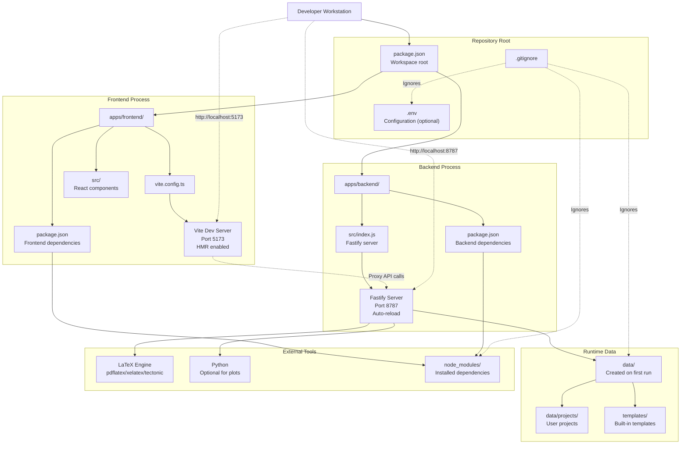
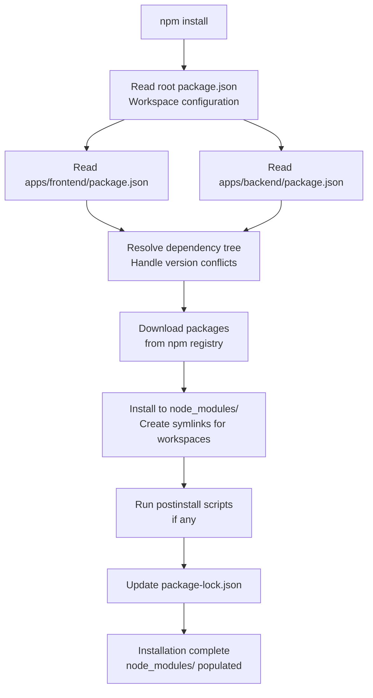
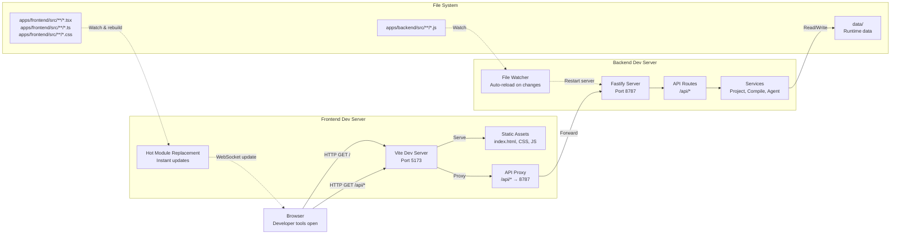
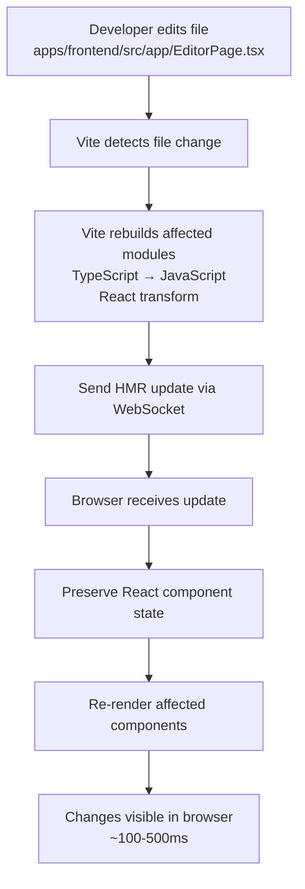

<!-- source: DeepWiki mcp.deepwiki.com · repo OpenDCAI/OpenPrism · page 7.1 Development Setup · fetched 2026-11-02 -->

# Development Setup

<details>
<summary>Relevant source files</summary>

The following files were used as context for generating this wiki page:

- [.gitignore](.gitignore)
- [README.md](README.md)
- [apps/frontend/package.json](apps/frontend/package.json)
- [apps/frontend/src/latex/engine.ts](apps/frontend/src/latex/engine.ts)

</details>


This document provides step-by-step instructions for setting up a local development environment for OpenPrism. It covers prerequisite installation, dependency management, environment configuration, and starting the development servers with hot-reload enabled. This guide is intended for developers who want to contribute to or extend the OpenPrism codebase.

For end-user installation and production deployment, see [Installation](#2.1) and [Building for Production](#7.3). For understanding the project's directory structure, see [Project Structure](#7.2).

---

## Prerequisites

### Required Software

OpenPrism requires the following software to be installed on your development machine:

| Software | Minimum Version | Purpose | Verification Command |
|----------|----------------|---------|---------------------|
| Node.js | 18.0.0 | JavaScript runtime for frontend and backend | `node --version` |
| npm | 9.0.0 | Package manager | `npm --version` |
| LaTeX Engine | N/A | PDF compilation (TexLive or Tectonic) | `pdflatex --version` or `tectonic --version` |
| Git | Any recent | Version control | `git --version` |

**Sources:** [README.md:227-229]()

### LaTeX Engine Installation

OpenPrism supports multiple LaTeX compilation engines. Install at least one of the following:

**TexLive (Recommended for Development)**

- **Linux (Ubuntu/Debian):**
  ```bash
  sudo apt-get update
  sudo apt-get install texlive-full
  ```
  
- **Linux (CentOS/RHEL):**
  ```bash
  sudo yum install texlive texlive-*
  ```
  
- **macOS:**
  ```bash
  brew install --cask mactex
  ```
  
- **Windows:**
  Download installer from https://www.tug.org/texlive/

**Tectonic (Lightweight Alternative)**

- **Linux/macOS:**
  ```bash
  curl --proto '=https' --tlsv1.2 -fsSL https://drop-sh.fullyjustified.net | sh
  ```
  
- **Windows:**
  Download installer from https://tectonic-typesetting.github.io/

The backend compilation service ([apps/backend/src/routes/compile.js]()) supports automatic fallback between engines. TexLive full installation is approximately 5-7GB, while Tectonic is more lightweight but has fewer features.

**Sources:** [README.md:232-257]()

### Optional Dependencies

| Software | Purpose | Required For |
|----------|---------|-------------|
| Python 3.x | Plot generation service | Plot-from-table feature |
| matplotlib, pandas, seaborn | Charting libraries | Plot generation |

Python dependencies are only required if you plan to use or develop the plot generation feature ([apps/backend/src/services/plot.js]()).

---

## Repository Setup

### Cloning the Repository

```bash
# Clone the repository
git clone https://github.com/OpenDCAI/OpenPrism.git

# Navigate to project root
cd OpenPrism
```

The repository is organized as a monorepo with the following structure:

```
OpenPrism/
├── apps/
│   ├── frontend/          # React + Vite application
│   └── backend/           # Fastify server
├── templates/             # Built-in LaTeX templates
├── data/                  # Runtime data directory (created on first run)
└── package.json           # Root workspace configuration
```

**Sources:** [README.md:264-268](), [README.md:427-442]()

### Development Environment Architecture



**Sources:** [README.md:427-442](), [.gitignore:1-11]()

---

## Dependency Installation

### Installing Node.js Dependencies

From the repository root, install all dependencies for both frontend and backend:

```bash
# Install all dependencies
npm install
```

This command installs dependencies defined in:
- Root [package.json]() (workspace configuration)
- [apps/frontend/package.json:10-28]() (frontend dependencies)
- [apps/backend/package.json]() (backend dependencies)

### Frontend Dependencies

Key frontend dependencies installed by this process:

| Package | Version | Purpose |
|---------|---------|---------|
| `react` | ^18.2.0 | UI framework |
| `react-router-dom` | ^6.22.3 | Client-side routing |
| `codemirror` | ^6.0.1 | Code editor core |
| `@codemirror/*` | ^6.x | Editor extensions |
| `pdfjs-dist` | ^3.11.174 | PDF rendering |
| `i18next` | ^23.12.2 | Internationalization |
| `react-i18next` | ^14.1.3 | React i18n bindings |
| `react-markdown` | ^10.1.0 | Markdown rendering |
| `vite` | ^5.0.10 | Build tool and dev server |

**Sources:** [apps/frontend/package.json:10-37]()

### Dependency Installation Flow



**Sources:** [README.md:269-270](), [apps/frontend/package.json:1-38]()

---

## Environment Configuration

### Development Environment Variables

Create a `.env` file in the repository root for local development configuration. This file is optional for development but recommended for configuring LLM integration.

**Example `.env` for Development:**

```bash
# LLM Configuration (optional for development)
OPENPRISM_LLM_ENDPOINT=https://api.openai.com/v1/chat/completions
OPENPRISM_LLM_API_KEY=sk-your-development-key
OPENPRISM_LLM_MODEL=gpt-4o-mini

# Data storage path (defaults to ./data)
OPENPRISM_DATA_DIR=./data

# Backend service port (defaults to 8787)
PORT=8787

# Python executable path (optional, for plot generation)
OPENPRISM_PYTHON=python3
```

**Sources:** [README.md:336-349]()

### Configuration Precedence

The system resolves configuration in the following order:

1. **Runtime overrides** - API request parameters
2. **Frontend localStorage** - User settings panel
3. **Backend .env file** - Server defaults
4. **Hardcoded defaults** - Fallback values

This allows developers to set system-wide defaults in `.env` while users can override them in the UI settings panel.

**Sources:** [README.md:332-349]()

### Git Ignored Files

The following files and directories are excluded from version control ([.gitignore:1-11]()):

```
node_modules/          # Installed dependencies
.DS_Store              # macOS system files
.env                   # Environment configuration
.env.local             # Local overrides
apps/frontend/dist/    # Build output
apps/frontend/.vite/   # Vite cache
apps/backend/.cache/   # Backend cache
data/                  # Runtime user data
```

Never commit `.env` files or the `data/` directory to version control.

**Sources:** [.gitignore:1-11]()

---

## Starting Development Servers

### Running Both Servers Concurrently

The recommended approach for development is to run both frontend and backend simultaneously:

```bash
# Start both frontend and backend dev servers
npm run dev
```

This command (defined in root `package.json`) starts:
- **Frontend:** Vite dev server on `http://localhost:5173`
- **Backend:** Fastify server on `http://localhost:8787`

The frontend Vite configuration includes a proxy that forwards `/api/*` requests to the backend server, enabling seamless development.

**Sources:** [README.md:272-274](), [README.md:276-278]()

### Running Servers Individually

For debugging or focused development on one layer, run servers individually:

```bash
# Frontend only
npm run dev:frontend

# Backend only
npm run dev:backend
```

**Sources:** [README.md:464-470]()

### Development Server Architecture



**Sources:** [apps/frontend/package.json:6](), [README.md:276-278]()

### Port Configuration

Default development ports:

| Service | Port | Configurable Via | Default |
|---------|------|------------------|---------|
| Frontend (Vite) | 5173 | `vite.config.ts` | 5173 |
| Backend (Fastify) | 8787 | `.env` → `PORT` | 8787 |

To change the backend port, modify the `PORT` environment variable in `.env`. The frontend Vite proxy configuration must match this port.

**Sources:** [README.md:276-278]()

---

## Verifying Installation

### Health Check Endpoints

After starting the servers, verify they are running correctly:

**Frontend Health Check:**
```bash
curl http://localhost:5173
# Should return HTML of the landing page
```

**Backend Health Check:**
```bash
curl http://localhost:8787/api/health
# Should return: {"status":"ok"}
```

### Testing LaTeX Compilation

Verify LaTeX engine availability:

```bash
# Test pdflatex
pdflatex --version

# Test xelatex
xelatex --version

# Test tectonic (if installed)
tectonic --version
```

The backend compilation service ([apps/backend/src/routes/compile.js]()) will automatically detect and fall back to available engines.

### Testing LLM Integration

If you configured LLM credentials in `.env`, test the agent endpoint:

```bash
curl -X POST http://localhost:8787/api/agent/run \
  -H "Content-Type: application/json" \
  -d '{
    "task": "polish",
    "mode": "direct",
    "selectedText": "This is a test sentence.",
    "llmConfig": {
      "endpoint": "YOUR_ENDPOINT",
      "apiKey": "YOUR_KEY",
      "model": "gpt-4o-mini"
    }
  }'
```

**Sources:** [README.md:301-303]()

---

## Development Workflow

### Hot Module Replacement (HMR)

The Vite dev server provides instant feedback for frontend changes:



**Sources:** [apps/frontend/package.json:6]()

### Backend Auto-Reload

When backend files change, the server automatically restarts:

1. Developer modifies [apps/backend/src/routes/projects.js]()
2. File watcher detects change
3. Fastify process restarts
4. Active API connections are terminated
5. Frontend automatically reconnects

### Common Development Commands

| Command | Description | Use Case |
|---------|-------------|----------|
| `npm run dev` | Start both servers | Full-stack development |
| `npm run dev:frontend` | Start frontend only | UI/UX development |
| `npm run dev:backend` | Start backend only | API/service development |
| `npm run build` | Build for production | Pre-deployment testing |
| `npm run preview` | Preview production build | Testing built artifacts |

**Sources:** [README.md:464-470](), [apps/frontend/package.json:5-8]()

---

## Troubleshooting

### Common Issues

**Issue: `EADDRINUSE` - Port Already in Use**

```bash
# Find process using port 5173 or 8787
lsof -i :5173
lsof -i :8787

# Kill the process
kill -9 <PID>
```

**Issue: `Module not found` Errors**

```bash
# Clear node_modules and reinstall
rm -rf node_modules package-lock.json
npm install
```

**Issue: LaTeX Compilation Fails**

```bash
# Verify LaTeX installation
which pdflatex
which xelatex
which tectonic

# Check LaTeX engine output
pdflatex --version
```

The backend compilation service ([apps/backend/src/routes/compile.js]()) supports automatic fallback between engines if one fails.

**Issue: Frontend Cannot Connect to Backend**

1. Verify backend is running: `curl http://localhost:8787/api/health`
2. Check Vite proxy configuration in [apps/frontend/vite.config.ts]()
3. Ensure `PORT` in `.env` matches Vite proxy target

### Development Environment Reset

To completely reset your development environment:

```bash
# Stop all servers (Ctrl+C)

# Remove all installed dependencies
rm -rf node_modules
rm -rf apps/frontend/node_modules
rm -rf apps/backend/node_modules
rm package-lock.json

# Remove build artifacts
rm -rf apps/frontend/dist
rm -rf apps/frontend/.vite
rm -rf apps/backend/.cache

# Remove runtime data (optional - destroys projects)
rm -rf data/

# Reinstall
npm install

# Restart servers
npm run dev
```

**Sources:** [.gitignore:1-11](), [README.md:264-274]()

### System Resource Requirements

Minimum recommended resources for development:

| Resource | Minimum | Recommended |
|----------|---------|-------------|
| RAM | 4GB | 8GB+ |
| Disk Space | 10GB free | 20GB+ free |
| CPU | 2 cores | 4+ cores |

The largest disk space requirement comes from TexLive (5-7GB) and `node_modules` (~500MB).

**Sources:** [README.md:258]()

---

## Next Steps

After successfully setting up your development environment:

1. **Understand the codebase:** See [Project Structure](#7.2) for directory organization
2. **Build for production:** See [Building for Production](#7.3)
3. **Frontend development:** See [Frontend Development](#7.4)
4. **Backend development:** See [Backend Development](#7.5)
5. **Add features:** See [Adding AI Features](#7.6)

**Sources:** [README.md:427-442]()

---

