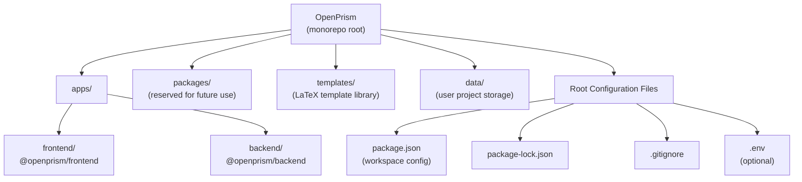
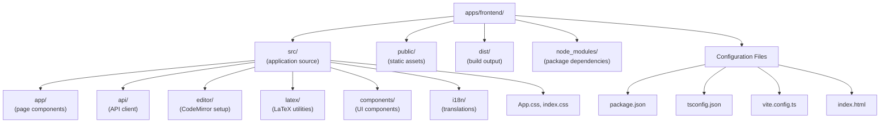
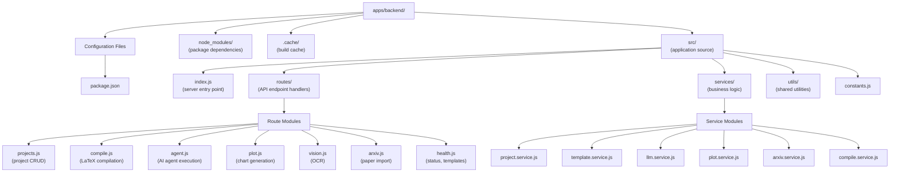
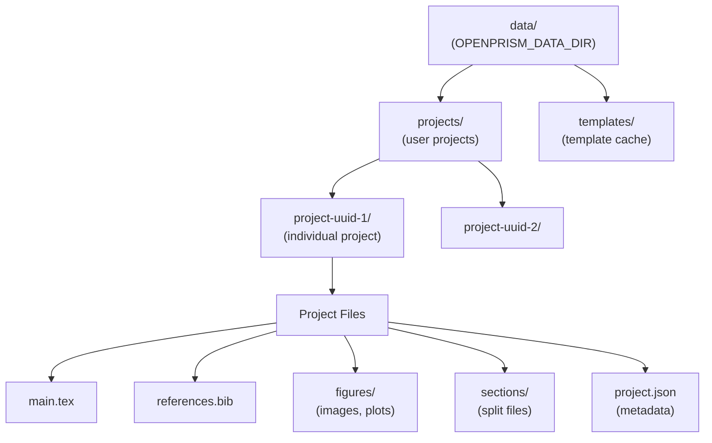
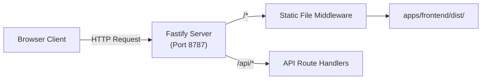
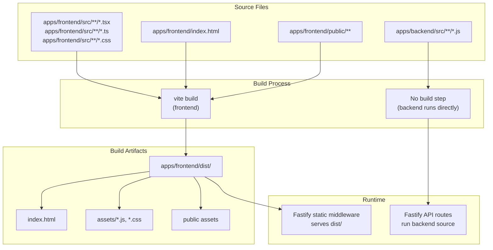

<!-- source: DeepWiki mcp.deepwiki.com · repo OpenDCAI/OpenPrism · page 7.2 Project Structure · fetched 2026-11-02 -->

# Project Structure

<details>
<summary>Relevant source files</summary>

The following files were used as context for generating this wiki page:

- [.gitignore](.gitignore)
- [README.md](README.md)
- [apps/frontend/src/latex/engine.ts](apps/frontend/src/latex/engine.ts)
- [package-lock.json](package-lock.json)

</details>


This document describes the directory organization, file layout, and architectural boundaries of the OpenPrism codebase. It serves as a reference for developers navigating the monorepo and understanding where different types of code and configuration reside.

For information about setting up the development environment, see [Development Setup](#7.1). For build and deployment procedures, see [Building for Production](#7.3).

---

## Monorepo Organization

OpenPrism uses a monorepo structure with npm workspaces to manage multiple packages. The root [`package-lock.json:1-18`]() defines two workspace patterns: `apps/*` and `packages/*`.



**Sources:** [`package-lock.json:1-18`](), [`README.md:427-442`](), [`.gitignore:1-10`]()

---

## Root Directory Structure

The repository root contains workspace management and deployment configuration:

| Path | Purpose | Managed By |
|------|---------|-----------|
| `apps/` | Application packages (frontend, backend) | Developer |
| `packages/` | Shared libraries (reserved for future use) | Developer |
| `templates/` | Built-in LaTeX templates (ACL, CVPR, NeurIPS, ICML) | System |
| `data/` | Default user project storage location | Runtime |
| `node_modules/` | Root-level dependencies | npm |
| `package.json` | Workspace definition and dev scripts | Developer |
| `package-lock.json` | Dependency lock file | npm |
| `.gitignore` | VCS exclusions | Developer |
| `.env` | Optional environment variable overrides | Deployment |
| `README.md` | User-facing documentation | Developer |

The `.gitignore` excludes build artifacts, environment files, and the `data/` directory from version control:

```
node_modules/
.DS_Store
.env
.env.local
apps/frontend/dist/
apps/frontend/.vite/
apps/backend/.cache/
data/
```

**Sources:** [`.gitignore:1-10`](), [`README.md:427-442`]()

---

## Frontend Application Structure

The frontend package (`apps/frontend/`) implements the React-based user interface using Vite as the build tool.

### Frontend Directory Layout



### Key Frontend Directories

#### `src/app/` - Page Components

Contains the main application pages and routing logic:

| File | Purpose |
|------|---------|
| `App.tsx` | Root component with router configuration |
| `LandingPage.tsx` | Marketing/welcome page |
| `ProjectPage.tsx` | Project list management interface |
| `EditorPage.tsx` | Main editing workspace (three-panel layout) |

**Sources:** [`README.md:432-436`]()

#### `src/api/` - API Client Layer

Contains the centralized HTTP client for backend communication:

| File | Purpose |
|------|---------|
| `client.ts` | Fetch-based API client with typed endpoints |

The `client.ts` module provides functions for all backend routes including project management, compilation, AI agent execution, and template operations.

**Sources:** [`README.md:432-436`]()

#### `src/editor/` - CodeMirror Integration

Houses the CodeMirror 6 editor configuration, extensions, and language support:

- LaTeX syntax highlighting
- Autocompletion sources
- Code folding services
- Ghost text for AI suggestions

**Sources:** System architecture diagrams

#### `src/latex/` - LaTeX Type Definitions

Contains TypeScript type definitions for LaTeX compilation:

```typescript
// apps/frontend/src/latex/engine.ts
export interface CompileOutcome {
  pdf: Uint8Array;
  log: string;
  status: number;
  engine: string;
}
```

**Sources:** [`apps/frontend/src/latex/engine.ts:1-6`]()

#### `src/components/` - Reusable UI Components

Contains shared React components used across pages (buttons, modals, panels, etc.).

#### `src/i18n/` - Internationalization

Contains translation files and i18next configuration for English and Chinese language support.

**Sources:** System architecture diagrams

### Frontend Build Artifacts

| Path | Generated By | Purpose |
|------|--------------|---------|
| `dist/` | Vite build | Production-optimized bundle |
| `.vite/` | Vite dev server | Development cache |

These directories are excluded from version control via `.gitignore`.

**Sources:** [`.gitignore:5-6`]()

---

## Backend Application Structure

The backend package (`apps/backend/`) implements the Fastify-based API server with services for compilation, AI integration, and project management.

### Backend Directory Layout



### Backend Code Organization

#### `src/index.js` - Server Entry Point

Main Fastify server initialization, plugin registration, and route mounting. This file:
- Creates the Fastify instance
- Registers CORS and multipart plugins
- Mounts all route handlers
- Starts the HTTP server on configured port

**Sources:** [`README.md:438`]()

#### `src/routes/` - API Route Handlers

Each route file registers endpoints for a specific domain:

| File | Routes Prefix | Purpose |
|------|--------------|---------|
| `health.js` | `/api/health`, `/api/templates` | Health checks, template listing |
| `projects.js` | `/api/projects/*` | Project CRUD, file operations, import |
| `compile.js` | `/api/compile` | LaTeX compilation requests |
| `agent.js` | `/api/agent/run` | AI agent execution |
| `plot.js` | `/api/plot/from-table` | Python plotting from table data |
| `vision.js` | `/api/vision/latex` | Image-to-LaTeX OCR |
| `arxiv.js` | `/api/arxiv/*` | arXiv search and import |

**Sources:** System architecture diagrams

#### `src/services/` - Business Logic Layer

Service modules encapsulate domain logic and external integrations:

| Service | Responsibility |
|---------|---------------|
| `project.service.js` | Project lifecycle, file I/O, metadata |
| `template.service.js` | Template discovery, manifest parsing |
| `llm.service.js` | OpenAI-compatible LLM API abstraction |
| `compile.service.js` | LaTeX engine execution, log parsing |
| `plot.service.js` | Python script generation and execution |
| `arxiv.service.js` | arXiv API, paper download, extraction |

**Sources:** System architecture diagrams

#### `src/utils/` - Shared Utilities

Cross-cutting utility modules:
- File system operations with path sanitization
- LaTeX parsing helpers
- i18n localization utilities

#### `src/constants.js` - Configuration Constants

Defines system defaults including:
- Default data directory paths
- Supported LaTeX engines
- Template categories

**Sources:** System architecture diagrams

---

## Data Storage Structure

The `data/` directory (or path specified by `OPENPRISM_DATA_DIR` environment variable) stores all user-generated content and cached templates.

### Data Directory Structure Diagram



### Project Metadata Schema

Each project directory contains a `project.json` file with metadata:

```json
{
  "id": "unique-project-id",
  "name": "Project Name",
  "template": "acl-2023",
  "createdAt": "2024-01-01T00:00:00.000Z",
  "updatedAt": "2024-01-02T12:00:00.000Z",
  "tags": ["conference", "nlp"]
}
```

**Sources:** [`README.md:404-413`]()

---

## Template System Structure

The `templates/` directory at repository root contains built-in LaTeX templates for academic conferences.

### Template Organization

```
templates/
├── acl-2023/
│   ├── template.json      # Manifest (name, category, entryPoint)
│   ├── main.tex           # Template main file
│   ├── acl.cls            # Conference class file
│   └── references.bib     # Sample bibliography
├── cvpr-2024/
│   ├── template.json
│   ├── main.tex
│   └── cvpr.sty
├── neurips-2023/
│   ├── template.json
│   ├── main.tex
│   └── neurips.sty
└── icml-2024/
    ├── template.json
    ├── main.tex
    └── icml.sty
```

### Template Manifest Format

Each template's `template.json` describes its metadata:

```json
{
  "name": "ACL 2023",
  "category": "nlp",
  "entryPoint": "main.tex",
  "description": "Association for Computational Linguistics 2023"
}
```

The `template.service.js` service discovers and parses these manifests to populate the template gallery UI.

**Sources:** [`README.md:439`]()

---

## Configuration File Locations

### Root-Level Configuration

| File | Purpose | Format |
|------|---------|--------|
| `package.json` | Workspace definition, scripts, root dependencies | JSON |
| `.env` | Environment variable overrides (optional) | Shell variables |
| `.gitignore` | VCS exclusions | Text patterns |

### Frontend Configuration

| File | Purpose |
|------|---------|
| `apps/frontend/package.json` | Frontend dependencies and metadata |
| `apps/frontend/vite.config.ts` | Vite build configuration |
| `apps/frontend/tsconfig.json` | TypeScript compiler options |
| `apps/frontend/index.html` | HTML entry point |

### Backend Configuration

| File | Purpose |
|------|---------|
| `apps/backend/package.json` | Backend dependencies and metadata |
| `apps/backend/src/constants.js` | System constants and defaults |

**Sources:** System architecture diagrams

---

## Environment Variable Configuration

The backend reads configuration from environment variables (`.env` file or system environment):

| Variable | Purpose | Default |
|----------|---------|---------|
| `OPENPRISM_LLM_ENDPOINT` | LLM API endpoint URL | None |
| `OPENPRISM_LLM_API_KEY` | LLM authentication key | None |
| `OPENPRISM_LLM_MODEL` | Default model name | `gpt-4o-mini` |
| `OPENPRISM_DATA_DIR` | Project storage location | `./data` |
| `OPENPRISM_PYTHON` | Python executable path | `python3` |
| `PORT` | Backend server port | `8787` |

**Configuration Precedence:**
1. Runtime overrides (per-request parameters)
2. Frontend localStorage (user preferences)
3. Backend `.env` file (system defaults)
4. Hardcoded defaults in `constants.js`

**Sources:** [`README.md:334-349`](), [`.gitignore:3-4`]()

---

## Build Output and Deployment Artifacts

### Development Mode

In development (`npm run dev`), both frontend and backend run as separate processes:

| Process | Port | Hot Reload |
|---------|------|------------|
| Frontend (Vite dev server) | 5173 | Yes |
| Backend (Fastify) | 8787 | Yes (nodemon) |

### Production Mode

After `npm run build`, the build process generates:

| Path | Generated By | Contains |
|------|--------------|----------|
| `apps/frontend/dist/` | Vite | Optimized HTML, JS, CSS bundles |
| `apps/backend/src/` | None (JS source) | Backend source (no compilation needed) |

In production (`npm start`), Fastify serves both:
- Static frontend assets from `apps/frontend/dist/`
- API endpoints at `/api/*`

**Unified Server Architecture:**


**Sources:** [`README.md:260-288`]()

---

## Workspace Dependencies

The monorepo uses npm workspaces to manage inter-package dependencies and shared modules.

### Root-Level Dependencies

Defined in root `package.json`:
- `pdf-lib`: PDF manipulation library (used by backend)
- `concurrently`: Run multiple commands (used in `npm run dev`)

### Frontend Dependencies

Key packages from `apps/frontend/package.json`:
- `react`, `react-dom`: UI framework
- `react-router-dom`: Client-side routing
- `codemirror`, `@codemirror/*`: Editor infrastructure
- `pdfjs-dist`: PDF rendering
- `i18next`, `react-i18next`: Internationalization
- `diff`: Text diffing for change preview
- `vite`: Build tool

### Backend Dependencies

Key packages from `apps/backend/package.json`:
- `fastify`: HTTP server framework
- `@fastify/cors`, `@fastify/multipart`: Fastify plugins
- `langchain`, `@langchain/openai`: LLM integration
- `tar`, `unzipper`: Archive handling (for arXiv imports)
- `diff`: Text patching
- `fast-xml-parser`: XML parsing (for arXiv metadata)

**Sources:** [`package-lock.json:6-65`]()

---

## Source-to-Build Mapping

This diagram shows how source code files are transformed into runtime artifacts:



**Sources:** [`README.md:282-288`](), [`.gitignore:5-7`]()

---

## Directory Ownership and Lifecycle

| Directory | Created By | Modified By | Version Controlled |
|-----------|------------|-------------|-------------------|
| `apps/frontend/src/` | Developer | Developer | Yes |
| `apps/backend/src/` | Developer | Developer | Yes |
| `templates/` | Developer | Developer | Yes |
| `node_modules/` | npm install | npm | No |
| `apps/frontend/dist/` | vite build | vite build | No |
| `data/` | Backend runtime | Backend runtime | No |
| `.env` | Deployment | Deployment | No |

**Sources:** [`.gitignore:1-10`]()

---

