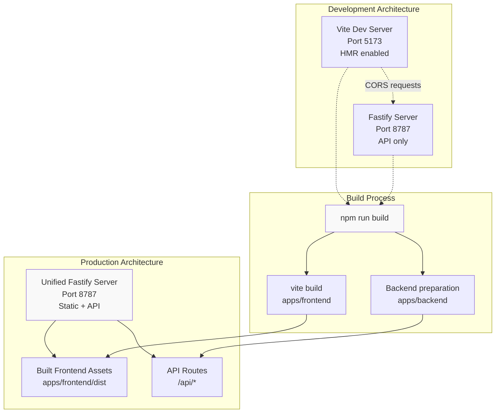
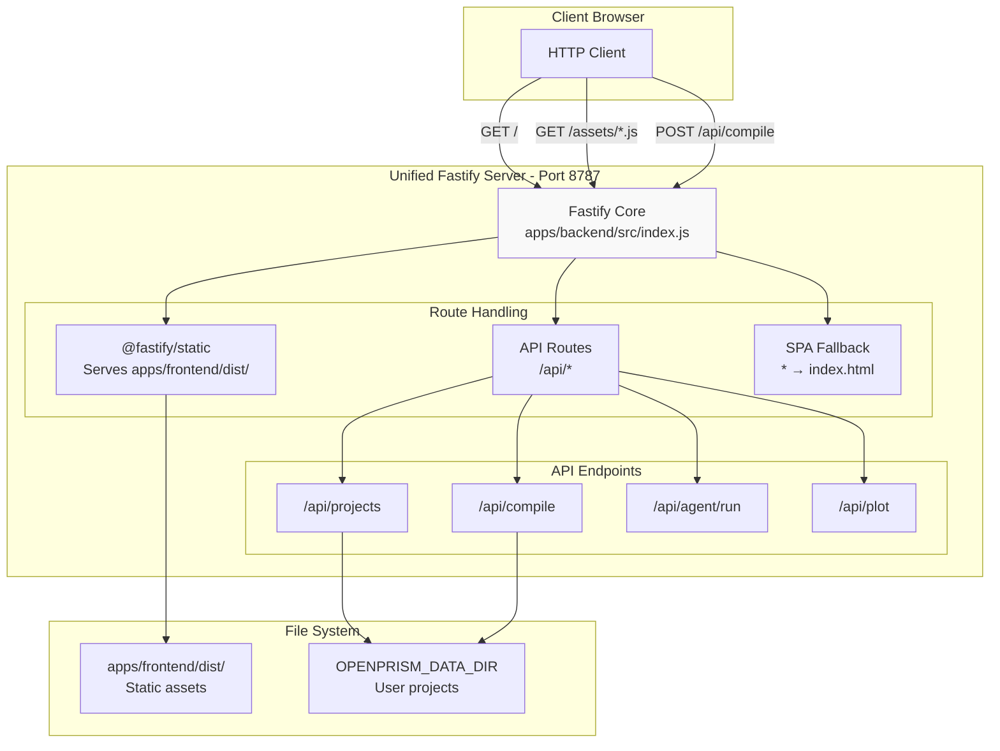
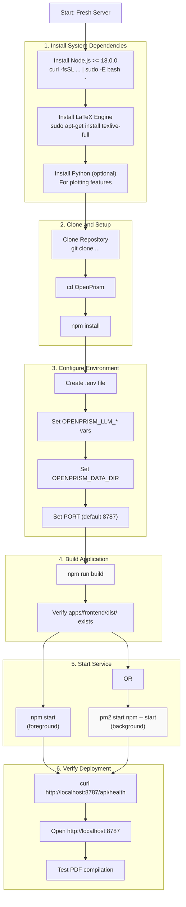
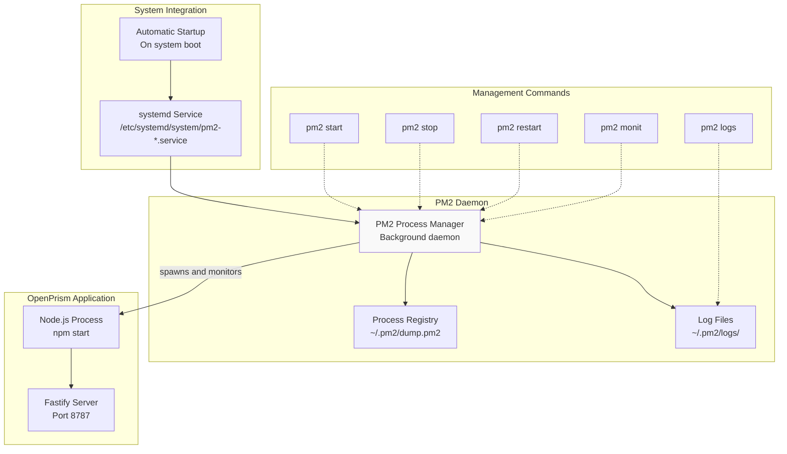

<!-- source: DeepWiki mcp.deepwiki.com · repo OpenDCAI/OpenPrism · page 7.3 Building for Production · fetched 2026-11-02 -->

# Building for Production

<details>
<summary>Relevant source files</summary>

The following files were used as context for generating this wiki page:

- [README.md](README.md)
- [apps/frontend/package.json](apps/frontend/package.json)

</details>


## Purpose and Scope

This document describes the production build process for OpenPrism, including frontend compilation, backend preparation, unified server architecture, and deployment workflows. It covers build scripts, optimization strategies, process management with PM2, and production-specific configuration.

For instructions on running the application in development mode, see [Running the Application](#2.3). For initial environment setup, see [Development Setup](#7.1). For general configuration options, see [Configuration](#2.2).

---

## Build Process Overview

OpenPrism's production build transforms the development codebase into an optimized, deployable application. The process differs significantly from development mode:

**Development Mode:**
- Frontend: Vite dev server on port 5173 with Hot Module Replacement (HMR)
- Backend: Fastify server on port 8787 with auto-reload
- Separate processes with CORS-enabled cross-origin requests

**Production Mode:**
- Unified Fastify server serving both static assets and API endpoints
- Optimized frontend bundle with minification and code splitting
- Single port (default 8787) for all traffic
- No HMR or auto-reload overhead



**Sources:** [README.md:262-288](), [README.md:290-328]()

---

## Build Scripts

The root `package.json` defines workspace-level build commands that orchestrate frontend and backend builds:

| Script | Command | Purpose |
|--------|---------|---------|
| `npm run build` | Builds both frontend and backend | Primary production build command |
| `npm run build:frontend` | `cd apps/frontend && npm run build` | Builds frontend only via Vite |
| `npm run build:backend` | Backend preparation (if applicable) | Prepares backend for production |
| `npm start` | Starts unified production server | Launches Fastify with static serving |

**Frontend Build Script:**

The frontend uses Vite's production build pipeline defined in [apps/frontend/package.json:7]():

```json
"build": "vite build"
```

This command:
1. Compiles TypeScript to JavaScript
2. Bundles React components and dependencies
3. Minifies and tree-shakes code
4. Generates optimized static assets in `apps/frontend/dist/`
5. Creates source maps for debugging (if configured)

**Sources:** [apps/frontend/package.json:5-8](), [README.md:283-288]()

---

## Frontend Build Process

### Vite Build Pipeline

Vite transforms the React application into a production-ready bundle optimized for performance and browser compatibility:

```mermaid
graph TB
    subgraph "Source Files"
        TSX["TypeScript/TSX Files<br/>apps/frontend/src/"]
        CSS["CSS Stylesheets<br/>apps/frontend/src/*.css"]
        Assets["Static Assets<br/>images, fonts"]
    end
    
    subgraph "Vite Build Process"
        TypeScript["TypeScript Compilation<br/>TSX → JS"]
        Bundling["Module Bundling<br/>Rollup-based"]
        Minification["Code Minification<br/>Terser"]
        CodeSplit["Code Splitting<br/>Lazy loading"]
        AssetOptim["Asset Optimization<br/>Hashing, compression"]
    end
    
    subgraph "Output: apps/frontend/dist/"
        IndexHTML["index.html<br/>Entry point"]
        JSBundles["assets/*.js<br/>Bundled code"]
        CSSBundles["assets/*.css<br/>Processed styles"]
        OptimAssets["assets/*<br/>Optimized assets"]
    end
    
    TSX --> TypeScript
    CSS --> Bundling
    Assets --> AssetOptim
    
    TypeScript --> Bundling
    Bundling --> Minification
    Minification --> CodeSplit
    CodeSplit --> JSBundles
    
    CSS --> CSSBundles
    AssetOptim --> OptimAssets
    
    IndexHTML -.->|"references"| JSBundles
    IndexHTML -.->|"references"| CSSBundles
    
    style "Vite Build Process" fill:#f9f9f9
```

### Build Output Structure

After running `npm run build`, the frontend build output appears in `apps/frontend/dist/`:

```
apps/frontend/dist/
├── index.html              # Entry HTML with asset references
├── assets/
│   ├── index-[hash].js     # Main application bundle
│   ├── index-[hash].css    # Compiled styles
│   ├── vendor-[hash].js    # Third-party dependencies (code-split)
│   ├── EditorPage-[hash].js  # Lazy-loaded route chunks
│   └── ...                 # Other chunked modules
└── [static assets]         # Images, fonts, etc.
```

### Key Optimizations

| Optimization | Description | Impact |
|--------------|-------------|--------|
| **Tree Shaking** | Removes unused exports from dependencies | Reduces bundle size by 30-50% |
| **Code Splitting** | Separates routes and vendors into chunks | Faster initial load time |
| **Minification** | Removes whitespace, shortens identifiers | Reduces transfer size by 40-60% |
| **Asset Hashing** | Content-based filenames (e.g., `[hash].js`) | Enables aggressive caching |
| **Dead Code Elimination** | Removes unreachable code paths | Smaller runtime footprint |

**Sources:** [apps/frontend/package.json:1-38](), [README.md:432-442]()

---

## Backend Preparation

The backend consists primarily of Node.js modules that don't require compilation. However, production deployment involves several preparation steps:

### File Organization

The backend source structure remains largely unchanged in production:

```
apps/backend/
├── src/
│   ├── index.js           # Server entry point
│   ├── routes/            # API route handlers
│   │   ├── projects.js
│   │   ├── compile.js
│   │   ├── agent.js
│   │   └── ...
│   ├── services/          # Business logic
│   │   ├── llmService.js
│   │   ├── plotService.js
│   │   └── ...
│   └── utils/             # Helper functions
└── package.json
```

### Production Optimizations

While the backend doesn't have a separate build step, production deployment should:

1. **Install production dependencies only:**
   ```bash
   cd apps/backend
   npm install --production
   ```

2. **Set NODE_ENV:**
   ```bash
   export NODE_ENV=production
   ```

3. **Verify external dependencies:**
   - LaTeX engine (pdflatex/xelatex/tectonic)
   - Python interpreter (for plotting service)

**Sources:** [README.md:437-439]()

---

## Unified Production Server

In production, a single Fastify instance serves both static frontend assets and API endpoints, eliminating the need for CORS and reducing deployment complexity.



### Static File Serving Configuration

The backend server registers `@fastify/static` to serve the built frontend:

```javascript
// apps/backend/src/index.js (conceptual)
import fastifyStatic from '@fastify/static';
import path from 'path';

// Serve static files from frontend build directory
fastify.register(fastifyStatic, {
  root: path.join(__dirname, '../../frontend/dist'),
  prefix: '/'
});

// API routes have higher priority
fastify.register(apiRoutes, { prefix: '/api' });

// SPA fallback: serve index.html for unmatched routes
fastify.setNotFoundHandler((request, reply) => {
  if (!request.url.startsWith('/api')) {
    reply.sendFile('index.html');
  }
});
```

### Route Priority

Request routing follows this priority order:

1. **API Routes** (`/api/*`) - Handled by backend route handlers
2. **Static Assets** (`/assets/*`, `/favicon.ico`) - Served from `dist/` directory
3. **SPA Fallback** (all other paths) - Returns `index.html` for client-side routing

**Sources:** [README.md:276-278](), [README.md:437-439]()

---

## Deployment Workflow

### Step-by-Step Production Deployment



### Complete Deployment Script

```bash
#!/bin/bash
# Complete Linux production deployment

# 1. Install Node.js (Ubuntu/Debian)
curl -fsSL https://deb.nodesource.com/setup_18.x | sudo -E bash -
sudo apt-get install -y nodejs

# 2. Install LaTeX engine
sudo apt-get update
sudo apt-get install -y texlive-full

# 3. Verify installations
node --version    # Should be >= 18.0.0
pdflatex --version

# 4. Clone and setup project
git clone https://github.com/OpenDCAI/OpenPrism.git
cd OpenPrism
npm install

# 5. Configure environment
cat > .env << EOF
OPENPRISM_LLM_ENDPOINT=https://api.openai.com/v1/chat/completions
OPENPRISM_LLM_API_KEY=your-api-key
OPENPRISM_LLM_MODEL=gpt-4o-mini
OPENPRISM_DATA_DIR=/var/openprism/data
PORT=8787
EOF

# 6. Build application
npm run build

# 7. Start with PM2
sudo npm install -g pm2
pm2 start npm --name "openprism" -- start
pm2 save
pm2 startup
```

**Sources:** [README.md:290-328]()

---

## PM2 Process Management

PM2 is the recommended process manager for production deployments, providing automatic restarts, log management, and system startup integration.

### PM2 Installation and Basic Usage

```bash
# Install PM2 globally
sudo npm install -g pm2

# Start OpenPrism
pm2 start npm --name "openprism" -- start

# View process status
pm2 status

# View logs
pm2 logs openprism

# Restart application
pm2 restart openprism

# Stop application
pm2 stop openprism
```

### PM2 Configuration File

Create `ecosystem.config.js` in the project root for advanced configuration:

```javascript
module.exports = {
  apps: [{
    name: 'openprism',
    script: 'npm',
    args: 'start',
    cwd: '/path/to/OpenPrism',
    instances: 1,
    autorestart: true,
    watch: false,
    max_memory_restart: '1G',
    env: {
      NODE_ENV: 'production',
      PORT: 8787,
      OPENPRISM_DATA_DIR: '/var/openprism/data'
    },
    error_file: '/var/log/openprism/error.log',
    out_file: '/var/log/openprism/out.log',
    log_date_format: 'YYYY-MM-DD HH:mm:ss Z'
  }]
};
```

### PM2 Commands with Configuration

```bash
# Start with config file
pm2 start ecosystem.config.js

# Save current process list
pm2 save

# Configure startup script (survives reboots)
pm2 startup systemd
# Follow the displayed command to complete setup

# Update application (after pulling changes)
git pull
npm install
npm run build
pm2 restart openprism
```

### PM2 Process Management Diagram



### PM2 Monitoring

```bash
# Real-time monitoring dashboard
pm2 monit

# Process metrics
pm2 describe openprism

# View logs in real-time
pm2 logs openprism --lines 100

# Clear logs
pm2 flush
```

**Sources:** [README.md:323-328]()

---

## Production Environment Configuration

### Required Environment Variables

Create a `.env` file in the project root with production values:

| Variable | Description | Example | Required |
|----------|-------------|---------|----------|
| `NODE_ENV` | Environment identifier | `production` | Recommended |
| `PORT` | Backend server port | `8787` | Optional (default 8787) |
| `OPENPRISM_DATA_DIR` | Project storage directory | `/var/openprism/data` | Optional (default `./data`) |
| `OPENPRISM_LLM_ENDPOINT` | LLM API endpoint URL | `https://api.openai.com/v1/chat/completions` | Optional* |
| `OPENPRISM_LLM_API_KEY` | LLM API authentication key | `sk-...` | Optional* |
| `OPENPRISM_LLM_MODEL` | Default LLM model | `gpt-4o-mini` | Optional* |
| `OPENPRISM_PYTHON` | Python executable path | `/usr/bin/python3` | Optional |

\* LLM configuration can be set via frontend settings panel instead of environment variables

### Production Configuration Example

```bash
# .env file for production deployment
NODE_ENV=production
PORT=8787

# LLM Configuration (optional - can be set in UI)
OPENPRISM_LLM_ENDPOINT=https://api.openai.com/v1/chat/completions
OPENPRISM_LLM_API_KEY=sk-your-production-api-key
OPENPRISM_LLM_MODEL=gpt-4o-mini

# Data Directory (recommended to use absolute path)
OPENPRISM_DATA_DIR=/var/openprism/data

# Python for plotting service (optional)
OPENPRISM_PYTHON=/usr/bin/python3
```

### Security Considerations

1. **File Permissions:**
   ```bash
   # Restrict .env file access
   chmod 600 .env
   
   # Set appropriate data directory permissions
   sudo mkdir -p /var/openprism/data
   sudo chown $USER:$USER /var/openprism/data
   chmod 755 /var/openprism/data
   ```

2. **API Key Management:**
   - Never commit `.env` to version control
   - Use environment-specific keys (separate dev/prod keys)
   - Rotate keys periodically

3. **Firewall Configuration:**
   ```bash
   # Allow only necessary ports
   sudo ufw allow 8787/tcp
   sudo ufw enable
   ```

**Sources:** [README.md:334-414]()

---

## Build Verification and Testing

### Post-Build Verification Checklist

After building and starting the application, verify the following:

```bash
# 1. Check build output exists
ls -lh apps/frontend/dist/
# Should show: index.html, assets/, and other static files

# 2. Verify backend is running
curl http://localhost:8787/api/health
# Expected: {"status": "ok"} or similar

# 3. Check frontend is accessible
curl -I http://localhost:8787/
# Expected: HTTP/1.1 200 OK with Content-Type: text/html

# 4. Verify static assets load
curl http://localhost:8787/assets/index-*.js
# Expected: Minified JavaScript bundle

# 5. Test API endpoint
curl -X GET http://localhost:8787/api/templates
# Expected: JSON list of templates

# 6. Check LaTeX compilation availability
which pdflatex
# or
which tectonic
# Expected: Path to LaTeX engine
```

### Smoke Test Workflow

Perform basic functional tests after deployment:

1. **Access UI:**
   - Open `http://localhost:8787` in browser
   - Verify landing page loads correctly
   - Check for console errors in browser DevTools

2. **Create Project:**
   - Navigate to Projects page
   - Create new project with template
   - Verify project appears in list

3. **Edit and Compile:**
   - Open project in editor
   - Make a small edit to `main.tex`
   - Click "Compile PDF"
   - Verify PDF preview appears

4. **Test AI Features:**
   - Configure LLM settings (if not in `.env`)
   - Open Agent tab
   - Send test message
   - Verify AI response appears

### Common Build Issues

| Issue | Symptom | Solution |
|-------|---------|----------|
| **Missing dist/ directory** | 404 errors on all pages | Run `npm run build` |
| **Old assets cached** | UI not reflecting changes | Clear `apps/frontend/dist/` and rebuild |
| **Port already in use** | `EADDRINUSE` error | Kill process on port 8787 or change `PORT` in `.env` |
| **LaTeX compilation fails** | PDF generation errors | Verify `pdflatex` or `tectonic` is in PATH |
| **API 500 errors** | Backend crashes | Check logs with `pm2 logs` or `npm start` output |

**Sources:** [README.md:417-424]()

---

## Production Optimization Best Practices

### Frontend Optimizations

1. **Bundle Size Analysis:**
   ```bash
   # Install bundle analyzer
   cd apps/frontend
   npm install --save-dev rollup-plugin-visualizer
   
   # Generate bundle analysis
   npm run build
   # Check dist/stats.html for visualization
   ```

2. **Asset Caching:**
   - Configure reverse proxy (nginx/Apache) to cache static assets
   - Set long cache times for hashed assets (e.g., `Cache-Control: max-age=31536000`)
   - Set short cache times for `index.html` (e.g., `Cache-Control: no-cache`)

3. **Compression:**
   ```bash
   # Enable gzip/brotli in nginx
   gzip on;
   gzip_types text/plain text/css application/json application/javascript text/xml application/xml;
   ```

### Backend Optimizations

1. **Process Count:**
   - Single instance for small deployments
   - Use PM2 cluster mode for high traffic:
   ```javascript
   // ecosystem.config.js
   {
     instances: 'max',  // Use all CPU cores
     exec_mode: 'cluster'
   }
   ```

2. **Resource Limits:**
   ```javascript
   // ecosystem.config.js
   {
     max_memory_restart: '1G',  // Restart if memory exceeds 1GB
     max_restarts: 10,           // Limit restart attempts
     min_uptime: '10s'           // Minimum uptime before considering "online"
   }
   ```

3. **Log Rotation:**
   ```bash
   # Install PM2 log rotate module
   pm2 install pm2-logrotate
   
   # Configure rotation
   pm2 set pm2-logrotate:max_size 10M
   pm2 set pm2-logrotate:retain 7
   ```

### Infrastructure Recommendations

1. **Reverse Proxy:**
   - Use nginx or Apache as reverse proxy
   - Handles SSL termination
   - Serves static assets with aggressive caching
   - Proxies API requests to backend

2. **SSL/TLS:**
   ```nginx
   # nginx SSL configuration
   server {
       listen 443 ssl http2;
       server_name your-domain.com;
       
       ssl_certificate /path/to/cert.pem;
       ssl_certificate_key /path/to/key.pem;
       
       location / {
           proxy_pass http://localhost:8787;
           proxy_http_version 1.1;
           proxy_set_header Upgrade $http_upgrade;
           proxy_set_header Connection 'upgrade';
           proxy_set_header Host $host;
           proxy_cache_bypass $http_upgrade;
       }
   }
   ```

3. **Health Checks:**
   - Set up monitoring to poll `/api/health` endpoint
   - Configure alerts for downtime
   - Use PM2's built-in monitoring or external services (Datadog, New Relic)

**Sources:** [README.md:290-328]()

---

## Summary

Building OpenPrism for production involves:

1. **Running `npm run build`** to compile frontend with Vite and prepare backend
2. **Deploying the unified server** where Fastify serves both static assets and API
3. **Using PM2** for process management, auto-restart, and system startup integration
4. **Configuring environment variables** for LLM endpoints, data directories, and ports
5. **Verifying the deployment** with health checks and smoke tests

The production architecture eliminates development overhead (HMR, CORS, dual ports) while maintaining full application functionality through a streamlined unified server approach.

**Sources:** [README.md:280-328](), [apps/frontend/package.json:5-8]()

---

