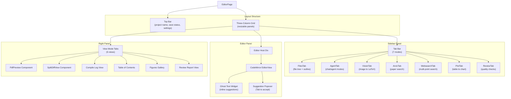
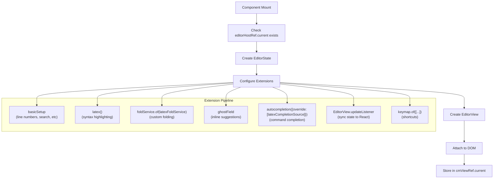
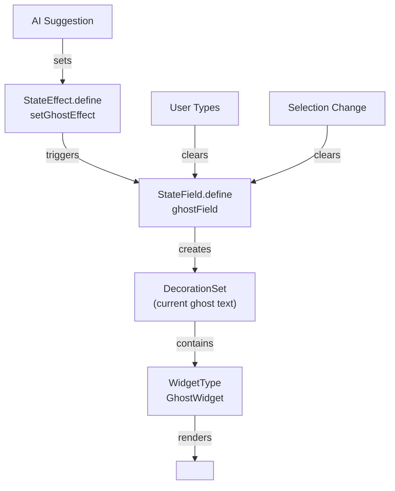
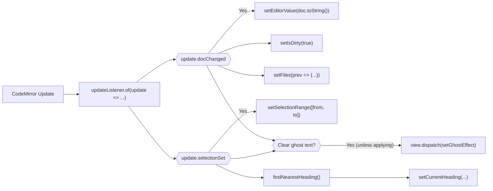
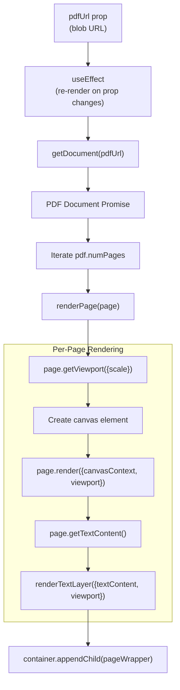

<!-- source: DeepWiki mcp.deepwiki.com · repo OpenDCAI/OpenPrism · page 7.4 Frontend Development · fetched 2026-11-02 -->

# Frontend Development

<details>
<summary>Relevant source files</summary>

The following files were used as context for generating this wiki page:

- [apps/frontend/package.json](apps/frontend/package.json)
- [apps/frontend/src/app/EditorPage.tsx](apps/frontend/src/app/EditorPage.tsx)
- [apps/frontend/src/vite-env.d.ts](apps/frontend/src/vite-env.d.ts)

</details>


## Purpose and Scope

This document covers the development workflow, architecture patterns, and implementation details for the OpenPrism frontend application. It is intended for developers who need to understand the React/TypeScript codebase structure, modify existing components, or add new features to the user interface.

For high-level frontend architecture and user-facing features, see [Frontend Architecture](#3.2) and [Frontend Application](#4). For UI styling and design patterns, see [Styling and Theming](#7.7).

---

## Development Environment

### Build System

The frontend uses Vite as the development server and build tool. Vite provides fast hot module replacement (HMR) during development and optimized production builds.

**Key Configuration:**

The Vite configuration is located at `apps/frontend/vite.config.ts`. During development, the frontend runs on port 5173 by default and proxies API requests to the backend on port 8787.

In production mode, the backend serves the compiled frontend static assets from a unified server, eliminating the need for CORS configuration.

**Development Commands:**

```bash
# Start development server with HMR
npm run dev

# Build optimized production bundle
npm run build

# Preview production build locally
npm run preview
```

**Sources:** [apps/frontend/package.json:5-8](), [apps/frontend/vite.config.ts]()

---

### Dependency Structure

The frontend uses a modern React stack with specialized libraries for document editing and visualization:

| Category | Package | Purpose |
|----------|---------|---------|
| Core Framework | `react@^18.2.0` | UI component library |
| Routing | `react-router-dom@^6.22.3` | SPA navigation |
| Editor | `codemirror@^6.0.1` + extensions | LaTeX code editing |
| PDF Rendering | `pdfjs-dist@^3.11.174` | In-browser PDF display |
| Internationalization | `i18next@^23.12.2` | Multi-language support |
| Diff Display | `diff@^5.2.0` | Change visualization |
| Markdown | `react-markdown@^10.1.0` | AI response rendering |

**CodeMirror Extensions:**

The editor uses multiple CodeMirror 6 packages for advanced functionality:
- `@codemirror/autocomplete` - LaTeX command completion
- `@codemirror/commands` - Editor commands (comment toggle, etc.)
- `@codemirror/language` - Syntax highlighting and folding
- `@codemirror/search` - Find/replace functionality
- `@codemirror/state` - Editor state management
- `@codemirror/view` - Visual decorations and widgets

**Sources:** [apps/frontend/package.json:10-28]()

---

## Project Structure and Entry Points

### Directory Layout

```
apps/frontend/src/
├── app/                    # Page components
│   ├── EditorPage.tsx     # Main workspace (2700+ lines)
│   ├── ProjectPage.tsx    # Project list management
│   └── LandingPage.tsx    # Marketing/intro page
├── api/                    # Backend communication
│   └── client.ts          # API client functions
├── latex/                  # LaTeX language support
│   ├── lang.ts            # Syntax highlighting
│   └── engine.ts          # Compilation types
├── i18n/                   # Translation files
│   ├── en.json
│   └── zh.json
└── main.tsx               # Application entry point
```

### Application Entry Point

**React Router Configuration:**

The application uses React Router for client-side navigation with three primary routes:

```typescript
<Routes>
  <Route path="/" element={<LandingPage />} />
  <Route path="/projects" element={<ProjectPage />} />
  <Route path="/editor/:projectId" element={<EditorPage />} />
</Routes>
```

The `EditorPage` component is the primary workspace and contains the majority of application logic (2700+ lines), implementing the three-panel editor interface, AI features, and file management.

**Sources:** [apps/frontend/src/app/EditorPage.tsx:1-40]()

---

## Component Architecture

### Main Workspace Component Hierarchy



**Component Characteristics:**

The `EditorPage` component is a monolithic React function component that manages all workspace state. While this violates typical React best practices (components should be small and focused), it enables tight integration between editor state, file operations, and AI features without prop drilling.

Key sub-components:
- `PdfPreview` - Self-contained PDF rendering with PDF.js [apps/frontend/src/app/EditorPage.tsx:882-1092]()
- `SplitDiffView` - Side-by-side diff display with synchronized scrolling [apps/frontend/src/app/EditorPage.tsx:834-880]()

**Sources:** [apps/frontend/src/app/EditorPage.tsx:1094-1234]()

---

## State Management Patterns

### State Organization

The `EditorPage` component uses React hooks for state management without external state management libraries (Redux, Zustand, etc.). State is organized into logical domains:

**File System State:**

```typescript
const [tree, setTree] = useState<{ path: string; type: string }[]>([]);
const [fileOrder, setFileOrder] = useState<Record<string, string[]>>({});
const [activePath, setActivePath] = useState<string>('');
const [files, setFiles] = useState<Record<string, string>>({});
const [mainFile, setMainFile] = useState('main.tex');
```

**Editor State:**

```typescript
const [editorValue, setEditorValue] = useState<string>('');
const [selectionRange, setSelectionRange] = useState<[number, number]>([0, 0]);
const [isDirty, setIsDirty] = useState(false);
const [isSaving, setIsSaving] = useState(false);
```

**AI Assistant State:**

```typescript
const [assistantMode, setAssistantMode] = useState<'chat' | 'agent'>('agent');
const [chatMessages, setChatMessages] = useState<Message[]>([]);
const [agentMessages, setAgentMessages] = useState<Message[]>([]);
const [prompt, setPrompt] = useState('');
const [task, setTask] = useState(DEFAULT_TASKS(t)[0].value);
const [mode, setMode] = useState<'direct' | 'tools'>('direct');
```

**Compilation State:**

```typescript
const [compileLog, setCompileLog] = useState('');
const [pdfUrl, setPdfUrl] = useState('');
const [pdfScale, setPdfScale] = useState(1);
const [isCompiling, setIsCompiling] = useState(false);
```

**Sources:** [apps/frontend/src/app/EditorPage.tsx:1099-1234]()

---

### Ref-Based Architecture

The component uses refs extensively to access imperative APIs and avoid stale closures in event handlers:

**CodeMirror Access:**

```typescript
const cmViewRef = useRef<EditorView | null>(null);
const editorHostRef = useRef<HTMLDivElement | null>(null);
```

The `cmViewRef` provides direct access to the CodeMirror `EditorView` instance for programmatic editor manipulation (inserting text, dispatching transactions, etc.).

**Stable Function References:**

```typescript
const requestSuggestionRef = useRef<() => void>(() => {});
const acceptSuggestionRef = useRef<() => void>(() => {});
const clearSuggestionRef = useRef<() => void>(() => {});
const saveActiveFileRef = useRef<() => void>(() => {});

// Updated in useEffect to always reference current implementation
useEffect(() => {
  requestSuggestionRef.current = requestInlineSuggestion;
  acceptSuggestionRef.current = acceptInlineSuggestion;
  clearSuggestionRef.current = clearInlineSuggestion;
  saveActiveFileRef.current = saveActiveFile;
}, [/* deps */]);
```

This pattern ensures keyboard shortcuts and event handlers always call the latest function implementation without recreating the entire CodeMirror instance.

**State Synchronization:**

```typescript
const activePathRef = useRef<string>('');

useEffect(() => {
  activePathRef.current = activePath;
}, [activePath]);
```

Refs like `activePathRef` provide synchronous access to state within async callbacks, avoiding race conditions when state updates during long-running operations.

**Sources:** [apps/frontend/src/app/EditorPage.tsx:1214-1234](), [apps/frontend/src/app/EditorPage.tsx:1298-1300](), [apps/frontend/src/app/EditorPage.tsx:1659-1663]()

---

## CodeMirror Integration

### Editor Initialization

The CodeMirror editor is initialized in a `useEffect` hook that runs once when the component mounts:



**Initialization Code:**

The editor is created in [apps/frontend/src/app/EditorPage.tsx:1325-1459](). Key aspects:

1. **Guard Condition:** Checks `!editorHostRef.current || cmViewRef.current` to prevent duplicate initialization
2. **Extension Order:** Extensions are applied in a specific order to ensure proper interaction
3. **Cleanup:** Returns a cleanup function that calls `view.destroy()` and clears the ref

**Sources:** [apps/frontend/src/app/EditorPage.tsx:1325-1459]()

---

### Custom Extensions

#### LaTeX Folding Service

The custom `latexFoldService` enables code folding for LaTeX-specific constructs:

**Supported Fold Types:**
1. **Environments:** `\begin{...}` to `\end{...}` with nested depth tracking
2. **Sections:** `\section`, `\subsection`, `\subsubsection` (hierarchical)
3. **Conditionals:** `\if...` to `\fi`
4. **Groups:** `\begingroup` to `\endgroup`
5. **Display Math:** `$$...$$` and `\[...\]`

**Implementation:**

```typescript
function latexFoldService(state: EditorState, lineStart: number, lineEnd: number) {
  const line = state.doc.lineAt(lineStart);
  const clean = stripLatexComment(line.text);
  
  // Try environment folding
  const envMatch = clean.match(/\\begin\{([^}]+)\}/);
  if (envMatch) {
    return findEnvFold(state, line.number, lineEnd, envMatch[1]);
  }
  
  // Try section folding
  const sectionMatch = clean.match(SECTION_RE);
  if (sectionMatch) {
    const level = SECTION_LEVELS[sectionMatch[1]] ?? 99;
    return findSectionFold(state, line.number, lineEnd, level);
  }
  
  // ... other fold types
}
```

The service strips comments before analyzing to avoid false positives from commented-out LaTeX commands.

**Sources:** [apps/frontend/src/app/EditorPage.tsx:288-316](), [apps/frontend/src/app/EditorPage.tsx:165-178](), [apps/frontend/src/app/EditorPage.tsx:180-222]()

---

#### Ghost Text Field

The `ghostField` implements inline AI suggestions using CodeMirror's decoration API:

**Architecture:**



**Implementation Details:**

The `GhostWidget` class extends `WidgetType` to render suggestion text as a DOM element:

```typescript
class GhostWidget extends WidgetType {
  constructor(private text: string) {
    super();
  }

  toDOM() {
    const span = document.createElement('span');
    span.className = 'cm-ghost';
    span.textContent = this.text;
    return span;
  }

  ignoreEvent() {
    return true;  // Don't capture mouse/keyboard events
  }
}
```

The `ghostField` StateField manages the decoration lifecycle, automatically clearing suggestions when the user types or moves the cursor:

```typescript
const ghostField = StateField.define<DecorationSet>({
  create() {
    return Decoration.none;
  },
  update(deco, tr) {
    // Map existing decorations through document changes
    let next = deco.map(tr.changes);
    
    // Check for setGhostEffect
    for (const effect of tr.effects) {
      if (effect.is(setGhostEffect)) {
        // Apply new ghost text or clear
      }
    }
    
    // Clear on document change or selection change
    if (tr.docChanged || tr.selectionSet) {
      return Decoration.none;
    }
    
    return next;
  },
  provide: (field) => EditorView.decorations.from(field)
});
```

**Sources:** [apps/frontend/src/app/EditorPage.tsx:651-695](), [apps/frontend/src/app/EditorPage.tsx:653-668](), [apps/frontend/src/app/EditorPage.tsx:670-695]()

---

#### LaTeX Autocompletion

The custom completion source provides context-aware LaTeX command suggestions:

**Completion Implementation:**

```typescript
function latexCompletionSource(context: CompletionContext) {
  // Match backslash followed by letters
  const before = context.matchBefore(/[\\/][A-Za-z]*$/);
  if (!before) return null;
  
  // Check previous character for context
  const prev = before.from > 0 
    ? context.state.doc.sliceString(before.from - 1, before.from) 
    : ' ';
  
  // Don't complete URLs (e.g., http://)
  if (before.text.startsWith('/') && prev === ':') return null;
  
  // Require whitespace, opening brace, or newline before backslash
  if (prev && !/[\s({\n]/.test(prev)) return null;
  
  const options = [
    { label: '\\section{}', type: 'keyword', 
      apply: (view, _, from, to) => {
        view.dispatch({
          changes: { from, to, insert: '\\section{}' },
          selection: { anchor: from + '\\section{'.length }
        });
      }
    },
    // ... more completions
  ];
  
  return {
    from: before.from,
    options,
    validFor: /^[\\/][A-Za-z]*$/
  };
}
```

**Cursor Positioning:**

Completions use custom `apply` functions to position the cursor inside braces after insertion, enabling immediate typing without additional navigation.

**Sources:** [apps/frontend/src/app/EditorPage.tsx:590-649]()

---

### Update Listener Pattern

The `EditorView.updateListener` synchronizes CodeMirror state with React state:

**Synchronization Flow:**



**Critical Implementation Detail:**

The `applyingSuggestionRef` flag prevents ghost text from being cleared when the system programmatically inserts suggestion text:

```typescript
const updateListener = EditorView.updateListener.of((update) => {
  const skipClear = applyingSuggestionRef.current;
  
  if (update.docChanged) {
    const value = update.state.doc.toString();
    setEditorValue(value);
    
    if (!suppressDirtyRef.current) {
      setIsDirty(true);
    } else {
      suppressDirtyRef.current = false;
    }
    
    // Cache in-memory for faster file switching
    const path = activePathRef.current;
    if (path) {
      setFiles((prev) => ({ ...prev, [path]: value }));
    }
  }
  
  // Clear ghost text on user edits (but not when accepting suggestions)
  if (!skipClear && inlineSuggestionRef.current && 
      (update.docChanged || update.selectionSet)) {
    inlineSuggestionRef.current = '';
    inlineAnchorRef.current = null;
    setInlineSuggestionText('');
    // Dispatch clear effect asynchronously
  }
  
  if (skipClear) {
    applyingSuggestionRef.current = false;
  }
});
```

**Sources:** [apps/frontend/src/app/EditorPage.tsx:1328-1363]()

---

### Keyboard Shortcuts

Custom keybindings are registered through the `keymap` extension:

**Registered Shortcuts:**

| Key | Function | Implementation |
|-----|----------|----------------|
| `Cmd/Ctrl-S` | Save active file | `saveActiveFileRef.current()` |
| `Alt-/` | Request AI suggestion | `requestSuggestionRef.current()` |
| `Cmd/Ctrl-/` | Toggle comment | `toggleComment` (CodeMirror) |
| `Cmd/Ctrl-Space` | Request AI suggestion | `requestSuggestionRef.current()` |
| `Tab` | Accept full suggestion | `acceptSuggestionRef.current()` |
| `ArrowRight` | Accept word chunk | `acceptChunkRef.current()` (at anchor) |
| `Escape` | Clear suggestion | `clearSuggestionRef.current()` |

**Keymap Configuration:**

```typescript
const keymapExtension = keymap.of([
  {
    key: 'Mod-s',
    run: () => {
      saveActiveFileRef.current();
      return true;  // Prevent default browser save dialog
    }
  },
  {
    key: 'Tab',
    run: () => {
      if (!inlineSuggestionRef.current) return false;
      acceptSuggestionRef.current();
      return true;
    }
  },
  // ... more bindings
  ...foldKeymap,      // Code folding shortcuts
  ...searchKeymap     // Find/replace shortcuts
]);
```

The `Mod` prefix automatically resolves to `Cmd` on macOS and `Ctrl` on Windows/Linux.

**Sources:** [apps/frontend/src/app/EditorPage.tsx:1365-1419]()

---

## API Client Layer

### Request Function Architecture

The API client is implemented in `apps/frontend/src/api/client.ts` as a collection of standalone async functions:

```mermaid
graph TB
    ClientFns["API Client Functions<br/>(client.ts)"]
    
    subgraph "Project Operations"
        listProjects["listProjects()"]
        getProjectTree["getProjectTree(id)"]
        createProject["createProject(name, templateId?)"]
        deleteProject["deleteProject(id)"]
    end
    
    subgraph "File Operations"
        getAllFiles["getAllFiles(id)"]
        getFile["getFile(id, path)"]
        writeFile["writeFile(id, path, content)"]
        renamePath["renamePath(id, from, to)"]
        uploadFiles["uploadFiles(id, files, basePath)"]
        updateFileOrder["updateFileOrder(id, folder, order)"]
    end
    
    subgraph "Compilation"
        compileProject["compileProject(params)"]
    end
    
    subgraph "AI Services"
        runAgent["runAgent(params)"]
        callLLM["callLLM(config, messages)"]
        plotFromTable["plotFromTable(params)"]
        visionToLatex["visionToLatex(params)"]
    end
    
    subgraph "External Services"
        arxivSearch["arxivSearch(query, maxResults)"]
        arxivBibtex["arxivBibtex(arxivId)"]
    end
    
    ClientFns --> listProjects
    ClientFns --> getProjectTree
    ClientFns --> getAllFiles
    ClientFns --> compileProject
    ClientFns --> runAgent
    ClientFns --> arxivSearch
```



**Design Pattern:**

Each function encapsulates a single API endpoint call with proper error handling and type safety. Functions use the `fetch` API directly rather than a wrapper library like Axios.

**Sources:** [apps/frontend/src/api/client.ts:18-35]()

---

### Request/Response Pattern

**Standard Request Structure:**

```typescript
export async function writeFile(
  projectId: string,
  filePath: string,
  content: string
): Promise<void> {
  const response = await fetch(`${API_BASE}/projects/${projectId}/file`, {
    method: 'PUT',
    headers: { 'Content-Type': 'application/json' },
    body: JSON.stringify({ path: filePath, content })
  });
  
  if (!response.ok) {
    const error = await response.text();
    throw new Error(`Failed to write file: ${error}`);
  }
}
```

**Response Typing:**

API functions return typed responses defined in the client file:

```typescript
export interface ProjectMeta {
  id: string;
  name: string;
  createdAt: string;
  updatedAt: string;
  tags?: string[];
  mainFile?: string;
}

export interface CompileResult {
  ok: boolean;
  pdf?: Uint8Array;
  log?: string;
  error?: string;
  engine?: string;
}
```

**Sources:** [apps/frontend/src/api/client.ts]()

---

### Streaming Response Handling

The arXiv import function uses Server-Sent Events (SSE) for progress updates:

**SSE Implementation:**

```typescript
export async function importArxivProject(
  arxivId: string,
  onProgress?: (phase: string, percent?: number) => void
): Promise<ProjectMeta> {
  return new Promise((resolve, reject) => {
    const eventSource = new EventSource(
      `${API_BASE}/projects/import-arxiv-sse?arxivId=${encodeURIComponent(arxivId)}`
    );
    
    let projectMeta: ProjectMeta | null = null;
    
    eventSource.onmessage = (event) => {
      try {
        const data = JSON.parse(event.data);
        
        if (data.phase === 'complete' && data.project) {
          projectMeta = data.project;
        } else if (data.phase === 'error') {
          eventSource.close();
          reject(new Error(data.error || 'Import failed'));
        } else {
          // Progress update
          onProgress?.(data.phase, data.percent);
        }
      } catch (err) {
        eventSource.close();
        reject(err);
      }
    };
    
    eventSource.onerror = (err) => {
      eventSource.close();
      reject(err);
    };
    
    // EventSource automatically closes on 'complete' phase
    eventSource.addEventListener('close', () => {
      eventSource.close();
      if (projectMeta) {
        resolve(projectMeta);
      } else {
        reject(new Error('Import incomplete'));
      }
    });
  });
}
```

This pattern enables real-time progress feedback during long-running operations (download, extraction, file writing).

**Sources:** [apps/frontend/src/api/client.ts]()

---

## React Patterns and Best Practices

### Memoization Strategy

The component uses `useMemo` for expensive computations that depend on frequently changing state:

**Memoized Values:**

```typescript
// Rebuild file tree only when tree data or order changes
const treeRoot = useMemo(
  () => buildTree(filteredTreeItems, fileOrder),
  [filteredTreeItems, fileOrder]
);

// Filter files only when tree or filter text changes
const filteredTreeItems = useMemo(() => {
  const term = fileFilter.trim().toLowerCase();
  if (!term) return tree;
  return tree.filter((item) => item.path.toLowerCase().includes(term));
}, [tree, fileFilter]);

// Extract .tex files once per tree update
const texFiles = useMemo(
  () => tree
    .filter((item) => item.type === 'file' && item.path.toLowerCase().endsWith('.tex'))
    .map((item) => item.path),
  [tree]
);

// Parse outline only when main file content changes
const outlineItems = useMemo(() => {
  if (!outlineText || !mainFile || !mainFile.toLowerCase().endsWith('.tex')) return [];
  return parseOutline(outlineText);
}, [outlineText, mainFile]);
```

**Performance Impact:**

Without memoization, `buildTree` would execute on every render (triggered by any state change), recursively sorting hundreds of file nodes. Memoization reduces this to only when `tree` or `fileOrder` changes.

**Sources:** [apps/frontend/src/app/EditorPage.tsx:2494-2500](), [apps/frontend/src/app/EditorPage.tsx:2528-2536](), [apps/frontend/src/app/EditorPage.tsx:2551-2554]()

---

### Callback Optimization

Functions passed as props or stored in refs are wrapped with `useCallback` to prevent unnecessary re-renders and infinite loops:

**Critical Callbacks:**

```typescript
const saveActiveFile = useCallback(
  async (opts?: { silent?: boolean }) => {
    if (!activePath) return;
    setIsSaving(true);
    try {
      await writeFile(projectId, activePath, editorValue);
      setIsDirty(false);
      setSavePulse(true);
      window.setTimeout(() => setSavePulse(false), 1200);
      if (!opts?.silent) {
        setStatus(t('已保存 {{path}}', { path: activePath }));
      }
    } catch (err) {
      setStatus(t('保存失败: {{error}}', { error: String(err) }));
    } finally {
      setIsSaving(false);
    }
  },
  [activePath, editorValue, projectId, t]
);

const ensureFileContent = useCallback(
  async (path: string) => {
    if (Object.prototype.hasOwnProperty.call(files, path)) {
      return files[path] ?? '';
    }
    const data = await getFile(projectId, path);
    setFiles((prev) => ({ ...prev, [path]: data.content }));
    return data.content;
  },
  [files, projectId]
);
```

These callbacks are used in multiple places (effects, event handlers, other callbacks) and must have stable identities to avoid triggering dependent effects unnecessarily.

**Sources:** [apps/frontend/src/app/EditorPage.tsx:1665-1684](), [apps/frontend/src/app/EditorPage.tsx:1788-1798]()

---

### Effect Dependencies

The component uses numerous `useEffect` hooks for side effects. Proper dependency arrays are critical:

**Sync State to Ref:**

```typescript
useEffect(() => {
  activePathRef.current = activePath;
}, [activePath]);
```

**Auto-Save on Edit:**

```typescript
useEffect(() => {
  if (!isDirty || !activePath) return;
  
  if (saveTimerRef.current) {
    window.clearTimeout(saveTimerRef.current);
  }
  
  saveTimerRef.current = window.setTimeout(() => {
    saveActiveFile({ silent: true });
  }, 1500);
  
  return () => {
    if (saveTimerRef.current) {
      window.clearTimeout(saveTimerRef.current);
      saveTimerRef.current = null;
    }
  };
}, [activePath, editorValue, isDirty, saveActiveFile]);
```

This effect debounces auto-save to 1.5 seconds after the last edit, clearing the timer on cleanup to prevent save after unmount.

**Persist Settings:**

```typescript
useEffect(() => {
  persistSettings(settings);
}, [settings]);
```

Writes settings to localStorage whenever any setting changes.

**Sources:** [apps/frontend/src/app/EditorPage.tsx:1298-1300](), [apps/frontend/src/app/EditorPage.tsx:1690-1709](), [apps/frontend/src/app/EditorPage.tsx:1249-1251]()

---

### Conditional Rendering Patterns

The component uses conditional rendering extensively to show/hide panels and tabs:

**Sidebar Tab Rendering:**

```typescript
{activeSidebar === 'files' && (
  <div className="sidebar-content">
    {/* File tree and outline */}
  </div>
)}

{activeSidebar === 'agent' && (
  <div className="sidebar-content">
    {/* Chat/agent interface */}
  </div>
)}

{activeSidebar === 'vision' && (
  <div className="sidebar-content">
    {/* Image upload and OCR */}
  </div>
)}
```

**Right Panel View Switching:**

```typescript
{rightView === 'pdf' && pdfUrl && (
  <PdfPreview
    pdfUrl={pdfUrl}
    scale={pdfScale}
    fitWidth={pdfFitWidth}
    onTextClick={(text) => {/* ... */}}
    // ... more props
  />
)}

{rightView === 'diff' && pendingChanges.length > 0 && (
  <SplitDiffView rows={buildSplitDiff(/*...*/)} />
)}

{rightView === 'log' && (
  <div className="compile-log">
    {parseCompileErrors(compileLog).map((error, idx) => (
      <div key={idx} onClick={() => {/* jump to line */}}>
        {error.message}
      </div>
    ))}
  </div>
)}
```

This pattern keeps unmounted components from consuming resources (e.g., PDF.js workers, diff calculations).

**Sources:** [apps/frontend/src/app/EditorPage.tsx]()

---

## PDF Preview Implementation

### PDF.js Integration

The `PdfPreview` component wraps PDF.js for in-browser PDF rendering:



**Key Implementation Details:**

1. **Quality Boost:** Renders at `devicePixelRatio * 1.25` scale, then displays at CSS size for sharp rendering on high-DPI displays
2. **Text Layer:** Creates a separate text layer for selectable text and search functionality
3. **Spread View:** Optional two-page spread layout for book-like viewing
4. **Outline Extraction:** Parses PDF outline for table of contents display

**Rendering Function:**

```typescript
const renderPage = async (page: Awaited<ReturnType<typeof pdf.getPage>>) => {
  // CSS viewport for display size
  const cssViewport = page.getViewport({ scale: baseScale });
  
  // Higher resolution for rendering
  const qualityBoost = Math.min(2.4, (window.devicePixelRatio || 1) * 1.25);
  const renderViewport = page.getViewport({ scale: baseScale * qualityBoost });

  const pageWrapper = document.createElement('div');
  pageWrapper.className = 'pdf-page';
  pageWrapper.style.width = `${cssViewport.width}px`;
  pageWrapper.style.height = `${cssViewport.height}px`;

  const canvas = document.createElement('canvas');
  canvas.width = renderViewport.width;
  canvas.height = renderViewport.height;
  canvas.style.width = `${cssViewport.width}px`;
  canvas.style.height = `${cssViewport.height}px`;
  
  const ctx = canvas.getContext('2d');
  if (ctx) {
    await page.render({ canvasContext: ctx, viewport: renderViewport }).promise;
  }

  const textLayer = document.createElement('div');
  textLayer.className = 'textLayer';
  const textContent = await page.getTextContent();
  renderTextLayer({
    textContentSource: textContent,
    container: textLayer,
    viewport: cssViewport
  });

  pageWrapper.appendChild(canvas);
  pageWrapper.appendChild(textLayer);
  return pageWrapper;
};
```

**Sources:** [apps/frontend/src/app/EditorPage.tsx:911-1048](), [apps/frontend/src/app/EditorPage.tsx:939-975]()

---

### Fit-to-Width Scaling

The preview supports automatic fit-to-width scaling:

**Scale Calculation:**

```typescript
let baseScale = scale;
if (fitWidth && containerWidth > 0) {
  const firstPage = await pdf.getPage(1);
  const originalViewport = firstPage.getViewport({ scale: 1.0 });
  
  // Calculate scale to fit container width
  const pageTargetWidth = spread 
    ? Math.max(200, (containerWidth - 16) / 2)  // Two-page spread
    : containerWidth;
  
  baseScale = pageTargetWidth / originalViewport.width;
  
  // Report calculated scale back to parent
  if (onFitScale) {
    onFitScale(baseScale);
  }
}
```

The parent component can then display the actual scale (e.g., "125%") in the UI.

**Sources:** [apps/frontend/src/app/EditorPage.tsx:922-937]()

---

## Internationalization

### i18next Setup

The application uses `i18next` and `react-i18next` for multi-language support:

**Translation Hook Usage:**

```typescript
import { useTranslation } from 'react-i18next';

function Component() {
  const { t, i18n } = useTranslation();
  
  // Simple translation
  const text = t('Save');
  
  // Translation with interpolation
  const message = t('已保存 {{path}}', { path: activePath });
  
  // Change language
  i18n.changeLanguage('zh');
  
  return <div>{text}</div>;
}
```

**Translation Key Patterns:**

Keys can be:
1. **English text:** `t('Save')` - Used directly in code
2. **Chinese text:** `t('保存')` - Chinese keys for Chinese-first development
3. **Interpolated:** `t('File: {{name}}', { name: 'main.tex' })`

**Language Switching:**

```typescript
<button onClick={() => i18n.changeLanguage('en')}>English</button>
<button onClick={() => i18n.changeLanguage('zh')}>中文</button>
```

The current language persists in localStorage automatically via i18next configuration.

**Sources:** [apps/frontend/src/app/EditorPage.tsx:4](), [apps/frontend/src/app/EditorPage.tsx:1096]()

---

### Dynamic Translation Loading

Translation files are located in `apps/frontend/src/i18n/`:

```
i18n/
├── en.json    # English translations
└── zh.json    # Chinese translations
```

**Translation File Structure:**

```json
{
  "Save": "Save",
  "保存": "Save",
  "File: {{name}}": "File: {{name}}",
  "已保存 {{path}}": "Saved {{path}}",
  "LaTeX Editing": "LaTeX Editing",
  "PDF Preview": "PDF Preview"
}
```

Keys can be in either language, allowing developers to write code with their preferred language keys.

**Sources:** Directory structure inferred from usage patterns

---

## Performance Optimization

### Debouncing Patterns

**Auto-Save Debouncing:**

```typescript
useEffect(() => {
  if (!isDirty || !activePath) return;
  
  // Clear existing timer
  if (saveTimerRef.current) {
    window.clearTimeout(saveTimerRef.current);
  }
  
  // Set new timer
  saveTimerRef.current = window.setTimeout(() => {
    saveActiveFile({ silent: true });
  }, 1500);
  
  // Cleanup on unmount or dependency change
  return () => {
    if (saveTimerRef.current) {
      window.clearTimeout(saveTimerRef.current);
      saveTimerRef.current = null;
    }
  };
}, [activePath, editorValue, isDirty, saveActiveFile]);
```

This pattern ensures files are saved automatically 1.5 seconds after the last edit, preventing excessive API calls during active typing.

**Sources:** [apps/frontend/src/app/EditorPage.tsx:1690-1709]()

---

### File Content Caching

The component maintains an in-memory file cache to avoid redundant API calls:

**Cache Strategy:**

```typescript
const [files, setFiles] = useState<Record<string, string>>({});

const ensureFileContent = useCallback(
  async (path: string) => {
    // Check cache first
    if (Object.prototype.hasOwnProperty.call(files, path)) {
      return files[path] ?? '';
    }
    
    // Cache miss - fetch from API
    const data = await getFile(projectId, path);
    
    // Update cache
    setFiles((prev) => ({ ...prev, [path]: data.content }));
    
    return data.content;
  },
  [files, projectId]
);
```

**Cache Updates:**

The cache is updated in multiple scenarios:
1. **Editor changes:** Via the CodeMirror update listener [apps/frontend/src/app/EditorPage.tsx:1338-1341]()
2. **File open:** When loading a file for editing [apps/frontend/src/app/EditorPage.tsx:1484-1486]()
3. **File write:** After successful save operations [apps/frontend/src/app/EditorPage.tsx:1969-1970]()

**Sources:** [apps/frontend/src/app/EditorPage.tsx:1105](), [apps/frontend/src/app/EditorPage.tsx:1788-1798]()

---

### Lazy Rendering

Components use conditional rendering to avoid mounting expensive components until needed:

**PDF Preview:**

```typescript
{rightView === 'pdf' && pdfUrl && (
  <PdfPreview
    pdfUrl={pdfUrl}
    // ... props
  />
)}
```

The `PdfPreview` component (which spawns PDF.js workers and renders canvases) only mounts when:
1. User switches to PDF view (`rightView === 'pdf'`)
2. A PDF has been compiled (`pdfUrl` is set)

**AI Features:**

```typescript
{activeSidebar === 'agent' && (
  <div className="sidebar-content">
    {/* Agent chat interface */}
  </div>
)}
```

Each sidebar tab only renders when active, preventing unnecessary React reconciliation.

**Sources:** [apps/frontend/src/app/EditorPage.tsx]()

---

## Development Workflow

### Hot Module Replacement

Vite's HMR enables instant updates during development without full page reloads:

**HMR Behavior:**

1. **CSS Changes:** Applied instantly without state loss
2. **React Component Changes:** Component re-renders with preserved state
3. **Module Changes:** Dependencies are hot-replaced when possible
4. **State Loss Scenarios:** Changes to module-level state or exports may require full reload

**Preserving State During HMR:**

React Fast Refresh (enabled by `@vitejs/plugin-react`) preserves component state across most edits. However, changes to:
- Hook order
- Component type (function ↔ class)
- Module-level variables

...will trigger a full reload.

**Sources:** [apps/frontend/package.json:6]()

---

### TypeScript Integration

The frontend uses TypeScript for type safety:

**Type Definition Patterns:**

```typescript
// Interface for component props
interface PdfPreviewProps {
  pdfUrl: string;
  scale: number;
  fitWidth: boolean;
  spread: boolean;
  onFitScale?: (value: number | null) => void;
  onTextClick: (text: string) => void;
  annotations: Array<{
    id: string;
    page: number;
    x: number;
    y: number;
    text: string;
  }>;
  // ... more props
}

// Type alias for state
type CompileEngine = 'pdflatex' | 'xelatex' | 'lualatex' | 'latexmk' | 'tectonic';

// Union types for mode switching
type InlineEdit =
  | { kind: 'new-file' | 'new-folder'; parent: string; value: string }
  | { kind: 'rename'; path: string; value: string };
```

**Type Inference:**

TypeScript infers types for most variables and function returns, reducing annotation burden:

```typescript
// Type inferred as string[]
const texFiles = useMemo(
  () => tree
    .filter((item) => item.type === 'file' && item.path.endsWith('.tex'))
    .map((item) => item.path),
  [tree]
);
```

**Sources:** [apps/frontend/src/app/EditorPage.tsx:42-80](), [apps/frontend/src/app/EditorPage.tsx:63-65](), [apps/frontend/src/app/EditorPage.tsx:67]()

---

### Environment Variables

Environment variables are typed through `vite-env.d.ts`:

**Type Declaration:**

```typescript
/// <reference types="vite/client" />

declare module '*?url' {
  const src: string;
  export default src;
}
```

This enables importing file URLs with the `?url` suffix:

```typescript
import pdfWorker from 'pdfjs-dist/build/pdf.worker.min?url';
GlobalWorkerOptions.workerSrc = pdfWorker;
```

**Sources:** [apps/frontend/src/vite-env.d.ts:1-6](), [apps/frontend/src/app/EditorPage.tsx:16](), [apps/frontend/src/app/EditorPage.tsx:40]()

---

## Testing Considerations

While the codebase does not currently include a test suite, testing strategies for this architecture would include:

**Unit Testing:**

1. **Pure Functions:** Utility functions like `parseOutline`, `stripLatexComment`, `buildTree` are ideal candidates
2. **Custom Hooks:** Extract stateful logic into custom hooks for easier testing
3. **API Client Functions:** Mock `fetch` to test request/response handling

**Component Testing:**

1. **Isolated Components:** Test `PdfPreview` and `SplitDiffView` independently
2. **User Interactions:** Simulate clicks, keyboard events, file uploads
3. **Conditional Rendering:** Verify correct panel displays based on state

**Integration Testing:**

1. **CodeMirror Integration:** Verify editor updates trigger React state changes
2. **File Operations:** Test open → edit → save workflow
3. **AI Features:** Mock API responses to test suggestion acceptance

**E2E Testing:**

1. **Critical Paths:** Project creation → file editing → compilation → PDF preview
2. **AI Workflows:** Search → insert citation → compile
3. **Cross-Browser:** Verify PDF.js and CodeMirror work in all supported browsers

**Sources:** General best practices for React application testing

---

## Common Development Tasks

### Adding a New Sidebar Tab

**Steps:**

1. **Add State:**
   ```typescript
   type SidebarMode = 'files' | 'agent' | 'vision' | 'search' | 'websearch' | 'plot' | 'review' | 'newtab';
   const [activeSidebar, setActiveSidebar] = useState<SidebarMode>('files');
   ```

2. **Add Tab Button:**
   ```typescript
   <button
     className={activeSidebar === 'newtab' ? 'active' : ''}
     onClick={() => setActiveSidebar('newtab')}
   >
     {t('New Tab')}
   </button>
   ```

3. **Add Content Rendering:**
   ```typescript
   {activeSidebar === 'newtab' && (
     <div className="sidebar-content">
       {/* Tab content here */}
     </div>
   )}
   ```

**Sources:** [apps/frontend/src/app/EditorPage.tsx:1154]()

---

### Adding a New API Endpoint

**Steps:**

1. **Add Client Function in `client.ts`:**
   ```typescript
   export async function newEndpoint(
     projectId: string,
     params: SomeParams
   ): Promise<SomeResponse> {
     const response = await fetch(`${API_BASE}/new-endpoint`, {
       method: 'POST',
       headers: { 'Content-Type': 'application/json' },
       body: JSON.stringify({ projectId, ...params })
     });
     
     if (!response.ok) {
       const error = await response.text();
       throw new Error(`Request failed: ${error}`);
     }
     
     return response.json();
   }
   ```

2. **Import in Component:**
   ```typescript
   import { newEndpoint } from '../api/client';
   ```

3. **Call in Handler:**
   ```typescript
   const handleAction = async () => {
     try {
       const result = await newEndpoint(projectId, params);
       // Process result
     } catch (err) {
       setStatus(`Error: ${String(err)}`);
     }
   };
   ```

**Sources:** [apps/frontend/src/api/client.ts]()

---

### Adding a CodeMirror Extension

**Steps:**

1. **Define Extension:**
   ```typescript
   import { Extension } from '@codemirror/state';
   
   function myExtension(): Extension {
     return EditorView.updateListener.of((update) => {
       if (update.docChanged) {
         // Handle document changes
       }
     });
   }
   ```

2. **Add to Extensions Array:**
   ```typescript
   const state = EditorState.create({
     doc: '',
     extensions: [
       basicSetup,
       latex(),
       myExtension(),  // Add here
       // ... other extensions
     ]
   });
   ```

3. **Clean Up (if needed):**
   ```typescript
   return () => {
     // Cleanup code in useEffect cleanup function
   };
   ```

**Sources:** [apps/frontend/src/app/EditorPage.tsx:1421-1436]()

---

## Debugging Tips

### CodeMirror State Inspection

Access the current editor state in the browser console:

```javascript
// Get the EditorView instance
const view = window.__CM_VIEW__;  // If you expose it for debugging

// Inspect state
console.log(view.state.doc.toString());
console.log(view.state.selection.main);

// Dispatch a transaction programmatically
view.dispatch({
  changes: { from: 0, to: 0, insert: 'Hello' }
});
```

**Sources:** General CodeMirror debugging practices

---

### React DevTools

Use React DevTools to inspect component state:

1. **Install Extension:** Available for Chrome/Firefox
2. **Inspect EditorPage:** Find in component tree
3. **View State:** All `useState` hooks are visible
4. **View Refs:** Refs like `cmViewRef` show current values
5. **Profile Renders:** Identify performance bottlenecks

---

### Network Debugging

Monitor API requests in browser DevTools:

1. **Network Tab:** View all fetch requests
2. **Filter by API_BASE:** Focus on backend calls
3. **Inspect Payloads:** Check request/response JSON
4. **Timing Analysis:** Identify slow endpoints
5. **Failed Requests:** Check status codes and error messages

---

## Conclusion

The OpenPrism frontend implements a sophisticated document editing environment using modern React patterns and advanced CodeMirror integration. Key architectural decisions include:

1. **Monolithic Component:** `EditorPage` centralizes state management for tight integration
2. **Ref-Based Architecture:** Enables stable function references for event handlers
3. **Custom CodeMirror Extensions:** Provide LaTeX-specific editing features
4. **In-Memory Caching:** Optimizes file access performance
5. **Direct Fetch API:** Simple, type-safe backend communication

Developers working on the frontend should understand the CodeMirror update listener pattern, the relationship between React state and refs, and the memoization strategies used for performance optimization.

**Sources:** [apps/frontend/src/app/EditorPage.tsx](), [apps/frontend/package.json](), [apps/frontend/src/api/client.ts]()

---

