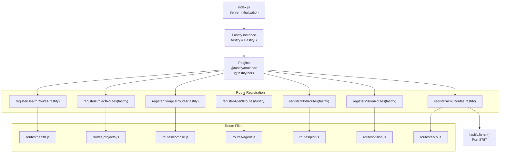
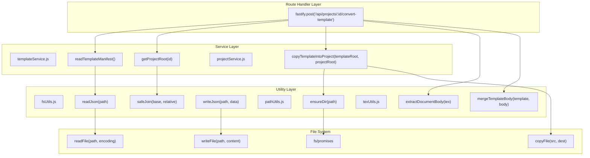
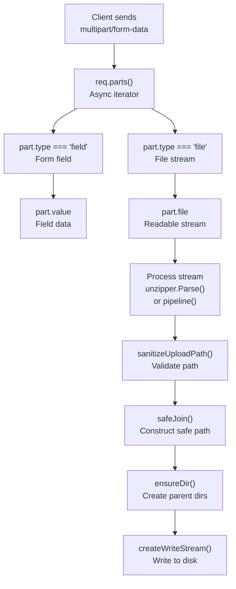
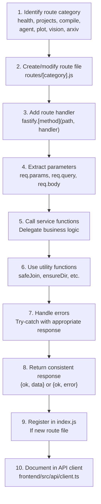

<!-- source: DeepWiki mcp.deepwiki.com · repo OpenDCAI/OpenPrism · page 7.5 Backend Development · fetched 2026-11-02 -->

# Backend Development

<details>
<summary>Relevant source files</summary>

The following files were used as context for generating this wiki page:

- [apps/backend/src/routes/health.js](apps/backend/src/routes/health.js)
- [apps/backend/src/routes/projects.js](apps/backend/src/routes/projects.js)
- [apps/backend/src/services/templateService.js](apps/backend/src/services/templateService.js)

</details>


This document provides guidance for developers working on the OpenPrism backend. It covers Fastify route development patterns, service layer architecture, utility functions, and step-by-step instructions for adding new API endpoints. For information about specific backend services and their implementation details, see [Backend Application](#5). For configuration and deployment, see [Building for Production](#7.3).

## Backend Stack and Entry Point

The OpenPrism backend is built on Node.js with Fastify as the HTTP server framework. The server initialization occurs in `apps/backend/src/index.js`, which sets up the Fastify instance, registers plugins (multipart for file uploads, CORS for cross-origin requests), and mounts route handlers.



**Sources**: Based on system architecture overview, `apps/backend/src/routes/projects.js`, `apps/backend/src/routes/health.js`

## Route Handler Architecture

Route handlers follow a consistent registration pattern using exported functions that accept the Fastify instance. Each route file exports a `register*Routes(fastify)` function that defines multiple endpoints within a functional scope.

### Route Registration Pattern

[apps/backend/src/routes/health.js:1-10]() demonstrates the minimal registration pattern:

```javascript
export function registerHealthRoutes(fastify) {
  fastify.get('/api/health', async () => ({ ok: true }));
  
  fastify.get('/api/templates', async () => {
    const { templates, categories } = await readTemplateManifest();
    return { templates, categories };
  });
}
```

[apps/backend/src/routes/projects.js:16-39]() shows a more complex example with async data access:

```javascript
export function registerProjectRoutes(fastify) {
  fastify.get('/api/projects', async () => {
    await ensureDir(DATA_DIR);
    const entries = await fs.readdir(DATA_DIR, { withFileTypes: true });
    const projects = [];
    // ... processing logic
    return { projects };
  });
  // ... additional routes
}
```

**Sources**: `apps/backend/src/routes/health.js:1-10`, `apps/backend/src/routes/projects.js:16-39`

### Request Handler Patterns

The codebase uses three primary request handler patterns:

| Pattern | Use Case | Example Route |
|---------|----------|---------------|
| **Simple GET** | Read-only operations with no parameters | `/api/health` |
| **Parameterized GET** | Read operations with path/query parameters | `/api/projects/:id/file?path=...` |
| **POST/PUT/PATCH** | Write operations with request body | `/api/projects/:id/file` |
| **Multipart POST** | File upload operations | `/api/projects/:id/upload` |
| **Server-Sent Events** | Long-running operations with progress | `/api/projects/import-arxiv-sse` |

#### Path Parameter Access

[apps/backend/src/routes/projects.js:169-179]() shows path parameter extraction:

```javascript
fastify.post('/api/projects/:id/rename-project', async (req) => {
  const { id } = req.params;
  const { name } = req.body || {};
  // ... processing
});
```

#### Query Parameter Access

[apps/backend/src/routes/projects.js:286-294]() demonstrates query parameter handling:

```javascript
fastify.get('/api/projects/:id/file', async (req) => {
  const { id } = req.params;
  const { path: filePath } = req.query;
  // ... processing
});
```

#### Request Body Access

[apps/backend/src/routes/projects.js:334-349]() shows body parsing for write operations:

```javascript
fastify.put('/api/projects/:id/file', async (req) => {
  const { id } = req.params;
  const { path: filePath, content } = req.body || {};
  // ... processing
});
```

**Sources**: `apps/backend/src/routes/projects.js:169-179`, `apps/backend/src/routes/projects.js:286-294`, `apps/backend/src/routes/projects.js:334-349`

## Service Layer Integration

Route handlers delegate business logic to service layer functions. Services encapsulate domain logic, external API calls, and complex operations.



**Sources**: `apps/backend/src/routes/projects.js:369-401`, `apps/backend/src/services/templateService.js`

### Template Service Pattern

[apps/backend/src/services/templateService.js:6-15]() demonstrates the service pattern for reading configuration:

```javascript
export async function readTemplateManifest() {
  try {
    const data = await readJson(TEMPLATE_MANIFEST);
    const templates = Array.isArray(data?.templates) ? data.templates : [];
    const categories = Array.isArray(data?.categories) ? data.categories : [];
    return { templates, categories };
  } catch {
    return { templates: [], categories: [] };
  }
}
```

Key characteristics:
- **Export named functions**: Services export explicit function names rather than default exports
- **Error handling**: Try-catch blocks with sensible fallback values
- **Type validation**: Defensive checks for expected data shapes (`Array.isArray()`)
- **Utility composition**: Leverage utility functions like `readJson()` for common operations

[apps/backend/src/services/templateService.js:17-47]() shows a recursive file operation pattern:

```javascript
export async function copyTemplateIntoProject(templateRoot, projectRoot) {
  const changed = [];
  const walk = async (rel = '') => {
    const dirPath = path.join(templateRoot, rel);
    const entries = await fs.readdir(dirPath, { withFileTypes: true });
    for (const entry of entries) {
      const nextRel = path.join(rel, entry.name);
      // Skip main.tex to preserve user content
      if (entry.name === 'main.tex') continue;
      // ... copy logic
    }
  };
  await walk('');
  return changed;
}
```

**Sources**: `apps/backend/src/services/templateService.js:6-15`, `apps/backend/src/services/templateService.js:17-47`

## File System Operations and Security

All file system operations use utility functions from `fsUtils.js` and `pathUtils.js` that enforce security boundaries.

### Path Security Pattern

The `safeJoin()` function prevents path traversal attacks. [apps/backend/src/routes/projects.js:290-293]() shows its usage:

```javascript
const projectRoot = await getProjectRoot(id);
const abs = safeJoin(projectRoot, filePath);
const content = await fs.readFile(abs, 'utf8');
```

The `sanitizeUploadPath()` function validates uploaded file paths. [apps/backend/src/routes/projects.js:74-81]() demonstrates this pattern:

```javascript
for await (const entry of zipStream) {
  const relPath = sanitizeUploadPath(entry.path);
  if (!relPath || relPath.endsWith('project.json')) {
    entry.autodrain();
    continue;
  }
  const abs = safeJoin(projectRoot, relPath);
  // ... safe to write to abs
}
```

### Safe File Operations

Common patterns for file operations:

| Operation | Utility Function | Purpose |
|-----------|------------------|---------|
| Create directory | `ensureDir(path)` | Creates directory if missing, no error if exists |
| Read JSON | `readJson(path)` | Parse JSON with error handling |
| Write JSON | `writeJson(path, data)` | Atomic write with pretty formatting |
| Copy directory | `copyDir(src, dest)` | Recursive copy with overwrite control |
| List files | `listFilesRecursive(root)` | Recursive directory listing |

**Sources**: `apps/backend/src/routes/projects.js:290-293`, `apps/backend/src/routes/projects.js:74-81`

## Response Patterns

The backend uses consistent response patterns for different operation types.

### Success Responses

**Simple operations** return `{ ok: true }`:
```javascript
fastify.delete('/api/projects/:id/permanent', async (req) => {
  const { id } = req.params;
  const projectRoot = await getProjectRoot(id);
  await fs.rm(projectRoot, { recursive: true, force: true });
  return { ok: true };
});
```
[apps/backend/src/routes/projects.js:212-217]()

**Data operations** return `{ ok: true, data }`:
```javascript
fastify.post('/api/projects/:id/rename-project', async (req) => {
  // ... processing
  return { ok: true, project: next };
});
```
[apps/backend/src/routes/projects.js:169-179]()

**List operations** return `{ items }`:
```javascript
fastify.get('/api/projects', async () => {
  // ... processing
  return { projects };
});
```
[apps/backend/src/routes/projects.js:17-39]()

### Error Responses

Error responses use `{ ok: false, error: message }`:
```javascript
if (!name) return { ok: false, error: 'Missing name' };
```
[apps/backend/src/routes/projects.js:172]()

For internationalized errors, use the `t()` function:
```javascript
const lang = getLang(req);
return { ok: false, error: t(lang, 'zip_extract_failed', { error: String(err) }) };
```
[apps/backend/src/routes/projects.js:57-93]()

### Binary Responses

For file downloads, set appropriate headers:
```javascript
fastify.get('/api/projects/:id/blob', async (req, reply) => {
  // ... read file
  const contentTypes = {
    '.png': 'image/png',
    '.pdf': 'application/pdf',
    // ...
  };
  const contentType = contentTypes[ext] || 'application/octet-stream';
  reply.header('Content-Type', contentType);
  return reply.send(buffer);
});
```
[apps/backend/src/routes/projects.js:296-315]()

**Sources**: `apps/backend/src/routes/projects.js:212-217`, `apps/backend/src/routes/projects.js:169-179`, `apps/backend/src/routes/projects.js:17-39`, `apps/backend/src/routes/projects.js:296-315`

## Multipart File Upload Handling

File uploads use Fastify's multipart plugin. [apps/backend/src/routes/projects.js:56-103]() demonstrates the multipart pattern:



### Multipart Processing Loop

```javascript
const parts = req.parts();
for await (const part of parts) {
  if (part.type === 'field' && part.fieldname === 'projectName') {
    projectName = String(part.value || '').trim() || projectName;
    continue;
  }
  if (part.type !== 'file') continue;
  
  // Stream processing for files
  const relPath = sanitizeUploadPath(part.filename);
  if (!relPath) continue;
  const abs = safeJoin(projectRoot, relPath);
  await ensureDir(path.dirname(abs));
  await pipeline(part.file, createWriteStream(abs));
  saved.push(relPath);
}
```
[apps/backend/src/routes/projects.js:317-332]()

**Important**: Always call `entry.autodrain()` for skipped entries in archive processing to prevent memory leaks:
```javascript
if (!relPath || relPath.endsWith('project.json')) {
  entry.autodrain();
  continue;
}
```
[apps/backend/src/routes/projects.js:77-80]()

**Sources**: `apps/backend/src/routes/projects.js:56-103`, `apps/backend/src/routes/projects.js:317-332`, `apps/backend/src/routes/projects.js:77-80`

## Server-Sent Events for Long Operations

For operations with progress tracking, use Server-Sent Events (SSE). [apps/backend/src/routes/projects.js:105-167]() demonstrates the SSE pattern:

```javascript
fastify.get('/api/projects/import-arxiv-sse', async (req, reply) => {
  reply.raw.writeHead(200, {
    'Content-Type': 'text/event-stream',
    'Cache-Control': 'no-cache',
    Connection: 'keep-alive'
  });
  
  const send = (event, data) => {
    reply.raw.write(`event: ${event}\ndata: ${JSON.stringify(data)}\n\n`);
  };
  
  try {
    send('progress', { phase: 'download', percent: 0 });
    await downloadArxivSource(arxivId, tmpTar, ({ received, total }) => {
      const percent = total > 0 ? Math.round((received / total) * 100) : -1;
      send('progress', { phase: 'download', percent, received, total });
    });
    
    send('progress', { phase: 'extract', percent: -1 });
    // ... extraction logic
    
    send('done', { ok: true, project: meta });
  } catch (err) {
    send('error', { error: String(err) });
  } finally {
    reply.raw.end();
  }
  
  return reply;
});
```

SSE event types used:
- `progress`: Progress updates with phase and percentage
- `done`: Operation completion with result data
- `error`: Error messages

**Sources**: `apps/backend/src/routes/projects.js:105-167`

## Metadata Management Pattern

Project metadata is stored in `project.json` files. Common patterns for metadata updates:

### Read-Modify-Write Pattern

[apps/backend/src/routes/projects.js:219-229]() shows the standard pattern:

```javascript
const projectRoot = await getProjectRoot(id);
const metaPath = path.join(projectRoot, 'project.json');
const meta = await readJson(metaPath);
const next = { ...meta, tags, updatedAt: new Date().toISOString() };
await writeJson(metaPath, next);
return { ok: true, project: next };
```

### Timestamp Management

Always update `updatedAt` for user-initiated changes:
```javascript
meta.updatedAt = new Date().toISOString();
```
[apps/backend/src/routes/projects.js:345]()

For trash operations, maintain both `trashed` flag and `trashedAt` timestamp:
```javascript
const next = {
  ...meta,
  trashed: !!trashed,
  trashedAt: trashed ? new Date().toISOString() : null,
  updatedAt: new Date().toISOString()
};
```
[apps/backend/src/routes/projects.js:248-253]()

### Default Value Handling

When reading metadata, provide sensible defaults:
```javascript
projects.push({
  ...meta,
  updatedAt: meta.updatedAt || meta.createdAt,
  tags: meta.tags || [],
  archived: meta.archived || false,
  trashed: meta.trashed || false,
  trashedAt: meta.trashedAt || null
});
```
[apps/backend/src/routes/projects.js:26-33]()

**Sources**: `apps/backend/src/routes/projects.js:219-229`, `apps/backend/src/routes/projects.js:345`, `apps/backend/src/routes/projects.js:248-253`, `apps/backend/src/routes/projects.js:26-33`

## Adding a New API Endpoint

Follow this workflow to add a new backend endpoint:



### Step-by-Step Example

To add a new endpoint for exporting a project as a ZIP file:

**1. Choose the route file**: This belongs in `routes/projects.js` since it's project-related.

**2. Add the route handler**:
```javascript
fastify.get('/api/projects/:id/export-zip', async (req, reply) => {
  const { id } = req.params;
  const projectRoot = await getProjectRoot(id);
  
  // Use archiver library to create ZIP
  const archive = archiver('zip', { zlib: { level: 9 } });
  
  reply.header('Content-Type', 'application/zip');
  reply.header('Content-Disposition', `attachment; filename="${id}.zip"`);
  
  archive.pipe(reply.raw);
  archive.directory(projectRoot, false);
  await archive.finalize();
  
  return reply;
});
```

**3. Import required dependencies** at the top of the file:
```javascript
import archiver from 'archiver';
```

**4. Test the endpoint** using curl or the frontend:
```bash
curl http://localhost:8787/api/projects/[id]/export-zip -o project.zip
```

**5. Add to frontend API client** (`apps/frontend/src/api/client.ts`):
```typescript
export async function exportProjectZip(projectId: string): Promise<Blob> {
  const response = await fetch(`/api/projects/${projectId}/export-zip`);
  return response.blob();
}
```

**Sources**: Based on patterns from `apps/backend/src/routes/projects.js`

## Constants and Configuration

Backend configuration constants are defined in `apps/backend/src/config/constants.js`:

| Constant | Purpose | Default/Source |
|----------|---------|----------------|
| `DATA_DIR` | Project storage directory | `OPENPRISM_DATA_DIR` env or `~/.openprism/data` |
| `TEMPLATE_DIR` | Built-in templates location | `DATA_DIR/templates` |
| `TEMPLATE_MANIFEST` | Template metadata file | `TEMPLATE_DIR/manifest.json` |
| `PORT` | HTTP server port | `PORT` env or `8787` |

Usage pattern:
```javascript
import { DATA_DIR, TEMPLATE_DIR } from '../config/constants.js';
```
[apps/backend/src/routes/projects.js:7]()

**Sources**: `apps/backend/src/routes/projects.js:7`, based on system configuration architecture

## Internationalization in Routes

For user-facing error messages, use the i18n system:

```javascript
import { getLang, t } from '../i18n/index.js';

fastify.post('/api/some-operation', async (req) => {
  const lang = getLang(req);
  try {
    // ... operation
  } catch (err) {
    return { ok: false, error: t(lang, 'operation_failed', { error: String(err) }) };
  }
});
```
[apps/backend/src/routes/projects.js:14,57,93]()

The `getLang(req)` function extracts the language from the request (typically from `Accept-Language` header or query parameter). Translation keys are defined in `apps/backend/src/i18n/locales/`.

**Sources**: `apps/backend/src/routes/projects.js:14,57,93`

## Error Handling Best Practices

### Try-Catch Placement

**At route level** for user operations:
```javascript
fastify.post('/api/projects/:id/convert-template', async (req) => {
  try {
    // ... operation that might fail
    return { ok: true, mainFile, changedFiles };
  } catch (err) {
    return { ok: false, error: `Template convert failed: ${String(err)}` };
  }
});
```
[apps/backend/src/routes/projects.js:369-401]()

**At service level** for optional operations:
```javascript
export async function readTemplateManifest() {
  try {
    const data = await readJson(TEMPLATE_MANIFEST);
    // ... processing
    return { templates, categories };
  } catch {
    return { templates: [], categories: [] };
  }
}
```
[apps/backend/src/services/templateService.js:6-15]()

### Silent Failure for Non-Critical Operations

For metadata updates that shouldn't block the primary operation:
```javascript
try {
  const metaPath = path.join(projectRoot, 'project.json');
  const meta = await readJson(metaPath);
  meta.updatedAt = new Date().toISOString();
  await writeJson(metaPath, meta);
} catch { /* ignore */ }
```
[apps/backend/src/routes/projects.js:342-348]()

**Sources**: `apps/backend/src/routes/projects.js:369-401`, `apps/backend/src/services/templateService.js:6-15`, `apps/backend/src/routes/projects.js:342-348`

## Testing Routes

To manually test routes during development:

### Using curl

```bash
# GET request
curl http://localhost:8787/api/health

# POST with JSON body
curl -X POST http://localhost:8787/api/projects \
  -H "Content-Type: application/json" \
  -d '{"name":"Test Project"}'

# File upload
curl -X POST http://localhost:8787/api/projects/:id/upload \
  -F "file=@test.png"
```

### Using the Frontend

Start both dev servers:
```bash
npm run dev
```

The frontend dev server (port 5173) proxies API requests to the backend (port 8787) based on Vite configuration, allowing full integration testing.

**Sources**: Based on development architecture from system overview

## Common Development Tasks

### Adding a New Service Function

1. Create or modify a file in `apps/backend/src/services/`
2. Export named functions
3. Use utility functions for file operations
4. Handle errors appropriately
5. Return consistent data structures

Example structure:
```javascript
import { readJson } from '../utils/fsUtils.js';

export async function myNewService(param) {
  try {
    const data = await readJson(somePath);
    // ... processing
    return { success: true, result: data };
  } catch (error) {
    return { success: false, error: String(error) };
  }
}
```

### Adding a New Utility Function

1. Add to appropriate utility file (`fsUtils.js`, `pathUtils.js`, `texUtils.js`)
2. Keep functions pure and focused
3. Document edge cases
4. Export as named function

Example pattern from `fsUtils.js`:
```javascript
export async function ensureDir(dir) {
  try {
    await fs.mkdir(dir, { recursive: true });
  } catch (err) {
    if (err.code !== 'EEXIST') throw err;
  }
}
```

**Sources**: Based on `apps/backend/src/services/templateService.js` and utility patterns

## Common Pitfalls

| Issue | Problem | Solution |
|-------|---------|----------|
| **Path traversal** | User input in file paths | Always use `safeJoin()` and `sanitizeUploadPath()` |
| **Memory leaks in multipart** | Not draining skipped streams | Call `entry.autodrain()` for skipped entries |
| **Race conditions in metadata** | Concurrent writes to `project.json` | Use read-modify-write pattern, consider locking for critical operations |
| **Missing error handling** | Unhandled promise rejections | Wrap async operations in try-catch |
| **Type assumptions** | Assuming data shapes | Use defensive checks (`Array.isArray()`, `|| {}`, etc.) |
| **Missing i18n** | Hardcoded English error messages | Use `t(lang, key, params)` for user-facing strings |

**Sources**: Based on patterns observed in `apps/backend/src/routes/projects.js`

---

