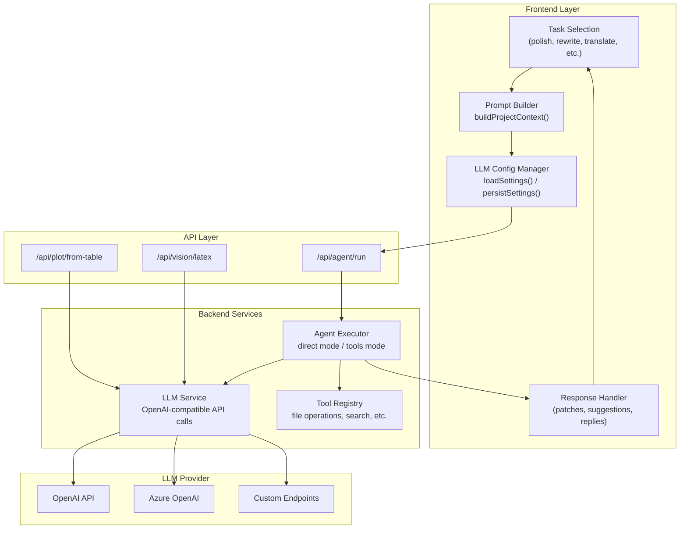
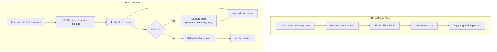
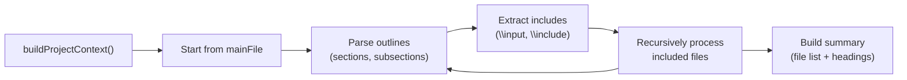
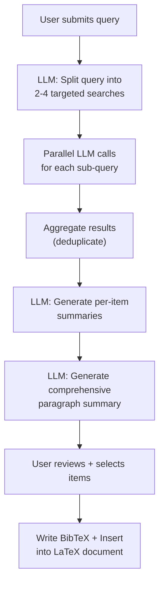

<!-- source: DeepWiki mcp.deepwiki.com · repo OpenDCAI/OpenPrism · page 7.6 Adding AI Features · fetched 2026-11-02 -->

# Adding AI Features

<details>
<summary>Relevant source files</summary>

The following files were used as context for generating this wiki page:

- [README.md](README.md)
- [apps/frontend/src/app/EditorPage.tsx](apps/frontend/src/app/EditorPage.tsx)

</details>


This document provides guidance for developers who want to add new AI-powered features to OpenPrism or extend existing AI capabilities. It covers the AI infrastructure architecture, task registration, agent execution modes, LLM provider integration, and frontend integration patterns.

**Scope**: This page focuses on adding AI features to the OpenPrism editor workspace. For information about the existing AI features from a user perspective, see [AI Assistant Modes](#6.2), [AI Autocomplete](#6.3), [Plot Generation](#6.9), [Vision OCR](#6.10), and [Peer Review](#6.11). For backend service architecture, see [AI Agent Service](#5.3).

---

## AI System Architecture

OpenPrism's AI functionality is built around a flexible agent-based architecture that supports multiple execution modes and LLM providers. The system consists of three main layers:

**Sources**: [README.md:67-74](), [apps/frontend/src/app/EditorPage.tsx:1-40]()

### Core Components



**Sources**: [apps/frontend/src/app/EditorPage.tsx:1250-1278](), [apps/backend/src/routes/agent.js](), [apps/backend/src/services/llm.js]()

---

## LLM Configuration System

OpenPrism uses a three-tier configuration system with clear precedence rules:

1. **Runtime overrides** (per-request parameters)
2. **Frontend localStorage** (user preferences)
3. **Backend environment variables** (system defaults)

### Configuration Structure

The `AppSettings` type defines the configuration schema:

**Sources**: [apps/frontend/src/app/EditorPage.tsx:69-80](), [apps/frontend/src/app/EditorPage.tsx:100-112]()

```typescript
type AppSettings = {
  llmEndpoint: string;        // OpenAI-compatible endpoint URL
  llmApiKey: string;          // API authentication key
  llmModel: string;           // Model identifier (e.g., 'gpt-4o-mini')
  searchEndpoint: string;     // Optional override for search tasks
  searchApiKey: string;       // Optional override for search tasks
  searchModel: string;        // Optional override for search tasks
  visionEndpoint: string;     // Optional override for vision tasks
  visionApiKey: string;       // Optional override for vision tasks
  visionModel: string;        // Optional override for vision tasks
  compileEngine: CompileEngine;
};
```

### Loading and Persisting Configuration

Settings are loaded from localStorage on application start and persisted on every change:

**Sources**: [apps/frontend/src/app/EditorPage.tsx:114-143]()

```typescript
// Loading settings
function loadSettings(): AppSettings {
  const raw = window.localStorage.getItem(SETTINGS_KEY);
  if (!raw) return DEFAULT_SETTINGS;
  const parsed = JSON.parse(raw) as Partial<AppSettings>;
  return { ...DEFAULT_SETTINGS, ...parsed };
}

// Persisting settings
function persistSettings(settings: AppSettings) {
  window.localStorage.setItem(SETTINGS_KEY, JSON.stringify(settings));
}
```

### Configuration Resolution

The system resolves configuration using fallback chains. For example, search and vision tasks can optionally use separate LLM configurations:

**Sources**: [apps/frontend/src/app/EditorPage.tsx:1253-1278]()

```typescript
// Search LLM config with fallback to main config
const searchLlmConfig = useMemo(() => {
  const hasOverride = Boolean(searchEndpoint || searchApiKey || searchModel);
  return {
    endpoint: (hasOverride ? searchEndpoint : llmEndpoint) || llmEndpoint,
    apiKey: (hasOverride ? searchApiKey : llmApiKey) || undefined,
    model: (hasOverride ? searchModel : llmModel) || llmModel
  };
}, [llmEndpoint, llmApiKey, llmModel, searchEndpoint, searchApiKey, searchModel]);
```

### Adding LLM Provider Support

To add support for a new OpenAI-compatible provider:

1. **Update default endpoint** if needed in `DEFAULT_SETTINGS` [apps/frontend/src/app/EditorPage.tsx:100-112]()
2. **No code changes required** - any OpenAI-compatible endpoint works out of the box
3. **Document provider-specific settings** (e.g., Azure deployment names) in user documentation

**Sources**: [apps/frontend/src/app/EditorPage.tsx:1253-1278]()

---

## Adding New AI Tasks

AI tasks are predefined operations that users can select from the Agent tab. Adding a new task involves three steps: task definition, prompt construction, and response handling.

### Task Definition

Tasks are defined in the `DEFAULT_TASKS` array:

**Sources**: [apps/frontend/src/app/EditorPage.tsx:82-89]()

```typescript
const DEFAULT_TASKS = (t: (key: string) => string) => [
  { value: 'polish', label: t('润色') },
  { value: 'rewrite', label: t('改写') },
  { value: 'structure', label: t('结构调整') },
  { value: 'translate', label: t('翻译') },
  { value: 'websearch', label: t('检索 (arXiv)') },
  { value: 'custom', label: t('自定义') }
];
```

To add a new task:

1. **Add task definition** to `DEFAULT_TASKS` array
2. **Add internationalization keys** for the task label
3. **Implement task-specific logic** in `sendPrompt()` function

### Example: Adding a "Summarize" Task

**Step 1**: Add to task definitions:

```typescript
const DEFAULT_TASKS = (t: (key: string) => string) => [
  // ... existing tasks
  { value: 'summarize', label: t('总结') }
];
```

**Step 2**: Add prompt construction logic in `sendPrompt()`:

**Sources**: [apps/frontend/src/app/EditorPage.tsx:3083-3175]()

```typescript
const sendPrompt = async () => {
  // ... existing code
  
  // Add summarize task handling
  if (!isChat && task === 'summarize') {
    if (translateScope === 'selection' && !selectionText) {
      setStatus(t('请选择要总结的文本。'));
      return;
    }
    const note = prompt ? `\n${t('User note')}: ${prompt}` : '';
    if (translateScope === 'project') {
      effectiveMode = 'tools';
      effectiveSelection = '';
      effectiveContent = '';
      effectivePrompt = t('Generate a comprehensive summary of all .tex files in the project.{{note}}', { note });
    } else if (translateScope === 'file') {
      effectiveSelection = '';
      effectivePrompt = t('Summarize the current file.{{note}}', { note });
    } else {
      effectivePrompt = t('Summarize the selected text.{{note}}', { note });
    }
    effectiveTask = 'summarize';
  }
  
  // ... rest of sendPrompt logic
};
```

**Step 3**: Handle response appropriately (summarize typically returns text):

The response handling logic at [apps/frontend/src/app/EditorPage.tsx:3151-3171]() already handles different response types (`reply`, `suggestion`, `patches`).

**Sources**: [apps/frontend/src/app/EditorPage.tsx:3083-3175]()

---

## Agent Execution Modes

OpenPrism supports two execution modes: **Direct** (single-shot LLM call) and **Tools** (multi-turn with tool invocations).



**Sources**: [apps/backend/src/routes/agent.js](), [README.md:69-72]()

### Direct Mode

Direct mode is suitable for:
- Simple text transformations (polish, rewrite)
- Single-file operations
- Quick inline suggestions
- Autocomplete

**Sources**: [apps/frontend/src/app/EditorPage.tsx:1580-1627]()

Example from autocomplete feature:

```typescript
const requestInlineSuggestion = useCallback(async () => {
  const view = cmViewRef.current;
  if (!view || isSuggesting) return;
  
  const pos = view.state.selection.main.head;
  const docText = view.state.doc.toString();
  const before = docText.slice(Math.max(0, pos - 4000), pos);
  const after = docText.slice(pos, pos + 400);
  
  const res = await runAgent({
    task: 'autocomplete',
    prompt: t('Continue after <CURSOR>...'),
    selection: '',
    content: `${before}<CURSOR>${after}`,
    mode: 'direct',  // Single-shot execution
    projectId,
    activePath,
    compileLog,
    llmConfig
  });
  
  const suggestion = (res.suggestion || res.reply || '').trim();
  // Apply suggestion...
}, [/* deps */]);
```

### Tools Mode

Tools mode is suitable for:
- Multi-file operations
- Complex refactoring
- Project-wide changes
- Tasks requiring file system access

**Sources**: [apps/frontend/src/app/EditorPage.tsx:3107-3135]()

Example from translate task:

```typescript
if (!isChat && task === 'translate') {
  if (translateScope === 'project') {
    effectiveMode = 'tools';  // Enable multi-turn tools execution
    effectiveSelection = '';
    effectiveContent = '';
    effectivePrompt = t('Translate all .tex files in the project to {{target}}...', 
                        { target: translateTarget });
  }
}
```

### Response Types

The agent service returns different response types based on the execution mode and task:

**Sources**: [apps/frontend/src/app/EditorPage.tsx:3155-3171]()

| Response Field | Type | Description | When Used |
|---------------|------|-------------|-----------|
| `reply` | `string` | Conversational response | Chat mode, Tools mode final response |
| `suggestion` | `string` | Inline text replacement | Direct mode with selection |
| `patches` | `Array<{path, content, diff}>` | Structured file changes | Tools mode, Agent mode |

---

## Building Context for AI Tasks

Many AI tasks benefit from project-wide context. OpenPrism provides a context builder that traces through LaTeX `\input` and `\include` directives:

**Sources**: [apps/frontend/src/app/EditorPage.tsx:1800-1835]()



### Using Project Context

**Sources**: [apps/frontend/src/app/EditorPage.tsx:3130-3135]()

```typescript
// In sendPrompt()
if (!isChat && effectiveTask !== 'websearch') {
  const context = await buildProjectContext();
  if (context) {
    effectivePrompt = `${effectivePrompt}\n\n[Project Context]\n${context}`;
  }
}
```

The context includes:
- List of all related `.tex` files
- Section/subsection structure of each file (up to 12 headings per file)
- Hierarchical outline representation

**Sources**: [apps/frontend/src/app/EditorPage.tsx:1817-1834]()

---

## Frontend Integration Patterns

### Adding a New AI Sidebar Tab

To add a new AI feature with a dedicated sidebar tab:

**Step 1**: Add tab definition in sidebar tabs section:

**Sources**: [apps/frontend/src/app/EditorPage.tsx:3388-3447]()

```typescript
<button
  className={`tab-btn ${activeSidebar === 'myfeature' ? 'active' : ''}`}
  onClick={() => setActiveSidebar('myfeature')}
  title={t('My Feature')}
>
  <span className="tab-icon">
    {/* SVG icon */}
  </span>
  <span className="tab-text">{t('My Feature')}</span>
</button>
```

**Step 2**: Add conditional rendering for tab content:

```typescript
{activeSidebar === 'myfeature' ? (
  <>
    <div className="panel-header">
      <div>{t('My Feature')}</div>
    </div>
    <div className="tools-body">
      {/* Feature UI */}
    </div>
  </>
) : /* ... other tabs */}
```

**Step 3**: Add state management for the feature:

```typescript
const [myFeatureState, setMyFeatureState] = useState<MyFeatureState>({
  // initial state
});
```

### Calling the Agent API

The standard pattern for calling the agent API:

**Sources**: [apps/frontend/src/app/EditorPage.tsx:1593-1621]()

```typescript
const res = await runAgent({
  task: 'task_name',           // Task identifier
  prompt: 'System prompt',     // Instructions for the LLM
  selection: selectionText,    // Selected text (or empty)
  content: editorValue,        // Current file content
  mode: 'direct',              // 'direct' or 'tools'
  projectId,                   // Project identifier
  activePath,                  // Current file path
  compileLog,                  // Recent compile log (optional)
  llmConfig,                   // LLM configuration
  interaction: 'agent',        // 'chat' or 'agent'
  history: []                  // Conversation history (optional)
});
```

### Handling Different Response Types

**Sources**: [apps/frontend/src/app/EditorPage.tsx:3155-3171]()

```typescript
// 1. Patches (structured file changes)
if (res.patches && res.patches.length > 0) {
  const nextPending = res.patches.map((patch) => ({
    filePath: patch.path,
    original: files[patch.path] ?? '',
    proposed: patch.content,
    diff: patch.diff
  }));
  setPendingChanges(nextPending);
  setRightView('diff');  // Show diff viewer
}

// 2. Inline suggestion (text replacement)
else if (res.suggestion) {
  const proposed = selectionText
    ? replaceSelection(editorValue, selectionRange[0], selectionRange[1], res.suggestion)
    : res.suggestion;
  const diff = createTwoFilesPatch(activePath, activePath, editorValue, proposed);
  setPendingChanges([{ filePath: activePath, original: editorValue, proposed, diff }]);
  setRightView('diff');
}

// 3. Reply (conversational response)
const replyText = res.reply || t('已生成建议。');
setHistory((prev) => [...prev, { role: 'assistant', content: replyText }]);
```

---

## Adding Specialized AI Features

### Vision/OCR Integration

The vision feature demonstrates integration with multimodal LLMs:

**Sources**: [apps/frontend/src/app/EditorPage.tsx:2326-2361]()

```typescript
const handleVisionSubmit = async () => {
  if (!visionFile) return;
  
  const res = await visionToLatex({
    projectId,
    file: visionFile,           // Image file (File object)
    mode: visionMode,           // 'equation', 'table', 'algorithm', etc.
    prompt: extraPrompt,        // Optional user constraints
    llmConfig: visionLlmConfig  // Vision-specific LLM config
  });
  
  if (res.ok) {
    setVisionResult(res.latex || '');
  }
};
```

Key aspects:
- Uses separate `visionLlmConfig` for vision-specific models
- Supports multiple recognition modes
- Allows custom prompts for constraint specification
- Returns LaTeX code directly

**Sources**: [apps/frontend/src/app/EditorPage.tsx:1271-1278]()

### Plot Generation

Plot generation demonstrates AI-driven code generation with execution:

**Sources**: [apps/frontend/src/app/EditorPage.tsx:2047-2080]()

```typescript
const handlePlotGenerate = async () => {
  const res = await plotFromTable({
    projectId,
    tableLatex: selectionText,      // LaTeX table from selection
    chartType: plotType,            // 'bar', 'line', 'heatmap'
    title: plotTitle.trim(),        // Optional chart title
    prompt: plotPrompt.trim(),      // Optional custom instructions
    filename: plotFilename.trim(),  // Optional filename
    retries: plotRetries,           // Number of retry attempts
    llmConfig                       // Main LLM config
  });
  
  if (res.ok && res.assetPath) {
    setPlotAssetPath(res.assetPath);
    await refreshTree();  // Refresh file tree to show new asset
    
    if (plotAutoInsert) {
      insertFigureSnippet(res.assetPath);  // Auto-insert LaTeX figure
    }
  }
};
```

This pattern:
1. Sends LaTeX table data to backend
2. Backend uses LLM to generate Python plotting code
3. Backend executes Python code in isolated environment
4. Returns generated plot as asset file
5. Frontend optionally inserts LaTeX `\includegraphics` snippet

**Sources**: [apps/frontend/src/app/EditorPage.tsx:1745-1756]()

### Multi-Query Search

The websearch feature demonstrates complex multi-step AI workflows:

**Sources**: [apps/frontend/src/app/EditorPage.tsx:2082-2247]()



Key implementation details:

```typescript
// Step 1: Query splitting
const splitRes = await callLLM({
  llmConfig: searchLlmConfig,
  messages: [
    { role: 'system', content: 'Split the query into 2-4 targeted search queries...' },
    { role: 'user', content: query }
  ]
});
const queries = parsed.queries.slice(0, 4);

// Step 2: Parallel searches
await Promise.all(
  queries.map(async (q) => {
    const res = await callLLM({
      llmConfig: searchLlmConfig,
      messages: [/* search prompt */]
    });
    // Parse and aggregate results
  })
);

// Step 3: Generate summaries
const summariesRes = await callLLM({
  llmConfig: searchLlmConfig,
  messages: [
    { role: 'system', content: 'Write 1-2 sentence summaries for each paper...' }
  ]
});
```

**Sources**: [apps/frontend/src/app/EditorPage.tsx:2096-2242]()

---

## Advanced Patterns

### Typewriter Effect for Responses

The system uses a typewriter effect for streaming-like display of LLM responses:

**Sources**: [apps/frontend/src/app/EditorPage.tsx:3039-3073]()

```typescript
const startTypewriter = useCallback((setHistory: Dispatch<SetStateAction<Message[]>>, text: string) => {
  if (typewriterTimerRef.current) {
    window.clearTimeout(typewriterTimerRef.current);
  }
  
  let idx = 0;
  const step = () => {
    idx = Math.min(text.length, idx + 2);  // Show 2 chars at a time
    const slice = text.slice(0, idx);
    
    setHistory((prev) => {
      const next = [...prev];
      const last = next[next.length - 1];
      if (last.role === 'assistant') {
        next[next.length - 1] = { ...last, content: slice };
      }
      return next;
    });
    
    if (idx < text.length) {
      typewriterTimerRef.current = window.setTimeout(step, 16);  // ~60fps
    }
  };
  step();
}, []);
```

Usage:

```typescript
const replyText = res.reply || 'Response text';
setHistory((prev) => [...prev, { role: 'assistant', content: '' }]);
window.setTimeout(() => startTypewriter(setHistory, replyText), 0);
```

**Sources**: [apps/frontend/src/app/EditorPage.tsx:3152-3153]()

### Ghost Text Suggestions

The autocomplete feature uses CodeMirror decorations for inline suggestions:

**Sources**: [apps/frontend/src/app/EditorPage.tsx:651-695]()

```typescript
// Define ghost effect
const setGhostEffect = StateEffect.define<{ pos: number | null; text: string }>();

// Create widget for ghost text
class GhostWidget extends WidgetType {
  constructor(private text: string) { super(); }
  
  toDOM() {
    const span = document.createElement('span');
    span.className = 'cm-ghost';
    span.textContent = this.text;
    return span;
  }
}

// State field for managing ghost decorations
const ghostField = StateField.define<DecorationSet>({
  create() { return Decoration.none; },
  update(deco, tr) {
    for (const effect of tr.effects) {
      if (effect.is(setGhostEffect)) {
        const { pos, text } = effect.value;
        if (pos == null || !text) return Decoration.none;
        
        const widget = Decoration.widget({
          widget: new GhostWidget(text),
          side: 1
        });
        return Decoration.set([widget.range(pos)]);
      }
    }
    // Clear on document or selection changes
    if (tr.docChanged || tr.selectionSet) return Decoration.none;
    return deco.map(tr.changes);
  },
  provide: (field) => EditorView.decorations.from(field)
});
```

Applying ghost text:

```typescript
view.dispatch({
  effects: setGhostEffect.of({ pos: cursorPosition, text: suggestion })
});
```

**Sources**: [apps/frontend/src/app/EditorPage.tsx:1616-1618]()

### Error Handling and Status Updates

Best practices for AI feature error handling:

```typescript
try {
  setBusy(true);
  setStatus('Processing...');
  
  const res = await aiApiCall({ /* params */ });
  
  if (!res.ok) {
    throw new Error(res.error || 'Operation failed');
  }
  
  // Handle success
  setStatus('Success');
} catch (err) {
  setStatus(t('Failed: {{error}}', { error: String(err) }));
  console.error('AI operation error:', err);
} finally {
  setBusy(false);
}
```

**Sources**: [apps/frontend/src/app/EditorPage.tsx:2054-2079]()

---

## Testing AI Features

### Manual Testing Checklist

When adding a new AI feature:

1. **Configuration testing**:
   - Test with default settings
   - Test with custom endpoint (e.g., Azure OpenAI)
   - Test with missing API key (should show clear error)

2. **Mode testing** (for agent tasks):
   - Test Direct mode with simple prompts
   - Test Tools mode with multi-file operations
   - Verify correct mode is used for task type

3. **Response handling**:
   - Test with various response formats
   - Test error responses (network failures, API errors)
   - Test timeout scenarios

4. **UI/UX**:
   - Verify loading states are shown
   - Verify status messages are clear
   - Test keyboard shortcuts if applicable

5. **Integration**:
   - Test with empty projects
   - Test with complex multi-file projects
   - Test interaction with compilation system

### Example Test Scenarios

**Autocomplete feature**:
- Trigger with `Alt+/` or `Cmd+Space`
- Accept with `Tab`
- Accept chunk with `→`
- Cancel with `Esc`
- Verify ghost text positioning on scroll

**Agent tasks**:
- Submit with empty selection (should handle gracefully)
- Submit with large selection (>1000 lines)
- Test file path in generated patches
- Verify diff viewer shows changes correctly

**Sources**: [apps/frontend/src/app/EditorPage.tsx:1366-1419]()

---

## Backend API Extension

To add a new AI endpoint on the backend:

**Step 1**: Create route handler in `apps/backend/src/routes/`:

```javascript
// apps/backend/src/routes/myfeature.js
export default async function myFeatureRoutes(fastify) {
  fastify.post('/api/myfeature', async (request, reply) => {
    const { projectId, input, llmConfig } = request.body;
    
    // Validate input
    if (!input) {
      return reply.status(400).send({ ok: false, error: 'Missing input' });
    }
    
    // Call LLM service
    const llmResponse = await callLLM({
      messages: [
        { role: 'system', content: 'System prompt...' },
        { role: 'user', content: input }
      ],
      llmConfig
    });
    
    if (!llmResponse.ok) {
      return reply.status(500).send({ 
        ok: false, 
        error: llmResponse.error 
      });
    }
    
    // Process response
    const result = processLLMOutput(llmResponse.content);
    
    return { ok: true, result };
  });
}
```

**Step 2**: Register route in main server file:

```javascript
// apps/backend/src/index.js
import myFeatureRoutes from './routes/myfeature.js';

await fastify.register(myFeatureRoutes);
```

**Step 3**: Add client function in `apps/frontend/src/api/client.ts`:

```typescript
export async function callMyFeature(params: {
  projectId: string;
  input: string;
  llmConfig?: { endpoint: string; apiKey?: string; model: string };
}) {
  const res = await fetch(`${API_BASE}/myfeature`, {
    method: 'POST',
    headers: { 'Content-Type': 'application/json' },
    body: JSON.stringify(params)
  });
  return res.json();
}
```

**Sources**: [apps/backend/src/routes/agent.js](), [apps/backend/src/routes/plot.js](), [apps/frontend/src/api/client.ts]()

---

## Best Practices

### Prompt Engineering

1. **Be specific about output format**: Request JSON, LaTeX, or specific structure
2. **Provide context**: Use `buildProjectContext()` for project-aware tasks
3. **Include examples**: Show desired input/output format
4. **Set constraints**: Specify what to preserve (e.g., LaTeX commands, structure)

Example prompt structure:

```typescript
const prompt = [
  'You are a LaTeX writing assistant.',
  'Task: ' + taskDescription,
  'Context: ' + projectContext,
  'Constraints: Preserve LaTeX commands and document structure.',
  'Output format: Return only valid LaTeX code.',
  userInstructions
].filter(Boolean).join('\n\n');
```

### Configuration Management

1. **Use separate configs for specialized tasks**: Vision and search tasks may need different models
2. **Provide clear fallbacks**: Always fall back to main LLM config
3. **Validate configurations**: Check endpoint format and required fields
4. **Support runtime overrides**: Allow per-request configuration changes

**Sources**: [apps/frontend/src/app/EditorPage.tsx:1262-1278]()

### Error Handling

1. **Parse LLM output defensively**: Use `safeJsonParse()` for JSON responses
2. **Provide user-friendly error messages**: Translate technical errors
3. **Log details for debugging**: Keep full error stack in console
4. **Implement retry logic**: For transient network failures

**Sources**: [apps/frontend/src/app/EditorPage.tsx:574-584]()

```typescript
function safeJsonParse<T>(raw: string): T | null {
  try {
    return JSON.parse(raw) as T;
  } catch (err) {
    try {
      return JSON.parse(sanitizeJsonString(raw)) as T;
    } catch (err2) {
      return null;
    }
  }
}
```

### Performance Optimization

1. **Use debouncing for auto-save**: Avoid excessive file writes during AI operations
2. **Cache file contents**: Use `ensureFileContent()` to avoid redundant reads
3. **Implement request cancellation**: For long-running operations
4. **Show progress indicators**: For multi-step workflows

**Sources**: [apps/frontend/src/app/EditorPage.tsx:1690-1709](), [apps/frontend/src/app/EditorPage.tsx:1788-1798]()

---

This guide covers the essential patterns for adding AI features to OpenPrism. For questions about specific implementation details, consult the existing AI feature implementations: Agent tab [apps/frontend/src/app/EditorPage.tsx:3576-3820](), Vision tab [apps/frontend/src/app/EditorPage.tsx:3821-3940](), Plot tab [apps/frontend/src/app/EditorPage.tsx:4273-4272](), and WebSearch tab [apps/frontend/src/app/EditorPage.tsx:4084-4272]().

---

