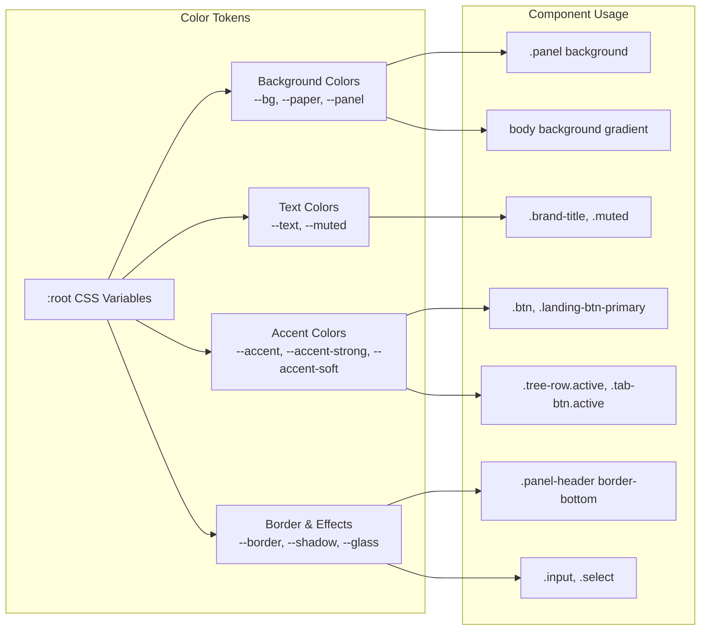
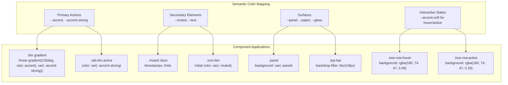
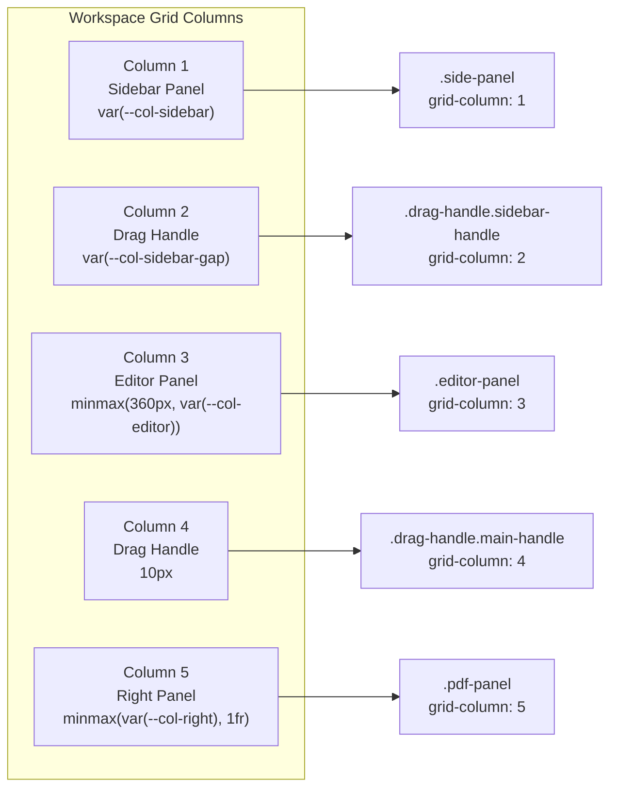
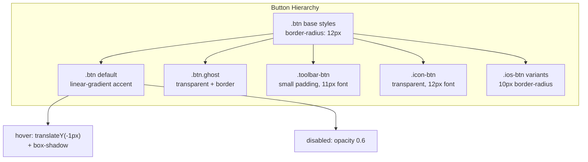
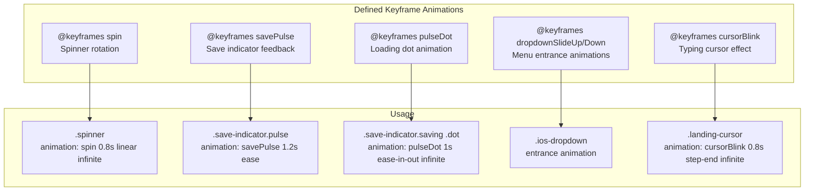
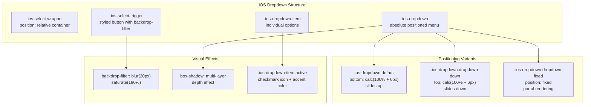

<!-- source: DeepWiki mcp.deepwiki.com · repo OpenDCAI/OpenPrism · page 7.7 Styling and Theming · fetched 2026-11-02 -->

# Styling and Theming

<details>
<summary>Relevant source files</summary>

The following files were used as context for generating this wiki page:

- [apps/frontend/src/app/App.css](apps/frontend/src/app/App.css)

</details>


## Purpose and Scope

This document describes the CSS architecture, design system, and styling patterns used throughout OpenPrism's frontend application. It covers the foundational design tokens (CSS custom properties), component styling conventions, layout systems, visual effects, and responsive design patterns.

For information about UI component development and React patterns, see [Frontend Development](#7.4). For details on CodeMirror editor styling extensions, see [CodeMirror Integration](#4.4).

---

## CSS Architecture Overview

OpenPrism uses a single, comprehensive CSS file that defines all application styles using a component-oriented approach without CSS-in-JS or preprocessors.

```mermaid
graph TB
    AppCSS["App.css<br/>(Single CSS File)"]
    
    subgraph "Foundation Layer"
        CustomProps["CSS Custom Properties<br/>:root variables"]
        Resets["Global Resets<br/>box-sizing, body"]
        Fonts["Font Imports<br/>Google Fonts"]
    end
    
    subgraph "Layout Systems"
        Grid["Grid Layouts<br/>.workspace grid"]
        Flex["Flexbox Layouts<br/>.top-bar, .toolbar"]
        Panels[".panel classes<br/>reusable containers"]
    end
    
    subgraph "Component Styles"
        EditorComponents["Editor Workspace<br/>.editor-panel, .breadcrumb-bar"]
        SidebarComponents["Sidebar Components<br/>.sidebar-tabs, .tree-node"]
        PDFComponents["PDF Viewer<br/>.pdf-panel, .pdf-toolbar"]
        ModalComponents["Modals & Overlays<br/>.modal, .ctx-menu"]
        FormComponents["Form Controls<br/>.input, .btn, .select"]
    end
    
    subgraph "Feature-Specific"
        Landing["Landing Page<br/>.landing-* classes"]
        Projects["Project Management<br/>.project-* classes"]
        Diff["Diff Viewer<br/>.split-diff, .diff-panel"]
        Vision["Vision Tab<br/>.vision-*, .image-drop-zone"]
    end
    
    subgraph "Effects & Utilities"
        Animations["@keyframes<br/>spin, savePulse, dropdownSlide"]
        Glassmorphism["Backdrop Filters<br/>blur effects"]
        Responsive["Media Queries<br/>@media, @container"]
    end
    
    AppCSS --> CustomProps
    AppCSS --> Resets
    AppCSS --> Fonts
    
    CustomProps --> Grid
    CustomProps --> Flex
    CustomProps --> Panels
    
    Panels --> EditorComponents
    Panels --> SidebarComponents
    Panels --> PDFComponents
    Panels --> ModalComponents
    
    FormComponents --> EditorComponents
    FormComponents --> SidebarComponents
    
    AppCSS --> Landing
    AppCSS --> Projects
    AppCSS --> Diff
    AppCSS --> Vision
    
    AppCSS --> Animations
    AppCSS --> Glassmorphism
    AppCSS --> Responsive
```



**Sources**: [apps/frontend/src/app/App.css:1-3441]()

---

## Design System Foundation

### CSS Custom Properties

OpenPrism defines a comprehensive set of CSS custom properties in the `:root` selector that serve as design tokens throughout the application.

| Category | Variable | Value | Usage |
|----------|----------|-------|-------|
| **Background** | `--bg` | `#f4efe6` | Page background |
| | `--paper` | `#fbf8f2` | Panel surfaces |
| | `--panel` | `rgba(255, 255, 255, 0.9)` | Panel with transparency |
| | `--panel-muted` | `rgba(252, 248, 241, 0.92)` | Panel headers |
| | `--glass` | `rgba(252, 248, 241, 0.76)` | Glassmorphism effect |
| **Text** | `--text` | `#2b2522` | Primary text color |
| | `--muted` | `#7a6f67` | Secondary text color |
| **Accent** | `--accent` | `#b44a2f` | Primary brand color |
| | `--accent-strong` | `#933623` | Darker accent |
| | `--accent-soft` | `rgba(180, 74, 47, 0.16)` | Translucent accent |
| **Borders** | `--border` | `rgba(120, 98, 83, 0.22)` | Standard border color |
| **Effects** | `--shadow` | `0 24px 48px rgba(68, 50, 38, 0.18)` | Drop shadow |



**Sources**: [apps/frontend/src/app/App.css:3-16]()

### Global Reset and Base Styles

```css
* {
  box-sizing: border-box;
}

body {
  font-family: "IBM Plex Sans", "Helvetica Neue", sans-serif;
  font-size: 12.5px;
  color: var(--text);
  background: /* multi-layer gradient */
}
```

**Sources**: [apps/frontend/src/app/App.css:18-37]()

---

## Typography System

OpenPrism uses three font families with specific semantic roles:

| Font Family | CSS Class/Usage | Purpose |
|-------------|-----------------|---------|
| **IBM Plex Sans** | Default body font | UI text, controls, labels |
| **Source Serif 4** | `.brand-title`, `.landing-title` | Branding, headings |
| **JetBrains Mono** | `.status-right`, code blocks | Monospace data, file paths |

### Font Loading

Fonts are imported from Google Fonts CDN at the beginning of the stylesheet:

**Sources**: [apps/frontend/src/app/App.css:1]()

### Typography Classes

| Class | Font Size | Weight | Usage |
|-------|-----------|--------|-------|
| `.brand-title` | 20px | 700 | Application name in top bar |
| `.brand-sub` | 12px | normal | Subtitle text |
| `.landing-title` | clamp(48px, 8vw, 80px) | 700 | Landing page hero |
| `.muted` | 11px | normal | Secondary text |
| `.tool-title` | 11px | normal | Section headers (uppercase) |

**Sources**: [apps/frontend/src/app/App.css:65-74](), [apps/frontend/src/app/App.css:2484-2491](), [apps/frontend/src/app/App.css:2122-2125]()

---

## Color System and Semantic Usage

### Color Application Pattern



### State-Based Color Variants

The codebase uses alpha channel variations of base colors for different states:

| State | Pattern | Example |
|-------|---------|---------|
| **Hover** | `rgba(180, 74, 47, 0.1)` | Subtle highlight on interactive elements |
| **Active** | `rgba(180, 74, 47, 0.18)` | Selected file in tree |
| **Border** | `rgba(120, 98, 83, 0.22)` | Standard border color |
| **Soft Background** | `rgba(180, 74, 47, 0.08)` | Soft accent background |

**Sources**: [apps/frontend/src/app/App.css:10-15](), [apps/frontend/src/app/App.css:1133-1136](), [apps/frontend/src/app/App.css:1120-1122]()

---

## Layout Architecture

### Three-Panel Grid System

The main editor workspace uses CSS Grid with dynamic column sizing controlled by CSS variables:

```css
.workspace {
  display: grid;
  grid-template-columns: 
    var(--col-sidebar) 
    var(--col-sidebar-gap) 
    minmax(360px, var(--col-editor)) 
    10px 
    minmax(var(--col-right), 1fr);
}
```



**Dynamic Resizing**: Column widths are stored in CSS variables that are updated via JavaScript when users drag the `.drag-handle` elements.

**Sources**: [apps/frontend/src/app/App.css:171-179]()

### Panel Structure Pattern

All major panels follow a consistent structure:

```
.panel (container with glassmorphism)
  └── .panel-header (sticky header with title/controls)
  └── [panel-body variant] (scrollable content)
  └── [optional footer/actions]
```

**Sources**: [apps/frontend/src/app/App.css:181-190](), [apps/frontend/src/app/App.css:231-240]()

---

## Component Styling Patterns

### Button System

OpenPrism defines multiple button variants with consistent styling patterns:

| Class | Appearance | Usage |
|-------|------------|-------|
| `.btn` | Gradient background, rounded | Primary actions |
| `.btn.ghost` | Transparent with border | Secondary actions |
| `.toolbar-btn` | Small, bordered | Editor toolbar actions |
| `.icon-btn` | Minimal, no background | Icon-only actions |
| `.ios-btn.primary` | iOS-style solid | Vision/Plot features |
| `.ios-btn.secondary` | iOS-style light | Cancel actions |



**Sources**: [apps/frontend/src/app/App.css:2070-2100](), [apps/frontend/src/app/App.css:779-795](), [apps/frontend/src/app/App.css:368-381](), [apps/frontend/src/app/App.css:1625-1657]()

### Input System

Form inputs use consistent styling with focus states:

```css
.input {
  border-radius: 12px;
  border: 1px solid rgba(120, 98, 83, 0.3);
  padding: 8px 10px;
  font-size: 12px;
  background: #fffdf9;
  transition: border-color 0.2s ease, box-shadow 0.2s ease;
}

.input:focus {
  border-color: rgba(180, 74, 47, 0.4);
  box-shadow: 0 0 0 3px rgba(180, 74, 47, 0.1);
}
```

**Focus Ring Pattern**: All interactive inputs use a soft box-shadow ring rather than browser default outlines.

**Sources**: [apps/frontend/src/app/App.css:619-633]()

### File Tree Icon System

The file tree uses styled pseudo-elements and color-coded extensions:

| Extension | Class | Background Color | Border Color |
|-----------|-------|------------------|--------------|
| `.tex` | `.tree-icon.ext-tex` | `rgba(54, 134, 197, 0.12)` | `rgba(54, 134, 197, 0.35)` |
| `.bib` | `.tree-icon.ext-bib` | `rgba(120, 98, 83, 0.12)` | `rgba(120, 98, 83, 0.35)` |
| images | `.tree-icon.ext-png/.ext-jpg` | `rgba(68, 166, 124, 0.14)` | `rgba(68, 166, 124, 0.4)` |
| folder | `.tree-icon.folder` | `rgba(180, 74, 47, 0.12)` | `rgba(180, 74, 47, 0.35)` |

**Folder Icon**: Uses a `::before` pseudo-element to create a folder tab effect:

```css
.tree-icon.folder::before {
  content: '';
  position: absolute;
  top: -4px;
  left: 4px;
  width: 10px;
  height: 6px;
  border-radius: 4px 4px 0 0;
  background: rgba(180, 74, 47, 0.25);
}
```

**Sources**: [apps/frontend/src/app/App.css:1066-1118]()

---

## Visual Effects and Animations

### Glassmorphism Effect

The application uses backdrop filters extensively for a modern glassmorphic appearance:

```css
.top-bar {
  background: var(--glass);
  backdrop-filter: blur(18px);
  -webkit-backdrop-filter: blur(18px);
  border-bottom: 1px solid var(--border);
}
```

**Key Properties**:
- `backdrop-filter: blur(18px)` - Modern browsers
- `-webkit-backdrop-filter: blur(18px)` - Safari compatibility
- Semi-transparent background using `rgba()` or CSS variables

**Sources**: [apps/frontend/src/app/App.css:52-63](), [apps/frontend/src/app/App.css:2228-2241]()

### Animation Keyframes



**Sources**: [apps/frontend/src/app/App.css:1246-1250](), [apps/frontend/src/app/App.css:151-169](), [apps/frontend/src/app/App.css:2331-2362](), [apps/frontend/src/app/App.css:2603-2606]()

### Transition Patterns

Consistent transition durations are used across components:

- **Quick interactions**: `0.2s ease` (buttons, hover states)
- **Smooth animations**: `0.25s cubic-bezier(0.4, 0, 0.2, 1)` (dropdowns, modals)
- **Slow emphasis**: `0.5s cubic-bezier(0.4, 0, 0.2, 1)` (carousel transitions)

**Sources**: [apps/frontend/src/app/App.css:2239](), [apps/frontend/src/app/App.css:2705]()

---

## Responsive Design

### Media Queries

The application adapts to smaller screens with a single breakpoint:

```css
@media (max-width: 1100px) {
  .workspace {
    grid-template-columns: 1fr;
  }
  .drag-handle.vertical {
    display: none;
  }
  .side-panel,
  .editor-panel,
  .pdf-panel {
    grid-column: auto;
  }
}
```

**Behavior**: Below 1100px width, the three-panel grid collapses into a single-column layout, hiding drag handles.

**Sources**: [apps/frontend/src/app/App.css:2199-2214]()

### Container Queries

The sidebar uses container queries for responsive tab display:

```css
@container sidebar (max-width: 280px) {
  .tab-icon {
    display: inline-flex;
  }
  .tab-text {
    display: none;
  }
  .tab-btn {
    padding: 6px 8px;
  }
}
```

**Pattern**: When the sidebar panel (`.side-panel` with `container-name: sidebar`) is narrower than 280px, tab labels are hidden and only icons are shown.

**Sources**: [apps/frontend/src/app/App.css:2398-2408](), [apps/frontend/src/app/App.css:197-199]()

---

## Specialized UI Patterns

### iOS-Style Dropdown System

OpenPrism implements a custom dropdown that mimics iOS design:



**Backdrop Click Handling**: Fixed dropdowns use `.topbar-dropdown-backdrop` overlay for click-away detection.

**Sources**: [apps/frontend/src/app/App.css:2217-2330](), [apps/frontend/src/app/App.css:2364-2395]()

### Split Diff Viewer

The diff viewer uses a two-column grid for side-by-side comparison:

```css
.split-diff {
  display: grid;
  grid-template-columns: 1fr 1fr;
  gap: 12px;
}

.split-row {
  display: grid;
  grid-template-columns: 40px 1fr;
  gap: 8px;
}

.split-row.added {
  background: rgba(16, 185, 129, 0.12);
}

.split-row.removed {
  background: rgba(239, 68, 68, 0.12);
}
```

**Color Coding**: Uses green tint for additions and red tint for removals with low opacity for readability.

**Sources**: [apps/frontend/src/app/App.css:1992-2045]()

### Context Menu

Right-click context menus use a portal-style rendering with backdrop:

```css
.ctx-menu-backdrop {
  position: fixed;
  inset: 0;
  z-index: 10000;
}

.ctx-menu {
  position: fixed;
  background: rgba(252, 248, 241, 0.98);
  backdrop-filter: blur(30px) saturate(180%);
  border-radius: 10px;
  animation: dropdownSlideDown 0.18s cubic-bezier(0.4, 0, 0.2, 1);
}
```

**Sources**: [apps/frontend/src/app/App.css:905-922]()

---

## Landing Page Styling

The landing page uses a distinct visual style with larger typography and gradients:

### Hero Section

| Element | Styling |
|---------|---------|
| `.landing-title` | `clamp(48px, 8vw, 80px)` font size, fluid scaling |
| `.landing-subtitle` | 18px, max-width 520px, centered |
| `.landing-btn-primary` | Large pill button (14px padding, 999px border-radius) |
| `.landing-badge` | Badge with blur backdrop, 13px font |

### Background Gradient

```css
.landing-page {
  background:
    radial-gradient(ellipse at 50% 0%, rgba(255, 255, 255, 0.7) 0%, transparent 60%),
    radial-gradient(ellipse at 80% 20%, rgba(244, 239, 230, 0.5) 0%, transparent 50%),
    radial-gradient(ellipse at 20% 80%, rgba(239, 230, 216, 0.3) 0%, transparent 50%),
    linear-gradient(180deg, #f6f1e7 0%, #efe6d8 40%, #f5efe6 100%);
}
```

**Multi-layer radial gradients** create a soft, organic background effect.

**Sources**: [apps/frontend/src/app/App.css:2410-2424](), [apps/frontend/src/app/App.css:2484-2512](), [apps/frontend/src/app/App.css:2523-2563]()

### Feature Carousel

The carousel uses CSS transforms for sliding:

```css
.carousel-track {
  display: flex;
  transition: transform 0.5s cubic-bezier(0.4, 0, 0.2, 1);
}

.carousel-card {
  min-width: 100%;
}
```

**Navigation**: Transform property is updated via JavaScript to slide between cards.

**Sources**: [apps/frontend/src/app/App.css:2703-2706](), [apps/frontend/src/app/App.css:2708-2720]()

---

## Markdown Rendering Styles

The application uses `.markdown-body` class for rendering markdown content with consistent styling:

| Element | Styling |
|---------|---------|
| Headings | `h1`: 1.4em, `h2`: 1.25em, `h3`: 1.1em |
| Code inline | Monospace, `rgba(120, 98, 83, 0.1)` background, accent color |
| Code blocks | `pre` with padding, slightly darker background |
| Blockquotes | Left border with accent color, soft background tint |
| Tables | Bordered with header background |

**Usage Contexts**:
- `.log-content.markdown-body` - Compile log panel
- `.review-content.markdown-body` - Review reports
- `.chat-msg .content.markdown-body` - Chat messages

**Sources**: [apps/frontend/src/app/App.css:2773-2920]()

---

## Customization Guide

### Adding a New Color Scheme

To add a new color theme:

1. **Define new CSS custom properties** in `:root`:
```css
:root {
  --bg: #newvalue;
  --accent: #newvalue;
  /* ... other tokens */
}
```

2. **Consider alpha variations** for all base colors used in hover/active states

3. **Test with glassmorphism** - ensure backdrop-filter blur effects work with new colors

**Sources**: [apps/frontend/src/app/App.css:3-16]()

### Extending Component Styles

To add styles for a new component:

1. **Use existing design tokens** - reference CSS variables rather than hardcoded colors
2. **Follow naming convention** - `.feature-name` for parent, `.feature-name-part` for children
3. **Include transitions** - typically `0.2s ease` or `0.25s cubic-bezier(0.4, 0, 0.2, 1)`
4. **Add hover states** - interactive elements should have hover feedback

### Modifying the Layout Grid

To adjust workspace column sizing:

1. CSS variables are dynamically set via JavaScript in EditorPage component
2. Initial values can be modified in the grid template
3. Minimum width constraints protect against overly narrow panels

**Sources**: [apps/frontend/src/app/App.css:171-179]()

---

## CodeMirror-Specific Styling

While most CodeMirror theming is handled by extensions (see [CodeMirror Integration](#4.4)), some visual adjustments are made in App.css:

### Fold Gutter Styling

```css
.editor-host .cm-foldGutter .cm-gutterElement span {
  display: inline-flex;
  width: 14px;
  height: 18px;
  border-radius: 3px;
  color: rgba(180, 74, 47, 0.45);
  transition: all 0.15s ease;
}

.editor-host .cm-foldGutter .cm-gutterElement span:hover {
  background: rgba(180, 74, 47, 0.14);
  color: var(--accent-strong);
}
```

### Fold Placeholder

```css
.editor-host .cm-foldPlaceholder {
  background: rgba(180, 74, 47, 0.08);
  border: 1px solid rgba(180, 74, 47, 0.2);
  border-radius: 4px;
  padding: 0 6px;
  color: var(--accent-strong);
}
```

### Ghost Text (AI Suggestions)

```css
.cm-ghost {
  color: rgba(120, 98, 83, 0.6);
  font-style: italic;
}
```

**Sources**: [apps/frontend/src/app/App.css:1275-1322]()

---

## Best Practices

### Performance Considerations

1. **Single CSS file** - No CSS-in-JS runtime overhead
2. **CSS containment** - Use `container-type` for responsive components
3. **Hardware acceleration** - Transforms and opacity for animations
4. **Reduced repaints** - Backdrop filters are expensive; use sparingly

### Browser Compatibility

1. **Vendor prefixes** - `-webkit-backdrop-filter` for Safari
2. **Fallback patterns** - Ensure UI works without backdrop-filter support
3. **Container queries** - Progressive enhancement (older browsers show all tab text)

### Accessibility

1. **Focus indicators** - Custom focus rings with box-shadow for keyboard navigation
2. **Color contrast** - Text colors meet WCAG AA standards
3. **Transitions** - Can be disabled by users with `prefers-reduced-motion` (not yet implemented)

**Sources**: [apps/frontend/src/app/App.css:58-59](), [apps/frontend/src/app/App.css:2228-2230]()