# Page: Overview

# Overview

<details>
<summary>Relevant source files</summary>

The following files were used as context for generating this wiki page:

- [README.md](README.md)
- [README_ZH.md](README_ZH.md)

</details>


## Purpose and Scope

This document provides a comprehensive overview of the OpenPrism system architecture, its core components, and design principles. OpenPrism is a local-first LaTeX workspace integrated with AI capabilities for academic writing. This page covers the system's high-level organization, technology stack, and component relationships.

For detailed information about specific subsystems:
- Installation and environment setup: see [Installation](#2.1)
- Frontend application structure and UI components: see [Frontend Architecture](#3.2)
- Backend services and API design: see [Backend Architecture](#3.3)
- Individual feature implementations: see [Features](#6)
- Development workflows and contribution guidelines: see [Development Guide](#7)

**Sources**: [README.md:1-65]()

---

## What is OpenPrism

OpenPrism is a **local-first LaTeX + AI workspace** designed for academic writing. It combines traditional LaTeX editing capabilities with modern AI-powered assistance while maintaining complete data sovereignty through local deployment. The system runs entirely on user-controlled infrastructure, with no mandatory cloud dependencies.

**Key Characteristics**:
- **Local-First Architecture**: All project data stored in configurable local filesystem directory
- **AI-Augmented Editing**: Three AI interaction modes (Chat, Agent, Tools) with OpenAI-compatible LLM integration
- **Full-Featured LaTeX Environment**: Supports multiple compilation engines (TexLive, Tectonic) with automatic fallback
- **Academic-Focused**: Built-in templates for major conferences (ACL, CVPR, NeurIPS, ICML), paper search integration, and citation management

**Sources**: [README.md:65-117]()

---

## System Architecture

### Three-Tier Architecture

OpenPrism implements a classic three-tier architecture with clear separation between presentation, application logic, and data persistence layers.

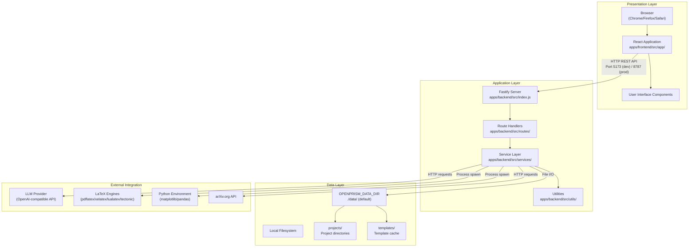

**Sources**: [README.md:427-442]()

---

### Deployment Modes

OpenPrism supports two distinct deployment configurations with different process topologies.

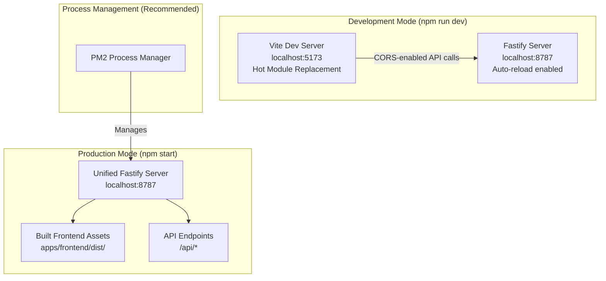

**Configuration Commands**:

| Mode | Command | Frontend Port | Backend Port |
|------|---------|---------------|--------------|
| Development | `npm run dev` | 5173 | 8787 |
| Production | `npm start` | - | 8787 (unified) |

**Sources**: [README.md:260-328](), [package.json scripts]()

---

## Core Components

### Frontend Application Structure

The frontend is a React single-page application built with Vite, organized into distinct functional modules.

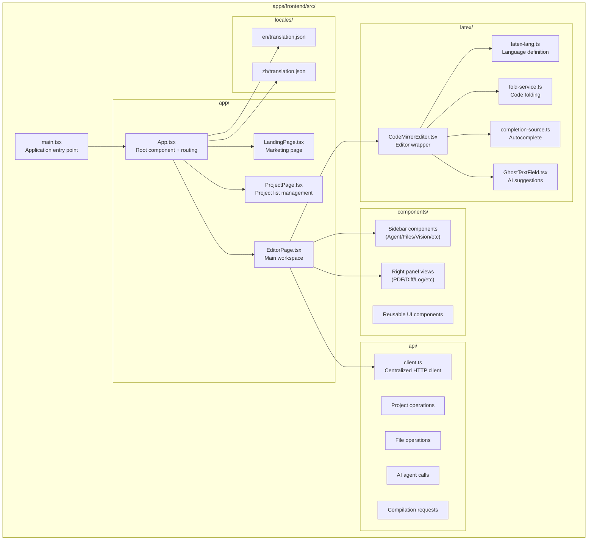

**Key Files**:

| Component | File Path | Responsibility |
|-----------|-----------|----------------|
| Application Root | `apps/frontend/src/app/App.tsx` | Routing, global state, layout |
| Editor Workspace | `apps/frontend/src/app/EditorPage.tsx` | Three-panel layout, editor state management |
| API Client | `apps/frontend/src/api/client.ts` | HTTP communication with backend |
| CodeMirror Integration | `apps/frontend/src/latex/CodeMirrorEditor.tsx` | LaTeX editor instantiation |
| Language Support | `apps/frontend/src/latex/latex-lang.ts` | LaTeX syntax highlighting |

**Sources**: [README.md:427-442]()

---

### Backend Service Architecture

The backend is a Fastify-based Node.js server with modular route handlers and service layers.

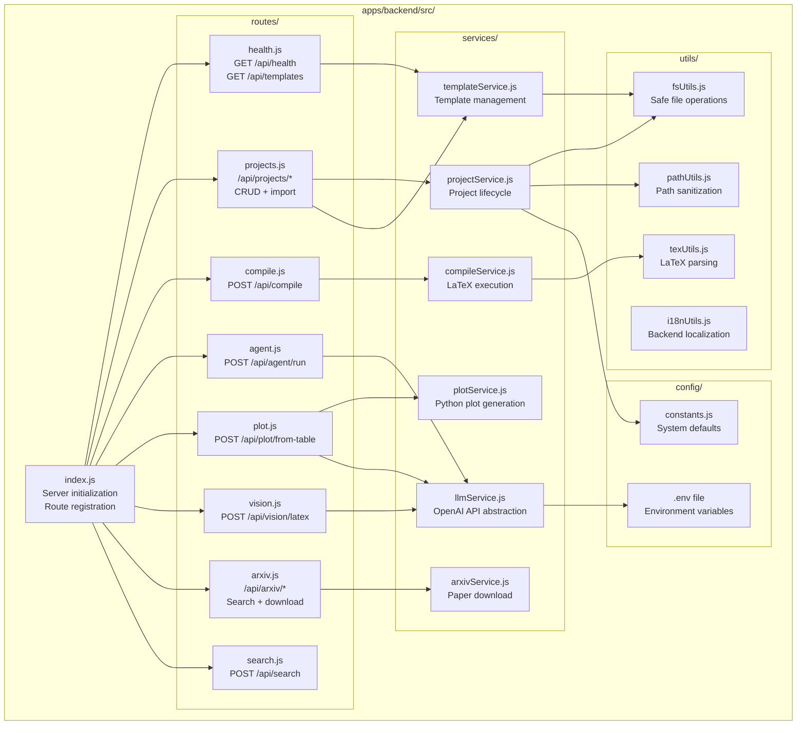

**API Endpoints**:

| Endpoint | Method | Route Handler | Purpose |
|----------|--------|---------------|---------|
| `/api/health` | GET | `routes/health.js` | Server health check |
| `/api/templates` | GET | `routes/health.js` | List available templates |
| `/api/projects` | GET | `routes/projects.js` | List user projects |
| `/api/projects/:id` | GET/PUT/DELETE | `routes/projects.js` | Project operations |
| `/api/projects/:id/files` | GET/PUT | `routes/projects.js` | File operations |
| `/api/compile` | POST | `routes/compile.js` | LaTeX compilation |
| `/api/agent/run` | POST | `routes/agent.js` | AI agent execution |
| `/api/plot/from-table` | POST | `routes/plot.js` | Generate plot from table |
| `/api/vision/latex` | POST | `routes/vision.js` | Image to LaTeX OCR |
| `/api/arxiv/search` | GET | `routes/arxiv.js` | Search arXiv papers |

**Sources**: [README.md:427-442]()

---

## Technology Stack

### Core Dependencies

The system is built on modern JavaScript ecosystem tools with minimal external dependencies for core functionality.

**Frontend**:
| Technology | Version Requirement | Purpose |
|------------|---------------------|---------|
| React | Latest | UI framework |
| Vite | Latest | Build tool and dev server |
| CodeMirror 6 | Latest | Code editor core |
| PDF.js | Latest | PDF rendering in browser |
| i18next | Latest | Internationalization |
| react-router-dom | Latest | Client-side routing |

**Backend**:
| Technology | Version Requirement | Purpose |
|------------|---------------------|---------|
| Node.js | >= 18.0.0 | Runtime environment |
| Fastify | Latest | HTTP server framework |
| axios | Latest | HTTP client for external APIs |

**External Dependencies** (Runtime):
| Dependency | Installation Method | Purpose |
|------------|---------------------|---------|
| TexLive or Tectonic | System package manager | LaTeX compilation |
| Python 3.x | System package manager | Optional: plot generation |

**Sources**: [README.md:224-258](), [apps/frontend/package.json](), [apps/backend/package.json]()

---

## Data Storage Model

### Filesystem Organization

OpenPrism uses a directory-based storage model with a configurable root path.

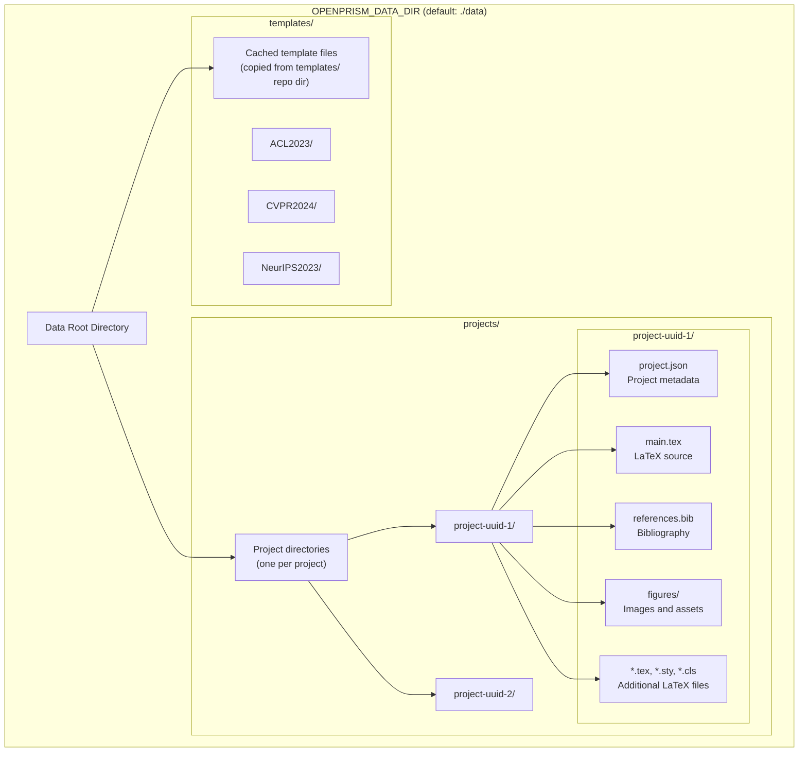

**Project Metadata Schema** (`project.json`):
```json
{
  "id": "uuid-string",
  "name": "Project Name",
  "createdAt": "ISO-8601-timestamp",
  "updatedAt": "ISO-8601-timestamp",
  "mainFile": "main.tex",
  "template": "ACL2023",
  "tags": ["tag1", "tag2"]
}
```

**Storage Configuration**:
- Environment variable: `OPENPRISM_DATA_DIR`
- Default value: `./data` (relative to project root)
- Example custom path: `/var/openprism/data`

**Sources**: [README.md:395-413]()

---

## Configuration System

### Multi-Layer Configuration

OpenPrism implements a hierarchical configuration system with clear precedence rules.

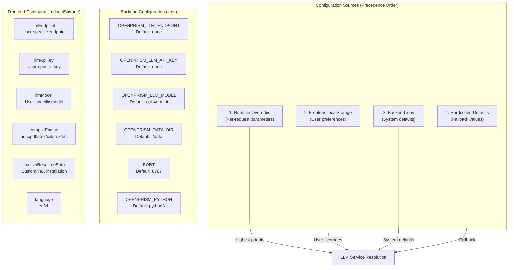

**Environment Variables**:
| Variable | Purpose | Example Value |
|----------|---------|---------------|
| `OPENPRISM_LLM_ENDPOINT` | OpenAI-compatible API endpoint | `https://api.openai.com/v1/chat/completions` |
| `OPENPRISM_LLM_API_KEY` | API authentication key | `sk-...` |
| `OPENPRISM_LLM_MODEL` | Default model name | `gpt-4o-mini` |
| `OPENPRISM_DATA_DIR` | Project storage root | `./data` |
| `PORT` | Backend server port | `8787` |
| `OPENPRISM_PYTHON` | Python executable path | `python3` |

**Sources**: [README.md:332-402]()

---

## Key Design Principles

### Local-First Architecture

**Data Sovereignty**: All user data persists in the local filesystem with no mandatory cloud synchronization. The `OPENPRISM_DATA_DIR` directory contains complete project state, enabling easy backup, version control integration, and migration.

**Privacy-Preserving AI**: LLM integration is abstracted through the `llmService.js` module, allowing users to:
- Use self-hosted LLM endpoints
- Configure per-request in frontend without backend restart
- Operate entirely offline (compilation, editing) when AI features are not needed

**Sources**: [README.md:65]()

---

### Modular Service Design

**Separation of Concerns**: Backend services are isolated in dedicated modules:
- `projectService.js`: Project lifecycle (create, read, update, delete)
- `compileService.js`: LaTeX compilation pipeline (engine selection, execution, error parsing)
- `llmService.js`: LLM provider abstraction (API calls, response parsing)
- `plotService.js`: Python-based visualization (code generation, execution, asset management)

This isolation enables:
- Independent testing of each service
- Easy extension with new AI capabilities
- Safe error handling (e.g., LaTeX compilation failures don't crash the server)

**Sources**: [apps/backend/src/services/]()

---

### OpenAI-Compatible LLM Integration

**Provider Agnostic**: The system uses the OpenAI Chat Completions API format as the standardized interface, supporting:
- OpenAI official endpoint: `https://api.openai.com/v1`
- Azure OpenAI: Custom deployment URLs
- Third-party providers: Any OpenAI-compatible service
- Self-hosted models: Local inference servers (e.g., vLLM, Ollama with OpenAI compatibility layer)

**Configuration Flexibility**: Users can override LLM settings at three levels:
1. System-wide defaults in `.env`
2. Per-user settings in browser `localStorage`
3. Per-request overrides in API calls

**Sources**: [README.md:352-380]()

---

### Multi-Engine LaTeX Support

**Automatic Fallback**: The compilation service (`compileService.js`) attempts multiple LaTeX engines in sequence:
1. User-specified engine (if configured)
2. `pdflatex` (standard)
3. `xelatex` (Unicode support)
4. `lualatex` (Lua scripting)
5. `tectonic` (lightweight fallback)

This ensures maximum compatibility across different system configurations without requiring manual engine selection.

**Sources**: [README.md:381-393]()

---

## System Initialization Flow

The following diagram shows the complete startup sequence from server launch to ready state.

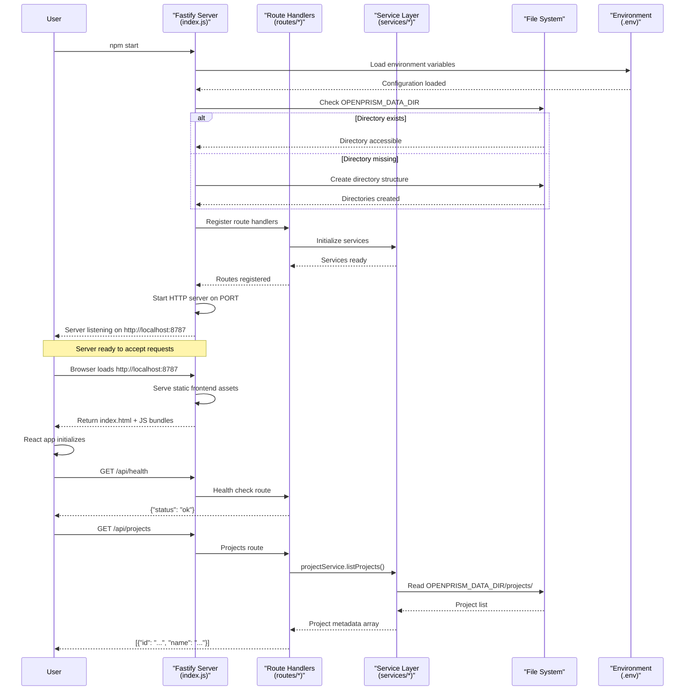

**Sources**: [apps/backend/src/index.js](), [apps/frontend/src/main.tsx]()

---

# Page: Getting Started

# Getting Started

<details>
<summary>Relevant source files</summary>

The following files were used as context for generating this wiki page:

- [README.md](README.md)

</details>


This document provides an overview of the initial setup process for OpenPrism, including prerequisites, installation workflow, and basic configuration. It serves as an entry point for new users and developers getting the system running for the first time.

For detailed installation instructions for specific operating systems, see [Installation](#2.1). For comprehensive configuration options and LLM setup, see [Configuration](#2.2). For running development and production servers, see [Running the Application](#2.3).

**Sources:** [README.md:1-509]()

---

## Prerequisites Overview

OpenPrism requires three primary components to function: a Node.js runtime environment, a LaTeX compilation engine, and an OpenAI-compatible LLM endpoint for AI features. The following table summarizes the core requirements:

| Component | Requirement | Purpose |
|-----------|-------------|---------|
| **Node.js** | >= 18.0.0 | Runtime for frontend and backend applications |
| **npm** | >= 9.0.0 | Package manager for dependency installation |
| **LaTeX Engine** | TexLive or Tectonic | PDF compilation from LaTeX source |
| **LLM Provider** | OpenAI-compatible API | AI assistant, autocomplete, and agent features |
| **Python** | 3.x (optional) | Plot generation from tables using matplotlib/seaborn |

**Sources:** [README.md:224-229](), [README.md:232-258]()

---

## Getting Started Workflow

The following diagram illustrates the complete setup and startup process, mapping user actions to specific system commands and components:

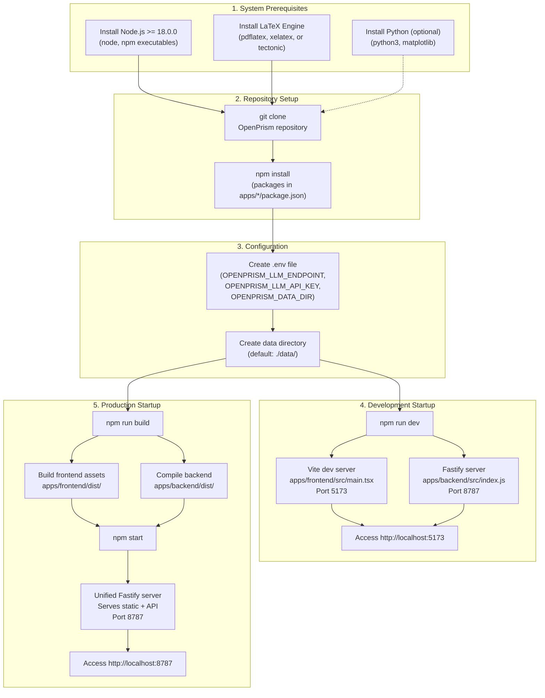

**Sources:** [README.md:260-328](), [README.md:427-442]()

---

## Quick Start Summary

The table below compares development and production deployment modes:

| Aspect | Development Mode | Production Mode |
|--------|------------------|-----------------|
| **Command** | `npm run dev` | `npm run build && npm start` |
| **Frontend** | Vite dev server (port 5173) with HMR | Static assets served by Fastify |
| **Backend** | Fastify (port 8787) with auto-reload | Fastify (port 8787) compiled |
| **Entry Points** | `apps/frontend/src/main.tsx`<br/>`apps/backend/src/index.js` | `apps/frontend/dist/`<br/>`apps/backend/dist/index.js` |
| **Access URL** | http://localhost:5173 | http://localhost:8787 |
| **Hot Reload** | Yes (both frontend and backend) | No |
| **Build Output** | None (in-memory) | `dist/` directories in both apps |
| **Use Case** | Local development and testing | Production deployment |

**Sources:** [README.md:262-278](), [README.md:280-288]()

---

## Initial Setup Process

This diagram details the specific code paths and configuration files involved in the initial setup, bridging system concepts to code entities:

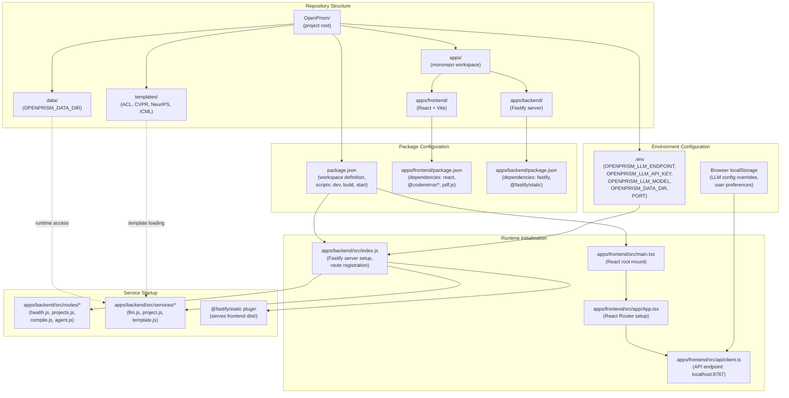

**Sources:** [README.md:427-442](), [README.md:334-414]()

---

## Configuration Resolution

OpenPrism uses a multi-layered configuration system with clear precedence rules. The following diagram illustrates how configuration values are resolved at runtime:

```mermaid
graph TB
    subgraph "Configuration Sources (Precedence Order)"
        P1["1. Runtime Overrides<br/>(API request parameters,<br/>e.g., POST /api/agent/run body)"]
        P2["2. Frontend localStorage<br/>(Settings panel inputs,<br/>keys: llmEndpoint, llmApiKey, llmModel)"]
        P3["3. Backend .env File<br/>(OPENPRISM_LLM_ENDPOINT,<br/>OPENPRISM_LLM_API_KEY,<br/>OPENPRISM_LLM_MODEL)"]
        P4["4. System Defaults<br/>(Hardcoded in apps/backend/src/services/llm.js)"]
    end
    
    subgraph "Configuration Categories"
        LLMConfig["LLM Configuration<br/>(endpoint, apiKey, model)"]
        DataConfig["Data Storage<br/>(OPENPRISM_DATA_DIR)"]
        ServerConfig["Server Settings<br/>(PORT: 8787)"]
        LatexConfig["LaTeX Engine<br/>(pdflatex, xelatex, tectonic)"]
        PythonConfig["Python Path<br/>(OPENPRISM_PYTHON)"]
    end
    
    subgraph "Resolution Process"
        AgentRequest["User triggers AI task<br/>(e.g., Polish, Rewrite)"]
        CheckRuntime["Check request body<br/>for llmConfig override"]
        CheckLocalStorage["Read from localStorage<br/>(apps/frontend/src/api/client.ts)"]
        CheckEnv["Read process.env<br/>(apps/backend/src/services/llm.js)"]
        UseDefaults["Use hardcoded defaults"]
        ExecuteLLM["Call LLM endpoint with<br/>resolved configuration"]
    end
    
    P1 --> LLMConfig
    P2 --> LLMConfig
    P3 --> LLMConfig
    P3 --> DataConfig
    P3 --> ServerConfig
    P3 --> PythonConfig
    P4 --> LLMConfig
    
    AgentRequest --> CheckRuntime
    CheckRuntime -->|"exists"| ExecuteLLM
    CheckRuntime -->|"not found"| CheckLocalStorage
    CheckLocalStorage -->|"exists"| ExecuteLLM
    CheckLocalStorage -->|"not found"| CheckEnv
    CheckEnv -->|"exists"| ExecuteLLM
    CheckEnv -->|"not found"| UseDefaults
    UseDefaults --> ExecuteLLM
```

**Sources:** [README.md:334-394]()

---

## Verification Steps

After completing the setup process, verify the installation by checking the following:

| Check | Command | Expected Output |
|-------|---------|----------------|
| **Node.js version** | `node --version` | `v18.0.0` or higher |
| **npm version** | `npm --version` | `9.0.0` or higher |
| **LaTeX engine** | `pdflatex --version` or `tectonic --version` | Version information without errors |
| **Backend health** | `curl http://localhost:8787/api/health` | `{"status":"ok"}` |
| **Frontend access** | Open `http://localhost:5173` (dev) or `http://localhost:8787` (prod) | OpenPrism landing page loads |
| **Data directory** | `ls -la data/` | Directory exists with `projects/` and `templates/` subdirectories |

**Sources:** [README.md:301-303]()

---

## Common Setup Patterns

### Minimal Development Setup

For local development with minimal configuration:

```bash
# Install dependencies
npm install

# Start development servers
npm run dev
```

Frontend configuration via Settings panel (no `.env` file required):
- LLM Endpoint: `https://api.openai.com/v1/chat/completions`
- API Key: (enter your key)
- Model: `gpt-4o-mini`

**Sources:** [README.md:262-278](), [README.md:363-374]()

### Linux Server Production Setup

Complete production deployment with PM2 process management:

```bash
# 1. Install system dependencies
sudo apt-get install -y nodejs texlive-full

# 2. Clone and build
git clone https://github.com/OpenDCAI/OpenPrism.git
cd OpenPrism
npm install
npm run build

# 3. Configure environment
cat > .env << EOF
OPENPRISM_LLM_ENDPOINT=https://api.openai.com/v1/chat/completions
OPENPRISM_LLM_API_KEY=sk-your-key
OPENPRISM_LLM_MODEL=gpt-4o-mini
OPENPRISM_DATA_DIR=/var/openprism/data
PORT=8787
EOF

# 4. Start with PM2
npm install -g pm2
pm2 start npm --name "openprism" -- start
pm2 save
pm2 startup
```

**Sources:** [README.md:290-328]()

### Azure OpenAI Configuration

For Azure OpenAI deployments, configure via `.env`:

```bash
OPENPRISM_LLM_ENDPOINT=https://your-resource.openai.azure.com/openai/deployments/your-deployment
OPENPRISM_LLM_API_KEY=your-azure-api-key
OPENPRISM_LLM_MODEL=gpt-4o
```

**Sources:** [README.md:376-379]()

---

## Startup Command Reference

The following table documents the npm scripts defined in the root [package.json]():

| Script | Command | Description |
|--------|---------|-------------|
| **dev** | `npm run dev` | Starts both frontend (5173) and backend (8787) in development mode with hot reload |
| **dev:frontend** | `npm run dev:frontend` | Starts only Vite dev server for frontend development |
| **dev:backend** | `npm run dev:backend` | Starts only Fastify server for backend development |
| **build** | `npm run build` | Builds both frontend and backend for production |
| **start** | `npm start` | Starts unified production server (port 8787) |

**Sources:** [README.md:464-470]()

---

## File System Layout

After successful setup, the OpenPrism directory structure appears as follows:

```
OpenPrism/
├── .env                          # Backend environment configuration (optional)
├── package.json                  # Root workspace configuration
├── apps/
│   ├── frontend/
│   │   ├── src/
│   │   │   ├── main.tsx          # React application entry point
│   │   │   ├── app/
│   │   │   │   ├── App.tsx       # Main application component
│   │   │   │   ├── EditorPage.tsx
│   │   │   │   └── ProjectPage.tsx
│   │   │   └── api/
│   │   │       └── client.ts     # API client (baseURL: localhost:8787)
│   │   ├── package.json
│   │   └── dist/                 # Production build output
│   └── backend/
│       ├── src/
│       │   ├── index.js          # Fastify server entry point
│       │   ├── routes/           # API route handlers
│       │   │   ├── health.js     # GET /api/health
│       │   │   ├── projects.js   # /api/projects/*
│       │   │   ├── compile.js    # POST /api/compile
│       │   │   └── agent.js      # POST /api/agent/run
│       │   └── services/         # Business logic layer
│       │       ├── llm.js        # LLM provider abstraction
│       │       ├── project.js    # Project CRUD operations
│       │       └── template.js   # Template management
│       ├── package.json
│       └── dist/                 # Production build output
├── templates/                    # Built-in LaTeX templates
│   ├── acl/
│   ├── cvpr/
│   ├── neurips/
│   └── icml/
└── data/                         # User data directory (OPENPRISM_DATA_DIR)
    ├── projects/                 # User LaTeX projects
    │   └── <project-id>/
    │       ├── main.tex
    │       ├── references.bib
    │       └── project.json      # Project metadata
    └── templates/                # Template cache (optional)
```

**Sources:** [README.md:427-442](), [README.md:404-413]()

---

## Next Steps

After completing the initial setup:

1. **Verify Installation**: Follow the [Verification Steps](#verification-steps) above to ensure all components are working correctly.

2. **Configure LLM Provider**: Set up your OpenAI-compatible endpoint. See [Configuration](#2.2) for detailed LLM configuration options including Azure OpenAI and custom providers.

3. **Create Your First Project**: Navigate to `http://localhost:5173` (dev) or `http://localhost:8787` (prod) and create a new project from the Projects panel. Select a template (ACL, CVPR, NeurIPS, ICML) or start from scratch.

4. **Explore Features**: Familiarize yourself with the three-panel workspace (sidebar, editor, preview), AI assistant modes (Chat, Agent, Tools), and compilation workflow. See [Features](#6) for comprehensive feature documentation.

5. **Development Workflow**: If you plan to contribute or extend OpenPrism, see [Development Guide](#7) for development patterns, project structure, and contribution guidelines.

**Sources:** [README.md:417-424]()

---

# Page: Installation

# Installation

<details>
<summary>Relevant source files</summary>

The following files were used as context for generating this wiki page:

- [README.md](README.md)
- [apps/frontend/package.json](apps/frontend/package.json)

</details>


This document provides detailed instructions for installing all dependencies required to run OpenPrism on Linux, macOS, and Windows systems. It covers the installation of Node.js, npm, LaTeX compilation engines, and optional Python dependencies for plotting features.

For information about configuring OpenPrism after installation, see [Configuration](#2.2). For instructions on starting the development or production servers, see [Running the Application](#2.3).

## System Requirements

OpenPrism requires the following software to be installed on the host system:

| Component | Minimum Version | Purpose |
|-----------|----------------|---------|
| Node.js | >= 18.0.0 | Runtime for frontend and backend |
| npm | >= 9.0.0 | Package manager |
| LaTeX Engine | Any supported | PDF compilation (see below) |
| Python | >= 3.8 (optional) | Plot generation via matplotlib/seaborn |

**Sources:** [README.md:224-229]()

## Dependency Architecture

The following diagram shows the runtime dependencies and how they relate to OpenPrism's core services:

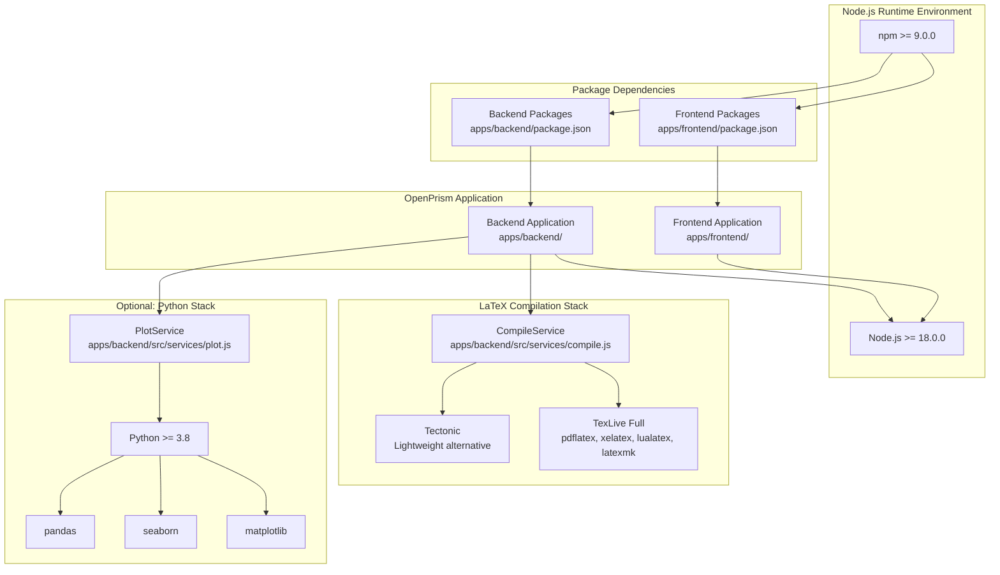

**Sources:** [README.md:224-258](), [apps/frontend/package.json:1-38]()

## Installing Node.js and npm

### Linux (Ubuntu/Debian)

```bash
# Install Node.js 18.x from NodeSource repository
curl -fsSL https://deb.nodesource.com/setup_18.x | sudo -E bash -
sudo apt-get install -y nodejs

# Verify installation
node --version  # Should output >= v18.0.0
npm --version   # Should output >= 9.0.0
```

### Linux (CentOS/RHEL)

```bash
# Install Node.js 18.x from NodeSource repository
curl -fsSL https://rpm.nodesource.com/setup_18.x | sudo bash -
sudo yum install -y nodejs

# Verify installation
node --version
npm --version
```

### macOS

```bash
# Using Homebrew
brew install node@18

# Add to PATH if needed
echo 'export PATH="/usr/local/opt/node@18/bin:$PATH"' >> ~/.zshrc
source ~/.zshrc

# Verify installation
node --version
npm --version
```

### Windows

Download and install the Node.js 18.x LTS installer from [https://nodejs.org/](https://nodejs.org/). The installer includes both `node` and `npm` executables. After installation, verify in PowerShell or Command Prompt:

```powershell
node --version
npm --version
```

**Sources:** [README.md:293-295]()

## Installing LaTeX Engines

OpenPrism requires at least one LaTeX compilation engine to generate PDF output. The system supports automatic fallback between multiple engines if configured. Choose one of the following installation options:

### Option 1: TexLive (Recommended)

TexLive provides a complete LaTeX distribution with all standard packages. Installation size is approximately 5-7GB.

#### Linux (Ubuntu/Debian)

```bash
sudo apt-get update
sudo apt-get install texlive-full
```

The `texlive-full` package installs:
- `pdflatex` - Standard LaTeX engine
- `xelatex` - Unicode and non-Latin script support
- `lualatex` - Lua scripting support
- `latexmk` - Automated build management
- Comprehensive package collection

#### Linux (CentOS/RHEL)

```bash
sudo yum install texlive texlive-*
```

#### macOS

```bash
brew install --cask mactex
```

MacTeX includes the full TexLive distribution plus macOS-specific GUI tools.

#### Windows

Download the TexLive installer from [https://www.tug.org/texlive/](https://www.tug.org/texlive/) and run the installation wizard. The default installation path is `C:\texlive\`.

#### Verification

```bash
pdflatex --version
xelatex --version
lualatex --version
latexmk --version
```

**Sources:** [README.md:235-249]()

### Option 2: Tectonic (Lightweight)

Tectonic is a modern, self-contained LaTeX engine with automatic package management. Installation size is under 100MB.

#### Linux/macOS

```bash
curl --proto '=https' --tlsv1.2 -fsSL https://drop-sh.fullyjustified.net | sh
```

#### Windows

Download the Tectonic installer from [https://tectonic-typesetting.github.io/](https://tectonic-typesetting.github.io/).

#### Verification

```bash
tectonic --version
```

**Limitations:** Tectonic does not support all LaTeX packages and may fail on complex documents. For production deployments, TexLive is recommended.

**Sources:** [README.md:251-258]()

### Comparison: TexLive vs Tectonic

| Criterion | TexLive | Tectonic |
|-----------|---------|----------|
| Installation Size | 5-7GB | <100MB |
| Package Coverage | Comprehensive | Limited |
| Engine Support | `pdflatex`, `xelatex`, `lualatex`, `latexmk` | `tectonic` only |
| Template Compatibility | All templates | Most basic templates |
| Automatic Packages | No | Yes |
| Recommended For | Production servers, full features | Development, lightweight systems |

**Sources:** [README.md:258]()

## Installing Python (Optional)

Python is required only if you plan to use the plot generation feature ([PlotService](#5.4)). The plotting pipeline executes Python scripts that use `matplotlib`, `seaborn`, and `pandas` to generate visualizations from LaTeX table data.

### Linux (Ubuntu/Debian)

```bash
sudo apt-get install python3 python3-pip
pip3 install matplotlib seaborn pandas
```

### Linux (CentOS/RHEL)

```bash
sudo yum install python3 python3-pip
pip3 install matplotlib seaborn pandas
```

### macOS

```bash
brew install python@3.11
pip3 install matplotlib seaborn pandas
```

### Windows

Download Python 3.11+ from [https://www.python.org/downloads/](https://www.python.org/downloads/). Ensure "Add Python to PATH" is checked during installation. Then:

```powershell
pip install matplotlib seaborn pandas
```

### Verification

```bash
python3 --version  # Should output >= 3.8
python3 -c "import matplotlib; import seaborn; import pandas"  # Should not error
```

### Configuring Python Path

If Python is installed in a non-standard location, the backend must be configured to locate the executable. This is done via the `OPENPRISM_PYTHON` environment variable (see [Configuration](#2.2)). The [PlotService](apps/backend/src/services/plot.js) uses this path when spawning Python subprocesses.

**Sources:** [README.md:332-349]() (environment variables section)

## Installation Flow for Complete Deployment

The following diagram illustrates the sequential installation process for a complete OpenPrism deployment:

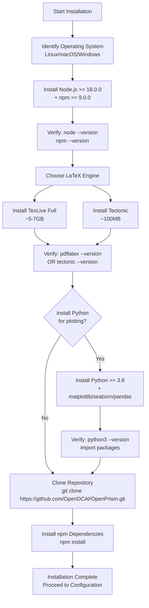

**Sources:** [README.md:290-328]()

## Installing OpenPrism Application Packages

After installing system dependencies, install the OpenPrism application and its Node.js package dependencies:

```bash
# Clone the repository
git clone https://github.com/OpenDCAI/OpenPrism.git
cd OpenPrism

# Install all dependencies (frontend + backend)
npm install
```

The root-level `npm install` command installs dependencies for both the frontend and backend applications as defined in their respective `package.json` files:

- **Frontend packages** ([apps/frontend/package.json]()):
  - `codemirror` (6.0.1) - Editor core
  - `@codemirror/*` - Language support, autocomplete, search
  - `react` (18.2.0) - UI framework
  - `react-router-dom` (6.22.3) - Routing
  - `pdfjs-dist` (3.11.174) - PDF rendering
  - `i18next` (23.12.2) - Internationalization
  - `react-markdown` (10.1.0) - Markdown rendering
  - `vite` (5.0.10) - Build tool

- **Backend packages** ([apps/backend/package.json]()) - Referenced in architecture diagrams

**Sources:** [apps/frontend/package.json:1-38](), [README.md:265-274]()

## Verification Checklist

After completing installation, verify all components:

| Component | Verification Command | Expected Output |
|-----------|---------------------|-----------------|
| Node.js | `node --version` | `v18.x.x` or higher |
| npm | `npm --version` | `9.x.x` or higher |
| LaTeX (TexLive) | `pdflatex --version` | TexLive version info |
| LaTeX (Tectonic) | `tectonic --version` | Tectonic version info |
| Python (optional) | `python3 --version` | `3.8.x` or higher |
| OpenPrism packages | Check for `node_modules/` directory | Directory exists with packages |

### Troubleshooting Installation Issues

**Node.js version too old:**
```bash
# Remove old version and reinstall using methods above
# On Linux with apt:
sudo apt-get remove nodejs
curl -fsSL https://deb.nodesource.com/setup_18.x | sudo -E bash -
sudo apt-get install -y nodejs
```

**LaTeX commands not found:**
Ensure the LaTeX binaries are in your system `PATH`:
```bash
# Linux/macOS
which pdflatex
export PATH="/usr/local/texlive/2023/bin/x86_64-linux:$PATH"

# Windows: Add TexLive bin directory to system PATH via Environment Variables
```

**Python packages import errors:**
```bash
# Reinstall with --user flag
pip3 install --user matplotlib seaborn pandas

# Or use a virtual environment
python3 -m venv venv
source venv/bin/activate  # On Windows: venv\Scripts\activate
pip install matplotlib seaborn pandas
```

**Sources:** [README.md:301-303](), [README.md:293-328]()

## Next Steps

After successful installation:
1. **Configure environment variables and LLM endpoints**: See [Configuration](#2.2)
2. **Start the development or production server**: See [Running the Application](#2.3)
3. **Review the project structure**: See [Project Structure](#7.2)

**Sources:** [README.md:1-509]()

---

# Page: Configuration

# Configuration

<details>
<summary>Relevant source files</summary>

The following files were used as context for generating this wiki page:

- [README.md](README.md)
- [apps/frontend/src/api/client.ts](apps/frontend/src/api/client.ts)

</details>


This document explains how to configure OpenPrism through environment variables, frontend settings, and runtime parameters. Configuration controls LLM provider integration, data storage location, LaTeX compilation engines, and user interface preferences.

For installation prerequisites, see [Installation](#2.1). For instructions on running the configured application, see [Running the Application](#2.3).

---

## Configuration Architecture

OpenPrism implements a multi-layer configuration system with clear precedence rules. Configuration originates from three sources:

1. **Backend Environment Variables** - System-level defaults defined in `.env` file
2. **Frontend localStorage** - User-specific preferences persisted in browser storage
3. **Runtime Overrides** - Per-request parameters passed through API calls

**Sources**: [README.md:332-413](), [apps/frontend/src/api/client.ts:21-25]()

---

## Backend Environment Variables

Backend configuration is defined in a `.env` file at the project root. This file is optional; the system uses sensible defaults when variables are not specified.

### Creating the .env File

Create a `.env` file in the OpenPrism root directory:

```bash
# LLM Provider Configuration
OPENPRISM_LLM_ENDPOINT=https://api.openai.com/v1/chat/completions
OPENPRISM_LLM_API_KEY=sk-your-api-key-here
OPENPRISM_LLM_MODEL=gpt-4o-mini

# Data Storage
OPENPRISM_DATA_DIR=./data

# Server Port
PORT=8787

# Python Environment (optional)
OPENPRISM_PYTHON=python3
```

### Environment Variable Reference

| Variable | Description | Default | Required |
|----------|-------------|---------|----------|
| `OPENPRISM_LLM_ENDPOINT` | OpenAI-compatible API endpoint URL | None | No |
| `OPENPRISM_LLM_API_KEY` | Authentication key for LLM provider | None | No |
| `OPENPRISM_LLM_MODEL` | Model identifier (e.g., `gpt-4o-mini`) | None | No |
| `OPENPRISM_DATA_DIR` | Absolute or relative path to data storage | `./data` | No |
| `PORT` | Backend server HTTP port | `8787` | No |
| `OPENPRISM_PYTHON` | Python executable path for plot generation | `python3` | No |

### Configuration Flow Diagram

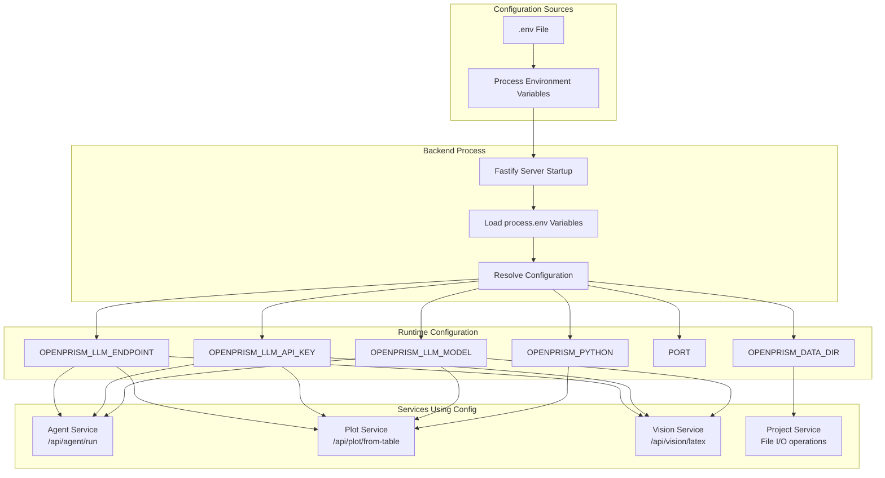

**Sources**: [README.md:334-349](), [README.md:312-318]()

---

## Frontend Configuration (localStorage)

Frontend configuration persists in browser `localStorage`, allowing per-user customization without modifying server settings. Users configure these through the Settings panel in the UI.

### localStorage Keys

The frontend stores configuration using the following localStorage keys:

| Key | Value Type | Description |
|-----|------------|-------------|
| `openprism-llm-endpoint` | string | LLM API endpoint override |
| `openprism-llm-key` | string | User's LLM API key |
| `openprism-llm-model` | string | Preferred model name |
| `openprism-lang` | string | UI language (`zh-CN` or `en-US`) |
| `openprism-compile-engine` | string | LaTeX engine preference |
| `openprism-texlive-path` | string | Custom TexLive resource path |

### Settings Panel Access

Users access configuration through the Settings button in the frontend interface. This panel provides forms for:

- LLM Endpoint URL
- API Key (masked input)
- Model selection
- LaTeX engine selection
- TexLive resource path
- Language toggle

### localStorage to API Request Flow

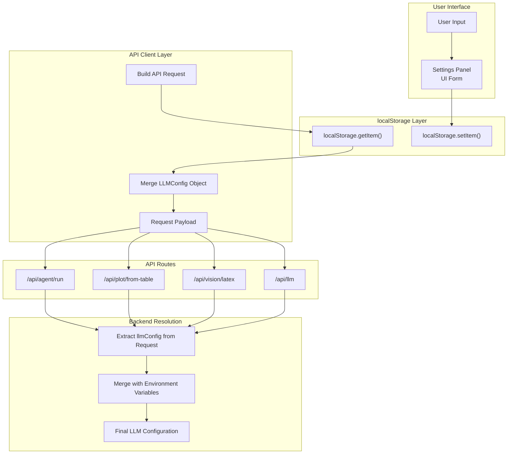

**Sources**: [apps/frontend/src/api/client.ts:54-60](), [apps/frontend/src/api/client.ts:200-217](), [README.md:363-374]()

---

## LLM Configuration

OpenPrism supports any OpenAI-compatible LLM endpoint. Configuration can be set at three levels with clear precedence.

### Supported LLM Providers

| Provider | Endpoint Format | Notes |
|----------|----------------|-------|
| OpenAI | `https://api.openai.com/v1/chat/completions` | Native support |
| Azure OpenAI | `https://your-resource.openai.azure.com/openai/deployments/your-deployment` | Requires deployment-specific URL |
| Custom Providers | `https://api.apiyi.com/v1` (example) | Must implement OpenAI-compatible API |

### Configuration Methods

#### Method 1: Environment Variables (System Default)

Define in `.env` file:

```bash
OPENPRISM_LLM_ENDPOINT=https://api.openai.com/v1/chat/completions
OPENPRISM_LLM_API_KEY=sk-your-api-key
OPENPRISM_LLM_MODEL=gpt-4o-mini
```

#### Method 2: Frontend Settings Panel (User Override)

1. Open Settings panel in UI
2. Enter Endpoint URL
3. Enter API Key
4. Select Model from dropdown
5. Configuration automatically saves to localStorage

#### Method 3: Runtime API Parameters (Request Override)

API requests can include optional `llmConfig` parameter:

```typescript
// Example from client.ts interface
interface LLMConfig {
  endpoint: string;
  apiKey: string;
  model: string;
}

// Usage in API call
runAgent({
  task: "polish",
  prompt: "Improve clarity",
  // ... other parameters
  llmConfig: {
    endpoint: "https://custom-api.example.com/v1",
    apiKey: "custom-key",
    model: "gpt-4"
  }
})
```

### LLM Configuration Interface

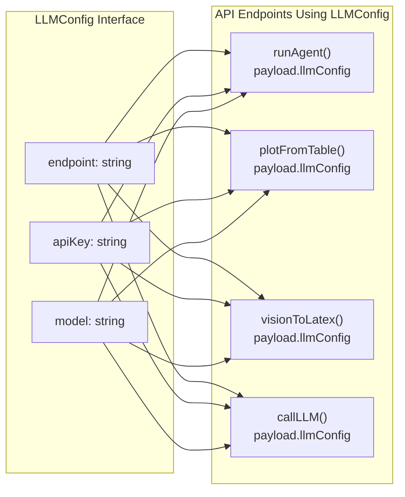

**Sources**: [apps/frontend/src/api/client.ts:21-25](), [apps/frontend/src/api/client.ts:209](), [apps/frontend/src/api/client.ts:265](), [apps/frontend/src/api/client.ts:279](), [apps/frontend/src/api/client.ts:344](), [README.md:351-379]()

---

## Data Directory Configuration

The data directory stores all project files, templates, and generated assets. Configure via `OPENPRISM_DATA_DIR` environment variable.

### Default Directory Structure

```
data/
├── projects/              # User LaTeX projects
│   ├── project-abc123/
│   │   ├── main.tex
│   │   ├── references.bib
│   │   ├── figures/
│   │   └── project.json  # Project metadata
│   └── project-def456/
└── templates/             # Template cache (optional)
```

### Configuration Example

```bash
# Relative path (default)
OPENPRISM_DATA_DIR=./data

# Absolute path (recommended for production)
OPENPRISM_DATA_DIR=/var/openprism/data

# Custom location
OPENPRISM_DATA_DIR=/home/user/openprism-projects
```

### Directory Resolution Flow

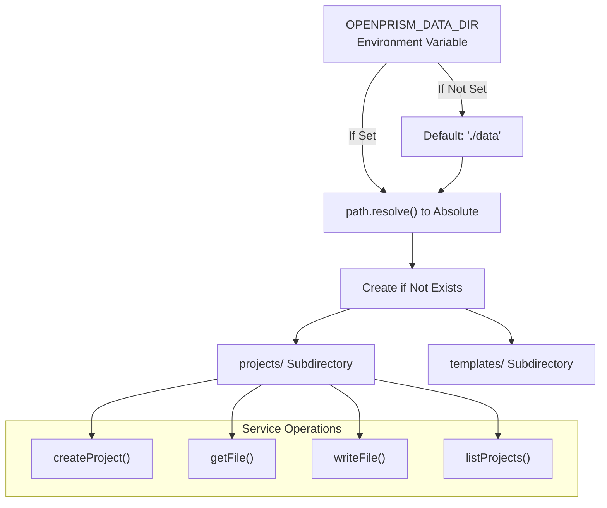

**Sources**: [README.md:344-345](), [README.md:395-413]()

---

## LaTeX Compilation Configuration

LaTeX compilation engine selection supports both automatic detection and manual override. Configuration affects PDF generation quality and compilation speed.

### Supported Engines

| Engine | Command | Use Case | CJK Support |
|--------|---------|----------|-------------|
| `pdflatex` | `pdflatex` | Standard LaTeX documents | No |
| `xelatex` | `xelatex` | Unicode, custom fonts, Chinese | Yes |
| `lualatex` | `lualatex` | Lua scripting, advanced typography | Yes |
| `latexmk` | `latexmk` | Automated multi-pass compilation | Via flags |
| `tectonic` | `tectonic` | Modern, lightweight, automatic packages | Limited |

### Configuration Methods

#### Frontend Engine Selection

Users select compilation engine in the Settings panel:

1. **Auto Mode** - System attempts engines in order: `pdflatex` → `xelatex` → `lualatex` → `latexmk` → `tectonic`
2. **Manual Mode** - User specifies exact engine
3. **Custom TexLive Path** - Override system TexLive installation location

Configuration persists to `localStorage` key `openprism-compile-engine`.

#### Compilation Request Structure

```typescript
// From client.ts compileProject function
compileProject({
  projectId: string,
  mainFile: string,
  engine: 'pdflatex' | 'xelatex' | 'lualatex' | 'latexmk' | 'tectonic'
})
```

### Engine Selection Flow

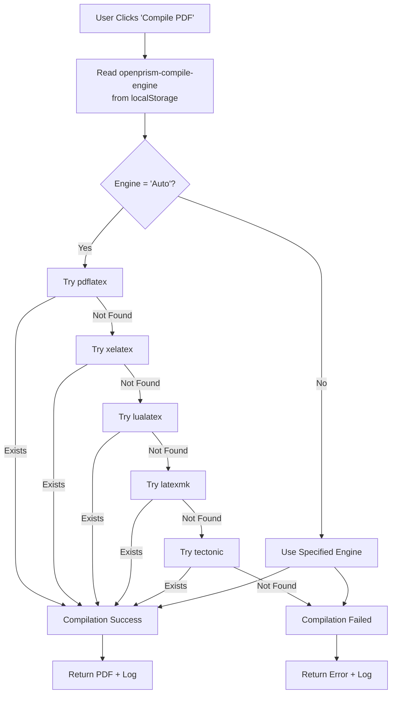

**Sources**: [apps/frontend/src/api/client.ts:219-231](), [README.md:381-394]()

---

## Internationalization Settings

OpenPrism supports bilingual interface: Chinese (Simplified) and English. Language configuration affects UI text, API responses, and error messages.

### Language Configuration

Language is stored in `localStorage` key `openprism-lang` with values:
- `zh-CN` - Chinese (Simplified)
- `en-US` - English

### Language Switching

Users toggle language via the language selector in the top navigation bar. Changes take effect immediately without page reload.

### API Request Language Header

All API requests include an `x-lang` header derived from localStorage:

```typescript
// From client.ts getLangHeader function
function getLangHeader() {
  if (typeof window === 'undefined') return 'zh-CN';
  const stored = window.localStorage.getItem('openprism-lang');
  return stored === 'en-US' ? 'en-US' : 'zh-CN';
}

// Header included in all requests
async function request<T>(url: string, options?: RequestInit): Promise<T> {
  const lang = getLangHeader();
  const mergedHeaders = {
    'Content-Type': 'application/json',
    'x-lang': lang,
    ...(options?.headers || {})
  };
  // ... fetch request
}
```

### Internationalization Flow

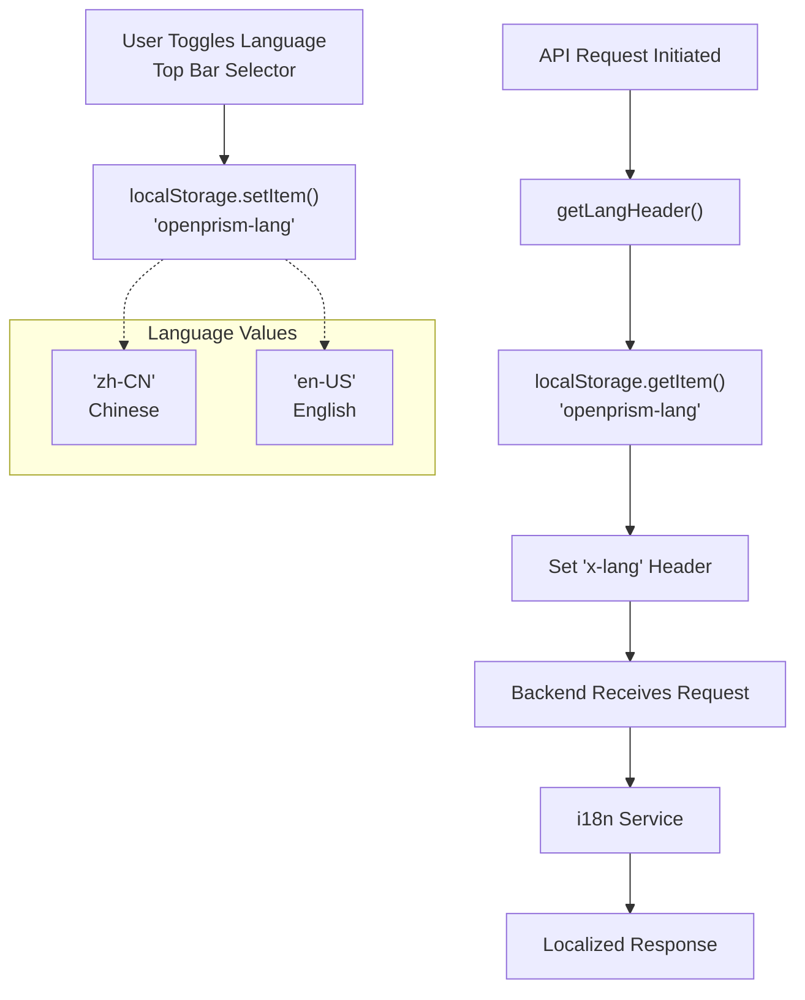

**Sources**: [apps/frontend/src/api/client.ts:54-60](), [apps/frontend/src/api/client.ts:56-60](), [apps/frontend/src/api/client.ts:62-77](), [README.md:98]()

---

## Configuration Precedence

OpenPrism resolves configuration using a three-tier precedence system. Higher-priority sources override lower-priority defaults.

### Precedence Order

**Priority 1 (Highest)**: Runtime API Parameters
- Passed directly in request payload as `llmConfig` object
- Affects only the specific API call
- Example: Per-task model override

**Priority 2**: Frontend localStorage
- User-specific settings from Settings panel
- Persists across browser sessions
- Affects all requests from that browser

**Priority 3 (Lowest)**: Backend Environment Variables
- System-wide defaults from `.env` file
- Fallback when no user override exists
- Affects all users and requests

### Precedence Resolution Example

```
User requests AI polish with custom API key:

1. Request payload contains:
   llmConfig: { apiKey: "user-override-key" }
   
2. localStorage contains:
   openprism-llm-key: "browser-stored-key"
   
3. .env contains:
   OPENPRISM_LLM_API_KEY=system-default-key

Result: System uses "user-override-key"
```

### Configuration Merge Logic

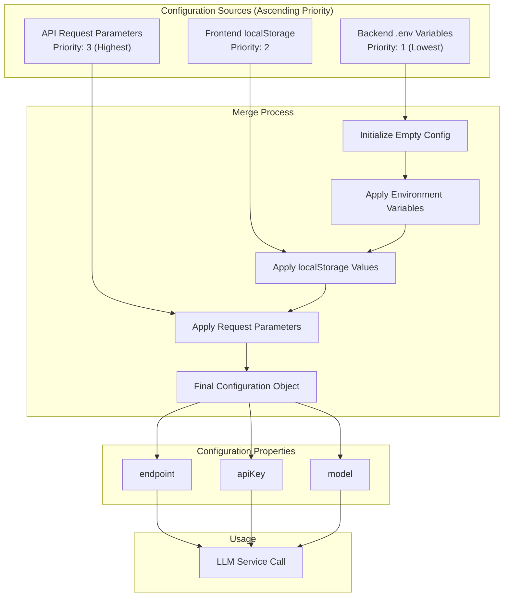

### Precedence Table

| Configuration | Source | Priority | Scope | Persistence |
|---------------|--------|----------|-------|-------------|
| Runtime `llmConfig` | API request payload | 1 (Highest) | Single request | None |
| localStorage values | Settings panel | 2 | Per-browser user | Browser storage |
| Environment variables | `.env` file | 3 (Lowest) | System-wide | Process environment |

**Sources**: [apps/frontend/src/api/client.ts:209](), [apps/frontend/src/api/client.ts:265](), [apps/frontend/src/api/client.ts:344](), [README.md:351-380]()

---

## Configuration Examples

### Example 1: Development Environment Setup

```bash
# .env file for development
OPENPRISM_LLM_ENDPOINT=https://api.openai.com/v1/chat/completions
OPENPRISM_LLM_API_KEY=sk-development-key
OPENPRISM_LLM_MODEL=gpt-4o-mini
OPENPRISM_DATA_DIR=./data
PORT=8787
OPENPRISM_PYTHON=python3
```

### Example 2: Production Server with Azure OpenAI

```bash
# .env file for production
OPENPRISM_LLM_ENDPOINT=https://mycompany.openai.azure.com/openai/deployments/gpt-4o/chat/completions?api-version=2024-02-15-preview
OPENPRISM_LLM_API_KEY=azure-api-key-here
OPENPRISM_LLM_MODEL=gpt-4o
OPENPRISM_DATA_DIR=/var/openprism/data
PORT=8787
```

### Example 3: User-Specific Override in Browser

User configures via Settings panel:
- Endpoint: `https://api.anthropic.com/v1/chat/completions`
- API Key: `user-personal-key`
- Model: `claude-3-opus`

These values save to localStorage and override system defaults for that user's browser.

### Example 4: Per-Request Custom Configuration

```typescript
// Client code making API request
import { runAgent } from './api/client';

await runAgent({
  task: "translate",
  prompt: "Translate to Spanish",
  selection: selectedText,
  content: fullDocument,
  mode: "direct",
  // Override LLM configuration for this request only
  llmConfig: {
    endpoint: "https://api.openai.com/v1/chat/completions",
    apiKey: "project-specific-key",
    model: "gpt-4"
  }
});
```

### Example 5: Custom Data Directory with Absolute Path

```bash
# .env for shared server environment
OPENPRISM_DATA_DIR=/mnt/shared-storage/openprism-data
PORT=8787
```

This configuration places all user projects on a mounted network drive, enabling multi-instance deployments with shared storage.

**Sources**: [README.md:312-328](), [README.md:338-349](), [README.md:356-361](), [README.md:376-379]()

---

# Page: Running the Application

# Running the Application

<details>
<summary>Relevant source files</summary>

The following files were used as context for generating this wiki page:

- [README.md](README.md)
- [apps/frontend/package.json](apps/frontend/package.json)

</details>


## Purpose and Scope

This document provides instructions for starting and managing OpenPrism in both development and production environments. It covers the execution of frontend and backend processes, their configuration, and process management strategies.

For installation prerequisites and environment setup, see [Installation](#2.1). For configuration of environment variables and system settings, see [Configuration](#2.2). For building production artifacts, see [Building for Production](#7.3).

---

## Development Mode

Development mode runs separate frontend and backend processes with hot module reloading and auto-restart capabilities for rapid development.

### Starting Development Servers

The monorepo provides scripts to start both services simultaneously or independently:

| Command | Purpose | Frontend Port | Backend Port |
|---------|---------|---------------|--------------|
| `npm run dev` | Start both services | 5173 | 8787 |
| `npm run dev:frontend` | Frontend only | 5173 | - |
| `npm run dev:backend` | Backend only | - | 8787 |

**Starting both services:**
```bash
npm run dev
```

This executes concurrent processes defined in [package.json:10]() which runs `npm run dev:frontend` and `npm run dev:backend` in parallel.

**Frontend Development Server:**
The frontend runs a Vite development server with Hot Module Replacement (HMR):
```bash
npm run dev:frontend
# Executes: vite
# Location: apps/frontend/package.json:6
```

The Vite server listens on `http://localhost:5173` and provides:
- Hot module replacement for React components
- Fast refresh for state preservation during edits
- Source map support for debugging
- Proxy configuration for API requests to backend

**Backend Development Server:**
The backend runs Fastify with auto-reload on file changes:
```bash
npm run dev:backend
# Executes: node apps/backend/src/index.js
# Location: package.json (root)
```

The Fastify server listens on `http://localhost:8787` (configurable via `PORT` environment variable) and provides:
- RESTful API endpoints under `/api/*`
- CORS headers for cross-origin requests from frontend
- Request logging and error handling

### Development Architecture Diagram

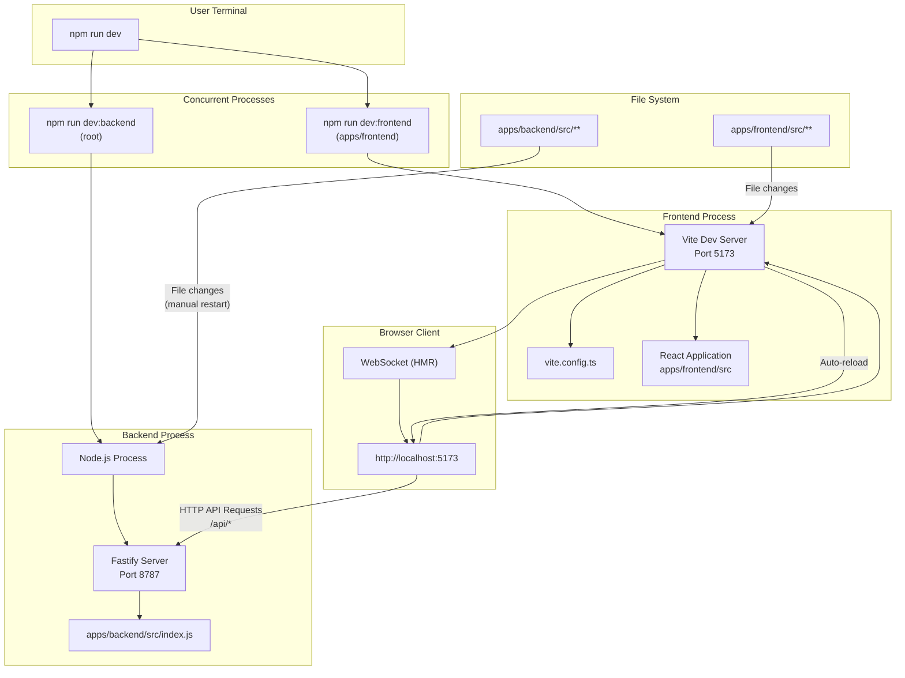

**Sources:** [README.md:260-279](), [package.json (root)](), [apps/frontend/package.json:6]()

### Access Points in Development

Once both servers are running:

- **Frontend Application:** `http://localhost:5173`
  - Landing page, project management, editor workspace
  - All UI interactions
  
- **Backend API:** `http://localhost:8787`
  - Direct API access (typically not accessed directly)
  - Health check: `http://localhost:8787/api/health`
  
- **API Proxying:** Frontend automatically proxies API requests to backend
  - Frontend makes requests to `/api/*`
  - Vite proxies to `http://localhost:8787/api/*`

**Sources:** [README.md:276-278]()

---

## Production Mode

Production mode builds optimized static assets and runs a unified server that serves both frontend and backend from a single process.

### Building for Production

Before running in production, build both frontend and backend:

```bash
npm run build
```

This command executes:
1. `npm run build:frontend` - Builds optimized React bundle
2. `npm run build:backend` - Copies backend source to `dist/`

The build process creates:

| Artifact | Location | Purpose |
|----------|----------|---------|
| Frontend bundle | `apps/frontend/dist/` | Optimized HTML, JS, CSS |
| Backend files | `dist/` | Server code for production |

**Frontend Build Process:**
```bash
# Executed by: npm run build:frontend
vite build
# Input: apps/frontend/src/
# Output: apps/frontend/dist/
```

The Vite build process performs:
- Tree-shaking to remove unused code
- Minification of JavaScript and CSS
- Code splitting for lazy loading
- Asset hashing for cache busting

**Backend Build Process:**
The backend uses JavaScript directly without transpilation. The build script copies source files to the distribution directory for unified deployment.

**Sources:** [README.md:283-288](), [apps/frontend/package.json:7]()

### Starting Production Server

After building, start the production server:

```bash
npm start
```

This executes `node dist/index.js` which runs a unified Fastify server that:
1. Serves static frontend assets from `apps/frontend/dist/`
2. Handles API requests on `/api/*` routes
3. Falls back to `index.html` for client-side routing

The production server listens on the port specified by the `PORT` environment variable (default: 8787).

**Access in Production:**
- **Application URL:** `http://localhost:8787`
  - Frontend and API unified on same origin
  - No CORS issues
  - No separate ports

**Sources:** [README.md:286-288]()

### Production Architecture Diagram

```mermaid
graph TB
    subgraph DeploymentCommand["Deployment Commands"]
        BuildCmd["npm run build"]
        StartCmd["npm start"]
    end
    
    subgraph BuildProcess["Build Process"]
        BuildFrontend["vite build<br/>(apps/frontend)"]
        BuildBackend["Copy backend src<br/>to dist/"]
    end
    
    subgraph BuildArtifacts["Build Artifacts"]
        FrontendDist["apps/frontend/dist/<br/>- index.html<br/>- assets/*.js<br/>- assets/*.css"]
        BackendDist["dist/<br/>- index.js<br/>- routes/<br/>- services/"]
    end
    
    subgraph ProductionProcess["Production Process"]
        NodeProcess["node dist/index.js"]
        FastifyUnified["Fastify Unified Server<br/>Port 8787"]
    end
    
    subgraph ServerLogic["Server Logic"]
        StaticMiddleware["Static File Middleware<br/>Serve apps/frontend/dist/"]
        APIRoutes["API Routes<br/>/api/*"]
        FallbackRoute["SPA Fallback<br/>→ index.html"]
    end
    
    subgraph ClientRequests["Client Requests"]
        RootRequest["GET /<br/>→ index.html"]
        AssetRequest["GET /assets/*<br/>→ Static files"]
        APIRequest["POST /api/projects<br/>→ API handler"]
        SPARoute["GET /editor<br/>→ index.html (SPA)"]
    end
    
    BuildCmd --> BuildFrontend
    BuildCmd --> BuildBackend
    
    BuildFrontend --> FrontendDist
    BuildBackend --> BackendDist
    
    StartCmd --> NodeProcess
    NodeProcess --> FastifyUnified
    
    FastifyUnified --> StaticMiddleware
    FastifyUnified --> APIRoutes
    FastifyUnified --> FallbackRoute
    
    RootRequest --> StaticMiddleware
    AssetRequest --> StaticMiddleware
    APIRequest --> APIRoutes
    SPARoute --> FallbackRoute
    
    StaticMiddleware --> FrontendDist
    APIRoutes --> BackendDist
    FallbackRoute --> FrontendDist
```

**Sources:** [README.md:282-288](), [README.md:430-442]()

---

## Process Management with PM2

PM2 is the recommended process manager for production deployments, providing automatic restarts, log management, and startup scripts.

### Installing PM2

Install PM2 globally:

```bash
sudo npm install -g pm2
```

**Sources:** [README.md:324]()

### Starting with PM2

Start OpenPrism as a PM2-managed process:

```bash
pm2 start npm --name "openprism" -- start
```

This command:
- Creates a process named `openprism`
- Executes `npm start`
- Manages the process lifecycle automatically

**Alternative: Using ecosystem file**

Create `ecosystem.config.js` in the project root:

```javascript
module.exports = {
  apps: [{
    name: 'openprism',
    script: 'npm',
    args: 'start',
    env: {
      NODE_ENV: 'production',
      PORT: 8787,
      OPENPRISM_DATA_DIR: '/var/openprism/data'
    },
    error_file: './logs/err.log',
    out_file: './logs/out.log',
    log_date_format: 'YYYY-MM-DD HH:mm:ss Z'
  }]
};
```

Then start with:
```bash
pm2 start ecosystem.config.js
```

**Sources:** [README.md:324-327]()

### PM2 Command Reference

| Command | Purpose |
|---------|---------|
| `pm2 start npm --name "openprism" -- start` | Start the application |
| `pm2 stop openprism` | Stop the application |
| `pm2 restart openprism` | Restart the application |
| `pm2 delete openprism` | Remove from PM2 |
| `pm2 logs openprism` | View logs in real-time |
| `pm2 monit` | Monitor CPU/memory usage |
| `pm2 list` | List all PM2 processes |

**Sources:** [README.md:323-327]()

### PM2 Startup Configuration

Configure PM2 to automatically start OpenPrism on system boot:

```bash
# Save current PM2 process list
pm2 save

# Generate and configure startup script
pm2 startup
```

The `pm2 startup` command outputs a system-specific command that must be executed with sudo privileges. This creates a systemd/init.d service that:
1. Starts PM2 on system boot
2. Restores saved process list
3. Ensures application availability after server restarts

**Sources:** [README.md:325-327]()

### PM2 Process Management Flow

```mermaid
graph TB
    subgraph InitialSetup["Initial Setup"]
        InstallPM2["npm install -g pm2"]
        BuildApp["npm run build"]
    end
    
    subgraph StartProcess["Start Process"]
        PM2Start["pm2 start npm<br/>--name 'openprism'<br/>-- start"]
        ProcessRunning["Process: openprism<br/>PID: XXXX<br/>Status: online"]
    end
    
    subgraph ProcessMonitoring["Process Monitoring"]
        PM2List["pm2 list"]
        PM2Logs["pm2 logs openprism"]
        PM2Monit["pm2 monit"]
    end
    
    subgraph ProcessControl["Process Control"]
        PM2Restart["pm2 restart openprism"]
        PM2Stop["pm2 stop openprism"]
        PM2Delete["pm2 delete openprism"]
    end
    
    subgraph PersistenceSetup["Persistence Setup"]
        PM2Save["pm2 save<br/>(Save process list)"]
        PM2Startup["pm2 startup<br/>(Generate startup script)"]
        SystemdService["Systemd Service<br/>pm2-root.service"]
        BootSequence["Server Reboot"]
        AutoRestore["PM2 Auto-restore<br/>Resurrect processes"]
    end
    
    subgraph LogManagement["Log Management"]
        ErrorLog["./logs/err.log"]
        OutLog["./logs/out.log"]
        PM2LogRotate["pm2 install pm2-logrotate"]
    end
    
    InstallPM2 --> BuildApp
    BuildApp --> PM2Start
    PM2Start --> ProcessRunning
    
    ProcessRunning --> PM2List
    ProcessRunning --> PM2Logs
    ProcessRunning --> PM2Monit
    
    ProcessRunning --> PM2Restart
    ProcessRunning --> PM2Stop
    PM2Stop --> PM2Delete
    PM2Restart --> ProcessRunning
    
    ProcessRunning --> PM2Save
    PM2Save --> PM2Startup
    PM2Startup --> SystemdService
    
    BootSequence --> SystemdService
    SystemdService --> AutoRestore
    AutoRestore --> ProcessRunning
    
    ProcessRunning --> ErrorLog
    ProcessRunning --> OutLog
    ErrorLog --> PM2LogRotate
    OutLog --> PM2LogRotate
```

**Sources:** [README.md:323-327]()

---

## Environment Variables for Runtime

Runtime behavior is controlled by environment variables that can be set before starting the application:

| Variable | Default | Purpose |
|----------|---------|---------|
| `PORT` | `8787` | Backend server port |
| `OPENPRISM_DATA_DIR` | `./data` | Project storage directory |
| `OPENPRISM_LLM_ENDPOINT` | (none) | LLM API endpoint URL |
| `OPENPRISM_LLM_API_KEY` | (none) | LLM API authentication key |
| `OPENPRISM_LLM_MODEL` | (none) | Default LLM model identifier |
| `OPENPRISM_PYTHON` | `python3` | Python executable path |

**Setting variables for npm start:**
```bash
PORT=3000 OPENPRISM_DATA_DIR=/var/data npm start
```

**Setting variables for PM2:**
```bash
pm2 start npm --name "openprism" -- start \
  --update-env \
  --env PORT=3000 \
  --env OPENPRISM_DATA_DIR=/var/data
```

**Using .env file:**
Create `.env` in project root:
```bash
PORT=3000
OPENPRISM_DATA_DIR=/var/data
OPENPRISM_LLM_ENDPOINT=https://api.openai.com/v1/chat/completions
OPENPRISM_LLM_API_KEY=sk-your-api-key
OPENPRISM_LLM_MODEL=gpt-4o-mini
```

The backend automatically loads `.env` files using environment variable parsing at startup.

**Sources:** [README.md:334-349](), [README.md:312-318]()

---

## Script Reference

The following npm scripts are available at different levels of the monorepo:

### Root Package Scripts

Located in the root `package.json`:

| Script | Command | Purpose |
|--------|---------|---------|
| `dev` | Concurrent dev:frontend + dev:backend | Start both servers in development |
| `dev:frontend` | `npm run dev --workspace=@openprism/frontend` | Start frontend dev server only |
| `dev:backend` | `node apps/backend/src/index.js` | Start backend dev server only |
| `build` | `npm run build --workspaces` | Build all workspaces |
| `start` | `node dist/index.js` | Start production server |

### Frontend Package Scripts

Located in [apps/frontend/package.json:5-8]():

| Script | Command | Purpose |
|--------|---------|---------|
| `dev` | `vite` | Start Vite dev server (port 5173) |
| `build` | `vite build` | Build optimized production bundle |
| `preview` | `vite preview` | Preview production build locally |

**Sources:** [README.md:464-470](), [apps/frontend/package.json:5-8]()

---

## Troubleshooting

### Common Startup Issues

**Port Already in Use:**
```
Error: listen EADDRINUSE: address already in use :::8787
```
Solution: Change port via environment variable or kill process using the port:
```bash
# Linux/macOS
lsof -ti:8787 | xargs kill -9

# Or use different port
PORT=8788 npm start
```

**Build Directory Not Found:**
```
Error: Cannot find module 'dist/index.js'
```
Solution: Run build before starting production:
```bash
npm run build
npm start
```

**Frontend Assets 404 in Production:**
The production server expects frontend build artifacts at `apps/frontend/dist/`. Ensure the build completed successfully:
```bash
ls -la apps/frontend/dist/
# Should contain: index.html, assets/, etc.
```

**PM2 Process Crashes Immediately:**
Check PM2 logs for errors:
```bash
pm2 logs openprism --lines 50
```

Common causes:
- Missing `.env` configuration
- LaTeX engine not installed
- Insufficient permissions for data directory
- Port conflict

**Sources:** [README.md:222-328]()

### Verifying Successful Startup

**Development Mode:**
```bash
# Terminal output should show:
# Frontend: VITE v5.x.x ready in XXX ms
# Frontend: ➜ Local: http://localhost:5173/
# Backend: Server listening at http://localhost:8787
```

**Production Mode:**
```bash
# Terminal output should show:
# Server listening at http://localhost:8787
# (Single unified server)
```

**PM2 Mode:**
```bash
pm2 list
# Should show:
# │ openprism │ online │ XXXX │ 0 │ ...
```

**Health Check:**
```bash
# Development
curl http://localhost:8787/api/health

# Production
curl http://localhost:8787/api/health

# Expected response: {"status":"ok"}
```

**Sources:** [README.md:260-328]()

---

# Page: Architecture

# Architecture

<details>
<summary>Relevant source files</summary>

The following files were used as context for generating this wiki page:

- [README.md](README.md)
- [apps/frontend/src/api/client.ts](apps/frontend/src/api/client.ts)

</details>


This document provides a comprehensive technical overview of OpenPrism's system architecture, including its three-tier design, component relationships, data flow patterns, and key design decisions. For installation and configuration details, see [Getting Started](#2). For specific feature implementations, see [Features](#6). For development workflows, see [Development Guide](#7).

## Purpose and Scope

This page documents the structural organization of the OpenPrism codebase, describing how the frontend React application communicates with the Fastify backend server, how services are layered and integrated, and how external dependencies (LLM providers, LaTeX engines, Python environment) are orchestrated. The focus is on architectural patterns, component boundaries, and the relationships between major subsystems rather than implementation details of individual features.

---

## System Overview

OpenPrism implements a **three-tier architecture** with clear separation between presentation, business logic, and data persistence layers.

```mermaid
graph TB
    subgraph Browser["Client Browser"]
        React["React Application<br/>(apps/frontend)<br/>Port 5173 dev"]
        LocalStorage["localStorage<br/>User preferences & LLM config"]
    end
    
    subgraph Server["Backend Server"]
        Fastify["Fastify Server<br/>(apps/backend)<br/>Port 8787"]
        
        subgraph CoreServices["Core Services"]
            ProjectSvc["ProjectService<br/>Project CRUD"]
            TemplateSvc["TemplateService<br/>Template operations"]
            CompileSvc["CompileService<br/>LaTeX execution"]
        end
        
        subgraph AIServices["AI Services"]
            AgentSvc["AgentService<br/>LLM orchestration"]
            PlotSvc["PlotService<br/>Chart generation"]
            VisionSvc["VisionService<br/>Image OCR"]
        end
        
        subgraph Integration["Integration Services"]
            ArxivSvc["ArxivService<br/>Paper import"]
            SearchSvc["SearchService<br/>Web/academic search"]
        end
    end
    
    subgraph External["External Dependencies"]
        LLM["LLM Provider<br/>OpenAI-compatible"]
        LaTeX["LaTeX Engines<br/>pdflatex/xelatex/tectonic"]
        Python["Python<br/>matplotlib/seaborn"]
    end
    
    subgraph Storage["File System Storage"]
        DataDir["OPENPRISM_DATA_DIR<br/>./data (default)"]
        Projects["projects/<br/>User LaTeX files"]
        Templates["templates/<br/>Built-in templates"]
    end
    
    React -->|"REST API<br/>/api/*"| Fastify
    React <-->|"Read/Write"| LocalStorage
    
    Fastify --> CoreServices
    Fastify --> AIServices
    Fastify --> Integration
    
    ProjectSvc <-->|"fs operations"| Projects
    TemplateSvc <-->|"Read"| Templates
    CompileSvc -->|"spawn"| LaTeX
    
    AgentSvc -->|"HTTP POST"| LLM
    VisionSvc -->|"HTTP POST"| LLM
    PlotSvc -->|"spawn"| Python
    PlotSvc -->|"Code generation"| LLM
    
    DataDir --> Projects
    DataDir --> Templates
```

**Architecture Characteristics:**

| Layer | Technology | Responsibility |
|-------|-----------|---------------|
| Frontend | React + Vite + CodeMirror 6 | UI rendering, editor state, user interactions |
| Backend | Fastify + Node.js | API routing, business logic, external integrations |
| Storage | File system (local) | Project files, templates, generated assets |
| External | OpenAI-compatible LLM, LaTeX, Python | Compute-intensive operations |

The system follows a **local-first philosophy**: all user data persists in a configurable directory (`OPENPRISM_DATA_DIR`), and the LLM configuration can be overridden per-user via browser localStorage or per-request via API parameters.

**Sources:** [README.md:63-117](), [apps/frontend/src/api/client.ts:1-368]()

---

## Component Interaction Patterns

### Request Flow: Project Compilation

This diagram shows how a typical compilation request flows through the system, mapping natural language concepts to actual code entities.

```mermaid
sequenceDiagram
    participant User
    participant EditorPage as "EditorPage.tsx<br/>React Component"
    participant APIClient as "client.ts<br/>compileProject()"
    participant FastifyRoute as "/api/compile<br/>Route Handler"
    participant CompileSvc as "CompileService<br/>services/compile.js"
    participant LaTeXEngine as "pdflatex/xelatex/tectonic<br/>child_process.spawn()"
    participant FileSystem as "DATA_DIR/projects/{id}"
    
    User->>EditorPage: Click "Compile PDF"
    EditorPage->>APIClient: compileProject({projectId, mainFile, engine})
    APIClient->>FastifyRoute: POST /api/compile
    FastifyRoute->>CompileSvc: compileProject(payload)
    CompileSvc->>FileSystem: Write temp files
    CompileSvc->>LaTeXEngine: spawn(engine, [args])
    LaTeXEngine-->>CompileSvc: stdout/stderr
    CompileSvc->>CompileSvc: parseLog(log)
    CompileSvc->>FileSystem: Read output.pdf
    CompileSvc-->>FastifyRoute: {pdf: base64, log: string}
    FastifyRoute-->>APIClient: JSON response
    APIClient-->>EditorPage: {ok, pdf, log}
    EditorPage->>EditorPage: createObjectURL(pdf)
    EditorPage->>User: Display PDF in right panel
```

**Key Code Entities:**

- **Frontend:** `EditorPage` component manages compilation triggers [apps/frontend/src/app/EditorPage.tsx]()
- **API Client:** `compileProject()` function handles HTTP communication [apps/frontend/src/api/client.ts:219-231]()
- **Backend Route:** `/api/compile` route registered in [apps/backend/src/routes/compile.js]()
- **Service Layer:** `CompileService` orchestrates LaTeX engine execution [apps/backend/src/services/compile.js]()

**Sources:** [apps/frontend/src/api/client.ts:219-231](), [apps/backend/src/routes/compile.js](), Diagram 1 and Diagram 5 from high-level overview

---

## Frontend Architecture

The frontend is a **single-page application (SPA)** built with React, using Vite as the build tool and development server.

### Routing Structure

```mermaid
graph LR
    Router["react-router-dom<br/>BrowserRouter"]
    
    Router --> Landing["/<br/>LandingPage.tsx"]
    Router --> Projects["/projects<br/>ProjectPage.tsx"]
    Router --> Editor["/editor/:projectId<br/>EditorPage.tsx"]
    
    Landing --> I18n["i18next<br/>Internationalization"]
    Projects --> I18n
    Editor --> I18n
    
    Editor --> Sidebar["Sidebar<br/>7 tab modes"]
    Editor --> CodeMirror["CodeMirror 6<br/>LaTeX editor"]
    Editor --> RightPanel["Right Panel<br/>6 view modes"]
```

**Route Definitions:**

| Path | Component | Purpose |
|------|-----------|---------|
| `/` | `LandingPage.tsx` | Marketing page with feature carousel |
| `/projects` | `ProjectPage.tsx` | Project list management UI |
| `/editor/:projectId` | `EditorPage.tsx` | Main workspace with three-panel layout |

**Sources:** [apps/frontend/src/app/LandingPage.tsx](), [apps/frontend/src/app/ProjectPage.tsx](), [apps/frontend/src/app/EditorPage.tsx]()

### EditorPage Architecture

The `EditorPage` component is the most complex frontend component, implementing a three-panel workspace.

```mermaid
graph TB
    EditorPage["EditorPage Component<br/>(apps/frontend/src/app/EditorPage.tsx)"]
    
    subgraph LeftPanel["Left Sidebar (7 tabs)"]
        FilesTab["Files Tab<br/>File tree + outline"]
        AgentTab["Agent Tab<br/>Chat/Agent/Tools modes"]
        VisionTab["Vision Tab<br/>Image → LaTeX"]
        ArxivTab["arXiv Tab<br/>Paper search"]
        WebTab["Web Tab<br/>Web search"]
        PlotTab["Plot Tab<br/>Table → Chart"]
        ReviewTab["Review Tab<br/>Quality checks"]
    end
    
    subgraph CenterPanel["Center Editor"]
        CMEditor["CodeMirror EditorView<br/>LaTeX editing"]
        CMState["EditorState<br/>Document + extensions"]
        CMExtensions["Extensions:<br/>- LaTeX language<br/>- Fold service<br/>- Autocompletion<br/>- Ghost text"]
    end
    
    subgraph RightPanel["Right Panel (6 views)"]
        PDFView["PDF Preview<br/>PDF.js rendering"]
        DiffView["Diff Viewer<br/>Split diff display"]
        LogView["Compile Log<br/>Error highlighting"]
        TOCView["Table of Contents<br/>Section navigation"]
        FiguresView["Figures Gallery<br/>Asset preview"]
        ReviewView["Review Report<br/>Markdown display"]
    end
    
    EditorPage --> LeftPanel
    EditorPage --> CenterPanel
    EditorPage --> RightPanel
    
    EditorPage --> AppState["React State:<br/>- currentProject<br/>- fileTree<br/>- compileLog<br/>- pdfBlob"]
    EditorPage --> APIClient["API Client<br/>client.ts"]
```

**State Management:**

The `EditorPage` manages multiple state concerns:

1. **Project State:** Current project metadata, file tree structure [apps/frontend/src/app/EditorPage.tsx]()
2. **Editor State:** CodeMirror's internal `EditorState` object for document and cursor position
3. **UI State:** Active sidebar tab, right panel mode, modal visibility
4. **Persistent State:** LLM configuration and preferences stored in `localStorage`

**Sources:** [apps/frontend/src/app/EditorPage.tsx](), Diagram 2 from high-level overview

### CodeMirror Integration

OpenPrism uses **CodeMirror 6** for the LaTeX editor, with custom extensions for LaTeX-specific functionality.

```mermaid
graph TB
    EditorView["EditorView<br/>Main editor instance"]
    
    EditorView --> EditorState["EditorState"]
    
    EditorState --> Doc["Text.of(lines)<br/>Document content"]
    EditorState --> Extensions["Extensions Array"]
    
    Extensions --> BasicSetup["basicSetup<br/>Standard features"]
    Extensions --> LaTeXLang["LaTeX Language<br/>Syntax highlighting"]
    Extensions --> FoldSvc["Fold Service<br/>Code folding"]
    Extensions --> Completion["Autocompletion<br/>LaTeX commands"]
    Extensions --> GhostText["Ghost Text Field<br/>AI suggestions"]
    Extensions --> KeyBindings["Custom Keybindings<br/>Ctrl+S, Ctrl+Space"]
    
    GhostText --> GhostState["StateField<br/>suggestion: string"]
    GhostText --> GhostWidget["WidgetType<br/>Gray overlay text"]
```

**Key Extensions:**

| Extension | Purpose | Location |
|-----------|---------|----------|
| LaTeX Language | Syntax highlighting and parsing | [apps/frontend/src/latex/latex-lang.ts]() |
| Fold Service | Section/environment folding | [apps/frontend/src/latex/fold.ts]() |
| Completion Source | LaTeX command autocompletion | [apps/frontend/src/latex/completion.ts]() |
| Ghost Text Field | Display AI inline suggestions | [apps/frontend/src/latex/ghost-text.ts]() |

**Sources:** [apps/frontend/src/app/EditorPage.tsx](), [apps/frontend/src/latex/]()

---

## Backend Architecture

The backend is a **Fastify server** organized into route handlers, service layers, and utility modules.

### Route Organization

```mermaid
graph TB
    FastifyApp["Fastify App<br/>(apps/backend/src/index.js)"]
    
    FastifyApp --> HealthRoute["/api/health<br/>Health check + system info"]
    FastifyApp --> TemplateRoute["/api/templates<br/>Template listing"]
    FastifyApp --> ProjectRoute["/api/projects/*<br/>Project operations"]
    FastifyApp --> CompileRoute["/api/compile<br/>LaTeX compilation"]
    FastifyApp --> AgentRoute["/api/agent/run<br/>AI agent execution"]
    FastifyApp --> PlotRoute["/api/plot/from-table<br/>Chart generation"]
    FastifyApp --> VisionRoute["/api/vision/latex<br/>Image OCR"]
    FastifyApp --> ArxivRoute["/api/arxiv/*<br/>arXiv integration"]
    FastifyApp --> LLMRoute["/api/llm<br/>Direct LLM calls"]
    
    ProjectRoute --> ProjectService["ProjectService<br/>services/project.js"]
    CompileRoute --> CompileService["CompileService<br/>services/compile.js"]
    AgentRoute --> LLMService["LLMService<br/>services/llm.js"]
    PlotRoute --> PlotService["PlotService<br/>services/plot.js"]
    VisionRoute --> LLMService
    ArxivRoute --> ArxivService["ArxivService<br/>services/arxiv.js"]
```

**API Endpoints:**

| Endpoint | Method | Purpose | Handler File |
|----------|--------|---------|--------------|
| `/api/projects` | GET | List all projects | [apps/backend/src/routes/projects.js]() |
| `/api/projects` | POST | Create new project | [apps/backend/src/routes/projects.js]() |
| `/api/projects/:id/file` | GET, PUT | Read/write file | [apps/backend/src/routes/projects.js]() |
| `/api/projects/:id/tree` | GET | Get file tree | [apps/backend/src/routes/projects.js]() |
| `/api/compile` | POST | Compile LaTeX | [apps/backend/src/routes/compile.js]() |
| `/api/agent/run` | POST | Execute AI agent | [apps/backend/src/routes/agent.js]() |
| `/api/plot/from-table` | POST | Generate chart | [apps/backend/src/routes/plot.js]() |
| `/api/vision/latex` | POST | Image to LaTeX | [apps/backend/src/routes/vision.js]() |
| `/api/arxiv/search` | POST | Search arXiv | [apps/backend/src/routes/arxiv.js]() |

**Sources:** [apps/backend/src/index.js](), [apps/backend/src/routes/]()

### Service Layer Design

The service layer encapsulates business logic and external integrations, following a **dependency injection pattern** where configuration is passed as parameters.

```mermaid
graph TB
    subgraph Services["Service Layer<br/>(apps/backend/src/services/)"]
        LLMSvc["LLMService<br/>llm.js"]
        ProjectSvc["ProjectService<br/>project.js"]
        TemplateSvc["TemplateService<br/>template.js"]
        CompileSvc["CompileService<br/>compile.js"]
        PlotSvc["PlotService<br/>plot.js"]
        ArxivSvc["ArxivService<br/>arxiv.js"]
    end
    
    subgraph Utils["Utility Layer<br/>(apps/backend/src/utils/)"]
        FSUtils["fs-utils.js<br/>Safe file operations"]
        PathUtils["path-utils.js<br/>Path sanitization"]
        TexUtils["tex-utils.js<br/>LaTeX parsing"]
        I18nUtils["i18n-utils.js<br/>Localization"]
    end
    
    subgraph Config["Configuration"]
        EnvVars[".env file<br/>OPENPRISM_*"]
        Constants["constants.js<br/>Defaults"]
    end
    
    LLMSvc --> EnvVars
    ProjectSvc --> FSUtils
    ProjectSvc --> PathUtils
    CompileSvc --> TexUtils
    CompileSvc --> FSUtils
    TemplateSvc --> FSUtils
    
    ProjectSvc --> Constants
    LLMSvc --> Constants
```

**Service Responsibilities:**

| Service | File | Key Methods | Purpose |
|---------|------|-------------|---------|
| `LLMService` | `llm.js` | `callLLM()`, `resolveLLMConfig()` | Abstract LLM provider, handle OpenAI-compatible API calls |
| `ProjectService` | `project.js` | `createProject()`, `getFileTree()` | Project lifecycle, file operations |
| `TemplateService` | `template.js` | `listTemplates()`, `applyTemplate()` | Template discovery, project initialization |
| `CompileService` | `compile.js` | `compileProject()`, `detectEngine()` | LaTeX compilation, error parsing |
| `PlotService` | `plot.js` | `generatePlot()`, `executePython()` | Python-based chart generation |
| `ArxivService` | `arxiv.js` | `searchPapers()`, `downloadPaper()` | arXiv API integration |

**Sources:** [apps/backend/src/services/](), Diagram 3 from high-level overview

### Configuration Resolution

OpenPrism implements a **multi-layer configuration system** with the following precedence (highest to lowest):

```mermaid
graph TB
    Request["API Request"]
    
    Request --> RuntimeOverride{"Runtime Override<br/>in request body?"}
    RuntimeOverride -->|Yes| UseRuntime["Use request.body.llmConfig"]
    RuntimeOverride -->|No| CheckFrontend{"Frontend Config<br/>in localStorage?"}
    
    CheckFrontend -->|Yes| UseFrontend["Use localStorage config<br/>(sent in request)"]
    CheckFrontend -->|No| CheckEnv{"Backend .env<br/>variables set?"}
    
    CheckEnv -->|Yes| UseEnv["Use process.env.OPENPRISM_*"]
    CheckEnv -->|No| UseDefaults["Use hardcoded defaults"]
    
    UseRuntime --> FinalConfig["Final LLM Config"]
    UseFrontend --> FinalConfig
    UseEnv --> FinalConfig
    UseDefaults --> FinalConfig
```

**Configuration Variables:**

| Variable | Environment | localStorage Key | Default |
|----------|-------------|------------------|---------|
| LLM Endpoint | `OPENPRISM_LLM_ENDPOINT` | `openprism-llm-endpoint` | `https://api.openai.com/v1/chat/completions` |
| API Key | `OPENPRISM_LLM_API_KEY` | `openprism-llm-api-key` | None (required) |
| Model | `OPENPRISM_LLM_MODEL` | `openprism-llm-model` | `gpt-4o-mini` |
| Data Directory | `OPENPRISM_DATA_DIR` | N/A | `./data` |
| Port | `PORT` | N/A | `8787` |

**Sources:** [README.md:332-349](), [apps/frontend/src/api/client.ts:21-25](), Diagram 6 from high-level overview

---

## Data Storage Architecture

OpenPrism uses a **file-system-based storage model** with no database. All data persists in a configurable directory (`OPENPRISM_DATA_DIR`).

### Directory Structure

```
OPENPRISM_DATA_DIR/
├── projects/
│   ├── {projectId}/
│   │   ├── project.json          # Metadata
│   │   ├── .openprism/           # System files
│   │   │   └── fileOrder.json    # Custom file ordering
│   │   ├── main.tex              # LaTeX files
│   │   ├── references.bib
│   │   └── figures/
│   │       └── chart1.png
│   └── {projectId}/
│       └── ...
└── templates/
    ├── acl2023/
    ├── cvpr2024/
    └── neurips2023/
```

### Project Metadata Schema

The `project.json` file stores project-level metadata:

```typescript
interface ProjectMeta {
  id: string;              // Unique identifier (UUID)
  name: string;            // Display name
  createdAt: string;       // ISO 8601 timestamp
  updatedAt: string;       // ISO 8601 timestamp
  tags: string[];          // User-defined tags
  archived: boolean;       // Archive status
  trashed: boolean;        // Soft delete flag
  trashedAt: string | null; // Trash timestamp
}
```

**Sources:** [apps/frontend/src/api/client.ts:1-10](), [README.md:397-413]()

### File Order Management

Custom file ordering in the file tree is stored in `.openprism/fileOrder.json`:

```typescript
interface FileOrderMap {
  [folder: string]: string[];  // folder path -> ordered file names
}
```

Example:
```json
{
  "": ["main.tex", "abstract.tex", "introduction.tex"],
  "sections": ["related-work.tex", "methodology.tex", "results.tex"]
}
```

**Sources:** [apps/frontend/src/api/client.ts:17-19](), [apps/backend/src/routes/projects.js]()

### Template System

Templates are stored in the `templates/` directory and discovered at runtime. Each template contains:

- `manifest.json`: Metadata (name, description, mainFile, category)
- LaTeX source files (`.tex`, `.bib`, `.sty`, `.cls`)
- Optional assets (images, bibliography files)

```typescript
interface TemplateMeta {
  id: string;              // Directory name
  label: string;           // Display name (Chinese)
  mainFile: string;        // Entry point (e.g., "main.tex")
  category: string;        // Category ID
  description: string;     // Description (Chinese)
  descriptionEn: string;   // Description (English)
  tags: string[];          // Search tags
  author: string;          // Template author
  featured: boolean;       // Featured flag
}
```

**Sources:** [apps/frontend/src/api/client.ts:27-37](), [apps/backend/src/services/template.js]()

---

## API Design Patterns

### RESTful Conventions

The API follows REST principles with standard HTTP methods:

| Operation | Method | Pattern | Example |
|-----------|--------|---------|---------|
| List | GET | `/api/{resource}` | `GET /api/projects` |
| Create | POST | `/api/{resource}` | `POST /api/projects` |
| Read | GET | `/api/{resource}/{id}` | `GET /api/projects/abc123/file?path=main.tex` |
| Update | PUT/PATCH | `/api/{resource}/{id}` | `PUT /api/projects/abc123/file` |
| Delete | DELETE | `/api/{resource}/{id}` | `DELETE /api/projects/abc123` |

**Sources:** [apps/backend/src/routes/projects.js]()

### Request/Response Patterns

All API responses follow a consistent structure:

**Success Response:**
```json
{
  "ok": true,
  "data": { ... },
  "metadata": { ... }
}
```

**Error Response:**
```json
{
  "ok": false,
  "error": "Human-readable error message"
}
```

**Example: Agent Execution Response**
```typescript
interface AgentResponse {
  ok: boolean;
  reply: string;          // Conversational response
  suggestion: string;     // Inline suggestion (autocomplete)
  patches?: {             // Structured file changes
    path: string;
    diff: string;         // Unified diff format
    content: string;      // Full new content
  }[];
}
```

**Sources:** [apps/frontend/src/api/client.ts:200-217](), [apps/backend/src/routes/agent.js]()

### Server-Sent Events (SSE)

Long-running operations use **Server-Sent Events** for progress streaming:

```mermaid
sequenceDiagram
    participant Client as "Frontend<br/>importArxivSSE()"
    participant Server as "/api/projects/import-arxiv-sse"
    participant ArxivAPI as "arxiv.org"
    
    Client->>Server: GET with EventSource
    Server->>ArxivAPI: Download .tar.gz
    loop Progress Updates
        Server-->>Client: event: progress<br/>data: {phase, percent}
    end
    ArxivAPI-->>Server: Complete
    Server->>Server: Extract + create project
    Server-->>Client: event: done<br/>data: {project}
    Client->>Client: Navigate to editor
```

**SSE Events:**

| Event Type | Data Schema | Purpose |
|------------|-------------|---------|
| `progress` | `{phase: string, percent: number}` | Progress updates |
| `done` | `{ok: true, project: ProjectMeta}` | Success |
| `error` | `{ok: false, error: string}` | Failure |

**Sources:** [apps/frontend/src/api/client.ts:306-337](), [apps/backend/src/routes/projects.js]()

### API Client Abstraction

The frontend uses a centralized API client with type-safe wrappers:

```typescript
// apps/frontend/src/api/client.ts

// Internal request helper
async function request<T>(url: string, options?: RequestInit): Promise<T> {
  const lang = getLangHeader();
  const res = await fetch(`${API_BASE}${url}`, {
    ...options,
    headers: {
      'Content-Type': 'application/json',
      'x-lang': lang,
      ...(options?.headers || {})
    }
  });
  if (!res.ok) throw new Error(await res.text());
  return res.json();
}

// Public API functions
export function listProjects() {
  return request<{ projects: ProjectMeta[] }>('/api/projects');
}

export function createProject(payload: { name: string; template?: string }) {
  return request<ProjectMeta>('/api/projects', {
    method: 'POST',
    body: JSON.stringify(payload)
  });
}
```

**Benefits:**

- Type safety with TypeScript interfaces
- Centralized error handling
- Automatic language header injection
- Consistent response parsing

**Sources:** [apps/frontend/src/api/client.ts:53-88]()

---

## AI Agent Execution Architecture

The AI agent system supports multiple execution modes with different capabilities and guarantees.

### Execution Modes

```mermaid
graph TB
    AgentAPI["/api/agent/run"]
    
    AgentAPI --> ModeSwitch{"mode parameter"}
    
    ModeSwitch -->|"direct"| DirectMode["Direct Mode<br/>Single LLM call"]
    ModeSwitch -->|"tools"| ToolsMode["Tools Mode<br/>Multi-turn with tools"]
    
    DirectMode --> SingleCall["callLLM()<br/>messages array"]
    SingleCall --> DirectResponse["Return response<br/>{reply, suggestion}"]
    
    ToolsMode --> InitCall["Initial callLLM()<br/>with tools definition"]
    InitCall --> ToolCheck{"Tool calls<br/>requested?"}
    ToolCheck -->|Yes| ExecuteTools["Execute tool functions<br/>readFile(), writeFile()"]
    ExecuteTools --> FollowupCall["callLLM() with results"]
    FollowupCall --> ToolCheck
    ToolCheck -->|No| ToolsResponse["Return response<br/>{reply, patches}"]
```

**Mode Comparison:**

| Mode | Turns | Tool Access | Use Case | Output |
|------|-------|-------------|----------|--------|
| `direct` | 1 | No | Chat Q&A, autocomplete, polish | `reply` or `suggestion` |
| `tools` | 1+ | Yes | Multi-file edits, complex refactoring | `reply` + `patches[]` |

**Sources:** [apps/backend/src/routes/agent.js](), [apps/backend/src/services/llm.js](), Diagram 4 from high-level overview

### Context Building

Before executing an agent task, the frontend builds comprehensive context:

```typescript
interface AgentPayload {
  task: string;              // Task type: 'polish', 'rewrite', etc.
  prompt: string;            // User instruction
  selection: string;         // Selected text
  content: string;           // Full file content
  mode: 'direct' | 'tools';
  projectId?: string;        // For file operations
  activePath?: string;       // Current file
  compileLog?: string;       // Recent errors
  llmConfig?: Partial<LLMConfig>;
  interaction?: 'chat' | 'agent';
  history?: { role: string; content: string }[];
}
```

**Context Sources:**

1. **Selection Context:** User-highlighted text
2. **File Context:** Full content of active file
3. **Project Context:** File tree and related files (in tools mode)
4. **Compilation Context:** Recent compile errors for diagnosis
5. **Conversation History:** Previous chat messages

**Sources:** [apps/frontend/src/api/client.ts:200-217](), [apps/backend/src/routes/agent.js]()

### Tool Definitions

In `tools` mode, the LLM has access to file operation tools:

```typescript
const tools = [
  {
    type: 'function',
    function: {
      name: 'readFile',
      description: 'Read content of a file in the project',
      parameters: {
        type: 'object',
        properties: {
          path: { type: 'string', description: 'File path relative to project root' }
        },
        required: ['path']
      }
    }
  },
  {
    type: 'function',
    function: {
      name: 'writeFile',
      description: 'Write content to a file in the project',
      parameters: {
        type: 'object',
        properties: {
          path: { type: 'string', description: 'File path' },
          content: { type: 'string', description: 'New file content' }
        },
        required: ['path', 'content']
      }
    }
  }
];
```

The agent service executes these tools by performing actual file operations on the project directory.

**Sources:** [apps/backend/src/routes/agent.js]()

---

## Deployment Architecture

### Development Mode

In development, frontend and backend run as separate processes:

```mermaid
graph LR
    Dev["npm run dev"]
    
    Dev --> Frontend["Frontend Process<br/>npm run dev:frontend"]
    Dev --> Backend["Backend Process<br/>npm run dev:backend"]
    
    Frontend --> Vite["Vite Dev Server<br/>localhost:5173"]
    Backend --> Fastify["Fastify Server<br/>localhost:8787"]
    
    Vite -->|"Proxy /api/*"| Fastify
```

**Configuration:**

- Frontend Vite proxy configuration routes `/api/*` to backend port
- Hot Module Replacement (HMR) enabled for frontend
- Backend auto-restart on file changes via nodemon

**Sources:** [README.md:262-279](), [package.json scripts]()

### Production Mode

In production, a single Fastify server serves both static assets and API:

```mermaid
graph TB
    Build["npm run build"]
    
    Build --> BuildFrontend["Build Frontend<br/>npm run build:frontend"]
    Build --> BuildBackend["Build Backend<br/>npm run build:backend"]
    
    BuildFrontend --> StaticAssets["Static Assets<br/>apps/frontend/dist/"]
    BuildBackend --> ServerBundle["Server Bundle<br/>apps/backend/dist/"]
    
    Start["npm start"]
    Start --> FastifyServer["Unified Fastify Server"]
    
    FastifyServer --> ServeStatic["Serve Static<br/>@fastify/static"]
    FastifyServer --> APIRoutes["API Routes<br/>/api/*"]
    
    ServeStatic --> StaticAssets
    APIRoutes --> ServerBundle
```

**Unified Server Benefits:**

- Single port (8787 by default)
- Simplified deployment
- No CORS configuration needed
- Easier process management with PM2

**PM2 Configuration:**

```bash
pm2 start npm --name "openprism" -- start
pm2 save
pm2 startup
```

**Sources:** [README.md:280-328](), [apps/backend/src/index.js](), Diagram 6 from high-level overview

---

## Cross-Cutting Concerns

### Error Handling

The system implements consistent error handling across all layers:

**Frontend:**
- API client throws errors with descriptive messages
- Components catch errors and display user-friendly notifications
- Compilation errors parsed and displayed with file/line navigation

**Backend:**
- Route handlers catch exceptions and return `{ok: false, error: string}`
- Service layer throws descriptive errors
- External process failures captured and logged

**Sources:** [apps/frontend/src/api/client.ts:62-77](), [apps/backend/src/routes/]()

### Internationalization

Both frontend and backend support Chinese and English:

**Frontend:**
- i18next library with language detection
- Translation files: `locales/zh-CN.json`, `locales/en-US.json`
- Language switcher in top navigation
- Language stored in localStorage

**Backend:**
- Language header (`x-lang`) read from requests
- i18n utility provides localized error messages
- Template descriptions localized

**Language Header Flow:**

```mermaid
graph LR
    LocalStorage["localStorage<br/>'openprism-lang'"]
    APIClient["API Client<br/>getLangHeader()"]
    Request["HTTP Request<br/>x-lang: zh-CN"]
    Backend["Backend<br/>req.headers['x-lang']"]
    I18nUtil["i18n-utils.js<br/>t(key, lang)"]
    
    LocalStorage --> APIClient
    APIClient --> Request
    Request --> Backend
    Backend --> I18nUtil
```

**Sources:** [apps/frontend/src/api/client.ts:54-60](), [apps/backend/src/utils/i18n-utils.js](), [README.md:98]()

### Security Considerations

**Path Traversal Prevention:**
- `path-utils.js` sanitizes all file paths
- Paths validated to be within project directory
- Symbolic links rejected

**API Authentication:**
- Currently no authentication (local-first design)
- LLM API keys stored client-side in localStorage
- Backend only proxies LLM requests

**Sandboxing:**
- LaTeX compilation runs in temporary directories
- Python plotting executes in isolated process
- No arbitrary code execution from user input (except LaTeX itself)

**Sources:** [apps/backend/src/utils/path-utils.js](), [apps/backend/src/services/compile.js](), [apps/backend/src/services/plot.js]()

---

This architecture document provides a comprehensive technical overview of OpenPrism's system design. For implementation details of specific features, see the [Features](#6) section. For development workflows and contribution guidelines, see the [Development Guide](#7).

---

# Page: System Overview

# System Overview

<details>
<summary>Relevant source files</summary>

The following files were used as context for generating this wiki page:

- [README.md](README.md)
- [apps/frontend/src/api/client.ts](apps/frontend/src/api/client.ts)

</details>


## Purpose and Scope

This document describes the high-level architecture of OpenPrism, a local-first LaTeX + AI workspace. It covers the three-tier system design, major component relationships, deployment modes, and data flow patterns. For detailed frontend component structure, see [Frontend Architecture](#3.2). For backend service implementation details, see [Backend Architecture](#3.3). For API contracts and communication patterns, see [API Design](#3.5).

**Sources**: [README.md:63-117]()

---

## Three-Tier Architecture

OpenPrism implements a clean separation between presentation, business logic, and external integrations:

| Layer | Technology | Port (Dev) | Entry Point |
|-------|-----------|------------|-------------|
| **Frontend** | React + Vite | 5173 | [apps/frontend/src/main.tsx]() |
| **Backend** | Fastify | 8787 | [apps/backend/src/index.js]() |
| **External** | LLM APIs, arXiv, LaTeX engines | N/A | Various services |

**Deployment Modes**:
- **Development**: Separate processes on different ports with hot-reload
- **Production**: Unified Fastify server serving both static assets and API endpoints

**Sources**: [README.md:262-288](), [README.md:427-442]()

---

## Overall System Architecture

```mermaid
graph TB
    subgraph Browser["Browser Environment"]
        UI["React Application<br/>(apps/frontend)"]
        LS["localStorage<br/>LLM config, preferences"]
    end
    
    subgraph Backend["Fastify Server<br/>apps/backend/src/index.js"]
        API["Route Handlers<br/>apps/backend/src/routes/*"]
        
        subgraph CoreSvc["Core Services"]
            ProjSvc["ProjectService"]
            TmplSvc["TemplateService"]
            CompSvc["CompileService"]
        end
        
        subgraph AISvc["AI Services"]
            AgentSvc["AgentService<br/>/api/agent/run"]
            PlotSvc["PlotService<br/>/api/plot/from-table"]
            VisionSvc["VisionService<br/>/api/vision/latex"]
        end
        
        subgraph IntSvc["Integration Services"]
            ArxivSvc["arXiv Service<br/>/api/arxiv/*"]
            SearchSvc["Search Service"]
        end
    end
    
    subgraph External["External Systems"]
        LLM["OpenAI-compatible LLM<br/>OPENPRISM_LLM_ENDPOINT"]
        Arxiv["arXiv.org API"]
        Python["Python + matplotlib"]
    end
    
    subgraph Storage["File System<br/>OPENPRISM_DATA_DIR"]
        Projects["projects/<projectId>/"]
        Templates["templates/"]
        Assets["Generated PDFs, plots"]
    end
    
    subgraph LaTeX["LaTeX Environment"]
        Engines["pdflatex / xelatex / lualatex<br/>latexmk / tectonic"]
    end
    
    UI -->|"HTTP REST<br/>client.ts"| API
    UI <-->|"Read/Write"| LS
    
    API --> ProjSvc
    API --> TmplSvc
    API --> CompSvc
    API --> AgentSvc
    API --> PlotSvc
    API --> VisionSvc
    API --> ArxivSvc
    
    ProjSvc <-->|"fs.readFile, fs.writeFile"| Projects
    TmplSvc <-->|"fs.readdir"| Templates
    CompSvc -->|"child_process.spawn"| Engines
    CompSvc -->|"fs.writeFile"| Assets
    
    AgentSvc -->|"POST /chat/completions"| LLM
    VisionSvc -->|"POST /chat/completions<br/>base64 images"| LLM
    PlotSvc -->|"child_process.spawn"| Python
    PlotSvc -->|"code generation"| LLM
    ArxivSvc -->|"HTTP GET"| Arxiv
```

**Description**: OpenPrism's architecture separates concerns across three primary tiers. The React frontend ([apps/frontend/src/app/App.tsx]()) communicates with the Fastify backend exclusively through REST APIs defined in [apps/frontend/src/api/client.ts](). The backend orchestrates multiple specialized services: project/template/compilation for LaTeX operations, agent/plot/vision for AI-powered features, and arxiv/search for external content integration. All user data persists in `OPENPRISM_DATA_DIR` (default: `./data`), supporting the local-first philosophy. External process execution (LaTeX engines, Python scripts) is isolated through `child_process.spawn` to contain failures and enable engine auto-fallback.

**Sources**: [README.md:63-117](), [apps/frontend/src/api/client.ts:1-368](), [README.md:332-349]()

---

## Core Backend Routes and Services

The backend exposes RESTful endpoints through Fastify route handlers that delegate to service-layer components:

### Project Management Routes

| Route | Method | Handler Location | Service |
|-------|--------|------------------|---------|
| `/api/projects` | GET | [apps/backend/src/routes/projects.js]() | `ProjectService.listProjects()` |
| `/api/projects` | POST | [apps/backend/src/routes/projects.js]() | `ProjectService.createProject()` |
| `/api/projects/:id/tree` | GET | [apps/backend/src/routes/projects.js]() | `ProjectService.getProjectTree()` |
| `/api/projects/:id/file` | GET/PUT | [apps/backend/src/routes/projects.js]() | `ProjectService.readFile()`, `writeFile()` |
| `/api/projects/:id/upload` | POST | [apps/backend/src/routes/projects.js]() | `ProjectService.uploadFiles()` |
| `/api/projects/import-zip` | POST | [apps/backend/src/routes/projects.js]() | `ProjectService.importFromZip()` |
| `/api/projects/import-arxiv-sse` | GET | [apps/backend/src/routes/projects.js]() | `ArxivService.importProject()` (SSE) |

### AI and Compilation Routes

| Route | Method | Service Component | Purpose |
|-------|--------|------------------|---------|
| `/api/agent/run` | POST | [apps/backend/src/routes/agent.js]() | LLM-powered document editing |
| `/api/compile` | POST | [apps/backend/src/routes/compile.js]() | LaTeX compilation with engine auto-fallback |
| `/api/plot/from-table` | POST | [apps/backend/src/routes/plot.js]() | Python plot generation from LaTeX tables |
| `/api/vision/latex` | POST | [apps/backend/src/routes/vision.js]() | Image-to-LaTeX OCR using vision models |
| `/api/arxiv/search` | POST | [apps/backend/src/routes/arxiv.js]() | arXiv paper search |
| `/api/arxiv/bibtex` | POST | [apps/backend/src/routes/arxiv.js]() | BibTeX generation from arXiv ID |
| `/api/templates` | GET | [apps/backend/src/routes/health.js]() | Template listing from manifest |

**Sources**: [apps/frontend/src/api/client.ts:79-367](), [README.md:427-442]()

---

## Frontend Application Structure

```mermaid
graph TB
    subgraph Routing["React Router<br/>apps/frontend/src/app/App.tsx"]
        Routes["Route Definitions"]
    end
    
    subgraph Pages["Page Components"]
        Landing["LandingPage<br/>apps/frontend/src/app/LandingPage.tsx"]
        Projects["ProjectPage<br/>apps/frontend/src/app/ProjectPage.tsx"]
        Editor["EditorPage<br/>apps/frontend/src/app/EditorPage.tsx"]
    end
    
    subgraph EditorCore["Editor Workspace<br/>Three-Panel Layout"]
        Sidebar["Sidebar<br/>7 tab modes"]
        CM6["CodeMirror 6<br/>LaTeX editing"]
        RightPanel["Right Panel<br/>6 view modes"]
    end
    
    subgraph SidebarTabs["Sidebar Tabs"]
        Files["Files<br/>Tree + outline"]
        Agent["Agent<br/>Chat/Tools modes"]
        Vision["Vision<br/>Image OCR"]
        ArxivTab["arXiv Search"]
        WebTab["Web Search"]
        Plot["Plot<br/>Table to chart"]
        Review["Review<br/>Quality checks"]
    end
    
    subgraph RightViews["Right Panel Views"]
        PDF["PDF Preview<br/>PDF.js"]
        Diff["Diff Viewer<br/>Split view"]
        Log["Compile Log<br/>Error parsing"]
        TOC["Table of Contents"]
        Figs["Figures Gallery"]
        ReviewView["Review Report"]
    end
    
    subgraph State["State Management"]
        CMState["CodeMirror State<br/>EditorState API"]
        ReactState["React State<br/>useState, useEffect"]
        LocalCfg["localStorage<br/>openprism-llm-*"]
    end
    
    subgraph APILayer["API Client<br/>apps/frontend/src/api/client.ts"]
        ProjectAPI["Project Operations<br/>listProjects, createProject"]
        FileAPI["File Operations<br/>getFile, writeFile"]
        AgentAPI["AI Operations<br/>runAgent, visionToLatex"]
        CompileAPI["Compilation<br/>compileProject"]
    end
    
    Routes --> Landing
    Routes --> Projects
    Routes --> Editor
    
    Editor --> Sidebar
    Editor --> CM6
    Editor --> RightPanel
    
    Sidebar --> Files
    Sidebar --> Agent
    Sidebar --> Vision
    Sidebar --> ArxivTab
    Sidebar --> WebTab
    Sidebar --> Plot
    Sidebar --> Review
    
    RightPanel --> PDF
    RightPanel --> Diff
    RightPanel --> Log
    RightPanel --> TOC
    RightPanel --> Figs
    RightPanel --> ReviewView
    
    CM6 --> CMState
    Editor --> ReactState
    Editor --> LocalCfg
    Editor --> APILayer
    
    APILayer --> ProjectAPI
    APILayer --> FileAPI
    APILayer --> AgentAPI
    APILayer --> CompileAPI
```

**Description**: The frontend is structured as a single-page React application with three primary routes defined in [apps/frontend/src/app/App.tsx](). The `EditorPage` component implements a sophisticated three-panel workspace where the left sidebar provides 7 operational modes, the center hosts a CodeMirror 6 editor with LaTeX-specific extensions, and the right panel offers 6 different views. State management is distributed across three layers: CodeMirror's internal `EditorState` for document editing, React's `useState/useEffect` hooks for UI state, and browser `localStorage` for persistent configuration (LLM endpoints, language preferences). All backend communication is abstracted through [apps/frontend/src/api/client.ts](), which exports typed functions for each API endpoint.

**Sources**: [README.md:427-442](), [apps/frontend/src/api/client.ts:1-368]()

---

## Data Storage Organization

OpenPrism uses a file-system-based storage model with all data residing in `OPENPRISM_DATA_DIR`:

```
OPENPRISM_DATA_DIR/
├── projects/
│   ├── <projectId-1>/
│   │   ├── project.json          # ProjectMeta: name, tags, timestamps
│   │   ├── fileOrder.json        # UI file ordering preferences
│   │   ├── main.tex              # LaTeX source files
│   │   ├── references.bib        # Bibliography
│   │   └── figures/              # Project assets
│   └── <projectId-2>/
│       └── ...
└── templates/
    ├── template-manifest.json    # TemplateMeta array
    ├── acl2023/
    │   ├── main.tex
    │   └── acl.sty
    ├── cvpr2024/
    └── neurips2024/
```

### ProjectMeta Schema

```typescript
interface ProjectMeta {
  id: string;                     // UUID
  name: string;                   // User-defined project name
  createdAt: string;              // ISO timestamp
  updatedAt: string;              // ISO timestamp
  tags: string[];                 // User-defined tags
  archived: boolean;              // Archive status
  trashed: boolean;               // Soft-delete flag
  trashedAt: string | null;       // Trash timestamp
}
```

**Sources**: [apps/frontend/src/api/client.ts:1-10](), [README.md:395-413]()

---

## Configuration Resolution

OpenPrism implements a multi-layer configuration system with clear precedence:

```mermaid
graph TB
    Runtime["Runtime Overrides<br/>API request parameters<br/>llmConfig field"]
    Frontend["Frontend localStorage<br/>openprism-llm-endpoint<br/>openprism-llm-api-key<br/>openprism-llm-model"]
    Backend["Backend .env File<br/>OPENPRISM_LLM_ENDPOINT<br/>OPENPRISM_LLM_API_KEY<br/>OPENPRISM_LLM_MODEL"]
    Defaults["Hardcoded Defaults<br/>gpt-4o-mini"]
    
    Resolution["LLM Service Resolution<br/>apps/backend/src/services/llm.js"]
    
    Runtime -->|"Highest priority"| Resolution
    Frontend -->|"User preferences"| Resolution
    Backend -->|"System defaults"| Resolution
    Defaults -->|"Fallback"| Resolution
```

### Configuration Layers

| Layer | Storage | Scope | Example Variables |
|-------|---------|-------|-------------------|
| **Runtime** | API request payload | Per-request | `runAgent({ llmConfig: { model: "gpt-4" } })` |
| **Frontend** | Browser localStorage | Per-user | `openprism-llm-endpoint`, `openprism-llm-api-key` |
| **Backend** | `.env` file | System-wide | `OPENPRISM_LLM_ENDPOINT`, `OPENPRISM_DATA_DIR` |
| **Defaults** | Source code | Fallback | `gpt-4o-mini`, `./data` |

**Precedence Order**: Runtime overrides > Frontend localStorage > Backend .env > Hardcoded defaults

**Sources**: [README.md:332-403](), [apps/frontend/src/api/client.ts:21-25]()

---

## External Process Execution

OpenPrism executes external processes (LaTeX engines, Python scripts) through isolated `child_process.spawn` calls to contain failures and enable engine fallback:

### LaTeX Compilation Pipeline

```mermaid
graph LR
    Input["Project Files<br/>main.tex + deps"]
    
    EngineSelect["Engine Selection<br/>pdflatex/xelatex/lualatex/<br/>latexmk/tectonic"]
    
    Spawn["child_process.spawn<br/>CompileService"]
    
    Success["Parse PDF + Log<br/>Extract errors"]
    Fallback["Auto-Fallback<br/>Try next engine"]
    
    Output["Return PDF + Log<br/>Or error details"]
    
    Input --> EngineSelect
    EngineSelect --> Spawn
    Spawn -->|"Exit code 0"| Success
    Spawn -->|"Exit code != 0"| Fallback
    Fallback --> Spawn
    Success --> Output
```

### Python Plot Generation Pipeline

```mermaid
graph LR
    Table["LaTeX Table Code"]
    
    LLM["LLM Code Generation<br/>matplotlib/seaborn script"]
    
    TempDir["Create temp directory<br/>Write payload.json + plot.py"]
    
    PySpawn["child_process.spawn<br/>python plot.py"]
    
    Asset["Save PNG to<br/>projects/<id>/figures/"]
    
    Return["Return assetPath"]
    
    Table --> LLM
    LLM --> TempDir
    TempDir --> PySpawn
    PySpawn --> Asset
    Asset --> Return
```

**Isolation Benefits**:
- **Failure containment**: LaTeX/Python crashes don't affect backend process
- **Engine fallback**: Automatically try alternative LaTeX engines on failure
- **Timeout control**: Kill runaway processes after configurable timeout
- **Resource limits**: OS-level process constraints apply

**Sources**: [README.md:383-394](), [apps/frontend/src/api/client.ts:256-274]()

---

## Communication Patterns

### REST API Communication

Standard request-response pattern for most operations:

```mermaid
sequenceDiagram
    participant UI as "Frontend UI"
    participant Client as "API Client<br/>client.ts"
    participant Backend as "Fastify Backend"
    participant Service as "Service Layer"
    participant FS as "File System"
    
    UI->>Client: "writeFile(projectId, path, content)"
    Client->>Backend: "PUT /api/projects/:id/file<br/>{ path, content }"
    Backend->>Service: "ProjectService.writeFile()"
    Service->>FS: "fs.writeFile()"
    FS-->>Service: "success"
    Service-->>Backend: "{ ok: true }"
    Backend-->>Client: "{ ok: true }"
    Client-->>UI: "Promise resolves"
```

### Server-Sent Events (SSE) for Long Operations

Used for operations requiring progress updates (arXiv import):

```mermaid
sequenceDiagram
    participant UI as "Frontend UI"
    participant ES as "EventSource<br/>importArxivSSE"
    participant Backend as "GET /api/projects/import-arxiv-sse"
    participant Arxiv as "arXiv.org"
    
    UI->>ES: "new EventSource(url)"
    ES->>Backend: "HTTP GET (stream)"
    Backend->>Arxiv: "Download .tar.gz"
    Backend-->>ES: "event: progress<br/>{ phase: 'download', percent: 25 }"
    ES-->>UI: "onProgress callback"
    Backend->>Backend: "Extract archive"
    Backend-->>ES: "event: progress<br/>{ phase: 'extract', percent: 75 }"
    ES-->>UI: "onProgress callback"
    Backend-->>ES: "event: done<br/>{ ok: true, project: {...} }"
    ES-->>UI: "Promise resolves"
```

**Sources**: [apps/frontend/src/api/client.ts:306-337](), [apps/frontend/src/api/client.ts:62-77]()

---

## Deployment Architecture

### Development Mode

```mermaid
graph TB
    subgraph DevFrontend["Frontend Dev Server<br/>Port 5173"]
        Vite["Vite Dev Server<br/>HMR enabled"]
        DevUI["React App<br/>Hot reload"]
    end
    
    subgraph DevBackend["Backend Dev Server<br/>Port 8787"]
        Fastify["Fastify Server<br/>Auto-reload"]
        DevAPI["Route Handlers"]
    end
    
    Browser["Browser<br/>localhost:5173"]
    
    Browser -->|"Page requests"| Vite
    Vite --> DevUI
    Browser -->|"API requests<br/>proxied to :8787"| DevAPI
```

**Commands**:
- Start both: `npm run dev`
- Frontend only: `npm run dev:frontend`
- Backend only: `npm run dev:backend`

### Production Mode

```mermaid
graph TB
    subgraph Unified["Unified Fastify Server<br/>Port 8787"]
        StaticHandler["Static File Handler<br/>Serves built frontend"]
        APIHandler["API Route Handlers<br/>/api/*"]
    end
    
    subgraph Build["Built Assets"]
        FrontendDist["apps/frontend/dist/<br/>Optimized bundle"]
        BackendDist["apps/backend/dist/<br/>Compiled server"]
    end
    
    Browser["Browser<br/>:8787"]
    PM2["PM2 Process Manager<br/>Auto-restart, clustering"]
    
    Browser -->|"/ requests"| StaticHandler
    Browser -->|"/api/* requests"| APIHandler
    StaticHandler --> FrontendDist
    APIHandler --> BackendDist
    PM2 -->|"Manages"| Unified
```

**Commands**:
- Build: `npm run build`
- Start: `npm start`
- PM2: `pm2 start npm --name openprism -- start`

**Sources**: [README.md:260-328](), [README.md:464-470]()

---

## Key Integration Points

### LLM Integration

All AI features route through a unified LLM service abstraction that supports OpenAI-compatible endpoints:

| Feature | Route | LLM Usage |
|---------|-------|-----------|
| **AI Agent** | `/api/agent/run` | Direct mode (single-shot) or Tools mode (multi-turn with file operations) |
| **Vision OCR** | `/api/vision/latex` | GPT-4 Vision API with base64-encoded images |
| **Plot Generation** | `/api/plot/from-table` | Code generation: table data → Python matplotlib script |
| **Web Search** | `/api/search` (via agent) | Query expansion and result summarization |

**Configuration Flow**:
1. Frontend reads LLM config from localStorage (`openprism-llm-*` keys)
2. Passes config in API request payload as `llmConfig` field
3. Backend merges with `.env` defaults (precedence: request > env > defaults)
4. Makes POST request to configured `OPENPRISM_LLM_ENDPOINT`

### arXiv Integration

Direct integration with arXiv.org API for academic paper workflows:

| Operation | Endpoint | Purpose |
|-----------|----------|---------|
| **Search** | `/api/arxiv/search` | Query arXiv, return paper metadata |
| **BibTeX** | `/api/arxiv/bibtex` | Generate BibTeX entry from arXiv ID |
| **Import** | `/api/projects/import-arxiv-sse` | Download .tar.gz source, create project (with SSE progress) |

**Sources**: [apps/frontend/src/api/client.ts:200-217](), [apps/frontend/src/api/client.ts:237-255](), [apps/frontend/src/api/client.ts:306-337]()

---

## Summary

OpenPrism's architecture achieves a clean separation of concerns through:

1. **Three-tier design**: React frontend, Fastify backend, external services
2. **Local-first storage**: All user data in `OPENPRISM_DATA_DIR` file system
3. **Service-oriented backend**: Specialized services for projects, compilation, AI, plotting, arXiv
4. **Unified API client**: Type-safe frontend abstraction over REST endpoints
5. **Multi-layer configuration**: Runtime > localStorage > .env > defaults
6. **Isolated process execution**: LaTeX/Python as child processes with auto-fallback
7. **Flexible LLM integration**: OpenAI-compatible endpoint with per-request overrides

This design supports the system's core goals: fast editing, controlled AI-driven changes, local privacy, and minimal external dependencies.

**Sources**: [README.md:63-117](), [README.md:427-442](), [apps/frontend/src/api/client.ts:1-368]()

---

# Page: Frontend Architecture

# Frontend Architecture

<details>
<summary>Relevant source files</summary>

The following files were used as context for generating this wiki page:

- [apps/frontend/package.json](apps/frontend/package.json)
- [apps/frontend/src/app/EditorPage.tsx](apps/frontend/src/app/EditorPage.tsx)
- [apps/frontend/src/app/ProjectPage.tsx](apps/frontend/src/app/ProjectPage.tsx)

</details>


## Purpose and Scope

This document describes the technical architecture of the OpenPrism frontend application, including its routing structure, state management patterns, editor integration, and component organization. The frontend is a React-based single-page application (SPA) built with Vite that provides a LaTeX editing workspace with AI-assisted features.

For details on specific user-facing features and UI components, see [Frontend Application](#4). For information on API communication patterns, see [API Client Layer](#4.7). For backend service architecture, see [Backend Architecture](#3.3).

---

## Application Structure

### Routing and Page Components

The frontend application is organized around three primary routes, each implemented as a dedicated page component:

**Route Structure Diagram**

```mermaid
graph TB
    App["App Entry Point<br/>apps/frontend/src/main.tsx"]
    Router["React Router<br/>BrowserRouter"]
    
    Landing["LandingPage<br/>apps/frontend/src/app/LandingPage.tsx"]
    Projects["ProjectPage<br/>apps/frontend/src/app/ProjectPage.tsx"]
    Editor["EditorPage<br/>apps/frontend/src/app/EditorPage.tsx"]
    
    App --> Router
    Router -->|"/ route"| Landing
    Router -->|"/projects route"| Projects
    Router -->|"/editor/:projectId route"| Editor
    
    Landing -->|"Navigate to projects"| Projects
    Projects -->|"Open/Create project"| Editor
    Editor -->|"Back to projects"| Projects
```

**Sources:** [apps/frontend/src/app/LandingPage.tsx](), [apps/frontend/src/app/ProjectPage.tsx:1-796](), [apps/frontend/src/app/EditorPage.tsx:1094-1095]()

### Page Component Responsibilities

| Component | Route | Primary Responsibilities |
|-----------|-------|-------------------------|
| `LandingPage` | `/` | Marketing content, feature showcase, language selection, navigation to projects |
| `ProjectPage` | `/projects` | Project listing, filtering, sorting, CRUD operations, template gallery, import workflows |
| `EditorPage` | `/editor/:projectId` | LaTeX editing workspace, three-panel layout, file management, compilation, AI features |

The routing logic follows a standard React Router pattern where `useNavigate()` and `useParams()` hooks handle navigation and route parameter extraction.

**Sources:** [apps/frontend/src/app/ProjectPage.tsx:33-35](), [apps/frontend/src/app/EditorPage.tsx:1094-1098]()

---

## State Management Architecture

### Multi-Layer State Model

The frontend employs a three-layer state management architecture, each serving distinct purposes:

**State Management Layers Diagram**

```mermaid
graph TB
    subgraph Browser["Browser Layer"]
        LocalStorage["localStorage<br/>Key: 'openprism-settings-v1'"]
    end
    
    subgraph React["React State Layer"]
        ProjectState["Project-level State<br/>projects, templates, filters"]
        EditorState["Editor-level State<br/>activePath, files, tree, settings"]
        UIState["UI State<br/>modals, dropdowns, selections"]
    end
    
    subgraph CodeMirror["CodeMirror Layer"]
        CMState["EditorState<br/>document, selection, extensions"]
        CMView["EditorView<br/>cmViewRef.current"]
    end
    
    LocalStorage -->|"loadSettings()"| EditorState
    EditorState -->|"persistSettings()"| LocalStorage
    
    EditorState -->|"setEditorDoc()"| CMState
    CMState -->|"updateListener"| EditorState
    
    CMView --> CMState
```

**Sources:** [apps/frontend/src/app/EditorPage.tsx:69-80](), [apps/frontend/src/app/EditorPage.tsx:114-143](), [apps/frontend/src/app/EditorPage.tsx:1421-1436]()

### State Persistence Strategy

#### localStorage Configuration

User preferences and LLM configuration are persisted to `localStorage` using the key `openprism-settings-v1`. The `AppSettings` type defines the persisted schema:

```typescript
type AppSettings = {
  llmEndpoint: string;
  llmApiKey: string;
  llmModel: string;
  searchEndpoint: string;
  searchApiKey: string;
  searchModel: string;
  visionEndpoint: string;
  visionApiKey: string;
  visionModel: string;
  compileEngine: CompileEngine;
};
```

The `loadSettings()` function [apps/frontend/src/app/EditorPage.tsx:114-134]() reads from localStorage at component mount, merging with `DEFAULT_SETTINGS` [apps/frontend/src/app/EditorPage.tsx:101-112]() for any missing keys. The `persistSettings()` function [apps/frontend/src/app/EditorPage.tsx:136-143]() writes changes back on every settings update via a `useEffect` hook [apps/frontend/src/app/EditorPage.tsx:1249-1251]().

**Sources:** [apps/frontend/src/app/EditorPage.tsx:69-143](), [apps/frontend/src/app/EditorPage.tsx:1249-1251]()

#### React State Organization

React state in `EditorPage` is organized into functional groupings using the `useState` hook:

| State Category | Example Variables | Purpose |
|---------------|------------------|---------|
| Project Context | `projectName`, `tree`, `activePath`, `fileOrder` | Track current project metadata and file structure |
| File Content | `files`, `editorValue` | Cache file contents in memory, track unsaved changes |
| Editor UI | `selectedPath`, `openFolders`, `fileFilter` | Manage file tree expansion and selection |
| AI Features | `chatMessages`, `agentMessages`, `pendingChanges` | Track AI interaction state and proposed edits |
| Compilation | `pdfUrl`, `compileLog`, `isCompiling` | Manage PDF rendering and build status |
| UI Modals | `settingsOpen`, `createOpen`, `importOpen` | Control modal visibility |

**Sources:** [apps/frontend/src/app/EditorPage.tsx:1099-1234]()

#### CodeMirror State Integration

CodeMirror maintains its own immutable state tree via `EditorState` [apps/frontend/src/app/EditorPage.tsx:1421-1436](). The integration is bidirectional:

1. **React → CodeMirror:** The `setEditorDoc()` callback [apps/frontend/src/app/EditorPage.tsx:1492-1501]() dispatches document changes to CodeMirror when loading a new file.

2. **CodeMirror → React:** An `updateListener` extension [apps/frontend/src/app/EditorPage.tsx:1328-1363]() observes document changes and selection updates, synchronizing them back to React state via `setEditorValue()` and `setSelectionRange()`.

3. **Dirty Flag Management:** The `isDirty` flag is set when CodeMirror reports a document change (unless `suppressDirtyRef.current` is true), triggering auto-save logic [apps/frontend/src/app/EditorPage.tsx:1695-1709]().

**Sources:** [apps/frontend/src/app/EditorPage.tsx:1325-1459](), [apps/frontend/src/app/EditorPage.tsx:1492-1501](), [apps/frontend/src/app/EditorPage.tsx:1695-1709]()

---

## Editor Integration

### CodeMirror 6 Setup

The editor workspace uses CodeMirror 6 as its core editing engine. The setup occurs in a `useEffect` hook that runs once on component mount:

**CodeMirror Initialization Flow**

```mermaid
graph TB
    Mount["EditorPage Component Mount"]
    CheckRef["Check editorHostRef.current && !cmViewRef.current"]
    CreateState["Create EditorState with extensions"]
    CreateView["Create EditorView instance"]
    AttachDOM["Attach to editorHostRef.current"]
    
    Extensions["Extensions Configuration"]
    BasicSetup["basicSetup"]
    LatexLang["latex() language support"]
    FoldService["foldService.of(latexFoldService)"]
    GhostField["ghostField for AI suggestions"]
    Autocomplete["autocompletion with latexCompletionSource"]
    UpdateListener["updateListener for state sync"]
    Keymaps["keymap.of([...]) custom shortcuts"]
    
    Mount --> CheckRef
    CheckRef --> CreateState
    CreateState --> Extensions
    Extensions --> BasicSetup
    Extensions --> LatexLang
    Extensions --> FoldService
    Extensions --> GhostField
    Extensions --> Autocomplete
    Extensions --> UpdateListener
    Extensions --> Keymaps
    CreateState --> CreateView
    CreateView --> AttachDOM
    AttachDOM -->|"Store reference"| CMViewRef["cmViewRef.current = view"]
```

**Sources:** [apps/frontend/src/app/EditorPage.tsx:1325-1459]()

### Extension Architecture

The CodeMirror instance is configured with the following extension stack:

#### 1. Language Support

The `latex()` extension provides LaTeX-specific syntax highlighting and parsing. It is imported from `apps/frontend/src/latex/lang` (not shown in provided files but referenced at [apps/frontend/src/app/EditorPage.tsx:8]()).

#### 2. Code Folding Service

A custom `latexFoldService` [apps/frontend/src/app/EditorPage.tsx:288-316]() implements intelligent folding for LaTeX constructs:

- **Environments:** Folds `\begin{...}` to matching `\end{...}` by tracking depth
- **Sections:** Folds `\section`, `\subsection`, etc. based on hierarchy levels
- **Control Flow:** Folds `\if*` to `\fi` and `\begingroup` to `\endgroup`
- **Display Math:** Folds `$$...$$` and `\[...\]` blocks

The implementation uses `stripLatexComment()` [apps/frontend/src/app/EditorPage.tsx:165-178]() to exclude commented portions of lines during fold detection.

**Sources:** [apps/frontend/src/app/EditorPage.tsx:165-316]()

#### 3. Autocompletion

The `latexCompletionSource` function [apps/frontend/src/app/EditorPage.tsx:590-649]() provides context-aware completions for LaTeX commands:

- Triggers on `\` prefix (but not after `:` to avoid URL false positives)
- Offers completions like `\section{}`, `\cite{}`, `\begin{itemize}`, `\begin{figure}`
- Uses `apply` functions to position cursor inside braces after insertion
- Validates context using `context.matchBefore()` and preceding character checks

**Sources:** [apps/frontend/src/app/EditorPage.tsx:590-649]()

#### 4. Ghost Text Field

The `ghostField` StateField [apps/frontend/src/app/EditorPage.tsx:670-695]() manages inline AI suggestions:

- Displays ghost text at a specific position using `GhostWidget` [apps/frontend/src/app/EditorPage.tsx:653-668]()
- Responds to `setGhostEffect` StateEffect for showing/hiding suggestions
- Automatically clears on document changes or selection changes
- Styled via `.cm-ghost` CSS class for visual differentiation

**Sources:** [apps/frontend/src/app/EditorPage.tsx:651-695]()

#### 5. Custom Keymaps

Key bindings are registered via `keymap.of([...])` [apps/frontend/src/app/EditorPage.tsx:1365-1419]():

| Key Binding | Function | Purpose |
|-------------|----------|---------|
| `Mod-s` | `saveActiveFileRef.current()` | Save current file |
| `Alt-/` or `Mod-Space` | `requestSuggestionRef.current()` | Request AI autocomplete |
| `Tab` | `acceptSuggestionRef.current()` | Accept full inline suggestion |
| `ArrowRight` | `acceptChunkRef.current()` | Accept next word/token of suggestion |
| `Escape` | `clearSuggestionRef.current()` | Dismiss inline suggestion |
| `Mod-/` | `toggleComment` | Toggle line comments |

These refs are updated via `useEffect` [apps/frontend/src/app/EditorPage.tsx:1658-1663]() to ensure they reference the latest closures.

**Sources:** [apps/frontend/src/app/EditorPage.tsx:1365-1419](), [apps/frontend/src/app/EditorPage.tsx:1658-1663]()

### Editor Theme Customization

The `editorTheme` [apps/frontend/src/app/EditorPage.tsx:697-730]() applies custom styling:

- Transparent background to blend with glassmorphism UI
- Monospace font stack: `"JetBrains Mono", "SF Mono", "Menlo"`
- Font size controlled by `--editor-font-size` CSS variable
- Active line highlighting with subtle orange tint (`rgba(180, 74, 47, 0.08)`)
- Custom gutter styling with transparent background

**Sources:** [apps/frontend/src/app/EditorPage.tsx:697-730]()

---

## Component Organization

### EditorPage Three-Panel Layout

The `EditorPage` component implements a sophisticated three-panel workspace with resizable columns:

**EditorPage Layout Structure**

```mermaid
graph TB
    subgraph EditorPage["EditorPage Component"]
        TopBar["Top Bar<br/>Project name, compile, settings"]
        
        subgraph MainGrid["Main Grid (gridRef)"]
            Sidebar["Sidebar Panel<br/>width: columnSizes.sidebar"]
            EditorArea["Editor Area<br/>width: columnSizes.editor"]
            RightPanel["Right Panel<br/>width: columnSizes.right"]
        end
        
        StatusBar["Status Bar<br/>Save status, current heading"]
    end
    
    subgraph SidebarTabs["Sidebar Tabs (activeSidebar)"]
        FilesTab["files: File tree + outline"]
        AgentTab["agent: AI chat/agent/tools"]
        VisionTab["vision: Image to LaTeX OCR"]
        SearchTab["search: arXiv search"]
        WebsearchTab["websearch: Web search"]
        PlotTab["plot: Table to chart"]
        ReviewTab["review: Peer review"]
    end
    
    subgraph EditorAreaSplit["Editor Area Split"]
        CMEditor["CodeMirror Editor<br/>editorHostRef"]
        OutlinePanel["Outline Panel (optional)<br/>editorSplit ratio"]
    end
    
    subgraph RightViews["Right Panel Views (rightView)"]
        PDFView["pdf: PDF Preview"]
        TOCView["toc: Table of Contents"]
        FiguresView["figures: Figures Gallery"]
        DiffView["diff: Change Review"]
        LogView["log: Compile Log"]
        ReviewView["review: Review Report"]
    end
    
    EditorPage --> TopBar
    EditorPage --> MainGrid
    EditorPage --> StatusBar
    
    MainGrid --> Sidebar
    MainGrid --> EditorArea
    MainGrid --> RightPanel
    
    Sidebar --> SidebarTabs
    EditorArea --> EditorAreaSplit
    RightPanel --> RightViews
```

**Sources:** [apps/frontend/src/app/EditorPage.tsx:1094](), [apps/frontend/src/app/EditorPage.tsx:1154-1156]()

### Sidebar Tab Implementation

The sidebar switches between 7 operational modes controlled by the `activeSidebar` state:

1. **files:** File tree with drag-and-drop reordering, inline create/rename, file outline
2. **agent:** AI assistant with chat/agent/tools modes, task selection, prompt input
3. **vision:** Image upload for OCR, equation/table/algorithm recognition modes
4. **search:** arXiv paper search with LLM-based or direct API queries
5. **websearch:** Multi-point web search with automatic query splitting
6. **plot:** Table-to-chart generation with matplotlib/seaborn code generation
7. **review:** Document quality checks and AI-generated review reports

Each tab renders conditionally based on the `activeSidebar` value, following the pattern:

```jsx
{activeSidebar === 'files' && (
  // File tree UI
)}
{activeSidebar === 'agent' && (
  // Agent UI
)}
// ... etc
```

**Sources:** [apps/frontend/src/app/EditorPage.tsx:1154]()

### Right Panel View Implementation

The right panel displays 6 different views based on the `rightView` state:

| View | Key | Component/Logic | Primary Use Case |
|------|-----|----------------|-----------------|
| PDF Preview | `pdf` | `<PdfPreview>` component with PDF.js rendering | Real-time compilation output |
| Table of Contents | `toc` | Extracted from PDF outline + LaTeX document outline | Navigation within document |
| Figures Gallery | `figures` | Lists files with figure extensions, allows insertion | Asset management |
| Diff Viewer | `diff` | `<SplitDiffView>` with synchronized scrolling | Review AI-proposed changes |
| Compile Log | `log` | Parsed compilation errors with clickable line numbers | Debug LaTeX errors |
| Review Report | `review` | Markdown-rendered AI review with quality checks | Document improvement |

The view is selected via a dropdown in the top-right corner, implemented with `rightViewDropdownOpen` state and the `RIGHT_VIEW_OPTIONS` constant [apps/frontend/src/app/EditorPage.tsx:91-98]().

**Sources:** [apps/frontend/src/app/EditorPage.tsx:91-98](), [apps/frontend/src/app/EditorPage.tsx:1151]()

### ProjectPage Component Structure

The `ProjectPage` component uses a sidebar + main content layout:

**ProjectPage Organization Diagram**

```mermaid
graph TB
    subgraph ProjectPage["ProjectPage Component"]
        Sidebar["Sidebar<br/>.project-sidebar"]
        MainContent["Main Content<br/>.project-main"]
    end
    
    subgraph SidebarSections["Sidebar Sections"]
        Brand["Brand: 'OpenPrism'"]
        CreateBtn["Create Project Button"]
        Actions["Action Buttons<br/>Import, Template Gallery"]
        NavItems["Navigation Items<br/>all/mine/archived/trash"]
        TagsList["Tags List<br/>Filter by tag"]
    end
    
    subgraph MainSections["Main Content Sections"]
        Header["Header<br/>Title, filters, language selector"]
        Toolbar["Toolbar<br/>Search, sort dropdown"]
        Table["Project Table<br/>List with checkboxes, actions"]
        Footer["Footer<br/>Pagination info"]
    end
    
    ProjectPage --> Sidebar
    ProjectPage --> MainContent
    
    Sidebar --> SidebarSections
    MainContent --> MainSections
```

**Sources:** [apps/frontend/src/app/ProjectPage.tsx:322-583]()

The project table implements batch operations via checkboxes and `selectedIds` Set state, allowing multi-select actions like batch archiving or deletion.

**Sources:** [apps/frontend/src/app/ProjectPage.tsx:46](), [apps/frontend/src/app/ProjectPage.tsx:464-471]()

---

## Key Libraries Integration

### PDF.js Integration

PDF rendering is handled by the `pdfjs-dist` library with a custom `<PdfPreview>` component:

**PDF.js Rendering Pipeline**

```mermaid
graph TB
    PdfUrl["pdfUrl: Blob URL or data URL"]
    GetDocument["getDocument(pdfUrl)"]
    LoadPDF["loadingTask.promise"]
    CalcScale["Calculate baseScale<br/>fitWidth logic"]
    
    subgraph PageLoop["For each page"]
        GetPage["pdf.getPage(pageNum)"]
        RenderCanvas["Render to canvas with high DPI"]
        RenderText["Render text layer for selection"]
        AppendDOM["Append to container"]
    end
    
    ExtractOutline["Extract PDF outline<br/>via pdf.getOutline()"]
    CallOutlineCallback["onOutline(items)"]
    
    PdfUrl --> GetDocument
    GetDocument --> LoadPDF
    LoadPDF --> CalcScale
    CalcScale --> PageLoop
    PageLoop --> ExtractOutline
    ExtractOutline --> CallOutlineCallback
```

**Sources:** [apps/frontend/src/app/EditorPage.tsx:882-1092]()

Key implementation details:

- **Worker Configuration:** PDF.js worker is loaded from `pdfjs-dist/build/pdf.worker.min?url` [apps/frontend/src/app/EditorPage.tsx:15-16](), [apps/frontend/src/app/EditorPage.tsx:40]()
- **Fit Width Scaling:** The `fitWidth` prop triggers automatic scale calculation based on container width [apps/frontend/src/app/EditorPage.tsx:922-937]()
- **Quality Boost:** Canvas rendering uses device pixel ratio * 1.25 for crisp text [apps/frontend/src/app/EditorPage.tsx:942]()
- **Text Layer:** The `renderTextLayer()` function enables text selection within the PDF [apps/frontend/src/app/EditorPage.tsx:968-973]()
- **Spread Mode:** Two-page spread layout for book-style viewing [apps/frontend/src/app/EditorPage.tsx:991-1000]()

**Sources:** [apps/frontend/src/app/EditorPage.tsx:882-1092]()

### i18next Internationalization

The application uses `react-i18next` for multi-language support:

**i18next Usage Pattern**

```mermaid
graph LR
    Component["React Component"]
    Hook["useTranslation() hook"]
    TFunction["t() function"]
    I18nInstance["i18n instance"]
    
    Component --> Hook
    Hook --> TFunction
    Hook --> I18nInstance
    
    TFunction -->|"t('key')"| Translation["Translated String"]
    TFunction -->|"t('key', {param})"| Interpolation["Interpolated String"]
    
    I18nInstance -->|"i18n.language"| CurrentLang["'zh-CN' or 'en-US'"]
    I18nInstance -->|"i18n.changeLanguage()"| SwitchLang["Switch Language"]
```

The `t()` function supports interpolation for dynamic values:

```typescript
t('已保存 {{path}}', { path: activePath })
t('{{n}} 分钟前', { n: Math.floor(diff / 60_000) })
```

Language switching is implemented via `i18n.changeLanguage(val)` in language selector dropdowns [apps/frontend/src/app/ProjectPage.tsx:414]().

**Sources:** [apps/frontend/src/app/EditorPage.tsx:4](), [apps/frontend/src/app/EditorPage.tsx:1096](), [apps/frontend/src/app/ProjectPage.tsx:35](), [apps/frontend/src/app/ProjectPage.tsx:414]()

### react-markdown for AI Responses

The `react-markdown` library with `remark-gfm` plugin renders Markdown content in AI assistant responses:

```jsx
<ReactMarkdown remarkPlugins={[remarkGfm]}>
  {reviewReport}
</ReactMarkdown>
```

This enables formatted output for review reports, search summaries, and other LLM-generated content.

**Sources:** [apps/frontend/src/app/EditorPage.tsx:5-6](), [apps/frontend/package.json:26-28]()

### Diff Library for Change Review

The `diff` library provides line-based diffing for the change review workflow:

1. **Unified Diff Generation:** `createTwoFilesPatch()` generates diff strings for file patches [apps/frontend/src/app/EditorPage.tsx:37]()
2. **Split Diff Display:** `diffLines()` splits content into added/removed/context lines [apps/frontend/src/app/EditorPage.tsx:732-767]()
3. **Visual Rendering:** The `<SplitDiffView>` component renders side-by-side before/after views [apps/frontend/src/app/EditorPage.tsx:834-880]()

The implementation uses synchronized scrolling via `lockRef` to keep left and right panels aligned.

**Sources:** [apps/frontend/src/app/EditorPage.tsx:19](), [apps/frontend/src/app/EditorPage.tsx:732-880]()

---

## Data Flow Patterns

### File Loading and Caching

**File Access Pattern**

```mermaid
graph TB
    UserAction["User Action<br/>Click file in tree"]
    OpenFile["openFile(filePath)"]
    CheckCache{"filePath in<br/>files object?"}
    
    UseCache["Return files[filePath]"]
    FetchAPI["getFile(projectId, filePath)"]
    UpdateCache["setFiles(prev => ({...prev, [filePath]: content}))"]
    UpdateEditor["setEditorDoc(content)"]
    
    UserAction --> OpenFile
    OpenFile --> CheckCache
    CheckCache -->|"Yes"| UseCache
    CheckCache -->|"No"| FetchAPI
    FetchAPI --> UpdateCache
    UseCache --> UpdateEditor
    UpdateCache --> UpdateEditor
```

**Sources:** [apps/frontend/src/app/EditorPage.tsx:1461-1490]()

The `files` object [apps/frontend/src/app/EditorPage.tsx:1105]() serves as an in-memory cache. The `ensureFileContent()` helper [apps/frontend/src/app/EditorPage.tsx:1788-1798]() abstracts cache-or-fetch logic for use in AI workflows that need to read project files.

**Sources:** [apps/frontend/src/app/EditorPage.tsx:1105](), [apps/frontend/src/app/EditorPage.tsx:1788-1798]()

### Auto-Save Mechanism

The editor implements debounced auto-save using a combination of the `isDirty` flag and a timer:

**Auto-Save Flow**

```mermaid
graph TB
    DocChange["Document Change in CodeMirror"]
    SetDirty["setIsDirty(true)"]
    CheckTimer{"saveTimerRef<br/>exists?"}
    ClearOldTimer["clearTimeout(saveTimerRef.current)"]
    StartNewTimer["setTimeout(() => saveActiveFile({silent: true}), 1500)"]
    
    TimerFires["Timer Fires (1500ms)"]
    SaveFile["saveActiveFile({silent: true})"]
    WriteAPI["writeFile(projectId, activePath, editorValue)"]
    ClearDirty["setIsDirty(false)"]
    
    DocChange --> SetDirty
    SetDirty --> CheckTimer
    CheckTimer -->|"Yes"| ClearOldTimer
    CheckTimer -->|"No"| StartNewTimer
    ClearOldTimer --> StartNewTimer
    
    StartNewTimer --> TimerFires
    TimerFires --> SaveFile
    SaveFile --> WriteAPI
    WriteAPI --> ClearDirty
```

**Sources:** [apps/frontend/src/app/EditorPage.tsx:1695-1709]()

The debounce delay is 1500ms, balancing responsiveness with API call efficiency. Manual save via `Mod-s` bypasses the timer and saves immediately [apps/frontend/src/app/EditorPage.tsx:1367-1371]().

**Sources:** [apps/frontend/src/app/EditorPage.tsx:1367-1371]()

### AI Agent Execution Flow

The AI agent execution follows a request-response pattern with context gathering:

**AI Agent Request Flow**

```mermaid
graph TB
    UserTrigger["User Triggers AI Task<br/>Polish, Rewrite, etc."]
    
    GatherContext["buildProjectContext()<br/>Parse outlines, follow \\input references"]
    PrepareSelection["Extract selected text or full content"]
    
    BuildPayload["Construct runAgent() payload"]
    
    subgraph Payload["Payload Contents"]
        Task["task: 'polish' | 'rewrite' | ..."]
        Prompt["prompt: User instruction"]
        Selection["selection: Selected text"]
        Content["content: Full file or context"]
        Mode["mode: 'direct' | 'tools'"]
        LLMConfig["llmConfig: {endpoint, apiKey, model}"]
    end
    
    SendRequest["POST /api/agent/run"]
    
    ProcessResponse{"Response type?"}
    
    InlineSugg["Display inline suggestion<br/>ghostField"]
    ChatReply["Append to chatMessages"]
    PatchesReceived["setPendingChanges(patches)<br/>Show in Diff view"]
    
    UserTrigger --> GatherContext
    GatherContext --> PrepareSelection
    PrepareSelection --> BuildPayload
    BuildPayload --> Payload
    Payload --> SendRequest
    
    SendRequest --> ProcessResponse
    ProcessResponse -->|"suggestion"| InlineSugg
    ProcessResponse -->|"reply"| ChatReply
    ProcessResponse -->|"patches"| PatchesReceived
```

**Sources:** [apps/frontend/src/app/EditorPage.tsx:1579-1627](), [apps/frontend/src/app/EditorPage.tsx:1800-1835]()

The `buildProjectContext()` function [apps/frontend/src/app/EditorPage.tsx:1800-1835]() recursively follows `\input` and `\include` directives to build a comprehensive context summary for the LLM, including document structure and file relationships.

**Sources:** [apps/frontend/src/app/EditorPage.tsx:1800-1835]()

### Compilation Pipeline

The compilation process merges in-memory edits with saved files before sending to the backend:

**Compilation Data Flow**

```mermaid
graph TB
    CompileClick["User Clicks Compile"]
    SaveCurrent["saveActiveFile()"]
    FetchAll["getAllFiles(projectId)"]
    
    MergeEdits["Merge in-memory files object<br/>with fetched files"]
    
    PreparePayload["Prepare compilation payload"]
    
    subgraph CompilePayload["Payload Structure"]
        Files["files: {path: content}"]
        MainFile["mainFile: 'main.tex'"]
        Engine["engine: compileEngine"]
    end
    
    SendCompile["POST /api/compile"]
    
    BackendProcess["Backend: Execute LaTeX engine"]
    
    ReceiveResponse["Receive response"]
    
    subgraph Response["Response Data"]
        PDF["pdf: base64 data"]
        Log["log: compilation log"]
        Warnings["warnings: []"]
        Errors["errors: []"]
    end
    
    CreateBlob["Create Blob URL from PDF data"]
    SetPdfUrl["setPdfUrl(blobUrl)"]
    ParseLog["parseCompileErrors(log)"]
    DisplayPDF["Render in PdfPreview"]
    
    CompileClick --> SaveCurrent
    SaveCurrent --> FetchAll
    FetchAll --> MergeEdits
    MergeEdits --> PreparePayload
    PreparePayload --> CompilePayload
    CompilePayload --> SendCompile
    SendCompile --> BackendProcess
    BackendProcess --> ReceiveResponse
    ReceiveResponse --> Response
    Response --> CreateBlob
    CreateBlob --> SetPdfUrl
    Response --> ParseLog
    SetPdfUrl --> DisplayPDF
```

**Sources:** API client calls at [apps/frontend/src/api/client.ts](), referenced in [apps/frontend/src/app/EditorPage.tsx:22]()

The `parseCompileErrors()` function [apps/frontend/src/app/EditorPage.tsx:776-815]() extracts error messages and line numbers from the LaTeX log, enabling clickable error navigation in the log view.

**Sources:** [apps/frontend/src/app/EditorPage.tsx:776-815]()

### Tree Refresh and File Order

The file tree maintains custom ordering via the `fileOrder` object, which maps folder paths to ordered arrays of child names:

**Tree Refresh Flow**

```mermaid
graph TB
    TriggerRefresh["Trigger: Create/Rename/Delete/Upload"]
    
    GetTree["getProjectTree(projectId)"]
    ReceiveData["Receive {items, fileOrder}"]
    
    UpdateState["setTree(items)<br/>setFileOrder(fileOrder)"]
    
    BuildTreeMemo["useMemo: buildTree(filteredTreeItems, fileOrder)"]
    
    subgraph BuildTree["buildTree() Logic"]
        CreateNodes["Create TreeNode objects"]
        SortNodes["Sort children:<br/>1. Custom order<br/>2. Dirs before files<br/>3. Alphabetical"]
    end
    
    RenderTree["Render tree with openFolders state"]
    
    TriggerRefresh --> GetTree
    GetTree --> ReceiveData
    ReceiveData --> UpdateState
    UpdateState --> BuildTreeMemo
    BuildTreeMemo --> BuildTree
    BuildTree --> RenderTree
```

**Sources:** [apps/frontend/src/app/EditorPage.tsx:362-411](), [apps/frontend/src/app/EditorPage.tsx:1302-1314](), [apps/frontend/src/app/EditorPage.tsx:2500]()

The `updateFileOrder()` API call [apps/frontend/src/app/EditorPage.tsx:28]() persists reordering to the backend when users drag-and-drop files in the tree.

**Sources:** [apps/frontend/src/app/EditorPage.tsx:2481-2492]()

---

## Dependencies and Build Configuration

### Core Dependencies

The frontend uses modern React and editor libraries:

| Dependency | Version | Purpose |
|------------|---------|---------|
| `react` | ^18.2.0 | UI framework |
| `react-dom` | ^18.2.0 | React rendering |
| `react-router-dom` | ^6.22.3 | Client-side routing |
| `codemirror` | ^6.0.1 | Core editor library |
| `@codemirror/*` | ^6.x | Editor extensions (autocomplete, commands, language, search, state, view) |
| `pdfjs-dist` | ^3.11.174 | PDF rendering |
| `i18next` | ^23.12.2 | Internationalization core |
| `react-i18next` | ^14.1.3 | React i18next bindings |
| `react-markdown` | ^10.1.0 | Markdown rendering |
| `diff` | ^5.2.0 | Diffing library |

**Sources:** [apps/frontend/package.json:10-29]()

### Build Tooling

Vite is used as the build tool with React plugin:

- **Dev Server:** `vite` command starts dev server on port 5173 (default)
- **Production Build:** `vite build` outputs to `dist/`
- **Preview:** `vite preview` serves production build

The Vite configuration uses `@vitejs/plugin-react` for Fast Refresh during development.

**Sources:** [apps/frontend/package.json:5-8](), [apps/frontend/package.json:34]()

---

# Page: Backend Architecture

# Backend Architecture

<details>
<summary>Relevant source files</summary>

The following files were used as context for generating this wiki page:

- [apps/backend/src/routes/health.js](apps/backend/src/routes/health.js)
- [apps/backend/src/routes/plot.js](apps/backend/src/routes/plot.js)
- [apps/backend/src/routes/projects.js](apps/backend/src/routes/projects.js)
- [apps/backend/src/services/plotService.js](apps/backend/src/services/plotService.js)
- [apps/backend/src/services/templateService.js](apps/backend/src/services/templateService.js)

</details>


## Purpose and Scope

This document describes the architecture of OpenPrism's backend server, including its Fastify-based API gateway, route handler organization, service layer patterns, utility modules, and external process execution mechanisms. The backend implements a layered architecture that separates HTTP concerns (routes) from business logic (services) and cross-cutting concerns (utilities).

For frontend-backend communication patterns, see [API Design](#3.5). For data storage organization, see [Data Storage](#3.4). For detailed documentation of individual API endpoints, see [Backend Application](#5).

## Server Foundation

The backend uses Fastify as its HTTP server framework, providing a lightweight and performant foundation for the API gateway layer.

### Fastify Server Initialization

The server initializes by registering route handlers for each feature domain. Route registration follows a consistent pattern where each domain exports a `registerXRoutes(fastify)` function that attaches handlers to the Fastify instance.

**Route Registration Pattern**

```mermaid
graph TB
    ServerInit["Server Initialization<br/>(main entry point)"]
    FastifyInstance["Fastify Instance<br/>fastify = Fastify()"]
    
    subgraph "Route Registration Functions"
        RegHealth["registerHealthRoutes(fastify)"]
        RegProjects["registerProjectRoutes(fastify)"]
        RegPlot["registerPlotRoutes(fastify)"]
        RegCompile["registerCompileRoutes(fastify)"]
        RegAgent["registerAgentRoutes(fastify)"]
        RegVision["registerVisionRoutes(fastify)"]
        RegArxiv["registerArxivRoutes(fastify)"]
    end
    
    subgraph "Registered Routes"
        HealthAPI["/api/health<br/>/api/templates"]
        ProjectAPI["/api/projects<br/>/api/projects/:id/*"]
        PlotAPI["/api/plot/from-table"]
        CompileAPI["/api/compile"]
        AgentAPI["/api/agent/run"]
        VisionAPI["/api/vision/latex"]
        ArxivAPI["/api/arxiv/*"]
    end
    
    ServerInit --> FastifyInstance
    FastifyInstance --> RegHealth
    FastifyInstance --> RegProjects
    FastifyInstance --> RegPlot
    FastifyInstance --> RegCompile
    FastifyInstance --> RegAgent
    FastifyInstance --> RegVision
    FastifyInstance --> RegArxiv
    
    RegHealth --> HealthAPI
    RegProjects --> ProjectAPI
    RegPlot --> PlotAPI
    RegCompile --> CompileAPI
    RegAgent --> AgentAPI
    RegVision --> VisionAPI
    RegArxiv --> ArxivAPI
```

**Sources:** [apps/backend/src/routes/health.js:3-10](), [apps/backend/src/routes/projects.js:16-434](), [apps/backend/src/routes/plot.js:8-77]()

## Route Handlers

Route handlers form the API gateway layer, receiving HTTP requests and orchestrating service calls. Each route handler file focuses on a specific feature domain.

### Health and Template Routes

The health route module provides system status checks and template manifest queries.

| Route | Method | Handler Function | Purpose |
|-------|--------|-----------------|---------|
| `/api/health` | GET | `fastify.get('/api/health', ...)` | Health check endpoint |
| `/api/templates` | GET | `fastify.get('/api/templates', ...)` | Retrieve template manifest |

**Handler Implementation Map**

```mermaid
graph LR
    HealthRoute["/api/health"]
    TemplateRoute["/api/templates"]
    
    HealthHandler["() => ({ ok: true })"]
    TemplateHandler["async () => {...}"]
    
    ReadTemplateManifest["readTemplateManifest()"]
    TemplateResponse["{ templates, categories }"]
    
    HealthRoute --> HealthHandler
    TemplateRoute --> TemplateHandler
    TemplateHandler --> ReadTemplateManifest
    ReadTemplateManifest --> TemplateResponse
```

**Sources:** [apps/backend/src/routes/health.js:1-10]()

### Project Management Routes

The project route module handles the complete project lifecycle, including CRUD operations, file management, and import mechanisms.

**Project Route Endpoints**

| Endpoint | Method | Handler Line | Functionality |
|----------|--------|--------------|---------------|
| `/api/projects` | GET | [apps/backend/src/routes/projects.js:17-39]() | List all projects |
| `/api/projects` | POST | [apps/backend/src/routes/projects.js:41-54]() | Create new project |
| `/api/projects/import-zip` | POST | [apps/backend/src/routes/projects.js:56-103]() | Import project from ZIP |
| `/api/projects/import-arxiv-sse` | GET | [apps/backend/src/routes/projects.js:105-167]() | Import arXiv project with SSE |
| `/api/projects/:id/rename-project` | POST | [apps/backend/src/routes/projects.js:169-179]() | Rename project |
| `/api/projects/:id/copy` | POST | [apps/backend/src/routes/projects.js:181-200]() | Duplicate project |
| `/api/projects/:id` | DELETE | [apps/backend/src/routes/projects.js:202-210]() | Soft delete (trash) |
| `/api/projects/:id/permanent` | DELETE | [apps/backend/src/routes/projects.js:212-217]() | Permanent deletion |
| `/api/projects/:id/tags` | PATCH | [apps/backend/src/routes/projects.js:219-229]() | Update project tags |
| `/api/projects/:id/archive` | PATCH | [apps/backend/src/routes/projects.js:231-240]() | Archive/unarchive |
| `/api/projects/:id/trash` | PATCH | [apps/backend/src/routes/projects.js:242-256]() | Trash/restore |
| `/api/projects/:id/tree` | GET | [apps/backend/src/routes/projects.js:258-270]() | Get file tree |
| `/api/projects/:id/file-order` | POST | [apps/backend/src/routes/projects.js:272-284]() | Update file ordering |
| `/api/projects/:id/file` | GET | [apps/backend/src/routes/projects.js:286-294]() | Read file content |
| `/api/projects/:id/file` | PUT | [apps/backend/src/routes/projects.js:334-349]() | Write file content |
| `/api/projects/:id/files` | GET | [apps/backend/src/routes/projects.js:351-367]() | Get all files |
| `/api/projects/:id/blob` | GET | [apps/backend/src/routes/projects.js:296-315]() | Serve binary assets |
| `/api/projects/:id/upload` | POST | [apps/backend/src/routes/projects.js:317-332]() | Upload files |
| `/api/projects/:id/convert-template` | POST | [apps/backend/src/routes/projects.js:369-401]() | Convert to template |
| `/api/projects/:id/template` | POST | [apps/backend/src/routes/projects.js:403-411]() | Apply template |
| `/api/projects/:id/folder` | POST | [apps/backend/src/routes/projects.js:413-421]() | Create folder |
| `/api/projects/:id/rename` | POST | [apps/backend/src/routes/projects.js:423-433]() | Rename file/folder |

**Project Creation Flow**

```mermaid
graph TB
    Request["POST /api/projects<br/>{ name, template }"]
    GenerateID["crypto.randomUUID()"]
    CreateDir["ensureDir(DATA_DIR/id)"]
    WriteMeta["writeJson(project.json)"]
    CheckTemplate{"template<br/>specified?"}
    CopyTemplate["copyDir(templateRoot, projectRoot)"]
    Response["{ id, name, createdAt }"]
    
    Request --> GenerateID
    GenerateID --> CreateDir
    CreateDir --> WriteMeta
    WriteMeta --> CheckTemplate
    CheckTemplate -->|yes| CopyTemplate
    CheckTemplate -->|no| Response
    CopyTemplate --> Response
```

**Sources:** [apps/backend/src/routes/projects.js:16-434]()

### Plot Generation Routes

The plot route module orchestrates AI-powered chart generation from LaTeX tables using Python visualization libraries.

**Plot Generation Pipeline**

```mermaid
graph TB
    Request["POST /api/plot/from-table<br/>{projectId, tableLatex, chartType, etc}"]
    
    subgraph "Validation & Setup"
        ValidateProject["getProjectRoot(projectId)"]
        SanitizePath["sanitizeUploadPath(filename)"]
        EnsureAssetDir["ensureDir(assets/plots)"]
    end
    
    subgraph "LLM Code Generation"
        ResolveLLM["resolveLLMConfig(llmConfig)"]
        BuildPrompt["Build prompt with<br/>baseSystem + user context"]
        CallLLM["callOpenAICompatible({messages, model, ...})"]
        ExtractCode["Extract Python code<br/>remove markdown fences"]
    end
    
    subgraph "Python Execution Loop"
        BuildPayload["payload = {tableLatex, chartType, outputPath, plotCode}"]
        RunPython["runPythonPlot(payload)"]
        CheckSuccess{"success?"}
        RetryCheck{"retries<br/>remaining?"}
        UpdateError["lastError = result.error"]
    end
    
    Response["{ ok: true, assetPath }"]
    ErrorResponse["{ ok: false, error }"]
    
    Request --> ValidateProject
    ValidateProject --> SanitizePath
    SanitizePath --> EnsureAssetDir
    EnsureAssetDir --> ResolveLLM
    ResolveLLM --> BuildPrompt
    BuildPrompt --> CallLLM
    CallLLM --> ExtractCode
    ExtractCode --> BuildPayload
    BuildPayload --> RunPython
    RunPython --> CheckSuccess
    CheckSuccess -->|yes| Response
    CheckSuccess -->|no| RetryCheck
    RetryCheck -->|yes| UpdateError
    UpdateError --> BuildPrompt
    RetryCheck -->|no| ErrorResponse
```

**Sources:** [apps/backend/src/routes/plot.js:1-77]()

## Service Layer

The service layer encapsulates business logic and provides reusable operations that route handlers invoke. Services abstract implementation details and manage interactions with external systems.

### Service Architecture Pattern

```mermaid
graph TB
    subgraph "Route Handlers"
        ProjectRoutes["registerProjectRoutes"]
        PlotRoutes["registerPlotRoutes"]
        AgentRoutes["registerAgentRoutes"]
        CompileRoutes["registerCompileRoutes"]
        ArxivRoutes["registerArxivRoutes"]
    end
    
    subgraph "Service Layer"
        ProjectService["projectService.js<br/>getProjectRoot()"]
        TemplateService["templateService.js<br/>readTemplateManifest()<br/>copyTemplateIntoProject()"]
        PlotService["plotService.js<br/>runPythonPlot()"]
        LLMService["llmService.js<br/>resolveLLMConfig()<br/>callOpenAICompatible()"]
        ArxivService["arxivService.js<br/>downloadArxivSource()<br/>extractArxivId()"]
        CompileService["compileService.js<br/>compileLatex()"]
    end
    
    subgraph "Utility Layer"
        FSUtils["fsUtils.js<br/>ensureDir, readJson, writeJson, copyDir, listFilesRecursive"]
        PathUtils["pathUtils.js<br/>safeJoin, sanitizeUploadPath"]
        TexUtils["texUtils.js<br/>isTextFile, extractDocumentBody, mergeTemplateBody"]
    end
    
    ProjectRoutes --> ProjectService
    ProjectRoutes --> TemplateService
    PlotRoutes --> PlotService
    PlotRoutes --> LLMService
    AgentRoutes --> LLMService
    CompileRoutes --> CompileService
    ArxivRoutes --> ArxivService
    
    ProjectService --> FSUtils
    ProjectService --> PathUtils
    TemplateService --> FSUtils
    PlotService --> FSUtils
    CompileService --> TexUtils
```

**Sources:** [apps/backend/src/routes/projects.js:1-14](), [apps/backend/src/routes/plot.js:1-6]()

### Template Service

The `templateService` module manages template operations, including manifest reading and template application to projects.

**Key Functions:**

- `readTemplateManifest()` - Parses [TEMPLATE_MANIFEST]() JSON file to retrieve available templates and categories
- `copyTemplateIntoProject(templateRoot, projectRoot)` - Recursively copies template files into a project directory with selective overwrite logic

**Template Copy Logic**

The copy operation implements intelligent file handling:
- Skips `main.tex` to preserve user content
- Overwrites non-`.tex` files (e.g., `.cls`, `.bst`, images)
- Preserves existing `.tex` files to avoid data loss

```mermaid
graph TB
    CopyStart["copyTemplateIntoProject(templateRoot, projectRoot)"]
    WalkDir["Walk directory tree"]
    CheckEntry{"Entry type?"}
    CheckMain{"File is<br/>main.tex?"}
    CheckExt{"Extension<br/>is .tex?"}
    FileExists{"File exists<br/>in project?"}
    SkipFile["Skip (preserve user content)"]
    CopyFile["fs.copyFile(src, dest)"]
    RecordChange["changed.push(path)"]
    CreateDir["ensureDir(destPath)"]
    Recurse["Recurse into subdirectory"]
    
    CopyStart --> WalkDir
    WalkDir --> CheckEntry
    CheckEntry -->|file| CheckMain
    CheckEntry -->|directory| CreateDir
    CreateDir --> Recurse
    Recurse --> WalkDir
    CheckMain -->|yes| SkipFile
    CheckMain -->|no| CheckExt
    CheckExt -->|yes| FileExists
    CheckExt -->|no| CopyFile
    FileExists -->|yes| SkipFile
    FileExists -->|no| CopyFile
    CopyFile --> RecordChange
```

**Sources:** [apps/backend/src/services/templateService.js:1-47]()

### Plot Service

The `plotService` module executes Python scripts for data visualization using matplotlib and seaborn.

**Key Function:** `runPythonPlot(payload)`

This service creates an isolated execution environment for each plot generation:

1. **Temporary Directory Creation:** Generates unique directory in `/tmp/openprism_plot_{uuid}`
2. **Payload Serialization:** Writes plot parameters to `payload.json`
3. **Python Script Generation:** Embeds complete plotting script with table parsing logic
4. **Process Spawning:** Executes Python interpreter with script and payload
5. **Cleanup:** Removes temporary directory regardless of outcome

**Python Executable Resolution**

The service resolves the Python executable in priority order:
1. `process.env.OPENPRISM_PYTHON` - Explicit override
2. `process.env.CONDA_PREFIX/bin/python` - Conda environment detection
3. `'python3'` - System default

**Python Script Components**

The embedded Python script [apps/backend/src/services/plotService.js:19-139]() includes:

- **Dependency Detection:** Checks for pandas and seaborn availability
- **Table Parser:** Extracts data from LaTeX `tabular` environment using regex
- **Multicolumn/Multirow Support:** Handles complex table structures
- **DataFrame Construction:** Creates pandas DataFrame for numeric operations
- **Code Execution:** Executes LLM-generated plotting code via `exec()`
- **Figure Export:** Saves plot to specified output path at 150 DPI

**Plot Execution Flow**

```mermaid
graph TB
    RunPlot["runPythonPlot(payload)"]
    CreateTemp["Create /tmp/openprism_plot_{uuid}"]
    WritePayload["Write payload.json"]
    WriteScript["Write plot.py<br/>(embedded script)"]
    ResolvePython["resolvePythonExecutable()"]
    SpawnProcess["spawn(pythonBin, [plot.py, payload.json])"]
    CaptureOutput["Capture stdout/stderr"]
    WaitExit["Wait for process exit"]
    CheckCode{"Exit code<br/>== 0?"}
    CleanupTemp["fs.rm(tmpDir, {recursive: true})"]
    ResolveSuccess["resolve({ ok: true })"]
    ResolveError["resolve({ ok: false, error: stderr })"]
    
    RunPlot --> CreateTemp
    CreateTemp --> WritePayload
    WritePayload --> WriteScript
    WriteScript --> ResolvePython
    ResolvePython --> SpawnProcess
    SpawnProcess --> CaptureOutput
    CaptureOutput --> WaitExit
    WaitExit --> CheckCode
    CheckCode -->|yes| CleanupTemp
    CheckCode -->|no| CleanupTemp
    CleanupTemp --> CheckCode
    CheckCode -->|yes| ResolveSuccess
    CheckCode -->|no| ResolveError
```

**Sources:** [apps/backend/src/services/plotService.js:1-163]()

## Utility Layer

Utility modules provide cross-cutting functionality used throughout the backend, including file system operations, path security, LaTeX parsing, and internationalization.

### Utility Module Organization

| Module | Location | Key Functions | Purpose |
|--------|----------|---------------|---------|
| `fsUtils` | Referenced in imports | `ensureDir`, `readJson`, `writeJson`, `copyDir`, `listFilesRecursive` | Safe file system operations |
| `pathUtils` | Referenced in imports | `safeJoin`, `sanitizeUploadPath` | Path traversal prevention |
| `texUtils` | Referenced in imports | `isTextFile`, `extractDocumentBody`, `mergeTemplateBody` | LaTeX document manipulation |
| `i18n` | Referenced in imports | `getLang`, `t` | Internationalization support |

**Utility Function Usage Patterns**

```mermaid
graph LR
    subgraph "Path Security"
        UserInput["User-provided path"]
        SanitizeUpload["sanitizeUploadPath()"]
        SafeJoin["safeJoin(baseDir, relativePath)"]
        SecurePath["Validated absolute path"]
        
        UserInput --> SanitizeUpload
        SanitizeUpload --> SafeJoin
        SafeJoin --> SecurePath
    end
    
    subgraph "File System Operations"
        EnsureDir["ensureDir(path)"]
        ReadJSON["readJson(path)"]
        WriteJSON["writeJson(path, data)"]
        CopyDir["copyDir(src, dest)"]
        ListFiles["listFilesRecursive(root)"]
    end
    
    subgraph "LaTeX Processing"
        IsText["isTextFile(path)"]
        ExtractBody["extractDocumentBody(latex)"]
        MergeBody["mergeTemplateBody(template, body)"]
    end
```

### Path Security Implementation

The `pathUtils` module implements security measures to prevent directory traversal attacks:

**`safeJoin(baseDir, relativePath)`**
- Resolves absolute path from base directory and relative path
- Ensures result is within base directory bounds
- Throws error if path escapes base directory

**`sanitizeUploadPath(filename)`**
- Removes path traversal sequences (`..`, absolute paths)
- Filters directory separators from user input
- Returns safe relative path or empty string

These functions are critical for security, used in all file operations where user input determines file paths: [apps/backend/src/routes/projects.js:76](), [apps/backend/src/routes/projects.js:81](), [apps/backend/src/routes/projects.js:291](), [apps/backend/src/routes/projects.js:301](), [apps/backend/src/routes/projects.js:326](), [apps/backend/src/routes/projects.js:339]()

**Sources:** [apps/backend/src/routes/projects.js:9]()

### LaTeX Utilities

The `texUtils` module provides LaTeX document manipulation capabilities:

**`isTextFile(path)`**
- Determines if file should be treated as text (e.g., `.tex`, `.bib`) or binary
- Used when reading project files to choose encoding: [apps/backend/src/routes/projects.js:360-364]()

**`extractDocumentBody(latex)`**
- Extracts content between `\begin{document}` and `\end{document}`
- Used in template conversion to preserve user content

**`mergeTemplateBody(templateTex, body)`**
- Injects user content into new template's document body
- Enables seamless template switching while preserving work

**Sources:** [apps/backend/src/routes/projects.js:10](), [apps/backend/src/routes/projects.js:392-393]()

## External Process Management

The backend spawns external processes for computationally intensive tasks that require specialized tools: LaTeX compilation engines and Python plotting scripts.

### Process Execution Architecture

```mermaid
graph TB
    subgraph "Backend Node.js Process"
        RouteHandler["Route Handler"]
        ServiceLayer["Service Layer"]
        ProcessSpawn["child_process.spawn()"]
    end
    
    subgraph "External Processes"
        LaTeXEngines["LaTeX Engines<br/>pdflatex/xelatex/lualatex"]
        TectonicEngine["Tectonic<br/>Lightweight LaTeX"]
        PythonInterpreter["Python<br/>matplotlib/seaborn"]
    end
    
    subgraph "Communication Channels"
        Stdin["stdin<br/>(optional input)"]
        Stdout["stdout<br/>(process output)"]
        Stderr["stderr<br/>(error messages)"]
        ExitCode["exit code<br/>(success indicator)"]
    end
    
    subgraph "File System"
        InputFiles["Input Files<br/>(temp directory)"]
        OutputFiles["Output Files<br/>(PDF, PNG)"]
    end
    
    RouteHandler --> ServiceLayer
    ServiceLayer --> ProcessSpawn
    ProcessSpawn --> LaTeXEngines
    ProcessSpawn --> TectonicEngine
    ProcessSpawn --> PythonInterpreter
    
    LaTeXEngines --> Stdout
    LaTeXEngines --> Stderr
    LaTeXEngines --> ExitCode
    PythonInterpreter --> Stdout
    PythonInterpreter --> Stderr
    PythonInterpreter --> ExitCode
    
    ServiceLayer --> InputFiles
    LaTeXEngines --> OutputFiles
    PythonInterpreter --> OutputFiles
    OutputFiles --> ServiceLayer
```

### Python Process Execution

The plot service demonstrates the backend's process execution pattern:

**Process Lifecycle:**

1. **Environment Preparation:** Creates isolated temporary directory [apps/backend/src/services/plotService.js:15-16]()
2. **Input Staging:** Writes payload and script to temp directory [apps/backend/src/services/plotService.js:17-141]()
3. **Process Spawning:** Invokes Python with arguments [apps/backend/src/services/plotService.js:145]()
4. **Stream Capture:** Buffers stdout and stderr [apps/backend/src/services/plotService.js:146-153]()
5. **Exit Handling:** Waits for process close, checks exit code [apps/backend/src/services/plotService.js:154-161]()
6. **Cleanup:** Removes temporary directory [apps/backend/src/services/plotService.js:155]()

**Process Spawn Implementation**

```mermaid
graph TB
    ServiceCall["runPythonPlot(payload)"]
    SetupEnv["Setup: Create tmpDir, write files"]
    ResolveBin["resolvePythonExecutable()"]
    SpawnCall["proc = spawn(pythonBin, [scriptPath, payloadPath], {cwd: tmpDir})"]
    
    subgraph "Stream Handlers"
        StdoutHandler["proc.stdout.on('data', chunk => stdout += chunk)"]
        StderrHandler["proc.stderr.on('data', chunk => stderr += chunk)"]
    end
    
    CloseHandler["proc.on('close', async (code) => {...})"]
    CheckCode{"code === 0?"}
    Cleanup["await fs.rm(tmpDir, {recursive: true, force: true})"]
    ResolveOK["resolve({ ok: true })"]
    ResolveError["resolve({ ok: false, error: stderr })"]
    
    ServiceCall --> SetupEnv
    SetupEnv --> ResolveBin
    ResolveBin --> SpawnCall
    SpawnCall --> StdoutHandler
    SpawnCall --> StderrHandler
    SpawnCall --> CloseHandler
    CloseHandler --> Cleanup
    Cleanup --> CheckCode
    CheckCode -->|yes| ResolveOK
    CheckCode -->|no| ResolveError
```

**Sources:** [apps/backend/src/services/plotService.js:13-162]()

### Error Handling and Isolation

External process execution implements robust error handling:

- **Timeout Protection:** Node.js can kill long-running processes (implementation in compile service)
- **Resource Cleanup:** Temporary directories deleted with `force: true` to handle permission errors
- **Error Propagation:** stderr captured and returned to client for debugging
- **Exit Code Checking:** Non-zero exit codes treated as failures with error details

**Sources:** [apps/backend/src/services/plotService.js:154-161]()

## Request Lifecycle

The backend implements a consistent request-response pattern across all endpoints, with standardized error handling and response formats.

### Typical Request Flow

```mermaid
graph TB
    ClientRequest["Client HTTP Request"]
    FastifyRouter["Fastify Router<br/>(method + path matching)"]
    RouteHandler["Route Handler Function<br/>async (req, reply) => {...}"]
    
    subgraph "Request Processing"
        ExtractParams["Extract params<br/>req.params, req.body, req.query"]
        ValidateInput["Validate input<br/>(check required fields)"]
        AuthCheck["Authentication<br/>(if required)"]
    end
    
    subgraph "Business Logic"
        CallService["Invoke Service Layer<br/>(e.g., getProjectRoot, readTemplateManifest)"]
        CallUtility["Use Utility Functions<br/>(e.g., safeJoin, ensureDir)"]
        ProcessData["Process/Transform Data"]
    end
    
    subgraph "Response Generation"
        CheckResult{"Operation<br/>successful?"}
        FormatSuccess["Format success response<br/>{ ok: true, ...data }"]
        FormatError["Format error response<br/>{ ok: false, error: '...' }"]
    end
    
    SendResponse["reply.send(response)<br/>or return response"]
    ClientResponse["HTTP Response"]
    
    ClientRequest --> FastifyRouter
    FastifyRouter --> RouteHandler
    RouteHandler --> ExtractParams
    ExtractParams --> ValidateInput
    ValidateInput --> AuthCheck
    AuthCheck --> CallService
    CallService --> CallUtility
    CallUtility --> ProcessData
    ProcessData --> CheckResult
    CheckResult -->|success| FormatSuccess
    CheckResult -->|error| FormatError
    FormatSuccess --> SendResponse
    FormatError --> SendResponse
    SendResponse --> ClientResponse
```

### Response Format Conventions

The backend uses consistent response structures:

**Success Response:**
```json
{
  "ok": true,
  "data": { /* endpoint-specific data */ }
}
```

**Error Response:**
```json
{
  "ok": false,
  "error": "Human-readable error message"
}
```

**Examples:**

- Project creation success: [apps/backend/src/routes/projects.js:53]()
- Project creation with template: [apps/backend/src/routes/projects.js:49-52]()
- ZIP import error: [apps/backend/src/routes/projects.js:93]()
- Plot generation success: [apps/backend/src/routes/plot.js:71]()
- Plot generation error: [apps/backend/src/routes/plot.js:75]()

### Server-Sent Events (SSE) Pattern

For long-running operations, the backend implements SSE to stream progress updates:

**arXiv Import SSE Flow**

```mermaid
graph TB
    ClientRequest["GET /api/projects/import-arxiv-sse"]
    SetHeaders["reply.raw.writeHead(200, {<br/>'Content-Type': 'text/event-stream',<br/>'Cache-Control': 'no-cache',<br/>Connection: 'keep-alive'<br/>})"]
    SendFunc["send = (event, data) => {<br/>reply.raw.write(`event: ${event}\\ndata: ${JSON.stringify(data)}\\n\\n`)<br/>}"]
    
    subgraph "Progress Events"
        ValidateID["Validate arXiv ID<br/>send('error', ...) if invalid"]
        DownloadStart["send('progress', {phase: 'download', percent: 0})"]
        DownloadProgress["downloadArxivSource(..., onProgress => {<br/>send('progress', {phase: 'download', percent, received, total})<br/>})"]
        ExtractStart["send('progress', {phase: 'extract', percent: -1})"]
        ExtractComplete["Extract tar.gz"]
        WriteMeta["Write project.json"]
        SendDone["send('done', {ok: true, project})"]
    end
    
    CloseConnection["reply.raw.end()"]
    
    ClientRequest --> SetHeaders
    SetHeaders --> SendFunc
    SendFunc --> ValidateID
    ValidateID --> DownloadStart
    DownloadStart --> DownloadProgress
    DownloadProgress --> ExtractStart
    ExtractStart --> ExtractComplete
    ExtractComplete --> WriteMeta
    WriteMeta --> SendDone
    SendDone --> CloseConnection
```

**Event Types:**
- `progress` - Download/extraction progress with percent complete
- `error` - Operation failure with error message
- `done` - Operation complete with result data

**Sources:** [apps/backend/src/routes/projects.js:105-167]()

### Error Handling Patterns

The backend implements multiple error handling strategies:

**Try-Catch with Cleanup:**
```javascript
try {
  // Operation that may fail
  const result = await riskyOperation();
  return { ok: true, result };
} catch (err) {
  await cleanup(); // Ensure resources released
  return { ok: false, error: String(err) };
}
```

**Silent Failure for Non-Critical Operations:**
- Project listing ignores unparseable metadata: [apps/backend/src/routes/projects.js:34-36]()
- Metadata update failures ignored during file writes: [apps/backend/src/routes/projects.js:342-347]()

**Input Validation:**
- Early return with error for missing required fields: [apps/backend/src/routes/plot.js:11-12]()
- Type checking and fallback values: [apps/backend/src/routes/projects.js:222]()

**Sources:** [apps/backend/src/routes/projects.js:91-94](), [apps/backend/src/routes/projects.js:154-161](), [apps/backend/src/routes/plot.js:9-76]()

## Configuration Management

The backend resolves configuration from multiple sources with defined precedence, enabling both system-wide defaults and per-request overrides.

### Configuration Sources

| Source | Scope | Priority | Example |
|--------|-------|----------|---------|
| Hardcoded Defaults | System | Lowest | Default model names, paths |
| Environment Variables | Server Instance | Medium | `OPENPRISM_LLM_ENDPOINT`, `OPENPRISM_DATA_DIR` |
| Request Parameters | Individual Request | Highest | `llmConfig` in request body |

### Environment Variable Reference

Based on configuration imports and usage patterns:

| Variable | Purpose | Used In |
|----------|---------|---------|
| `OPENPRISM_DATA_DIR` | Root directory for project storage | [apps/backend/src/routes/projects.js:7]() |
| `OPENPRISM_TEMPLATE_DIR` | Built-in template location | [apps/backend/src/routes/projects.js:7]() |
| `OPENPRISM_LLM_ENDPOINT` | OpenAI-compatible API endpoint | Referenced in `resolveLLMConfig` |
| `OPENPRISM_LLM_API_KEY` | Authentication for LLM API | Referenced in `resolveLLMConfig` |
| `OPENPRISM_LLM_MODEL` | Default model name | Referenced in `resolveLLMConfig` |
| `OPENPRISM_PYTHON` | Python executable path | [apps/backend/src/services/plotService.js:8]() |
| `CONDA_PREFIX` | Conda environment path | [apps/backend/src/services/plotService.js:9]() |
| `PORT` | Backend server port | Server initialization |

### Configuration Resolution Pattern

The `resolveLLMConfig(overrides)` function demonstrates configuration precedence:

```mermaid
graph TB
    RequestConfig["Request llmConfig Parameter<br/>(highest priority)"]
    EnvConfig["Environment Variables<br/>(medium priority)"]
    DefaultConfig["Hardcoded Defaults<br/>(lowest priority)"]
    
    ResolveLLM["resolveLLMConfig(llmConfig)"]
    MergedConfig["Merged Configuration Object"]
    
    subgraph "Configuration Fields"
        Endpoint["endpoint"]
        APIKey["apiKey"]
        Model["model"]
    end
    
    RequestConfig --> ResolveLLM
    EnvConfig --> ResolveLLM
    DefaultConfig --> ResolveLLM
    ResolveLLM --> MergedConfig
    
    MergedConfig --> Endpoint
    MergedConfig --> APIKey
    MergedConfig --> Model
```

**Usage Example:**

The plot generation route allows per-request LLM overrides:
1. Request includes `llmConfig` parameter: [apps/backend/src/routes/plot.js:10]()
2. Service resolves with environment fallback: [apps/backend/src/routes/plot.js:21-24]()
3. Merged config used for API call: [apps/backend/src/routes/plot.js:45-53]()

**Sources:** [apps/backend/src/routes/plot.js:5](), [apps/backend/src/routes/plot.js:21](), [apps/backend/src/services/plotService.js:7-11]()

---

# Page: Data Storage

# Data Storage

<details>
<summary>Relevant source files</summary>

The following files were used as context for generating this wiki page:

- [README.md](README.md)
- [apps/backend/src/routes/projects.js](apps/backend/src/routes/projects.js)
- [templates/manifest.json](templates/manifest.json)

</details>


## Purpose and Scope

This document describes the file system-based data storage architecture in OpenPrism, including the organization of user projects, metadata structures, template storage, and file management operations. OpenPrism uses a local-first storage model where all data resides on the server's file system without requiring external databases.

For API endpoints that interact with this storage layer, see [API Design](#3.5). For the Template System's manifest format and template operations, see [Template System](#5.5). For project lifecycle operations, see [Project Management API](#5.1).

---

## Storage Architecture Overview

OpenPrism implements a flat directory-based storage model where each project is a self-contained directory with its own metadata file. The system uses environment variables to configure storage locations and relies on Node.js file system APIs for all storage operations.

### Data Directory Structure

```mermaid
graph TB
    subgraph "File System Root"
        DataDir["OPENPRISM_DATA_DIR<br/>(configurable path)"]
    end
    
    subgraph "Project Storage"
        DataDir --> ProjectDir1["project UUID 1/<br/>(directory)"]
        DataDir --> ProjectDir2["project UUID 2/<br/>(directory)"]
        DataDir --> ProjectDirN["project UUID N/<br/>(directory)"]
        
        ProjectDir1 --> Meta1["project.json<br/>(metadata)"]
        ProjectDir1 --> MainTex1["main.tex<br/>(LaTeX source)"]
        ProjectDir1 --> RefBib1["references.bib<br/>(bibliography)"]
        ProjectDir1 --> Figures1["figures/<br/>(subdirectory)"]
        ProjectDir1 --> Assets1["*.png, *.pdf, etc.<br/>(assets)"]
        
        Figures1 --> Fig1["figure1.png"]
        Figures1 --> Fig2["figure2.pdf"]
    end
    
    subgraph "Template Storage"
        TemplateDir["TEMPLATE_DIR<br/>(templates/)"]
        TemplateDir --> Manifest["manifest.json<br/>(template catalog)"]
        TemplateDir --> ACL["acl/<br/>(template directory)"]
        TemplateDir --> CVPR["cvpr/<br/>(template directory)"]
        TemplateDir --> NeurIPS["neurips/<br/>(template directory)"]
        
        ACL --> ACLMain["main.tex"]
        ACL --> ACLCls["acl.cls"]
        ACL --> ACLBib["references.bib"]
    end
    
    subgraph "Configuration Sources"
        EnvFile[".env file"]
        EnvFile --> DataDirVar["OPENPRISM_DATA_DIR"]
        EnvFile --> PortVar["PORT"]
    end
    
    DataDirVar -.->|"configures"| DataDir
```

**Sources:** [README.md:395-413](), [apps/backend/src/routes/projects.js:1-434]()

---

## Project Storage

### Project Directory Organization

Each project is stored in a dedicated directory named by its UUID identifier. The directory structure is flexible and mirrors the user's file organization, with the exception of the mandatory `project.json` metadata file.

```mermaid
graph LR
    subgraph "Project Directory: data/{uuid}"
        ProjectRoot["Project Root"]
        
        ProjectRoot --> ProjectMeta["project.json<br/>(required)"]
        ProjectRoot --> MainFile["main.tex or other entry"]
        ProjectRoot --> BibFile["references.bib"]
        ProjectRoot --> SubDir1["subdirectory/"]
        ProjectRoot --> Assets["images/figures/assets"]
        
        SubDir1 --> NestedTex["chapter1.tex"]
        SubDir1 --> NestedFig["diagram.pdf"]
        
        ProjectMeta -.->|"contains"| MetaFields["id, name, createdAt<br/>updatedAt, tags, archived<br/>trashed, trashedAt, fileOrder"]
    end
```

**Sources:** [apps/backend/src/routes/projects.js:41-54](), [README.md:404-413]()

### Project Metadata Format

The `project.json` file stores all metadata for a project. This file is created during project initialization and updated by various operations throughout the project lifecycle.

| Field | Type | Description | Set By |
|-------|------|-------------|--------|
| `id` | `string` (UUID) | Unique project identifier | Creation |
| `name` | `string` | User-visible project name | Creation / Rename |
| `createdAt` | `string` (ISO 8601) | Project creation timestamp | Creation |
| `updatedAt` | `string` (ISO 8601) | Last modification timestamp | File writes |
| `tags` | `string[]` | User-assigned tags | Tag operations |
| `archived` | `boolean` | Archive status | Archive operation |
| `trashed` | `boolean` | Trash status (soft delete) | Delete operation |
| `trashedAt` | `string` or `null` | Trash timestamp | Delete operation |
| `fileOrder` | `object` | Custom file ordering per folder | Drag-and-drop |

**Sources:** [apps/backend/src/routes/projects.js:17-39](), [apps/backend/src/routes/projects.js:169-179]()

### Project Metadata Operations

```mermaid
graph TB
    subgraph "Metadata Read Operations"
        ReadAll["GET /api/projects"]
        ReadAll --> ScanDir["fs.readdir(DATA_DIR)"]
        ScanDir --> ReadMeta["readJson(project.json)"]
        ReadMeta --> Enrich["Add default values<br/>(updatedAt, tags, archived, trashed)"]
        Enrich --> ReturnList["Return projects array"]
    end
    
    subgraph "Metadata Write Operations"
        Create["POST /api/projects"]
        Create --> GenUUID["crypto.randomUUID()"]
        GenUUID --> MkDir["ensureDir(projectRoot)"]
        MkDir --> WriteMeta["writeJson(project.json, meta)"]
        
        Rename["POST /api/projects/:id/rename-project"]
        Rename --> LoadMeta["readJson(project.json)"]
        LoadMeta --> UpdateName["meta.name = newName"]
        UpdateName --> SaveMeta["writeJson(project.json, updated)"]
        
        UpdateTags["PATCH /api/projects/:id/tags"]
        UpdateFile["PUT /api/projects/:id/file"]
        Archive["PATCH /api/projects/:id/archive"]
        Trash["PATCH /api/projects/:id/trash"]
        
        UpdateTags --> SaveMeta
        UpdateFile --> UpdateTimestamp["meta.updatedAt = now()"]
        UpdateTimestamp --> SaveMeta
        Archive --> SaveMeta
        Trash --> SaveMeta
    end
```

**Sources:** [apps/backend/src/routes/projects.js:17-39](), [apps/backend/src/routes/projects.js:169-179](), [apps/backend/src/routes/projects.js:219-256](), [apps/backend/src/routes/projects.js:334-349]()

---

## File Storage Within Projects

### File Organization

Projects support arbitrary file hierarchies with no enforced structure beyond the `project.json` metadata file. Users can organize LaTeX sources, bibliography files, images, and other assets in any directory structure.

```mermaid
graph TB
    subgraph "File Operations API"
        GetFile["GET /api/projects/:id/file"]
        PutFile["PUT /api/projects/:id/file"]
        GetBlob["GET /api/projects/:id/blob"]
        GetFiles["GET /api/projects/:id/files"]
        GetTree["GET /api/projects/:id/tree"]
        Upload["POST /api/projects/:id/upload"]
        Rename["POST /api/projects/:id/rename"]
        CreateFolder["POST /api/projects/:id/folder"]
    end
    
    subgraph "File System Operations"
        GetFile --> ReadFile["fs.readFile(safeJoin(projectRoot, path))"]
        PutFile --> WriteFile["fs.writeFile(safeJoin(projectRoot, path))"]
        PutFile --> UpdateMeta["Update project.json updatedAt"]
        GetBlob --> ReadBinary["fs.readFile(abs) + Content-Type header"]
        GetFiles --> ListRecursive["listFilesRecursive(projectRoot)"]
        ListRecursive --> ReadAllFiles["Read each file (text or base64)"]
        GetTree --> ListRecursive2["listFilesRecursive(projectRoot)"]
        Upload --> StreamPipeline["pipeline(part.file, createWriteStream)"]
        Rename --> FsRename["fs.rename(absFrom, absTo)"]
        CreateFolder --> EnsureDir["ensureDir(abs)"]
    end
    
    subgraph "Path Safety"
        SafeJoin["safeJoin(base, relative)"]
        SanitizeUpload["sanitizeUploadPath(filename)"]
        
        ReadFile --> SafeJoin
        WriteFile --> SafeJoin
        ReadBinary --> SafeJoin
        StreamPipeline --> SanitizeUpload
    end
```

**Sources:** [apps/backend/src/routes/projects.js:286-349](), [apps/backend/src/routes/projects.js:351-367](), [apps/backend/src/routes/projects.js:317-332]()

### Text vs Binary File Handling

OpenPrism distinguishes between text and binary files when serving file contents. Text files are returned as UTF-8 strings, while binary files are base64-encoded.

**Text File Detection:** The `isTextFile` utility function determines file type based on extension. Common LaTeX-related extensions (`.tex`, `.bib`, `.cls`, `.sty`) are treated as text, while images (`.png`, `.jpg`, `.pdf`) are binary.

**Binary File Serving:** The `/api/projects/:id/blob` endpoint serves binary assets with appropriate `Content-Type` headers for in-browser rendering (e.g., `image/png`, `application/pdf`).

**Sources:** [apps/backend/src/routes/projects.js:296-315](), [apps/backend/src/routes/projects.js:351-367]()

### File Tree and Ordering

The file tree is dynamically generated by recursively scanning the project directory. Custom file ordering is stored in the `fileOrder` field of `project.json` as a mapping of folder paths to ordered filename arrays.

```mermaid
graph LR
    subgraph "File Tree Structure"
        TreeResponse["GET /api/projects/:id/tree response"]
        TreeResponse --> Items["items: FileItem[]"]
        TreeResponse --> FileOrder["fileOrder: Record<string, string[]>"]
        
        Items --> Item1["{ type: 'file', path: 'main.tex', ... }"]
        Items --> Item2["{ type: 'directory', path: 'figures/', ... }"]
        Items --> Item3["{ type: 'file', path: 'figures/fig1.png', ... }"]
        
        FileOrder --> RootOrder["'': ['main.tex', 'refs.bib']"]
        FileOrder --> FiguresOrder["'figures': ['fig1.png', 'fig2.pdf']"]
    end
    
    subgraph "Update File Order"
        OrderRequest["POST /api/projects/:id/file-order"]
        OrderRequest --> Folder["folder: string"]
        OrderRequest --> Order["order: string[]"]
        Folder --> UpdateMetaOrder["meta.fileOrder[folder] = order"]
        Order --> UpdateMetaOrder
    end
```

**Sources:** [apps/backend/src/routes/projects.js:258-270](), [apps/backend/src/routes/projects.js:272-284]()

---

## Template Storage

### Template Directory Structure

Templates are stored in the `templates/` directory (configured as `TEMPLATE_DIR`) and are read-only resources managed by the system. Each template is a directory containing a complete LaTeX project structure.

```mermaid
graph TB
    subgraph "templates/ Directory"
        TemplateRoot["TEMPLATE_DIR"]
        
        TemplateRoot --> ManifestFile["manifest.json<br/>(template catalog)"]
        TemplateRoot --> ACLDir["acl/"]
        TemplateRoot --> CVPRDir["cvpr/"]
        TemplateRoot --> NeurIPSDir["neurips/"]
        TemplateRoot --> ICMLDir["icml/"]
        
        ACLDir --> ACLMain["main.tex"]
        ACLDir --> ACLCls["acl.cls"]
        ACLDir --> ACLBib["references.bib"]
        ACLDir --> ACLBst["acl_natbib.bst"]
        
        ManifestFile --> TemplateArray["templates: Template[]"]
        ManifestFile --> CategoryArray["categories: Category[]"]
        
        TemplateArray --> TmplObj["{ id, label, mainFile,<br/>category, description,<br/>tags, author, featured }"]
    end
```

**Sources:** [templates/manifest.json:1-58](), [README.md:404-413]()

### Template Manifest Schema

The `manifest.json` file defines all available templates and their metadata. This file is loaded during template operations and API responses.

**Template Object Fields:**

| Field | Type | Description |
|-------|------|-------------|
| `id` | `string` | Template identifier (matches directory name) |
| `label` | `string` | Display name for UI |
| `mainFile` | `string` | Entry point file (e.g., `main.tex`) |
| `category` | `string` | Category ID (e.g., `academic`) |
| `description` | `string` | Chinese description |
| `descriptionEn` | `string` | English description |
| `tags` | `string[]` | Searchable tags |
| `author` | `string` | Template author |
| `featured` | `boolean` | Show in featured templates |

**Category Object Fields:**

| Field | Type | Description |
|-------|------|-------------|
| `id` | `string` | Category identifier |
| `label` | `string` | Chinese label |
| `labelEn` | `string` | English label |

**Sources:** [templates/manifest.json:1-58]()

### Template Application

Templates can be applied to projects at creation time or converted afterward. The application process copies template files into the project directory.

```mermaid
graph TB
    subgraph "Template at Creation"
        CreateWithTemplate["POST /api/projects<br/>(with template param)"]
        CreateWithTemplate --> CreateDir["Create project directory"]
        CreateDir --> WriteMeta["Write project.json"]
        WriteMeta --> CopyTemplate["copyDir(TEMPLATE_DIR/template, projectRoot)"]
        CopyTemplate --> ReturnMeta["Return project metadata"]
    end
    
    subgraph "Template Conversion"
        ConvertTemplate["POST /api/projects/:id/convert-template"]
        ConvertTemplate --> ReadManifest["readTemplateManifest()"]
        ReadManifest --> ExtractBody["extractDocumentBody(current main.tex)"]
        ExtractBody --> ReadTemplateTex["Read template main.tex"]
        ReadTemplateTex --> MergeBody["mergeTemplateBody(template, body)"]
        MergeBody --> CopyFiles["copyTemplateIntoProject(templateRoot, projectRoot)"]
        CopyFiles --> WriteMerged["Write merged main.tex"]
        WriteMerged --> ReturnChanged["Return changed files list"]
    end
    
    subgraph "Direct Template Copy"
        ApplyTemplate["POST /api/projects/:id/template"]
        ApplyTemplate --> CopyDirect["copyDir(TEMPLATE_DIR/template, projectRoot)"]
        CopyDirect --> ReturnOk["Return ok: true"]
    end
```

**Sources:** [apps/backend/src/routes/projects.js:369-401](), [apps/backend/src/routes/projects.js:403-411](), [apps/backend/src/routes/projects.js:41-54]()

---

## Project Import Operations

### ZIP File Import

Users can import existing LaTeX projects by uploading ZIP archives. The import process extracts files while sanitizing paths to prevent directory traversal attacks.

```mermaid
graph TB
    subgraph "ZIP Import Flow"
        UploadZip["POST /api/projects/import-zip"]
        UploadZip --> GenID["Generate project UUID"]
        GenID --> CreateProjectDir["ensureDir(projectRoot)"]
        CreateProjectDir --> ParseMultipart["Parse multipart/form-data"]
        ParseMultipart --> ReadProjectName["Read projectName field"]
        ParseMultipart --> ProcessZip["Process ZIP stream"]
        ProcessZip --> ParseZip["unzipper.Parse()"]
        ParseZip --> IterateEntries["for each entry in ZIP"]
        IterateEntries --> SanitizePath["sanitizeUploadPath(entry.path)"]
        SanitizePath --> SkipProjectJson["Skip if project.json"]
        SanitizePath --> CheckType["entry.type === 'Directory'?"]
        CheckType -->|Yes| CreateDir["ensureDir(abs)"]
        CheckType -->|No| WriteFile["pipeline(entry, createWriteStream)"]
        WriteFile --> NextEntry["Next entry"]
        CreateDir --> NextEntry
        NextEntry --> IterateEntries
        IterateEntries -->|Done| WriteMeta["Write project.json"]
        WriteMeta --> ReturnProject["Return project metadata"]
    end
```

**Sources:** [apps/backend/src/routes/projects.js:56-103]()

### arXiv Project Import

OpenPrism supports importing papers directly from arXiv by downloading the LaTeX source archive and extracting it into a new project. This operation uses Server-Sent Events (SSE) to stream progress updates.

```mermaid
graph TB
    subgraph "arXiv Import with SSE"
        ArxivImport["GET /api/projects/import-arxiv-sse"]
        ArxivImport --> ParseArxivId["extractArxivId(arxivIdOrUrl)"]
        ParseArxivId --> ValidateId["Validate arXiv ID"]
        ValidateId --> SetupSSE["Setup SSE response headers"]
        SetupSSE --> GenProjectID["Generate project UUID"]
        GenProjectID --> CreateDir["ensureDir(projectRoot)"]
        CreateDir --> CreateMeta["Create project metadata"]
        CreateMeta --> DownloadTar["downloadArxivSource(arxivId, tmpTar, progressCallback)"]
        DownloadTar --> SendDownloadProgress["send('progress', {phase: 'download', percent})"]
        DownloadTar --> SendExtractStart["send('progress', {phase: 'extract'})"]
        SendExtractStart --> ExtractTar["tar.x({file: tmpTar, cwd: projectRoot})"]
        ExtractTar --> FilterPaths["Filter paths (no .., no absolute)"]
        FilterPaths --> CleanupTar["fs.rm(tmpTar)"]
        CleanupTar --> WriteMeta["writeJson(project.json)"]
        WriteMeta --> SendDone["send('done', {ok: true, project})"]
        SendDone --> CloseSSE["Close SSE connection"]
    end
```

**Sources:** [apps/backend/src/routes/projects.js:105-167]()

---

## Storage Utilities

### Path Safety Functions

OpenPrism implements path sanitization utilities to prevent directory traversal attacks and ensure all file operations remain within project boundaries.

**`safeJoin(base, relative)`:** Joins a base path with a relative path and validates that the result is within the base directory. Throws an error if path traversal is attempted.

**`sanitizeUploadPath(filename)`:** Sanitizes uploaded filenames by removing path components, filtering out unsafe characters, and validating the result is a valid relative path.

**Sources:** [apps/backend/src/routes/projects.js:9]()

### File System Utilities

The `fsUtils` module provides promise-based wrappers and convenience functions for file system operations.

**Core Functions:**

| Function | Purpose | Used By |
|----------|---------|---------|
| `ensureDir(path)` | Create directory if not exists | All write operations |
| `readJson(path)` | Read and parse JSON file | Metadata operations |
| `writeJson(path, data)` | Write object as formatted JSON | Metadata updates |
| `copyDir(src, dest)` | Recursively copy directory | Template application |
| `listFilesRecursive(dir)` | List all files in tree | File tree API |

**Sources:** [apps/backend/src/routes/projects.js:8]()

---

## Configuration

### Environment Variables

Storage paths are configured through environment variables defined in the `.env` file or system environment.

| Variable | Default | Description |
|----------|---------|-------------|
| `OPENPRISM_DATA_DIR` | `./data` | Root directory for all project data |
| `PORT` | `8787` | Backend server port |

**Data Directory Initialization:** The system automatically creates `OPENPRISM_DATA_DIR` if it doesn't exist during the first API call that requires it.

**Sources:** [README.md:395-402](), [apps/backend/src/routes/projects.js:7]()

### Constants

The backend defines path constants that are used throughout the storage layer:

- **`DATA_DIR`:** Resolved from `OPENPRISM_DATA_DIR` environment variable
- **`TEMPLATE_DIR`:** Hardcoded to `templates/` in the project root

**Sources:** [apps/backend/src/routes/projects.js:7]()

---

## Storage Operations Reference

### Project Lifecycle Operations

| Endpoint | Method | Operation | Storage Effect |
|----------|--------|-----------|----------------|
| `/api/projects` | GET | List projects | Read all `project.json` files |
| `/api/projects` | POST | Create project | Create UUID directory + `project.json` |
| `/api/projects/:id/rename-project` | POST | Rename project | Update `name` in `project.json` |
| `/api/projects/:id/copy` | POST | Copy project | Copy entire directory tree with new UUID |
| `/api/projects/:id` | DELETE | Soft delete project | Set `trashed: true` in `project.json` |
| `/api/projects/:id/permanent` | DELETE | Hard delete project | Remove entire project directory |
| `/api/projects/:id/tags` | PATCH | Update tags | Update `tags` array in `project.json` |
| `/api/projects/:id/archive` | PATCH | Archive project | Update `archived` field in `project.json` |
| `/api/projects/:id/trash` | PATCH | Trash/untrash | Update `trashed` and `trashedAt` fields |

**Sources:** [apps/backend/src/routes/projects.js:17-256]()

### File Operations

| Endpoint | Method | Operation | Storage Effect |
|----------|--------|-----------|----------------|
| `/api/projects/:id/tree` | GET | Get file tree | Recursive directory scan |
| `/api/projects/:id/file-order` | POST | Set file order | Update `fileOrder` in `project.json` |
| `/api/projects/:id/file` | GET | Read file | Read file as UTF-8 text |
| `/api/projects/:id/blob` | GET | Read binary file | Read file as binary with Content-Type |
| `/api/projects/:id/file` | PUT | Write file | Write file + update `updatedAt` |
| `/api/projects/:id/files` | GET | Get all files | Read all files (text + base64) |
| `/api/projects/:id/upload` | POST | Upload files | Write files from multipart upload |
| `/api/projects/:id/folder` | POST | Create folder | Create directory |
| `/api/projects/:id/rename` | POST | Rename file/folder | Move file system path |

**Sources:** [apps/backend/src/routes/projects.js:258-433]()

### Template Operations

| Endpoint | Method | Operation | Storage Effect |
|----------|--------|-----------|----------------|
| `/api/projects/:id/template` | POST | Apply template | Copy template directory to project |
| `/api/projects/:id/convert-template` | POST | Convert template | Merge template + preserve document body |

**Sources:** [apps/backend/src/routes/projects.js:369-411]()

### Import Operations

| Endpoint | Method | Operation | Storage Effect |
|----------|--------|-----------|----------------|
| `/api/projects/import-zip` | POST | Import ZIP | Extract ZIP into new project directory |
| `/api/projects/import-arxiv-sse` | GET | Import arXiv | Download + extract tar.gz into new project |

**Sources:** [apps/backend/src/routes/projects.js:56-167]()

---

# Page: API Design

# API Design

<details>
<summary>Relevant source files</summary>

The following files were used as context for generating this wiki page:

- [apps/backend/src/routes/projects.js](apps/backend/src/routes/projects.js)
- [apps/frontend/src/api/client.ts](apps/frontend/src/api/client.ts)

</details>


## Purpose and Scope

This document describes OpenPrism's RESTful API design, including endpoint conventions, data models, request/response patterns, and client-side abstraction layer. It covers the contract between the React frontend and Fastify backend, focusing on API structure, type definitions, and communication patterns.

For backend implementation details of specific services, see [Backend Architecture](#3.3). For frontend API consumption patterns in components, see [API Client Layer](#4.7). For data persistence mechanisms, see [Data Storage](#3.4).

**Sources:** [apps/frontend/src/api/client.ts:1-368](), [apps/backend/src/routes/projects.js:1-434]()

---

## API Architecture Overview

OpenPrism implements a RESTful HTTP API with JSON payloads. The frontend uses a centralized client module that abstracts all backend communication, providing type-safe interfaces for each operation. The backend uses Fastify route handlers that delegate to service-layer components.

```mermaid
graph TB
    subgraph "Frontend Layer"
        Component["React Component"]
        APIClient["API Client<br/>(client.ts)"]
    end
    
    subgraph "Network"
        HTTP["HTTP/REST<br/>JSON payloads"]
    end
    
    subgraph "Backend Layer"
        FastifyRoutes["Fastify Route Handlers"]
        ServiceLayer["Service Layer"]
    end
    
    Component -->|"import { createProject }"| APIClient
    APIClient -->|"POST /api/projects"| HTTP
    HTTP -->|"fastify.post('/api/projects', ...)"| FastifyRoutes
    FastifyRoutes -->|"Service calls"| ServiceLayer
    ServiceLayer -->|"Response"| FastifyRoutes
    FastifyRoutes -->|"JSON response"| HTTP
    HTTP -->|"ProjectMeta"| APIClient
    APIClient -->|"TypeScript typed"| Component
```

**Key architectural properties:**

- **Base URL**: Empty string (`API_BASE = ''`) enables unified server deployment where backend serves frontend assets
- **Content Type**: All endpoints accept and return `application/json` except multipart routes (file uploads)
- **Language Header**: `x-lang` header sent with all requests for i18n support
- **Type Safety**: TypeScript interfaces define all request/response shapes
- **Error Convention**: Non-2xx responses throw errors with text content

**Sources:** [apps/frontend/src/api/client.ts:53-77]()

---

## RESTful Resource Organization

The API follows RESTful conventions with resources organized under `/api/*` paths. Primary resource hierarchies are:

### Endpoint Structure

```mermaid
graph LR
    API["/api"]
    
    API --> Health["/health"]
    API --> Templates["/templates"]
    API --> Projects["/projects"]
    API --> Agent["/agent"]
    API --> Plot["/plot"]
    API --> Vision["/vision"]
    API --> Arxiv["/arxiv"]
    API --> Compile["/compile"]
    API --> LLM["/llm"]
    
    Projects --> ProjectOps["/projects/:id/*"]
    
    ProjectOps --> Tree["/tree"]
    ProjectOps --> File["/file"]
    ProjectOps --> Files["/files"]
    ProjectOps --> Blob["/blob"]
    ProjectOps --> Upload["/upload"]
    ProjectOps --> Folder["/folder"]
    ProjectOps --> Rename["/rename"]
    ProjectOps --> RenameProject["/rename-project"]
    ProjectOps --> Copy["/copy"]
    ProjectOps --> Tags["/tags"]
    ProjectOps --> Archive["/archive"]
    ProjectOps --> Trash["/trash"]
    ProjectOps --> Permanent["/permanent"]
    ProjectOps --> FileOrder["/file-order"]
    ProjectOps --> ConvertTemplate["/convert-template"]
    ProjectOps --> Template["/template"]
```

**HTTP Verbs:**

| Verb | Usage | Examples |
|------|-------|----------|
| `GET` | Retrieve resources | List projects, get file tree, read file content |
| `POST` | Create resources or actions | Create project, upload files, run agent, compile |
| `PUT` | Update entire resource | Write file content |
| `PATCH` | Partial update | Update tags, archive status, trash status |
| `DELETE` | Remove resources | Delete project (trash), permanent delete |

**Sources:** [apps/frontend/src/api/client.ts:79-367](), [apps/backend/src/routes/projects.js:16-434]()

---

## Core Data Models

TypeScript interfaces define the shape of data exchanged between frontend and backend. These interfaces provide compile-time type safety and serve as API documentation.

### ProjectMeta

```mermaid
classDiagram
    class ProjectMeta {
        +string id
        +string name
        +string createdAt
        +string updatedAt
        +string[] tags
        +boolean archived
        +boolean trashed
        +string|null trashedAt
    }
```

Represents project metadata stored in `project.json`. The `id` field is a UUID generated by `crypto.randomUUID()`.

**Sources:** [apps/frontend/src/api/client.ts:1-10](), [apps/backend/src/routes/projects.js:44-48]()

### FileItem

```typescript
interface FileItem {
  path: string;       // Relative path within project
  type: 'file' | 'dir';
}
```

Represents a file or directory entry in the project file tree. Returned by `/api/projects/:id/tree`.

**Sources:** [apps/frontend/src/api/client.ts:12-15]()

### LLMConfig

```typescript
interface LLMConfig {
  endpoint: string;   // OpenAI-compatible API endpoint
  apiKey: string;     // Authentication key
  model: string;      // Model identifier (e.g., "gpt-4o-mini")
}
```

Runtime LLM configuration overrides. Can be passed as `Partial<LLMConfig>` to allow selective overrides of environment defaults.

**Sources:** [apps/frontend/src/api/client.ts:21-25]()

### TemplateMeta

```typescript
interface TemplateMeta {
  id: string;         // Template directory name
  label: string;      // Chinese label
  mainFile: string;   // Entry point (e.g., "main.tex")
  category: string;   // Category ID
  description: string;      // Chinese description
  descriptionEn: string;    // English description
  tags: string[];
  author: string;
  featured: boolean;
}
```

Template metadata from `templates/manifest.json`. Used for template gallery display and project initialization.

**Sources:** [apps/frontend/src/api/client.ts:27-37]()

### ArxivPaper

```typescript
interface ArxivPaper {
  title: string;
  abstract: string;
  authors: string[];
  url: string;
  arxivId: string;
}
```

Structured arXiv paper metadata returned by search and BibTeX endpoints.

**Sources:** [apps/frontend/src/api/client.ts:45-51]()

---

## Request/Response Patterns

### Standard JSON Pattern

Most endpoints follow a request/response pattern with JSON bodies:

```mermaid
sequenceDiagram
    participant Client as "API Client"
    participant Network as "HTTP"
    participant Backend as "Fastify Handler"
    
    Client->>Network: POST /api/projects<br/>{name: "My Project"}
    Network->>Backend: req.body
    Backend->>Backend: Process request
    Backend->>Network: {id: "uuid", name: "My Project", createdAt: "..."}
    Network->>Client: Promise<ProjectMeta>
```

**Implementation:**

Frontend ([apps/frontend/src/api/client.ts:62-77]()):
```typescript
async function request<T>(url: string, options?: RequestInit): Promise<T> {
  const lang = getLangHeader();
  const mergedHeaders = {
    'Content-Type': 'application/json',
    'x-lang': lang,
    ...(options?.headers || {})
  };
  const res = await fetch(`${API_BASE}${url}`, {
    ...options,
    headers: mergedHeaders
  });
  if (!res.ok) {
    throw new Error(await res.text());
  }
  return res.json() as Promise<T>;
}
```

Backend ([apps/backend/src/routes/projects.js:41-54]()):
```javascript
fastify.post('/api/projects', async (req, reply) => {
  await ensureDir(DATA_DIR);
  const { name = 'Untitled', template } = req.body || {};
  const id = crypto.randomUUID();
  const projectRoot = path.join(DATA_DIR, id);
  await ensureDir(projectRoot);
  const meta = { id, name, createdAt: new Date().toISOString() };
  await writeJson(path.join(projectRoot, 'project.json'), meta);
  // ... template handling
  reply.send(meta);
});
```

**Sources:** [apps/frontend/src/api/client.ts:62-88](), [apps/backend/src/routes/projects.js:41-54]()

### Multipart Form Data Pattern

File uploads use `multipart/form-data` encoding. The frontend uses native `FormData` API, and the backend uses Fastify's multipart plugin.

```mermaid
sequenceDiagram
    participant Client as "uploadFiles()"
    participant FormData as "FormData"
    participant Network as "HTTP"
    participant Backend as "multipart parser"
    
    Client->>FormData: new FormData()
    Client->>FormData: append('files', file, path)
    Client->>Network: POST /api/projects/:id/upload<br/>Content-Type: multipart/form-data
    Network->>Backend: req.parts()
    Backend->>Backend: for await (const part of parts)
    Backend->>Backend: part.file.pipe(writeStream)
    Backend->>Network: {ok: true, files: [...]}
    Network->>Client: Promise<{ok, files}>
```

**Frontend implementation** ([apps/frontend/src/api/client.ts:180-198]()):
```typescript
export async function uploadFiles(projectId: string, files: File[], basePath?: string) {
  const form = new FormData();
  files.forEach((file) => {
    const rel = (file as File & { webkitRelativePath?: string }).webkitRelativePath || file.name;
    const finalPath = basePath ? `${basePath}/${rel}` : rel;
    form.append('files', file, finalPath);
  });
  const res = await fetch(`/api/projects/${projectId}/upload`, {
    method: 'POST',
    body: form,
    headers: { 'x-lang': getLangHeader() }
  });
  // ... error handling
}
```

**Backend implementation** ([apps/backend/src/routes/projects.js:317-332]()):
```javascript
fastify.post('/api/projects/:id/upload', async (req) => {
  const { id } = req.params;
  const projectRoot = await getProjectRoot(id);
  const saved = [];
  const parts = req.parts();
  for await (const part of parts) {
    if (part.type !== 'file') continue;
    const relPath = sanitizeUploadPath(part.filename);
    const abs = safeJoin(projectRoot, relPath);
    await ensureDir(path.dirname(abs));
    await pipeline(part.file, createWriteStream(abs));
    saved.push(relPath);
  }
  return { ok: true, files: saved };
});
```

**Sources:** [apps/frontend/src/api/client.ts:180-198](), [apps/backend/src/routes/projects.js:317-332]()

### Server-Sent Events (SSE) Pattern

Long-running operations use SSE for progress streaming. The `importArxivSSE` function demonstrates this pattern:

```mermaid
sequenceDiagram
    participant Client as "importArxivSSE()"
    participant EventSource as "EventSource"
    participant Backend as "SSE handler"
    
    Client->>EventSource: new EventSource(url)
    EventSource->>Backend: GET /api/projects/import-arxiv-sse?...
    Backend->>Backend: writeHead(200, text/event-stream)
    
    loop Progress updates
        Backend->>EventSource: event: progress<br/>data: {phase, percent}
        EventSource->>Client: onProgress callback
    end
    
    Backend->>EventSource: event: done<br/>data: {ok: true, project}
    EventSource->>Client: resolve(data)
    Client->>EventSource: close()
```

**Frontend implementation** ([apps/frontend/src/api/client.ts:306-337]()):
```typescript
export function importArxivSSE(
  payload: { arxivIdOrUrl: string; projectName?: string },
  onProgress?: (data: { phase: string; percent: number }) => void
): Promise<{ ok: boolean; project?: ProjectMeta; error?: string }> {
  return new Promise((resolve, reject) => {
    const params = new URLSearchParams({ arxivIdOrUrl: payload.arxivIdOrUrl });
    const es = new EventSource(`/api/projects/import-arxiv-sse?${params.toString()}`);

    es.addEventListener('progress', (e) => {
      if (onProgress) {
        try { onProgress(JSON.parse(e.data)); } catch {}
      }
    });
    es.addEventListener('done', (e) => {
      es.close();
      resolve(JSON.parse(e.data));
    });
    es.addEventListener('error', (e) => {
      es.close();
      reject(new Error('SSE connection failed'));
    });
  });
}
```

**Backend implementation** ([apps/backend/src/routes/projects.js:105-167]()):
```javascript
fastify.get('/api/projects/import-arxiv-sse', async (req, reply) => {
  reply.raw.writeHead(200, {
    'Content-Type': 'text/event-stream',
    'Cache-Control': 'no-cache',
    Connection: 'keep-alive'
  });
  const send = (event, data) => {
    reply.raw.write(`event: ${event}\ndata: ${JSON.stringify(data)}\n\n`);
  };
  
  send('progress', { phase: 'download', percent: 0 });
  await downloadArxivSource(arxivId, tmpTar, ({ received, total }) => {
    send('progress', { phase: 'download', percent: Math.round((received/total)*100) });
  });
  
  send('progress', { phase: 'extract', percent: -1 });
  await tar.x({ file: tmpTar, cwd: projectRoot });
  
  send('done', { ok: true, project: meta });
  reply.raw.end();
});
```

**Sources:** [apps/frontend/src/api/client.ts:306-337](), [apps/backend/src/routes/projects.js:105-167]()

---

## Error Handling Strategy

Errors follow a consistent pattern across all endpoints:

### Frontend Error Handling

The `request()` helper throws on non-2xx responses:

```typescript
if (!res.ok) {
  throw new Error(await res.text());
}
```

Components must catch these errors:

```typescript
try {
  const project = await createProject({ name: 'New Project' });
} catch (err) {
  // Display error message to user
  console.error(err);
}
```

**Sources:** [apps/frontend/src/api/client.ts:73-75]()

### Backend Error Responses

Endpoints return structured error responses with `ok: false` and `error` field:

```typescript
// Type-safe error responses
return { ok: false, error: 'Missing required field' };

// Localized error messages
return { ok: false, error: t(lang, 'error_key', { param: value }) };
```

Examples from backend:

```javascript
// Missing parameter
if (!name) return { ok: false, error: 'Missing name' };

// Validation failure
if (!Array.isArray(tags)) return { ok: false, error: 'tags must be an array' };

// Operation failure with context
return { ok: false, error: `Template convert failed: ${String(err)}` };
```

**Sources:** [apps/backend/src/routes/projects.js:172, 222, 399]()

### HTTP Status Codes

| Code | Usage | Example |
|------|-------|---------|
| 200 | Successful operation | Project created, file saved |
| 400 | Bad request | Missing required parameters |
| 404 | Resource not found | Project ID doesn't exist |
| 500 | Server error | File system error, external service failure |

Status codes are implicit in Fastify - throwing errors or returning error objects triggers appropriate codes.

**Sources:** [apps/backend/src/routes/projects.js:56-103, 299]()

---

## API Client Abstraction

The `client.ts` module provides a complete abstraction layer over HTTP communication, exposing type-safe functions for each operation.

### Client Function Organization

```mermaid
graph TB
    subgraph "Project Lifecycle"
        listProjects["listProjects()"]
        createProject["createProject()"]
        renameProject["renameProject()"]
        copyProject["copyProject()"]
        deleteProject["deleteProject()"]
        permanentDeleteProject["permanentDeleteProject()"]
    end
    
    subgraph "Project Metadata"
        updateProjectTags["updateProjectTags()"]
        archiveProject["archiveProject()"]
        trashProject["trashProject()"]
    end
    
    subgraph "File Operations"
        getProjectTree["getProjectTree()"]
        getFile["getFile()"]
        writeFile["writeFile()"]
        getAllFiles["getAllFiles()"]
        createFolder["createFolder()"]
        renamePath["renamePath()"]
        uploadFiles["uploadFiles()"]
        updateFileOrder["updateFileOrder()"]
    end
    
    subgraph "AI Services"
        runAgent["runAgent()"]
        callLLM["callLLM()"]
        visionToLatex["visionToLatex()"]
        plotFromTable["plotFromTable()"]
    end
    
    subgraph "External Services"
        arxivSearch["arxivSearch()"]
        arxivBibtex["arxivBibtex()"]
        importZip["importZip()"]
        importArxivSSE["importArxivSSE()"]
    end
    
    subgraph "Compilation"
        compileProject["compileProject()"]
    end
    
    subgraph "Templates"
        listTemplates["listTemplates()"]
    end
```

### Function Signatures

Each client function is strongly typed with request payload and response types:

```typescript
// Simple GET requests
export function listProjects() {
  return request<{ projects: ProjectMeta[] }>('/api/projects');
}

// POST with payload
export function createProject(payload: { name: string; template?: string }) {
  return request<ProjectMeta>('/api/projects', {
    method: 'POST',
    body: JSON.stringify(payload)
  });
}

// PATCH for partial updates
export function updateProjectTags(id: string, tags: string[]) {
  return request<{ ok: boolean; project?: ProjectMeta }>(`/api/projects/${id}/tags`, {
    method: 'PATCH',
    body: JSON.stringify({ tags })
  });
}

// Query parameters
export function getFile(id: string, filePath: string) {
  const qs = new URLSearchParams({ path: filePath }).toString();
  return request<{ content: string }>(`/api/projects/${id}/file?${qs}`);
}
```

**Key design principles:**

1. **Single Responsibility**: Each function maps to exactly one API endpoint
2. **Type Safety**: All inputs and outputs are strongly typed
3. **Consistent Naming**: Function names describe the operation (verb + noun)
4. **Parameter Organization**: IDs in function parameters, complex data in payload objects
5. **Promise-Based**: All functions return promises for consistent async handling

**Sources:** [apps/frontend/src/api/client.ts:79-367]()

---

## Internationalization Support

All API requests include an `x-lang` header for server-side localization:

```typescript
function getLangHeader() {
  if (typeof window === 'undefined') return 'zh-CN';
  const stored = window.localStorage.getItem(LANG_KEY);
  return stored === 'en-US' ? 'en-US' : 'zh-CN';
}
```

The header is automatically included in all requests:

```typescript
const mergedHeaders = {
  'Content-Type': 'application/json',
  'x-lang': lang,
  ...(options?.headers || {})
};
```

Backend handlers access the language via utility function:

```javascript
import { getLang, t } from '../i18n/index.js';

fastify.post('/api/route', async (req) => {
  const lang = getLang(req);
  return { error: t(lang, 'error_key', { param: value }) };
});
```

This enables server-side error messages, SSE progress updates, and other text to be localized based on user preference.

**Sources:** [apps/frontend/src/api/client.ts:54-60, 64-67](), [apps/backend/src/routes/projects.js:14, 57, 93]()

---

## Agent and AI Service APIs

AI-related endpoints follow special patterns to support streaming, file attachments, and complex payloads.

### Agent Execution API

The `runAgent` function supports both direct LLM calls and tool-based multi-turn execution:

```typescript
export function runAgent(payload: {
  task: string;              // Task identifier (e.g., "polish", "translate")
  prompt: string;            // User instruction
  selection: string;         // Selected text
  content: string;           // Full document content
  mode: 'direct' | 'tools';  // Execution mode
  projectId?: string;        // Project context
  activePath?: string;       // Active file path
  compileLog?: string;       // Compilation errors for fix task
  llmConfig?: Partial<LLMConfig>;  // Runtime LLM override
  interaction?: 'chat' | 'agent';  // UI interaction mode
  history?: { role: 'user' | 'assistant'; content: string }[];  // Conversation history
}) {
  return request<{
    ok: boolean;
    reply: string;           // Conversational response
    suggestion: string;      // Inline suggestion for autocomplete
    patches?: { path: string; diff: string; content: string }[];  // File modifications
  }>(`/api/agent/run`, {
    method: 'POST',
    body: JSON.stringify(payload)
  });
}
```

**Response type variations:**

| Interaction | Mode | Returns |
|-------------|------|---------|
| `chat` | `direct` | `reply` with conversational text |
| `agent` | `tools` | `patches` with file modifications |
| autocomplete | `direct` | `suggestion` with ghost text |

**Sources:** [apps/frontend/src/api/client.ts:200-217]()

### Vision OCR API

Image-to-LaTeX conversion uses multipart form data with multiple fields:

```typescript
export async function visionToLatex(payload: {
  projectId: string;
  file: File;
  mode: string;              // 'formula' | 'table' | 'general'
  prompt?: string;
  llmConfig?: Partial<LLMConfig>;
}) {
  const form = new FormData();
  form.append('image', payload.file);
  form.append('projectId', payload.projectId);
  form.append('mode', payload.mode);
  if (payload.prompt) form.append('prompt', payload.prompt);
  if (payload.llmConfig) form.append('llmConfig', JSON.stringify(payload.llmConfig));
  
  const res = await fetch('/api/vision/latex', {
    method: 'POST',
    body: form,
    headers: { 'x-lang': getLangHeader() }
  });
  // ...
}
```

**Sources:** [apps/frontend/src/api/client.ts:339-367]()

### Plot Generation API

Chart generation from LaTeX tables includes retry logic and asset path tracking:

```typescript
export function plotFromTable(payload: {
  projectId: string;
  tableLatex: string;        // LaTeX table source
  chartType: string;         // 'bar' | 'line' | 'scatter' | 'heatmap'
  title?: string;
  prompt?: string;           // Additional instructions
  filename?: string;         // Output filename
  retries?: number;          // Retry count for LLM failures
  llmConfig?: Partial<LLMConfig>;
}) {
  return request<{
    ok: boolean;
    assetPath?: string;      // Relative path to generated image
    error?: string;
  }>('/api/plot/from-table', {
    method: 'POST',
    body: JSON.stringify(payload)
  });
}
```

**Sources:** [apps/frontend/src/api/client.ts:257-274]()

---

## Compilation API

The compilation endpoint supports multiple LaTeX engines with auto-fallback logic:

```typescript
export function compileProject(payload: {
  projectId: string;
  mainFile: string;          // Entry point (e.g., "main.tex")
  engine: 'pdflatex' | 'xelatex' | 'lualatex' | 'latexmk' | 'tectonic';
}) {
  return request<{
    ok: boolean;
    pdf?: string;            // Base64-encoded PDF data
    log?: string;            // Compilation log with errors
    status?: number;         // Exit code
    engine?: string;         // Actual engine used (after fallback)
    error?: string;
  }>('/api/compile', {
    method: 'POST',
    body: JSON.stringify(payload)
  });
}
```

The backend attempts primary engine first, then falls back to Tectonic if configured. Response includes actual engine used for client-side tracking.

**Sources:** [apps/frontend/src/api/client.ts:219-231]()

---

## File Operations API Patterns

File-related operations demonstrate various access patterns and safety mechanisms.

### Query-Based File Access

Reading single files uses query parameters for path specification:

```typescript
export function getFile(id: string, filePath: string) {
  const qs = new URLSearchParams({ path: filePath }).toString();
  return request<{ content: string }>(`/api/projects/${id}/file?${qs}`);
}
```

Backend uses `safeJoin()` to prevent directory traversal attacks:

```javascript
fastify.get('/api/projects/:id/file', async (req) => {
  const { id } = req.params;
  const { path: filePath } = req.query;
  const projectRoot = await getProjectRoot(id);
  const abs = safeJoin(projectRoot, filePath);  // Security: prevents ../../../etc/passwd
  const content = await fs.readFile(abs, 'utf8');
  return { content };
});
```

**Sources:** [apps/frontend/src/api/client.ts:141-144](), [apps/backend/src/routes/projects.js:286-294]()

### Bulk File Access

Retrieving all project files for compilation includes encoding metadata:

```typescript
export function getAllFiles(id: string) {
  return request<{
    files: {
      path: string;
      content: string;
      encoding?: 'utf8' | 'base64';  // Binary files use base64
    }[]
  }>(`/api/projects/${id}/files`);
}
```

Backend implementation:

```javascript
fastify.get('/api/projects/:id/files', async (req) => {
  const { id } = req.params;
  const projectRoot = await getProjectRoot(id);
  const items = await listFilesRecursive(projectRoot);
  const files = [];
  for (const item of items) {
    if (item.type !== 'file') continue;
    const abs = path.join(projectRoot, item.path);
    const buffer = await fs.readFile(abs);
    if (isTextFile(item.path)) {
      files.push({ path: item.path, content: buffer.toString('utf8'), encoding: 'utf8' });
    } else {
      files.push({ path: item.path, content: buffer.toString('base64'), encoding: 'base64' });
    }
  }
  return { files };
});
```

This enables compilation to work with mixed text/binary assets (images, fonts, etc.).

**Sources:** [apps/frontend/src/api/client.ts:153-157](), [apps/backend/src/routes/projects.js:351-367]()

### Batch File Writes

The `uploadFiles` function supports directory uploads with preserved structure:

```typescript
export async function uploadFiles(projectId: string, files: File[], basePath?: string) {
  const form = new FormData();
  files.forEach((file) => {
    const rel = (file as File & { webkitRelativePath?: string }).webkitRelativePath || file.name;
    const finalPath = basePath ? `${basePath}/${rel}` : rel;
    form.append('files', file, finalPath);  // Third param preserves path
  });
  // ... fetch call
}
```

Backend processes streaming upload without loading entire payload into memory:

```javascript
fastify.post('/api/projects/:id/upload', async (req) => {
  const parts = req.parts();
  for await (const part of parts) {
    if (part.type !== 'file') continue;
    const relPath = sanitizeUploadPath(part.filename);
    await pipeline(part.file, createWriteStream(abs));  // Stream-to-disk
  }
});
```

**Sources:** [apps/frontend/src/api/client.ts:180-198](), [apps/backend/src/routes/projects.js:317-332]()

---

## Configuration Precedence

LLM configuration follows a three-tier precedence system:

```mermaid
graph LR
    RuntimeOverride["Runtime Override<br/>(llmConfig param)"]
    LocalStorage["Frontend localStorage<br/>(user settings)"]
    EnvVars["Backend .env<br/>(system defaults)"]
    
    RuntimeOverride -->|"Highest priority"| Resolution["Final Config"]
    LocalStorage -->|"Medium priority"| Resolution
    EnvVars -->|"Lowest priority"| Resolution
```

**Implementation pattern:**

```typescript
// Frontend: User can override per-request
await runAgent({
  task: 'polish',
  prompt: '...',
  llmConfig: {
    endpoint: 'https://custom.api',  // Override system default
    model: 'gpt-4'
  }
});

// Backend: Merges configurations
const finalConfig = {
  endpoint: payload.llmConfig?.endpoint || process.env.OPENPRISM_LLM_ENDPOINT,
  apiKey: payload.llmConfig?.apiKey || process.env.OPENPRISM_LLM_API_KEY,
  model: payload.llmConfig?.model || process.env.OPENPRISM_LLM_MODEL
};
```

This allows system administrators to set defaults while giving individual users flexibility to use their own API keys and endpoints.

**Sources:** [apps/frontend/src/api/client.ts:21-25, 209, 265, 279, 344]()

---

# Page: Frontend Application

# Frontend Application

<details>
<summary>Relevant source files</summary>

The following files were used as context for generating this wiki page:

- [apps/frontend/package.json](apps/frontend/package.json)
- [apps/frontend/src/app/EditorPage.tsx](apps/frontend/src/app/EditorPage.tsx)

</details>


## Purpose and Scope

The Frontend Application is a React-based single-page application that provides the user interface for OpenPrism. It implements a sophisticated LaTeX editor with AI-powered features, PDF preview, and project management capabilities. The application runs on port 5173 in development mode and is served as static assets by the backend in production.

This page covers the frontend's architecture, component structure, state management, and UI patterns. For backend API implementation details, see [Backend Application](#5). For detailed feature workflows, see [Features](#6).

**Sources**: [apps/frontend/package.json:1-38]()

---

## Application Structure

### Technology Stack

The frontend is built with the following core technologies:

| Technology | Version | Purpose |
|------------|---------|---------|
| React | 18.2.0 | UI framework |
| React Router DOM | 6.22.3 | Client-side routing |
| CodeMirror 6 | 6.0.1 | LaTeX code editor |
| PDF.js | 3.11.174 | PDF rendering |
| i18next | 23.12.2 | Internationalization |
| Vite | 5.0.10 | Build tool and dev server |

**Sources**: [apps/frontend/package.json:10-36]()

### Routing Architecture

```mermaid
graph TB
    App["App Entry Point"]
    Router["React Router"]
    Landing["LandingPage Component<br/>/"]
    Projects["ProjectPage Component<br/>/projects"]
    Editor["EditorPage Component<br/>/editor/:projectId"]
    
    App --> Router
    Router --> Landing
    Router --> Projects
    Router --> Editor
    
    Landing --> |"Navigate to projects"| Projects
    Projects --> |"Open project"| Editor
    Editor --> |"Back button"| Projects
```

**Routing Structure**

The application uses three primary routes:

1. **`/`** - `LandingPage`: Marketing and onboarding interface with feature showcase
2. **`/projects`** - `ProjectPage`: Project list management with CRUD operations
3. **`/editor/:projectId`** - `EditorPage`: Main workspace with three-panel layout

**Sources**: The routing structure is inferred from the component architecture. [apps/frontend/src/app/EditorPage.tsx:1-4]() shows React Router imports.

---

## EditorPage Component Architecture

The `EditorPage` component (line 1094 onwards) is the core of the application. It implements a complex three-panel workspace with extensive state management.

### Component State Structure

```mermaid
graph TB
    EditorPage["EditorPage Component"]
    
    subgraph "Core State"
        ProjectState["Project State<br/>projectId, projectName, tree, fileOrder"]
        EditorState["Editor State<br/>activePath, editorValue, selectionRange"]
        UIState["UI State<br/>sidebarOpen, activeSidebar, rightView"]
    end
    
    subgraph "Feature State"
        AIState["AI State<br/>chatMessages, agentMessages, prompt, task"]
        PDFState["PDF State<br/>pdfUrl, pdfScale, pdfOutline, pdfAnnotations"]
        ToolsState["Tools State<br/>visionFile, arxivResults, plotType"]
    end
    
    subgraph "Configuration"
        SettingsState["Settings State<br/>llmEndpoint, llmApiKey, compileEngine"]
    end
    
    EditorPage --> ProjectState
    EditorPage --> EditorState
    EditorPage --> UIState
    EditorPage --> AIState
    EditorPage --> PDFState
    EditorPage --> ToolsState
    EditorPage --> SettingsState
```

**Key State Variables**

| State Category | Variables | Lines |
|----------------|-----------|-------|
| Project | `projectId`, `projectName`, `tree`, `fileOrder` | 1098, 1101, 1102, 1103 |
| Editor | `activePath`, `editorValue`, `files`, `selectionRange` | 1104, 1106, 1105, 1107 |
| AI Assistant | `assistantMode`, `chatMessages`, `agentMessages`, `prompt`, `task` | 1111, 1112, 1113, 1114, 1115 |
| PDF | `pdfUrl`, `pdfScale`, `pdfOutline`, `pdfAnnotations` | 1137, 1138, 1142, 1143 |
| Settings | `settings` (type `AppSettings`) | 1099 |

**Sources**: [apps/frontend/src/app/EditorPage.tsx:1094-1235]()

### Settings Management

Settings are persisted to localStorage using the key `SETTINGS_KEY` (`'openprism-settings-v1'`):

```mermaid
graph LR
    loadSettings["loadSettings()<br/>line 114"]
    localStorage["Browser localStorage"]
    DEFAULT_SETTINGS["DEFAULT_SETTINGS<br/>line 101-112"]
    persistSettings["persistSettings()<br/>line 136"]
    
    loadSettings --> |"Read on mount"| localStorage
    localStorage --> |"Parse JSON"| AppSettings["AppSettings object"]
    DEFAULT_SETTINGS --> |"Fallback"| AppSettings
    AppSettings --> |"Update"| persistSettings
    persistSettings --> localStorage
```

The `AppSettings` type (lines 69-80) includes:

- **LLM Configuration**: `llmEndpoint`, `llmApiKey`, `llmModel`
- **Search Configuration**: `searchEndpoint`, `searchApiKey`, `searchModel`
- **Vision Configuration**: `visionEndpoint`, `visionApiKey`, `visionModel`
- **Compilation**: `compileEngine`

**Sources**: [apps/frontend/src/app/EditorPage.tsx:69-143]()

---

## Three-Panel Layout System

### Layout Structure

```mermaid
graph TB
    Workspace["workspace grid<br/>main.workspace ref=gridRef"]
    
    subgraph "Left Panel (260px default)"
        Sidebar["side-panel aside"]
        SidebarTabs["sidebar-tabs nav"]
        FilesTab["Files Tab"]
        AgentTab["Agent Tab"]
        VisionTab["Vision Tab"]
        SearchTab["Search Tab"]
        WebsearchTab["Websearch Tab"]
        PlotTab["Plot Tab"]
        ReviewTab["Review Tab"]
    end
    
    subgraph "Center Panel (640px default)"
        EditorPanel["editor-panel section"]
        CodeMirrorHost["Editor Host<br/>ref=editorHostRef"]
        CMView["EditorView<br/>ref=cmViewRef"]
    end
    
    subgraph "Right Panel (420px default)"
        RightPanel["right-panel section"]
        PDFView["PDF Preview"]
        DiffView["Diff Viewer"]
        LogView["Compile Log"]
        TOCView["Table of Contents"]
        FiguresView["Figures Gallery"]
        ReviewView["Review Report"]
    end
    
    Workspace --> Sidebar
    Workspace --> EditorPanel
    Workspace --> RightPanel
    
    Sidebar --> SidebarTabs
    SidebarTabs --> FilesTab
    SidebarTabs --> AgentTab
    SidebarTabs --> VisionTab
    SidebarTabs --> SearchTab
    SidebarTabs --> WebsearchTab
    SidebarTabs --> PlotTab
    SidebarTabs --> ReviewTab
    
    EditorPanel --> CodeMirrorHost
    CodeMirrorHost --> CMView
    
    RightPanel --> PDFView
    RightPanel --> DiffView
    RightPanel --> LogView
    RightPanel --> TOCView
    RightPanel --> FiguresView
    RightPanel --> ReviewView
```

**Column Sizing**

The layout uses CSS variables for responsive column widths stored in `columnSizes` state:

```typescript
const [columnSizes, setColumnSizes] = useState({ 
  sidebar: 260, 
  editor: 640, 
  right: 420 
});
```

Columns are resizable via drag handles (`startColumnDrag` function at line 3256).

**Sources**: [apps/frontend/src/app/EditorPage.tsx:1156-1157](), [apps/frontend/src/app/EditorPage.tsx:3256-3287](), [apps/frontend/src/app/EditorPage.tsx:3376-3384]()

---

## CodeMirror Integration

### Editor Initialization

The CodeMirror editor is initialized in a `useEffect` hook (lines 1325-1458):

```mermaid
graph TB
    useEffect["useEffect hook<br/>line 1325"]
    EditorState["EditorState.create()<br/>line 1421"]
    EditorView["new EditorView()<br/>line 1438"]
    
    subgraph "Extensions"
        basicSetup["basicSetup"]
        latex["latex()<br/>Language support"]
        latexFoldService["latexFoldService<br/>Code folding"]
        latexCompletionSource["latexCompletionSource<br/>Autocompletion"]
        ghostField["ghostField<br/>AI suggestions"]
        editorTheme["editorTheme<br/>Styling"]
        keymapExtension["keymapExtension<br/>Keyboard shortcuts"]
    end
    
    useEffect --> EditorState
    EditorState --> basicSetup
    EditorState --> latex
    EditorState --> latexFoldService
    EditorState --> latexCompletionSource
    EditorState --> ghostField
    EditorState --> editorTheme
    EditorState --> keymapExtension
    EditorState --> EditorView
    
    EditorView --> |"Stored in"| cmViewRef["cmViewRef.current"]
```

**Key Extensions**

| Extension | Purpose | Implementation |
|-----------|---------|----------------|
| `latex()` | LaTeX syntax highlighting | Line 1425 |
| `latexFoldService` | Code folding for sections/environments | Lines 288-316 |
| `latexCompletionSource` | Command autocompletion | Lines 590-649 |
| `ghostField` | Display AI inline suggestions | Lines 670-695 |
| `editorTheme` | Custom styling | Lines 697-730 |

**Sources**: [apps/frontend/src/app/EditorPage.tsx:1325-1458]()

### LaTeX-Specific Features

#### Code Folding

The `latexFoldService` function (lines 288-316) provides intelligent folding for:

- LaTeX environments (`\begin{...}` to `\end{...}`)
- Section hierarchy (`\section`, `\subsection`, etc.)
- Conditional blocks (`\if...` to `\fi`)
- Groups (`\begingroup` to `\endgroup`)
- Display math (`$$...$$`, `\[...\]`)

Helper functions:
- `stripLatexComment` (lines 165-178): Remove comments from lines
- `findEnvFold` (lines 180-202): Find matching environment end
- `findSectionFold` (lines 204-222): Find next same/higher-level section

**Sources**: [apps/frontend/src/app/EditorPage.tsx:165-316]()

#### Autocompletion

The `latexCompletionSource` function (lines 590-649) provides context-aware completions:

```typescript
// Triggers on backslash
const before = context.matchBefore(/[\\/][A-Za-z]*$/);

// Sample completions
{ label: '\\section{}', type: 'keyword', apply: ... }
{ label: '\\cite{}', type: 'keyword', apply: ... }
{ label: '\\begin{itemize}', type: 'keyword', apply: ... }
```

Completions use custom `apply` functions to position the cursor inside braces.

**Sources**: [apps/frontend/src/app/EditorPage.tsx:590-649]()

#### Ghost Text Field

The `ghostField` StateField (lines 670-695) displays AI-generated inline suggestions:

```mermaid
graph LR
    setGhostEffect["StateEffect.define<br/>setGhostEffect<br/>line 651"]
    ghostField["StateField<br/>ghostField<br/>line 670"]
    GhostWidget["GhostWidget class<br/>line 653"]
    
    setGhostEffect --> |"Triggers update"| ghostField
    ghostField --> |"Creates decoration"| GhostWidget
    GhostWidget --> |"Renders as"| span["span.cm-ghost"]
```

The ghost text is managed through refs:
- `inlineSuggestionRef`: Current suggestion text
- `inlineAnchorRef`: Cursor position for suggestion
- `applyingSuggestionRef`: Flag to prevent clearing during acceptance

**Sources**: [apps/frontend/src/app/EditorPage.tsx:651-695](), [apps/frontend/src/app/EditorPage.tsx:1217-1226]()

### Keyboard Shortcuts

The keymap extension (lines 1365-1419) defines:

| Shortcut | Action | Handler |
|----------|--------|---------|
| `Mod-s` | Save file | `saveActiveFileRef.current()` |
| `Alt-/` | Request AI suggestion | `requestSuggestionRef.current()` |
| `Mod-Space` | Request AI suggestion | `requestSuggestionRef.current()` |
| `Tab` | Accept full suggestion | `acceptSuggestionRef.current()` |
| `ArrowRight` | Accept suggestion chunk | `acceptChunkRef.current()` |
| `Escape` | Clear suggestion | `clearSuggestionRef.current()` |
| `Mod-/` | Toggle comment | `toggleComment` |

**Sources**: [apps/frontend/src/app/EditorPage.tsx:1365-1419]()

---

## Sidebar Features

The sidebar supports seven operational modes controlled by `activeSidebar` state (line 1154):

### Mode Selection Logic

```mermaid
graph TB
    activeSidebar["activeSidebar state<br/>line 1154"]
    
    files["'files'<br/>File tree & outline"]
    agent["'agent'<br/>Chat & Agent modes"]
    vision["'vision'<br/>Image to LaTeX"]
    search["'search'<br/>arXiv search"]
    websearch["'websearch'<br/>Web search"]
    plot["'plot'<br/>Table to chart"]
    review["'review'<br/>Quality checks"]
    
    activeSidebar --> files
    activeSidebar --> agent
    activeSidebar --> vision
    activeSidebar --> search
    activeSidebar --> websearch
    activeSidebar --> plot
    activeSidebar --> review
```

### Files Tab

Key components:
- **File Tree**: Rendered by `renderTree` function (lines 2718-2884)
- **Tree State**: `openFolders` state tracks expanded directories
- **Drag & Drop**: File reordering via `moveFileWithOrder` (lines 2440-2470)
- **Inline Editing**: `inlineEdit` state for rename/create (lines 2367-2437)
- **Outline Panel**: Shows document structure from `outlineItems` (lines 2551-2554)

Tree node structure (lines 348-353):
```typescript
type TreeNode = {
  name: string;
  path: string;
  type: 'file' | 'dir';
  children: TreeNode[];
};
```

**Sources**: [apps/frontend/src/app/EditorPage.tsx:1154](), [apps/frontend/src/app/EditorPage.tsx:2718-2884](), [apps/frontend/src/app/EditorPage.tsx:348-410]()

### Agent Tab

Implements dual-mode AI assistant:

**Mode Toggle** (line 1111):
```typescript
const [assistantMode, setAssistantMode] = useState<'chat' | 'agent'>('agent');
```

**Chat Mode**:
- Read-only interaction
- Uses `chatMessages` state
- Direct mode execution

**Agent Mode**:
- Generates file modification suggestions
- Uses `agentMessages` state
- Task selection via `task` state (line 1115)
- Execution mode via `mode` state: `'direct'` or `'tools'` (line 1116)

Task types defined in `DEFAULT_TASKS` (lines 82-89):
- `polish`, `rewrite`, `structure`, `translate`, `websearch`, `custom`

**Sources**: [apps/frontend/src/app/EditorPage.tsx:1111-1116](), [apps/frontend/src/app/EditorPage.tsx:82-89](), [apps/frontend/src/app/EditorPage.tsx:3576-3819]()

### Vision Tab

Handles image-to-LaTeX conversion:

**State Variables**:
```typescript
const [visionMode, setVisionMode] = useState<'equation' | 'table' | 'figure' | 'algorithm' | 'ocr'>('equation');
const [visionFile, setVisionFile] = useState<File | null>(null);
const [visionResult, setVisionResult] = useState('');
const [visionBusy, setVisionBusy] = useState(false);
```

**Flow**:
1. User uploads/pastes image (lines 3852-3904)
2. `handleVisionSubmit` calls `visionToLatex` API (lines 2326-2361)
3. Result displayed in editable textarea
4. `handleVisionInsert` inserts to cursor (lines 2363-2366)

**Sources**: [apps/frontend/src/app/EditorPage.tsx:1170-1175](), [apps/frontend/src/app/EditorPage.tsx:2326-2366](), [apps/frontend/src/app/EditorPage.tsx:3821-3940]()

### Search Tab (arXiv)

Implements academic paper search:

**State Variables** (lines 1176-1188):
```typescript
const [arxivQuery, setArxivQuery] = useState('');
const [arxivResults, setArxivResults] = useState<ArxivPaper[]>([]);
const [arxivSelected, setArxivSelected] = useState<Record<string, boolean>>({});
const [useLlmSearch, setUseLlmSearch] = useState(false);
```

**Search Flow** (`handleArxivSearch`, lines 1842-1921):
1. Query submitted
2. If `useLlmSearch` enabled: LLM with tools mode
3. Otherwise: Direct API call via `arxivSearch`
4. Results populate checkable list

**Apply Flow** (`handleArxivApply`, lines 1923-2044):
1. Selected papers processed
2. BibTeX entries fetched via `arxivBibtex`
3. Written to target `.bib` file
4. Optionally inserts citations to current file or uses AI to insert into target file

**Sources**: [apps/frontend/src/app/EditorPage.tsx:1176-1188](), [apps/frontend/src/app/EditorPage.tsx:1842-2044](), [apps/frontend/src/app/EditorPage.tsx:3941-4082]()

### Websearch Tab

Multi-point web search with aggregation:

**Execution Flow** (`runWebsearch`, lines 2082-2247):

```mermaid
graph TB
    start["User enters query"]
    split["LLM splits into 2-4 queries<br/>callLLM"]
    parallel["Parallel search execution<br/>Promise.all"]
    aggregate["Deduplicate results"]
    summarize["Generate per-item summaries<br/>callLLM"]
    paragraph["Generate综合总结<br/>callLLM"]
    
    start --> split
    split --> parallel
    parallel --> aggregate
    aggregate --> summarize
    summarize --> paragraph
```

**State Variables** (lines 1200-1208):
```typescript
const [websearchResults, setWebsearchResults] = useState<WebsearchItem[]>([]);
const [websearchParagraph, setWebsearchParagraph] = useState('');
const [websearchItemNotes, setWebsearchItemNotes] = useState<Record<string, string>>({});
```

**Apply Flow** (`applyWebsearchInsert`, lines 2250-2317):
1. Writes BibTeX entries to target `.bib`
2. Generates formatted summary with itemized list
3. Inserts to target TeX file

**Sources**: [apps/frontend/src/app/EditorPage.tsx:2082-2317](), [apps/frontend/src/app/EditorPage.tsx:1200-1208](), [apps/frontend/src/app/EditorPage.tsx:4084-4272]()

### Plot Tab

Converts LaTeX tables to charts:

**State Variables** (lines 1191-1199):
```typescript
const [plotType, setPlotType] = useState<'bar' | 'line' | 'heatmap'>('bar');
const [plotTitle, setPlotTitle] = useState('');
const [plotFilename, setPlotFilename] = useState('');
const [plotPrompt, setPlotPrompt] = useState('');
```

**Generation Flow** (`handlePlotGenerate`, lines 2047-2079):
1. Validates table selection (`selectionText` contains `\begin{tabular}` or `\begin{table}`)
2. Calls `plotFromTable` API with parameters
3. Returns `assetPath` to generated image
4. Optionally inserts figure snippet via `insertFigureSnippet`

**Sources**: [apps/frontend/src/app/EditorPage.tsx:1191-1199](), [apps/frontend/src/app/EditorPage.tsx:2047-2079](), [apps/frontend/src/app/EditorPage.tsx:4273-4373]()

### Review Tab

Quality checking interface with multiple checks:

**Available Checks** (lines 4384-4495):

| Check | Task | Mode | Output |
|-------|------|------|--------|
| Detailed Review | `peer_review` | `tools` | Full report to review panel |
| Consistency | `consistency_check` | `tools` | Notes + optional patches |
| Missing Citations | `missing_citations` | `tools` | Notes list |
| Compile Summary | `compile_summary` | `direct` | Error summary |

All checks use `runAgent` API and populate either `reviewReport` or `reviewNotes` state.

**Sources**: [apps/frontend/src/app/EditorPage.tsx:4374-4512](), [apps/frontend/src/app/EditorPage.tsx:1209-1211]()

---

## Right Panel Views

Controlled by `rightView` state (line 1151):

### PDF Preview

Implemented by `PdfPreview` component (lines 882-1092):

**Props**:
```typescript
{
  pdfUrl: string;
  scale: number;
  fitWidth: boolean;
  spread: boolean;
  onFitScale?: (value: number | null) => void;
  onTextClick: (text: string) => void;
  onOutline?: (items: {...}[]) => void;
  annotations: {...}[];
  annotateMode: boolean;
  onAddAnnotation?: (page: number, x: number, y: number) => void;
  containerRef?: RefObject<HTMLDivElement>;
}
```

**Rendering Pipeline**:
1. `getDocument` loads PDF from blob URL (line 919)
2. Calculates scale for fit-to-width if enabled (lines 926-937)
3. Renders each page to canvas with quality boost (lines 939-975)
4. Overlays text layer for selection (lines 968-973)
5. Extracts outline via `pdf.getOutline()` (lines 1005-1033)

**Interactive Features**:
- Click text to select
- Add annotations in annotate mode
- Navigate via outline
- Zoom controls

**Sources**: [apps/frontend/src/app/EditorPage.tsx:882-1092]()

### Diff Viewer

Implemented by `SplitDiffView` component (lines 834-880):

**Data Structure**:
```typescript
interface PendingChange {
  filePath: string;
  original: string;
  proposed: string;
  diff: string;
}
```

**Rendering**:
- Uses `buildSplitDiff` function (lines 732-767) based on `diffLines` from `diff` library
- Synchronized scrolling between left/right columns
- Color-coded additions/removals/context

**Actions**:
- `applyPending`: Apply changes to files (lines 3223-3242)
- `discardPending`: Discard suggestions (lines 3244-3254)

**Sources**: [apps/frontend/src/app/EditorPage.tsx:56-61](), [apps/frontend/src/app/EditorPage.tsx:732-880](), [apps/frontend/src/app/EditorPage.tsx:3223-3254]()

### Compile Log

Displays compilation errors with navigation:

**Error Parsing** (`parseCompileErrors`, lines 776-815):
- Extracts file:line patterns
- Identifies LaTeX error markers (`!`)
- Returns structured `CompileError` array

**Error Navigation** (`jumpToError`, lines 2697-2716):
1. Opens target file if different from active
2. Calculates line offset via `findLineOffset` (lines 817-828)
3. Scrolls to position and focuses editor

**Sources**: [apps/frontend/src/app/EditorPage.tsx:769-828](), [apps/frontend/src/app/EditorPage.tsx:2697-2716]()

### Other Views

**Table of Contents** (PDF outline):
- Populated by `pdfOutline` state
- Clickable items scroll to page via `scrollToPdfPage` (lines 3000-3007)

**Figures Gallery**:
- Lists all figure files filtered by `figureFiles` memo (lines 2958-2966)
- Preview selected figure
- Insert button calls `insertFigureSnippet` (lines 1745-1756)

**Review Report**:
- Displays markdown-formatted report in `reviewReport` state
- Rendered with `ReactMarkdown` component

**Sources**: [apps/frontend/src/app/EditorPage.tsx:3000-3007](), [apps/frontend/src/app/EditorPage.tsx:2958-2966](), [apps/frontend/src/app/EditorPage.tsx:1745-1756]()

---

## API Communication Layer

### API Client Functions

All backend communication goes through functions imported from `'../api/client'` (lines 18-35):

| Function | Purpose | Endpoint |
|----------|---------|----------|
| `listProjects` | Fetch project list | `GET /api/projects` |
| `getProjectTree` | Get file tree | `GET /api/projects/:id/tree` |
| `getFile` | Read file content | `GET /api/projects/:id/file` |
| `writeFile` | Write file content | `PUT /api/projects/:id/file` |
| `createFolderApi` | Create directory | `POST /api/projects/:id/folder` |
| `renamePath` | Rename file/folder | `POST /api/projects/:id/rename` |
| `uploadFiles` | Upload files | `POST /api/projects/:id/upload` |
| `compileProject` | Compile LaTeX | `POST /api/compile` |
| `runAgent` | Execute AI task | `POST /api/agent/run` |
| `plotFromTable` | Generate plot | `POST /api/plot/from-table` |
| `visionToLatex` | Image OCR | `POST /api/vision/latex` |
| `arxivSearch` | Search arXiv | `GET /api/arxiv/search` |
| `arxivBibtex` | Get BibTeX | `GET /api/arxiv/bibtex` |
| `callLLM` | Direct LLM call | `POST /api/llm/call` |

**Sources**: [apps/frontend/src/app/EditorPage.tsx:18-35]()

### Request Flow Example: AI Agent

```mermaid
graph TB
    sendPrompt["sendPrompt() function<br/>line 3083"]
    buildContext["buildProjectContext()<br/>line 1800"]
    runAgent["runAgent API call<br/>line 3138"]
    backend["Backend /api/agent/run"]
    
    typewriter["startTypewriter()<br/>line 3039<br/>Animated response"]
    patches["Patch handling<br/>setPendingChanges"]
    
    sendPrompt --> buildContext
    buildContext --> |"Gather context"| runAgent
    runAgent --> backend
    backend --> |"Response"| typewriter
    backend --> |"Patches"| patches
    
    patches --> DiffView["Switch to diff view"]
```

**Key Parameters**:
```typescript
await runAgent({
  task: effectiveTask,
  prompt: effectivePrompt,
  selection: effectiveSelection,
  content: effectiveContent,
  mode: isChat ? 'direct' : effectiveMode,
  projectId,
  activePath,
  compileLog,
  llmConfig: effectiveLlmConfig,
  interaction: isChat ? 'chat' : 'agent',
  history: nextHistory.slice(-8)
});
```

**Sources**: [apps/frontend/src/app/EditorPage.tsx:3083-3175](), [apps/frontend/src/app/EditorPage.tsx:1800-1835]()

### Context Building

The `buildProjectContext` function (lines 1800-1835) creates project summaries for AI:

1. Starts from `mainFile` or `activePath`
2. Parses outline via `parseOutline` (lines 438-460)
3. Extracts `\input` and `\include` targets via `extractIncludeTargets` (lines 462-475)
4. Recursively processes included files
5. Returns formatted summary with file list and section headings

**Sources**: [apps/frontend/src/app/EditorPage.tsx:1800-1835](), [apps/frontend/src/app/EditorPage.tsx:438-475]()

---

## File Operations

### File Tree Management

**Tree Building** (`buildTree`, lines 362-410):
- Converts flat file list to hierarchical structure
- Applies custom ordering from `fileOrder` state
- Sorts folders before files

**Tree Operations**:
- `openFile`: Load file content (lines 1461-1490)
- `refreshTree`: Reload file tree (lines 1302-1314)
- `moveFileWithOrder`: Drag-and-drop reordering (lines 2440-2470)
- `reorderWithinFolder`: Same-folder reorder (lines 2502-2526)

**Inline Editing**:
- `beginInlineCreate`: Start create file/folder (lines 2368-2376)
- `beginInlineRename`: Start rename (lines 2378-2384)
- `confirmInlineEdit`: Complete edit operation (lines 2386-2436)

**Sources**: [apps/frontend/src/app/EditorPage.tsx:362-410](), [apps/frontend/src/app/EditorPage.tsx:1461-1490](), [apps/frontend/src/app/EditorPage.tsx:2368-2436]()

### Auto-Save System

Debounced auto-save via `useEffect` (lines 1695-1709):

```typescript
useEffect(() => {
  if (!isDirty || !activePath) return;
  if (saveTimerRef.current) {
    window.clearTimeout(saveTimerRef.current);
  }
  saveTimerRef.current = window.setTimeout(() => {
    saveActiveFile({ silent: true });
  }, 1500);
  // Cleanup
}, [activePath, editorValue, isDirty, saveActiveFile]);
```

**Save Indicators** (lines 3363-3374):
- `isSaving`: "保存中..."
- `isDirty`: "未保存"
- Neither: "已保存" with pulse animation

**Sources**: [apps/frontend/src/app/EditorPage.tsx:1695-1709](), [apps/frontend/src/app/EditorPage.tsx:3363-3374]()

---

## UI Patterns

### iOS-Style Dropdowns

Custom dropdown implementation used throughout:

```typescript
// Trigger button
<button 
  className="ios-select-trigger" 
  onClick={() => setTaskDropdownOpen(!taskDropdownOpen)}
>
  <span>{label}</span>
  <svg>...</svg> // Chevron
</button>

// Dropdown menu
{taskDropdownOpen && (
  <div className="ios-dropdown">
    {options.map((item) => (
      <div className={`ios-dropdown-item ${active ? 'active' : ''}`}>
        {item.label}
        {active && <svg>...</svg>} // Checkmark
      </div>
    ))}
  </div>
)}
```

Used for:
- Task selection (lines 3628-3661)
- Mode selection (lines 3664-3708)
- Main file selection (lines 3326-3334)
- Engine selection (lines 3336-3344)
- Language selection (lines 3351-3359)

**Sources**: [apps/frontend/src/app/EditorPage.tsx:3628-3708](), [apps/frontend/src/app/EditorPage.tsx:3326-3359]()

### Drag Handles

Resizable panels via mouse drag (lines 3256-3311):

```mermaid
graph LR
    handle["Drag handle element"]
    onMouseDown["startColumnDrag()<br/>or startEditorSplitDrag()"]
    onMove["mousemove listener"]
    updateSize["setColumnSizes()<br/>or setEditorSplit()"]
    onUp["mouseup cleanup"]
    
    handle --> onMouseDown
    onMouseDown --> onMove
    onMove --> updateSize
    onMove --> onUp
```

**Constraints**:
- Sidebar: min 220px
- Editor: min 360px
- Right panel: min 320px
- Editor split: ratio between 0.35 and 0.85

**Sources**: [apps/frontend/src/app/EditorPage.tsx:3256-3311]()

### Typewriter Effect

Animated AI response display (lines 3039-3073):

```typescript
const startTypewriter = useCallback((setHistory, text) => {
  let idx = 0;
  const step = () => {
    idx = Math.min(text.length, idx + 2);
    const slice = text.slice(0, idx);
    setHistory((prev) => {
      // Update last assistant message
    });
    if (idx < text.length) {
      typewriterTimerRef.current = window.setTimeout(step, 16);
    }
  };
  step();
}, []);
```

Used after AI responses in chat/agent modes to create smooth text reveal.

**Sources**: [apps/frontend/src/app/EditorPage.tsx:3039-3073]()

---

## Utility Functions

### Text Processing

| Function | Purpose | Lines |
|----------|---------|-------|
| `stripLatexComment` | Remove LaTeX comments | 165-178 |
| `parseOutline` | Extract section headings | 438-460 |
| `extractIncludeTargets` | Find \input/\include | 462-475 |
| `findNearestHeading` | Get section at cursor | 477-491 |
| `findCurrentEnvironment` | Detect environment stack | 493-515 |
| `extractJsonBlock` | Extract JSON from text | 517-522 |
| `sanitizeJsonString` | Fix malformed JSON | 524-572 |
| `safeJsonParse` | Robust JSON parsing | 574-584 |

**Sources**: [apps/frontend/src/app/EditorPage.tsx:165-584]()

### File Type Detection

```typescript
function isFigureFile(path: string) {
  const lower = path.toLowerCase();
  return FIGURE_EXTS.some((ext) => lower.endsWith(ext));
}

function isTextFile(path: string) {
  const lower = path.toLowerCase();
  return lower.endsWith('.tex') || lower.endsWith('.bib') || 
         TEXT_EXTS.some((ext) => lower.endsWith(ext));
}

function getFileTypeLabel(path: string) {
  // Returns 'TEX', 'BIB', 'PNG', etc.
}
```

Constants:
- `FIGURE_EXTS`: `['.png', '.jpg', '.jpeg', '.pdf', '.svg', '.eps']` (line 145)
- `TEXT_EXTS`: `['.sty', '.cls', '.bst', '.txt', '.md', ...]` (line 146)

**Sources**: [apps/frontend/src/app/EditorPage.tsx:145-340]()

---

## Performance Optimizations

### Memoization

Key memoized computations:

```typescript
const llmConfig = useMemo(() => ({
  endpoint: llmEndpoint,
  apiKey: llmApiKey || undefined,
  model: llmModel
}), [llmEndpoint, llmApiKey, llmModel]);

const treeRoot = useMemo(
  () => buildTree(filteredTreeItems, fileOrder), 
  [filteredTreeItems, fileOrder]
);

const selectionText = useMemo(() => {
  const [start, end] = selectionRange;
  if (start === end) return '';
  return editorValue.slice(start, end);
}, [selectionRange, editorValue]);
```

**Sources**: [apps/frontend/src/app/EditorPage.tsx:1253-1260](), [apps/frontend/src/app/EditorPage.tsx:2500](), [apps/frontend/src/app/EditorPage.tsx:2943-2947]()

### Ref-Based Callbacks

Functions stored in refs to avoid useEffect dependencies:

```typescript
const requestSuggestionRef = useRef<() => void>(() => {});
const acceptSuggestionRef = useRef<() => void>(() => {});
const saveActiveFileRef = useRef<() => void>(() => {});

// Updated via useEffect
useEffect(() => {
  requestSuggestionRef.current = requestInlineSuggestion;
  acceptSuggestionRef.current = acceptInlineSuggestion;
  saveActiveFileRef.current = () => saveActiveFile();
}, [requestInlineSuggestion, acceptInlineSuggestion, saveActiveFile]);
```

Allows keymap to access latest closures without recreating editor.

**Sources**: [apps/frontend/src/app/EditorPage.tsx:1222-1226](), [apps/frontend/src/app/EditorPage.tsx:1658-1663](), [apps/frontend/src/app/EditorPage.tsx:1686-1688]()

---

## Internationalization

### i18next Integration

Translation hook usage (line 1096):
```typescript
const { t, i18n } = useTranslation();
```

**Language Toggle** (lines 3351-3359):
- Dropdown in top bar
- Options: "中文" or "English"
- Switches via `i18n.changeLanguage()`

**Translation Keys**:
- Simple strings: `t('保存')`, `t('编译 PDF')`
- Interpolation: `t('已保存 {{path}}', { path: activePath })`
- Plurals and context handled by i18next

All user-facing strings use `t()` wrapper for translation support.

**Sources**: [apps/frontend/src/app/EditorPage.tsx:1096](), [apps/frontend/src/app/EditorPage.tsx:3351-3359]()

---

## Summary

The Frontend Application is a sophisticated React SPA with:

- **Architecture**: Three-panel layout with 7 sidebar modes and 6 right panel views
- **Editor**: CodeMirror 6 with LaTeX-specific extensions (folding, completion, ghost text)
- **State**: 100+ state variables managed with React hooks
- **AI Integration**: Inline suggestions, chat, agent modes, vision OCR, search
- **PDF**: Full-featured renderer with annotations and outline navigation
- **Persistence**: Auto-save, localStorage settings, file operations
- **Internationalization**: Full i18next support
- **Performance**: Memoization, ref-based callbacks, debounced operations

The component structure emphasizes modularity while maintaining a single `EditorPage` component for the main workspace, enabling complex state coordination across features.

**Sources**: [apps/frontend/src/app/EditorPage.tsx:1-5500]() (entire file)

---

# Page: Landing Page

# Landing Page

<details>
<summary>Relevant source files</summary>

The following files were used as context for generating this wiki page:

- [apps/frontend/src/app/App.css](apps/frontend/src/app/App.css)
- [apps/frontend/src/app/LandingPage.tsx](apps/frontend/src/app/LandingPage.tsx)
- [apps/frontend/src/i18n/locales/en-US.json](apps/frontend/src/i18n/locales/en-US.json)
- [apps/frontend/src/i18n/locales/zh-CN.json](apps/frontend/src/i18n/locales/zh-CN.json)

</details>


## Purpose and Scope

The Landing Page serves as the marketing and onboarding entry point for OpenPrism. It provides an interactive showcase of the system's six core features (AI completion, vision recognition, plotting, paper search, AI agent, and quality review) through an auto-rotating carousel interface. The page handles initial user engagement, language selection, and navigation to the main application workspace.

For information about the project management interface that users navigate to after the landing page, see [Project Management Interface](#4.2). For details on the complete frontend architecture, see [Frontend Architecture](#3.2).

---

## Component Architecture

The landing page is implemented as a single-page React component with three primary UI sections: a language selector top bar, a hero section with branding and call-to-action, and an interactive feature carousel.

```mermaid
graph TB
    subgraph "LandingPage Component"
        Root["LandingPage<br/>(default export)"]
        
        subgraph "Top Bar Section"
            LangSelector["Language Selector<br/>ios-select-wrapper"]
            LangDropdown["Dropdown Menu<br/>ios-dropdown dropdown-down"]
        end
        
        subgraph "Hero Section"
            Announce["Announcement Banner<br/>landing-announce"]
            Title["Typewriter Title<br/>landing-title"]
            Subtitle["Subtitle Text<br/>landing-subtitle"]
            CTA["CTA Button<br/>landing-cta"]
            Badges["Feature Badges<br/>landing-badges (4 items)"]
        end
        
        subgraph "Carousel Section"
            Tabs["Feature Tabs<br/>carousel-tabs (6 tabs)"]
            Track["Sliding Track<br/>carousel-track"]
            Cards["Feature Cards<br/>carousel-card (6 cards)"]
            Dots["Navigation Dots<br/>carousel-dots (6 dots)"]
        end
        
        Helper["FeatureIcon<br/>(helper component)"]
    end
    
    Router["React Router<br/>useNavigate"]
    I18n["i18next<br/>useTranslation"]
    
    Root --> LangSelector
    Root --> Announce
    Root --> Title
    Root --> Subtitle
    Root --> CTA
    Root --> Badges
    Root --> Tabs
    Root --> Track
    Root --> Dots
    
    LangSelector --> LangDropdown
    Track --> Cards
    Cards --> Helper
    Tabs --> Helper
    
    Root --> Router
    Root --> I18n
    
    CTA -.->|"navigate('/projects')"| Router
    LangSelector -.->|"i18n.changeLanguage()"| I18n
```

**Sources:** [apps/frontend/src/app/LandingPage.tsx:1-222]()

---

## Component State and Constants

The `LandingPage` component manages four pieces of local state and references two key constants that drive its behavior.

| State Variable | Type | Purpose |
|----------------|------|---------|
| `charCount` | `number` | Controls typewriter animation progress for title |
| `activeFeature` | `number` | Index of currently displayed feature in carousel (0-5) |
| `langDropdownOpen` | `boolean` | Controls visibility of language selection dropdown |
| `timerRef` | `MutableRefObject` | Stores interval ID for auto-carousel rotation |

| Constant | Value | Purpose |
|----------|-------|---------|
| `TITLE_TEXT` | `"OpenPrism is Here"` | Text displayed in typewriter animation |
| `FEATURE_KEYS` | `['completion', 'vision', 'plot', 'search', 'agent', 'review']` | Array of feature identifiers for carousel |
| `AUTO_INTERVAL` | `4000` | Milliseconds between automatic carousel transitions |

**Sources:** [apps/frontend/src/app/LandingPage.tsx:5-7](), [apps/frontend/src/app/LandingPage.tsx:12-15]()

---

## Typewriter Animation System

The landing page title implements a character-by-character reveal animation using a state-driven approach. Each character's opacity transitions based on its position relative to `charCount`.

```mermaid
sequenceDiagram
    participant Mount as Component Mount
    participant Effect as useEffect Hook
    participant State as charCount State
    participant DOM as Title DOM
    
    Mount->>State: Initialize charCount = 0
    Mount->>Effect: Start animation
    
    loop Every 90ms
        Effect->>State: Increment charCount
        State->>DOM: Update opacity for char[charCount]
        Effect->>Effect: Check if charCount >= TITLE_TEXT.length
        alt Animation complete
            Effect->>Effect: Clear timeout
        else Continue
            Effect->>Effect: Schedule next increment
        end
    end
```

The implementation splits `TITLE_TEXT` into individual characters, applying conditional CSS classes:
- Characters 0-8 (inclusive): `landing-title-accent` class
- Characters 9-18: `landing-title-dark` class
- All characters: opacity controlled by `i < charCount ? 1 : 0`

A blinking cursor element (`landing-cursor`) is appended after the text to simulate terminal-style typing.

**Sources:** [apps/frontend/src/app/LandingPage.tsx:17-21](), [apps/frontend/src/app/LandingPage.tsx:82-100]()

---

## Carousel Auto-Rotation Logic

The feature carousel automatically advances through the six features on a timer while allowing manual tab selection to interrupt and restart the auto-rotation cycle.

```mermaid
stateDiagram-v2
    [*] --> AutoRotating: Component Mount
    
    AutoRotating --> AutoRotating: Every 4000ms:<br/>activeFeature = (i+1) % 6
    AutoRotating --> ManualSelect: User clicks tab
    
    ManualSelect --> ClearTimer: Clear interval
    ClearTimer --> SetFeature: Set activeFeature = clicked index
    SetFeature --> RestartTimer: Create new interval
    RestartTimer --> AutoRotating
    
    AutoRotating --> [*]: Component Unmount<br/>(clear interval)
```

The `timerRef` maintains a reference to the active `setInterval` ID, enabling cleanup on unmount and interruption on manual selection via the `selectFeature` function [apps/frontend/src/app/LandingPage.tsx:30-36]().

**Sources:** [apps/frontend/src/app/LandingPage.tsx:23-28](), [apps/frontend/src/app/LandingPage.tsx:30-36]()

---

## Internationalization Integration

The landing page fully supports multi-language rendering through the i18next library, with language selection persisted across sessions.

### Translation Key Structure

All user-facing text uses translation keys prefixed with `landing.`:

| Translation Key Pattern | Example Usage | Purpose |
|------------------------|---------------|---------|
| `landing.announce` | Announcement banner text | Top banner content |
| `landing.subtitle` | Subtitle with HTML | Main tagline (supports `<b>` tags) |
| `landing.startWriting` | CTA button text | Primary action button |
| `landing.featureX` | Badge labels | Hero section feature badges |
| `landing.feat.X.tab` | Carousel tab labels | Tab navigation text |
| `landing.feat.X.title` | Feature card titles | Card heading text |
| `landing.feat.X.desc` | Feature card descriptions | Card body text |

### Language Switcher Implementation

The top-bar language selector implements an iOS-style dropdown pattern:

```mermaid
graph LR
    Trigger["ios-select-trigger<br/>(button)"]
    Dropdown["ios-dropdown dropdown-down<br/>(conditional render)"]
    Items["ios-dropdown-item<br/>(zh-CN, en-US)"]
    
    Trigger -->|"onClick"| ToggleState["Toggle langDropdownOpen"]
    ToggleState -->|"true"| Dropdown
    Dropdown --> Items
    Items -->|"onClick"| ChangeLanguage["i18n.changeLanguage(val)"]
    ChangeLanguage --> CloseDropdown["setLangDropdownOpen(false)"]
```

Active language items display a checkmark icon. Current language is read from `i18n.language` and mapped to display labels via the translation system.

**Sources:** [apps/frontend/src/app/LandingPage.tsx:11](), [apps/frontend/src/app/LandingPage.tsx:40-62](), [apps/frontend/src/i18n/locales/zh-CN.json:378-404](), [apps/frontend/src/i18n/locales/en-US.json:378-404]()

---

## Feature Carousel Architecture

The carousel displays six features in a horizontally-scrolling track with synchronized tab navigation and dot indicators.

### Carousel Components Mapping

```mermaid
graph TB
    Container["landing-carousel<br/>(section element)"]
    
    subgraph "Tab Navigation"
        TabsWrapper["carousel-tabs<br/>(div container)"]
        Tab0["carousel-tab<br/>(button: completion)"]
        Tab1["carousel-tab<br/>(button: vision)"]
        Tab2["carousel-tab<br/>(button: plot)"]
        Tab3["carousel-tab<br/>(button: search)"]
        Tab4["carousel-tab<br/>(button: agent)"]
        Tab5["carousel-tab<br/>(button: review)"]
    end
    
    subgraph "Sliding Track System"
        TrackWrapper["carousel-track-wrapper<br/>(overflow container)"]
        Track["carousel-track<br/>(transform: translateX)"]
        Card0["carousel-card<br/>(FeatureIcon + text)"]
        Card1["carousel-card"]
        Card2["carousel-card"]
        Card3["carousel-card"]
        Card4["carousel-card"]
        Card5["carousel-card"]
    end
    
    subgraph "Dot Indicators"
        DotsWrapper["carousel-dots<br/>(div container)"]
        Dot0["carousel-dot<br/>(button indicator)"]
        Dot1["carousel-dot"]
        Dot2["carousel-dot"]
        Dot3["carousel-dot"]
        Dot4["carousel-dot"]
        Dot5["carousel-dot"]
    end
    
    Container --> TabsWrapper
    Container --> TrackWrapper
    Container --> DotsWrapper
    
    TabsWrapper --> Tab0
    TabsWrapper --> Tab1
    TabsWrapper --> Tab2
    TabsWrapper --> Tab3
    TabsWrapper --> Tab4
    TabsWrapper --> Tab5
    
    TrackWrapper --> Track
    Track --> Card0
    Track --> Card1
    Track --> Card2
    Track --> Card3
    Track --> Card4
    Track --> Card5
    
    DotsWrapper --> Dot0
    DotsWrapper --> Dot1
    DotsWrapper --> Dot2
    DotsWrapper --> Dot3
    DotsWrapper --> Dot4
    DotsWrapper --> Dot5
```

### Transform-Based Sliding Animation

The carousel uses CSS transforms to slide the track horizontally. The `activeFeature` state index directly controls the `translateX` percentage:

- `activeFeature = 0` → `translateX(0%)`
- `activeFeature = 1` → `translateX(-100%)`
- `activeFeature = 2` → `translateX(-200%)`
- ... and so on

Each card occupies 100% of the wrapper width. The calculation `translateX(-${activeFeature * 100}%)` positions the selected card in the viewport [apps/frontend/src/app/LandingPage.tsx:169-172]().

**Sources:** [apps/frontend/src/app/LandingPage.tsx:154-198]()

---

## FeatureIcon Component

The `FeatureIcon` helper renders SVG icons for each feature using a switch statement on the feature name. All icons share consistent SVG properties and styling attributes.

| Feature Key | SVG Paths |
|-------------|-----------|
| `completion` | Three stacked layers (AI model visualization) |
| `vision` | Rectangle frame with circle and line (image recognition) |
| `plot` | Three vertical bars of varying heights (chart visualization) |
| `search` | Circle with diagonal line (search icon) |
| `agent` | Rectangle with face elements (AI assistant) |
| `review` | Circle with checkmark polyline (quality check) |

All icons use these standardized props:
```typescript
{
  width: 32,
  height: 32,
  viewBox: '0 0 24 24',
  fill: 'none',
  stroke: 'currentColor',
  strokeWidth: 1.8,
  strokeLinecap: 'round',
  strokeLinejoin: 'round'
}
```

**Sources:** [apps/frontend/src/app/LandingPage.tsx:203-221]()

---

## Navigation Integration

The landing page integrates with React Router to transition users to the main application workspace.

```mermaid
sequenceDiagram
    participant User
    participant CTA["CTA Button"]
    participant Navigate["useNavigate()"]
    participant Router["React Router"]
    participant Projects["ProjectPage Component"]
    
    User->>CTA: Click "Start Writing"
    CTA->>Navigate: navigate('/projects')
    Navigate->>Router: Push /projects route
    Router->>Projects: Mount ProjectPage
    Projects->>User: Display project list
```

The primary call-to-action button invokes `navigate('/projects')` on click [apps/frontend/src/app/LandingPage.tsx:110-116](), transitioning to the project management interface where users can create or open LaTeX projects.

**Sources:** [apps/frontend/src/app/LandingPage.tsx:10](), [apps/frontend/src/app/LandingPage.tsx:110-116]()

---

## CSS Class Hierarchy

The landing page styling follows a hierarchical class naming convention with a `landing-` prefix for the main container and section-specific prefixes for child elements.

```mermaid
graph TB
    Root[".landing-page"]
    
    subgraph "Top Bar"
        TopBar[".landing-top-bar"]
    end
    
    subgraph "Hero Section"
        Hero[".landing-hero"]
        Announce[".landing-announce"]
        AnnounceText[".landing-announce-text"]
        AnnounceLink[".landing-announce-link"]
        Title[".landing-title"]
        TitleAccent[".landing-title-accent"]
        TitleDark[".landing-title-dark"]
        Cursor[".landing-cursor"]
        Subtitle[".landing-subtitle"]
        CTA[".landing-cta"]
        BtnPrimary[".landing-btn-primary"]
        Badges[".landing-badges"]
        Badge[".landing-badge"]
    end
    
    subgraph "Carousel Section"
        Carousel[".landing-carousel"]
        CarouselTabs[".carousel-tabs"]
        CarouselTab[".carousel-tab"]
        CarouselTrackWrapper[".carousel-track-wrapper"]
        CarouselTrack[".carousel-track"]
        CarouselCard[".carousel-card"]
        CarouselCardIcon[".carousel-card-icon"]
        CarouselCardTitle[".carousel-card-title"]
        CarouselCardDesc[".carousel-card-desc"]
        CarouselDots[".carousel-dots"]
        CarouselDot[".carousel-dot"]
    end
    
    Root --> TopBar
    Root --> Hero
    Root --> Carousel
    
    Hero --> Announce
    Announce --> AnnounceText
    Announce --> AnnounceLink
    Hero --> Title
    Title --> TitleAccent
    Title --> TitleDark
    Title --> Cursor
    Hero --> Subtitle
    Hero --> CTA
    CTA --> BtnPrimary
    Hero --> Badges
    Badges --> Badge
    
    Carousel --> CarouselTabs
    CarouselTabs --> CarouselTab
    Carousel --> CarouselTrackWrapper
    CarouselTrackWrapper --> CarouselTrack
    CarouselTrack --> CarouselCard
    CarouselCard --> CarouselCardIcon
    CarouselCard --> CarouselCardTitle
    CarouselCard --> CarouselCardDesc
    Carousel --> CarouselDots
    CarouselDots --> CarouselDot
```

**Note:** The actual CSS rules are defined in the global stylesheet but not included in the provided file excerpts. The class structure is inferred from JSX className attributes.

**Sources:** [apps/frontend/src/app/LandingPage.tsx:39-199]()

---

## Accessibility Considerations

The landing page implements several accessibility patterns:

- **Semantic HTML**: Uses `<section>`, `<button>`, and `<h1>` elements appropriately
- **Interactive elements**: All clickable areas use `<button>` elements with onClick handlers
- **SVG icons**: Decorative icons use `aria-hidden` implicitly (no text alternatives needed for visual enhancements)
- **Keyboard navigation**: All interactive buttons are focusable via tab key
- **Language identification**: The `i18n.language` value can be used to set `lang` attributes on parent elements

**Sources:** [apps/frontend/src/app/LandingPage.tsx:38-200]()

---

## Summary: Code-to-UI Mapping

| Code Entity | UI Element | Primary Interaction |
|-------------|-----------|-------------------|
| `LandingPage` component | Root container | None (container only) |
| `charCount` state | Title character opacity | Animated typewriter effect |
| `activeFeature` state | Carousel position | Tab/dot clicks, auto-rotation |
| `langDropdownOpen` state | Language selector | Dropdown toggle |
| `selectFeature(i)` function | Tab/dot clicks | Manual feature selection |
| `navigate('/projects')` call | CTA button | Navigation to projects |
| `i18n.changeLanguage(val)` call | Language dropdown items | Language switching |
| `FeatureIcon` component | Carousel card icons | Visual feature representation |
| `FEATURE_KEYS` array | Carousel iteration | Drives all feature loops |
| Translation keys `landing.*` | All text content | i18next rendering |

**Sources:** [apps/frontend/src/app/LandingPage.tsx:1-222]()

---

# Page: Project Management Interface

# Project Management Interface

<details>
<summary>Relevant source files</summary>

The following files were used as context for generating this wiki page:

- [apps/frontend/src/api/client.ts](apps/frontend/src/api/client.ts)
- [apps/frontend/src/app/App.css](apps/frontend/src/app/App.css)
- [apps/frontend/src/app/ProjectPage.tsx](apps/frontend/src/app/ProjectPage.tsx)

</details>


## Purpose and Scope

The Project Management Interface provides a centralized workspace for users to view, organize, and manage their LaTeX projects. This interface is implemented in the `ProjectPage` component and serves as the landing area after initial authentication or when navigating away from the editor.

This page covers the project listing UI, filtering/sorting mechanisms, CRUD operations, project import workflows, and template selection. For information about editing individual projects, see [Editor Workspace](#4.3). For initial landing page content, see [Landing Page](#4.1).

**Sources:** [apps/frontend/src/app/ProjectPage.tsx:1-796]()

---

## Component Architecture

The project management interface is built as a single-page component with a two-panel layout and multiple modal overlays for complex operations.

```mermaid
graph TB
    subgraph ProjectPage["ProjectPage Component"]
        State["State Management"]
        Sidebar["Sidebar Navigation Panel"]
        MainContent["Main Content Area"]
        Modals["Modal Overlays"]
        
        State --> Sidebar
        State --> MainContent
        State --> Modals
    end
    
    subgraph SidebarComponents["Sidebar Components"]
        Brand["Brand Header"]
        CreateBtn["Create Button"]
        ActionButtons["Import/Template Buttons"]
        NavItems["Navigation Items<br/>(all, mine, archived, trash)"]
        TagsSection["Tags Section"]
    end
    
    subgraph MainComponents["Main Content Components"]
        Header["Header with Title & Language"]
        Toolbar["Search & Sort Toolbar"]
        ProjectTable["Project Table"]
        Footer["Status Footer"]
    end
    
    subgraph ModalComponents["Modal Components"]
        CreateModal["Create Project Modal"]
        ImportModal["Import Project Modal"]
        TemplateGallery["Template Gallery Modal"]
    end
    
    Sidebar --> SidebarComponents
    MainContent --> MainComponents
    Modals --> ModalComponents
    
    ProjectTable --> RenameInline["Inline Rename Input"]
    ProjectTable --> TagEditor["Inline Tag Editor"]
```

**Sources:** [apps/frontend/src/app/ProjectPage.tsx:33-795](), [apps/frontend/src/app/App.css:2921-3441]()

---

## Layout Structure

```mermaid
graph LR
    subgraph Shell["project-shell (flex row)"]
        Sidebar["project-sidebar<br/>240px fixed width<br/>Scrollable"]
        Main["project-main<br/>Flex 1<br/>Scrollable content"]
    end
    
    Sidebar --> SidebarContent["Brand<br/>Create Button<br/>Nav Items<br/>Tags (collapsible)"]
    Main --> MainContent["Header<br/>Status Bar<br/>Toolbar<br/>Table Wrapper<br/>Footer"]
```

The layout uses a two-column flex container (`.project-shell`) with a fixed-width sidebar (`.project-sidebar`, 240px) and a flexible main content area (`.project-main`). The sidebar is vertically scrollable and contains navigation and organizational tools. The main content area is also scrollable and contains the project table.

**Sources:** [apps/frontend/src/app/ProjectPage.tsx:322-393](), [apps/frontend/src/app/App.css:2922-3144]()

---

## Data Model

### ProjectMeta Interface

The core data structure representing a project is defined in the API client:

| Field | Type | Description |
|-------|------|-------------|
| `id` | `string` | Unique project identifier |
| `name` | `string` | User-facing project name |
| `createdAt` | `string` | ISO timestamp of creation |
| `updatedAt` | `string` | ISO timestamp of last modification |
| `tags` | `string[]` | Array of user-defined tags |
| `archived` | `boolean` | Whether project is archived |
| `trashed` | `boolean` | Whether project is in trash |
| `trashedAt` | `string \| null` | ISO timestamp of trash action |

**Sources:** [apps/frontend/src/api/client.ts:1-10]()

### Component State Variables

| State Variable | Type | Purpose |
|----------------|------|---------|
| `projects` | `ProjectMeta[]` | Full list of user projects |
| `templates` | `TemplateMeta[]` | Available project templates |
| `categories` | `TemplateCategory[]` | Template category definitions |
| `viewFilter` | `'all' \| 'mine' \| 'archived' \| 'trash'` | Current view mode |
| `activeTag` | `string \| null` | Selected tag for filtering |
| `sortBy` | `'updatedAt' \| 'name' \| 'createdAt'` | Active sort criterion |
| `selectedIds` | `Set<string>` | Checked project IDs for bulk operations |
| `filter` | `string` | Search query text |
| `renameState` | `{id: string, value: string} \| null` | Inline rename editor state |
| `tagEditId` | `string \| null` | Project ID with active tag input |

**Sources:** [apps/frontend/src/app/ProjectPage.tsx:37-70]()

---

## View Filtering and Organization

The interface provides multiple levels of filtering and organization:

```mermaid
graph TD
    AllProjects["projects array<br/>(all projects)"]
    
    ViewFilter["viewFilter state<br/>all/mine/archived/trash"]
    TagFilter["activeTag state<br/>selected tag or null"]
    SearchFilter["filter state<br/>search term"]
    SortCriteria["sortBy state<br/>updatedAt/name/createdAt"]
    
    AllProjects --> ViewFilter
    ViewFilter --> FirstFilter["First-level filter"]
    FirstFilter --> TagFilter
    TagFilter --> SecondFilter["Tag filter"]
    SecondFilter --> SearchFilter
    SearchFilter --> ThirdFilter["Name search"]
    ThirdFilter --> SortCriteria
    SortCriteria --> FinalList["filteredProjects<br/>(computed)"]
    
    FinalList --> Rendered["Rendered in table"]
```

### View Filters

The `viewFilter` state determines which projects are visible based on their archive/trash status:

- **all**: All projects except trashed (`!p.trashed`)
- **mine**: Active projects only (`!p.archived && !p.trashed`)
- **archived**: Archived but not trashed (`p.archived && !p.trashed`)
- **trash**: Only trashed projects (`p.trashed`)

**Sources:** [apps/frontend/src/app/ProjectPage.tsx:98-113]()

### Tag-Based Filtering

When `activeTag` is set, projects are filtered to only those containing that tag in their `tags` array. Tags are displayed in the sidebar with counts derived from all projects.

**Sources:** [apps/frontend/src/app/ProjectPage.tsx:92-96, 104]()

### Search and Sort

The `filter` state applies a case-insensitive substring match on project names. The `sortBy` state controls the sort order:

- **updatedAt**: Most recently modified first (default)
- **name**: Alphabetical by name
- **createdAt**: Most recently created first

**Sources:** [apps/frontend/src/app/ProjectPage.tsx:105-111]()

---

## CRUD Operations

### Project Creation Flow

```mermaid
sequenceDiagram
    participant User
    participant CreateModal
    participant createProject
    participant API["POST /api/projects"]
    participant loadProjects
    participant navigate
    
    User->>CreateModal: Click "新建项目"
    CreateModal->>User: Show modal with name & template inputs
    User->>CreateModal: Enter name, select template
    User->>CreateModal: Click "创建"
    CreateModal->>createProject: {name, template}
    createProject->>API: POST with payload
    API-->>createProject: ProjectMeta response
    createProject-->>CreateModal: created project
    CreateModal->>loadProjects: Refresh project list
    CreateModal->>navigate: Navigate to /editor/{id}
```

The creation flow is handled by `handleCreate()` at [apps/frontend/src/app/ProjectPage.tsx:135-150](). It calls the API endpoint through `createProject()` at [apps/frontend/src/api/client.ts:83-88]().

**Sources:** [apps/frontend/src/app/ProjectPage.tsx:135-150](), [apps/frontend/src/api/client.ts:83-88]()

### Inline Rename Operation

```mermaid
sequenceDiagram
    participant User
    participant Table["Project Table"]
    participant renameState
    participant handleRename
    participant API["POST /api/projects/:id/rename-project"]
    
    User->>Table: Click "重命名" button
    Table->>renameState: Set {id, value: current name}
    renameState->>Table: Render inline input
    User->>Table: Edit name
    User->>Table: Press Enter or blur
    Table->>handleRename: Trigger save
    handleRename->>API: {name: new value}
    API-->>handleRename: Success response
    handleRename->>renameState: Clear state
    handleRename->>loadProjects: Refresh list
```

Inline rename is implemented with conditional rendering in the table cell. When `renameState.id` matches the project ID, an `<input>` replaces the project name display.

**Sources:** [apps/frontend/src/app/ProjectPage.tsx:152-166, 494-505](), [apps/frontend/src/api/client.ts:90-95]()

### Delete and Trash Operations

The interface supports two deletion workflows:

1. **Soft Delete (Trash)**: Sets `trashed: true` via `PATCH /api/projects/:id/trash`
2. **Permanent Delete**: Removes project entirely via `DELETE /api/projects/:id/permanent`

Users can restore trashed projects by setting `trashed: false`, or permanently delete them from the trash view.

**Sources:** [apps/frontend/src/app/ProjectPage.tsx:168-213](), [apps/frontend/src/api/client.ts:104-114, 130-135]()

### Archive Operation

Archiving toggles the `archived` boolean via `PATCH /api/projects/:id/archive`. Archived projects are excluded from the "mine" view but remain searchable in "all" and "archived" views.

**Sources:** [apps/frontend/src/app/ProjectPage.tsx:178-185](), [apps/frontend/src/api/client.ts:123-128]()

### Copy Operation

The copy operation creates a duplicate project with "(Copy)" appended to the name:

**Sources:** [apps/frontend/src/app/ProjectPage.tsx:253-261](), [apps/frontend/src/api/client.ts:97-102]()

---

## Tag Management

```mermaid
graph TD
    UserAction["User clicks + or tag pill"]
    
    TagEditor["tagEditId state set<br/>Inline input rendered"]
    UserInput["User types tag name"]
    HandleAdd["handleAddTag(id, tag)"]
    
    CurrentTags["Get project.tags array"]
    NewTags["Create Set with new tag"]
    UpdateAPI["PATCH /api/projects/:id/tags"]
    Reload["loadProjects()"]
    
    UserAction --> TagEditor
    TagEditor --> UserInput
    UserInput --> HandleAdd
    HandleAdd --> CurrentTags
    CurrentTags --> NewTags
    NewTags --> UpdateAPI
    UpdateAPI --> Reload
```

Tags are managed through inline editors in the table. Each project row shows its tags as pills, and clicking the "+" button activates an input field for adding new tags. Tags can be removed by clicking the "×" on each pill.

The `allTags` computed value extracts all unique tags across all projects for display in the sidebar.

**Sources:** [apps/frontend/src/app/ProjectPage.tsx:92-96, 215-237, 513-548](), [apps/frontend/src/api/client.ts:116-121]()

---

## Import Mechanisms

### ZIP Import Flow

```mermaid
sequenceDiagram
    participant User
    participant ImportModal
    participant FileInput["<input type=file>"]
    participant handleImportZip
    participant FormData
    participant API["POST /api/projects/import-zip"]
    participant navigate
    
    User->>ImportModal: Click "导入项目"
    ImportModal->>User: Show modal
    User->>ImportModal: Click "选择文件"
    ImportModal->>FileInput: Trigger click()
    FileInput->>User: OS file picker
    User->>FileInput: Select .zip file
    FileInput->>handleImportZip: File object
    handleImportZip->>FormData: Append file & projectName
    FormData->>API: POST multipart/form-data
    API-->>handleImportZip: {project: ProjectMeta}
    handleImportZip->>navigate: /editor/{project.id}
```

ZIP import uses a hidden file input (ref `zipInputRef`) that is programmatically clicked. The selected file is sent via FormData to the backend.

**Sources:** [apps/frontend/src/app/ProjectPage.tsx:263-278, 585-599](), [apps/frontend/src/api/client.ts:287-304]()

### arXiv Import with Server-Sent Events

```mermaid
sequenceDiagram
    participant User
    participant ImportModal
    participant handleImportArxiv
    participant importArxivSSE
    participant EventSource["Server-Sent Events"]
    participant Backend["GET /api/projects/import-arxiv-sse"]
    
    User->>ImportModal: Enter arXiv URL/ID
    User->>ImportModal: Click "导入 arXiv"
    ImportModal->>handleImportArxiv: arxivInput value
    handleImportArxiv->>importArxivSSE: {arxivIdOrUrl}
    importArxivSSE->>EventSource: Open connection
    EventSource->>Backend: GET with query params
    
    loop Progress Updates
        Backend->>EventSource: event: progress
        EventSource->>importArxivSSE: {phase, percent}
        importArxivSSE->>ImportModal: Update progress bar
    end
    
    Backend->>EventSource: event: done
    EventSource->>importArxivSSE: {project: ProjectMeta}
    importArxivSSE-->>handleImportArxiv: Success result
    handleImportArxiv->>ImportModal: Close modal & navigate
```

arXiv import uses Server-Sent Events (SSE) for real-time progress tracking. The `importArxivSSE()` function establishes an EventSource connection and listens for "progress" and "done" events. The UI displays a progress bar that updates as the download and extraction proceed.

**Sources:** [apps/frontend/src/app/ProjectPage.tsx:280-305](), [apps/frontend/src/api/client.ts:306-337]()

---

## Template Gallery

The template gallery modal provides a browsable interface for selecting project templates:

```mermaid
graph TB
    OpenGallery["User clicks '模板库'"]
    LoadTemplates["listTemplates()"]
    
    GalleryState["Gallery State:<br/>galleryCat, galleryFeatured,<br/>gallerySearch"]
    
    FilterLogic["Filter templates by:<br/>1. Category<br/>2. Featured flag<br/>3. Search term"]
    
    RenderGrid["Render template cards<br/>in grid layout"]
    
    UserClick["User clicks template card"]
    CreateFromTemplate["handleCreateFromTemplate(tplId)"]
    CreateAPI["createProject({name, template})"]
    Navigate["Navigate to editor"]
    
    OpenGallery --> LoadTemplates
    LoadTemplates --> GalleryState
    GalleryState --> FilterLogic
    FilterLogic --> RenderGrid
    RenderGrid --> UserClick
    UserClick --> CreateFromTemplate
    CreateFromTemplate --> CreateAPI
    CreateAPI --> Navigate
```

### Template Data Structure

Templates are defined by the `TemplateMeta` interface:

| Field | Type | Description |
|-------|------|-------------|
| `id` | `string` | Template identifier |
| `label` | `string` | Display name |
| `mainFile` | `string` | Entry point file |
| `category` | `string` | Category ID for grouping |
| `description` | `string` | Chinese description |
| `descriptionEn` | `string` | English description |
| `tags` | `string[]` | Template tags |
| `author` | `string` | Template author |
| `featured` | `boolean` | Featured flag for prominence |

**Sources:** [apps/frontend/src/api/client.ts:27-37](), [apps/frontend/src/app/ProjectPage.tsx:122-133, 239-251, 726-792]()

---

## API Integration

All operations in the Project Management Interface communicate with the backend through the centralized API client. Below is a complete mapping of UI operations to API endpoints:

| Operation | Function | HTTP Method | Endpoint | Request Body | Response |
|-----------|----------|-------------|----------|--------------|----------|
| Load projects | `listProjects()` | GET | `/api/projects` | — | `{projects: ProjectMeta[]}` |
| Create project | `createProject()` | POST | `/api/projects` | `{name, template?}` | `ProjectMeta` |
| Rename project | `renameProject()` | POST | `/api/projects/:id/rename-project` | `{name}` | `{ok, project?, error?}` |
| Copy project | `copyProject()` | POST | `/api/projects/:id/copy` | `{name?}` | `{ok, project?, error?}` |
| Delete project | `deleteProject()` | DELETE | `/api/projects/:id` | — | `{ok, error?}` |
| Permanent delete | `permanentDeleteProject()` | DELETE | `/api/projects/:id/permanent` | — | `{ok}` |
| Update tags | `updateProjectTags()` | PATCH | `/api/projects/:id/tags` | `{tags: string[]}` | `{ok, project?}` |
| Archive/unarchive | `archiveProject()` | PATCH | `/api/projects/:id/archive` | `{archived: boolean}` | `{ok, project?}` |
| Trash/restore | `trashProject()` | PATCH | `/api/projects/:id/trash` | `{trashed: boolean}` | `{ok, project?}` |
| Import ZIP | `importZip()` | POST | `/api/projects/import-zip` | FormData with file | `{ok, project?, error?}` |
| Import arXiv | `importArxivSSE()` | GET (SSE) | `/api/projects/import-arxiv-sse` | Query params | SSE stream → `{ok, project?, error?}` |
| Load templates | `listTemplates()` | GET | `/api/templates` | — | `{templates: TemplateMeta[], categories?: TemplateCategory[]}` |

**Sources:** [apps/frontend/src/api/client.ts:79-337]()

---

## UI Component Mapping

### Sidebar Navigation Structure

The sidebar uses a custom navigation pattern with icon-labeled items and counts:

```mermaid
graph TB
    SidebarBrand["Brand Header<br/>'OpenPrism'<br/>'Projects Workspace'"]
    CreateButton["sidebar-create-btn<br/>'+ 新建项目'"]
    ActionRow["sidebar-actions-row<br/>Import | Template buttons"]
    
    NavSection["sidebar-nav"]
    NavAll["sidebar-nav-item<br/>All Projects<br/>count: viewCounts.all"]
    NavMine["sidebar-nav-item<br/>My Projects<br/>count: viewCounts.mine"]
    NavArchive["sidebar-nav-item<br/>Archived<br/>count: viewCounts.archived"]
    NavTrash["sidebar-nav-item<br/>Trash<br/>count: viewCounts.trash"]
    
    TagsHeader["sidebar-tags-header<br/>Collapsible '整理标签'"]
    TagsList["sidebar-tags-list<br/>Dynamic tag items"]
    
    SidebarBrand --> CreateButton
    CreateButton --> ActionRow
    ActionRow --> NavSection
    NavSection --> NavAll
    NavSection --> NavMine
    NavSection --> NavArchive
    NavSection --> NavTrash
    NavSection --> TagsHeader
    TagsHeader --> TagsList
```

Each navigation item has an active state that applies the `.active` class, changing its background and text color. The active item is determined by comparing `viewFilter` state and `activeTag`.

**Sources:** [apps/frontend/src/app/ProjectPage.tsx:308-392](), [apps/frontend/src/app/App.css:2989-3092]()

### Project Table Structure

The table uses a traditional HTML `<table>` element with custom styling:

| Column Class | Width | Content | Sortable |
|--------------|-------|---------|----------|
| `.col-check` | 40px | Checkbox for selection | No |
| `.col-name` | 35% | Project name (clickable or inline input) | Yes |
| `.col-tags` | 200px | Tag pills with add/remove controls | No |
| `.col-modified` | 120px | Relative time since last update | Yes |
| `.col-actions` | 280px | Action buttons (open, rename, copy, etc.) | No |

The table header includes a "select all" checkbox that toggles all visible projects. Individual rows show a selected state with background color change when checked.

**Sources:** [apps/frontend/src/app/ProjectPage.tsx:459-578](), [apps/frontend/src/app/App.css:3174-3273]()

---

## Internationalization

The interface supports English and Chinese through `react-i18next`. All user-facing strings are wrapped in `t()` calls:

```typescript
// Example translations
t('新建项目')       // "New Project" in EN
t('所有项目')       // "All Projects" in EN
t('重命名')         // "Rename" in EN
t('删除项目 {{name}}？此操作不可撤销。', { name })
```

The language selector is displayed in the main header using an `ios-select-wrapper` dropdown. Language preference is stored in localStorage and affects both UI strings and template descriptions.

**Sources:** [apps/frontend/src/app/ProjectPage.tsx:35, 404-424]()

---

## Modal Components

All modal dialogs use a consistent structure with backdrop click-to-close:

```
.modal-backdrop (fixed, full screen, semi-transparent)
  └─ .modal (centered card)
       ├─ .modal-header (title + close button)
       ├─ .modal-body (form fields or content)
       └─ .modal-actions (cancel + confirm buttons)
```

The template gallery modal uses a larger size (`.template-gallery-modal`) with a grid layout for template cards.

**Sources:** [apps/frontend/src/app/ProjectPage.tsx:601-792](), [apps/frontend/src/app/App.css:2136-2184, 3275-3414]()

---

# Page: Editor Workspace

# Editor Workspace

<details>
<summary>Relevant source files</summary>

The following files were used as context for generating this wiki page:

- [apps/frontend/src/app/App.css](apps/frontend/src/app/App.css)
- [apps/frontend/src/app/EditorPage.tsx](apps/frontend/src/app/EditorPage.tsx)

</details>


## Purpose and Scope

The Editor Workspace is the primary user interface for document editing in OpenPrism. It implements a three-panel layout with an adjustable sidebar (left), a CodeMirror-based LaTeX editor (center), and a context-sensitive right panel. This page documents the workspace architecture, layout management, panel organization, and state coordination.

For details on the CodeMirror editor integration and extensions, see [CodeMirror Integration](#4.4). For UI components and styling patterns, see [UI Components and Styling](#4.5). For backend compilation services, see [Compilation Service](#5.2).

**Sources:** [apps/frontend/src/app/EditorPage.tsx:1-2884](), [apps/frontend/src/app/App.css:171-220]()

---

## Layout Architecture

### Three-Panel Grid System

The workspace uses CSS Grid to define three primary regions: sidebar, editor, and right panel. The layout is defined by the `.workspace` CSS class with dynamic column sizing controlled by CSS custom properties.

**Diagram: Workspace Grid Layout**

```mermaid
graph TB
    subgraph Workspace["workspace (CSS Grid)"]
        direction LR
        Sidebar["side-panel<br/>(--col-sidebar)"]
        HandleL["drag-handle.sidebar-handle<br/>(--col-sidebar-gap)"]
        Editor["editor-panel<br/>(--col-editor)"]
        HandleR["drag-handle.main-handle<br/>(10px fixed)"]
        RightPanel["pdf-panel<br/>(--col-right)"]
    end
    
    Sidebar -->|"grid-column: 1"| HandleL
    HandleL -->|"grid-column: 2"| Editor
    Editor -->|"grid-column: 3"| HandleR
    HandleR -->|"grid-column: 4"| RightPanel
    RightPanel -.->|"grid-column: 5"| End[""]
    
    State["columnSizes state<br/>{sidebar, editor, right}"]
    State -->|"generates CSS vars"| Workspace
```

**Sources:** [apps/frontend/src/app/App.css:171-179](), [apps/frontend/src/app/EditorPage.tsx:1157]()

The grid template is defined as:
```
grid-template-columns: var(--col-sidebar) var(--col-sidebar-gap) minmax(360px, var(--col-editor)) 10px minmax(var(--col-right), 1fr);
```

Column sizes are stored in the `columnSizes` state object and applied as CSS custom properties dynamically.

**Sources:** [apps/frontend/src/app/App.css:173](), [apps/frontend/src/app/EditorPage.tsx:1157]()

### Drag Handle System

Two vertical drag handles enable manual resizing of panels:

| Handle | Grid Column | CSS Class | Purpose |
|--------|-------------|-----------|---------|
| Sidebar Handle | 2 | `.drag-handle.sidebar-handle` | Resize sidebar width |
| Main Handle | 4 | `.drag-handle.main-handle` | Resize editor vs right panel |

Drag handles implement `cursor: col-resize` and transition background color on hover. The resizing logic is implemented through mouse event handlers that calculate new column sizes based on cursor position.

**Sources:** [apps/frontend/src/app/App.css:201-229]()

---

## Sidebar Panel

The sidebar is the leftmost panel containing seven tab modes for different workflows. It uses the `activeSidebar` state to track the current tab and conditionally renders tab-specific content.

### Sidebar Tab Architecture

**Diagram: Sidebar Tab System**

```mermaid
graph TB
    SidePanel["side-panel<br/>class='panel'"]
    
    subgraph TabBar["sidebar-tabs"]
        TabGroup["tab-group"]
        FilesBtn["tab-btn Files"]
        AgentBtn["tab-btn Agent"]
        VisionBtn["tab-btn Vision"]
        SearchBtn["tab-btn arXiv"]
        WebBtn["tab-btn Web"]
        PlotBtn["tab-btn Plot"]
        ReviewBtn["tab-btn Review"]
    end
    
    subgraph Content["Tab Content Area"]
        FilesContent["File Tree + Outline"]
        AgentContent["Chat/Agent Interface"]
        VisionContent["Image Upload + OCR"]
        SearchContent["arXiv Search UI"]
        WebContent["Web Search UI"]
        PlotContent["Table-to-Chart UI"]
        ReviewContent["Quality Check UI"]
    end
    
    SidePanel --> TabBar
    SidePanel --> Content
    
    ActiveState["activeSidebar state<br/>'files' | 'agent' | ..."]
    ActiveState -->|"controls visibility"| Content
    ActiveState -->|"sets .active class"| TabBar
```

**Sources:** [apps/frontend/src/app/App.css:296-366](), [apps/frontend/src/app/EditorPage.tsx:1154]()

### Tab Implementation Details

Each tab button has:
- Base class: `.tab-btn`
- Active state class: `.tab-btn.active` (applied when `activeSidebar` matches tab value)
- Icon + text labels with responsive behavior (icon-only on narrow sidebars via container queries)

**Tab State Management:**

```typescript
// State tracking current tab
const [activeSidebar, setActiveSidebar] = useState<'files' | 'agent' | 'vision' | 'search' | 'websearch' | 'plot' | 'review'>('files');
```

**Sources:** [apps/frontend/src/app/EditorPage.tsx:1154]()

### Sidebar Tab Modes

| Tab | State Value | Primary Purpose | Key Components |
|-----|-------------|-----------------|----------------|
| Files | `'files'` | File tree navigation, outline view | TreeNode rendering, outline items |
| Agent | `'agent'` | AI assistant (chat/agent/tools modes) | Chat messages, prompt input, task selector |
| Vision | `'vision'` | Image-to-LaTeX OCR | Image upload, vision mode selector, result display |
| arXiv | `'search'` | Academic paper search and import | Search input, result list, BibTeX management |
| Web | `'websearch'` | Multi-point web search and summarization | Query input, log display, result aggregation |
| Plot | `'plot'` | Table-to-chart generation | Chart type selector, Python plotting integration |
| Review | `'review'` | Document quality checks | Review buttons, diagnostic tools |

**Sources:** [apps/frontend/src/app/EditorPage.tsx:1154](), [apps/frontend/src/app/App.css:296-557]()

### Files Tab Structure

The Files tab combines a file tree with an optional outline panel:

**Diagram: Files Tab Components**

```mermaid
graph TB
    FilesTab["activeSidebar === 'files'"]
    
    subgraph FileActions["file-actions"]
        ActionGroups["Multiple action-group sections"]
    end
    
    subgraph FileTree["file-tree-body"]
        TreeRoot["treeRoot (TreeNode)"]
        TreeRoot -->|"recursive render"| TreeNodes["renderTree() output"]
    end
    
    subgraph Outline["outline-panel"]
        OutlineHeader["outline-header"]
        OutlineList["outline-list"]
        OutlineItems["outlineItems array"]
    end
    
    FilesTab --> FileActions
    FilesTab --> FileTree
    FilesTab --> Outline
    
    OpenFolders["openFolders state<br/>Record<string, boolean>"]
    SelectedPath["selectedPath state<br/>string"]
    
    OpenFolders -->|"controls expansion"| TreeNodes
    SelectedPath -->|"highlights selection"| TreeNodes
```

**Sources:** [apps/frontend/src/app/App.css:875-1042](), [apps/frontend/src/app/EditorPage.tsx:1159-1168, 2718-2884]()

The file tree is built from a flat list of paths into a hierarchical `TreeNode` structure using the `buildTree()` function. Each node tracks:
- `name`: Display name
- `path`: Full path
- `type`: `'file'` or `'dir'`
- `children`: Array of child nodes

**Sources:** [apps/frontend/src/app/EditorPage.tsx:348-411]()

---

## Editor Panel

The center panel hosts the CodeMirror 6 editor instance with LaTeX language support, custom extensions, and inline suggestion display.

### Editor Component Hierarchy

**Diagram: Editor Panel Structure**

```mermaid
graph TB
    EditorPanel["editor-panel<br/>class='panel'"]
    
    subgraph TopBar["Top Toolbar"]
        Breadcrumb["breadcrumb-bar<br/>Shows active file path + heading"]
        Toolbar["editor-toolbar<br/>Font size, snippets, etc."]
    end
    
    subgraph EditorArea["editor-area"]
        EditorHost["editor-host<br/>ref=editorHostRef"]
        CMView["CodeMirror EditorView<br/>ref=cmViewRef"]
        GhostText["Ghost Text Widget<br/>Inline suggestions"]
    end
    
    subgraph SplitArea["Optional Split"]
        CompileLog["compile-log<br/>Error display"]
    end
    
    EditorPanel --> TopBar
    EditorPanel --> EditorArea
    EditorPanel --> SplitArea
    
    EditorHost -->|"mounted in"| CMView
    CMView -->|"decorations"| GhostText
    
    EditorValue["editorValue state"]
    ActivePath["activePath state"]
    
    EditorValue -->|"syncs to"| CMView
    ActivePath -->|"displayed in"| Breadcrumb
```

**Sources:** [apps/frontend/src/app/App.css:695-1270](), [apps/frontend/src/app/EditorPage.tsx:1214-1231]()

### CodeMirror Integration Points

The editor is initialized in a `useEffect` hook and stored in `cmViewRef`:

**Key References:**
- Editor DOM container: `editorHostRef` [apps/frontend/src/app/EditorPage.tsx:1214]()
- CodeMirror instance: `cmViewRef` [apps/frontend/src/app/EditorPage.tsx:1216]()
- Editor state creation: [apps/frontend/src/app/EditorPage.tsx:1421-1442]()

Extensions loaded:
1. `basicSetup` - Core editor features
2. `latex()` - LaTeX language support
3. `foldService.of(latexFoldService)` - LaTeX-aware folding
4. `ghostField` - Inline suggestion decorations
5. `autocompletion({ override: [latexCompletionSource] })` - LaTeX completions
6. Custom keymaps for save, comment toggle, suggestion control

**Sources:** [apps/frontend/src/app/EditorPage.tsx:1325-1442]()

### Breadcrumb System

The breadcrumb bar displays:
1. Active file path (split by `/` separators)
2. Current heading context (nearest section/subsection/subsubsection)

The current heading is tracked by the `currentHeading` state, updated on selection changes via `findNearestHeading()`.

**Sources:** [apps/frontend/src/app/App.css:703-736](), [apps/frontend/src/app/EditorPage.tsx:1190, 1346-1347, 477-491]()

### Editor Toolbar Actions

The toolbar provides quick-insert snippets and font size controls:

| Action Group | Buttons |
|--------------|---------|
| Structure | Section, Subsection, Subsubsection |
| Lists | Itemize, Enumerate |
| Math | Equation |
| Tables | Table template |
| Code | Listing, Algorithm |
| References | Cite, Ref, Label |
| Figures | Figure template |

Each button calls a corresponding `insert*Snippet()` function that uses `insertAtCursor()` to inject LaTeX code.

**Sources:** [apps/frontend/src/app/App.css:738-820](), [apps/frontend/src/app/EditorPage.tsx:1758-1786]()

---

## Right Panel

The right panel displays context-sensitive views based on the `rightView` state. It supports six distinct view modes.

### Right Panel View System

**Diagram: Right Panel Architecture**

```mermaid
graph TB
    PdfPanel["pdf-panel<br/>class='panel'"]
    
    subgraph Header["panel-header"]
        ViewSelector["view-selector<br/>Dropdown for view mode"]
    end
    
    subgraph Body["right-body"]
        ViewContent["view-content"]
    end
    
    PdfPanel --> Header
    PdfPanel --> Body
    
    RightViewState["rightView state<br/>'pdf' | 'toc' | 'figures' | 'diff' | 'log' | 'review'"]
    
    RightViewState -->|"selected in"| ViewSelector
    RightViewState -->|"controls render"| ViewContent
    
    subgraph Views["View Components"]
        PDF["PdfPreview component<br/>PDF.js rendering"]
        TOC["toc-panel<br/>Outline navigation"]
        Figures["figure-panel-v2<br/>Image gallery"]
        Diff["diff-panel<br/>Patch review"]
        Log["log-panel<br/>Compile errors"]
        Review["review-content<br/>AI report"]
    end
    
    ViewContent -.->|"when 'pdf'"| PDF
    ViewContent -.->|"when 'toc'"| TOC
    ViewContent -.->|"when 'figures'"| Figures
    ViewContent -.->|"when 'diff'"| Diff
    ViewContent -.->|"when 'log'"| Log
    ViewContent -.->|"when 'review'"| Review
```

**Sources:** [apps/frontend/src/app/App.css:1410-1442](), [apps/frontend/src/app/EditorPage.tsx:1151]()

### View Mode Details

| View | State Value | Purpose | Key State Dependencies |
|------|-------------|---------|------------------------|
| PDF | `'pdf'` | Render compiled PDF with PDF.js | `pdfUrl`, `pdfScale`, `pdfFitWidth`, `pdfSpread` |
| TOC | `'toc'` | Display PDF outline/bookmarks | `pdfOutline` |
| Figures | `'figures'` | Gallery of project images | `selectedFigure`, figure files from tree |
| Diff | `'diff'` | Review AI-generated patches | `pendingChanges`, `diffFocus` |
| Log | `'log'` | Show compilation errors | `compileLog`, parsed errors |
| Review | `'review'` | AI-generated quality report | `reviewReport`, `reviewReportBusy` |

**Sources:** [apps/frontend/src/app/EditorPage.tsx:91-98, 1151, 1136-1150]()

### PDF Preview Component

The `PdfPreview` component is a complex sub-component that:
1. Loads PDF using `getDocument()` from `pdfjs-dist`
2. Renders each page to canvas with text layer
3. Supports zoom, fit-width, spread mode
4. Extracts outline for TOC view
5. Handles annotations and click events

**Component Interface:**

```typescript
function PdfPreview({
  pdfUrl,
  scale,
  fitWidth,
  spread,
  onFitScale,
  onTextClick,
  onOutline,
  annotations,
  annotateMode,
  onAddAnnotation,
  containerRef
}: { ... })
```

**Sources:** [apps/frontend/src/app/EditorPage.tsx:882-1092]()

The component uses a `useEffect` hook to trigger re-rendering when `pdfUrl`, `scale`, `fitWidth`, or `spread` change. Each page is rendered with a high-DPI canvas scaled by `devicePixelRatio` for sharp display.

**Sources:** [apps/frontend/src/app/EditorPage.tsx:911-1048]()

### Diff Panel Structure

The diff panel displays pending changes from AI agents using a split-view diff:

**Diagram: Diff Panel Data Flow**

```mermaid
graph LR
    Agent["AI Agent Response"]
    
    Agent -->|"generates"| Patches["patches array<br/>{path, content, diff}"]
    
    Patches -->|"mapped to"| PendingChanges["pendingChanges state<br/>PendingChange[]"]
    
    PendingChanges -->|"rendered as"| DiffItems["diff-item components"]
    
    DiffItems -->|"each contains"| SplitDiff["SplitDiffView component"]
    
    SplitDiff -->|"calls"| BuildDiff["buildSplitDiff()<br/>diffLines() from 'diff'"]
    
    BuildDiff -->|"returns"| Rows["Split diff rows<br/>{left, right, type}"]
    
    UserAction["User clicks Accept"]
    UserAction -->|"writes"| FileUpdate["writeFile() API call"]
    FileUpdate -->|"removes from"| PendingChanges
```

**Sources:** [apps/frontend/src/app/EditorPage.tsx:56-61, 135, 732-767, 834-880]()

Each `PendingChange` object contains:
- `filePath`: Target file path
- `original`: Original content
- `proposed`: Proposed content
- `diff`: Unified diff string

The `SplitDiffView` component renders side-by-side comparison with synchronized scrolling.

**Sources:** [apps/frontend/src/app/EditorPage.tsx:56-61, 834-880]()

---

## Workspace State Management

The `EditorPage` component manages extensive state for coordinating all workspace panels.

### State Categories

**Diagram: State Organization**

```mermaid
graph TB
    subgraph Project["Project State"]
        ProjectId["projectId"]
        ProjectName["projectName"]
        Tree["tree (file list)"]
        FileOrder["fileOrder"]
        Files["files (content cache)"]
    end
    
    subgraph Editor["Editor State"]
        ActivePath["activePath"]
        EditorValue["editorValue"]
        SelectionRange["selectionRange"]
        IsDirty["isDirty"]
        IsSaving["isSaving"]
    end
    
    subgraph Layout["Layout State"]
        ActiveSidebar["activeSidebar"]
        RightView["rightView"]
        ColumnSizes["columnSizes"]
        EditorSplit["editorSplit"]
        SidebarOpen["sidebarOpen"]
    end
    
    subgraph UI["UI State"]
        SelectedPath["selectedPath"]
        OpenFolders["openFolders"]
        InlineEdit["inlineEdit"]
        FileContextMenu["fileContextMenu"]
        DragState["dragOverPath, draggingPath"]
    end
    
    subgraph Compilation["Compilation State"]
        IsCompiling["isCompiling"]
        CompileLog["compileLog"]
        PdfUrl["pdfUrl"]
        PdfScale["pdfScale"]
        EngineName["engineName"]
    end
    
    subgraph AI["AI Feature State"]
        ChatMessages["chatMessages"]
        AgentMessages["agentMessages"]
        PendingChanges["pendingChanges"]
        InlineSuggestion["inlineSuggestionText"]
    end
    
    EditorValue -.->|"auto-save"| Files
    ActivePath -.->|"loads from"| Files
    Tree -.->|"determines available"| ActivePath
    IsCompiling -.->|"generates"| PdfUrl
    AI -.->|"affects"| PendingChanges
```

**Sources:** [apps/frontend/src/app/EditorPage.tsx:1099-1234]()

### Critical State References

| State Variable | Type | Line Reference | Purpose |
|----------------|------|----------------|---------|
| `activePath` | `string` | 1104 | Currently open file in editor |
| `editorValue` | `string` | 1106 | Current editor content |
| `files` | `Record<string, string>` | 1105 | Cached file contents |
| `activeSidebar` | Tab union type | 1154 | Active sidebar tab |
| `rightView` | View union type | 1151 | Active right panel view |
| `columnSizes` | `{sidebar, editor, right}` | 1157 | Panel widths in pixels |
| `cmViewRef` | `RefObject<EditorView>` | 1216 | CodeMirror instance reference |
| `pendingChanges` | `PendingChange[]` | 135 | AI-generated patches awaiting review |

**Sources:** [apps/frontend/src/app/EditorPage.tsx:1099-1234]()

### State Synchronization Patterns

**Editor-to-File Sync:**
The editor content is synchronized to the `files` cache and persisted to backend via auto-save:

```typescript
// Update on doc change
if (update.docChanged) {
  const value = update.state.doc.toString();
  setEditorValue(value);
  const path = activePathRef.current;
  if (path) {
    setFiles((prev) => ({ ...prev, [path]: value }));
  }
}
```

**Sources:** [apps/frontend/src/app/EditorPage.tsx:1330-1342]()

**Auto-Save Logic:**
Debounced save triggered 1500ms after content change:

```typescript
useEffect(() => {
  if (!isDirty || !activePath) return;
  if (saveTimerRef.current) {
    window.clearTimeout(saveTimerRef.current);
  }
  saveTimerRef.current = window.setTimeout(() => {
    saveActiveFile({ silent: true });
  }, 1500);
  // cleanup...
}, [activePath, editorValue, isDirty, saveActiveFile]);
```

**Sources:** [apps/frontend/src/app/EditorPage.tsx:1695-1709]()

---

## Layout Customization

### Resizable Columns

Column resizing is implemented through drag handlers that update `columnSizes` state, which is then applied as CSS custom properties to the `.workspace` grid.

**Resize Implementation Pattern:**

1. User drags `.drag-handle` element
2. Mouse move handler calculates new column widths
3. `setColumnSizes()` updates state
4. React re-renders workspace with new CSS variables
5. Grid columns adjust accordingly

**Sources:** [apps/frontend/src/app/App.css:201-229]()

### Responsive Behavior

On narrow viewports (< 1100px), the layout collapses to single-column:

```css
@media (max-width: 1100px) {
  .workspace {
    grid-template-columns: 1fr;
  }
  .drag-handle.vertical {
    display: none;
  }
}
```

**Sources:** [apps/frontend/src/app/App.css:2199-2214]()

### Container Queries for Sidebar

The sidebar tabs use container queries to switch to icon-only mode on narrow widths:

```css
@container sidebar (max-width: 280px) {
  .tab-icon {
    display: inline-flex;
  }
  .tab-text {
    display: none;
  }
}
```

**Sources:** [apps/frontend/src/app/App.css:2398-2408]()

---

## Integration Points

The Editor Workspace integrates with multiple backend services and other frontend components:

**Diagram: Workspace Integration Map**

```mermaid
graph TB
    Workspace["EditorPage Component"]
    
    subgraph Backend["Backend API Routes"]
        GetFile["/api/projects/:id/file"]
        WriteFile["/api/projects/:id/file"]
        CompileAPI["/api/compile"]
        AgentAPI["/api/agent/run"]
        PlotAPI["/api/plot/from-table"]
        VisionAPI["/api/vision/latex"]
        ArxivAPI["/api/arxiv/*"]
    end
    
    subgraph State["State Persistence"]
        LocalStorage["localStorage<br/>Settings, LLM config"]
    end
    
    subgraph External["External Libraries"]
        PDFjs["pdfjs-dist<br/>PDF rendering"]
        Diff["diff library<br/>Text diffing"]
        CMir["@codemirror/*<br/>Editor core"]
    end
    
    Workspace -->|"getFile()<br/>writeFile()"| GetFile
    Workspace -->|"writeFile()"| WriteFile
    Workspace -->|"compileProject()"| CompileAPI
    Workspace -->|"runAgent()"| AgentAPI
    Workspace -->|"plotFromTable()"| PlotAPI
    Workspace -->|"visionToLatex()"| VisionAPI
    Workspace -->|"arxivSearch()<br/>arxivBibtex()"| ArxivAPI
    
    Workspace -->|"loadSettings()<br/>persistSettings()"| LocalStorage
    
    Workspace -->|"getDocument()"| PDFjs
    Workspace -->|"diffLines()<br/>createTwoFilesPatch()"| Diff
    Workspace -->|"EditorView<br/>EditorState"| CMir
```

**Sources:** [apps/frontend/src/app/EditorPage.tsx:18-40, 114-143]()

### API Client Integration

All backend communication goes through the centralized API client defined in [apps/frontend/src/api/client.ts](). The workspace imports and calls functions like:

- `getProjectTree()` - Fetch file tree
- `getFile()` - Load file content
- `writeFile()` - Save file content
- `compileProject()` - Trigger compilation
- `runAgent()` - Execute AI tasks
- `plotFromTable()` - Generate charts
- `visionToLatex()` - OCR processing
- `arxivSearch()` / `arxivBibtex()` - Academic search

**Sources:** [apps/frontend/src/app/EditorPage.tsx:18-35]()

### Settings Persistence

User settings (LLM config, compile engine, etc.) are persisted to localStorage using the key `'openprism-settings-v1'`:

```typescript
const SETTINGS_KEY = 'openprism-settings-v1';

function loadSettings(): AppSettings {
  const raw = window.localStorage.getItem(SETTINGS_KEY);
  // parse and validate...
}

function persistSettings(settings: AppSettings) {
  window.localStorage.setItem(SETTINGS_KEY, JSON.stringify(settings));
}
```

**Sources:** [apps/frontend/src/app/EditorPage.tsx:100-143]()

---

**Sources:** [apps/frontend/src/app/EditorPage.tsx:1-2884](), [apps/frontend/src/app/App.css:1-3441]()

---

# Page: CodeMirror Integration

# CodeMirror Integration

<details>
<summary>Relevant source files</summary>

The following files were used as context for generating this wiki page:

- [.gitignore](.gitignore)
- [apps/frontend/src/app/EditorPage.tsx](apps/frontend/src/app/EditorPage.tsx)
- [apps/frontend/src/latex/engine.ts](apps/frontend/src/latex/engine.ts)

</details>


## Purpose and Scope

This document describes how CodeMirror 6 is integrated into OpenPrism's frontend application to provide a LaTeX editing experience with intelligent code assistance. It covers the editor initialization process, custom extensions for LaTeX-specific functionality, code folding logic, autocompletion sources, AI-powered ghost text suggestions, theming, and keybindings.

For information about the overall editor workspace layout and three-panel UI structure, see [Editor Workspace](#4.3). For details about AI autocomplete features and suggestion workflows, see [AI Autocomplete](#6.3).

---

## Architecture Overview

The CodeMirror integration is centered in the `EditorPage` component and consists of several custom extensions layered on top of the core CodeMirror 6 architecture. The system implements a reactive pattern where document changes flow through the editor state, trigger update listeners, and synchronize with React component state.

```mermaid
graph TB
    subgraph "React Component Layer"
        EditorPage["EditorPage Component"]
        EditorState["React State<br/>(editorValue, activePath, isDirty)"]
        EditorRefs["Refs<br/>(cmViewRef, editorHostRef)"]
    end
    
    subgraph "CodeMirror Core"
        CMState["EditorState<br/>Document + Selection"]
        CMView["EditorView<br/>DOM Rendering"]
        CMExtensions["Extensions Array"]
    end
    
    subgraph "Custom Extensions"
        BasicSetup["basicSetup<br/>Standard features"]
        LatexLang["latex()<br/>Language support"]
        FoldService["foldService<br/>latexFoldService"]
        Autocomplete["autocompletion<br/>latexCompletionSource"]
        GhostField["ghostField<br/>AI suggestions"]
        UpdateListener["updateListener<br/>Change tracking"]
        KeymapExt["keymap<br/>Custom bindings"]
        EditorTheme["editorTheme<br/>Visual styling"]
        SearchExt["search()<br/>Find/replace"]
    end
    
    EditorPage --> EditorRefs
    EditorPage --> EditorState
    EditorRefs --> CMView
    
    CMView --> CMState
    CMState --> CMExtensions
    
    CMExtensions --> BasicSetup
    CMExtensions --> LatexLang
    CMExtensions --> FoldService
    CMExtensions --> Autocomplete
    CMExtensions --> GhostField
    CMExtensions --> UpdateListener
    CMExtensions --> KeymapExt
    CMExtensions --> EditorTheme
    CMExtensions --> SearchExt
    
    UpdateListener --> EditorState
    KeymapExt --> EditorPage
```

**Sources:** [apps/frontend/src/app/EditorPage.tsx:1-50](), [apps/frontend/src/app/EditorPage.tsx:1325-1459]()

---

## Editor Initialization

The CodeMirror editor is initialized in a `useEffect` hook that runs once when the component mounts. The initialization process creates an `EditorState` with a complete extension configuration, instantiates an `EditorView` attached to a DOM container, and stores references for later access.

```mermaid
graph TB
    MountEffect["useEffect on Mount"]
    CheckExisting["Check if cmViewRef.current exists"]
    CreateState["EditorState.create()"]
    ConfigureExtensions["Configure Extension Array"]
    CreateView["new EditorView()"]
    AttachDOM["Attach to editorHostRef.current"]
    StoreRef["Store in cmViewRef.current"]
    RegisterKeyHandler["Register Alt+/ handler"]
    CleanupFn["Return cleanup function"]
    
    MountEffect --> CheckExisting
    CheckExisting -->|"Not exists"| CreateState
    CreateState --> ConfigureExtensions
    ConfigureExtensions --> CreateView
    CreateView --> AttachDOM
    AttachDOM --> StoreRef
    StoreRef --> RegisterKeyHandler
    RegisterKeyHandler --> CleanupFn
    CheckExisting -->|"Already exists"| End["Skip initialization"]
    
    CleanupFn --> DestroyView["view.destroy()"]
    CleanupFn --> RemoveHandler["Remove event listener"]
    CleanupFn --> ClearRef["cmViewRef.current = null"]
```

The editor state is created with an empty document and a comprehensive extension array that includes standard features (`basicSetup`), LaTeX language support, custom folding, autocompletion, ghost text field, search, theming, and keybindings. The editor view is then instantiated with this state and mounted into the DOM container referenced by `editorHostRef`.

| Configuration Element | Purpose |
|----------------------|---------|
| `doc: ''` | Initial empty document |
| `basicSetup` | Line numbers, bracket matching, syntax highlighting foundation |
| `latex()` | LaTeX language parser and syntax highlighting |
| `indentOnInput()` | Auto-indent when typing |
| `foldService.of(latexFoldService)` | Custom LaTeX-aware code folding |
| `EditorView.lineWrapping` | Wrap long lines |
| `editorTheme` | Custom visual theme |
| `ghostField` | AI suggestion overlays |
| `search()` | Find/replace functionality |
| `autocompletion({ override: [latexCompletionSource] })` | LaTeX command completion |
| `updateListener` | Track document and selection changes |
| `keymapExtension` | Custom keyboard shortcuts |

**Sources:** [apps/frontend/src/app/EditorPage.tsx:1325-1459](), [apps/frontend/src/app/EditorPage.tsx:1421-1436]()

---

## LaTeX Language Support

LaTeX language support is provided through a custom language extension imported from `../latex/lang`. This extension provides syntax highlighting rules specific to LaTeX constructs including commands, environments, math mode, comments, and document structure elements.

The language parser recognizes:
- Control sequences (commands starting with `\`)
- Environment blocks (`\begin{...}` / `\end{...}`)
- Math mode delimiters (`$...$`, `$$...$$`, `\[...\]`, `\(...\)`)
- Comment lines (starting with `%`)
- Curly brace groups and optional arguments

**Sources:** [apps/frontend/src/app/EditorPage.tsx:8]()

---

## Code Folding Service

The custom LaTeX folding service implements intelligent code folding for LaTeX-specific constructs. It allows users to collapse sections, environments, conditional blocks, and display math to improve document navigation and readability.

### Folding Logic Architecture

```mermaid
graph TB
    FoldRequest["latexFoldService(state, lineStart, lineEnd)"]
    GetLine["Get line at lineStart"]
    StripComment["stripLatexComment(line.text)"]
    CheckEmpty["Check if line is empty"]
    
    FoldRequest --> GetLine
    GetLine --> StripComment
    StripComment --> CheckEmpty
    CheckEmpty -->|"Empty"| ReturnNull["return null"]
    CheckEmpty -->|"Not empty"| TestEnv["Test for \\begin{env}"]
    
    TestEnv -->|"Match"| FindEnvFold["findEnvFold()"]
    TestEnv -->|"No match"| TestSection["Test for \\section*"]
    
    TestSection -->|"Match"| FindSectionFold["findSectionFold()"]
    TestSection -->|"No match"| TestGroup["Test for \\begingroup"]
    
    TestGroup -->|"Match"| FindTokenFold1["findTokenFold(GROUP_*)"]
    TestGroup -->|"No match"| TestIf["Test for \\if*"]
    
    TestIf -->|"Match"| FindTokenFold2["findTokenFold(IF_*)"]
    TestIf -->|"No match"| TestDisplayMath["Test for $$ or \\["]
    
    TestDisplayMath -->|"Match"| FindDisplayMathFold["findDisplayMathFold()"]
    TestDisplayMath -->|"No match"| ReturnNull2["return null"]
```

### Supported Folding Constructs

| Construct | Detection Pattern | Folding Behavior |
|-----------|------------------|------------------|
| **Environments** | `\begin{name}` | Folds to matching `\end{name}`, tracking nested depth |
| **Sections** | `\section`, `\subsection`, `\subsubsection`, `\paragraph`, `\subparagraph` | Folds to next section of same or higher level |
| **Groups** | `\begingroup` | Folds to matching `\endgroup` |
| **Conditionals** | `\if*` commands | Folds to matching `\fi` |
| **Display Math** | `$$...$$` or `\[...\]` | Folds to closing delimiter |

### Environment Folding Algorithm

The `findEnvFold` function [apps/frontend/src/app/EditorPage.tsx:180-202]() implements depth-tracking to handle nested environments correctly. It scans forward from the opening `\begin{env}` line, maintaining a counter that increments on nested `\begin{env}` and decrements on `\end{env}`, returning the fold range when depth reaches zero.

### Section Folding Algorithm

The `findSectionFold` function [apps/frontend/src/app/EditorPage.tsx:204-222]() uses a hierarchical level system defined in `SECTION_LEVELS` [apps/frontend/src/app/EditorPage.tsx:148-154](). Sections fold to the next section of equal or higher level (lower number), or to the end of the document if no such section exists.

### Comment Stripping

All folding detection functions first strip LaTeX comments using `stripLatexComment` [apps/frontend/src/app/EditorPage.tsx:165-178](), which removes everything after an unescaped `%` character. This ensures folding logic ignores commented-out code.

**Sources:** [apps/frontend/src/app/EditorPage.tsx:148-316]()

---

## Autocompletion System

The autocompletion system provides context-aware suggestions for LaTeX commands and common constructs. It is implemented through a custom completion source that overrides the default autocompletion behavior.

### Completion Source Function

The `latexCompletionSource` function [apps/frontend/src/app/EditorPage.tsx:590-649]() implements the completion logic:

```mermaid
graph TB
    CompletionContext["CompletionContext"]
    MatchBefore["context.matchBefore(/[\\\/][A-Za-z]*$/)"]
    CheckMatch["Check if match exists"]
    CheckPrevChar["Check previous character"]
    
    CompletionContext --> MatchBefore
    MatchBefore --> CheckMatch
    CheckMatch -->|"No match"| ReturnNull["return null"]
    CheckMatch -->|"Match found"| CheckPrevChar
    CheckPrevChar -->|"Not whitespace/(/{/newline"| ReturnNull2["return null"]
    CheckPrevChar -->|"Valid context"| CheckColon["Check if :/ pattern"]
    CheckColon -->|"Yes"| ReturnNull3["return null (URL)"]
    CheckColon -->|"No"| BuildOptions["Build completion options"]
    BuildOptions --> ReturnCompletion["Return completion result"]
```

### Completion Trigger Conditions

Autocompletion is triggered when:
1. User types `\` followed by zero or more alphabetic characters
2. The character before `\` is whitespace, `(`, `{`, or newline
3. The pattern is not `:\/` (to avoid triggering on URLs)

### Available Completions

The system provides the following LaTeX command completions:

| Command | Type | Behavior |
|---------|------|----------|
| `\section{}` | keyword | Inserts command and positions cursor inside braces |
| `\subsection{}` | keyword | Inserts command and positions cursor inside braces |
| `\subsubsection{}` | keyword | Inserts command and positions cursor inside braces |
| `\paragraph{}` | keyword | Inserts command and positions cursor inside braces |
| `\cite{}` | keyword | Inserts command and positions cursor inside braces |
| `\ref{}` | keyword | Inserts command and positions cursor inside braces |
| `\label{}` | keyword | Inserts command and positions cursor inside braces |
| `\begin{itemize}` | keyword | Inserts full itemize environment with `\item` |
| `\begin{enumerate}` | keyword | Inserts full enumerate environment with `\item` |
| `\begin{figure}` | keyword | Inserts complete figure template with caption and label |
| `\begin{table}` | keyword | Inserts complete table template with tabular |

### Custom Apply Functions

Completions for commands like `\section{}` use custom `apply` functions that not only insert the text but also programmatically position the cursor inside the braces:

```typescript
apply: (view: any, _completion: any, from: number, to: number) => {
  view.dispatch({
    changes: { from, to, insert: '\\section{}' },
    selection: { anchor: from + '\\section{'.length }
  });
}
```

**Sources:** [apps/frontend/src/app/EditorPage.tsx:590-649]()

---

## Ghost Text Field for AI Suggestions

The ghost text field system displays AI-generated inline suggestions as semi-transparent overlay text that appears at the cursor position. This provides a non-intrusive way to show autocomplete suggestions that users can accept or reject.

### State Effect and Field Architecture

```mermaid
graph TB
    subgraph "State Effect"
        SetGhostEffect["setGhostEffect<br/>StateEffect.define"]
        EffectValue["{ pos: number | null, text: string }"]
    end
    
    subgraph "State Field"
        GhostField["ghostField<br/>StateField.define"]
        CreateFn["create(): Decoration.none"]
        UpdateFn["update(deco, tr)"]
    end
    
    subgraph "Widget Type"
        GhostWidget["GhostWidget extends WidgetType"]
        ToDom["toDOM(): HTMLElement"]
        IgnoreEvent["ignoreEvent(): true"]
    end
    
    SetGhostEffect --> EffectValue
    GhostField --> CreateFn
    GhostField --> UpdateFn
    UpdateFn --> CheckEffects["Check for setGhostEffect"]
    CheckEffects -->|"Found"| CreateWidget["Create GhostWidget"]
    CheckEffects -->|"Not found"| CheckChanges["Check docChanged or selectionSet"]
    CheckChanges -->|"Yes"| ClearDeco["Return Decoration.none"]
    CheckChanges -->|"No"| MapDeco["Map decorations to new positions"]
    CreateWidget --> GhostWidget
    GhostWidget --> ToDom
    GhostWidget --> IgnoreEvent
```

### Ghost Widget Implementation

The `GhostWidget` class [apps/frontend/src/app/EditorPage.tsx:653-668]() extends `WidgetType` to render the suggestion text:

```typescript
class GhostWidget extends WidgetType {
  constructor(private text: string) {
    super();
  }

  toDOM() {
    const span = document.createElement('span');
    span.className = 'cm-ghost';
    span.textContent = this.text;
    return span;
  }

  ignoreEvent() {
    return true;  // Don't capture events
  }
}
```

The rendered span has the class `cm-ghost` which can be styled with CSS to appear semi-transparent.

### Ghost Field State Management

The `ghostField` [apps/frontend/src/app/EditorPage.tsx:670-695]() is a `StateField` that manages ghost text decorations:

1. **Creation**: Returns `Decoration.none` (no decorations initially)
2. **Update logic**:
   - If `setGhostEffect` is dispatched with a position and text, creates a widget decoration at that position
   - If document changes or selection changes, clears all ghost decorations
   - Otherwise, maps existing decorations to new positions after document changes

### Integration with AI Suggestions

Ghost text is set through the effect system:

```typescript
view.dispatch({
  effects: setGhostEffect.of({ pos, text: suggestion })
});
```

And cleared similarly:

```typescript
view.dispatch({
  effects: setGhostEffect.of({ pos: null, text: '' })
});
```

**Sources:** [apps/frontend/src/app/EditorPage.tsx:651-695]()

---

## Editor Theme

The custom editor theme provides visual styling optimized for LaTeX editing, with a warm color palette and transparent background that integrates with the glassmorphism UI design.

### Theme Configuration

The `editorTheme` [apps/frontend/src/app/EditorPage.tsx:697-730]() is created using `EditorView.theme()`:

| Selector | Styling |
|----------|---------|
| `&` (root) | `height: 100%`, `background: transparent` |
| `.cm-scroller` | Font: JetBrains Mono fallback chain, Size: `var(--editor-font-size, 11px)`, Line height: 1.6 |
| `.cm-content` | Padding: 16px |
| `.cm-gutters` | Transparent background, no border, muted color |
| `.cm-lineNumbers .cm-gutterElement` | Custom padding for line numbers |
| `.cm-activeLine` | Subtle background highlight: `rgba(180, 74, 47, 0.08)` |
| `.cm-activeLineGutter` | Transparent (matches main background) |
| `.cm-selectionBackground` | Selection highlight: `rgba(180, 74, 47, 0.18)` |

### Font Configuration

The editor uses a monospace font stack:
1. **JetBrains Mono** (preferred)
2. **SF Mono** (macOS fallback)
3. **Menlo** (macOS fallback)
4. Generic `monospace`

### Dynamic Font Size

The font size is controlled by a CSS variable `--editor-font-size` which defaults to 11px. This allows runtime adjustment of the editor font size without recreating the theme:

```typescript
const [editorFontSize, setEditorFontSize] = useState(11);
// Applied to editor container via inline style
style={{ '--editor-font-size': `${editorFontSize}px` }}
```

**Sources:** [apps/frontend/src/app/EditorPage.tsx:697-730](), [apps/frontend/src/app/EditorPage.tsx:1169]()

---

## Keybindings

The editor implements custom keybindings for LaTeX editing, file operations, and AI suggestion control. These are configured through a keymap extension added to the editor state.

### Keymap Configuration

```mermaid
graph TB
    KeymapExt["keymap.of([ ... ])"]
    
    ModS["Mod-s<br/>Save file"]
    AltSlash["Alt-/<br/>Request suggestion"]
    ModSlash["Mod-/<br/>Toggle comment"]
    ModSpace["Mod-Space<br/>Request suggestion"]
    ArrowRight["ArrowRight<br/>Accept suggestion chunk"]
    Tab["Tab<br/>Accept full suggestion"]
    Escape["Escape<br/>Clear suggestion"]
    FoldKeymap["...foldKeymap"]
    SearchKeymap["...searchKeymap"]
    
    KeymapExt --> ModS
    KeymapExt --> AltSlash
    KeymapExt --> ModSlash
    KeymapExt --> ModSpace
    KeymapExt --> ArrowRight
    KeymapExt --> Tab
    KeymapExt --> Escape
    KeymapExt --> FoldKeymap
    KeymapExt --> SearchKeymap
    
    ModS --> SaveActiveFileRef["saveActiveFileRef.current()"]
    AltSlash --> RequestSuggestionRef["requestSuggestionRef.current()"]
    ModSlash --> ToggleComment["toggleComment"]
    ModSpace --> RequestSuggestionRef2["requestSuggestionRef.current()"]
    ArrowRight --> CheckAnchor["Check if cursor at suggestion anchor"]
    CheckAnchor -->|"Yes"| AcceptChunkRef["acceptChunkRef.current()"]
    CheckAnchor -->|"No"| DefaultBehavior["Return false (default behavior)"]
    Tab --> CheckSuggestion["Check if suggestion exists"]
    CheckSuggestion -->|"Yes"| AcceptSuggestionRef["acceptSuggestionRef.current()"]
    CheckSuggestion -->|"No"| DefaultTab["Return false (default tab)"]
    Escape --> ClearSuggestionRef["clearSuggestionRef.current()"]
```

### Keymap Table

| Key | Action | Implementation |
|-----|--------|----------------|
| `Mod-s` | Save current file | Calls `saveActiveFileRef.current()` |
| `Alt-/` | Request AI suggestion | Calls `requestSuggestionRef.current()` |
| `Mod-/` | Toggle line comment | Uses CodeMirror's `toggleComment` command |
| `Mod-Space` | Request AI suggestion | Calls `requestSuggestionRef.current()` (alternative binding) |
| `ArrowRight` | Accept suggestion chunk | If cursor is at suggestion anchor, accepts next word/token |
| `Tab` | Accept full suggestion | Accepts entire inline suggestion if present |
| `Escape` | Clear suggestion | Removes ghost text and clears suggestion state |

**Note:** `Mod` is `Cmd` on macOS and `Ctrl` on Windows/Linux.

### Special Alt+/ Handling

Due to browser/keyboard variations in how `Alt-/` is handled, an additional DOM event listener is registered directly on the editor:

```typescript
const handleAltSlash = (event: KeyboardEvent) => {
  if (!event.altKey) return;
  if (event.key === '/' || event.key === '÷' || event.code === 'Slash') {
    event.preventDefault();
    event.stopPropagation();
    requestSuggestionRef.current();
  }
};
view.dom.addEventListener('keydown', handleAltSlash, true);
```

This ensures the suggestion request works across different keyboard layouts and internationalization settings.

**Sources:** [apps/frontend/src/app/EditorPage.tsx:1365-1419](), [apps/frontend/src/app/EditorPage.tsx:1444-1453]()

---

## State Management and Update Handling

The CodeMirror integration implements a bidirectional state synchronization pattern between CodeMirror's internal state and React component state. This ensures document changes, selection changes, and dirty state are properly tracked and persisted.

### Update Listener Architecture

```mermaid
graph TB
    UpdateListener["EditorView.updateListener.of()"]
    
    UpdateListener --> CheckDocChanged["Check update.docChanged"]
    UpdateListener --> CheckSelectionSet["Check update.selectionSet"]
    UpdateListener --> CheckSuggestion["Check suggestion state"]
    
    CheckDocChanged -->|"Yes"| GetValue["Get document value"]
    GetValue --> SetEditorValue["setEditorValue(value)"]
    SetEditorValue --> CheckSuppress["Check suppressDirtyRef"]
    CheckSuppress -->|"Not suppressed"| SetDirty["setIsDirty(true)"]
    CheckSuppress -->|"Suppressed"| ClearSuppress["suppressDirtyRef = false"]
    SetDirty --> UpdateFiles["Update files state"]
    ClearSuppress --> UpdateFiles
    
    CheckSelectionSet -->|"Yes"| GetSelection["Get selection.main"]
    GetSelection --> SetSelectionRange["setSelectionRange([from, to])"]
    SetSelectionRange --> FindHeading["findNearestHeading()"]
    FindHeading --> SetCurrentHeading["setCurrentHeading(heading)"]
    
    CheckSuggestion -->|"Suggestion exists"| CheckModified["Check if doc/selection changed"]
    CheckModified -->|"Yes and not applying"| ClearGhost["Clear ghost text"]
```

### State Synchronization Flow

| Event | CodeMirror → React | React → CodeMirror |
|-------|-------------------|-------------------|
| **User types** | `update.docChanged` → `setEditorValue()` → `setFiles()` → `setIsDirty(true)` | N/A |
| **File opened** | N/A | `openFile()` → `setEditorDoc()` → `view.dispatch()` |
| **Selection changes** | `update.selectionSet` → `setSelectionRange()` → `setCurrentHeading()` | N/A |
| **File saved** | N/A | `writeFile()` → `setIsDirty(false)` |
| **Suggestion accepted** | `view.dispatch()` with changes | `applyingSuggestionRef = true` to prevent clearing |

### Dirty State Management

The dirty state indicates unsaved changes and triggers auto-save:

1. **Setting dirty**: When document changes occur (via `update.docChanged`) and not suppressed
2. **Clearing dirty**: When file is successfully saved or when a new file is opened
3. **Suppression**: The `suppressDirtyRef` prevents marking as dirty when programmatically updating the document (e.g., when opening a file)

### Auto-Save Mechanism

An effect [apps/frontend/src/app/EditorPage.tsx:1695-1709]() monitors the dirty state and triggers auto-save after 1.5 seconds of inactivity:

```typescript
useEffect(() => {
  if (!isDirty || !activePath) return;
  if (saveTimerRef.current) {
    window.clearTimeout(saveTimerRef.current);
  }
  saveTimerRef.current = window.setTimeout(() => {
    saveActiveFile({ silent: true });
  }, 1500);
  // Cleanup cancels pending save
}, [activePath, editorValue, isDirty, saveActiveFile]);
```

### Reference Pattern for Callbacks

To avoid closure issues with stale state in keybindings, the system uses refs that are updated whenever the callbacks change:

```typescript
useEffect(() => {
  requestSuggestionRef.current = requestInlineSuggestion;
  acceptSuggestionRef.current = acceptInlineSuggestion;
  acceptChunkRef.current = acceptSuggestionChunk;
  clearSuggestionRef.current = clearInlineSuggestion;
}, [requestInlineSuggestion, acceptInlineSuggestion, 
    acceptSuggestionChunk, clearInlineSuggestion]);
```

This ensures keybindings always call the latest version of these functions with current state.

**Sources:** [apps/frontend/src/app/EditorPage.tsx:1328-1363](), [apps/frontend/src/app/EditorPage.tsx:1658-1663](), [apps/frontend/src/app/EditorPage.tsx:1695-1709]()

---

## Integration with React Component

The CodeMirror editor integrates with the React component through refs, effects, and callbacks:

| Integration Point | Mechanism | Purpose |
|------------------|-----------|---------|
| **DOM Mounting** | `editorHostRef` | Container element for editor view |
| **View Access** | `cmViewRef` | Persistent reference to EditorView instance |
| **Active Path** | `activePathRef` | Syncs with React state for file tracking |
| **Suggestion State** | `inlineSuggestionRef`, `inlineAnchorRef` | Manages ghost text state |
| **Callbacks** | `requestSuggestionRef`, `acceptSuggestionRef`, etc. | Exposes editor operations to keybindings |
| **Suppression** | `suppressDirtyRef`, `applyingSuggestionRef` | Controls update behavior |

**Sources:** [apps/frontend/src/app/EditorPage.tsx:1214-1234](), [apps/frontend/src/app/EditorPage.tsx:1299-1300]()

---

# Page: UI Components and Styling

# UI Components and Styling

<details>
<summary>Relevant source files</summary>

The following files were used as context for generating this wiki page:

- [apps/frontend/src/app/App.css](apps/frontend/src/app/App.css)
- [apps/frontend/src/app/EditorPage.tsx](apps/frontend/src/app/EditorPage.tsx)

</details>


## Purpose and Scope

This page documents the CSS-based styling system and UI component patterns used throughout the OpenPrism frontend. It covers the design system architecture, component styling conventions, glassmorphism effects, responsive design patterns, and animation systems. For information about the React component structure and workspace layout, see [Editor Workspace](#4.3). For internationalization and UI text management, see [Internationalization](#4.6).

**Sources:** [apps/frontend/src/app/App.css:1-3441]()

---

## Design System Overview

OpenPrism implements a custom CSS design system using CSS custom properties (CSS variables) defined at the `:root` level. The design follows a warm, academic aesthetic with a focus on readability and reduced eye strain.

### Color Palette

The color system is defined through CSS variables and establishes a cohesive visual identity:

```css
:root {
  --bg: #f4efe6;                    /* Background gradient base */
  --paper: #fbf8f2;                 /* Panel backgrounds */
  --panel: rgba(255, 255, 255, 0.9); /* Translucent panels */
  --panel-muted: rgba(252, 248, 241, 0.92);
  --text: #2b2522;                  /* Primary text color */
  --muted: #7a6f67;                 /* Secondary text */
  --accent: #b44a2f;                /* Primary accent (rust) */
  --accent-strong: #933623;         /* Darker accent variant */
  --accent-soft: rgba(180, 74, 47, 0.16); /* Soft accent background */
  --border: rgba(120, 98, 83, 0.22); /* Border color */
  --shadow: 0 24px 48px rgba(68, 50, 38, 0.18); /* Shadow definition */
  --glass: rgba(252, 248, 241, 0.76); /* Glassmorphism base */
}
```

The palette uses earthy tones with a rust/terracotta accent color (`#b44a2f`), creating a warm, scholarly aesthetic reminiscent of academic papers and libraries.

**Sources:** [apps/frontend/src/app/App.css:3-16]()

### Typography System

OpenPrism uses three font families for different purposes:

| Context | Font Family | Usage |
|---------|-------------|-------|
| **UI Text** | IBM Plex Sans | Body text, buttons, labels |
| **Headings** | Source Serif 4 | Titles, section headers |
| **Code/Editor** | JetBrains Mono | Code editor, monospace data |

```css
body {
  font-family: "IBM Plex Sans", "Helvetica Neue", sans-serif;
  font-size: 12.5px;
  color: var(--text);
}

.brand-title {
  font-family: "Source Serif 4", "Times New Roman", serif;
  font-size: 20px;
  font-weight: 700;
}
```

The base font size is `12.5px`, designed to maximize information density while maintaining readability. The editor font size is dynamically adjustable via the `--editor-font-size` CSS variable, defaulting to `11px`.

**Sources:** [apps/frontend/src/app/App.css:1](), [apps/frontend/src/app/App.css:27-36](), [apps/frontend/src/app/App.css:65-74]()

---

## Component Styling Architecture

### CSS Organization Pattern

The stylesheet follows a component-based organization pattern where styles are grouped by functional area rather than alphabetically:

```mermaid
graph TB
    Root["Root Level<br/>:root, *, html, body"]
    Layout["Layout Components<br/>.app-shell, .workspace, .panel"]
    TopBar["Top Bar<br/>.top-bar, .toolbar, .status-bar"]
    Sidebar["Sidebar<br/>.sidebar-tabs, .tab-btn"]
    Editor["Editor<br/>.editor-panel, .editor-host"]
    Right["Right Panel<br/>.pdf-panel, .right-body"]
    Modals["Modals & Overlays<br/>.modal, .ctx-menu"]
    Utilities["Utility Classes<br/>.btn, .input, .muted"]
    Landing["Landing Page<br/>.landing-page, .carousel"]
    Projects["Project Page<br/>.project-shell, .project-table"]
    
    Root --> Layout
    Layout --> TopBar
    Layout --> Sidebar
    Layout --> Editor
    Layout --> Right
    Layout --> Modals
    Layout --> Utilities
    Root --> Landing
    Root --> Projects
```

**Sources:** [apps/frontend/src/app/App.css:44-2214]()

### Panel Component Pattern

Panels are the fundamental building block of the UI. All major interface sections use the `.panel` base class with glassmorphism effects:

```css
.panel {
  background: var(--panel);
  border-radius: 18px;
  box-shadow: var(--shadow);
  display: flex;
  flex-direction: column;
  overflow: visible;
  border: 1px solid rgba(255, 255, 255, 0.7);
  backdrop-filter: blur(12px);
}
```

Panels always include:
- Rounded corners (`border-radius: 18px`)
- Drop shadows for depth
- Semi-transparent backgrounds
- Backdrop blur for glassmorphism
- Flexbox layout with column direction

**Sources:** [apps/frontend/src/app/App.css:181-190]()

---

## Layout System

### Three-Panel Grid Architecture

The main workspace uses a CSS Grid layout with five columns to create the three-panel interface:

```mermaid
graph LR
    subgraph Workspace["Grid Columns"]
        Col1["Sidebar<br/>--col-sidebar"]
        Col2["Drag Handle<br/>--col-sidebar-gap"]
        Col3["Editor<br/>minmax(360px, --col-editor)"]
        Col4["Drag Handle<br/>10px"]
        Col5["Right Panel<br/>minmax(--col-right, 1fr)"]
    end
    
    Col1 -.->|"grid-column: 1"| SidePanel[".side-panel"]
    Col2 -.->|"grid-column: 2"| SidebarHandle[".drag-handle.sidebar-handle"]
    Col3 -.->|"grid-column: 3"| EditorPanel[".editor-panel"]
    Col4 -.->|"grid-column: 4"| MainHandle[".drag-handle.main-handle"]
    Col5 -.->|"grid-column: 5"| PDFPanel[".pdf-panel"]
```

The grid template is defined with CSS custom properties for dynamic resizing:

```css
.workspace {
  display: grid;
  grid-template-columns: var(--col-sidebar) var(--col-sidebar-gap) 
                         minmax(360px, var(--col-editor)) 10px 
                         minmax(var(--col-right), 1fr);
  gap: 0;
  padding: 10px 0 14px 14px;
  flex: 1;
  min-height: 0;
  overflow: hidden;
}
```

Column widths are stored in React state and applied as inline CSS variables, enabling interactive resizing via drag handles.

**Sources:** [apps/frontend/src/app/App.css:171-179](), [apps/frontend/src/app/EditorPage.tsx:1157]()

### Responsive Breakpoint

The layout collapses to a single-column stack on narrow screens:

```css
@media (max-width: 1100px) {
  .workspace {
    grid-template-columns: 1fr;
  }
  .drag-handle.vertical {
    display: none;
  }
}
```

**Sources:** [apps/frontend/src/app/App.css:2199-2214]()

---

## Glassmorphism and Visual Effects

### Backdrop Filter System

OpenPrism extensively uses backdrop filters to create depth and visual hierarchy through glassmorphism:

```mermaid
graph TB
    subgraph "Glassmorphism Stack"
        Layer1["Body Background<br/>Gradient + Radial overlays"]
        Layer2["Panel Background<br/>Semi-transparent white<br/>backdrop-filter: blur(12px)"]
        Layer3["Top Bar<br/>backdrop-filter: blur(18px)"]
        Layer4["Dropdowns<br/>backdrop-filter: blur(30px) saturate(180%)"]
    end
    
    Layer1 --> Layer2
    Layer2 --> Layer3
    Layer2 --> Layer4
```

**Body Background Pattern:**

```css
body {
  background:
    radial-gradient(circle at top, rgba(255, 255, 255, 0.7), 
                    rgba(244, 239, 230, 0.8) 60%),
    linear-gradient(135deg, #f6f1e7 0%, #efe6d8 50%, #f5efe6 100%);
  min-height: 100vh;
}
```

**Top Bar Glassmorphism:**

```css
.top-bar {
  background: var(--glass);
  backdrop-filter: blur(18px);
  -webkit-backdrop-filter: blur(18px);
  border-bottom: 1px solid var(--border);
}
```

**Dropdown Glassmorphism (Maximum Effect):**

```css
.ios-dropdown {
  background: rgba(252, 248, 241, 0.98);
  backdrop-filter: blur(30px) saturate(180%);
  -webkit-backdrop-filter: blur(30px) saturate(180%);
  box-shadow: 0 -4px 20px rgba(68, 50, 38, 0.15), 
              0 -2px 8px rgba(68, 50, 38, 0.08);
}
```

**Sources:** [apps/frontend/src/app/App.css:32-36](), [apps/frontend/src/app/App.css:52-63](), [apps/frontend/src/app/App.css:2275-2293]()

### Shadow System

Shadows create depth through multiple layers with varying opacity and blur:

```css
--shadow: 0 24px 48px rgba(68, 50, 38, 0.18);

/* Panel shadows */
box-shadow: var(--shadow);

/* Card hover shadows */
box-shadow: 0 8px 20px rgba(68, 50, 38, 0.12);

/* PDF page shadows */
box-shadow: 0 12px 24px rgba(68, 50, 38, 0.16);
```

**Sources:** [apps/frontend/src/app/App.css:14](), [apps/frontend/src/app/App.css:184]()

---

## Button Component System

### Button Variants

OpenPrism defines three primary button styles through CSS classes:

```mermaid
graph LR
    BaseBtn[".btn<br/>Base button class"]
    Primary["Primary<br/>Gradient accent"]
    Ghost[".btn.ghost<br/>Subtle background"]
    IconBtn[".icon-btn<br/>Icon-only"]
    ToolbarBtn[".toolbar-btn<br/>Toolbar variant"]
    
    BaseBtn --> Primary
    BaseBtn --> Ghost
    BaseBtn -.-> IconBtn
    BaseBtn -.-> ToolbarBtn
```

**Primary Button (Default):**

```css
.btn {
  border: none;
  background: linear-gradient(135deg, var(--accent), var(--accent-strong));
  color: white;
  padding: 7px 14px;
  border-radius: 12px;
  font-weight: 600;
  font-size: 12px;
  cursor: pointer;
  transition: transform 0.2s ease, box-shadow 0.2s ease;
}

.btn:hover {
  transform: translateY(-1px);
  box-shadow: 0 10px 20px rgba(180, 74, 47, 0.3);
}
```

**Ghost Button:**

```css
.btn.ghost {
  background: rgba(120, 98, 83, 0.16);
  color: #4e453f;
}
```

**Icon Button:**

```css
.icon-btn {
  border: none;
  background: transparent;
  color: var(--muted);
  font-size: 12px;
  cursor: pointer;
  padding: 4px 6px;
  border-radius: 8px;
}

.icon-btn:hover {
  color: var(--accent-strong);
  background: rgba(180, 74, 47, 0.1);
}
```

**Sources:** [apps/frontend/src/app/App.css:2070-2100](), [apps/frontend/src/app/App.css:368-381]()

### iOS-Style Dropdown Component

The custom dropdown system implements iOS-inspired design patterns with smooth animations:

```css
.ios-select-trigger {
  height: 36px;
  padding: 0 32px 0 12px;
  background: rgba(252, 248, 241, 0.88);
  backdrop-filter: blur(20px) saturate(180%);
  border: 1px solid rgba(120, 98, 83, 0.22);
  border-radius: 10px;
  transition: all 0.25s cubic-bezier(0.4, 0, 0.2, 1);
  box-shadow: 0 1px 3px rgba(68, 50, 38, 0.08);
}

.ios-dropdown {
  animation: dropdownSlideDown 0.25s cubic-bezier(0.4, 0, 0.2, 1);
}
```

**Sources:** [apps/frontend/src/app/App.css:2216-2396]()

---

## Input Component Patterns

### Standard Input Fields

All text inputs share a consistent base style:

```css
.input {
  width: 100%;
  border-radius: 12px;
  border: 1px solid rgba(120, 98, 83, 0.3);
  padding: 8px 10px;
  font-size: 12px;
  background: #fffdf9;
  transition: border-color 0.2s ease, box-shadow 0.2s ease;
}

.input:focus {
  outline: none;
  border-color: rgba(180, 74, 47, 0.4);
  box-shadow: 0 0 0 3px rgba(180, 74, 47, 0.1);
}
```

Focus states use a ring effect with `box-shadow` rather than outlines for smoother visual feedback.

**Sources:** [apps/frontend/src/app/App.css:619-633]()

### Inline Edit Pattern

Inline editing uses a specialized input variant for in-place file/folder renaming:

```css
.inline-input {
  width: 100%;
  border: 1px solid rgba(120, 98, 83, 0.35);
  border-radius: 8px;
  padding: 4px 6px;
  font-size: 12px;
  background: #fffdf9;
}

.tree-row.inline {
  background: rgba(180, 74, 47, 0.08);
}
```

**Sources:** [apps/frontend/src/app/App.css:606-617]()

---

## Animation System

### Keyframe Animations

OpenPrism defines several keyframe animations for micro-interactions:

```mermaid
graph TB
    subgraph "Animation Catalog"
        Spin["@keyframes spin<br/>360° rotation<br/>0.8s linear infinite"]
        SavePulse["@keyframes savePulse<br/>Ring expansion<br/>1.2s ease"]
        PulseDot["@keyframes pulseDot<br/>Scale + opacity<br/>1s ease-in-out infinite"]
        Blink["@keyframes cursorBlink<br/>Opacity toggle<br/>0.8s step-end infinite"]
        SlideDown["@keyframes dropdownSlideDown<br/>Fade + translate<br/>0.25s cubic-bezier"]
        SlideUp["@keyframes dropdownSlideUp<br/>Fade + translate<br/>0.25s cubic-bezier"]
    end
```

**Spinner Animation:**

```css
.spinner {
  width: 14px;
  height: 14px;
  border-radius: 50%;
  border: 2px solid rgba(180, 74, 47, 0.2);
  border-top-color: var(--accent);
  animation: spin 0.8s linear infinite;
}

@keyframes spin {
  to { transform: rotate(360deg); }
}
```

**Save Indicator Pulse:**

```css
.save-indicator.pulse {
  animation: savePulse 1.2s ease;
}

@keyframes savePulse {
  0% {
    box-shadow: 0 0 0 0 rgba(75, 124, 80, 0.4);
  }
  100% {
    box-shadow: 0 0 0 10px rgba(75, 124, 80, 0);
  }
}
```

**Sources:** [apps/frontend/src/app/App.css:1237-1250](), [apps/frontend/src/app/App.css:151-169](), [apps/frontend/src/app/App.css:2331-2362]()

### Transition System

Component transitions use cubic-bezier easing for natural motion:

```css
/* Standard transitions */
transition: all 0.2s ease;

/* Interactive elements */
transition: transform 0.2s ease, box-shadow 0.2s ease;

/* Dropdown animations */
transition: all 0.25s cubic-bezier(0.4, 0, 0.2, 1);
```

**Sources:** [apps/frontend/src/app/App.css:114](), [apps/frontend/src/app/App.css:2079]()

---

## File Tree Styling System

### Tree Node Component Structure

The file tree implements a hierarchical visual system with file type indicators:

```mermaid
graph TB
    TreeNode[".tree-node<br/>Container"]
    TreeRow[".tree-row<br/>Interactive row"]
    TreeIcon[".tree-icon<br/>File type badge"]
    TreeLabel[".tree-label<br/>File name"]
    TreeTag[".tree-tag<br/>Optional badge"]
    TreeChildren[".tree-children<br/>Nested items"]
    
    TreeNode --> TreeRow
    TreeRow --> TreeIcon
    TreeRow --> TreeLabel
    TreeRow --> TreeTag
    TreeNode --> TreeChildren
    
    subgraph "File Type Classes"
        ExtTex[".ext-tex<br/>Blue theme"]
        ExtBib[".ext-bib<br/>Brown theme"]
        ExtImg[".ext-png/jpg/svg<br/>Green theme"]
        Folder[".folder<br/>Rust accent"]
    end
    
    TreeIcon --> ExtTex
    TreeIcon --> ExtBib
    TreeIcon --> ExtImg
    TreeIcon --> Folder
```

**File Type Badge System:**

```css
.tree-icon {
  width: 28px;
  height: 18px;
  border-radius: 6px;
  font-size: 9px;
  font-weight: 700;
  border: 1px solid rgba(120, 98, 83, 0.2);
  background: rgba(255, 255, 255, 0.9);
  color: #5a4e46;
  text-transform: uppercase;
}

.tree-icon.ext-tex {
  background: rgba(54, 134, 197, 0.12);
  border-color: rgba(54, 134, 197, 0.35);
  color: #2b5f86;
}

.tree-icon.ext-bib {
  background: rgba(120, 98, 83, 0.12);
  border-color: rgba(120, 98, 83, 0.35);
  color: #5a4e46;
}

.tree-icon.ext-png, .tree-icon.ext-jpg, .tree-icon.ext-svg {
  background: rgba(68, 166, 124, 0.14);
  border-color: rgba(68, 166, 124, 0.4);
  color: #2f6c53;
}

.tree-icon.folder {
  background: rgba(180, 74, 47, 0.12);
  border-color: rgba(180, 74, 47, 0.35);
}
```

**Sources:** [apps/frontend/src/app/App.css:1066-1118]()

### Drag-and-Drop Visual Feedback

Tree rows provide visual feedback during drag operations:

```css
.tree-row.dragging {
  opacity: 0.6;
  transform: scale(0.98);
}

.tree-row.drag-over {
  background: rgba(180, 74, 47, 0.1);
}

.tree-row.folder.drag-over {
  background: rgba(180, 74, 47, 0.12);
  color: var(--accent-strong);
}

.tree-row.file.drag-over-file {
  background: rgba(180, 74, 47, 0.08);
  box-shadow: inset 0 2px 0 rgba(180, 74, 47, 0.5);
}
```

A floating hint overlay follows the cursor during drag:

```css
.drag-hint-overlay {
  position: absolute;
  z-index: 5;
  padding: 6px 10px;
  border-radius: 10px;
  background: rgba(43, 37, 34, 0.92);
  color: #fff;
  font-size: 10px;
  pointer-events: none;
  transform: translate(10px, 10px);
  box-shadow: 0 8px 18px rgba(0, 0, 0, 0.2);
  max-width: 220px;
}
```

**Sources:** [apps/frontend/src/app/App.css:1120-1169]()

---

## Modal and Overlay System

### Modal Component Structure

Modals use a backdrop + dialog pattern with smooth animations:

```css
.modal-backdrop {
  position: fixed;
  inset: 0;
  background: rgba(43, 37, 34, 0.35);
  display: flex;
  align-items: center;
  justify-content: center;
  z-index: 100;
}

.modal {
  width: min(620px, 92vw);
  background: var(--paper);
  border-radius: 18px;
  box-shadow: 0 30px 60px rgba(43, 37, 34, 0.35);
  border: 1px solid rgba(120, 98, 83, 0.25);
  display: flex;
  flex-direction: column;
}

.modal-header {
  padding: 14px 16px;
  font-family: "Source Serif 4", "Times New Roman", serif;
  font-size: 16px;
  font-weight: 700;
  border-bottom: 1px solid var(--border);
  background: rgba(255, 255, 255, 0.7);
  border-radius: 18px 18px 0 0;
}
```

**Sources:** [apps/frontend/src/app/App.css:2136-2168]()

### Context Menu System

Right-click context menus use high-blur glassmorphism:

```css
.ctx-menu-backdrop {
  position: fixed;
  inset: 0;
  z-index: 10000;
}

.ctx-menu {
  position: fixed;
  min-width: 160px;
  background: rgba(252, 248, 241, 0.98);
  backdrop-filter: blur(30px) saturate(180%);
  -webkit-backdrop-filter: blur(30px) saturate(180%);
  border: 1px solid rgba(120, 98, 83, 0.22);
  border-radius: 10px;
  box-shadow: 0 4px 20px rgba(68, 50, 38, 0.15), 
              0 2px 8px rgba(68, 50, 38, 0.08);
  padding: 4px;
  animation: dropdownSlideDown 0.18s cubic-bezier(0.4, 0, 0.2, 1);
}

.ctx-menu-item {
  padding: 6px 10px;
  border-radius: 6px;
  font-size: 12px;
  color: var(--text);
  transition: background 0.15s ease;
}

.ctx-menu-item:hover {
  background: rgba(180, 74, 47, 0.1);
  color: var(--accent-strong);
}
```

**Sources:** [apps/frontend/src/app/App.css:904-957]()

---

## Status Indicators and Badges

### Save Status Indicator

The save status indicator in the status bar uses color-coded states:

```css
.save-indicator {
  display: inline-flex;
  align-items: center;
  gap: 6px;
  font-size: 10px;
  padding: 2px 8px;
  border-radius: 999px;
  background: rgba(255, 255, 255, 0.8);
  border: 1px solid rgba(120, 98, 83, 0.2);
  color: var(--muted);
  transition: all 0.2s ease;
}

.save-indicator .dot {
  width: 6px;
  height: 6px;
  border-radius: 999px;
  background: rgba(120, 98, 83, 0.4);
}

/* States */
.save-indicator.saving {
  color: var(--accent-strong);
  border-color: rgba(180, 74, 47, 0.4);
}

.save-indicator.saving .dot {
  background: var(--accent);
  animation: pulseDot 1s ease-in-out infinite;
}

.save-indicator.dirty .dot {
  background: #9b4a35;
}

.save-indicator.saved .dot {
  background: #4b7c50;
}
```

**Sources:** [apps/frontend/src/app/App.css:104-145]()

### Badge Components

Various badge styles for metadata display:

```css
/* Context tags */
.context-tag {
  font-size: 10px;
  padding: 4px 8px;
  border-radius: 999px;
  background: rgba(120, 98, 83, 0.12);
  color: var(--muted);
  border: 1px solid rgba(120, 98, 83, 0.2);
}

/* Tree tags */
.tree-tag {
  background: rgba(120, 98, 83, 0.12);
  color: #5a4e46;
  font-size: 9px;
  padding: 2px 5px;
  border-radius: 999px;
}

/* Project tag pills */
.project-tag-pill {
  display: inline-block;
  padding: 2px 8px;
  border-radius: 10px;
  font-size: 11px;
  background: var(--accent-soft);
  color: var(--accent-strong);
}
```

**Sources:** [apps/frontend/src/app/App.css:288-295](), [apps/frontend/src/app/App.css:1181-1187](), [apps/frontend/src/app/App.css:3249-3258]()

---

## Responsive Design Patterns

### Container Query for Sidebar Tabs

The sidebar uses CSS container queries to switch between text and icon-only display:

```css
.side-panel {
  container-type: inline-size;
  container-name: sidebar;
}

@container sidebar (max-width: 280px) {
  .tab-icon {
    display: inline-flex;
  }
  .tab-text {
    display: none;
  }
  .tab-btn {
    padding: 6px 8px;
  }
}
```

This allows the sidebar to gracefully degrade when resized narrow, showing only icons instead of text labels.

**Sources:** [apps/frontend/src/app/App.css:192-198](), [apps/frontend/src/app/App.css:2398-2408]()

### Mobile Breakpoint

The main layout collapses to single-column on screens narrower than 1100px:

```css
@media (max-width: 1100px) {
  .workspace {
    grid-template-columns: 1fr;
  }
  .drag-handle.vertical {
    display: none;
  }
  .side-panel,
  .editor-panel,
  .pdf-panel {
    grid-column: auto;
  }
  .pdf-frame {
    min-height: 300px;
  }
}
```

**Sources:** [apps/frontend/src/app/App.css:2199-2214]()

---

## Split Diff Viewer Styling

The diff viewer implements a synchronized two-column layout:

```css
.split-diff {
  display: grid;
  grid-template-columns: 1fr 1fr;
  gap: 12px;
  border: 1px solid rgba(120, 98, 83, 0.3);
  border-radius: 12px;
  background: #fffaf3;
  color: #2b2522;
  overflow: hidden;
}

.split-column {
  display: flex;
  flex-direction: column;
  max-height: 240px;
  overflow: auto;
}

.split-row {
  display: grid;
  grid-template-columns: 40px 1fr;
  gap: 8px;
  padding: 4px 10px;
  font-family: "JetBrains Mono", "SF Mono", monospace;
  font-size: 11px;
  line-height: 1.4;
}

.split-row.added {
  background: rgba(16, 185, 129, 0.12);
}

.split-row.removed {
  background: rgba(239, 68, 68, 0.12);
}
```

**Sources:** [apps/frontend/src/app/App.css:1992-2046]()

---

## Markdown Rendering Styles

The `.markdown-body` class provides GitHub-like markdown rendering:

```css
.markdown-body {
  font-size: 13px;
  line-height: 1.6;
  color: var(--text);
  word-wrap: break-word;
}

.markdown-body h1 { font-size: 1.4em; }
.markdown-body h2 { font-size: 1.25em; }
.markdown-body h3 { font-size: 1.1em; }

.markdown-body code {
  font-family: 'SF Mono', 'Fira Code', monospace;
  font-size: 0.9em;
  padding: 2px 5px;
  background: rgba(120, 98, 83, 0.1);
  border-radius: 4px;
  color: var(--accent-strong);
}

.markdown-body pre {
  margin: 10px 0;
  padding: 12px;
  background: rgba(120, 98, 83, 0.08);
  border-radius: 8px;
  overflow-x: auto;
}

.markdown-body blockquote {
  margin: 10px 0;
  padding: 4px 12px;
  border-left: 3px solid var(--accent);
  color: var(--muted);
  background: rgba(180, 74, 47, 0.04);
  border-radius: 0 6px 6px 0;
}
```

This is used for rendering AI-generated review reports, chat messages, and other markdown content.

**Sources:** [apps/frontend/src/app/App.css:2772-2920]()

---

## Landing Page Styling

### Hero Section

The landing page uses large typography and soft gradients:

```css
.landing-page {
  position: fixed;
  inset: 0;
  background:
    radial-gradient(ellipse at 50% 0%, rgba(255, 255, 255, 0.7) 0%, transparent 60%),
    radial-gradient(ellipse at 80% 20%, rgba(244, 239, 230, 0.5) 0%, transparent 50%),
    radial-gradient(ellipse at 20% 80%, rgba(239, 230, 216, 0.3) 0%, transparent 50%),
    linear-gradient(180deg, #f6f1e7 0%, #efe6d8 40%, #f5efe6 100%);
}

.landing-title {
  font-family: "Source Serif 4", "Times New Roman", serif;
  font-size: clamp(48px, 8vw, 80px);
  font-weight: 700;
  line-height: 1.1;
  letter-spacing: -0.02em;
}

.landing-title-accent {
  color: var(--accent);
}
```

**Sources:** [apps/frontend/src/app/App.css:2410-2425](), [apps/frontend/src/app/App.css:2484-2495]()

### Feature Carousel

The carousel uses CSS transforms for sliding animations:

```css
.carousel-track {
  display: flex;
  transition: transform 0.5s cubic-bezier(0.4, 0, 0.2, 1);
}

.carousel-card {
  min-width: 100%;
  padding: 48px 36px;
  background: rgba(255, 255, 255, 0.55);
  backdrop-filter: blur(12px);
  border: 1px solid var(--border);
}

.carousel-dots {
  display: flex;
  gap: 8px;
}

.carousel-dot {
  width: 8px;
  height: 8px;
  border-radius: 50%;
  transition: all 0.25s ease;
}

.carousel-dot.active {
  background: var(--accent);
  transform: scale(1.25);
}
```

**Sources:** [apps/frontend/src/app/App.css:2654-2770]()

---

## Project Page Styling

### Sidebar Navigation

The project page uses a persistent sidebar with navigation items:

```css
.project-sidebar {
  width: 240px;
  min-width: 240px;
  background: var(--panel);
  border-right: 1px solid var(--border);
  padding: 16px 14px;
  gap: 12px;
}

.sidebar-nav-item {
  display: flex;
  align-items: center;
  gap: 8px;
  padding: 8px 10px;
  border-radius: 10px;
  cursor: pointer;
  font-size: 13px;
  transition: background 0.15s;
}

.sidebar-nav-item.active {
  background: var(--accent-soft);
  color: var(--accent-strong);
  font-weight: 600;
}
```

**Sources:** [apps/frontend/src/app/App.css:2929-2046]()

### Project Table

The project table uses a clean, minimal design:

```css
.project-table-wrapper {
  flex: 1;
  overflow-y: auto;
  background: rgba(255, 255, 255, 0.85);
  border: 1px solid var(--border);
  border-radius: 14px;
}

.project-table {
  width: 100%;
  border-collapse: collapse;
  font-size: 13px;
}

.project-table-row:hover td {
  background: rgba(120, 98, 83, 0.04);
}

.project-table-row.selected td {
  background: rgba(180, 74, 47, 0.06);
}
```

**Sources:** [apps/frontend/src/app/App.css:3174-3210]()

---

## Theme Integration with CodeMirror

The editor theme is defined using CodeMirror's `EditorView.theme()` API:

```typescript
const editorTheme = EditorView.theme(
  {
    '&': {
      height: '100%',
      background: 'transparent'
    },
    '.cm-scroller': {
      fontFamily: '"JetBrains Mono", "SF Mono", "Menlo", monospace',
      fontSize: 'var(--editor-font-size, 11px)',
      lineHeight: '1.6'
    },
    '.cm-gutters': {
      background: 'transparent',
      border: 'none',
      color: 'rgba(122, 111, 103, 0.6)'
    },
    '.cm-activeLine': {
      background: 'rgba(180, 74, 47, 0.08)'
    },
    '.cm-selectionBackground': {
      background: 'rgba(180, 74, 47, 0.18)'
    }
  },
  { dark: false }
);
```

This integrates the CodeMirror editor with the application's color palette and uses the `--editor-font-size` CSS variable for dynamic font sizing.

**Sources:** [apps/frontend/src/app/EditorPage.tsx:697-730]()

---

## Summary

The OpenPrism UI styling system demonstrates several key architectural patterns:

1. **CSS Variables for Theming**: Centralized color and spacing definitions enable consistent design
2. **Component-Based Organization**: Styles grouped by functional area rather than alphabetically
3. **Glassmorphism Effects**: Extensive use of backdrop filters and semi-transparent backgrounds
4. **Responsive Design**: Container queries and media queries for adaptive layouts
5. **Smooth Animations**: Cubic-bezier easing functions for natural motion
6. **File Type Visual System**: Color-coded badges for instant file recognition
7. **State-Driven Styling**: Visual feedback for hover, active, drag, and focus states

The system balances aesthetic appeal with functional clarity, creating a workspace that feels both modern and academically grounded.

**Sources:** [apps/frontend/src/app/App.css:1-3441](), [apps/frontend/src/app/EditorPage.tsx:697-730]()

---

# Page: Internationalization

# Internationalization

<details>
<summary>Relevant source files</summary>

The following files were used as context for generating this wiki page:

- [apps/frontend/src/app/EditorPage.tsx](apps/frontend/src/app/EditorPage.tsx)
- [apps/frontend/src/app/LandingPage.tsx](apps/frontend/src/app/LandingPage.tsx)
- [apps/frontend/src/i18n/locales/en-US.json](apps/frontend/src/i18n/locales/en-US.json)
- [apps/frontend/src/i18n/locales/zh-CN.json](apps/frontend/src/i18n/locales/zh-CN.json)

</details>


## Purpose and Scope

This document describes OpenPrism's internationalization (i18n) system, which provides multi-language support for the frontend application. It covers the translation file structure, how translations are accessed in React components, language switching mechanisms, and conventions for managing translation keys. For backend API development, see [Backend Development](#7.5). For frontend component development patterns, see [Frontend Development](#7.4).

---

## Technology Stack

OpenPrism uses the **i18next** ecosystem for internationalization:

| Library | Purpose |
|---------|---------|
| `i18next` | Core i18n framework for translation management and interpolation |
| `react-i18next` | React bindings providing hooks and components for i18n |

The system is client-side only; all translations are bundled with the frontend application. The backend does not perform localization.

**Sources:** [apps/frontend/src/app/EditorPage.tsx:4](), [apps/frontend/src/app/LandingPage.tsx:3]()

---

## Translation File Architecture

```mermaid
graph TB
    subgraph "Translation Storage"
        zhCN["zh-CN.json<br/>(Chinese translations)"]
        enUS["en-US.json<br/>(English translations)"]
    end
    
    subgraph "i18next Core"
        i18nextCore["i18next instance"]
        langDetector["Language detector"]
        loadedTranslations["Loaded translations cache"]
    end
    
    subgraph "React Integration"
        useTranslation["useTranslation hook"]
        tFunction["t() function"]
        i18nObject["i18n object"]
    end
    
    subgraph "React Components"
        EditorPage["EditorPage"]
        LandingPage["LandingPage"]
        ProjectPage["ProjectPage"]
    end
    
    zhCN --> i18nextCore
    enUS --> i18nextCore
    i18nextCore --> langDetector
    langDetector --> loadedTranslations
    loadedTranslations --> useTranslation
    
    useTranslation --> tFunction
    useTranslation --> i18nObject
    
    tFunction --> EditorPage
    tFunction --> LandingPage
    tFunction --> ProjectPage
    
    i18nObject --> EditorPage
    i18nObject --> LandingPage
    i18nObject --> ProjectPage
```

### Translation File Structure

Translation files are located at:
- **Chinese:** `apps/frontend/src/i18n/locales/zh-CN.json`
- **English:** `apps/frontend/src/i18n/locales/en-US.json`

Both files follow identical key structures with language-specific values. The JSON schema is flat (single-level key-value pairs), with keys using either English or Chinese characters.

**Example structure:**

```json
{
  "保存": "Save",
  "编译 PDF": "Compile PDF",
  "landing.subtitle": "AI-powered <b>academic writing</b>",
  "请求失败: {{error}}": "Request failed: {{error}}"
}
```

**Sources:** [apps/frontend/src/i18n/locales/zh-CN.json:1-450](), [apps/frontend/src/i18n/locales/en-US.json:1-450]()

---

## Using Translations in Components

### Basic Translation Pattern

```mermaid
graph LR
    Component["React Component"] --> useTranslation["useTranslation()"]
    useTranslation --> t["t() function"]
    useTranslation --> i18n["i18n object"]
    
    t --> translate["Translate key to text"]
    i18n --> checkLang["Check current language"]
    i18n --> switchLang["Switch language"]
```

Components access translations via the `useTranslation` hook from `react-i18next`:

```typescript
import { useTranslation } from 'react-i18next';

function MyComponent() {
  const { t, i18n } = useTranslation();
  
  // Simple translation
  const saveLabel = t('保存'); // Returns "保存" (zh-CN) or "Save" (en-US)
  
  // Check current language
  const currentLang = i18n.language; // "zh-CN" or "en-US"
  
  return <button>{saveLabel}</button>;
}
```

**Sources:** [apps/frontend/src/app/EditorPage.tsx:4,1096](), [apps/frontend/src/app/LandingPage.tsx:3,11]()

### Translation with Interpolation

The `t()` function supports variable interpolation using double-brace syntax:

```typescript
// Translation key: "请求失败: {{error}}"
// English: "Request failed: {{error}}"

const errorMsg = t('请求失败: {{error}}', { error: 'Network timeout' });
// Returns: "请求失败: Network timeout" (zh-CN)
// Returns: "Request failed: Network timeout" (en-US)
```

**Common interpolation patterns in the codebase:**

| Pattern | Example Key | Example Usage |
|---------|-------------|---------------|
| Error messages | `"编译失败: {{error}}"` | `t('编译失败: {{error}}', { error: err.message })` |
| Status updates | `"下载中... {{percent}}%"` | `t('下载中... {{percent}}%', { percent: 75 })` |
| Item counts | `"显示 {{shown}} / {{total}} 个项目"` | `t('显示 {{shown}} / {{total}} 个项目', { shown: 5, total: 20 })` |
| File paths | `"已保存 {{path}}"` | `t('已保存 {{path}}', { path: 'main.tex' })` |

**Sources:** [apps/frontend/src/i18n/locales/zh-CN.json:152,318,420,200](), [apps/frontend/src/i18n/locales/en-US.json:152,318,420,200]()

### HTML Content in Translations

Some translations contain HTML markup for rich formatting:

```typescript
// Translation key: "landing.subtitle"
// Value: "AI 驱动的 <b>学术写作</b> — 轻量、快速、无忧。"

<p dangerouslySetInnerHTML={{ __html: t('landing.subtitle') }} />
```

**Sources:** [apps/frontend/src/app/LandingPage.tsx:105]()

### Dynamic Translation Lists

Components that generate options dynamically pass the `t()` function to factory functions:

```typescript
const DEFAULT_TASKS = (t: (key: string) => string) => [
  { value: 'polish', label: t('润色') },
  { value: 'rewrite', label: t('改写') },
  { value: 'structure', label: t('结构调整') },
  { value: 'translate', label: t('翻译') },
  { value: 'websearch', label: t('检索 (arXiv)') },
  { value: 'custom', label: t('自定义') }
];

// Usage in component:
const tasks = DEFAULT_TASKS(t);
```

This pattern ensures labels are re-evaluated when the language changes.

**Sources:** [apps/frontend/src/app/EditorPage.tsx:82-89]()

---

## Language Switching Mechanism

```mermaid
graph TB
    User["User clicks language selector"]
    Dropdown["Language dropdown"]
    changeLanguage["i18n.changeLanguage(langCode)"]
    i18nextCore["i18next core updates"]
    reactUpdate["React components re-render"]
    tFunction["All t() calls return new language"]
    
    User --> Dropdown
    Dropdown --> changeLanguage
    changeLanguage --> i18nextCore
    i18nextCore --> reactUpdate
    reactUpdate --> tFunction
```

### Implementation in LandingPage

The language selector is implemented as a custom dropdown in the LandingPage component:

```typescript
const [langDropdownOpen, setLangDropdownOpen] = useState(false);

// Display current language
<button onClick={() => setLangDropdownOpen(!langDropdownOpen)}>
  <span>{i18n.language === 'en-US' ? t('English') : t('中文')}</span>
</button>

// Language options
{langDropdownOpen && (
  <div className="ios-dropdown dropdown-down">
    {[['zh-CN', t('中文')], ['en-US', t('English')]].map(([val, label]) => (
      <div 
        className={`ios-dropdown-item ${i18n.language === val ? 'active' : ''}`}
        onClick={() => { 
          i18n.changeLanguage(val); 
          setLangDropdownOpen(false); 
        }}
      >
        {label}
        {i18n.language === val && <CheckmarkIcon />}
      </div>
    ))}
  </div>
)}
```

**Key methods:**
- `i18n.language` - Returns the current active language code
- `i18n.changeLanguage(langCode)` - Switches to the specified language and triggers re-render

**Sources:** [apps/frontend/src/app/LandingPage.tsx:15,43-60]()

### Language Persistence

Language selection is typically persisted to `localStorage` by i18next's language detector plugin (configuration not shown in provided files). When the user returns, their language preference is automatically restored.

---

## Translation Key Conventions

### Key Naming Patterns

OpenPrism uses multiple key naming conventions:

| Pattern | Example Keys | Usage Context |
|---------|--------------|---------------|
| Chinese characters | `"保存"`, `"编译 PDF"`, `"新建项目"` | UI labels and buttons |
| Dot notation | `"landing.subtitle"`, `"landing.feat.completion.title"` | Hierarchical organization (e.g., landing page sections) |
| Sentence templates | `"请求失败: {{error}}"` | Error messages with interpolation |
| Descriptive phrases | `"Chat 模式仅对话，不会改动文件。"` | Help text and descriptions |
| Enum values | `"Polish"`, `"Rewrite"`, `"Translate"` | Task names and options |

### Hierarchical Keys (Landing Page)

The landing page uses dot-separated namespaces for organization:

```json
{
  "landing.announce": "OpenDCAI: 更多开源项目",
  "landing.subtitle": "AI 驱动的 <b>学术写作</b>",
  "landing.startWriting": "开始写作",
  "landing.feat.completion.tab": "智能补全",
  "landing.feat.completion.title": "AI 智能补全",
  "landing.feat.completion.desc": "基于上下文的 LaTeX 智能续写..."
}
```

This structure groups related translations together and makes the JSON file easier to navigate.

**Sources:** [apps/frontend/src/i18n/locales/zh-CN.json:378-404]()

### Special Characters in Keys

Keys may contain:
- Spaces: `"编译 PDF"`
- Parentheses: `"检索 (arXiv)"`
- Colons: `"Engine: {{engine}}"`
- Forward slashes: `"写入 Bib / 插入引用"`
- Question marks: `"删除项目 {{name}}？此操作不可撤销。"`

**Sources:** [apps/frontend/src/i18n/locales/zh-CN.json:21,32,159,167]()

---

## Translation Coverage by Feature Area

```mermaid
graph TB
    subgraph "Translation Domains"
        ui["UI Labels & Buttons<br/>~80 keys"]
        errors["Error Messages<br/>~40 keys"]
        landing["Landing Page<br/>~30 keys"]
        tasks["AI Task Names<br/>~15 keys"]
        settings["Settings & Config<br/>~20 keys"]
        projects["Project Management<br/>~35 keys"]
        search["Search & Citations<br/>~25 keys"]
        compile["Compilation<br/>~15 keys"]
        status["Status Messages<br/>~30 keys"]
    end
    
    zhCN["zh-CN.json<br/>~450 keys total"] --> ui
    zhCN --> errors
    zhCN --> landing
    zhCN --> tasks
    zhCN --> settings
    zhCN --> projects
    zhCN --> search
    zhCN --> compile
    zhCN --> status
    
    enUS["en-US.json<br/>~450 keys total"] --> ui
    enUS --> errors
    enUS --> landing
    enUS --> tasks
    enUS --> settings
    enUS --> projects
    enUS --> search
    enUS --> compile
    enUS --> status
```

### Key Distribution

Both translation files contain approximately **450 translation keys** covering:

1. **General UI Elements** - Save, delete, create, cancel, close, etc.
2. **Editor Interface** - Files, agent, vision, search tabs; PDF, diff, log views
3. **AI Features** - Task names (polish, rewrite, translate), mode labels (chat, agent, tools)
4. **Project Management** - New project, import, archive, delete, tags
5. **Compilation** - Engine names, compile status, error messages
6. **Search & Citations** - arXiv search, web search, BibTeX generation
7. **Error Messages** - Compilation errors, network errors, validation errors
8. **Status Messages** - Saving, uploading, downloading, processing states
9. **Landing Page** - Marketing copy, feature descriptions, CTAs
10. **Settings** - LLM configuration, API keys, preferences

**Sources:** [apps/frontend/src/i18n/locales/zh-CN.json:1-450](), [apps/frontend/src/i18n/locales/en-US.json:1-450]()

---

## Adding New Translations

### Workflow for New Translation Keys

```mermaid
graph TD
    identify["Identify new translatable text<br/>in component"]
    chooseKey["Choose translation key<br/>(follow naming convention)"]
    addZhCN["Add key to zh-CN.json<br/>(Chinese value)"]
    addEnUS["Add key to en-US.json<br/>(English value)"]
    useInCode["Use t('key') in component"]
    test["Test in both languages"]
    
    identify --> chooseKey
    chooseKey --> addZhCN
    chooseKey --> addEnUS
    addZhCN --> useInCode
    addEnUS --> useInCode
    useInCode --> test
```

### Step-by-Step Process

1. **Identify translatable content**: Any user-facing text should be translatable
2. **Choose a key name**: 
   - Use Chinese characters for simple labels
   - Use dot notation for hierarchical content
   - Include placeholders for dynamic content: `{{variable}}`
3. **Add to both language files**: Ensure keys are identical in both files
4. **Replace hardcoded text** with `t('key')` calls
5. **Test language switching** to verify both translations display correctly

### Example: Adding a New Button Label

**Before:**
```typescript
<button>Export PDF</button>
```

**After:**

1. Add to `zh-CN.json`:
```json
{
  "导出 PDF": "导出 PDF"
}
```

2. Add to `en-US.json`:
```json
{
  "导出 PDF": "Export PDF"
}
```

3. Update component:
```typescript
<button>{t('导出 PDF')}</button>
```

### Example: Adding an Error Message with Interpolation

1. Add to `zh-CN.json`:
```json
{
  "导出失败: {{error}}": "导出失败: {{error}}"
}
```

2. Add to `en-US.json`:
```json
{
  "导出失败: {{error}}": "Export failed: {{error}}"
}
```

3. Use in component:
```typescript
setStatus(t('导出失败: {{error}}', { error: err.message }));
```

**Sources:** [apps/frontend/src/i18n/locales/zh-CN.json:152,318](), [apps/frontend/src/i18n/locales/en-US.json:152,318]()

---

## Supported Languages

OpenPrism currently supports **two languages**:

| Language Code | Language Name | Translation File | Completeness |
|---------------|---------------|------------------|--------------|
| `zh-CN` | Simplified Chinese | `zh-CN.json` | 100% (~450 keys) |
| `en-US` | English (US) | `en-US.json` | 100% (~450 keys) |

### Language Code Usage

- Language codes follow the **BCP 47** standard: `language-REGION`
- `zh-CN`: Chinese as used in Mainland China
- `en-US`: English as used in the United States

### Fallback Language

If a key is missing from the active language file, i18next will attempt to:
1. Display the key itself (default behavior)
2. Fall back to a configured fallback language (typically `en-US`)

The exact fallback configuration is defined in the i18n initialization file (not provided in the excerpts).

**Sources:** [apps/frontend/src/app/LandingPage.tsx:51-52]()

---

## Best Practices

### 1. Always Translate User-Facing Text

**Do:**
```typescript
<button>{t('保存')}</button>
<div className="status">{t('编译中...')}</div>
```

**Don't:**
```typescript
<button>Save</button>  // Hardcoded English
<div className="status">Compiling...</div>
```

### 2. Use Interpolation for Dynamic Content

**Do:**
```typescript
t('已保存 {{path}}', { path: filename })
t('显示 {{shown}} / {{total}} 个项目', { shown: 5, total: 20 })
```

**Don't:**
```typescript
t('已保存 ') + filename  // String concatenation breaks translation context
`${t('显示')} ${shown} / ${total} ${t('个项目')}`  // Split translations are hard to localize
```

### 3. Keep Keys Synchronized

Both `zh-CN.json` and `en-US.json` must have **identical keys**. Use the same key name in both files, with language-specific values:

```json
// zh-CN.json
{ "保存": "保存" }

// en-US.json
{ "保存": "Save" }
```

### 4. Use Descriptive Keys for Complex Content

For longer text or hierarchical content, use dot notation:

```json
{
  "landing.feat.completion.title": "AI 智能补全",
  "landing.feat.completion.desc": "基于上下文的 LaTeX 智能续写..."
}
```

### 5. Preserve Formatting Across Languages

When translations contain LaTeX commands, HTML tags, or special formatting, ensure both languages maintain the same structure:

```json
// zh-CN
"使用 \\\\cite{{{keys}}}。": "使用 \\\\cite{{{keys}}}。"

// en-US
"使用 \\\\cite{{{keys}}}。": "Use \\\\cite{{{keys}}}."
```

**Sources:** [apps/frontend/src/i18n/locales/zh-CN.json:97](), [apps/frontend/src/i18n/locales/en-US.json:97]()

---

## Common Translation Patterns in the Codebase

### Pattern 1: Dynamic Options Arrays

```typescript
const RIGHT_VIEW_OPTIONS = (t: (key: string) => string) => [
  { value: 'pdf', label: 'PDF' },
  { value: 'toc', label: t('目录') },
  { value: 'figures', label: 'FIG' },
  { value: 'diff', label: 'DIFF' },
  { value: 'log', label: 'LOG' },
  { value: 'review', label: t('评审报告') }
];
```

This pattern allows option labels to update when language changes.

**Sources:** [apps/frontend/src/app/EditorPage.tsx:91-98]()

### Pattern 2: Conditional Language Display

```typescript
{i18n.language === 'en-US' ? t('English') : t('中文')}
```

Used for displaying the current language name in the UI.

**Sources:** [apps/frontend/src/app/LandingPage.tsx:44]()

### Pattern 3: Status Messages with State Updates

```typescript
setStatus(t('加载项目信息失败: {{error}}', { error: String(err) }));
setStatus(t('编译完成 ({{engine}})', { engine: engineName }));
```

Common pattern for displaying operation results to users.

**Sources:** [apps/frontend/src/app/EditorPage.tsx:1295,1663]()

### Pattern 4: Inline Translation in JSX

```typescript
<div className="status">{t('保存中...')}</div>
<button onClick={handleSave}>{t('保存')}</button>
```

Direct translation calls within JSX expressions.

**Sources:** Throughout [apps/frontend/src/app/EditorPage.tsx]()

---

## Summary

OpenPrism's internationalization system provides:
- **Bilingual support** (Chinese and English) via i18next
- **Simple API** using the `t()` function and `useTranslation` hook
- **Flat JSON structure** with ~450 keys per language
- **Runtime language switching** without page reload
- **Variable interpolation** for dynamic content
- **Hierarchical key organization** for structured content

The system is fully client-side, with no server-side localization. All translations are bundled with the frontend application and loaded at startup.

**Sources:** [apps/frontend/src/app/EditorPage.tsx:4,1096](), [apps/frontend/src/app/LandingPage.tsx:3,11,43-60](), [apps/frontend/src/i18n/locales/zh-CN.json:1-450](), [apps/frontend/src/i18n/locales/en-US.json:1-450]()

---

# Page: API Client Layer

# API Client Layer

<details>
<summary>Relevant source files</summary>

The following files were used as context for generating this wiki page:

- [apps/frontend/src/api/client.ts](apps/frontend/src/api/client.ts)
- [apps/frontend/src/vite-env.d.ts](apps/frontend/src/vite-env.d.ts)

</details>


## Purpose and Scope

The API Client Layer provides a centralized, type-safe interface for all frontend-to-backend communication in OpenPrism. This module abstracts HTTP requests, handles authentication headers, manages error responses, and exports TypeScript interfaces that define the data contracts between frontend and backend. All API functions in this layer are implemented in [apps/frontend/src/api/client.ts:1-368]().

For information about the backend API implementation, see [Backend Architecture](#3.3). For details on how the Editor Workspace consumes these API functions, see [Editor Workspace](#4.3).

**Sources**: [apps/frontend/src/api/client.ts:1-368]()

---

## Architecture Overview

The API client is structured as a single module that exports typed functions and interfaces. It consists of four primary layers:

```mermaid
graph TB
    subgraph "Consumer Components"
        EditorPage["EditorPage"]
        ProjectPage["ProjectPage"]
        SidebarTabs["Sidebar Tabs<br/>(Agent, Vision, etc)"]
    end
    
    subgraph "API Client Layer - client.ts"
        TypeDefs["Type Definitions<br/>ProjectMeta, FileItem,<br/>LLMConfig, etc"]
        RequestCore["Core Request Function<br/>request<T>()"]
        
        subgraph "API Function Groups"
            ProjectFns["Project Management<br/>listProjects(), createProject(),<br/>deleteProject(), etc"]
            FileFns["File Operations<br/>getFile(), writeFile(),<br/>uploadFiles(), etc"]
            AIFns["AI Services<br/>runAgent(), callLLM(),<br/>visionToLatex()"]
            IntegrationFns["Integrations<br/>arxivSearch(), plotFromTable(),<br/>compileProject()"]
        end
    end
    
    subgraph "Infrastructure"
        FetchAPI["Browser Fetch API"]
        EventSource["EventSource<br/>(for SSE)"]
        FormData["FormData<br/>(for file uploads)"]
        LocalStorage["localStorage<br/>(for language pref)"]
    end
    
    subgraph "Backend"
        APIRoutes["/api/* endpoints"]
    end
    
    EditorPage --> ProjectFns
    EditorPage --> FileFns
    EditorPage --> AIFns
    EditorPage --> IntegrationFns
    ProjectPage --> ProjectFns
    SidebarTabs --> AIFns
    SidebarTabs --> IntegrationFns
    
    ProjectFns --> RequestCore
    FileFns --> RequestCore
    AIFns --> RequestCore
    IntegrationFns --> RequestCore
    
    RequestCore --> TypeDefs
    RequestCore --> FetchAPI
    RequestCore --> LocalStorage
    
    AIFns --> FormData
    FileFns --> FormData
    IntegrationFns --> EventSource
    
    FetchAPI --> APIRoutes
    EventSource --> APIRoutes
```

**Diagram: API Client Layer Architecture**

The client layer acts as a facade between React components and backend endpoints, providing strongly-typed function signatures that abstract HTTP details.

**Sources**: [apps/frontend/src/api/client.ts:1-368]()

---

## Type Definitions

The module exports TypeScript interfaces that define data structures exchanged between frontend and backend. These types enforce compile-time safety and serve as documentation for API contracts.

### Core Data Types

| Interface | Purpose | Key Fields | Defined At |
|-----------|---------|-----------|------------|
| `ProjectMeta` | Project metadata | `id`, `name`, `tags`, `archived`, `trashed`, `createdAt`, `updatedAt` | [apps/frontend/src/api/client.ts:1-10]() |
| `FileItem` | File tree node | `path`, `type` (file/dir) | [apps/frontend/src/api/client.ts:12-15]() |
| `FileOrderMap` | Custom file ordering | `[folder: string]: string[]` | [apps/frontend/src/api/client.ts:17-19]() |
| `LLMConfig` | LLM configuration | `endpoint`, `apiKey`, `model` | [apps/frontend/src/api/client.ts:21-25]() |
| `TemplateMeta` | Template metadata | `id`, `label`, `mainFile`, `category`, `description`, `tags` | [apps/frontend/src/api/client.ts:27-37]() |
| `TemplateCategory` | Template category | `id`, `label`, `labelEn` | [apps/frontend/src/api/client.ts:39-43]() |
| `ArxivPaper` | arXiv paper data | `title`, `abstract`, `authors`, `url`, `arxivId` | [apps/frontend/src/api/client.ts:45-51]() |

### Type Usage Example

```typescript
// ProjectMeta structure
interface ProjectMeta {
  id: string;              // Unique project identifier
  name: string;            // Display name
  createdAt: string;       // ISO timestamp
  updatedAt: string;       // ISO timestamp
  tags: string[];          // User-defined tags
  archived: boolean;       // Archive status
  trashed: boolean;        // Trash status
  trashedAt: string | null; // Trash timestamp or null
}
```

**Sources**: [apps/frontend/src/api/client.ts:1-51]()

---

## Request Infrastructure

### Core Request Function

The `request<T>()` function serves as the foundation for all HTTP communication. It wraps the browser's `fetch` API with OpenPrism-specific behavior.

```mermaid
graph LR
    Call["API Function Call<br/>(e.g., listProjects())"]
    Request["request&lt;T&gt;()<br/>Generic wrapper"]
    Headers["Add Headers<br/>Content-Type, x-lang"]
    Fetch["fetch()<br/>Browser API"]
    Check["Response Check<br/>res.ok?"]
    Parse["res.json()<br/>Parse response"]
    Return["Return Promise&lt;T&gt;"]
    Error["throw Error<br/>await res.text()"]
    
    Call --> Request
    Request --> Headers
    Headers --> Fetch
    Fetch --> Check
    Check -->|"true"| Parse
    Check -->|"false"| Error
    Parse --> Return
```

**Diagram: Request Flow Through `request<T>()` Function**

The function implementation at [apps/frontend/src/api/client.ts:62-77]() performs these operations:

1. **Language Header Injection**: Retrieves language preference from `localStorage` using key `'openprism-lang'` and sets `x-lang` header to `'zh-CN'` or `'en-US'`
2. **Header Merging**: Combines default headers (`Content-Type: application/json`, `x-lang`) with caller-provided headers
3. **Fetch Execution**: Constructs full URL from `API_BASE` (empty string, meaning relative paths) and invokes `fetch()`
4. **Error Handling**: Throws an `Error` with response text if `res.ok` is false
5. **JSON Parsing**: Returns parsed JSON response as `Promise<T>`

**Sources**: [apps/frontend/src/api/client.ts:53-77]()

### Configuration Constants

```typescript
const API_BASE = '';                    // Relative URLs (empty base)
const LANG_KEY = 'openprism-lang';      // localStorage key for language
```

The empty `API_BASE` means all requests are relative to the current origin. In development, the frontend dev server (port 5173) proxies `/api/*` requests to the backend (port 8787). In production, the unified server serves both frontend assets and API endpoints.

**Sources**: [apps/frontend/src/api/client.ts:53-54]()

---

## API Function Categories

### Project Management Functions

Functions for project lifecycle operations, organized by CRUD semantics:

| Function | HTTP Method | Endpoint | Purpose | Defined At |
|----------|-------------|----------|---------|------------|
| `listProjects()` | GET | `/api/projects` | List all projects | [apps/frontend/src/api/client.ts:79-81]() |
| `createProject()` | POST | `/api/projects` | Create new project | [apps/frontend/src/api/client.ts:83-88]() |
| `renameProject()` | POST | `/api/projects/:id/rename-project` | Rename project | [apps/frontend/src/api/client.ts:90-95]() |
| `copyProject()` | POST | `/api/projects/:id/copy` | Duplicate project | [apps/frontend/src/api/client.ts:97-102]() |
| `deleteProject()` | DELETE | `/api/projects/:id` | Move to trash | [apps/frontend/src/api/client.ts:104-108]() |
| `permanentDeleteProject()` | DELETE | `/api/projects/:id/permanent` | Permanently delete | [apps/frontend/src/api/client.ts:110-114]() |
| `updateProjectTags()` | PATCH | `/api/projects/:id/tags` | Update tags | [apps/frontend/src/api/client.ts:116-121]() |
| `archiveProject()` | PATCH | `/api/projects/:id/archive` | Toggle archive | [apps/frontend/src/api/client.ts:123-128]() |
| `trashProject()` | PATCH | `/api/projects/:id/trash` | Toggle trash | [apps/frontend/src/api/client.ts:130-135]() |

```mermaid
graph TB
    subgraph "Project Lifecycle"
        Create["createProject()<br/>POST /api/projects"]
        Rename["renameProject()<br/>POST /api/projects/:id/rename-project"]
        Copy["copyProject()<br/>POST /api/projects/:id/copy"]
        Archive["archiveProject()<br/>PATCH /api/projects/:id/archive"]
        Trash["trashProject()<br/>PATCH /api/projects/:id/trash"]
        Delete["deleteProject()<br/>DELETE /api/projects/:id"]
        Permanent["permanentDeleteProject()<br/>DELETE /api/projects/:id/permanent"]
    end
    
    subgraph "Project Metadata"
        List["listProjects()<br/>GET /api/projects"]
        Tags["updateProjectTags()<br/>PATCH /api/projects/:id/tags"]
    end
    
    Create --> Rename
    Rename --> Tags
    Tags --> Archive
    Tags --> Copy
    Archive --> Trash
    Trash --> Delete
    Delete --> Permanent
    List -.->|"Retrieves"| Create
    List -.->|"Retrieves"| Rename
    List -.->|"Retrieves"| Tags
```

**Diagram: Project Management Function Relationships**

**Sources**: [apps/frontend/src/api/client.ts:79-135]()

### File Operations Functions

Functions for manipulating project files and directory structure:

| Function | HTTP Method | Endpoint | Purpose | Defined At |
|----------|-------------|----------|---------|------------|
| `getProjectTree()` | GET | `/api/projects/:id/tree` | Get file tree | [apps/frontend/src/api/client.ts:137-139]() |
| `getFile()` | GET | `/api/projects/:id/file?path=...` | Read file content | [apps/frontend/src/api/client.ts:141-144]() |
| `writeFile()` | PUT | `/api/projects/:id/file` | Write file content | [apps/frontend/src/api/client.ts:146-151]() |
| `getAllFiles()` | GET | `/api/projects/:id/files` | Get all files | [apps/frontend/src/api/client.ts:153-157]() |
| `createFolder()` | POST | `/api/projects/:id/folder` | Create directory | [apps/frontend/src/api/client.ts:159-164]() |
| `renamePath()` | POST | `/api/projects/:id/rename` | Rename file/folder | [apps/frontend/src/api/client.ts:166-171]() |
| `updateFileOrder()` | POST | `/api/projects/:id/file-order` | Update custom order | [apps/frontend/src/api/client.ts:173-178]() |
| `uploadFiles()` | POST | `/api/projects/:id/upload` | Upload files via FormData | [apps/frontend/src/api/client.ts:180-198]() |

#### Special Handling: File Upload

The `uploadFiles()` function at [apps/frontend/src/api/client.ts:180-198]() differs from other functions because it:

1. Uses `FormData` instead of JSON payload
2. Handles `webkitRelativePath` for directory uploads
3. Supports optional `basePath` parameter for upload target
4. Manually constructs `fetch()` call (bypasses `request()` function)

```typescript
// FormData construction for file uploads
const form = new FormData();
files.forEach((file) => {
  const rel = file.webkitRelativePath || file.name;
  const finalPath = basePath ? `${basePath}/${rel}` : rel;
  form.append('files', file, finalPath);
});
```

**Sources**: [apps/frontend/src/api/client.ts:137-198]()

### AI Service Functions

Functions that invoke AI capabilities:

| Function | HTTP Method | Endpoint | Purpose | Payload Keys | Defined At |
|----------|-------------|----------|---------|--------------|------------|
| `runAgent()` | POST | `/api/agent/run` | Execute AI agent task | `task`, `prompt`, `mode`, `llmConfig` | [apps/frontend/src/api/client.ts:200-217]() |
| `callLLM()` | POST | `/api/llm` | Direct LLM call | `messages`, `model`, `llmConfig` | [apps/frontend/src/api/client.ts:276-285]() |
| `visionToLatex()` | POST | `/api/vision/latex` | Image to LaTeX OCR | `image` (FormData), `mode`, `llmConfig` | [apps/frontend/src/api/client.ts:339-367]() |

#### Agent Execution Payload

The `runAgent()` function at [apps/frontend/src/api/client.ts:200-217]() accepts a complex payload structure:

```typescript
interface AgentPayload {
  task: string;                  // Task type (e.g., 'polish', 'translate')
  prompt: string;                // User instruction
  selection: string;             // Selected text
  content: string;               // Full document content
  mode: 'direct' | 'tools';      // Execution mode
  projectId?: string;            // Current project ID
  activePath?: string;           // Active file path
  compileLog?: string;           // Compilation log for context
  llmConfig?: Partial<LLMConfig>; // Override LLM settings
  interaction?: 'chat' | 'agent'; // UI interaction mode
  history?: Array<{              // Conversation history
    role: 'user' | 'assistant';
    content: string;
  }>;
}
```

The function returns structured patches for file modifications:

```typescript
interface AgentResponse {
  ok: boolean;
  reply: string;                 // Conversational response
  suggestion: string;            // Inline suggestion text
  patches?: Array<{              // File modifications
    path: string;
    diff: string;
    content: string;
  }>;
}
```

**Sources**: [apps/frontend/src/api/client.ts:200-217](), [apps/frontend/src/api/client.ts:276-285](), [apps/frontend/src/api/client.ts:339-367]()

### Integration Functions

Functions for external service integrations:

```mermaid
graph TB
    subgraph "arXiv Integration"
        ArxivSearch["arxivSearch()<br/>POST /api/arxiv/search"]
        ArxivBibtex["arxivBibtex()<br/>POST /api/arxiv/bibtex"]
        ImportArxiv["importArxivSSE()<br/>GET /api/projects/import-arxiv-sse"]
    end
    
    subgraph "Template System"
        ListTemplates["listTemplates()<br/>GET /api/templates"]
    end
    
    subgraph "Compilation"
        Compile["compileProject()<br/>POST /api/compile"]
    end
    
    subgraph "Plot Generation"
        Plot["plotFromTable()<br/>POST /api/plot/from-table"]
    end
    
    subgraph "Project Import"
        ImportZip["importZip()<br/>POST /api/projects/import-zip"]
    end
    
    ArxivSearch --> ArxivBibtex
    ArxivSearch --> ImportArxiv
    ListTemplates -.->|"Used by"| CreateProject["createProject()"]
    Plot --> Assets["Project Assets"]
    ImportZip --> Project["New Project"]
    ImportArxiv --> Project
    Compile --> PDF["PDF Output"]
```

**Diagram: Integration Function Dependencies**

| Function | HTTP Method | Endpoint | Purpose | Defined At |
|----------|-------------|----------|---------|------------|
| `compileProject()` | POST | `/api/compile` | Compile LaTeX to PDF | [apps/frontend/src/api/client.ts:219-231]() |
| `listTemplates()` | GET | `/api/templates` | List available templates | [apps/frontend/src/api/client.ts:233-235]() |
| `arxivSearch()` | POST | `/api/arxiv/search` | Search arXiv papers | [apps/frontend/src/api/client.ts:237-245]() |
| `arxivBibtex()` | POST | `/api/arxiv/bibtex` | Get BibTeX entry | [apps/frontend/src/api/client.ts:247-255]() |
| `plotFromTable()` | POST | `/api/plot/from-table` | Generate plot from table | [apps/frontend/src/api/client.ts:257-274]() |
| `importZip()` | POST | `/api/projects/import-zip` | Import ZIP archive | [apps/frontend/src/api/client.ts:287-304]() |
| `importArxivSSE()` | GET (SSE) | `/api/projects/import-arxiv-sse` | Import arXiv project | [apps/frontend/src/api/client.ts:306-337]() |

**Sources**: [apps/frontend/src/api/client.ts:219-337]()

---

## Special Communication Patterns

### Server-Sent Events (SSE)

The `importArxivSSE()` function at [apps/frontend/src/api/client.ts:306-337]() implements Server-Sent Events for long-running operations with progress tracking:

```mermaid
sequenceDiagram
    participant Component
    participant importArxivSSE
    participant EventSource
    participant Backend
    
    Component->>importArxivSSE: Call with arxivIdOrUrl
    importArxivSSE->>EventSource: new EventSource(url)
    EventSource->>Backend: HTTP Connection
    
    loop Progress Updates
        Backend->>EventSource: event: progress
        EventSource->>importArxivSSE: 'progress' event
        importArxivSSE->>Component: onProgress callback
    end
    
    Backend->>EventSource: event: done
    EventSource->>importArxivSSE: 'done' event
    importArxivSSE->>EventSource: es.close()
    importArxivSSE->>Component: resolve(result)
```

**Diagram: Server-Sent Events Flow for arXiv Import**

The function registers three event listeners:

1. **`progress`**: Fires during download/extraction with phase, percent, received, and total bytes
2. **`done`**: Fires when import completes successfully with resulting `ProjectMeta`
3. **`error`**: Fires on failure, attempts to parse error message from event data

**Sources**: [apps/frontend/src/api/client.ts:306-337]()

### FormData Uploads

Three functions use `FormData` for file uploads instead of JSON payloads:

1. **`uploadFiles()`** [apps/frontend/src/api/client.ts:180-198](): Uploads multiple files with optional `basePath`
2. **`importZip()`** [apps/frontend/src/api/client.ts:287-304](): Uploads ZIP archive with optional `projectName`
3. **`visionToLatex()`** [apps/frontend/src/api/client.ts:339-367](): Uploads image with mode, prompt, and `llmConfig` serialized to JSON string

All three bypass the `request()` function and manually construct `fetch()` calls because:
- `FormData` requires omitting the `Content-Type` header (browser sets it automatically with boundary)
- Language header still needs to be injected via `getLangHeader()`

**Sources**: [apps/frontend/src/api/client.ts:180-198](), [apps/frontend/src/api/client.ts:287-304](), [apps/frontend/src/api/client.ts:339-367]()

---

## Error Handling

### Error Propagation Strategy

The API client uses exception-based error handling. The `request()` function at [apps/frontend/src/api/client.ts:73-75]() throws an `Error` when `res.ok` is false:

```typescript
if (!res.ok) {
  throw new Error(await res.text());
}
```

This means all API functions return `Promise<T>` that may reject. Calling code must handle errors:

```typescript
// Example consumer pattern
try {
  const result = await createProject({ name: 'New Project' });
  // Handle success
} catch (err) {
  // Handle error
  console.error('Project creation failed:', err.message);
}
```

### Response Error Structure

Some functions return structured error objects instead of throwing:

```typescript
// Functions with error field in response
interface ErrorResponse {
  ok: boolean;
  error?: string;
  // ... other fields
}
```

Functions using this pattern:

- `renameProject()`: Returns `{ ok, project?, error? }`
- `copyProject()`: Returns `{ ok, project?, error? }`
- `deleteProject()`: Returns `{ ok, error? }`
- `arxivSearch()`: Returns `{ ok, papers?, error? }`
- `arxivBibtex()`: Returns `{ ok, bibtex?, entry?, error? }`
- `plotFromTable()`: Returns `{ ok, assetPath?, error? }`
- `callLLM()`: Returns `{ ok, content?, error? }`
- `importZip()`: Returns `{ ok, project?, error? }`
- `importArxivSSE()`: Resolves with `{ ok, project?, error? }`
- `visionToLatex()`: Returns `{ ok, latex?, assetPath?, error? }`

This dual error handling strategy (throw vs. return error field) reflects evolution of the API design. Newer endpoints tend to use the structured response pattern for more predictable error handling.

**Sources**: [apps/frontend/src/api/client.ts:73-75](), [apps/frontend/src/api/client.ts:91](), [apps/frontend/src/api/client.ts:98](), [apps/frontend/src/api/client.ts:105](), [apps/frontend/src/api/client.ts:238](), [apps/frontend/src/api/client.ts:248](), [apps/frontend/src/api/client.ts:267](), [apps/frontend/src/api/client.ts:281](), [apps/frontend/src/api/client.ts:303](), [apps/frontend/src/api/client.ts:309](), [apps/frontend/src/api/client.ts:366]()

---

## API Endpoint Mapping

Complete mapping of client functions to backend endpoints:

| Function Name | Endpoint Pattern | Backend Implementation Reference |
|---------------|------------------|----------------------------------|
| `listProjects()` | `GET /api/projects` | [Project Management API](#5.1) |
| `createProject()` | `POST /api/projects` | [Project Management API](#5.1) |
| `renameProject()` | `POST /api/projects/:id/rename-project` | [Project Management API](#5.1) |
| `copyProject()` | `POST /api/projects/:id/copy` | [Project Management API](#5.1) |
| `deleteProject()` | `DELETE /api/projects/:id` | [Project Management API](#5.1) |
| `permanentDeleteProject()` | `DELETE /api/projects/:id/permanent` | [Project Management API](#5.1) |
| `updateProjectTags()` | `PATCH /api/projects/:id/tags` | [Project Management API](#5.1) |
| `archiveProject()` | `PATCH /api/projects/:id/archive` | [Project Management API](#5.1) |
| `trashProject()` | `PATCH /api/projects/:id/trash` | [Project Management API](#5.1) |
| `getProjectTree()` | `GET /api/projects/:id/tree` | [Project Management API](#5.1) |
| `getFile()` | `GET /api/projects/:id/file` | [Project Management API](#5.1) |
| `writeFile()` | `PUT /api/projects/:id/file` | [Project Management API](#5.1) |
| `getAllFiles()` | `GET /api/projects/:id/files` | [Project Management API](#5.1) |
| `createFolder()` | `POST /api/projects/:id/folder` | [Project Management API](#5.1) |
| `renamePath()` | `POST /api/projects/:id/rename` | [Project Management API](#5.1) |
| `updateFileOrder()` | `POST /api/projects/:id/file-order` | [Project Management API](#5.1) |
| `uploadFiles()` | `POST /api/projects/:id/upload` | [Project Management API](#5.1) |
| `importZip()` | `POST /api/projects/import-zip` | [Project Management API](#5.1) |
| `importArxivSSE()` | `GET /api/projects/import-arxiv-sse` | [arXiv Integration](#5.6) |
| `runAgent()` | `POST /api/agent/run` | [AI Agent Service](#5.3) |
| `compileProject()` | `POST /api/compile` | [Compilation Service](#5.2) |
| `listTemplates()` | `GET /api/templates` | [Template System](#5.5) |
| `arxivSearch()` | `POST /api/arxiv/search` | [arXiv Integration](#5.6) |
| `arxivBibtex()` | `POST /api/arxiv/bibtex` | [arXiv Integration](#5.6) |
| `plotFromTable()` | `POST /api/plot/from-table` | [Plot Generation Service](#5.4) |
| `callLLM()` | `POST /api/llm` | [AI Agent Service](#5.3) |
| `visionToLatex()` | `POST /api/vision/latex` | [AI Agent Service](#5.3) |

**Sources**: [apps/frontend/src/api/client.ts:1-368]()

---

## Usage Patterns

### Consuming API Functions in Components

Components import specific functions from the client module:

```typescript
// Typical import pattern
import { listProjects, createProject, deleteProject } from '@/api/client';

// Usage in component
async function handleCreateProject(name: string) {
  try {
    const project = await createProject({ name });
    // Update UI state with new project
  } catch (err) {
    // Display error to user
  }
}
```

### LLM Configuration Override

Functions that interact with AI services accept optional `llmConfig` parameter for per-request overrides:

```typescript
// Using default LLM config from backend .env
await runAgent({
  task: 'polish',
  prompt: 'Improve grammar',
  // ... other params
});

// Overriding with user's custom config
await runAgent({
  task: 'polish',
  prompt: 'Improve grammar',
  llmConfig: {
    endpoint: 'https://api.openai.com/v1/chat/completions',
    apiKey: userApiKey,
    model: 'gpt-4'
  }
  // ... other params
});
```

This pattern enables the configuration precedence described in [Configuration](#2.2): Runtime overrides > Frontend localStorage > Backend .env > System defaults.

**Sources**: [apps/frontend/src/api/client.ts:209](), [apps/frontend/src/api/client.ts:265](), [apps/frontend/src/api/client.ts:279](), [apps/frontend/src/api/client.ts:344]()

---

## Type Safety and Contract Enforcement

The API client enforces type safety at compile-time through TypeScript generics. The `request<T>()` function's type parameter ensures response parsing matches expected structure:

```typescript
// Compile-time type checking
const response = await request<{ projects: ProjectMeta[] }>('/api/projects');
// response.projects is typed as ProjectMeta[]
// Accessing response.invalidField would be a compile error
```

This prevents runtime type errors and serves as living documentation of API contracts. When backend response structures change, TypeScript compiler will flag mismatches in consuming code.

**Sources**: [apps/frontend/src/api/client.ts:62-77]()

---

# Page: Backend Application

# Backend Application

<details>
<summary>Relevant source files</summary>

The following files were used as context for generating this wiki page:

- [apps/backend/src/routes/health.js](apps/backend/src/routes/health.js)
- [apps/backend/src/routes/projects.js](apps/backend/src/routes/projects.js)
- [apps/backend/src/services/templateService.js](apps/backend/src/services/templateService.js)

</details>


## Purpose and Scope

The Backend Application is a Fastify-based HTTP server that provides RESTful API endpoints for all OpenPrism functionality. It runs on port 8787 (configurable via `PORT` environment variable) and handles project management, file operations, LaTeX compilation, AI agent execution, plotting, vision OCR, and external service integrations.

This page covers the backend server architecture, route organization, service layer, and utility modules. For specific feature implementations, see:
- Project-specific operations: [Project Management API](#5.1)
- LaTeX compilation: [Compilation Service](#5.2)
- AI functionality: [AI Agent Service](#5.3)
- Python plotting: [Plot Generation Service](#5.4)
- Template operations: [Template System](#5.5)
- arXiv integration: [arXiv Integration](#5.6)

**Sources:** [apps/backend/src/routes/projects.js:1-434](), [apps/backend/src/routes/health.js:1-10]()

---

## Server Architecture Overview

The backend follows a three-layer architecture: API Gateway (Fastify), Route Handlers, and Service Layer, with a cross-cutting Utility Layer for common operations.

### Layer Architecture Diagram

```mermaid
graph TB
    subgraph "API Gateway Layer"
        FastifyServer["Fastify Server Instance"]
    end
    
    subgraph "Route Registration Layer"
        registerHealthRoutes["registerHealthRoutes()"]
        registerProjectRoutes["registerProjectRoutes()"]
        registerCompileRoutes["registerCompileRoutes()"]
        registerAgentRoutes["registerAgentRoutes()"]
        registerPlotRoutes["registerPlotRoutes()"]
        registerVisionRoutes["registerVisionRoutes()"]
        registerArxivRoutes["registerArxivRoutes()"]
    end
    
    subgraph "Service Layer"
        templateService["templateService.js"]
        projectService["projectService.js"]
        llmService["llmService.js"]
        plotService["plotService.js"]
        arxivService["arxivService.js"]
        compileService["compileService.js"]
    end
    
    subgraph "Utility Layer"
        fsUtils["fsUtils.js<br/>ensureDir, readJson, writeJson, copyDir"]
        pathUtils["pathUtils.js<br/>safeJoin, sanitizeUploadPath"]
        texUtils["texUtils.js<br/>isTextFile, extractDocumentBody"]
        i18nUtils["i18n/index.js<br/>getLang, t"]
    end
    
    subgraph "Configuration"
        constants["config/constants.js<br/>DATA_DIR, TEMPLATE_DIR"]
        envVars[".env file<br/>LLM config, paths"]
    end
    
    FastifyServer --> registerHealthRoutes
    FastifyServer --> registerProjectRoutes
    FastifyServer --> registerCompileRoutes
    FastifyServer --> registerAgentRoutes
    FastifyServer --> registerPlotRoutes
    FastifyServer --> registerVisionRoutes
    FastifyServer --> registerArxivRoutes
    
    registerHealthRoutes --> templateService
    registerProjectRoutes --> projectService
    registerProjectRoutes --> templateService
    registerProjectRoutes --> arxivService
    registerCompileRoutes --> compileService
    registerAgentRoutes --> llmService
    registerPlotRoutes --> plotService
    registerPlotRoutes --> llmService
    registerVisionRoutes --> llmService
    registerArxivRoutes --> arxivService
    
    templateService --> fsUtils
    projectService --> fsUtils
    projectService --> pathUtils
    compileService --> texUtils
    
    registerHealthRoutes --> i18nUtils
    registerProjectRoutes --> i18nUtils
    
    templateService --> constants
    projectService --> constants
    llmService --> envVars
```

**Sources:** [apps/backend/src/routes/health.js:1-10](), [apps/backend/src/routes/projects.js:1-434](), [apps/backend/src/services/templateService.js:1-47]()

---

## Route Organization

All routes are registered through modular registration functions. The backend exposes routes under the `/api` prefix.

### Route Registration Pattern

Each route module exports a registration function that receives the Fastify instance:

```javascript
export function registerXxxRoutes(fastify) {
  fastify.get('/api/xxx', async (req, reply) => { ... });
  fastify.post('/api/xxx', async (req, reply) => { ... });
}
```

### Core Route Modules

| Module | Registration Function | Primary Routes | Purpose |
|--------|----------------------|----------------|---------|
| `health.js` | `registerHealthRoutes()` | `GET /api/health`, `GET /api/templates` | Health checks and template manifest |
| `projects.js` | `registerProjectRoutes()` | `GET/POST /api/projects`, `/api/projects/:id/*` | Project CRUD and file management |
| `compile.js` | `registerCompileRoutes()` | `POST /api/compile` | LaTeX compilation |
| `agent.js` | `registerAgentRoutes()` | `POST /api/agent/run` | AI agent execution |
| `plot.js` | `registerPlotRoutes()` | `POST /api/plot/from-table` | Python plot generation |
| `vision.js` | `registerVisionRoutes()` | `POST /api/vision/latex` | Image to LaTeX OCR |
| `arxiv.js` | `registerArxivRoutes()` | `GET /api/arxiv/*` | arXiv paper search and metadata |

**Sources:** [apps/backend/src/routes/health.js:3-10](), [apps/backend/src/routes/projects.js:16-434]()

---

## Project Management Routes

The `registerProjectRoutes()` function in `projects.js` implements comprehensive project lifecycle management with 20+ endpoints.

### Project Routes Diagram

```mermaid
graph TB
    subgraph "Project Lifecycle"
        listProjects["GET /api/projects<br/>List all projects"]
        createProject["POST /api/projects<br/>Create new project"]
        renameProject["POST /api/projects/:id/rename-project<br/>Rename project"]
        copyProject["POST /api/projects/:id/copy<br/>Duplicate project"]
        deleteProject["DELETE /api/projects/:id<br/>Move to trash"]
        permanentDelete["DELETE /api/projects/:id/permanent<br/>Permanent deletion"]
    end
    
    subgraph "Project Metadata"
        updateTags["PATCH /api/projects/:id/tags<br/>Update tags array"]
        archiveProject["PATCH /api/projects/:id/archive<br/>Archive/unarchive"]
        trashProject["PATCH /api/projects/:id/trash<br/>Trash/restore"]
    end
    
    subgraph "File Operations"
        getTree["GET /api/projects/:id/tree<br/>Get file tree"]
        getFile["GET /api/projects/:id/file<br/>Read text file"]
        getBlob["GET /api/projects/:id/blob<br/>Read binary file"]
        getAllFiles["GET /api/projects/:id/files<br/>Read all files"]
        putFile["PUT /api/projects/:id/file<br/>Write file"]
        uploadFile["POST /api/projects/:id/upload<br/>Upload multipart"]
        createFolder["POST /api/projects/:id/folder<br/>Create directory"]
        renameFile["POST /api/projects/:id/rename<br/>Rename file/folder"]
        setFileOrder["POST /api/projects/:id/file-order<br/>Set file ordering"]
    end
    
    subgraph "Import Operations"
        importZip["POST /api/projects/import-zip<br/>Import ZIP archive"]
        importArxiv["GET /api/projects/import-arxiv-sse<br/>Import arXiv paper"]
    end
    
    subgraph "Template Operations"
        applyTemplate["POST /api/projects/:id/template<br/>Apply template"]
        convertTemplate["POST /api/projects/:id/convert-template<br/>Convert to template"]
    end
    
    subgraph "Data Storage"
        projectJson["project.json<br/>metadata file"]
        dataDir["DATA_DIR/projectId/<br/>project directory"]
    end
    
    listProjects --> dataDir
    createProject --> dataDir
    createProject --> projectJson
    renameProject --> projectJson
    updateTags --> projectJson
    
    getTree --> dataDir
    getFile --> dataDir
    getAllFiles --> dataDir
    putFile --> dataDir
    putFile --> projectJson
```

**Sources:** [apps/backend/src/routes/projects.js:16-434]()

### Project Metadata Structure

Every project has a `project.json` file with the following schema:

```javascript
{
  id: "uuid",                    // Unique project identifier
  name: "string",                // Display name
  createdAt: "ISO 8601",         // Creation timestamp
  updatedAt: "ISO 8601",         // Last modification timestamp
  tags: ["string"],              // User-defined tags
  archived: boolean,             // Archive status
  trashed: boolean,              // Trash status
  trashedAt: "ISO 8601" | null,  // Trash timestamp
  fileOrder: {                   // Custom file ordering per folder
    "folder/path": ["file1", "file2"]
  }
}
```

The metadata is read via `readJson()` at [apps/backend/src/routes/projects.js:25]() and written via `writeJson()` at [apps/backend/src/routes/projects.js:48]().

**Sources:** [apps/backend/src/routes/projects.js:23-38](), [apps/backend/src/routes/projects.js:169-179]()

### Project Creation Flow

```mermaid
sequenceDiagram
    participant Client
    participant ProjectRoute as "POST /api/projects"
    participant ensureDir
    participant writeJson
    participant copyDir
    participant FileSystem as "File System"
    
    Client->>ProjectRoute: "{ name, template }"
    ProjectRoute->>ProjectRoute: "Generate UUID"
    ProjectRoute->>ensureDir: "DATA_DIR/uuid"
    ensureDir->>FileSystem: "Create directory"
    ProjectRoute->>writeJson: "project.json metadata"
    writeJson->>FileSystem: "Write JSON file"
    
    alt Template provided
        ProjectRoute->>copyDir: "TEMPLATE_DIR/template → projectRoot"
        copyDir->>FileSystem: "Copy template files"
    end
    
    ProjectRoute->>Client: "{ id, name, createdAt }"
```

**Sources:** [apps/backend/src/routes/projects.js:41-54]()

### File Security

All file paths are validated using `safeJoin()` and `sanitizeUploadPath()` to prevent directory traversal attacks:

- `safeJoin(projectRoot, userPath)` ensures the resolved path stays within `projectRoot`
- `sanitizeUploadPath(path)` removes leading slashes, `..` segments, and absolute paths

**Sources:** [apps/backend/src/routes/projects.js:9](), [apps/backend/src/routes/projects.js:76](), [apps/backend/src/routes/projects.js:291]()

---

## Import Operations

### ZIP Import

`POST /api/projects/import-zip` accepts multipart form data with a ZIP archive and optional project name:

1. Generate new project UUID
2. Create project directory
3. Parse multipart stream with `unzipper.Parse()`
4. Filter and sanitize entry paths
5. Extract files to project directory (excluding `project.json`)
6. Write new `project.json` with metadata

**Sources:** [apps/backend/src/routes/projects.js:56-103]()

### arXiv Import with Server-Sent Events

`GET /api/projects/import-arxiv-sse` implements long-polling import with real-time progress updates:

```mermaid
sequenceDiagram
    participant Client
    participant SSEEndpoint as "/api/projects/import-arxiv-sse"
    participant arxivService as "arxivService.downloadArxivSource()"
    participant tar as "tar.x()"
    participant FileSystem as "File System"
    
    Client->>SSEEndpoint: "?arxivIdOrUrl=...&projectName=..."
    SSEEndpoint->>SSEEndpoint: "extractArxivId()"
    SSEEndpoint->>Client: "event: progress<br/>phase: download, percent: 0"
    
    SSEEndpoint->>arxivService: "Download .tar.gz"
    loop Download Progress
        arxivService->>SSEEndpoint: "{ received, total }"
        SSEEndpoint->>Client: "event: progress<br/>percent: X%"
    end
    
    SSEEndpoint->>Client: "event: progress<br/>phase: extract"
    SSEEndpoint->>tar: "Extract archive"
    tar->>FileSystem: "Write files to projectRoot"
    
    SSEEndpoint->>FileSystem: "Write project.json"
    SSEEndpoint->>Client: "event: done<br/>{ ok: true, project: {...} }"
    SSEEndpoint->>Client: "Close connection"
```

The SSE implementation at [apps/backend/src/routes/projects.js:105-167]() sends events in this format:

```javascript
reply.raw.write(`event: ${event}\ndata: ${JSON.stringify(data)}\n\n`);
```

Event types:
- `progress`: `{ phase: "download"|"extract", percent: number, received?, total? }`
- `error`: `{ error: string }`
- `done`: `{ ok: true, project: ProjectMeta }`

**Sources:** [apps/backend/src/routes/projects.js:105-167](), [apps/backend/src/routes/projects.js:13]()

---

## Template System Integration

### Template Application

`POST /api/projects/:id/template` copies all files from a template directory into an existing project:

```javascript
const templateRoot = path.join(TEMPLATE_DIR, template);
await copyDir(templateRoot, projectRoot);
```

**Sources:** [apps/backend/src/routes/projects.js:403-411]()

### Template Conversion

`POST /api/projects/:id/convert-template` implements sophisticated template switching:

1. Read current `main.tex` content
2. Extract document body using `extractDocumentBody()`
3. Read target template's main file
4. Merge body into template structure using `mergeTemplateBody()`
5. Copy all template files (excluding original `main.tex`) via `copyTemplateIntoProject()`
6. Write merged main file
7. Return list of changed files

This preserves the user's document content while adopting the new template's structure and styling.

**Sources:** [apps/backend/src/routes/projects.js:369-401]()

---

## File Operations

### Text File Reading

`GET /api/projects/:id/file?path=...` reads a single text file:

```javascript
const abs = safeJoin(projectRoot, filePath);
const content = await fs.readFile(abs, 'utf8');
return { content };
```

**Sources:** [apps/backend/src/routes/projects.js:286-294]()

### Binary File Reading

`GET /api/projects/:id/blob?path=...` reads binary files with appropriate MIME types:

```javascript
const contentTypes = {
  '.png': 'image/png',
  '.jpg': 'image/jpeg',
  '.jpeg': 'image/jpeg',
  '.svg': 'image/svg+xml',
  '.pdf': 'application/pdf',
  '.eps': 'application/postscript'
};
```

**Sources:** [apps/backend/src/routes/projects.js:296-315]()

### Bulk File Reading

`GET /api/projects/:id/files` returns all project files for compilation:

```javascript
for (const item of items) {
  if (item.type !== 'file') continue;
  const buffer = await fs.readFile(abs);
  if (isTextFile(item.path)) {
    files.push({ path, content: buffer.toString('utf8'), encoding: 'utf8' });
  } else {
    files.push({ path, content: buffer.toString('base64'), encoding: 'base64' });
  }
}
```

This endpoint is used by the compilation service to gather all files before sending to LaTeX engines.

**Sources:** [apps/backend/src/routes/projects.js:351-367](), [apps/backend/src/routes/projects.js:10]()

### File Writing

`PUT /api/projects/:id/file` writes file content and updates project metadata:

```javascript
await fs.writeFile(abs, content ?? '', 'utf8');
// Update project.json updatedAt timestamp
const meta = await readJson(metaPath);
meta.updatedAt = new Date().toISOString();
await writeJson(metaPath, meta);
```

**Sources:** [apps/backend/src/routes/projects.js:334-349]()

### File Upload

`POST /api/projects/:id/upload` handles multipart file uploads:

```javascript
const parts = req.parts();
for await (const part of parts) {
  if (part.type !== 'file') continue;
  const relPath = sanitizeUploadPath(part.filename);
  const abs = safeJoin(projectRoot, relPath);
  await ensureDir(path.dirname(abs));
  await pipeline(part.file, createWriteStream(abs));
  saved.push(relPath);
}
```

**Sources:** [apps/backend/src/routes/projects.js:317-332]()

---

## Service Layer

### Template Service

The `templateService.js` module provides two core functions:

#### `readTemplateManifest()`

Reads `templates/manifest.json` containing template metadata:

```javascript
{
  templates: [{
    id: "string",
    name: "string",
    description: "string",
    category: "string",
    mainFile: "string"
  }],
  categories: ["string"]
}
```

Returns empty arrays on error to ensure graceful degradation.

**Sources:** [apps/backend/src/services/templateService.js:6-15]()

#### `copyTemplateIntoProject(templateRoot, projectRoot)`

Recursively copies template files with smart overwrite logic:

- Skip `main.tex` (handled separately by template conversion)
- Overwrite non-`.tex` files (assets, style files)
- Preserve existing `.tex` files (user content)

```javascript
const shouldOverwrite = ext && ext !== '.tex';
try {
  await fs.access(destPath);
  if (!shouldOverwrite) continue; // File exists, don't overwrite .tex
} catch {
  // File missing; proceed to copy
}
```

Returns array of changed file paths.

**Sources:** [apps/backend/src/services/templateService.js:17-47]()

### Project Service

While not fully visible in the provided files, `projectService.js` exports at minimum:

- `getProjectRoot(id)`: Resolves project directory from ID with validation

This is used throughout routes to ensure project existence before operations.

**Sources:** [apps/backend/src/routes/projects.js:12](), [apps/backend/src/routes/projects.js:173]()

---

## Utility Modules

### File System Utilities (`fsUtils.js`)

Core filesystem abstractions used throughout the backend:

| Function | Purpose |
|----------|---------|
| `ensureDir(path)` | Create directory recursively if missing |
| `readJson(path)` | Read and parse JSON file |
| `writeJson(path, data)` | Write JSON with formatting |
| `copyDir(src, dest)` | Recursively copy directory |
| `listFilesRecursive(root)` | Walk directory tree, return file metadata |

**Sources:** [apps/backend/src/routes/projects.js:8]()

### Path Utilities (`pathUtils.js`)

Security-critical path validation:

| Function | Purpose |
|----------|---------|
| `safeJoin(base, ...parts)` | Join paths and validate result stays within base |
| `sanitizeUploadPath(path)` | Remove dangerous path components from user input |

These prevent directory traversal vulnerabilities.

**Sources:** [apps/backend/src/routes/projects.js:9]()

### TeX Utilities (`texUtils.js`)

LaTeX-specific parsing and manipulation:

| Function | Purpose |
|----------|---------|
| `isTextFile(path)` | Detect if file is text based on extension |
| `extractDocumentBody(tex)` | Extract content between `\begin{document}` and `\end{document}` |
| `mergeTemplateBody(templateTex, body)` | Replace template body with user content |

**Sources:** [apps/backend/src/routes/projects.js:10]()

### Internationalization (`i18n/index.js`)

Localization support for error messages and responses:

```javascript
const lang = getLang(req);  // Extract language from request
const errorMsg = t(lang, 'zip_extract_failed', { error: String(err) });
```

Supports context-aware translation with variable interpolation.

**Sources:** [apps/backend/src/routes/projects.js:14](), [apps/backend/src/routes/projects.js:93]()

---

## Configuration and Constants

### Constants Module (`config/constants.js`)

Exports path constants used throughout the backend:

```javascript
export const DATA_DIR;           // User project storage directory
export const TEMPLATE_DIR;       // Built-in templates directory
export const TEMPLATE_MANIFEST;  // templates/manifest.json path
```

These are derived from environment variables with sensible defaults.

**Sources:** [apps/backend/src/routes/projects.js:7](), [apps/backend/src/services/templateService.js:3]()

### Environment Variables

Key configuration via `.env`:

| Variable | Purpose | Example |
|----------|---------|---------|
| `OPENPRISM_DATA_DIR` | Project storage path | `/var/lib/openprism/data` |
| `OPENPRISM_LLM_ENDPOINT` | LLM API base URL | `https://api.openai.com/v1` |
| `OPENPRISM_LLM_API_KEY` | LLM authentication | `sk-...` |
| `OPENPRISM_LLM_MODEL` | Default model name | `gpt-4o-mini` |
| `PORT` | Backend server port | `8787` |
| `OPENPRISM_PYTHON` | Python executable path | `/usr/bin/python3` |

**Sources:** Referenced in service modules (not visible in provided files but documented in architecture diagrams)

---

## Request/Response Patterns

### Standard Success Response

```javascript
return { ok: true, ...data };
```

### Standard Error Response

```javascript
return { ok: false, error: "Error message" };
```

### Async Route Handlers

All route handlers are async functions allowing direct use of `await`:

```javascript
fastify.post('/api/projects', async (req, reply) => {
  const { name } = req.body;
  const id = crypto.randomUUID();
  await ensureDir(path.join(DATA_DIR, id));
  reply.send({ id, name });
});
```

**Sources:** [apps/backend/src/routes/projects.js:41-54]()

### Error Handling Pattern

Errors are caught and converted to user-friendly messages with i18n support:

```javascript
try {
  // operation
} catch (err) {
  await cleanup();
  return { ok: false, error: t(lang, 'operation_failed', { error: String(err) }) };
}
```

**Sources:** [apps/backend/src/routes/projects.js:91-94](), [apps/backend/src/routes/projects.js:154-158]()

---

## Health and Template Routes

### Health Check Endpoint

`GET /api/health` provides simple service availability:

```javascript
fastify.get('/api/health', async () => ({ ok: true }));
```

**Sources:** [apps/backend/src/routes/health.js:4]()

### Template Manifest Endpoint

`GET /api/templates` returns available templates and categories:

```javascript
fastify.get('/api/templates', async () => {
  const { templates, categories } = await readTemplateManifest();
  return { templates, categories };
});
```

This is called by the frontend to populate template selection UI.

**Sources:** [apps/backend/src/routes/health.js:6-9]()

---

## Data Flow: Project Import

### Complete Import Pipeline

```mermaid
sequenceDiagram
    participant Client
    participant ImportZip as "POST /api/projects/import-zip"
    participant Parser as "unzipper.Parse()"
    participant Sanitizer as "sanitizeUploadPath()"
    participant SafeJoin as "safeJoin()"
    participant FileSystem as "File System"
    
    Client->>ImportZip: "FormData: zip file + projectName"
    ImportZip->>ImportZip: "Generate UUID"
    ImportZip->>FileSystem: "Create DATA_DIR/uuid"
    
    ImportZip->>Parser: "Pipe file stream"
    loop For each entry
        Parser->>Sanitizer: "entry.path"
        Sanitizer->>Parser: "cleaned relative path"
        
        alt Valid path
            Parser->>SafeJoin: "projectRoot + relPath"
            SafeJoin->>Parser: "validated absolute path"
            
            alt Directory
                Parser->>FileSystem: "Create directory"
            else File
                alt Exclude project.json
                    Parser->>Parser: "Skip system file"
                else Regular file
                    Parser->>FileSystem: "Write file via pipeline"
                end
            end
        else Invalid path
            Parser->>Parser: "autodrain() and skip"
        end
    end
    
    ImportZip->>FileSystem: "Write new project.json"
    ImportZip->>Client: "{ ok: true, project: {...} }"
```

**Sources:** [apps/backend/src/routes/projects.js:56-103]()

---

## Data Flow: Template Conversion

### Template Switching Process

```mermaid
flowchart TD
    Start["POST /api/projects/:id/convert-template"] --> ReadCurrent["Read current main.tex"]
    ReadCurrent --> ExtractBody["extractDocumentBody()<br/>Extract user content"]
    ExtractBody --> ReadTemplate["Read target template main.tex"]
    ReadTemplate --> Merge["mergeTemplateBody()<br/>Insert user content into template"]
    
    Merge --> CopyFiles["copyTemplateIntoProject()<br/>Copy template assets"]
    
    subgraph "Copy Logic"
        CopyFiles --> CheckFile{"File type?"}
        CheckFile -->|"main.tex"| SkipMain["Skip (handled separately)"]
        CheckFile -->|".tex file"| CheckExists{"File exists?"}
        CheckExists -->|"Yes"| Preserve["Preserve existing"]
        CheckExists -->|"No"| CopyTex["Copy from template"]
        CheckFile -->|"Other files"| Overwrite["Overwrite from template"]
    end
    
    SkipMain --> WriteMerged
    Preserve --> WriteMerged
    CopyTex --> WriteMerged
    Overwrite --> WriteMerged["Write merged main.tex"]
    
    WriteMerged --> Return["Return changed files list"]
```

**Sources:** [apps/backend/src/routes/projects.js:369-401](), [apps/backend/src/services/templateService.js:17-47]()

---

## Security Considerations

### Path Traversal Prevention

All user-provided paths are validated through multiple layers:

1. **Upload Sanitization**: `sanitizeUploadPath()` removes:
   - Leading slashes
   - `..` segments
   - Absolute paths
   - Hidden files (starting with `.`)

2. **Safe Join**: `safeJoin(base, ...parts)` ensures:
   - Resolved path is within base directory
   - Throws error if path escapes base

3. **File Filtering**: Archive extraction filters entries:
   ```javascript
   filter: (entryPath) => {
     if (!entryPath) return false;
     if (path.isAbsolute(entryPath)) return false;
     return !entryPath.split('/').some((part) => part === '..');
   }
   ```

**Sources:** [apps/backend/src/routes/projects.js:76](), [apps/backend/src/routes/projects.js:148-152]()

### System File Protection

Critical system files are explicitly excluded from user operations:

- `project.json` cannot be overwritten during imports
- Template conversion skips `main.tex` during bulk copy to preserve merge logic

**Sources:** [apps/backend/src/routes/projects.js:77-79](), [apps/backend/src/services/templateService.js:24]()

---

## Extension Points

The backend architecture supports extension through:

1. **New Route Modules**: Add `registerXxxRoutes(fastify)` functions
2. **New Service Modules**: Implement service logic in `services/` directory
3. **New Utility Modules**: Add reusable functions in `utils/` directory
4. **Template Extensions**: Add templates to `TEMPLATE_DIR` and update manifest

All routes automatically receive:
- Request logging (via Fastify)
- Error handling (via async/await)
- Multipart parsing (via `@fastify/multipart`)
- CORS support (if configured)

**Sources:** [apps/backend/src/routes/health.js:3](), [apps/backend/src/routes/projects.js:16]()

---

# Page: Project Management API

# Project Management API

<details>
<summary>Relevant source files</summary>

The following files were used as context for generating this wiki page:

- [README.md](README.md)
- [apps/backend/src/routes/projects.js](apps/backend/src/routes/projects.js)

</details>


## Purpose and Scope

The Project Management API provides RESTful endpoints for managing LaTeX projects in OpenPrism. This includes project lifecycle operations (create, read, update, delete), file operations within projects (read, write, upload), project import mechanisms (ZIP, arXiv), and metadata management (tags, archiving, trash). The API is implemented as Fastify route handlers in [apps/backend/src/routes/projects.js:16-434]().

For information about LaTeX compilation operations, see [Compilation Service](#5.2). For template-specific operations beyond basic application, see [Template System](#5.5). For arXiv metadata and search operations, see [arXiv Integration](#5.6).

**Sources:** [apps/backend/src/routes/projects.js:1-434]()

---

## API Endpoints Overview

The Project Management API exposes 22 endpoints organized into five functional categories: project lifecycle, file operations, metadata management, import mechanisms, and template operations.

### Endpoint Categories

```mermaid
graph TB
    subgraph "Project Lifecycle"
        EP1["GET /api/projects"]
        EP2["POST /api/projects"]
        EP3["POST /api/projects/:id/copy"]
        EP4["DELETE /api/projects/:id"]
        EP5["DELETE /api/projects/:id/permanent"]
    end
    
    subgraph "Metadata Management"
        EP6["POST /api/projects/:id/rename-project"]
        EP7["PATCH /api/projects/:id/tags"]
        EP8["PATCH /api/projects/:id/archive"]
        EP9["PATCH /api/projects/:id/trash"]
    end
    
    subgraph "File Operations"
        EP10["GET /api/projects/:id/tree"]
        EP11["POST /api/projects/:id/file-order"]
        EP12["GET /api/projects/:id/file"]
        EP13["GET /api/projects/:id/blob"]
        EP14["PUT /api/projects/:id/file"]
        EP15["GET /api/projects/:id/files"]
        EP16["POST /api/projects/:id/upload"]
        EP17["POST /api/projects/:id/folder"]
        EP18["POST /api/projects/:id/rename"]
    end
    
    subgraph "Import Mechanisms"
        EP19["POST /api/projects/import-zip"]
        EP20["GET /api/projects/import-arxiv-sse"]
    end
    
    subgraph "Template Operations"
        EP21["POST /api/projects/:id/template"]
        EP22["POST /api/projects/:id/convert-template"]
    end
```

**Sources:** [apps/backend/src/routes/projects.js:16-434]()

---

## Route Registration

All project routes are registered through the `registerProjectRoutes` function, which receives a Fastify instance and attaches route handlers.

| Endpoint | Method | Handler Lines | Purpose |
|----------|--------|---------------|---------|
| `/api/projects` | GET | 17-39 | List all projects |
| `/api/projects` | POST | 41-54 | Create new project |
| `/api/projects/import-zip` | POST | 56-103 | Import ZIP archive |
| `/api/projects/import-arxiv-sse` | GET | 105-167 | Import from arXiv with SSE |
| `/api/projects/:id/rename-project` | POST | 169-179 | Rename project |
| `/api/projects/:id/copy` | POST | 181-200 | Duplicate project |
| `/api/projects/:id` | DELETE | 202-210 | Soft delete (trash) |
| `/api/projects/:id/permanent` | DELETE | 212-217 | Permanent delete |
| `/api/projects/:id/tags` | PATCH | 219-229 | Update tags |
| `/api/projects/:id/archive` | PATCH | 231-240 | Archive/unarchive |
| `/api/projects/:id/trash` | PATCH | 242-256 | Trash/restore |
| `/api/projects/:id/tree` | GET | 258-270 | Get file tree |
| `/api/projects/:id/file-order` | POST | 272-284 | Update file order |
| `/api/projects/:id/file` | GET | 286-294 | Read text file |
| `/api/projects/:id/blob` | GET | 296-315 | Read binary file |
| `/api/projects/:id/upload` | POST | 317-332 | Upload files |
| `/api/projects/:id/file` | PUT | 334-349 | Write file |
| `/api/projects/:id/files` | GET | 351-367 | Get all files |
| `/api/projects/:id/convert-template` | POST | 369-401 | Convert to template |
| `/api/projects/:id/template` | POST | 403-411 | Apply template |
| `/api/projects/:id/folder` | POST | 413-421 | Create folder |
| `/api/projects/:id/rename` | POST | 423-434 | Rename file/folder |

**Sources:** [apps/backend/src/routes/projects.js:16-434]()

---

## Project Metadata Structure

Each project directory contains a `project.json` file that stores project metadata. This file is read and written by most API endpoints to maintain project state.

### Metadata Schema

```mermaid
classDiagram
    class ProjectMeta {
        +String id
        +String name
        +String createdAt
        +String updatedAt
        +String[] tags
        +Boolean archived
        +Boolean trashed
        +String trashedAt
        +Object fileOrder
    }
    
    class FileOrder {
        +String folderPath
        +String[] orderedFileNames
    }
    
    ProjectMeta --> FileOrder : contains
```

| Field | Type | Required | Description |
|-------|------|----------|-------------|
| `id` | String (UUID) | Yes | Unique project identifier |
| `name` | String | Yes | Project display name |
| `createdAt` | String (ISO 8601) | Yes | Creation timestamp |
| `updatedAt` | String (ISO 8601) | No | Last modification timestamp |
| `tags` | String[] | No | User-defined tags for organization |
| `archived` | Boolean | No | Archive status (default: false) |
| `trashed` | Boolean | No | Trash status (default: false) |
| `trashedAt` | String (ISO 8601) | No | Trash timestamp |
| `fileOrder` | Object | No | Custom file ordering per folder |

The `fileOrder` field maps folder paths to arrays of file names, allowing users to customize the display order in the file tree. An empty string key (`""`) represents the root folder.

**Sources:** [apps/backend/src/routes/projects.js:17-39](), [apps/backend/src/routes/projects.js:169-256]()

---

## File System Organization

Projects are stored in a flat directory structure under `DATA_DIR`, with each project identified by its UUID. The system uses path sanitization utilities to prevent directory traversal attacks.

### Directory Structure

```mermaid
graph TB
    DataDir["DATA_DIR"]
    
    DataDir --> P1["project-uuid-1/"]
    DataDir --> P2["project-uuid-2/"]
    DataDir --> P3["project-uuid-3/"]
    
    P1 --> Meta1["project.json"]
    P1 --> Main1["main.tex"]
    P1 --> Bib1["references.bib"]
    P1 --> Figs1["figures/"]
    
    Figs1 --> Fig1["figure1.png"]
    Figs1 --> Fig2["figure2.pdf"]
    
    P2 --> Meta2["project.json"]
    P2 --> Src2["src/"]
    
    Src2 --> Ch1["chapter1.tex"]
    Src2 --> Ch2["chapter2.tex"]
```

### Path Resolution Flow

```mermaid
sequenceDiagram
    participant Client
    participant Route as "Route Handler"
    participant ProjectService as "projectService"
    participant PathUtils as "pathUtils"
    participant FS as "File System"
    
    Client->>Route: Request with projectId and filePath
    Route->>ProjectService: getProjectRoot(id)
    ProjectService->>PathUtils: safeJoin(DATA_DIR, id)
    PathUtils-->>ProjectService: absoluteProjectPath
    ProjectService->>FS: Check directory exists
    FS-->>ProjectService: Directory verified
    ProjectService-->>Route: projectRoot
    Route->>PathUtils: safeJoin(projectRoot, filePath)
    PathUtils-->>Route: absoluteFilePath
    Route->>FS: Read/Write file
    FS-->>Route: Operation result
    Route-->>Client: Response
```

The `getProjectRoot` function from `projectService` validates that a project directory exists before returning its path. The `safeJoin` function from `pathUtils` prevents directory traversal attacks by normalizing paths and ensuring they remain within the project directory.

**Sources:** [apps/backend/src/routes/projects.js:1-14](), [apps/backend/src/routes/projects.js:258-270](), [apps/backend/src/routes/projects.js:286-349]()

---

## Project Lifecycle Operations

### List All Projects

**Endpoint:** `GET /api/projects`

Returns an array of all project metadata objects. The handler scans `DATA_DIR` for subdirectories, reads each `project.json` file, and includes default values for optional fields.

```mermaid
flowchart TD
    Start["GET /api/projects"] --> EnsureDir["ensureDir(DATA_DIR)"]
    EnsureDir --> ReadDir["readdir(DATA_DIR)"]
    ReadDir --> Loop{"For each entry"}
    Loop -->|Directory| ReadMeta["readJson(project.json)"]
    Loop -->|File| Skip["Skip"]
    ReadMeta --> AddDefaults["Add default values:<br/>updatedAt, tags[], archived,<br/>trashed, trashedAt"]
    AddDefaults --> Collect["Collect in projects[]"]
    Collect --> Loop
    Skip --> Loop
    Loop -->|Done| Return["Return {projects}"]
```

**Default Values Applied:**
- `updatedAt`: Falls back to `createdAt` if not present
- `tags`: Empty array if not present
- `archived`: `false` if not present
- `trashed`: `false` if not present
- `trashedAt`: `null` if not present

**Sources:** [apps/backend/src/routes/projects.js:17-39]()

### Create New Project

**Endpoint:** `POST /api/projects`

Creates a new project directory with a generated UUID, writes initial metadata, and optionally copies template files.

**Request Body:**
```typescript
{
  name?: string,        // Default: "Untitled"
  template?: string     // Optional template ID
}
```

**Process:**
1. Generate UUID using `crypto.randomUUID()`
2. Create directory at `DATA_DIR/{uuid}`
3. Write `project.json` with minimal metadata
4. If `template` provided, copy from `TEMPLATE_DIR/{template}`

**Sources:** [apps/backend/src/routes/projects.js:41-54]()

### Copy Project

**Endpoint:** `POST /api/projects/:id/copy`

Creates a duplicate of an existing project with a new UUID. All files are copied, and metadata is updated with new identifiers and timestamps.

**Metadata Transformations:**
- `id`: New UUID generated
- `name`: Appended with " (Copy)" if not provided
- `createdAt`: Current timestamp
- `updatedAt`: Current timestamp
- `trashed`: Reset to `false`
- `trashedAt`: Reset to `null`

**Sources:** [apps/backend/src/routes/projects.js:181-200]()

### Delete Operations

OpenPrism implements a two-stage deletion system: soft delete (trash) and permanent delete.

**Soft Delete:** `DELETE /api/projects/:id`
- Sets `trashed: true` and `trashedAt: <timestamp>`
- Project remains on disk and can be restored
- Used by default for user-initiated deletions

**Permanent Delete:** `DELETE /api/projects/:id/permanent`
- Recursively removes project directory
- Irreversible operation
- Should only be called after user confirmation

**Sources:** [apps/backend/src/routes/projects.js:202-217]()

---

## File Operations

### File Tree Retrieval

**Endpoint:** `GET /api/projects/:id/tree`

Returns a recursive listing of all files and directories within a project, along with custom file ordering metadata.

**Response Structure:**
```typescript
{
  items: Array<{
    path: string,
    type: 'file' | 'directory',
    size?: number,
    modifiedAt?: string
  }>,
  fileOrder: {
    [folderPath: string]: string[]
  }
}
```

The `listFilesRecursive` utility function from `fsUtils` traverses the directory tree and excludes the `project.json` file from the listing.

**Sources:** [apps/backend/src/routes/projects.js:258-270]()

### File Reading

**Text Files:** `GET /api/projects/:id/file`

Reads a single text file and returns its content as a UTF-8 string. Used for LaTeX source files, BibTeX files, and other text-based assets.

**Query Parameters:**
- `path`: Relative path within project (e.g., `"main.tex"`, `"src/chapter1.tex"`)

**Binary Files:** `GET /api/projects/:id/blob`

Reads binary files (images, PDFs, EPS files) and returns them with appropriate `Content-Type` headers.

**Supported Content Types:**

| Extension | Content-Type |
|-----------|--------------|
| `.png` | `image/png` |
| `.jpg`, `.jpeg` | `image/jpeg` |
| `.svg` | `image/svg+xml` |
| `.pdf` | `application/pdf` |
| `.eps` | `application/postscript` |
| Other | `application/octet-stream` |

**Sources:** [apps/backend/src/routes/projects.js:286-315]()

### File Writing

**Endpoint:** `PUT /api/projects/:id/file`

Writes content to a file, creating parent directories as needed. Automatically updates the project's `updatedAt` timestamp.

**Request Body:**
```typescript
{
  path: string,       // Relative path within project
  content: string     // File content (empty string if not provided)
}
```

**Side Effects:**
1. Creates parent directories if they don't exist
2. Writes file content to disk
3. Updates `project.json` with current timestamp

This endpoint is used by the auto-save mechanism in the frontend editor.

**Sources:** [apps/backend/src/routes/projects.js:334-349]()

### Bulk File Retrieval

**Endpoint:** `GET /api/projects/:id/files`

Returns all project files in a single response. Text files are returned as UTF-8 strings, binary files as base64-encoded strings. This endpoint is used by the compilation service to gather all files for LaTeX processing.

**Response Structure:**
```typescript
{
  files: Array<{
    path: string,
    content: string,
    encoding: 'utf8' | 'base64'
  }>
}
```

The `isTextFile` utility from `texUtils` determines encoding based on file extension.

**Sources:** [apps/backend/src/routes/projects.js:351-367]()

### File Upload

**Endpoint:** `POST /api/projects/:id/upload`

Handles multipart file uploads. Accepts multiple files and saves them to the project directory using their uploaded filenames.

**Security Measures:**
1. `sanitizeUploadPath` from `pathUtils` prevents directory traversal
2. Parent directories are created automatically
3. Files are streamed directly to disk using `pipeline` to avoid memory issues with large files

**Response:**
```typescript
{
  ok: boolean,
  files: string[]  // Relative paths of saved files
}
```

**Sources:** [apps/backend/src/routes/projects.js:317-332]()

### File and Folder Management

**Create Folder:** `POST /api/projects/:id/folder`
- Creates a directory at the specified path
- Parent directories created automatically

**Rename:** `POST /api/projects/:id/rename`
- Renames or moves a file/folder
- Request body: `{ from: string, to: string }`
- Creates parent directories as needed

**File Order:** `POST /api/projects/:id/file-order`
- Updates custom file ordering for a folder
- Request body: `{ folder: string, order: string[] }`
- Stored in `project.json` under `fileOrder`

**Sources:** [apps/backend/src/routes/projects.js:272-284](), [apps/backend/src/routes/projects.js:413-434]()

---

## Import Mechanisms

### ZIP Import

**Endpoint:** `POST /api/projects/import-zip`

Imports a LaTeX project from a ZIP archive using multipart form upload. The endpoint streams the ZIP file for extraction to avoid loading the entire archive into memory.

```mermaid
flowchart TD
    Start["POST /api/projects/import-zip"] --> GenUUID["Generate UUID"]
    GenUUID --> CreateDir["Create project directory"]
    CreateDir --> ParseParts["Parse multipart request"]
    ParseParts --> CheckField{"Field type?"}
    CheckField -->|projectName| StoreName["Store project name"]
    CheckField -->|file| StreamZip["Stream ZIP with unzipper.Parse"]
    StoreName --> ParseParts
    StreamZip --> IterateEntries{"For each ZIP entry"}
    IterateEntries --> Sanitize["sanitizeUploadPath(entry.path)"]
    Sanitize --> ValidPath{"Valid path?"}
    ValidPath -->|No| Drain["Autodrain entry"]
    ValidPath -->|project.json| Drain
    ValidPath -->|Yes| CheckType{"Entry type?"}
    CheckType -->|Directory| CreateFolder["ensureDir(path)"]
    CheckType -->|File| WriteFile["Stream to file"]
    CreateFolder --> IterateEntries
    WriteFile --> IterateEntries
    Drain --> IterateEntries
    IterateEntries -->|Done| WriteMeta["Write project.json"]
    WriteMeta --> Success["Return {ok: true, project}"]
```

**Error Handling:**
- If ZIP extraction fails, the project directory is removed to prevent partial imports
- Missing ZIP file returns an error response
- Malformed ZIP paths are silently skipped

**Excluded Files:**
- Any file named `project.json` is excluded to prevent metadata conflicts
- Invalid paths (containing `..` or absolute paths) are skipped

**Sources:** [apps/backend/src/routes/projects.js:56-103]()

### arXiv Import with Server-Sent Events

**Endpoint:** `GET /api/projects/import-arxiv-sse`

Imports a LaTeX project from arXiv using Server-Sent Events (SSE) to stream progress updates to the client during the long-running download and extraction process.

**Query Parameters:**
- `arxivIdOrUrl`: arXiv identifier (e.g., `"2301.12345"`) or full URL
- `projectName`: Optional custom project name

**SSE Event Types:**

| Event | Data Structure | Description |
|-------|----------------|-------------|
| `progress` | `{ phase: 'download', percent: number, received: number, total: number }` | Download progress |
| `progress` | `{ phase: 'extract', percent: -1 }` | Extraction in progress |
| `done` | `{ ok: true, project: ProjectMeta }` | Import completed |
| `error` | `{ error: string }` | Import failed |

```mermaid
sequenceDiagram
    participant Client
    participant Route
    participant ArxivService as "arxivService"
    participant FS as "File System"
    
    Client->>Route: GET /api/projects/import-arxiv-sse
    Route->>Route: extractArxivId(arxivIdOrUrl)
    Route->>Client: SSE Headers (200, text/event-stream)
    Route->>Route: Generate UUID
    Route->>FS: Create project directory
    Route->>Client: event: progress<br/>data: {phase: 'download', percent: 0}
    Route->>ArxivService: downloadArxivSource(arxivId, tmpTar, callback)
    loop Download Progress
        ArxivService->>Route: Progress callback
        Route->>Client: event: progress<br/>data: {phase: 'download', percent: X}
    end
    ArxivService-->>Route: Download complete
    Route->>Client: event: progress<br/>data: {phase: 'extract', percent: -1}
    Route->>Route: tar.x() extract archive
    Route->>FS: Write project.json
    Route->>Client: event: done<br/>data: {ok: true, project}
    Route->>Client: Close connection
```

**Security Filtering:**
During extraction, the tar filter prevents:
- Absolute paths
- Paths containing `..` components
- Empty paths

**Cleanup:**
The temporary `.tar.gz` file is removed regardless of success or failure.

**Sources:** [apps/backend/src/routes/projects.js:105-167]()

---

## Template Operations

### Apply Template

**Endpoint:** `POST /api/projects/:id/template`

Copies all files from a template directory into an existing project. This is a simple bulk copy operation without merging logic.

**Request Body:**
```typescript
{
  template: string  // Template ID (e.g., "acl2023")
}
```

**Process:**
1. Resolve template directory: `TEMPLATE_DIR/{template}`
2. Copy entire directory to project root
3. Overwrites existing files with template versions

**Sources:** [apps/backend/src/routes/projects.js:403-411]()

### Convert Template

**Endpoint:** `POST /api/projects/:id/convert-template`

Performs intelligent template conversion that preserves the document body while replacing the preamble and structure with a new template. This is more sophisticated than simple file copying.

**Request Body:**
```typescript
{
  targetTemplate: string,    // Template ID to convert to
  mainFile?: string          // Current main file (default: "main.tex")
}
```

```mermaid
flowchart TD
    Start["POST /api/projects/:id/convert-template"] --> ReadManifest["readTemplateManifest()"]
    ReadManifest --> ValidateTemplate{"Template exists?"}
    ValidateTemplate -->|No| Error1["Return error"]
    ValidateTemplate -->|Yes| ReadCurrent["Read current main.tex"]
    ReadCurrent --> ExtractBody["extractDocumentBody(currentTex)"]
    ExtractBody --> ReadTemplate["Read template main.tex"]
    ReadTemplate --> MergeBody["mergeTemplateBody(templateTex, body)"]
    MergeBody --> CopyFiles["copyTemplateIntoProject(templateRoot, projectRoot)"]
    CopyFiles --> WriteMain["Write merged main.tex"]
    WriteMain --> Success["Return {ok: true, mainFile, changedFiles}"]
```

**Key Functions:**

1. **`extractDocumentBody`** (from `texUtils`):
   - Extracts content between `\begin{document}` and `\end{document}`
   - Preserves user-written content

2. **`mergeTemplateBody`** (from `texUtils`):
   - Replaces template's document body with user's content
   - Keeps template's preamble and structure

3. **`copyTemplateIntoProject`** (from `templateService`):
   - Copies template files excluding main file
   - Returns list of changed files

**Sources:** [apps/backend/src/routes/projects.js:369-401]()

---

## Metadata Management

### Rename Project

**Endpoint:** `POST /api/projects/:id/rename-project`

Updates the project's display name in its metadata file.

**Request Body:**
```typescript
{
  name: string  // New project name
}
```

**Sources:** [apps/backend/src/routes/projects.js:169-179]()

### Tag Management

**Endpoint:** `PATCH /api/projects/:id/tags`

Updates the project's tag array. Tags are used for organization and filtering in the project list interface.

**Request Body:**
```typescript
{
  tags: string[]  // Complete array of tags
}
```

**Side Effects:**
- Updates `updatedAt` timestamp
- Replaces entire tag array (not a merge operation)

**Sources:** [apps/backend/src/routes/projects.js:219-229]()

### Archive Status

**Endpoint:** `PATCH /api/projects/:id/archive`

Sets or clears the archive flag. Archived projects can be filtered from the main project list in the UI.

**Request Body:**
```typescript
{
  archived: boolean
}
```

**Sources:** [apps/backend/src/routes/projects.js:231-240]()

### Trash Status

**Endpoint:** `PATCH /api/projects/:id/trash`

Manages the trash state of a project, allowing soft delete and restoration.

**Request Body:**
```typescript
{
  trashed: boolean
}
```

**Behavior:**
- When `trashed: true`, sets `trashedAt` to current timestamp
- When `trashed: false`, clears `trashedAt` (restoration)
- Updates `updatedAt` timestamp

**Sources:** [apps/backend/src/routes/projects.js:242-256]()

---

## Dependencies and Utilities

### External Libraries

| Library | Usage | Import |
|---------|-------|--------|
| `tar` | Extract `.tar.gz` archives from arXiv | [apps/backend/src/routes/projects.js:4]() |
| `unzipper` | Parse and extract ZIP archives | [apps/backend/src/routes/projects.js:5]() |
| `crypto` | Generate UUIDs for project IDs | [apps/backend/src/routes/projects.js:6]() |

### Internal Utilities

```mermaid
graph LR
    ProjectRoutes["projects.js<br/>Route Handlers"]
    
    subgraph "Config"
        Constants["constants.js<br/>DATA_DIR, TEMPLATE_DIR"]
    end
    
    subgraph "File System Utils"
        FSUtils["fsUtils.js<br/>ensureDir, readJson, writeJson,<br/>copyDir, listFilesRecursive"]
    end
    
    subgraph "Security Utils"
        PathUtils["pathUtils.js<br/>safeJoin, sanitizeUploadPath"]
    end
    
    subgraph "LaTeX Utils"
        TexUtils["texUtils.js<br/>isTextFile, extractDocumentBody,<br/>mergeTemplateBody"]
    end
    
    subgraph "Services"
        TemplateService["templateService.js<br/>readTemplateManifest,<br/>copyTemplateIntoProject"]
        ProjectService["projectService.js<br/>getProjectRoot"]
        ArxivService["arxivService.js<br/>downloadArxivSource,<br/>extractArxivId"]
    end
    
    subgraph "Internationalization"
        I18n["i18n/index.js<br/>getLang, t"]
    end
    
    ProjectRoutes --> Constants
    ProjectRoutes --> FSUtils
    ProjectRoutes --> PathUtils
    ProjectRoutes --> TexUtils
    ProjectRoutes --> TemplateService
    ProjectRoutes --> ProjectService
    ProjectRoutes --> ArxivService
    ProjectRoutes --> I18n
```

**Key Utility Functions:**

- **`ensureDir`**: Creates directory if it doesn't exist (recursive)
- **`readJson`**: Reads and parses JSON file with error handling
- **`writeJson`**: Writes JSON with pretty formatting
- **`copyDir`**: Recursively copies directory contents
- **`listFilesRecursive`**: Returns flat list of all files in directory tree
- **`safeJoin`**: Joins paths and prevents directory traversal
- **`sanitizeUploadPath`**: Validates and normalizes uploaded file paths
- **`getProjectRoot`**: Resolves project directory and verifies existence

**Sources:** [apps/backend/src/routes/projects.js:1-14]()

---

## Error Handling

### Error Response Pattern

Most endpoints return a consistent error response format:

```typescript
{
  ok: false,
  error: string  // Human-readable error message
}
```

### Common Error Scenarios

**Project Not Found:**
- Thrown by `getProjectRoot` when project directory doesn't exist
- Results in 500 error if not caught by route handler

**Invalid Paths:**
- `safeJoin` throws error if path traversal detected
- `sanitizeUploadPath` returns `null` for invalid paths (silently skipped)

**File System Errors:**
- Read operations throw errors caught by try-catch blocks
- Write operations create parent directories to prevent ENOENT errors

**Validation Errors:**
- Missing required parameters (e.g., `name`, `path`, `order`) return explicit error messages
- Type validation performed inline (e.g., `Array.isArray(tags)`)

### Internationalization

Error messages are localized using the `i18n` system. The `getLang` function extracts the language preference from request headers, and `t` performs translation lookups.

**Example Usage:**
```javascript
const lang = getLang(req);
return { ok: false, error: t(lang, 'zip_extract_failed', { error: String(err) }) };
```

**Sources:** [apps/backend/src/routes/projects.js:14](), [apps/backend/src/routes/projects.js:93](), [apps/backend/src/routes/projects.js:156]()

---

## Security Considerations

### Path Traversal Prevention

All file operations use `safeJoin` from `pathUtils` to prevent directory traversal attacks. This function:
1. Normalizes paths to remove `.` and `..` components
2. Ensures resolved path remains within the project directory
3. Throws error if traversal detected

**Protected Operations:**
- File read: [apps/backend/src/routes/projects.js:291]()
- File write: [apps/backend/src/routes/projects.js:339]()
- File upload: [apps/backend/src/routes/projects.js:326]()
- Folder operations: [apps/backend/src/routes/projects.js:418-431]()

### Upload Sanitization

The `sanitizeUploadPath` function prevents malicious file uploads:
- Rejects absolute paths
- Removes path traversal sequences
- Normalizes path separators
- Returns `null` for invalid paths (silently skipped)

### Archive Extraction Filtering

Both ZIP and tar extraction implement filters to prevent:
- Extraction outside project directory
- Absolute path entries
- Symlink attacks
- Overwriting `project.json` metadata

**ZIP Filter:** [apps/backend/src/routes/projects.js:76-79]()
**Tar Filter:** [apps/backend/src/routes/projects.js:148-152]()

**Sources:** [apps/backend/src/routes/projects.js:9]()

---

# Page: Compilation Service

# Compilation Service

<details>
<summary>Relevant source files</summary>

The following files were used as context for generating this wiki page:

- [README.md](README.md)
- [apps/frontend/src/app/EditorPage.tsx](apps/frontend/src/app/EditorPage.tsx)

</details>


## Purpose and Scope

The Compilation Service is a core backend component responsible for converting LaTeX source files into PDF documents. It orchestrates the execution of LaTeX engines (pdflatex, xelatex, lualatex, latexmk, or tectonic), processes compilation logs, and returns the generated PDF along with diagnostic information. This service handles engine selection, automatic fallback between engines, and structured error parsing for user-facing diagnostics.

For information about the Project Management API that provides file storage and retrieval for compilation, see [Project Management API](#5.1). For details about AI-assisted error diagnosis, see [AI Agent Service](#5.3).

---

## System Context

The Compilation Service operates as a dedicated service within the Fastify backend, processing compilation requests from the frontend editor interface. It is invoked when users click "Compile PDF" or when automated compilation workflows trigger.

```mermaid
graph TB
    subgraph "Frontend Editor"
        EditorPage["EditorPage Component"]
        CompileBtn["Compile Button<br/>(line 3346-3348)"]
        PDFPreview["PDF Preview<br/>PdfPreview component"]
    end
    
    subgraph "Backend API Layer"
        CompileRoute["/api/compile<br/>POST endpoint"]
    end
    
    subgraph "Compilation Service"
        EngineSelection["Engine Selection<br/>compileEngine setting"]
        FileGathering["File Gathering<br/>getAllFiles()"]
        EngineExec["LaTeX Engine Execution<br/>pdflatex/xelatex/lualatex/latexmk/tectonic"]
        LogParser["Log Parser<br/>parseCompileErrors()"]
        PDFReturn["PDF + Log Response"]
    end
    
    subgraph "External Processes"
        TexLive["TexLive Installation<br/>pdflatex, xelatex, lualatex"]
        Latexmk["latexmk<br/>Automated build tool"]
        Tectonic["Tectonic<br/>Lightweight engine"]
    end
    
    subgraph "Data Storage"
        ProjectFiles["Project Files<br/>OPENPRISM_DATA_DIR/projectId/"]
    end
    
    CompileBtn -->|"compile() function<br/>(line 2886-2941)"| EditorPage
    EditorPage -->|"compileProject()<br/>API client call"| CompileRoute
    CompileRoute --> EngineSelection
    EngineSelection --> FileGathering
    FileGathering -->|"Read project files"| ProjectFiles
    FileGathering --> EngineExec
    EngineExec -->|"Spawn process"| TexLive
    EngineExec -->|"Spawn process"| Latexmk
    EngineExec -->|"Fallback spawn"| Tectonic
    EngineExec --> LogParser
    LogParser --> PDFReturn
    PDFReturn -->|"Base64 PDF + log"| EditorPage
    EditorPage -->|"Blob URL"| PDFPreview
```

**Sources:** [apps/frontend/src/app/EditorPage.tsx:2886-2941](), [README.md:76-80](), [README.md:383-389]()

---

## Compilation Pipeline

The compilation process follows a multi-stage pipeline that transforms LaTeX source files into a viewable PDF document.

### Pipeline Stages

```mermaid
graph LR
    subgraph "Stage 1: Request Preparation"
        A1["User triggers compile"]
        A2["Save current file<br/>(line 2890)"]
        A3["Gather all files<br/>getAllFiles() (line 2891)"]
        A4["Merge in-memory edits<br/>(line 2892-2903)"]
    end
    
    subgraph "Stage 2: Backend Execution"
        B1["POST /api/compile<br/>Request payload"]
        B2["Validate mainFile exists<br/>(line 2904-2906)"]
        B3["Execute LaTeX engine<br/>compileEngine setting"]
        B4["Capture stdout/stderr"]
    end
    
    subgraph "Stage 3: Response Processing"
        C1["Receive PDF bytes<br/>Base64 encoded"]
        C2["Parse compilation log<br/>parseCompileErrors() (line 776-815)"]
        C3["Create Blob URL<br/>(line 2926-2931)"]
        C4["Update UI state"]
    end
    
    subgraph "Stage 4: Error Handling"
        D1["Extract error locations<br/>file:line patterns"]
        D2["Display in LOG panel<br/>rightView='log'"]
        D3["Enable jump-to-error<br/>jumpToError() (line 2697-2716)"]
    end
    
    A1 --> A2
    A2 --> A3
    A3 --> A4
    A4 --> B1
    B1 --> B2
    B2 --> B3
    B3 --> B4
    B4 --> C1
    C1 --> C2
    C2 --> C3
    C3 --> C4
    C2 --> D1
    D1 --> D2
    D2 --> D3
```

**Sources:** [apps/frontend/src/app/EditorPage.tsx:2886-2941](), [apps/frontend/src/app/EditorPage.tsx:776-815](), [apps/frontend/src/app/EditorPage.tsx:2697-2716]()

### File Synchronization

Before compilation, the frontend ensures all file state is synchronized:

| Step | Function | Purpose |
|------|----------|---------|
| **1. Save Active** | `saveActiveFile()` [line 2890]() | Persist current editor buffer to backend |
| **2. Fetch All** | `getAllFiles(projectId)` [line 2891]() | Retrieve all project files from server |
| **3. Merge Edits** | In-memory override [line 2892-2903]() | Apply unsaved in-memory edits to file map |
| **4. Main File Check** | Validation [line 2904-2906]() | Ensure specified mainFile exists |

This approach allows users to compile without explicit save operations, as unsaved changes in the editor are automatically included in the compilation request.

**Sources:** [apps/frontend/src/app/EditorPage.tsx:2886-2906]()

---

## LaTeX Engine Support

The Compilation Service supports five LaTeX engines, each with different capabilities and use cases.

### Engine Configuration

Users select the compilation engine through the frontend settings interface, which is persisted to `localStorage` under the key `SETTINGS_KEY` ("openprism-settings-v1").

```mermaid
graph TB
    subgraph "Engine Selection"
        Settings["AppSettings state<br/>(line 69-80)"]
        Dropdown["Engine Dropdown<br/>(line 3336-3343)"]
        Persist["localStorage<br/>persistSettings() (line 136-143)"]
    end
    
    subgraph "Supported Engines"
        PdfLatex["pdflatex<br/>Standard LaTeX"]
        XeLaTeX["xelatex<br/>Unicode + Chinese"]
        LuaLaTeX["lualatex<br/>Lua scripting"]
        Latexmk["latexmk<br/>Automated builds"]
        Tectonic["tectonic<br/>Lightweight"]
    end
    
    subgraph "Backend Execution"
        Validate["Validate engine<br/>(line 120-126)"]
        Spawn["Spawn child process<br/>LaTeX engine CLI"]
    end
    
    Settings --> Dropdown
    Dropdown --> Persist
    Persist --> Settings
    Settings --> Validate
    
    Validate --> PdfLatex
    Validate --> XeLaTeX
    Validate --> LuaLaTeX
    Validate --> Latexmk
    Validate --> Tectonic
    
    PdfLatex --> Spawn
    XeLaTeX --> Spawn
    LuaLaTeX --> Spawn
    Latexmk --> Spawn
    Tectonic --> Spawn
```

**Sources:** [apps/frontend/src/app/EditorPage.tsx:69-80](), [apps/frontend/src/app/EditorPage.tsx:114-134](), [apps/frontend/src/app/EditorPage.tsx:3336-3343]()

### Engine Characteristics

| Engine | Use Case | Strengths | Installation |
|--------|----------|-----------|--------------|
| **pdflatex** | Standard documents | Fast, widely compatible | TexLive package |
| **xelatex** | Unicode/CJK support | Native font handling, Chinese/Japanese | TexLive package |
| **lualatex** | Advanced scripting | Lua scripting, modern features | TexLive package |
| **latexmk** | Complex projects | Automatic multi-pass compilation | TexLive package |
| **tectonic** | Lightweight setup | Self-contained, automatic package downloads | Standalone installer |

**Sources:** [README.md:383-389]()

### Auto-Fallback Mechanism

While the current implementation does not explicitly show auto-fallback logic in the provided code, the README documentation [line 77]() references "Auto fallback" between engines. This suggests the backend compilation service attempts alternative engines if the primary engine fails or is unavailable, with tectonic typically serving as the fallback option due to its lightweight nature and self-contained package management.

**Sources:** [README.md:76-80](), [README.md:233-258]()

---

## API Interface

The Compilation Service exposes a POST endpoint for compilation requests.

### Request Format

```typescript
// Inferred from frontend usage
POST /api/compile

Request Body:
{
  projectId: string,        // Project identifier
  mainFile: string,         // Entry point file (e.g., "main.tex")
  engine: CompileEngine     // One of: "pdflatex" | "xelatex" | "lualatex" | "latexmk" | "tectonic"
}
```

### Response Format

```typescript
// Inferred from frontend handling (line 2907-2917)
Response:
{
  ok: boolean,              // Success flag
  pdf?: string,             // Base64-encoded PDF bytes
  log?: string,             // Raw compilation log output
  status?: number,          // Exit status code
  error?: string,           // Error message if ok=false
  engine?: string           // Engine used for compilation
}
```

### Frontend Client Integration

The frontend invokes the compilation service through the `compileProject` API client function:

```typescript
// From apps/frontend/src/api/client.ts
const res = await compileProject({ 
  projectId, 
  mainFile, 
  engine: compileEngine 
});

if (!res.ok || !res.pdf) {
  throw new Error(res.error || "Backend compilation failed");
}

// Convert base64 to Uint8Array
const pdfBytes = Uint8Array.from(atob(res.pdf), c => c.charCodeAt(0));
```

**Sources:** [apps/frontend/src/app/EditorPage.tsx:2907-2917](), [apps/frontend/src/app/EditorPage.tsx:2912-2917]()

---

## Error Parsing and Diagnostics

The Compilation Service provides structured error information through log parsing, enabling users to identify and fix compilation issues quickly.

### Error Extraction

The `parseCompileErrors` function [line 776-815]() extracts error information from LaTeX log output using pattern matching:

```mermaid
graph TB
    subgraph "Log Input"
        RawLog["Raw compilation log<br/>Multi-line string"]
    end
    
    subgraph "Pattern Matching"
        FileLinePattern["file:line pattern<br/>([A-Za-z0-9_./-]+\\.tex):(\\d+)"]
        ExclamPattern["Exclamation pattern<br/>! LaTeX Error"]
        LineRefPattern["Line reference<br/>l\\.(\d+)"]
    end
    
    subgraph "Error Structure"
        CompileError["CompileError interface<br/>(line 769-774)"]
        Message["message: string"]
        Line["line?: number"]
        File["file?: string"]
        Raw["raw?: string"]
    end
    
    subgraph "Deduplication"
        SeenSet["Set<string><br/>key: file:line:message"]
        UniqueErrors["Unique error list"]
    end
    
    RawLog --> FileLinePattern
    RawLog --> ExclamPattern
    ExclamPattern --> LineRefPattern
    
    FileLinePattern --> CompileError
    ExclamPattern --> CompileError
    LineRefPattern --> CompileError
    
    CompileError --> Message
    CompileError --> Line
    CompileError --> File
    CompileError --> Raw
    
    CompileError --> SeenSet
    SeenSet --> UniqueErrors
```

**Sources:** [apps/frontend/src/app/EditorPage.tsx:776-815](), [apps/frontend/src/app/EditorPage.tsx:769-774]()

### Error Display and Navigation

Parsed errors are displayed in the LOG view panel, with clickable entries that jump to the error location:

| Component | Function | Description |
|-----------|----------|-------------|
| **LOG Panel** | `rightView='log'` [line 2932]() | Displays parsed errors in right panel |
| **Error List** | `compileErrors` memo [line 2949]() | Memoized list of parsed CompileError objects |
| **Jump Handler** | `jumpToError()` [line 2697-2716]() | Opens file and scrolls to error line |
| **Line Offset** | `findLineOffset()` [line 817-828]() | Converts line number to document offset |

The jump-to-error flow:

1. User clicks error in LOG panel
2. `jumpToError` determines target file (error.file or activePath)
3. If different file, loads content via `openFile()`
4. Calculates byte offset using `findLineOffset()`
5. Dispatches CodeMirror selection update with `scrollIntoView: true`

**Sources:** [apps/frontend/src/app/EditorPage.tsx:2697-2716](), [apps/frontend/src/app/EditorPage.tsx:817-828](), [apps/frontend/src/app/EditorPage.tsx:2949]()

---

## Compilation State Management

The frontend maintains several state variables to track compilation status and results:

```mermaid
stateDiagram-v2
    [*] --> Idle
    Idle --> Compiling: User clicks Compile
    Compiling --> Success: PDF generated
    Compiling --> Error: Compilation failed
    Success --> Viewing: Display PDF
    Error --> ShowingLog: Display errors
    Viewing --> Idle: User edits
    ShowingLog --> Idle: User fixes errors
    
    note right of Compiling
        isCompiling: true
        status: "编译中..."
    end note
    
    note right of Success
        pdfUrl: Blob URL
        compileLog: raw log
        rightView: 'pdf'
    end note
    
    note right of Error
        compileLog: error log
        rightView: 'log'
        compileErrors: parsed errors
    end note
```

### State Variables

| Variable | Type | Purpose | Lines |
|----------|------|---------|-------|
| `isCompiling` | `boolean` | Disables compile button during execution | [line 1146]() |
| `compileLog` | `string` | Raw LaTeX log output | [line 1136]() |
| `pdfUrl` | `string` | Blob URL for PDF preview | [line 1137]() |
| `engineName` | `string` | Engine used for last compilation | [line 1145]() |
| `compileErrors` | `CompileError[]` | Parsed error list (memo) | [line 2949]() |
| `rightView` | `'pdf' \| 'log' \| ...` | Active right panel view | [line 1151]() |

**Sources:** [apps/frontend/src/app/EditorPage.tsx:1136-1151](), [apps/frontend/src/app/EditorPage.tsx:2949]()

---

## AI-Assisted Diagnosis

The Compilation Service integrates with the AI Agent Service to provide intelligent error diagnosis and fix suggestions.

### Diagnose Flow

```mermaid
sequenceDiagram
    participant User
    participant UI as EditorPage
    participant Agent as AI Agent Service
    participant LLM as Language Model
    
    User->>UI: Click "一键诊断" (diagnose)
    UI->>UI: Check compileLog exists (line 3178-3181)
    UI->>UI: Set diagnoseBusy=true (line 3183)
    UI->>Agent: runAgent({<br/>  task: 'debug_compile',<br/>  selection: compileLog,<br/>  mode: 'tools'<br/>})
    Agent->>LLM: Analyze compilation errors
    LLM->>Agent: Generated fixes + patches
    Agent->>UI: Response with patches[]
    UI->>UI: setPendingChanges(patches) (line 3207-3212)
    UI->>UI: setRightView('diff') (line 3214)
    UI->>User: Display diff for review
```

The `diagnoseCompile` function [line 3177-3221]() wraps the compilation log in an agent request with the task type `'debug_compile'` and mode `'tools'`, enabling the LLM to generate file patches that can be reviewed and applied through the diff viewer interface.

**Sources:** [apps/frontend/src/app/EditorPage.tsx:3177-3221]()

---

## PDF Rendering

After successful compilation, the PDF is rendered using PDF.js in the right panel.

### Rendering Pipeline

```mermaid
graph LR
    subgraph "PDF Data Flow"
        Base64["Base64 string<br/>from backend response"]
        Uint8Array["Uint8Array<br/>decoded bytes (line 2913)"]
        Blob["Blob object<br/>type: application/pdf"]
        URL["Blob URL<br/>URL.createObjectURL()"]
    end
    
    subgraph "PdfPreview Component"
        GetDoc["getDocument(pdfUrl)<br/>PDF.js API (line 919)"]
        RenderPages["Render pages loop<br/>(line 939-989)"]
        Canvas["Canvas rendering<br/>with quality boost"]
        TextLayer["Text layer<br/>for selection (line 968-973)"]
    end
    
    subgraph "Interactive Features"
        Scale["Zoom controls<br/>pdfScale state"]
        FitWidth["Fit width mode<br/>pdfFitWidth flag"]
        Outline["TOC extraction<br/>onOutline callback"]
        Annotations["Annotation markers<br/>pdfAnnotations state"]
    end
    
    Base64 --> Uint8Array
    Uint8Array --> Blob
    Blob --> URL
    URL --> GetDoc
    GetDoc --> RenderPages
    RenderPages --> Canvas
    RenderPages --> TextLayer
    
    Scale --> RenderPages
    FitWidth --> RenderPages
    GetDoc --> Outline
    Annotations --> RenderPages
```

**Sources:** [apps/frontend/src/app/EditorPage.tsx:2912-2932](), [apps/frontend/src/app/EditorPage.tsx:882-1092](), [apps/frontend/src/app/EditorPage.tsx:911-1048]()

### Quality Rendering

The `PdfPreview` component implements high-DPI rendering by applying a quality boost multiplier:

```typescript
// From line 942-943
const qualityBoost = Math.min(2.4, (window.devicePixelRatio || 1) * 1.25);
const renderViewport = page.getViewport({ scale: baseScale * qualityBoost });
```

This renders to a larger canvas but displays at the target CSS size, ensuring sharp text and graphics on high-DPI displays.

**Sources:** [apps/frontend/src/app/EditorPage.tsx:939-975]()

---

## Configuration and Settings

### Environment Variables

The backend reads optional environment variables to configure LaTeX execution:

| Variable | Purpose | Default |
|----------|---------|---------|
| `OPENPRISM_DATA_DIR` | Project storage directory | `./data` |
| `PORT` | Backend server port | `8787` |
| `OPENPRISM_PYTHON` | Python executable path (for plotting) | System `python` |

**Sources:** [README.md:334-349]()

### Frontend Settings Storage

Compilation engine preference is stored in browser `localStorage`:

```typescript
// Settings structure (line 69-80)
type AppSettings = {
  llmEndpoint: string;
  llmApiKey: string;
  llmModel: string;
  searchEndpoint: string;
  searchApiKey: string;
  searchModel: string;
  visionEndpoint: string;
  visionApiKey: string;
  visionModel: string;
  compileEngine: CompileEngine;  // Compilation engine setting
};

const SETTINGS_KEY = 'openprism-settings-v1';
```

The `compileEngine` field is validated against the allowed engine list [line 121-126]() to prevent invalid values from persisted settings.

**Sources:** [apps/frontend/src/app/EditorPage.tsx:69-80](), [apps/frontend/src/app/EditorPage.tsx:100-112](), [apps/frontend/src/app/EditorPage.tsx:114-143]()

---

## Performance Considerations

### Compilation Optimization

- **In-Memory Merging**: Unsaved editor changes are merged into the file map on the frontend before sending to backend, avoiding unnecessary disk writes [line 2892-2903]()
- **Binary File Handling**: Images and other binary assets are base64-encoded for transmission and decoded on backend [line 2893-2896]()
- **Blob URL Management**: Previous PDF blob URLs are revoked to prevent memory leaks [line 2928-2930]()

### Resource Management

```mermaid
graph TB
    subgraph "Memory Management"
        CreateBlob["Create Blob URL<br/>URL.createObjectURL()"]
        RevokeOld["Revoke previous URL<br/>URL.revokeObjectURL(pdfUrl)"]
        Store["Store new pdfUrl in state"]
    end
    
    subgraph "Cleanup Hooks"
        UnmountPDF["PdfPreview unmount<br/>cancelled flag (line 1044-1046)"]
        ClearContainer["container.innerHTML = ''"]
    end
    
    CreateBlob --> RevokeOld
    RevokeOld --> Store
    UnmountPDF --> ClearContainer
```

The PDF preview component sets a `cancelled` flag [line 914]() that prevents state updates after unmount, avoiding React warnings and memory leaks during long rendering operations.

**Sources:** [apps/frontend/src/app/EditorPage.tsx:2926-2932](), [apps/frontend/src/app/EditorPage.tsx:911-1048]()

---

# Page: AI Agent Service

# AI Agent Service

<details>
<summary>Relevant source files</summary>

The following files were used as context for generating this wiki page:

- [README.md](README.md)
- [apps/frontend/src/app/EditorPage.tsx](apps/frontend/src/app/EditorPage.tsx)

</details>


## Purpose and Scope

The AI Agent Service is the core intelligence layer of OpenPrism, providing LLM-powered assistance for LaTeX document editing, analysis, and generation. This service orchestrates communication between the frontend editor and OpenAI-compatible language models, handling context extraction, task execution, and result formatting.

This document covers the agent service architecture, execution modes, task types, and integration patterns. For compilation-related diagnostics, see [Compilation Service](#5.2). For vision-based LaTeX generation, see [Vision OCR](#6.10). For template-based project initialization, see [Template System](#5.5).

**Sources:** [README.md:63-117](), [apps/frontend/src/app/EditorPage.tsx:1-100]()

---

## Overview

The AI Agent Service operates as a stateless request-response system that accepts task descriptions, document context, and configuration, then returns either conversational responses (chat mode) or structured file modifications (agent mode). The service supports two execution paradigms:

- **Direct Mode**: Single-shot LLM invocation for simple transformations (polish, rewrite, translate)
- **Tools Mode**: Multi-turn execution with file read/write capabilities for complex multi-file edits

The service is invoked via the `/api/agent/run` endpoint and integrates with the frontend's CodeMirror editor, project file system, and diff visualization components.

**Sources:** [apps/frontend/src/app/EditorPage.tsx:29](), [README.md:67-73]()

---

## System Architecture

### Component Interaction

```mermaid
graph TB
    subgraph "Frontend Components"
        Editor["CodeMirror Editor<br/>editorValue state"]
        Selection["Selection Range<br/>selectionRange [from, to]"]
        Context["buildProjectContext()<br/>Parse outline + includes"]
        Payload["Request Payload Builder<br/>task, prompt, mode, llmConfig"]
    end
    
    subgraph "API Layer"
        Client["runAgent()<br/>apps/frontend/src/api/client.ts"]
        Route["POST /api/agent/run<br/>apps/backend/src/routes/agent.js"]
    end
    
    subgraph "Agent Service Backend"
        ConfigResolver["LLM Config Resolution<br/>endpoint, apiKey, model"]
        DirectExec["Direct Execution<br/>Single LLM call"]
        ToolsExec["Tools Execution<br/>Multi-turn with file ops"]
        LLMClient["LLM Service<br/>OpenAI-compatible API"]
    end
    
    subgraph "Response Processing"
        InlineSugg["Inline Suggestion<br/>Ghost text display"]
        ChatReply["Chat Reply<br/>Markdown rendering"]
        Patches["File Patches<br/>createTwoFilesPatch()"]
        DiffView["Diff Viewer<br/>SplitDiffView component"]
    end
    
    Editor --> Selection
    Editor --> Context
    Selection --> Payload
    Context --> Payload
    Payload --> Client
    Client --> Route
    Route --> ConfigResolver
    ConfigResolver --> DirectExec
    ConfigResolver --> ToolsExec
    DirectExec --> LLMClient
    ToolsExec --> LLMClient
    LLMClient --> InlineSugg
    LLMClient --> ChatReply
    LLMClient --> Patches
    Patches --> DiffView
```

**Sources:** [apps/frontend/src/app/EditorPage.tsx:1800-1835](), [apps/frontend/src/app/EditorPage.tsx:3083-3175]()

---

## Execution Modes

### Direct Mode

Direct mode performs a single synchronous LLM call without file system access. This is the default for simple text transformations.

**Use Cases:**
- Text polishing and rewriting
- Translation of selected content
- Single-file modifications
- Autocomplete suggestions

**Characteristics:**
- No intermediate tool calls
- Fast execution (single round-trip)
- Returns either `suggestion` (for replacement) or `reply` (for chat)
- Limited to provided context (no file reads)

**Sources:** [apps/frontend/src/app/EditorPage.tsx:1116](), [apps/frontend/src/app/EditorPage.tsx:3142]()

---

### Tools Mode

Tools mode enables multi-turn execution where the LLM can invoke file system operations during task execution. The agent iteratively reads files, generates modifications, and writes results.

**Available Tools:**
- `read_file`: Fetch content from project files
- `write_file`: Persist modifications
- `list_files`: Enumerate project structure
- `arxiv_search`: Query academic papers (when configured)
- `arxiv_bibtex`: Generate bibliography entries

**Execution Flow:**

```mermaid
sequenceDiagram
    participant F as Frontend
    participant A as Agent Service
    participant LLM as LLM Provider
    participant FS as File System
    
    F->>A: runAgent(mode='tools')
    A->>LLM: Initial prompt + tools definition
    LLM->>A: Function call: read_file
    A->>FS: Read file content
    FS->>A: File content
    A->>LLM: Tool result + continue
    LLM->>A: Function call: write_file
    A->>FS: Write modified content
    FS->>A: Write confirmation
    A->>LLM: Tool result + continue
    LLM->>A: Final response + patches
    A->>F: Reply + structured patches[]
```

**Use Cases:**
- Multi-file refactoring
- Project-wide translation
- Context-aware edits requiring file reads
- Compile error diagnosis and fixes

**Sources:** [apps/frontend/src/app/EditorPage.tsx:3107-3128](), [apps/frontend/src/app/EditorPage.tsx:3186-3200]()

---

## Task Types

The agent service supports predefined task types that configure prompt templates and execution strategies:

| Task | Mode | Description | Frontend Location |
|------|------|-------------|-------------------|
| `polish` | direct/tools | Improve writing clarity and style | [EditorPage.tsx:83]() |
| `rewrite` | direct/tools | Restructure content while preserving meaning | [EditorPage.tsx:84]() |
| `structure` | direct/tools | Reorganize document sections | [EditorPage.tsx:85]() |
| `translate` | direct/tools | Multi-language translation with scope control | [EditorPage.tsx:86]() |
| `custom` | direct/tools | User-defined arbitrary instructions | [EditorPage.tsx:88]() |
| `websearch` | tools | arXiv search with citation generation | [EditorPage.tsx:87]() |
| `autocomplete` | direct | Inline code continuation | [EditorPage.tsx:1593-1627]() |
| `debug_compile` | tools | Analyze and fix LaTeX compilation errors | [EditorPage.tsx:3177-3221]() |

### Task Configuration Example

The translate task demonstrates scope-based execution configuration:

```mermaid
graph LR
    TranslateTask["translate task"]
    
    TranslateTask --> Selection["scope: selection<br/>mode: direct<br/>Single selection replacement"]
    TranslateTask --> File["scope: file<br/>mode: direct<br/>Full file translation"]
    TranslateTask --> Project["scope: project<br/>mode: tools<br/>Multi-file processing"]
    
    Selection --> Prompt1["Translate selected text to {{target}}<br/>Preserve LaTeX commands"]
    File --> Prompt2["Translate current file to {{target}}<br/>Preserve LaTeX structure"]
    Project --> Prompt3["Translate all .tex files to {{target}}<br/>Use tools for file access"]
```

**Sources:** [apps/frontend/src/app/EditorPage.tsx:3086-3118](), [apps/frontend/src/app/EditorPage.tsx:1117-1118]()

---

## Context Building

The `buildProjectContext` function extracts hierarchical document structure to provide the LLM with project-level awareness:

```mermaid
graph TB
    Start["buildProjectContext()"]
    MainFile["Resolve main file<br/>mainFile || activePath"]
    Queue["BFS traversal queue<br/>visited Set"]
    
    Start --> MainFile
    MainFile --> Queue
    
    Queue --> ProcessFile["Process .tex file"]
    ProcessFile --> ParseOutline["parseOutline()<br/>Extract sections"]
    ProcessFile --> ExtractIncludes["extractIncludeTargets()<br/>Find \\input{} \\include{}"]
    ParseOutline --> BuildSummary["File: {{path}}<br/>  - Section titles"]
    ExtractIncludes --> AddQueue["Add includes to queue"]
    AddQueue --> Queue
    
    BuildSummary --> Output["Project files: main.tex, intro.tex<br/>Outline:<br/>File: main.tex<br/>- Introduction<br/>  - Background<br/>File: intro.tex<br/>- Motivation"]
```

**Key Functions:**

- `parseOutline(text)`: Extracts `\section`, `\subsection`, `\subsubsection` headings with line numbers [EditorPage.tsx:438-460]()
- `extractIncludeTargets(text)`: Identifies `\input{}` and `\include{}` references [EditorPage.tsx:462-475]()
- `ensureFileContent(path)`: Lazy-loads file content from cache or backend [EditorPage.tsx:1788-1798]()

**Output Format:**
```
Project files: main.tex, sections/intro.tex, sections/method.tex
Outline:
File: main.tex
- Introduction
  - Background
  - Related Work
File: sections/intro.tex
- Motivation
```

**Sources:** [apps/frontend/src/app/EditorPage.tsx:1800-1835](), [apps/frontend/src/app/EditorPage.tsx:438-475]()

---

## LLM Configuration Resolution

Configuration follows a three-tier precedence hierarchy:

```mermaid
graph TB
    Request["Agent Request"]
    
    Request --> Override["1. Runtime Override<br/>llmConfig in request"]
    Request --> LocalStorage["2. Frontend localStorage<br/>SETTINGS_KEY: 'openprism-settings-v1'"]
    Request --> EnvVars["3. Backend Environment<br/>OPENPRISM_LLM_*"]
    
    Override --> Check1{Override present?}
    Check1 -->|Yes| Use1["Use override config"]
    Check1 -->|No| LocalStorage
    
    LocalStorage --> Check2{Settings exist?}
    Check2 -->|Yes| Use2["Use localStorage config"]
    Check2 -->|No| EnvVars
    
    EnvVars --> Use3["Use environment defaults"]
    
    Use1 --> Final["Resolved Config<br/>{endpoint, apiKey, model}"]
    Use2 --> Final
    Use3 --> Final
```

**Configuration Object Structure:**

```typescript
interface LLMConfig {
  endpoint: string;    // e.g., 'https://api.openai.com/v1/chat/completions'
  apiKey?: string;     // Optional authentication token
  model: string;       // e.g., 'gpt-4o-mini'
}
```

**Specialized Configurations:**

The system maintains separate LLM configurations for different task categories:

- **Primary LLM** (`llmConfig`): Default configuration for editing tasks [EditorPage.tsx:1253-1260]()
- **Search LLM** (`searchLlmConfig`): Websearch and arXiv queries [EditorPage.tsx:1262-1269]()
- **Vision LLM** (`visionLlmConfig`): Image-to-LaTeX OCR [EditorPage.tsx:1271-1278]()

**Sources:** [apps/frontend/src/app/EditorPage.tsx:100-143](), [apps/frontend/src/app/EditorPage.tsx:1253-1278]()

---

## Response Processing

### Response Types

The agent service returns three distinct response formats:

```mermaid
graph TB
    AgentResponse["Agent Service Response"]
    
    AgentResponse --> Type1["Inline Suggestion<br/>res.suggestion"]
    AgentResponse --> Type2["Chat Reply<br/>res.reply"]
    AgentResponse --> Type3["File Patches<br/>res.patches[]"]
    
    Type1 --> Ghost["Ghost Text Widget<br/>GhostWidget class"]
    Type1 --> Accept["Tab to accept<br/>→ to accept chunk"]
    
    Type2 --> Markdown["ReactMarkdown<br/>remarkGfm plugin"]
    Type2 --> Typewriter["Typewriter Effect<br/>startTypewriter()"]
    
    Type3 --> PatchItem["PendingChange{<br/>filePath, original,<br/>proposed, diff}"]
    PatchItem --> SplitDiff["SplitDiffView<br/>Side-by-side comparison"]
    SplitDiff --> UserAction["User Approval<br/>Accept / Reject"]
    UserAction --> WriteFile["writeFile()<br/>Persist changes"]
```

**Sources:** [apps/frontend/src/app/EditorPage.tsx:56-61](), [apps/frontend/src/app/EditorPage.tsx:3151-3175]()

---

### Inline Suggestion Workflow

Autocomplete suggestions display as non-intrusive ghost text at the cursor position:

```mermaid
sequenceDiagram
    participant U as User
    participant E as Editor
    participant A as Agent
    participant V as CodeMirror View
    
    U->>E: Alt+/ or Cmd+Space
    E->>A: requestInlineSuggestion()
    A->>A: Extract context (before, after, heading, env)
    A->>A: runAgent(task='autocomplete')
    A->>V: setGhostEffect.of({pos, text})
    V->>U: Display ghost text
    U->>E: Tab key
    E->>V: Insert suggestion text
    V->>E: Move cursor to end
```

**Key Implementation Details:**

- **Ghost Text Field**: Custom StateField that decorates the editor with translucent suggestion text [EditorPage.tsx:670-695]()
- **Context Extraction**: Captures 4000 chars before and 400 chars after cursor, plus current section and environment [EditorPage.tsx:1584-1588]()
- **Chunked Acceptance**: Right arrow key accepts one word at a time [EditorPage.tsx:1392-1400](), [EditorPage.tsx:1532-1552]()

**Sources:** [apps/frontend/src/app/EditorPage.tsx:1580-1627](), [apps/frontend/src/app/EditorPage.tsx:651-695]()

---

### Patch-Based Modifications

Agent mode generates structured patches that flow through a review interface:

**Patch Data Structure:**

```typescript
interface PendingChange {
  filePath: string;      // Target file path
  original: string;      // Current content
  proposed: string;      // Modified content
  diff: string;          // Unified diff format
}
```

**Diff Visualization:**

The `SplitDiffView` component renders line-by-line comparisons:

```mermaid
graph LR
    Patches["patches: PendingChange[]"]
    
    Patches --> Group["pendingGrouped<br/>Dedupe by filePath"]
    Group --> Focus["diffFocus<br/>Currently viewed patch"]
    Focus --> Split["SplitDiffView<br/>buildSplitDiff()"]
    
    Split --> Left["Left Column<br/>Before (original)"]
    Split --> Right["Right Column<br/>After (proposed)"]
    
    Left --> Rows["Sync scrolling<br/>Line numbers<br/>+/- indicators"]
    Right --> Rows
    
    Rows --> Actions["User Actions"]
    Actions --> Apply["applyPending()<br/>Write to file system"]
    Actions --> Discard["discardPending()<br/>Remove from queue"]
```

**Apply Logic:**

When a user accepts a patch:
1. Call `writeFile(projectId, filePath, proposed)` to persist [EditorPage.tsx:3226]()
2. Update in-memory files cache [EditorPage.tsx:3227]()
3. If patch targets active file, update editor view with `setEditorDoc()` [EditorPage.tsx:3228-3230]()
4. Remove from pending changes list [EditorPage.tsx:3233]()

**Sources:** [apps/frontend/src/app/EditorPage.tsx:3223-3254](), [apps/frontend/src/app/EditorPage.tsx:732-767](), [apps/frontend/src/app/EditorPage.tsx:834-880]()

---

## Common Workflows

### Polish Selected Text

**User Action:** Select paragraph, choose "polish" task, click "Generate Suggestion"

```mermaid
graph TB
    Select["User selects text<br/>selectionRange: [start, end]"]
    Choose["Task: polish<br/>Mode: direct"]
    Send["sendPrompt()"]
    
    Select --> Choose
    Choose --> Send
    
    Send --> BuildContext["buildProjectContext()<br/>Extract outline"]
    BuildContext --> Prepare["Payload:<br/>task='polish'<br/>selection=selectedText<br/>content=editorValue<br/>mode='direct'"]
    
    Prepare --> API["POST /api/agent/run"]
    API --> Backend["Backend Direct Mode<br/>Single LLM call"]
    Backend --> Response["Response:<br/>{suggestion: 'polished text'}"]
    
    Response --> CreatePatch["createTwoFilesPatch()<br/>Generate diff"]
    CreatePatch --> Pending["setPendingChanges([{<br/>  filePath: activePath,<br/>  original: editorValue,<br/>  proposed: replaced,<br/>  diff: unifiedDiff<br/>}])"]
    
    Pending --> Display["setRightView('diff')<br/>Show SplitDiffView"]
```

**Sources:** [apps/frontend/src/app/EditorPage.tsx:3083-3175](), [apps/frontend/src/app/EditorPage.tsx:3164-3170]()

---

### Diagnose Compile Errors

**User Action:** Click "Diagnose" button after compilation failure

```mermaid
graph TB
    Fail["Compilation Failed<br/>compileLog populated"]
    Click["User: Diagnose"]
    
    Fail --> Click
    Click --> Diagnose["diagnoseCompile()"]
    
    Diagnose --> Agent["runAgent(<br/>  task='debug_compile',<br/>  prompt='Diagnose and fix errors',<br/>  selection=compileLog,<br/>  mode='tools'<br/>)"]
    
    Agent --> Tools["Tools Mode Execution"]
    Tools --> Read["LLM: read_file(activePath)"]
    Read --> Analyze["LLM: Analyze errors"]
    Analyze --> Fix["LLM: Generate fixes"]
    Fix --> Write["LLM: write_file(path, fixed)"]
    
    Write --> Response["Response:<br/>{<br/>  reply: 'Fixed X errors',<br/>  patches: [{path, content, diff}]<br/>}"]
    
    Response --> UpdateChat["setAgentMessages([<br/>  ...prev,<br/>  {role: 'assistant', content: reply}<br/>])"]
    
    Response --> UpdateDiff["setPendingChanges(patches)"]
    UpdateDiff --> ShowDiff["setRightView('diff')"]
```

**Sources:** [apps/frontend/src/app/EditorPage.tsx:3177-3221](), [apps/frontend/src/app/EditorPage.tsx:3186-3200]()

---

### Translate Entire Project

**User Action:** Select "translate" task, scope "project", target "中文", click "Generate Suggestion"

```mermaid
graph TB
    Configure["Task: translate<br/>Scope: project<br/>Target: 中文"]
    
    Configure --> Check["translateScope === 'project'"]
    Check --> Override["effectiveMode = 'tools'<br/>effectiveContent = ''<br/>effectiveSelection = ''"]
    
    Override --> Prompt["effectivePrompt =<br/>'Translate all .tex files<br/>to 中文. Preserve LaTeX<br/>commands and structure.'"]
    
    Prompt --> Agent["runAgent(mode='tools')"]
    Agent --> LLM1["LLM: list_files()"]
    LLM1 --> LLM2["LLM: read_file('main.tex')"]
    LLM2 --> LLM3["LLM: read_file('intro.tex')"]
    LLM3 --> LLM4["LLM: Translate content"]
    LLM4 --> LLM5["LLM: write_file('main.tex')"]
    LLM5 --> LLM6["LLM: write_file('intro.tex')"]
    
    LLM6 --> Patches["Response: patches[] for all files"]
    Patches --> Review["User reviews in diff viewer<br/>Accept/reject per file"]
```

**Sources:** [apps/frontend/src/app/EditorPage.tsx:3106-3118](), [apps/frontend/src/app/EditorPage.tsx:3724-3803]()

---

## Integration Points

### Editor Integration

- **Selection State**: `selectionRange` state tracks cursor/selection for context-aware operations [EditorPage.tsx:1107]()
- **Content State**: `editorValue` provides current document text [EditorPage.tsx:1106]()
- **Dirty Tracking**: `isDirty` and auto-save ensure coherence between editor and file system [EditorPage.tsx:1148](), [EditorPage.tsx:1696-1709]()

### File System Integration

- **File Cache**: In-memory `files` state reduces backend round-trips [EditorPage.tsx:1105]()
- **Write Operations**: `writeFile()` persists changes and updates cache [EditorPage.tsx:34]()
- **Tree Refresh**: `refreshTree()` synchronizes UI after file modifications [EditorPage.tsx:1302-1314]()

### UI State Management

- **Assistant Mode**: `assistantMode` toggles between 'chat' and 'agent' interactions [EditorPage.tsx:1112]()
- **Execution Mode**: `mode` controls 'direct' vs 'tools' execution strategy [EditorPage.tsx:1116]()
- **Pending Changes**: `pendingChanges` queues patches for user review [EditorPage.tsx:1135]()
- **Right Panel**: `rightView` state switches between 'pdf', 'diff', 'log', etc. [EditorPage.tsx:1151]()

**Sources:** [apps/frontend/src/app/EditorPage.tsx:1094-1167](), [apps/frontend/src/app/EditorPage.tsx:1302-1314]()

---

## Configuration and Settings

### Settings Storage

Agent-related settings persist in browser localStorage under key `openprism-settings-v1`:

```typescript
type AppSettings = {
  llmEndpoint: string;           // Primary LLM endpoint
  llmApiKey: string;             // Primary API key
  llmModel: string;              // Primary model name
  searchEndpoint: string;        // Search-specific endpoint override
  searchApiKey: string;          // Search-specific API key override
  searchModel: string;           // Search-specific model override
  visionEndpoint: string;        // Vision-specific endpoint override
  visionApiKey: string;          // Vision-specific API key override
  visionModel: string;           // Vision-specific model override
  compileEngine: CompileEngine;  // LaTeX engine preference
};
```

**Persistence Functions:**

- `loadSettings()`: Reads from localStorage with fallback to defaults [EditorPage.tsx:114-134]()
- `persistSettings(settings)`: Writes to localStorage [EditorPage.tsx:136-143]()
- `useEffect(() => persistSettings(settings), [settings])`: Auto-save on change [EditorPage.tsx:1249-1251]()

**Sources:** [apps/frontend/src/app/EditorPage.tsx:69-143]()

---

## Error Handling

### Common Error Scenarios

| Scenario | Detection | Handling |
|----------|-----------|----------|
| LLM API failure | `catch` block in `sendPrompt()` | Append error message to chat history [EditorPage.tsx:3172-3174]() |
| Invalid JSON response | `safeJsonParse()` returns null | Display parse error, allow manual correction [EditorPage.tsx:574-584]() |
| Empty suggestion | Check `res.suggestion` truthiness | Skip patch generation, show status message [EditorPage.tsx:1612]() |
| File write failure | `writeFile()` rejects | Display error in status bar [EditorPage.tsx:1678]() |
| Context build timeout | Async timeout in `buildProjectContext()` | Proceed without full context |

### Status Feedback

The `status` state variable provides user-facing error messages:

```typescript
setStatus(t('请求失败: {{error}}', { error: String(err) }))
```

Displayed in status bar at [EditorPage.tsx:3362-3374]()

**Sources:** [apps/frontend/src/app/EditorPage.tsx:1665-1684](), [apps/frontend/src/app/EditorPage.tsx:3172-3174]()

---

## Performance Considerations

### Context Size Limits

- **Autocomplete**: 4000 chars before + 400 chars after cursor [EditorPage.tsx:1585-1586]()
- **Project Context**: First 12 outline items per file [EditorPage.tsx:1817]()
- **History**: Last 8 messages only [EditorPage.tsx:3149]()

### Caching Strategies

- **File Content**: `ensureFileContent()` checks in-memory cache before fetching [EditorPage.tsx:1788-1798]()
- **BibTeX Entries**: `arxivBibtexCache` prevents redundant API calls [EditorPage.tsx:1184](), [EditorPage.tsx:1948-1951]()
- **Settings**: localStorage reduces configuration latency [EditorPage.tsx:114-134]()

### Debouncing

- **Auto-save**: 1.5 second debounce on document edits [EditorPage.tsx:1702]()
- **Ghost Text Update**: Cleared on every doc/selection change [EditorPage.tsx:1349-1358]()

**Sources:** [apps/frontend/src/app/EditorPage.tsx:1696-1709](), [apps/frontend/src/app/EditorPage.tsx:1585-1586](), [apps/frontend/src/app/EditorPage.tsx:1788-1798]()

---

# Page: Plot Generation Service

# Plot Generation Service

<details>
<summary>Relevant source files</summary>

The following files were used as context for generating this wiki page:

- [apps/backend/src/routes/plot.js](apps/backend/src/routes/plot.js)
- [apps/backend/src/services/plotService.js](apps/backend/src/services/plotService.js)
- [apps/frontend/src/app/EditorPage.tsx](apps/frontend/src/app/EditorPage.tsx)

</details>


## Purpose and Scope

The Plot Generation Service enables users to convert LaTeX table data into publication-ready visualizations using AI-generated Python plotting code. This service orchestrates LLM-based code generation, Python script execution, and asset management to produce matplotlib/seaborn charts from tabular data. The service operates as a backend component that accepts LaTeX table markup, generates appropriate plotting code via an LLM, executes it in a sandboxed Python environment, and returns the generated image asset path.

For document compilation and PDF generation, see [Compilation Service](#5.2). For other AI-powered features, see [AI Agent Service](#5.3).

---

## System Architecture

The Plot Generation Service follows a multi-stage pipeline: the frontend submits a LaTeX table with chart specifications, the backend uses an LLM to generate Python plotting code, executes the code in a temporary environment, and stores the resulting image in the project's asset directory.

```mermaid
graph TB
    subgraph "Frontend (EditorPage)"
        PlotTab["Plot Tab UI"]
        TableSelection["User selects table data"]
        ChartConfig["Chart configuration<br/>(type, title, filename)"]
        PlotRequest["plotFromTable API call"]
    end
    
    subgraph "Backend Route Handler"
        PlotRoute["/api/plot/from-table<br/>POST handler"]
        ValidateInput["Validate projectId,<br/>tableLatex"]
        SanitizePath["sanitizeUploadPath()<br/>Generate asset path"]
        ResolveLLM["resolveLLMConfig()"]
    end
    
    subgraph "LLM Code Generation"
        BuildPrompt["Build system prompt:<br/>plotting constraints"]
        LLMCall["callOpenAICompatible()<br/>Generate Python code"]
        ExtractCode["Extract code from<br/>markdown blocks"]
        RetryLoop["Retry loop<br/>(max 5 attempts)"]
    end
    
    subgraph "Python Execution (plotService)"
        CreateTemp["Create temp dir:<br/>/tmp/openprism_plot_*"]
        WritePayload["Write payload.json"]
        WriteScript["Write plot.py<br/>(inline Python)"]
        SpawnPython["spawn() python process"]
        ParseTable["Parse LaTeX table<br/>to data rows"]
        ExecCode["exec() user plot code"]
        SaveFigure["plt.savefig() to<br/>assets/plots/"]
    end
    
    subgraph "Asset Storage"
        ProjectAssets["PROJECT_ROOT/<br/>assets/plots/"]
        AssetPath["Return relative path"]
    end
    
    TableSelection --> ChartConfig
    ChartConfig --> PlotRequest
    PlotRequest --> PlotRoute
    PlotRoute --> ValidateInput
    ValidateInput --> SanitizePath
    SanitizePath --> ResolveLLM
    
    ResolveLLM --> BuildPrompt
    BuildPrompt --> LLMCall
    LLMCall --> ExtractCode
    ExtractCode --> CreateTemp
    
    CreateTemp --> WritePayload
    WritePayload --> WriteScript
    WriteScript --> SpawnPython
    SpawnPython --> ParseTable
    ParseTable --> ExecCode
    ExecCode --> SaveFigure
    
    SaveFigure --> ProjectAssets
    ProjectAssets --> AssetPath
    AssetPath --> RetryLoop
    
    RetryLoop -->|Error| BuildPrompt
    RetryLoop -->|Success| PlotTab
    
    style PlotRoute fill:#f9f9f9
    style LLMCall fill:#f9f9f9
    style SpawnPython fill:#f9f9f9
```

**Sources**: [apps/backend/src/routes/plot.js:1-78](), [apps/backend/src/services/plotService.js:1-164]()

---

## API Endpoint

### POST /api/plot/from-table

The plot generation endpoint accepts LaTeX table data and chart specifications, returning the path to the generated image asset.

**Request Body**:

| Field | Type | Required | Description |
|-------|------|----------|-------------|
| `projectId` | string | Yes | Target project identifier |
| `tableLatex` | string | Yes | LaTeX table markup (tabular environment) |
| `chartType` | string | No | Chart type hint (bar, line, heatmap) |
| `title` | string | No | Chart title |
| `filename` | string | No | Output filename (default: plot_timestamp.png) |
| `prompt` | string | No | Additional user instructions for plotting |
| `llmConfig` | object | No | LLM configuration override |
| `retries` | number | No | Max retry attempts (default: 2, max: 5) |

**Response**:

```json
{
  "ok": true,
  "assetPath": "assets/plots/my_chart.png"
}
```

**Error Response**:

```json
{
  "ok": false,
  "error": "Error message"
}
```

The endpoint performs the following operations:

1. **Path sanitization**: Uses `sanitizeUploadPath()` to prevent directory traversal attacks
2. **Asset directory creation**: Ensures `assets/plots/` exists in project root
3. **LLM configuration resolution**: Merges request config with environment defaults
4. **Code generation loop**: Iterates with error feedback until success or max retries

**Sources**: [apps/backend/src/routes/plot.js:8-77]()

---

## LLM-Based Code Generation

The service uses an LLM to generate Python plotting code tailored to the input table structure and user specifications. This approach provides flexibility for diverse chart types and customization requirements without hardcoded templates.

```mermaid
graph TB
    subgraph "Prompt Construction"
        SystemPrompt["System Prompt:<br/>plotting constraints"]
        UserPrompt["User Prompt:<br/>chart_type, user_prompt,<br/>runtime_error, previous_code"]
    end
    
    subgraph "LLM Interaction"
        Messages["Build messages array"]
        APICall["callOpenAICompatible()"]
        Response["LLM response with<br/>Python code"]
    end
    
    subgraph "Code Extraction"
        StripMarkdown["Remove ```python blocks"]
        CleanCode["Trim whitespace"]
    end
    
    subgraph "Retry Logic"
        Attempt["Attempt counter:<br/>0 to maxRetries"]
        ExecuteCode["runPythonPlot()"]
        CheckResult{"Success?"}
        CaptureError["Capture stderr"]
        BuildFeedback["Include error in<br/>next prompt"]
    end
    
    SystemPrompt --> Messages
    UserPrompt --> Messages
    Messages --> APICall
    APICall --> Response
    Response --> StripMarkdown
    StripMarkdown --> CleanCode
    
    CleanCode --> ExecuteCode
    ExecuteCode --> CheckResult
    CheckResult -->|Yes| ReturnSuccess["Return assetPath"]
    CheckResult -->|No| CaptureError
    CaptureError --> BuildFeedback
    BuildFeedback --> Attempt
    Attempt -->|< maxRetries| UserPrompt
    Attempt -->|>= maxRetries| ReturnError["Return error"]
    
    style APICall fill:#f9f9f9
    style ExecuteCode fill:#f9f9f9
```

### System Prompt Template

The system prompt establishes plotting constraints and available variables:

```
You generate python plotting code using matplotlib (and seaborn if available).
You are given: rows (list of rows), header (list of column names).
If pandas is available, df and df_numeric are provided; otherwise df is None.
Do not import packages. Do not call plt.savefig().
Use chart_type if helpful.
Return ONLY python code.
```

These constraints ensure the generated code integrates cleanly with the execution environment.

### User Prompt Construction

The user prompt varies across retry attempts:

- **Initial attempt**: `chart_type`, `user_prompt` (if provided)
- **Retry attempts**: Includes `runtime_error` and `previous_code` for error-aware refinement

This feedback loop enables the LLM to self-correct syntax errors, invalid operations, or mismatched data assumptions.

**Sources**: [apps/backend/src/routes/plot.js:25-53]()

---

## Python Execution Environment

The `runPythonPlot()` function in `plotService.js` manages Python script execution in isolated temporary directories.

### Execution Flow

```mermaid
graph TB
    subgraph "Environment Setup"
        GenUUID["Generate runId:<br/>crypto.randomUUID()"]
        CreateTempDir["Create /tmp/openprism_plot_*"]
        WritePayload["Write payload.json"]
        WriteScript["Write plot.py<br/>(inline Python script)"]
    end
    
    subgraph "Python Resolution"
        CheckEnv{"OPENPRISM_PYTHON<br/>set?"}
        CheckConda{"CONDA_PREFIX<br/>set?"}
        DefaultPython["Use 'python3'"]
        CustomPython["Use env variable"]
        CondaPython["Use conda python"]
    end
    
    subgraph "Process Execution"
        SpawnProcess["spawn(pythonBin,<br/>[scriptPath, payloadPath])"]
        CaptureStdout["Capture stdout"]
        CaptureStderr["Capture stderr"]
        WaitClose["Wait for process exit"]
    end
    
    subgraph "Cleanup and Response"
        RemoveTemp["fs.rm(tmpDir,<br/>recursive: true)"]
        CheckCode{"Exit code<br/>== 0?"}
        ReturnSuccess["Return {ok: true}"]
        ReturnError["Return {ok: false,<br/>error: stderr}"]
    end
    
    GenUUID --> CreateTempDir
    CreateTempDir --> WritePayload
    WritePayload --> WriteScript
    
    WriteScript --> CheckEnv
    CheckEnv -->|Yes| CustomPython
    CheckEnv -->|No| CheckConda
    CheckConda -->|Yes| CondaPython
    CheckConda -->|No| DefaultPython
    
    CustomPython --> SpawnProcess
    CondaPython --> SpawnProcess
    DefaultPython --> SpawnProcess
    
    SpawnProcess --> CaptureStdout
    SpawnProcess --> CaptureStderr
    CaptureStdout --> WaitClose
    CaptureStderr --> WaitClose
    
    WaitClose --> RemoveTemp
    RemoveTemp --> CheckCode
    CheckCode -->|Yes| ReturnSuccess
    CheckCode -->|No| ReturnError
    
    style SpawnProcess fill:#f9f9f9
```

### Python Executable Resolution

The service resolves the Python executable in the following precedence order:

1. `process.env.OPENPRISM_PYTHON` - Explicit override
2. `process.env.CONDA_PREFIX/bin/python` - Conda environment
3. `python3` - System default

This allows administrators to specify custom Python installations with required plotting libraries.

### Temporary Directory Lifecycle

Each plot generation creates a unique temporary directory using `crypto.randomUUID()`:

- **Path**: `/tmp/openprism_plot_<uuid>`
- **Contents**: `payload.json`, `plot.py`
- **Cleanup**: Removed after process exit regardless of success/failure

This isolation prevents interference between concurrent plot requests.

**Sources**: [apps/backend/src/services/plotService.js:7-11](), [apps/backend/src/services/plotService.js:13-163]()

---

## LaTeX Table Parsing

The inline Python script contains a sophisticated LaTeX table parser that extracts data from `\begin{tabular}...\end{tabular}` environments.

### Parsing Algorithm

```mermaid
graph TB
    subgraph "Table Extraction"
        FindTabular["Regex: find \\begin{tabular}...\\end{tabular}"]
        StripCommands["Remove \\toprule, \\midrule,<br/>\\bottomrule, \\hline"]
        NormalizeBreaks["Normalize line breaks:<br/>replace \\n with \\\\"]
    end
    
    subgraph "Row Splitting"
        SplitRows["Split on '\\\\\\\\'"]
        FilterEmpty["Filter empty/comment rows"]
    end
    
    subgraph "Cell Parsing"
        SplitCells["Split on unescaped '&'"]
        ExpandMulticol["Handle \\multicolumn{n}{spec}{content}"]
        ExtractMultirow["Handle \\multirow{n}{spec}{content}"]
    end
    
    subgraph "Data Structure"
        ParsedData["data = list of row lists"]
        DetermineHeader{"First row<br/>all non-numeric?"}
        HeaderRow["header = data[0]<br/>rows = data[1:]"]
        GenerateHeader["header = ['col1', 'col2', ...]<br/>rows = data"]
        PadRows["Pad rows to max_cols length"]
    end
    
    subgraph "Available Variables"
        HeaderVar["header: list of column names"]
        RowsVar["rows: list of data rows"]
        DataFrameVar["df: pandas.DataFrame (if available)"]
        NumericDF["df_numeric: numeric-coerced df"]
    end
    
    FindTabular --> StripCommands
    StripCommands --> NormalizeBreaks
    NormalizeBreaks --> SplitRows
    SplitRows --> FilterEmpty
    
    FilterEmpty --> SplitCells
    SplitCells --> ExpandMulticol
    ExpandMulticol --> ExtractMultirow
    
    ExtractMultirow --> ParsedData
    ParsedData --> DetermineHeader
    DetermineHeader -->|Yes| HeaderRow
    DetermineHeader -->|No| GenerateHeader
    
    HeaderRow --> PadRows
    GenerateHeader --> PadRows
    
    PadRows --> HeaderVar
    PadRows --> RowsVar
    PadRows --> DataFrameVar
    PadRows --> NumericDF
    
    style ParsedData fill:#f9f9f9
    style DataFrameVar fill:#f9f9f9
```

### Supported LaTeX Constructs

| Construct | Handling |
|-----------|----------|
| `\toprule`, `\midrule`, `\bottomrule` | Stripped (booktabs package) |
| `\hline` | Stripped |
| `\multicolumn{n}{spec}{content}` | Expanded to n cells (first with content, rest empty) |
| `\multirow{n}{spec}{content}` | Content extracted, rowspan ignored |
| Unescaped `&` | Cell delimiter |
| `\\` | Row delimiter |
| Comment lines (`%`) | Skipped |

### Header Detection

The parser automatically detects whether the first row is a header:

- **Header row**: All cells are non-numeric
- **No header**: First row contains numeric data; generates default column names (`col1`, `col2`, ...)

### Data Frame Construction

If pandas is available (checked via `importlib.util.find_spec("pandas")`), the parser creates:

- **`df`**: Pandas DataFrame with original string values
- **`df_numeric`**: DataFrame with `pd.to_numeric(errors='coerce')` applied to all columns

This dual structure allows plotting code to choose between categorical and numeric interpretations.

**Sources**: [apps/backend/src/services/plotService.js:35-128]()

---

## Asset Management

Generated plots are stored in the project's asset directory with consistent naming conventions.

### Asset Path Structure

```
PROJECT_ROOT/
  assets/
    plots/
      plot_1234567890.png
      custom_chart.png
      heatmap_results.png
```

### Path Sanitization

The `sanitizeUploadPath()` utility prevents directory traversal attacks:

- Removes `..` path segments
- Strips leading slashes
- Validates against malicious patterns

### Filename Generation

```mermaid
graph LR
    Input["User-provided filename"]
    Sanitize["sanitizeUploadPath()"]
    CheckExt{"Has extension?"}
    AddExt["Add '.png' extension"]
    Timestamp["Fallback: plot_<timestamp>.png"]
    FinalName["Final filename"]
    
    Input --> Sanitize
    Sanitize -->|Valid| CheckExt
    Sanitize -->|Invalid| Timestamp
    CheckExt -->|Yes| FinalName
    CheckExt -->|No| AddExt
    AddExt --> FinalName
    Timestamp --> FinalName
    
    style Sanitize fill:#f9f9f9
```

### Asset Path Response

The API returns a **relative path** from the project root:

```json
{
  "assetPath": "assets/plots/my_chart.png"
}
```

This relative path format enables:

- **LaTeX inclusion**: `\includegraphics{assets/plots/my_chart.png}`
- **Frontend preview**: Constructed via project file API
- **Version control**: Paths remain valid across deployments

**Sources**: [apps/backend/src/routes/plot.js:13-18]()

---

## Code Execution Context

The generated Python code executes within a controlled namespace with predefined variables and constraints.

### Available Globals

The `exec()` call provides the following namespace:

```python
{
    "df": df,              # pandas.DataFrame or None
    "df_numeric": df_numeric,  # numeric-coerced DataFrame or None
    "rows": rows,          # list of row lists (all data)
    "header": header,      # list of column name strings
    "sns": sns,            # seaborn module or None
    "plt": plt             # matplotlib.pyplot
}
```

### Pre-configured Environment

Before user code execution:

```python
matplotlib.use("Agg")              # Non-interactive backend
plt.figure(figsize=(6, 4))         # Create figure
```

After user code execution:

```python
if title:
    plt.title(title)               # Apply user title
plt.tight_layout()                 # Optimize layout
plt.savefig(output_path, dpi=150)  # Save to project assets
```

### Dependency Detection

The script checks for optional dependencies at runtime:

```python
HAS_PANDAS = importlib.util.find_spec("pandas") is not None
HAS_SEABORN = importlib.util.find_spec("seaborn") is not None
```

This allows graceful degradation: LLM-generated code can use `sns` and `df` when available, or fall back to `rows`/`header` with raw matplotlib.

### Execution Constraints

**Allowed**:
- All matplotlib plotting functions
- Seaborn statistical plotting (if installed)
- Pandas data manipulation (if installed)
- NumPy operations (if installed)

**Prohibited** (enforced by prompt, not sandbox):
- Package imports (`import` statements)
- File I/O outside plot output
- Network requests
- System calls

The Python process runs with standard system permissions; malicious code could theoretically escape constraints. Production deployments should consider additional sandboxing (containers, restricted users).

**Sources**: [apps/backend/src/services/plotService.js:90-138]()

---

## Error Handling and Retry Mechanism

The service implements a sophisticated retry loop that uses runtime error feedback to guide LLM corrections.

### Retry Flow

```mermaid
graph TB
    InitAttempt["attempt = 0"]
    GenerateCode["LLM generates plot code"]
    ExecutePython["runPythonPlot(payload)"]
    CheckSuccess{"result.ok?"}
    ReturnSuccess["Return {ok: true, assetPath}"]
    CaptureError["lastError = result.error"]
    IncrementAttempt["attempt++"]
    CheckRetries{"attempt <=<br/>maxRetries?"}
    ReturnFailure["Return {ok: false, error: lastError}"]
    
    InitAttempt --> GenerateCode
    GenerateCode --> ExecutePython
    ExecutePython --> CheckSuccess
    CheckSuccess -->|Yes| ReturnSuccess
    CheckSuccess -->|No| CaptureError
    CaptureError --> IncrementAttempt
    IncrementAttempt --> CheckRetries
    CheckRetries -->|Yes| GenerateCode
    CheckRetries -->|No| ReturnFailure
    
    style ExecutePython fill:#f9f9f9
    style GenerateCode fill:#f9f9f9
```

### Error Feedback Loop

On retry attempts, the LLM receives:

| Field | Content |
|-------|---------|
| `user_prompt` | Original user instructions (preserved) |
| `chart_type` | Desired chart type (preserved) |
| `runtime_error` | Python stderr output from previous attempt |
| `previous_code` | Code that caused the error |

This context enables the LLM to:

- Fix syntax errors (missing colons, incorrect indentation)
- Correct data access patterns (invalid column names)
- Adjust plotting calls (unsupported arguments)
- Handle edge cases (empty data, all-NaN columns)

### Retry Limits

```javascript
const maxRetries = Math.min(5, Math.max(0, Number(retries ?? 2)));
```

- **Default**: 2 retries (3 total attempts)
- **Client-configurable**: Request can override via `retries` parameter
- **Maximum**: 5 retries (6 total attempts) to prevent infinite loops

### Common Error Patterns

| Error Type | LLM Fix Strategy |
|------------|------------------|
| `KeyError: 'column_name'` | Use actual column names from `header` |
| `NameError: name 'sns' is not defined` | Remove seaborn calls or check `sns is not None` |
| `TypeError: unsupported operand type(s)` | Convert strings to numeric via `df_numeric` |
| `ValueError: invalid literal for int()` | Add error handling or use pandas type coercion |
| Matplotlib API errors | Adjust function arguments or plot type |

**Sources**: [apps/backend/src/routes/plot.js:43-74]()

---

## Frontend Integration

The frontend Plot tab provides a user interface for table selection and chart generation.

### Plot Tab State

The `EditorPage` component manages plot-related state:

```typescript
const [plotType, setPlotType] = useState<'bar' | 'line' | 'heatmap'>('bar');
const [plotTitle, setPlotTitle] = useState('');
const [plotFilename, setPlotFilename] = useState('');
const [plotPrompt, setPlotPrompt] = useState('');
const [plotRetries, setPlotRetries] = useState(2);
const [plotBusy, setPlotBusy] = useState(false);
const [plotStatus, setPlotStatus] = useState('');
const [plotAssetPath, setPlotAssetPath] = useState('');
const [plotAutoInsert, setPlotAutoInsert] = useState(true);
```

### Workflow Integration

```mermaid
graph TB
    subgraph "User Actions"
        SelectTable["Select LaTeX table in editor"]
        ConfigureChart["Configure chart type, title, filename"]
        ClickGenerate["Click 'Generate Plot' button"]
    end
    
    subgraph "API Call"
        SetBusy["setPlotBusy(true)"]
        CallAPI["plotFromTable(...)"]
        UpdateStatus["setPlotStatus(progress)"]
    end
    
    subgraph "Response Handling"
        CheckResult{"Success?"}
        SetAssetPath["setPlotAssetPath(result.assetPath)"]
        ShowError["Display error status"]
    end
    
    subgraph "Auto-Insert (Optional)"
        CheckAutoInsert{"plotAutoInsert?"}
        InsertFigure["insertFigureSnippet(assetPath)"]
        SkipInsert["Show path in UI"]
    end
    
    SelectTable --> ConfigureChart
    ConfigureChart --> ClickGenerate
    ClickGenerate --> SetBusy
    SetBusy --> CallAPI
    CallAPI --> UpdateStatus
    UpdateStatus --> CheckResult
    
    CheckResult -->|Yes| SetAssetPath
    CheckResult -->|No| ShowError
    
    SetAssetPath --> CheckAutoInsert
    CheckAutoInsert -->|Yes| InsertFigure
    CheckAutoInsert -->|No| SkipInsert
    
    style CallAPI fill:#f9f9f9
    style InsertFigure fill:#f9f9f9
```

### Figure Snippet Auto-Insertion

When `plotAutoInsert` is enabled, the frontend automatically generates a LaTeX figure environment:

```latex
\begin{figure}[t]
\centering
\includegraphics[width=0.9\linewidth]{assets/plots/my_chart.png}
\caption{Caption.}
\label{fig:assets-plots-my-chart-png}
\end{figure}
```

This reduces manual boilerplate for inserting generated charts into documents.

**Sources**: [apps/frontend/src/app/EditorPage.tsx:1191-1199](), [apps/frontend/src/app/EditorPage.tsx:1745-1756]()

---

## Configuration

### Environment Variables

| Variable | Purpose | Default |
|----------|---------|---------|
| `OPENPRISM_PYTHON` | Python executable path | (none) |
| `CONDA_PREFIX` | Conda environment prefix | (none) |
| `OPENPRISM_LLM_ENDPOINT` | LLM API endpoint | Required |
| `OPENPRISM_LLM_API_KEY` | LLM API key | Required |
| `OPENPRISM_LLM_MODEL` | LLM model name | Required |

### Python Environment Requirements

**Required packages**:
- `matplotlib` - Core plotting library

**Optional packages** (recommended):
- `pandas` - Enables DataFrame operations and type coercion
- `seaborn` - Statistical plotting enhancements
- `numpy` - Numerical operations (indirect dependency)

**Installation**:
```bash
pip install matplotlib pandas seaborn
```

### LLM Configuration Override

Clients can override LLM settings per request:

```json
{
  "projectId": "proj123",
  "tableLatex": "...",
  "llmConfig": {
    "endpoint": "https://custom-api.example.com/v1/chat/completions",
    "apiKey": "custom-key",
    "model": "gpt-4"
  }
}
```

This allows users to use more capable models for complex plotting tasks.

**Sources**: [apps/backend/src/services/plotService.js:7-11](), [apps/backend/src/routes/plot.js:21-24]()

---

## Performance Considerations

### Execution Time

Typical plot generation requires:

- **LLM code generation**: 1-3 seconds (depends on model)
- **Python process spawn**: 100-300ms
- **Table parsing**: <50ms
- **Plot rendering**: 200-500ms (depends on complexity)

**Total**: ~2-5 seconds for first attempt, +2-3 seconds per retry

### Concurrency

Each plot generation:

- Creates isolated temporary directory (UUID-based, no conflicts)
- Spawns independent Python process
- Writes to unique project asset path

The service supports concurrent plot generation without coordination locks.

### Resource Cleanup

Temporary directories are cleaned up in the `close` event handler regardless of exit code. Failed cleanups (disk full, permission errors) log warnings but don't fail the request.

**Sources**: [apps/backend/src/services/plotService.js:154-162]()

---

## Limitations and Known Issues

1. **No sandboxing**: Python code runs with full process permissions. Malicious LLM-generated code could theoretically access filesystem or network.

2. **Limited error recovery**: If Python consistently fails after max retries, the service returns the last error without deeper diagnostics.

3. **No plot preview**: Frontend receives only the asset path; users must compile to PDF or view in Figures gallery to see results.

4. **Matplotlib backend fixed**: Uses `Agg` backend (non-interactive); cannot generate interactive plots.

5. **DPI hardcoded**: Plot resolution fixed at 150 DPI; high-resolution requirements need manual adjustment.

6. **Package availability**: If pandas/seaborn are missing, LLM must generate code using only raw data structures, which may produce lower-quality plots.

**Sources**: [apps/backend/src/services/plotService.js:19-139]()

---

# Page: Template System

# Template System

<details>
<summary>Relevant source files</summary>

The following files were used as context for generating this wiki page:

- [README.md](README.md)
- [apps/backend/src/routes/health.js](apps/backend/src/routes/health.js)
- [apps/backend/src/services/templateService.js](apps/backend/src/services/templateService.js)
- [templates/manifest.json](templates/manifest.json)

</details>


The Template System provides a manifest-driven architecture for managing and applying LaTeX document templates to projects. It supports built-in academic conference templates (ACL, CVPR, NeurIPS, ICML) and enables users to initialize projects with pre-configured document classes, bibliography styles, and supporting files. The system handles template metadata, categorization, and selective file copying with content preservation logic.

For information about project initialization workflows that utilize templates, see [Project Management API](#5.1). For details on how projects are structured and stored, see [Data Storage](#3.4).

---

## Template Manifest Structure

The template system is driven by a central manifest file located at [templates/manifest.json:1-58](). This JSON document defines all available templates and their categorization scheme.

### Template Definition Schema

Each template entry in the manifest contains the following fields:

| Field | Type | Purpose |
|-------|------|---------|
| `id` | string | Unique identifier for the template (e.g., "acl", "cvpr") |
| `label` | string | Display name shown to users |
| `mainFile` | string | Entry point LaTeX file, typically "main.tex" |
| `category` | string | Category ID for filtering (e.g., "academic") |
| `description` | string | Chinese description of the template |
| `descriptionEn` | string | English description of the template |
| `tags` | string[] | Searchable keywords and conference names |
| `author` | string | Template creator attribution |
| `featured` | boolean | Whether to highlight in template gallery |

**Sources**: [templates/manifest.json:2-46]()

### Category Definition Schema

Categories organize templates into logical groupings:

| Field | Type | Purpose |
|-------|------|---------|
| `id` | string | Unique category identifier |
| `label` | string | Chinese category name |
| `labelEn` | string | English category name |

Available categories include: `all`, `academic`, `thesis`, `resume`, `presentation`, `book`, `letter`, `report`.

**Sources**: [templates/manifest.json:48-57]()

### Manifest Data Model

```mermaid
graph TB
    subgraph "manifest.json Structure"
        Manifest["manifest.json<br/>{templates, categories}"]
        TemplatesArray["templates: []<br/>Array of template objects"]
        CategoriesArray["categories: []<br/>Array of category objects"]
        
        Template["Template Object<br/>{id, label, mainFile,<br/>category, description,<br/>descriptionEn, tags,<br/>author, featured}"]
        Category["Category Object<br/>{id, label, labelEn}"]
    end
    
    subgraph "File System Layout"
        TemplatesDir["templates/<br/>Directory root"]
        ACLDir["templates/acl/<br/>Template files"]
        CVPRDir["templates/cvpr/<br/>Template files"]
        NeurIPSDir["templates/neurips/<br/>Template files"]
        ICMLDir["templates/icml/<br/>Template files"]
        
        MainTex["main.tex<br/>Entry point"]
        ClsFiles[".cls files<br/>Document classes"]
        BstFiles[".bst files<br/>Bibliography styles"]
        Assets["Figures, logos<br/>Supporting assets"]
    end
    
    Manifest --> TemplatesArray
    Manifest --> CategoriesArray
    TemplatesArray --> Template
    CategoriesArray --> Category
    
    Template -->|"id references"| ACLDir
    Template -->|"id references"| CVPRDir
    Template -->|"id references"| NeurIPSDir
    Template -->|"id references"| ICMLDir
    
    ACLDir --> MainTex
    ACLDir --> ClsFiles
    ACLDir --> BstFiles
    ACLDir --> Assets
    
    style Manifest fill:#f9f9f9
    style Template fill:#f9f9f9
    style Category fill:#f9f9f9
```

**Diagram**: Template manifest structure and file system organization. The manifest JSON maps template IDs to directory names under `templates/`, where each directory contains the template's LaTeX source files and assets.

**Sources**: [templates/manifest.json:1-58]()

---

## Template Service Architecture

The template service layer provides two primary operations: reading the manifest and copying template files into project directories.

### Service Components

```mermaid
graph TB
    subgraph "API Layer"
        HealthRoute["/api/templates<br/>GET endpoint"]
    end
    
    subgraph "Service Layer"
        TemplateService["templateService.js"]
        ReadManifest["readTemplateManifest()<br/>Returns {templates, categories}"]
        CopyTemplate["copyTemplateIntoProject()<br/>templateRoot, projectRoot"]
    end
    
    subgraph "Utility Layer"
        FSUtils["fsUtils.js"]
        ReadJson["readJson()<br/>Parse JSON files"]
        EnsureDir["ensureDir()<br/>Create directories"]
    end
    
    subgraph "Constants"
        Constants["constants.js"]
        TemplateManifest["TEMPLATE_MANIFEST<br/>Path to manifest.json"]
    end
    
    subgraph "File System"
        ManifestFile["templates/manifest.json"]
        TemplateDir["templates/{templateId}/<br/>Source files"]
        ProjectDir["data/projects/{projectId}/<br/>Destination"]
    end
    
    HealthRoute --> ReadManifest
    ReadManifest --> TemplateService
    CopyTemplate --> TemplateService
    
    ReadManifest --> ReadJson
    ReadManifest --> TemplateManifest
    CopyTemplate --> EnsureDir
    
    ReadJson --> FSUtils
    EnsureDir --> FSUtils
    TemplateManifest --> Constants
    
    ReadManifest --> ManifestFile
    CopyTemplate --> TemplateDir
    CopyTemplate --> ProjectDir
    
    style TemplateService fill:#f9f9f9
    style ReadManifest fill:#f9f9f9
    style CopyTemplate fill:#f9f9f9
```

**Diagram**: Template service architecture showing the relationship between API routes, service functions, utilities, and file system operations.

**Sources**: [apps/backend/src/routes/health.js:1-10](), [apps/backend/src/services/templateService.js:1-47]()

### Core Functions

#### readTemplateManifest()

Located in [apps/backend/src/services/templateService.js:6-15](), this function reads and parses the template manifest file.

**Behavior**:
- Reads JSON from path defined by `TEMPLATE_MANIFEST` constant
- Validates that `templates` and `categories` are arrays
- Returns empty arrays if file is missing or malformed
- Never throws exceptions; returns safe defaults

**Return Type**:
```javascript
{
  templates: Array<TemplateObject>,
  categories: Array<CategoryObject>
}
```

**Sources**: [apps/backend/src/services/templateService.js:6-15]()

#### copyTemplateIntoProject()

Located in [apps/backend/src/services/templateService.js:17-47](), this function recursively copies template files into a project directory with selective overwrite logic.

**Parameters**:
- `templateRoot` (string): Source template directory path
- `projectRoot` (string): Destination project directory path

**Copy Logic**:

| File Type | Behavior | Rationale |
|-----------|----------|-----------|
| `main.tex` | **Skip** (never copied) | Entry point already exists in project |
| `.tex` files | **Preserve** (no overwrite) | User content must not be lost |
| Non-`.tex` files (`.cls`, `.bst`, etc.) | **Overwrite** | Supporting files should update |
| Directories | **Recurse** | Preserve directory structure |

**Return Value**: Array of relative paths for files that were copied or overwritten.

**Sources**: [apps/backend/src/services/templateService.js:17-47]()

---

## Template Application Process

When a user applies a template to a project, the system performs a selective file copy operation that preserves user content while updating supporting files.

### Copy Operation Flow

```mermaid
graph TB
    Start["copyTemplateIntoProject()<br/>templateRoot, projectRoot"]
    InitChanged["changed = []<br/>Track copied files"]
    WalkStart["walk(rel = '')<br/>Recursive directory walk"]
    
    ReadDir["fs.readdir(templateRoot + rel)<br/>{withFileTypes: true}"]
    IterateEntries["for each entry in entries"]
    
    CheckName{"entry.name === 'main.tex'?"}
    SkipMain["continue<br/>(skip main.tex)"]
    
    CheckType{"entry.isDirectory()?"}
    HandleDir["ensureDir(destPath)<br/>walk(nextRel)"]
    
    CheckExt["ext = path.extname(entry.name)"]
    DetermineShouldOverwrite["shouldOverwrite = ext && ext !== '.tex'"]
    
    CheckExists["fs.access(destPath)"]
    FileExists{"File exists?"}
    ShouldOverwrite{"shouldOverwrite?"}
    SkipFile["continue<br/>(preserve existing)"]
    
    EnsureDest["ensureDir(dirname(destPath))"]
    CopyFile["fs.copyFile(srcPath, destPath)"]
    TrackChange["changed.push(nextRel)"]
    
    NextEntry["Next entry"]
    Return["return changed"]
    
    Start --> InitChanged
    InitChanged --> WalkStart
    WalkStart --> ReadDir
    ReadDir --> IterateEntries
    
    IterateEntries --> CheckName
    CheckName -->|Yes| SkipMain
    CheckName -->|No| CheckType
    SkipMain --> NextEntry
    
    CheckType -->|Yes| HandleDir
    CheckType -->|No| CheckExt
    HandleDir --> NextEntry
    
    CheckExt --> DetermineShouldOverwrite
    DetermineShouldOverwrite --> CheckExists
    
    CheckExists --> FileExists
    FileExists -->|Yes| ShouldOverwrite
    FileExists -->|No| EnsureDest
    
    ShouldOverwrite -->|Yes| EnsureDest
    ShouldOverwrite -->|No| SkipFile
    SkipFile --> NextEntry
    
    EnsureDest --> CopyFile
    CopyFile --> TrackChange
    TrackChange --> NextEntry
    
    NextEntry --> IterateEntries
    IterateEntries -->|Done| Return
    
    style Start fill:#f9f9f9
    style Return fill:#f9f9f9
```

**Diagram**: Template copy operation flow showing the selective overwrite logic that preserves `.tex` files while updating supporting files like `.cls` and `.bst`.

**Sources**: [apps/backend/src/services/templateService.js:17-47]()

### File Processing Rules

The copy operation implements a three-tier decision tree:

1. **Filename Check**: If the file is `main.tex`, skip entirely regardless of location in directory tree ([line 24]())
2. **Directory Check**: If entry is a directory, create it in destination and recurse ([lines 27-29]())
3. **File Extension Check**: 
   - Extract file extension ([line 31]())
   - Set `shouldOverwrite = true` for non-`.tex` files with extensions ([line 32]())
   - If destination file exists and `shouldOverwrite = false`, skip ([lines 33-36]())
   - Otherwise, copy the file ([lines 39-41]())

This ensures that:
- Document class files (`.cls`) are always updated
- Bibliography styles (`.bst`) are always updated
- Supporting assets (images, logos) are always updated
- User-written LaTeX content (`.tex` files except main.tex) is preserved
- The main entry point (`main.tex`) is never overwritten

**Sources**: [apps/backend/src/services/templateService.js:24-42]()

---

## Template Categories

The manifest defines eight template categories for organizing templates in the UI.

### Category Definitions

| ID | Chinese Label | English Label | Purpose |
|----|---------------|---------------|---------|
| `all` | 所有 | All | Show all templates (filter bypass) |
| `academic` | 学术论文 | Academic | Conference and journal papers |
| `thesis` | 学位论文 | Thesis | Master's and PhD dissertations |
| `resume` | 简历 | Resume | Curriculum vitae |
| `presentation` | 演示文稿 | Presentation | Beamer slides |
| `book` | 书籍 | Book | Book manuscripts |
| `letter` | 信件 | Letter | Formal correspondence |
| `report` | 报告 | Report | Technical reports |

Currently, all four built-in templates (ACL, CVPR, NeurIPS, ICML) are categorized as `academic`. The category system is designed to be extensible for future template additions.

**Sources**: [templates/manifest.json:48-57]()

---

## Built-in Templates

OpenPrism ships with four featured academic conference templates.

### Template Specifications

| Template ID | Label | Conference | Field | Tags |
|-------------|-------|------------|-------|------|
| `acl` | ACL | Association for Computational Linguistics | Natural Language Processing | ACL, NLP |
| `cvpr` | CVPR (skeleton) | Conference on Computer Vision and Pattern Recognition | Computer Vision | CVPR, Computer Vision |
| `neurips` | NeurIPS (skeleton) | Neural Information Processing Systems | Machine Learning | NeurIPS, Machine Learning |
| `icml` | ICML (skeleton) | International Conference on Machine Learning | Machine Learning | ICML, Machine Learning |

All templates:
- Use `main.tex` as the entry point ([templates/manifest.json:6,17,28,39]())
- Are marked as `featured: true` for prominent display ([templates/manifest.json:12,23,34,45]())
- Include bilingual descriptions (Chinese and English) ([templates/manifest.json:8-9,19-20,30-31,41-42]())
- Are attributed to "OpenPrism" as author ([templates/manifest.json:11,22,33,44]())

**Sources**: [templates/manifest.json:2-46](), [README.md:84-85]()

---

## API Endpoints

The template system exposes one public API endpoint for retrieving available templates.

### GET /api/templates

**Route Registration**: [apps/backend/src/routes/health.js:6-9]()

**Handler Logic**:
```javascript
fastify.get('/api/templates', async () => {
  const { templates, categories } = await readTemplateManifest();
  return { templates, categories };
});
```

**Response Schema**:
```json
{
  "templates": [
    {
      "id": "acl",
      "label": "ACL",
      "mainFile": "main.tex",
      "category": "academic",
      "description": "ACL 会议论文模板，适用于自然语言处理领域",
      "descriptionEn": "ACL conference paper template for NLP research",
      "tags": ["ACL", "NLP"],
      "author": "OpenPrism",
      "featured": true
    }
  ],
  "categories": [
    {
      "id": "all",
      "label": "所有",
      "labelEn": "All"
    }
  ]
}
```

**Error Handling**: If the manifest file cannot be read, the service returns empty arrays rather than throwing an error ([apps/backend/src/services/templateService.js:12-13]()). This ensures the endpoint always returns a valid response.

**Usage Pattern**: The frontend calls this endpoint on application initialization to populate the template gallery in the project creation dialog.

**Sources**: [apps/backend/src/routes/health.js:6-9](), [apps/backend/src/services/templateService.js:6-15]()

---

## Template Integration Points

The template system integrates with other OpenPrism subsystems at three key points:

### Project Creation

When a user creates a new project with a template:
1. Frontend sends template ID to project creation endpoint
2. Backend creates project directory structure
3. Backend calls `copyTemplateIntoProject()` to populate the project
4. Project metadata records the template ID for reference

For details on the project creation flow, see [Project Management API](#5.1).

### Template Conversion

Users can switch templates on existing projects:
1. Backend identifies the new template directory
2. Backend calls `copyTemplateIntoProject()` with existing project as destination
3. Supporting files (`.cls`, `.bst`) are updated
4. User content (`.tex` files) is preserved
5. Changed file list is returned for UI feedback

This enables users to migrate between conference formats (e.g., ACL → CVPR) while preserving their written content.

**Sources**: [README.md:85]() (mentions "one-click conversion")

### Template Gallery UI

The frontend template gallery uses the manifest data for:
- Filtering templates by category
- Displaying template descriptions in user's language
- Highlighting featured templates
- Showing template tags and metadata

The gallery fetches templates via the `/api/templates` endpoint and caches the results in application state.

**Sources**: [apps/backend/src/routes/health.js:6-9](), [templates/manifest.json:1-58]()

---

# Page: arXiv Integration

# arXiv Integration

<details>
<summary>Relevant source files</summary>

The following files were used as context for generating this wiki page:

- [apps/backend/src/routes/projects.js](apps/backend/src/routes/projects.js)
- [apps/frontend/src/app/EditorPage.tsx](apps/frontend/src/app/EditorPage.tsx)

</details>


**Purpose**: This document describes OpenPrism's arXiv integration system, which enables users to search academic papers on arXiv.org, generate BibTeX citations, and import full arXiv LaTeX projects into the workspace. This system consists of backend services for downloading arXiv sources and frontend components for search and citation management.

For information about the web search feature (multi-point search with LLM-based summarization), see [Web Search](#6.8). For details on the Template System used during project creation, see [Template System](#5.5).

---

## System Overview

The arXiv integration provides two primary capabilities:

1. **Paper Search and Citation**: Search arXiv papers by keywords, retrieve metadata (title, authors, abstract), and generate BibTeX entries for insertion into `.bib` files.

2. **Project Import**: Download complete LaTeX source code from arXiv papers (including `.tex`, `.bib`, `.sty`, figures) and import them as editable OpenPrism projects.

Both capabilities are accessible through the arXiv sidebar tab in the Editor workspace and through the Project Import flow on the Projects page.

**Sources**: [apps/frontend/src/app/EditorPage.tsx:1176-1184](), [apps/backend/src/routes/projects.js:105-167]()

---

## Architecture and Components

### Component Overview

```mermaid
graph TB
    subgraph "Frontend Components"
        ArxivTab["Arxiv Sidebar Tab<br/>(EditorPage.tsx)"]
        SearchUI["Search Interface<br/>Query input + results"]
        ImportFlow["Import Flow<br/>(ProjectPage.tsx)"]
    end
    
    subgraph "Backend API Routes"
        SearchRoute["/api/arxiv/search<br/>(arxiv.js routes)"]
        BibtexRoute["/api/arxiv/bibtex<br/>(arxiv.js routes)"]
        ImportRoute["/api/projects/import-arxiv-sse<br/>(projects.js:105-167)"]
    end
    
    subgraph "Backend Services"
        ArxivService["arxivService.js<br/>extractArxivId()<br/>downloadArxivSource()"]
        ProjectService["projectService.js<br/>getProjectRoot()"]
    end
    
    subgraph "External Services"
        ArxivAPI["arXiv.org API<br/>export.arxiv.org"]
    end
    
    subgraph "File System"
        DataDir["DATA_DIR<br/>Project storage"]
        TarFile["Temporary .tar.gz<br/>Downloaded source"]
    end
    
    SearchUI -->|"POST /api/arxiv/search"| SearchRoute
    SearchUI -->|"POST /api/arxiv/bibtex"| BibtexRoute
    ImportFlow -->|"GET /api/projects/import-arxiv-sse"| ImportRoute
    
    SearchRoute --> ArxivAPI
    BibtexRoute --> ArxivAPI
    
    ImportRoute --> ArxivService
    ArxivService -->|"HTTP GET"| ArxivAPI
    ArxivService -->|"Save to"| TarFile
    ImportRoute -->|"Extract to"| DataDir
    ImportRoute --> ProjectService
    
    ArxivTab -->|"State management"| SearchUI
```

**Diagram**: arXiv Integration component architecture showing frontend UI components, backend API routes, services, and external dependencies.

**Sources**: [apps/frontend/src/app/EditorPage.tsx:1154](), [apps/backend/src/routes/projects.js:105](), [apps/backend/src/services/arxivService.js]()

---

### Key Backend Components

| Component | File | Responsibility |
|-----------|------|----------------|
| `extractArxivId()` | `arxivService.js` | Parse arXiv ID from various URL formats |
| `downloadArxivSource()` | `arxivService.js` | Download `.tar.gz` source with progress tracking |
| `/api/arxiv/search` | `arxiv.js` routes | Search arXiv papers via API |
| `/api/arxiv/bibtex` | `arxiv.js` routes | Generate BibTeX from arXiv ID |
| `/api/projects/import-arxiv-sse` | `projects.js:105-167` | Server-Sent Events endpoint for project import |

**Sources**: [apps/backend/src/services/arxivService.js](), [apps/backend/src/routes/projects.js:105-167]()

---

### Key Frontend Components

| Component | Location | Responsibility |
|-----------|----------|----------------|
| `arxivQuery` | EditorPage.tsx:1176 | Search query state |
| `arxivResults` | EditorPage.tsx:1178 | Search results array |
| `arxivSelected` | EditorPage.tsx:1179 | Selected papers for citation |
| `arxivBibtexCache` | EditorPage.tsx:1184 | Cached BibTeX entries |
| `handleArxivSearch()` | EditorPage.tsx:1842-1921 | Execute search operation |
| `handleArxivApply()` | EditorPage.tsx:1923-2045 | Apply citations to `.bib` file |

**Sources**: [apps/frontend/src/app/EditorPage.tsx:1176-1184](), [apps/frontend/src/app/EditorPage.tsx:1842-2045]()

---

## Paper Search and Citation Workflow

### Search Execution Flow

```mermaid
sequenceDiagram
    participant U as User
    participant UI as "ArxivTab UI"
    participant API as "Backend API"
    participant ArxivOrg as "arXiv.org"
    
    U->>UI: Enter query + maxResults
    U->>UI: Click search
    
    alt Direct Search Mode
        UI->>API: POST /api/arxiv/search<br/>{query, maxResults}
        API->>ArxivOrg: Query API
        ArxivOrg-->>API: XML response
        API-->>UI: {papers: [{title, authors, abstract, arxivId}]}
    else LLM Search Mode
        UI->>API: POST /api/agent/run<br/>{task: "websearch", mode: "tools"}
        API->>API: LLM calls arxiv_search tool
        API->>ArxivOrg: Multiple queries
        ArxivOrg-->>API: Results
        API->>API: LLM calls arxiv_bibtex tool
        API-->>UI: {reply: JSON with papers}
        UI->>UI: Parse JSON from LLM output
    end
    
    UI->>UI: Display results
    U->>UI: Select papers + click apply
    
    UI->>API: POST /api/arxiv/bibtex<br/>{arxivId}
    API->>ArxivOrg: Get BibTeX
    ArxivOrg-->>API: BibTeX string
    API-->>UI: {bibtex}
    
    UI->>API: PUT /api/projects/:id/file<br/>{path: "refs.bib", content}
    API-->>UI: {ok: true}
    
    UI->>UI: Insert \cite{key} into document
```

**Diagram**: Sequence diagram showing arXiv paper search with both direct search and LLM-enhanced search modes, followed by BibTeX generation and citation insertion.

**Sources**: [apps/frontend/src/app/EditorPage.tsx:1842-1921](), [apps/frontend/src/app/EditorPage.tsx:1923-2045]()

---

### Search Implementation Details

The `handleArxivSearch()` function implements two search modes:

#### Direct Search Mode (`useLlmSearch = false`)

```typescript
const res = await arxivSearch({ query, maxResults: arxivMaxResults });
if (!res.ok) throw new Error(res.error || t('检索失败'));
setArxivResults(res.papers || []);
```

This mode directly queries the arXiv API and returns structured paper metadata.

**Sources**: [apps/frontend/src/app/EditorPage.tsx:1905-1915]()

#### LLM Search Mode (`useLlmSearch = true`)

```typescript
const res = await runAgent({
  task: 'websearch',
  prompt: [
    t('Search arXiv for the user query.'),
    t('Return at most {{max}} papers.', { max: arxivMaxResults }),
    t('Use arxiv_search and arxiv_bibtex tools.'),
    t('Return JSON ONLY in this schema:'),
    t('{"papers":[{"title":"","authors":[],"arxivId":"","bibtex":""}]}.')
  ].join(' '),
  mode: 'tools',
  llmConfig: searchLlmConfig
});
```

This mode uses the AI Agent with tool-calling capabilities to perform more intelligent searches, including query expansion and automatic BibTeX generation.

**Sources**: [apps/frontend/src/app/EditorPage.tsx:1851-1871]()

---

### BibTeX Generation and Citation Insertion

```mermaid
graph TB
    SelectedPapers["Selected Papers<br/>arxivSelected[arxivId] = true"]
    CheckCache{"BibTeX in<br/>arxivBibtexCache?"}
    FetchBibtex["Fetch from API<br/>POST /api/arxiv/bibtex"]
    ExtractKey["extractBibKey()<br/>Parse @type{KEY,}"]
    CheckDuplicate{"Key exists<br/>in .bib file?"}
    AppendBib["Append to .bib content"]
    WriteBib["writeFile(projectId, bibPath, content)"]
    InsertCite["insertAtCursor('\\cite{key1,key2}')"]
    
    SelectedPapers --> CheckCache
    CheckCache -->|No| FetchBibtex
    CheckCache -->|Yes| ExtractKey
    FetchBibtex --> ExtractKey
    ExtractKey --> CheckDuplicate
    CheckDuplicate -->|No| AppendBib
    CheckDuplicate -->|Yes| ExtractKey
    AppendBib --> WriteBib
    WriteBib --> InsertCite
```

**Diagram**: BibTeX generation and citation insertion flow showing cache checking, duplicate detection, and file writing operations.

The `extractBibKey()` helper function parses the citation key from BibTeX:

```javascript
const extractBibKey = (bibtex: string) => {
  const match = bibtex.match(/@\w+\s*{\s*([^,\s]+)\s*,/);
  return match ? match[1].trim() : '';
};
```

**Sources**: [apps/frontend/src/app/EditorPage.tsx:1837-1840](), [apps/frontend/src/app/EditorPage.tsx:1923-2045]()

---

### Auto-Insert Citation Features

The system supports two auto-insertion modes controlled by state flags:

#### Mode 1: Direct Insertion (`autoInsertCite = true`)

Inserts `\cite{keys}` at the cursor position in the currently active `.tex` file:

```javascript
if (autoInsertCite && keys.length > 0) {
  if (activePath && activePath.toLowerCase().endsWith('.tex')) {
    insertAtCursor(`\\cite{${keys.join(',')}}`);
  }
}
```

**Sources**: [apps/frontend/src/app/EditorPage.tsx:1975-1983]()

#### Mode 2: AI-Assisted Insertion (`autoInsertToMain = true`)

Uses the AI Agent to intelligently insert citations into a Related Work section:

```javascript
const prompt = [
  t('Insert citations into the target TeX file.'),
  t('Target file: {{file}}.', { file: targetFile }),
  t('Use \\\\cite{{{keys}}}.', { keys: keys.join(',') }),
  t('If a Related Work section exists, add the citations there.'),
  t('Otherwise add a Related Work subsection near the end and cite the papers.'),
  t('Keep edits minimal and preserve formatting.')
].filter(Boolean).join(' ');

const res = await runAgent({
  task: 'insert_citations',
  prompt,
  mode: 'tools',
  projectId,
  activePath: targetFile
});

if (res.patches && res.patches.length > 0) {
  setPendingChanges(res.patches);
  setRightView('diff');
}
```

The Agent generates file patches that are displayed in the Diff Viewer for user approval.

**Sources**: [apps/frontend/src/app/EditorPage.tsx:1997-2031]()

---

## Project Import Workflow

### Import Execution Flow

```mermaid
sequenceDiagram
    participant U as User
    participant UI as Frontend
    participant API as "/api/projects/import-arxiv-sse"
    participant ArxivSvc as arxivService
    participant ArxivOrg as arXiv.org
    participant FS as File System
    
    U->>UI: Paste arXiv URL
    UI->>UI: Display import dialog
    U->>UI: Click import
    
    UI->>API: GET import-arxiv-sse?arxivIdOrUrl=...&projectName=...
    API->>API: extractArxivId(arxivIdOrUrl)
    API->>API: Generate UUID for project
    API->>FS: Create DATA_DIR/projectId/
    
    API-->>UI: SSE: event=progress {phase:"download", percent:0}
    
    API->>ArxivSvc: downloadArxivSource(arxivId, tmpTar, callback)
    ArxivSvc->>ArxivOrg: HTTP GET export.arxiv.org/src/{arxivId}
    
    loop Progress Updates
        ArxivOrg-->>ArxivSvc: Data chunk
        ArxivSvc->>API: callback({received, total})
        API-->>UI: SSE: event=progress {phase:"download", percent}
        UI->>UI: Update progress bar
    end
    
    ArxivOrg-->>ArxivSvc: Complete .tar.gz
    ArxivSvc-->>API: Download complete
    
    API-->>UI: SSE: event=progress {phase:"extract", percent:-1}
    
    API->>API: tar.x({file: tmpTar, cwd: projectRoot})
    API->>FS: Extract all files
    FS-->>API: Extraction complete
    
    API->>FS: writeJson(project.json, meta)
    API->>FS: rm(tmpTar)
    
    API-->>UI: SSE: event=done {ok:true, project:meta}
    API-->>UI: Close SSE connection
    
    UI->>UI: Navigate to /editor/:projectId
```

**Diagram**: Server-Sent Events (SSE) flow for arXiv project import showing real-time progress updates during download and extraction phases.

**Sources**: [apps/backend/src/routes/projects.js:105-167]()

---

### Import Implementation Details

#### Endpoint Registration

The import endpoint is registered in `projects.js`:

```javascript
fastify.get('/api/projects/import-arxiv-sse', async (req, reply) => {
  const { arxivIdOrUrl, projectName } = req.query;
  const arxivId = extractArxivId(arxivIdOrUrl);
  
  reply.raw.writeHead(200, {
    'Content-Type': 'text/event-stream',
    'Cache-Control': 'no-cache',
    Connection: 'keep-alive'
  });
  
  const send = (event, data) => {
    reply.raw.write(`event: ${event}\ndata: ${JSON.stringify(data)}\n\n`);
  };
  // ...
});
```

**Sources**: [apps/backend/src/routes/projects.js:105-119]()

#### Project Directory Creation

```javascript
const id = crypto.randomUUID();
const projectRoot = path.join(DATA_DIR, id);
await ensureDir(projectRoot);
const meta = {
  id,
  name: projectName || `arxiv-${arxivId}`,
  createdAt: new Date().toISOString()
};
```

**Sources**: [apps/backend/src/routes/projects.js:127-134]()

#### Download with Progress Tracking

```javascript
const tmpTar = path.join(projectRoot, '__arxiv_source.tar.gz');

send('progress', { phase: 'download', percent: 0 });

await downloadArxivSource(arxivId, tmpTar, ({ received, total }) => {
  const percent = total > 0 ? Math.round((received / total) * 100) : -1;
  send('progress', { phase: 'download', percent, received, total });
});
```

The `downloadArxivSource()` function in `arxivService.js` uses Node.js streams to download the file and invoke a callback with progress updates as chunks arrive.

**Sources**: [apps/backend/src/routes/projects.js:136-142]()

#### Extraction with Security Filtering

```javascript
send('progress', { phase: 'extract', percent: -1 });

await tar.x({
  file: tmpTar,
  cwd: projectRoot,
  filter: (entryPath) => {
    if (!entryPath) return false;
    if (path.isAbsolute(entryPath)) return false;
    return !entryPath.split('/').some((part) => part === '..');
  }
});
```

The filter prevents path traversal attacks by rejecting:
- Empty paths
- Absolute paths
- Paths containing `..` segments

**Sources**: [apps/backend/src/routes/projects.js:144-153]()

#### Error Handling and Cleanup

```javascript
try {
  // download and extract
} catch (err) {
  await fs.rm(projectRoot, { recursive: true, force: true });
  send('error', { error: t(lang, 'arxiv_download_failed', { error: String(err) }) });
  reply.raw.end();
  return reply;
} finally {
  await fs.rm(tmpTar, { force: true });
}
```

On error, the entire project directory is deleted to prevent partial imports. The temporary `.tar.gz` file is always cleaned up in the `finally` block.

**Sources**: [apps/backend/src/routes/projects.js:154-161]()

---

## API Reference

### POST /api/arxiv/search

Search for papers on arXiv.

**Request Body**:
```typescript
{
  query: string;        // Search keywords
  maxResults?: number;  // Default: 5
}
```

**Response**:
```typescript
{
  ok: boolean;
  papers?: Array<{
    title: string;
    abstract: string;
    authors: string[];
    url: string;
    arxivId: string;
  }>;
  error?: string;
}
```

**Sources**: [apps/frontend/src/api/client.ts]()

---

### POST /api/arxiv/bibtex

Generate BibTeX entry for an arXiv paper.

**Request Body**:
```typescript
{
  arxivId: string;  // e.g., "2301.12345" or "cs.AI/1234567"
}
```

**Response**:
```typescript
{
  ok: boolean;
  bibtex?: string;  // BibTeX entry in standard format
  error?: string;
}
```

**Sources**: [apps/frontend/src/api/client.ts]()

---

### GET /api/projects/import-arxiv-sse

Import an arXiv paper as a new project using Server-Sent Events for progress tracking.

**Query Parameters**:
```
arxivIdOrUrl: string  // arXiv ID or full URL
projectName?: string  // Custom project name
```

**SSE Events**:

| Event | Data | Description |
|-------|------|-------------|
| `progress` | `{phase: "download", percent: number, received?: number, total?: number}` | Download progress |
| `progress` | `{phase: "extract", percent: -1}` | Extraction in progress |
| `done` | `{ok: true, project: ProjectMeta}` | Import complete |
| `error` | `{error: string}` | Import failed |

**Response Headers**:
```
Content-Type: text/event-stream
Cache-Control: no-cache
Connection: keep-alive
```

**Sources**: [apps/backend/src/routes/projects.js:105-167]()

---

## Frontend Integration

### ArXiv Sidebar Tab State

The arXiv functionality is managed by the following state variables in `EditorPage.tsx`:

```typescript
const [arxivQuery, setArxivQuery] = useState('');
const [arxivMaxResults, setArxivMaxResults] = useState(5);
const [arxivResults, setArxivResults] = useState<ArxivPaper[]>([]);
const [arxivSelected, setArxivSelected] = useState<Record<string, boolean>>({});
const [arxivBusy, setArxivBusy] = useState(false);
const [arxivStatus, setArxivStatus] = useState('');
const [useLlmSearch, setUseLlmSearch] = useState(false);
const [llmSearchOutput, setLlmSearchOutput] = useState('');
const [arxivBibtexCache, setArxivBibtexCache] = useState<Record<string, string>>({});
const [bibTarget, setBibTarget] = useState('');
const [autoInsertCite, setAutoInsertCite] = useState(true);
const [autoInsertToMain, setAutoInsertToMain] = useState(false);
const [citeTargetFile, setCiteTargetFile] = useState('');
```

**Sources**: [apps/frontend/src/app/EditorPage.tsx:1176-1189]()

---

### UI Layout

The arXiv tab appears in the left sidebar when `activeSidebar === 'search'`:

```mermaid
graph TB
    subgraph "Arxiv Sidebar Tab"
        SearchInput["Search Input<br/>Query + Max Results"]
        SearchMode["Mode Toggle<br/>Direct / LLM Search"]
        SearchBtn["Search Button"]
        ResultsList["Results List<br/>Checkboxes + Metadata"]
        TargetBib["Target .bib File Dropdown"]
        InsertOptions["Auto-Insert Options<br/>Direct / AI-Assisted"]
        ApplyBtn["Apply Button"]
        StatusMsg["Status Message Display"]
    end
    
    SearchInput --> SearchBtn
    SearchMode --> SearchBtn
    SearchBtn -->|"handleArxivSearch()"| ResultsList
    ResultsList --> TargetBib
    TargetBib --> InsertOptions
    InsertOptions --> ApplyBtn
    ApplyBtn -->|"handleArxivApply()"| StatusMsg
```

**Diagram**: ArXiv sidebar tab UI component hierarchy and interaction flow.

**Sources**: [apps/frontend/src/app/EditorPage.tsx:1842-2045]()

---

## Configuration and Customization

### Search Configuration

The search behavior can be customized through several state-controlled options:

| Option | State Variable | Default | Description |
|--------|----------------|---------|-------------|
| Max Results | `arxivMaxResults` | 5 | Number of papers to retrieve |
| Search Mode | `useLlmSearch` | false | Use direct API or LLM-enhanced search |
| LLM Config | `searchLlmConfig` | Fallback to main LLM | Override LLM endpoint for search |

**Sources**: [apps/frontend/src/app/EditorPage.tsx:1177](), [apps/frontend/src/app/EditorPage.tsx:1182](), [apps/frontend/src/app/EditorPage.tsx:1262-1269]()

---

### Citation Insertion Options

| Option | State Variable | Default | Description |
|--------|----------------|---------|-------------|
| Target .bib File | `bibTarget` | First .bib file | Destination for BibTeX entries |
| Auto-Insert Cite | `autoInsertCite` | true | Insert `\cite{}` at cursor |
| AI-Assisted Insert | `autoInsertToMain` | false | Use Agent to insert into Related Work |
| Target File | `citeTargetFile` | `mainFile` | File for AI-assisted insertion |

**Sources**: [apps/frontend/src/app/EditorPage.tsx:1185-1188]()

---

## Error Handling

### Download Errors

If the arXiv source download fails, the system:

1. Deletes the partially created project directory
2. Sends an SSE `error` event to the frontend
3. Closes the SSE connection
4. Displays localized error message to user

```javascript
catch (err) {
  await fs.rm(projectRoot, { recursive: true, force: true });
  send('error', { error: t(lang, 'arxiv_download_failed', { error: String(err) }) });
  reply.raw.end();
  return reply;
}
```

**Sources**: [apps/backend/src/routes/projects.js:154-158]()

---

### Search Errors

Search failures are handled with user-friendly status messages:

```javascript
catch (err) {
  setArxivStatus(t('检索失败: {{error}}', { error: String(err) }));
} finally {
  setArxivBusy(false);
}
```

Common failure scenarios:
- Network timeout
- Invalid arXiv ID
- Rate limiting by arXiv.org
- LLM API errors (in LLM search mode)
- JSON parsing failures (in LLM search mode)

**Sources**: [apps/frontend/src/app/EditorPage.tsx:1917-1920]()

---

## Integration with Other Systems

### Template System Integration

While arXiv projects are imported with their original structure, users can apply templates post-import using the Template Convert feature (see [Template System](#5.5)).

---

### AI Agent Integration

The LLM search mode and AI-assisted citation insertion both utilize the AI Agent Service (see [AI Agent Service](#5.3)) with tool-calling capabilities:

- **Search**: Uses `arxiv_search` and `arxiv_bibtex` tools
- **Citation Insertion**: Uses file read/write tools in `'tools'` mode

**Sources**: [apps/frontend/src/app/EditorPage.tsx:1851-1871](), [apps/frontend/src/app/EditorPage.tsx:2007-2020]()

---

### Diff Viewer Integration

AI-assisted citation insertion generates file patches that are displayed in the Diff Viewer (see [Diff Viewer](#6.6)) for user review before application.

**Sources**: [apps/frontend/src/app/EditorPage.tsx:2021-2031]()

---

# Page: Features

# Features

<details>
<summary>Relevant source files</summary>

The following files were used as context for generating this wiki page:

- [README.md](README.md)
- [apps/frontend/src/app/EditorPage.tsx](apps/frontend/src/app/EditorPage.tsx)

</details>


This document describes the user-facing features and workflows available in OpenPrism. It covers the functional capabilities exposed through the editor interface, focusing on how users interact with the system and the underlying mechanisms that enable these features.

For architectural details about the frontend structure, see [Frontend Application](#4). For backend service implementation, see [Backend Application](#5). For development guidance on extending features, see [Development Guide](#7).

---

## Overview

OpenPrism provides a comprehensive feature set organized into seven functional areas:

| Category | Features | Primary Purpose |
|----------|----------|-----------------|
| **Editing** | LaTeX editing, auto-save, syntax highlighting | Core document authoring |
| **AI Assistance** | Chat, Agent, Tools modes, autocomplete | AI-powered content generation and editing |
| **Compilation** | Multi-engine support, error parsing | PDF generation and validation |
| **Preview** | PDF viewer, outline, figures gallery | Document visualization |
| **Search** | arXiv search, web search | Research and citation discovery |
| **Generation** | Plot generation, vision OCR | Asset creation from data or images |
| **Review** | Diff viewer, quality checks | Change review and document analysis |

**Sources:** [README.md:63-117](), [apps/frontend/src/app/EditorPage.tsx:1094-1150]()

---

## Feature Activation Flow

The following diagram shows how users activate different features through the editor interface and the corresponding state management:

```mermaid
graph TB
    User["User Action"]
    
    subgraph "UI Activation Points"
        Sidebar["Sidebar Tabs<br/>(activeSidebar state)"]
        TopBar["Top Bar Controls<br/>(compile, save, settings)"]
        Editor["Editor Shortcuts<br/>(Alt+/, Tab, Cmd+S)"]
        RightPanel["Right Panel Views<br/>(rightView state)"]
    end
    
    subgraph "Feature State Management"
        EditorState["EditorPage Component State<br/>~200 state variables"]
        CMState["CodeMirror State<br/>(cmViewRef)"]
        Settings["AppSettings<br/>(localStorage)"]
    end
    
    subgraph "Feature Modules"
        FilesTab["Files Tab<br/>activeSidebar='files'"]
        AgentTab["Agent Tab<br/>activeSidebar='agent'"]
        VisionTab["Vision Tab<br/>activeSidebar='vision'"]
        SearchTab["Search Tabs<br/>search/websearch"]
        PlotTab["Plot Tab<br/>activeSidebar='plot'"]
        ReviewTab["Review Tab<br/>activeSidebar='review'"]
    end
    
    User --> Sidebar
    User --> TopBar
    User --> Editor
    User --> RightPanel
    
    Sidebar --> EditorState
    TopBar --> EditorState
    Editor --> CMState
    RightPanel --> EditorState
    
    EditorState --> Settings
    CMState --> EditorState
    
    EditorState --> FilesTab
    EditorState --> AgentTab
    EditorState --> VisionTab
    EditorState --> SearchTab
    EditorState --> PlotTab
    EditorState --> ReviewTab
```

**Sources:** [apps/frontend/src/app/EditorPage.tsx:1094-1150](), [apps/frontend/src/app/EditorPage.tsx:3387-3446]()

---

## LaTeX Editing

### Core Editor Features

OpenPrism uses **CodeMirror 6** as the editing engine with custom LaTeX extensions:

| Feature | Implementation | Code Reference |
|---------|---------------|----------------|
| Syntax Highlighting | `latex()` language mode | [apps/frontend/src/latex/lang:8]() |
| Code Folding | `latexFoldService` function | [apps/frontend/src/app/EditorPage.tsx:288-316]() |
| Autocompletion | `latexCompletionSource` | [apps/frontend/src/app/EditorPage.tsx:590-649]() |
| Auto-save | Debounced `saveActiveFile` | [apps/frontend/src/app/EditorPage.tsx:1690-1709]() |

### File Tree Operations

The file tree supports comprehensive project management:

```mermaid
graph LR
    subgraph "Tree Operations"
        Create["Create File/Folder<br/>beginInlineCreate"]
        Rename["Rename<br/>beginInlineRename"]
        Move["Drag & Drop<br/>moveFileWithOrder"]
        Reorder["Reorder Within Folder<br/>reorderWithinFolder"]
        Upload["Upload Files<br/>handleUpload"]
    end
    
    subgraph "State Management"
        TreeState["tree state<br/>(path, type)[]"]
        FileOrder["fileOrder state<br/>Record<string, string[]>"]
        InlineEdit["inlineEdit state<br/>(kind, path, value)"]
    end
    
    subgraph "Persistence"
        API["updateFileOrder API"]
        FS["File System Operations<br/>writeFile, renamePath"]
    end
    
    Create --> InlineEdit
    Rename --> InlineEdit
    InlineEdit --> TreeState
    
    Move --> FileOrder
    Reorder --> FileOrder
    FileOrder --> API
    
    Upload --> FS
    FS --> TreeState
```

The tree builder (`buildTree` function) constructs a hierarchical representation from flat file paths and applies custom ordering:

**Sources:** [apps/frontend/src/app/EditorPage.tsx:362-410](), [apps/frontend/src/app/EditorPage.tsx:2368-2438](), [apps/frontend/src/app/EditorPage.tsx:2440-2469]()

### Outline Navigation

The outline panel extracts section headings using `parseOutline`:

```mermaid
graph TB
    MainFile["mainFile state<br/>(selected .tex)"]
    Content["Document Content"]
    Parser["parseOutline function<br/>regex: /\\+(section|subsection|subsubsection)/"]
    
    subgraph "Outline Items"
        Item1["OutlineItem<br/>{title, level, pos, line}"]
    end
    
    Display["Outline Panel UI<br/>collapsible list"]
    Jump["Jump to Position<br/>view.dispatch selection"]
    
    MainFile --> Content
    Content --> Parser
    Parser --> Item1
    Item1 --> Display
    Display --> Jump
```

**Sources:** [apps/frontend/src/app/EditorPage.tsx:438-460](), [apps/frontend/src/app/EditorPage.tsx:3532-3574]()

---

## AI Assistant Modes

OpenPrism provides three distinct AI interaction modes with different execution behaviors:

### Mode Comparison

| Mode | Execution | File Modifications | Use Case |
|------|-----------|-------------------|----------|
| **Chat** | `mode='direct'` | Read-only | Questions, explanations |
| **Agent** | `mode='direct'` or `mode='tools'` | Generates patches for review | Content editing, rewriting |
| **Tools** | `mode='tools'` | Multi-step with tool calls | Complex refactoring, multi-file edits |

### Interaction Flow

```mermaid
graph TB
    subgraph "UI State"
        ModeToggle["assistantMode state<br/>'chat' | 'agent'"]
        TaskSelect["task state<br/>polish/rewrite/translate/custom"]
        ModeSelect["mode state<br/>'direct' | 'tools'"]
        Prompt["prompt state<br/>user input"]
    end
    
    subgraph "Context Building"
        Selection["selectionText<br/>(editor selection)"]
        FileContent["editorValue<br/>(current file)"]
        ProjectCtx["buildProjectContext()<br/>scans includes"]
        CompileLogCtx["compileLog state<br/>(error context)"]
    end
    
    subgraph "API Call"
        RunAgent["runAgent API<br/>POST /api/agent/run"]
        Payload["AgentRequest<br/>{task, prompt, mode, content}"]
    end
    
    subgraph "Response Handling"
        Reply["res.reply<br/>(conversational)"]
        Suggestion["res.suggestion<br/>(inline replacement)"]
        Patches["res.patches[]<br/>(file modifications)"]
    end
    
    subgraph "UI Updates"
        ChatMsg["chatMessages/agentMessages<br/>append with typewriter"]
        PendingChanges["pendingChanges state<br/>for diff review"]
        RightViewSwitch["setRightView('diff')"]
    end
    
    ModeToggle --> RunAgent
    TaskSelect --> Payload
    ModeSelect --> Payload
    Prompt --> Payload
    
    Selection --> ProjectCtx
    FileContent --> ProjectCtx
    ProjectCtx --> Payload
    CompileLogCtx --> Payload
    
    RunAgent --> Reply
    RunAgent --> Suggestion
    RunAgent --> Patches
    
    Reply --> ChatMsg
    Suggestion --> PendingChanges
    Patches --> PendingChanges
    PendingChanges --> RightViewSwitch
```

**Sources:** [apps/frontend/src/app/EditorPage.tsx:3083-3175](), [apps/frontend/src/app/EditorPage.tsx:1800-1835]()

### Task Types

The `DEFAULT_TASKS` constant defines available tasks:

- **polish**: Language refinement
- **rewrite**: Content restructuring
- **structure**: Section reorganization
- **translate**: Language translation with scope (selection/file/project)
- **websearch**: Automated arXiv search with tool calls
- **custom**: User-defined instructions

**Translation Scope Handling:**

```mermaid
graph LR
    TranslateTask["task='translate'"]
    
    subgraph "Scope Selection"
        Selection["translateScope='selection'<br/>uses selectionText"]
        File["translateScope='file'<br/>uses editorValue"]
        Project["translateScope='project'<br/>mode='tools' multi-file"]
    end
    
    subgraph "Execution"
        DirectMode["mode='direct'<br/>single file"]
        ToolsMode["mode='tools'<br/>file operations"]
    end
    
    TranslateTask --> Selection
    TranslateTask --> File
    TranslateTask --> Project
    
    Selection --> DirectMode
    File --> DirectMode
    Project --> ToolsMode
```

**Sources:** [apps/frontend/src/app/EditorPage.tsx:82-89](), [apps/frontend/src/app/EditorPage.tsx:3087-3128]()

---

## AI Autocomplete

### Ghost Text Mechanism

Autocomplete uses CodeMirror's decoration system to display inline suggestions:

```mermaid
graph TB
    subgraph "Trigger"
        KeyPress["Keyboard Event<br/>Alt+/ or Cmd+Space"]
        Handler["requestInlineSuggestion"]
    end
    
    subgraph "Context Extraction"
        CursorPos["cursor position<br/>(view.state.selection.main.head)"]
        Before["4000 chars before cursor"]
        After["400 chars after cursor"]
        Heading["findNearestHeading<br/>(section context)"]
        Env["findCurrentEnvironment<br/>(e.g., 'itemize')"]
    end
    
    subgraph "LLM Request"
        Prompt["Autocomplete prompt<br/>'Continue after <CURSOR>'"]
        RunAgent["runAgent<br/>(task='autocomplete', mode='direct')"]
        Response["res.suggestion"]
    end
    
    subgraph "Ghost Decoration"
        GhostWidget["GhostWidget class<br/>WidgetType implementation"]
        SetEffect["setGhostEffect<br/>StateEffect"]
        GhostField["ghostField<br/>StateField"]
        Display["Rendered ghost text<br/>className='cm-ghost'"]
    end
    
    subgraph "Acceptance"
        Tab["Tab key → acceptInlineSuggestion"]
        Arrow["Arrow → acceptSuggestionChunk"]
        Escape["Escape → clearInlineSuggestion"]
    end
    
    KeyPress --> Handler
    Handler --> CursorPos
    CursorPos --> Before
    CursorPos --> After
    CursorPos --> Heading
    CursorPos --> Env
    
    Before --> Prompt
    After --> Prompt
    Heading --> Prompt
    Env --> Prompt
    
    Prompt --> RunAgent
    RunAgent --> Response
    
    Response --> SetEffect
    SetEffect --> GhostField
    GhostField --> GhostWidget
    GhostWidget --> Display
    
    Display --> Tab
    Display --> Arrow
    Display --> Escape
```

**Key Implementation Details:**

1. **GhostWidget Class**: Custom CodeMirror widget for rendering suggestions
   ```typescript
   class GhostWidget extends WidgetType {
     constructor(private text: string) { super(); }
     toDOM() {
       const span = document.createElement('span');
       span.className = 'cm-ghost';
       span.textContent = this.text;
       return span;
     }
   }
   ```

2. **State Field Management**: `ghostField` tracks the current decoration

3. **Chunk Acceptance**: `nextSuggestionChunk` extracts word-by-word for arrow key acceptance

**Sources:** [apps/frontend/src/app/EditorPage.tsx:651-695](), [apps/frontend/src/app/EditorPage.tsx:1579-1627](), [apps/frontend/src/app/EditorPage.tsx:1514-1552]()

---

## Document Compilation

### Engine Selection and Fallback

OpenPrism supports multiple LaTeX engines with auto-fallback:

| Engine | Type | Command | Use Case |
|--------|------|---------|----------|
| `pdflatex` | Standard | `pdflatex` | Default compilation |
| `xelatex` | Extended | `xelatex` | Unicode, Chinese support |
| `lualatex` | Lua-based | `lualatex` | Lua scripting |
| `latexmk` | Build tool | `latexmk -pdf` | Automated multi-pass |
| `tectonic` | Modern | `tectonic` | Lightweight fallback |

### Compilation Pipeline

```mermaid
graph TB
    subgraph "Preparation"
        Trigger["compile() function"]
        SaveCurrent["Save active file<br/>(in-memory → server)"]
        FetchAll["getAllFiles API<br/>GET /api/projects/:id/files"]
        MergeEdits["Merge unsaved edits<br/>fileMap[activePath] = editorValue"]
    end
    
    subgraph "Backend Request"
        CompileAPI["compileProject API<br/>POST /api/compile"]
        Payload["CompileRequest<br/>{projectId, mainFile, engine}"]
    end
    
    subgraph "Backend Processing"
        WriteTemp["Write files to temp dir"]
        ExecEngine["Execute LaTeX engine<br/>child_process.spawn"]
        CaptureOutput["Capture stdout/stderr"]
        ReadPDF["Read generated PDF"]
    end
    
    subgraph "Response Handling"
        ParseLog["parseCompileErrors<br/>extract file:line"]
        SetCompileLog["setCompileLog state"]
        CreateBlob["Create Blob URL<br/>URL.createObjectURL"]
        UpdatePDF["setPdfUrl state"]
    end
    
    subgraph "Error Display"
        CompileErrors["compileErrors useMemo<br/>CompileError[]"]
        ClickableLog["Clickable log items<br/>jumpToError function"]
    end
    
    Trigger --> SaveCurrent
    SaveCurrent --> FetchAll
    FetchAll --> MergeEdits
    MergeEdits --> CompileAPI
    
    CompileAPI --> Payload
    Payload --> WriteTemp
    WriteTemp --> ExecEngine
    ExecEngine --> CaptureOutput
    CaptureOutput --> ReadPDF
    
    ReadPDF --> ParseLog
    ParseLog --> SetCompileLog
    ReadPDF --> CreateBlob
    CreateBlob --> UpdatePDF
    
    SetCompileLog --> CompileErrors
    CompileErrors --> ClickableLog
```

**Error Parsing Logic:**

The `parseCompileErrors` function uses regex to extract structured error information:

```typescript
// Matches: filename.tex:123
const fileLineMatch = line.match(/([A-Za-z0-9_./-]+\.tex):(\d+)/);

// Matches: ! Error message
if (line.startsWith('!')) {
  const message = line.replace(/^!+\s*/, '').trim();
  // Look ahead for l.123 line number
}
```

**Sources:** [apps/frontend/src/app/EditorPage.tsx:2886-2941](), [apps/frontend/src/app/EditorPage.tsx:776-815](), [apps/frontend/src/app/EditorPage.tsx:2697-2716]()

### One-Click Diagnose

The diagnose feature sends compilation errors to the AI for automated fixes:

```mermaid
graph LR
    User["User clicks diagnose"]
    DiagnoseBtn["diagnoseCompile function<br/>(diagnoseBusy state)"]
    
    AgentCall["runAgent<br/>task='debug_compile'"]
    Payload["Payload<br/>{selection: compileLog, mode: 'tools'}"]
    
    Response["Response patches<br/>(fixes)"]
    DiffView["Show in diff viewer<br/>setPendingChanges"]
    
    User --> DiagnoseBtn
    DiagnoseBtn --> AgentCall
    AgentCall --> Payload
    Payload --> Response
    Response --> DiffView
```

**Sources:** [apps/frontend/src/app/EditorPage.tsx:3177-3221]()

---

## PDF Preview

### Rendering Architecture

PDF preview uses **PDF.js** with custom text layer rendering:

```mermaid
graph TB
    subgraph "Initialization"
        PdfUrl["pdfUrl state<br/>(Blob URL)"]
        Component["PdfPreview component"]
        Container["containerRef<br/>(DOM element)"]
    end
    
    subgraph "Loading"
        GetDoc["getDocument(pdfUrl)<br/>PDF.js API"]
        LoadTask["Loading task promise"]
        PdfDoc["pdf document object"]
    end
    
    subgraph "Scale Calculation"
        FitWidth["fitWidth prop<br/>(boolean)"]
        ContainerWidth["container.clientWidth"]
        PageViewport["page.getViewport({scale: 1.0})"]
        CalcScale["baseScale = containerWidth / viewport.width"]
    end
    
    subgraph "Page Rendering Loop"
        ForEach["For each page 1..numPages"]
        Canvas["Create canvas element<br/>high DPI scaling"]
        RenderCtx["page.render({canvasContext, viewport})"]
        TextLayer["renderTextLayer<br/>selectable text"]
        PageWrapper["div.pdf-page<br/>data-page-number"]
    end
    
    subgraph "Interactive Features"
        TextClick["onClick handler<br/>onTextClick callback"]
        Outline["getOutline()<br/>onOutline callback"]
        Annotations["pdfAnnotations state<br/>overlay markers"]
    end
    
    PdfUrl --> GetDoc
    GetDoc --> LoadTask
    LoadTask --> PdfDoc
    
    PdfDoc --> FitWidth
    FitWidth --> ContainerWidth
    ContainerWidth --> PageViewport
    PageViewport --> CalcScale
    
    CalcScale --> ForEach
    ForEach --> Canvas
    Canvas --> RenderCtx
    RenderCtx --> TextLayer
    TextLayer --> PageWrapper
    
    PageWrapper --> TextClick
    PdfDoc --> Outline
    Container --> Annotations
```

**Quality Boost:**

High-DPI rendering is achieved by rendering at higher scale then CSS-scaling down:

```typescript
const cssViewport = page.getViewport({ scale: baseScale });
const qualityBoost = Math.min(2.4, (window.devicePixelRatio || 1) * 1.25);
const renderViewport = page.getViewport({ scale: baseScale * qualityBoost });

canvas.width = renderViewport.width;
canvas.height = renderViewport.height;
canvas.style.width = `${cssViewport.width}px`;
canvas.style.height = `${cssViewport.height}px`;
```

**Sources:** [apps/frontend/src/app/EditorPage.tsx:882-1092](), [apps/frontend/src/app/EditorPage.tsx:911-1048]()

### Zoom and Navigation

```mermaid
graph LR
    subgraph "Zoom Controls"
        FitBtn["Fit Width button<br/>setPdfFitWidth(true)"]
        ZoomIn["Zoom In<br/>zoomPdf(+0.2)"]
        ZoomOut["Zoom Out<br/>zoomPdf(-0.2)"]
        ScaleValue["pdfScale state<br/>(0.6 - 2.5)"]
    end
    
    subgraph "Display Modes"
        SinglePage["Single Page<br/>spread=false"]
        SpreadView["Spread View<br/>spread=true"]
    end
    
    subgraph "Outline Navigation"
        OutlineItems["pdfOutline state<br/>{title, page, level}[]"]
        TOCPanel["Table of Contents view<br/>rightView='toc'"]
        ScrollTo["scrollToPdfPage<br/>(page number)"]
    end
    
    FitBtn --> ScaleValue
    ZoomIn --> ScaleValue
    ZoomOut --> ScaleValue
    
    ScaleValue --> SinglePage
    ScaleValue --> SpreadView
    
    OutlineItems --> TOCPanel
    TOCPanel --> ScrollTo
```

**Sources:** [apps/frontend/src/app/EditorPage.tsx:2989-3007](), [apps/frontend/src/app/EditorPage.tsx:3000-3007]()

---

## Diff Viewer

### Split Diff Rendering

The diff viewer uses the `diff` library to generate line-by-line comparisons:

```mermaid
graph TB
    subgraph "Pending Changes"
        AgentResponse["Agent response patches<br/>res.patches[]"]
        PendingState["pendingChanges state<br/>PendingChange[]"]
        Structure["Structure<br/>{filePath, original, proposed, diff}"]
    end
    
    subgraph "Diff Generation"
        DiffLines["diffLines(original, proposed)<br/>from 'diff' library"]
        Parts["Parts array<br/>{value, added?, removed?}"]
        BuildSplit["buildSplitDiff function"]
        Rows["Rows array<br/>{left, right, leftNo, rightNo, type}"]
    end
    
    subgraph "Rendering"
        Component["SplitDiffView component"]
        LeftCol["Left column<br/>(Before)"]
        RightCol["Right column<br/>(After)"]
        SyncScroll["Synchronized scrolling<br/>lockRef mechanism"]
    end
    
    subgraph "Actions"
        ApplyBtn["Apply button<br/>applyPending function"]
        DiscardBtn["Discard button<br/>discardPending function"]
        WriteFile["writeFile API<br/>persist changes"]
    end
    
    AgentResponse --> PendingState
    PendingState --> Structure
    Structure --> DiffLines
    DiffLines --> Parts
    Parts --> BuildSplit
    BuildSplit --> Rows
    
    Rows --> Component
    Component --> LeftCol
    Component --> RightCol
    LeftCol --> SyncScroll
    RightCol --> SyncScroll
    
    Component --> ApplyBtn
    Component --> DiscardBtn
    ApplyBtn --> WriteFile
```

**Synchronized Scroll Implementation:**

```typescript
const lockRef = useRef(false);

const syncScroll = (source: HTMLDivElement | null, target: HTMLDivElement | null) => {
  if (!source || !target || lockRef.current) return;
  lockRef.current = true;
  target.scrollTop = source.scrollTop;
  target.scrollLeft = source.scrollLeft;
  requestAnimationFrame(() => {
    lockRef.current = false;
  });
};
```

**Sources:** [apps/frontend/src/app/EditorPage.tsx:732-767](), [apps/frontend/src/app/EditorPage.tsx:834-880](), [apps/frontend/src/app/EditorPage.tsx:3223-3254]()

---

## Academic Search

### arXiv Search Flow

```mermaid
graph TB
    subgraph "User Input"
        Query["arxivQuery state<br/>(keyword input)"]
        MaxResults["arxivMaxResults<br/>(1-10)"]
        UseLLM["useLlmSearch<br/>(boolean toggle)"]
    end
    
    subgraph "Search Execution"
        DirectSearch["Direct API<br/>arxivSearch API"]
        LLMSearch["LLM-powered<br/>runAgent with tools"]
        SearchMode{{"Search Mode"}}
    end
    
    subgraph "Direct API Path"
        ArxivAPI["GET /api/arxiv/search<br/>searchArxiv endpoint"]
        ArxivResponse["ArxivPaper[]<br/>{title, authors, arxivId, url}"]
    end
    
    subgraph "LLM Tools Path"
        ToolsMode["mode='tools'<br/>arxiv_search + arxiv_bibtex"]
        JSONExtract["extractJsonBlock<br/>safeJsonParse"]
        LLMOutput["llmSearchOutput state<br/>(raw response)"]
        ParsedPapers["Parsed papers with BibTeX"]
    end
    
    subgraph "Results Display"
        ResultsList["arxivResults state<br/>checkbox list"]
        SelectPapers["arxivSelected state<br/>Record<string, boolean>"]
    end
    
    subgraph "BibTeX Generation"
        FetchBib["arxivBibtex API<br/>GET /api/arxiv/bibtex/:id"]
        Cache["arxivBibtexCache state"]
        ExtractKey["extractBibKey<br/>regex: /@\w+\s*{\s*([^,\s]+)/"]
    end
    
    subgraph "Application"
        TargetBib["bibTarget state<br/>(selected .bib file)"]
        WriteBib["Write BibTeX entries<br/>ensureFileContent + writeFile"]
        InsertCite["Insert citations<br/>autoInsertCite option"]
        AIInsert["AI-powered insertion<br/>autoInsertToMain option"]
    end
    
    Query --> SearchMode
    MaxResults --> SearchMode
    UseLLM --> SearchMode
    
    SearchMode -->|useLlmSearch=false| DirectSearch
    SearchMode -->|useLlmSearch=true| LLMSearch
    
    DirectSearch --> ArxivAPI
    ArxivAPI --> ArxivResponse
    ArxivResponse --> ResultsList
    
    LLMSearch --> ToolsMode
    ToolsMode --> JSONExtract
    JSONExtract --> LLMOutput
    LLMOutput --> ParsedPapers
    ParsedPapers --> ResultsList
    ParsedPapers --> Cache
    
    ResultsList --> SelectPapers
    SelectPapers --> FetchBib
    FetchBib --> Cache
    Cache --> ExtractKey
    
    ExtractKey --> TargetBib
    TargetBib --> WriteBib
    WriteBib --> InsertCite
    WriteBib --> AIInsert
```

**LLM Search Prompt:**

```typescript
const prompt = [
  'Search arXiv for the user query.',
  `Return at most ${arxivMaxResults} papers.`,
  'Use arxiv_search and arxiv_bibtex tools.',
  'Return JSON ONLY in this schema:',
  '{"papers":[{"title":"","authors":[],"arxivId":"","bibtex":""}]}.'
].join(' ');
```

**Sources:** [apps/frontend/src/app/EditorPage.tsx:1842-1921](), [apps/frontend/src/app/EditorPage.tsx:1923-2045]()

### Citation Insertion

Two insertion modes are available:

| Mode | Trigger | Behavior |
|------|---------|----------|
| **Auto Insert** | `autoInsertCite=true` | Inserts `\cite{key1,key2}` at cursor in active .tex file |
| **AI Insert** | `autoInsertToMain=true` | Uses Agent with Tools mode to insert citations in Related Work section |

**AI Insertion Prompt:**

```typescript
const prompt = [
  'Insert citations into the target TeX file.',
  `Target file: ${targetFile}.`,
  `Use \\cite{${keys.join(',')}}.`,
  'If a Related Work section exists, add the citations there.',
  'Otherwise add a Related Work subsection near the end and cite the papers.',
  'Keep edits minimal and preserve formatting.',
  citePayload.length > 0 ? `Papers: ${JSON.stringify(citePayload)}` : ''
].filter(Boolean).join(' ');
```

**Sources:** [apps/frontend/src/app/EditorPage.tsx:1975-2039]()

---

## Web Search

### Multi-Point Search Strategy

Web search implements a query expansion strategy:

```mermaid
graph TB
    subgraph "Query Processing"
        UserQuery["websearchQuery<br/>(user input)"]
        SplitQuery["Split query into 2-4 sub-queries<br/>callLLM with prompt"]
        SubQueries["queries array<br/>(targeted searches)"]
    end
    
    subgraph "Parallel Search"
        Parallel["Promise.all execution"]
        Search1["Search query 1<br/>callLLM with provider search"]
        Search2["Search query 2"]
        Search3["Search query 3"]
        Search4["Search query 4"]
    end
    
    subgraph "Result Aggregation"
        Extract["Extract JSON from each response<br/>extractJsonBlock + safeJsonParse"]
        Dedupe["Deduplicate by URL and title"]
        WebsearchItems["WebsearchItem[]<br/>{id, title, summary, url, bibtex, citeKey}"]
    end
    
    subgraph "Summarization"
        ItemSummaries["Generate per-item summaries<br/>callLLM"]
        ItemNotes["websearchItemNotes state<br/>Record<string, string>"]
        Paragraph["Generate综合总结<br/>callLLM"]
        WebsearchPara["websearchParagraph state<br/>(integrated summary)"]
    end
    
    subgraph "Insertion"
        SelectItems["websearchSelected state<br/>(user checkboxes)"]
        BibWrite["Write BibTeX to target file"]
        TexInsert["Insert summaries to target TeX<br/>itemize + paragraph"]
    end
    
    UserQuery --> SplitQuery
    SplitQuery --> SubQueries
    SubQueries --> Parallel
    
    Parallel --> Search1
    Parallel --> Search2
    Parallel --> Search3
    Parallel --> Search4
    
    Search1 --> Extract
    Search2 --> Extract
    Search3 --> Extract
    Search4 --> Extract
    
    Extract --> Dedupe
    Dedupe --> WebsearchItems
    
    WebsearchItems --> ItemSummaries
    ItemSummaries --> ItemNotes
    WebsearchItems --> Paragraph
    Paragraph --> WebsearchPara
    
    WebsearchItems --> SelectItems
    SelectItems --> BibWrite
    ItemNotes --> TexInsert
    WebsearchPara --> TexInsert
```

**Log Output:**

The `websearchLog` state array tracks progress through the pipeline:

```typescript
appendLog(setWebsearchLog, '拆分查询...');
appendLog(setWebsearchLog, `并行检索: ${queries.join(' | ')}`);
appendLog(setWebsearchLog, `检索中: ${q}`);
appendLog(setWebsearchLog, `完成: ${q} (${count})`);
appendLog(setWebsearchLog, `聚合结果: ${count} 条`);
appendLog(setWebsearchLog, '生成逐条总结...');
appendLog(setWebsearchLog, '生成综合总结...');
```

**Sources:** [apps/frontend/src/app/EditorPage.tsx:2082-2247](), [apps/frontend/src/app/EditorPage.tsx:2250-2317]()

### Output Format

The insertion generates structured LaTeX:

```latex
\paragraph{逐条总结}
\begin{itemize}
  \item Summary 1 \cite{key1}
  \item Summary 2 \cite{key2}
  \item Summary 3 \cite{key3}
\end{itemize}

\paragraph{综合总结}
Integrated summary paragraph with inline citations \cite{key1,key2}.
```

**Sources:** [apps/frontend/src/app/EditorPage.tsx:2290-2316]()

---

## Plot Generation

### Table-to-Chart Pipeline

```mermaid
graph TB
    subgraph "Input"
        Selection["selectionText<br/>(LaTeX table)"]
        Validate["Validate contains<br/>\\begin{tabular} or \\begin{table}"]
    end
    
    subgraph "Configuration"
        PlotType["plotType: 'bar' | 'line' | 'heatmap'"]
        PlotTitle["plotTitle (optional)"]
        PlotFilename["plotFilename (optional)"]
        PlotPrompt["plotPrompt (optional constraints)"]
        PlotRetries["plotRetries: number (default 2)"]
    end
    
    subgraph "Backend Processing"
        API["plotFromTable API<br/>POST /api/plot/from-table"]
        LLMGen["LLM generates Python code<br/>(matplotlib/seaborn)"]
        TempDir["Create temp directory"]
        WritePayload["Write payload.json + plot.py"]
        ExecPython["Execute python3 plot.py"]
        SaveAsset["Save to project assets/<br/>(generated filename)"]
    end
    
    subgraph "Response Handling"
        AssetPath["res.assetPath<br/>(relative path)"]
        RefreshTree["refreshTree()<br/>(update file list)"]
        InsertFigure["insertFigureSnippet<br/>(if plotAutoInsert)"]
    end
    
    subgraph "Figure Snippet"
        FigureEnv["\\begin{figure}[t]<br/>  \\centering<br/>  \\includegraphics[width=0.9\\linewidth]{path}<br/>  \\caption{Caption.}<br/>  \\label{fig:...}<br/>\\end{figure}"]
    end
    
    Selection --> Validate
    Validate --> API
    
    PlotType --> API
    PlotTitle --> API
    PlotFilename --> API
    PlotPrompt --> API
    PlotRetries --> API
    
    API --> LLMGen
    LLMGen --> TempDir
    TempDir --> WritePayload
    WritePayload --> ExecPython
    ExecPython --> SaveAsset
    
    SaveAsset --> AssetPath
    AssetPath --> RefreshTree
    RefreshTree --> InsertFigure
    InsertFigure --> FigureEnv
```

**LLM Code Generation:**

The backend uses an LLM to generate Python plotting code from the LaTeX table. The prompt includes:
- Table content
- Chart type specification
- Optional user constraints
- Output format requirements (save to specific path)

**Sources:** [apps/frontend/src/app/EditorPage.tsx:2047-2080](), [apps/frontend/src/app/EditorPage.tsx:1745-1756]()

---

## Vision OCR

### Image-to-LaTeX Conversion

```mermaid
graph TB
    subgraph "Input"
        FileSelect["visionFile state<br/>(File object)"]
        ModeSelect["visionMode<br/>equation|table|figure|algorithm|ocr"]
        UserPrompt["visionPrompt<br/>(optional constraints)"]
    end
    
    subgraph "Upload"
        Preview["visionPreviewUrl<br/>URL.createObjectURL"]
        DropZone["Drag & drop / paste / click<br/>image-drop-zone"]
    end
    
    subgraph "Processing"
        API["visionToLatex API<br/>POST /api/vision/latex"]
        FormData["multipart/form-data<br/>{file, mode, prompt, llmConfig}"]
        VisionLLM["Vision-capable LLM<br/>gpt-4o or custom endpoint"]
    end
    
    subgraph "Mode-Specific Prompts"
        EquationMode["mode='equation'<br/>只输出 equation 环境"]
        TableMode["mode='table'<br/>只输出 tabular/table"]
        AlgorithmMode["mode='algorithm'<br/>只输出 algorithm/algorithmic"]
        FigureMode["mode='figure'<br/>图像描述 + 图注"]
        OCRMode["mode='ocr'<br/>纯文字提取"]
    end
    
    subgraph "Output"
        Result["visionResult state<br/>(editable textarea)"]
        InsertBtn["handleVisionInsert<br/>insertAtCursor with block"]
    end
    
    FileSelect --> Preview
    Preview --> DropZone
    DropZone --> API
    
    ModeSelect --> EquationMode
    ModeSelect --> TableMode
    ModeSelect --> AlgorithmMode
    ModeSelect --> FigureMode
    ModeSelect --> OCRMode
    
    EquationMode --> API
    TableMode --> API
    AlgorithmMode --> API
    FigureMode --> API
    OCRMode --> API
    
    UserPrompt --> API
    API --> FormData
    FormData --> VisionLLM
    VisionLLM --> Result
    Result --> InsertBtn
```

**Mode Examples:**

| Mode | Input | Expected Output |
|------|-------|----------------|
| `equation` | Formula image | `\begin{equation} E = mc^2 \end{equation}` |
| `table` | Table screenshot | `\begin{tabular}{lcc} ... \end{tabular}` |
| `algorithm` | Algorithm diagram | `\begin{algorithm} ... \end{algorithm}` |
| `figure` | Chart/graph | Image description suitable for caption |
| `ocr` | Text image | Plain text extraction |

**Vision LLM Configuration:**

The feature uses `visionLlmConfig` which can override the default LLM endpoint:

```typescript
const visionLlmConfig = useMemo(() => {
  const hasOverride = Boolean(visionEndpoint || visionApiKey || visionModel);
  return {
    endpoint: (hasOverride ? visionEndpoint : llmEndpoint) || llmEndpoint,
    apiKey: (hasOverride ? visionApiKey : llmApiKey) || undefined,
    model: (hasOverride ? visionModel : llmModel) || llmModel
  };
}, [llmEndpoint, llmApiKey, llmModel, visionEndpoint, visionApiKey, visionModel]);
```

**Sources:** [apps/frontend/src/app/EditorPage.tsx:3326-3361](), [apps/frontend/src/app/EditorPage.tsx:1271-1278]()

---

## Peer Review

### Quality Check Features

The review tab provides four analysis modes:

| Check Type | Method | Output |
|------------|--------|--------|
| **Review Report** | LLM-based analysis | Full reviewer-style report |
| **Consistency Check** | Term/symbol analysis | List of inconsistencies |
| **Missing Citations** | Statement analysis | Statements needing citations |
| **Compile Summary** | Log analysis | Error summary with fixes |

### Review Report Generation

```mermaid
graph TB
    subgraph "Trigger"
        ReviewBtn["Generate Report button<br/>reviewReportBusy state"]
    end
    
    subgraph "Document Analysis"
        MainContent["mainFile content<br/>or active file"]
        ProjectContext["buildProjectContext()<br/>full project scan"]
    end
    
    subgraph "LLM Analysis"
        Prompt["Review prompt<br/>(quality metrics, structure, clarity)"]
        RunAgent["runAgent<br/>task='review', mode='direct'"]
        Response["Markdown report"]
    end
    
    subgraph "Display"
        ReviewReport["reviewReport state"]
        Markdown["ReactMarkdown component<br/>with remarkGfm"]
        RightPanel["rightView='review'"]
    end
    
    ReviewBtn --> MainContent
    MainContent --> ProjectContext
    ProjectContext --> Prompt
    Prompt --> RunAgent
    RunAgent --> Response
    Response --> ReviewReport
    ReviewReport --> Markdown
    Markdown --> RightPanel
```

**Review Categories:**

The report typically includes:
- **Structure**: Section organization, logical flow
- **Clarity**: Writing quality, technical accuracy
- **Citations**: Completeness of references
- **Figures/Tables**: Quality and relevance
- **Originality**: Contribution assessment
- **Reproducibility**: Method clarity

**Sources:** [apps/frontend/src/app/EditorPage.tsx:3438-3446](), [README.md:110-117]()

---

## Template Management

### Template Application

Templates provide pre-configured project structures:

```mermaid
graph LR
    subgraph "Built-in Templates"
        ACL["ACL Conference<br/>(acl_latex.pdf)"]
        CVPR["CVPR Conference<br/>(cvpr template)"]
        NeurIPS["NeurIPS Conference<br/>(neurips_2024.sty)"]
        ICML["ICML Conference<br/>(icml template)"]
    end
    
    subgraph "Template Structure"
        Manifest["template.json<br/>{name, category, description}"]
        Files["Template files<br/>(.tex, .sty, .cls, .bst)"]
    end
    
    subgraph "Application"
        SelectTemplate["Select during project creation<br/>or conversion"]
        CopyFiles["Copy template files<br/>to project directory"]
        PreserveContent["Preserve existing content<br/>(if conversion)"]
    end
    
    ACL --> Manifest
    CVPR --> Manifest
    NeurIPS --> Manifest
    ICML --> Manifest
    
    Manifest --> Files
    Files --> SelectTemplate
    SelectTemplate --> CopyFiles
    CopyFiles --> PreserveContent
```

**Template Discovery:**

Templates are discovered from the `templates/` directory structure. Each template contains:
- `template.json`: Metadata
- Main `.tex` file: Document structure
- Style files (`.sty`, `.cls`)
- Bibliography styles (`.bst`)

**One-Click Conversion:**

Users can convert existing projects to a different template while preserving content.

**Sources:** [README.md:83-86](), [apps/frontend/src/app/ProjectPage.tsx]()

---

## Project Import

### ZIP File Import

Standard project import from ZIP archives:

```mermaid
graph LR
    Upload["User uploads ZIP"]
    Parse["Extract archive"]
    Create["Create project directory"]
    Write["Write files"]
    Navigate["Navigate to editor"]
    
    Upload --> Parse
    Parse --> Create
    Create --> Write
    Write --> Navigate
```

### arXiv Project Import (SSE)

arXiv import uses Server-Sent Events for progress tracking:

```mermaid
graph TB
    subgraph "User Input"
        ArxivURL["arXiv URL<br/>(e.g., arxiv.org/abs/2301.12345)"]
        ExtractID["Extract arXiv ID<br/>regex pattern"]
    end
    
    subgraph "SSE Connection"
        SSEEndpoint["GET /api/projects/import-arxiv-sse<br/>?arxivId=..."]
        EventStream["Server-Sent Events stream"]
    end
    
    subgraph "Backend Progress"
        Download["Download .tar.gz<br/>from arXiv"]
        Progress1["Event: phase=download<br/>percent=X"]
        Extract["Extract archive"]
        Progress2["Event: phase=extract<br/>percent=Y"]
        CreateProject["Create project directory"]
        WriteFiles["Write extracted files"]
        Progress3["Event: phase=complete<br/>projectId=..."]
    end
    
    subgraph "Frontend Updates"
        ProgressBar["Progress indicator<br/>(phase + percent)"]
        StatusMessage["Status message updates"]
        Complete["Navigate to editor<br/>on completion"]
    end
    
    ArxivURL --> ExtractID
    ExtractID --> SSEEndpoint
    SSEEndpoint --> EventStream
    
    EventStream --> Download
    Download --> Progress1
    Progress1 --> ProgressBar
    
    EventStream --> Extract
    Extract --> Progress2
    Progress2 --> ProgressBar
    
    EventStream --> CreateProject
    CreateProject --> WriteFiles
    WriteFiles --> Progress3
    Progress3 --> Complete
    
    ProgressBar --> StatusMessage
```

**SSE Event Format:**

```json
{
  "phase": "download" | "extract" | "complete",
  "percent": 0-100,
  "projectId": "generated-id" // only on complete
}
```

**Sources:** [apps/frontend/src/app/ProjectPage.tsx](), [apps/backend/src/routes/projects.js]()

---

## Feature Configuration

### Settings Panel

User preferences are stored in `localStorage` under the key `OPENPRISM_SETTINGS_KEY`:

```mermaid
graph TB
    subgraph "Settings State"
        Settings["AppSettings interface<br/>{llmEndpoint, llmApiKey, llmModel, ...}"]
        Default["DEFAULT_SETTINGS constant"]
        Load["loadSettings()<br/>from localStorage"]
        Persist["persistSettings()<br/>to localStorage"]
    end
    
    subgraph "Configuration Categories"
        LLM["LLM Configuration<br/>endpoint, apiKey, model"]
        Search["Search LLM Override<br/>searchEndpoint, searchApiKey, searchModel"]
        Vision["Vision LLM Override<br/>visionEndpoint, visionApiKey, visionModel"]
        Engine["Compile Engine<br/>pdflatex|xelatex|lualatex|latexmk|tectonic"]
    end
    
    subgraph "Configuration Resolution"
        BaseConfig["Base llmConfig<br/>useMemo"]
        SearchConfig["searchLlmConfig<br/>(override if set)"]
        VisionConfig["visionLlmConfig<br/>(override if set)"]
    end
    
    subgraph "UI"
        SettingsBtn["Settings button"]
        Modal["Settings modal"]
        Form["Configuration form"]
    end
    
    Load --> Settings
    Settings --> LLM
    Settings --> Search
    Settings --> Vision
    Settings --> Engine
    
    LLM --> BaseConfig
    Search --> SearchConfig
    Vision --> VisionConfig
    
    Settings --> Persist
    
    SettingsBtn --> Modal
    Modal --> Form
    Form --> Settings
```

**Configuration Precedence:**

1. **Runtime overrides**: Per-request parameters (e.g., specific llmConfig in agent call)
2. **Frontend localStorage**: User settings panel
3. **Backend environment**: `.env` file variables
4. **System defaults**: Hardcoded `DEFAULT_SETTINGS`

**Sources:** [apps/frontend/src/app/EditorPage.tsx:100-143](), [apps/frontend/src/app/EditorPage.tsx:1254-1278]()

---

# Page: LaTeX Editing

# LaTeX Editing

<details>
<summary>Relevant source files</summary>

The following files were used as context for generating this wiki page:

- [README.md](README.md)
- [apps/frontend/src/app/EditorPage.tsx](apps/frontend/src/app/EditorPage.tsx)

</details>


LaTeX Editing encompasses the core text editing experience in OpenPrism, including the CodeMirror-based editor, file tree navigation, syntax highlighting, code folding, autocompletion, and auto-save functionality. This page documents the user-facing editing features and their implementation.

For AI-powered editing assistance, see [AI Autocomplete](#6.3). For document compilation and PDF generation, see [Document Compilation](#6.4). For the overall editor workspace layout, see [Editor Workspace](#4.3).

---

## Editor Architecture Overview

```mermaid
graph TB
    subgraph "Editor Container"
        EditorHost["editorHostRef<br/>div.editor-host"]
        EditorArea["editorAreaRef<br/>div.editor-area"]
    end
    
    subgraph "CodeMirror State"
        EditorState["EditorState<br/>Document + Extensions"]
        EditorView["EditorView<br/>cmViewRef.current"]
    end
    
    subgraph "Core Extensions"
        BasicSetup["basicSetup<br/>Line numbers, history, etc"]
        LatexLang["latex()<br/>Syntax highlighting"]
        FoldService["foldService<br/>latexFoldService"]
        Completion["autocompletion<br/>latexCompletionSource"]
        Theme["editorTheme<br/>Custom styling"]
        GhostField["ghostField<br/>AI suggestions"]
    end
    
    subgraph "Event Handlers"
        UpdateListener["updateListener<br/>Doc changes, selection"]
        Keymap["keymap<br/>Shortcuts"]
        SearchKeymap["searchKeymap<br/>Find/replace"]
        FoldKeymap["foldKeymap<br/>Fold shortcuts"]
    end
    
    EditorHost --> EditorView
    EditorArea --> EditorHost
    EditorView --> EditorState
    
    EditorState --> BasicSetup
    EditorState --> LatexLang
    EditorState --> FoldService
    EditorState --> Completion
    EditorState --> Theme
    EditorState --> GhostField
    EditorState --> UpdateListener
    EditorState --> Keymap
    EditorState --> SearchKeymap
    EditorState --> FoldKeymap
    
    UpdateListener --> FileCache["files state<br/>Record<string, string>"]
    UpdateListener --> EditorValue["editorValue state<br/>Current document"]
    UpdateListener --> SelectionRange["selectionRange state<br/>[from, to]"]
```

**Sources:** [apps/frontend/src/app/EditorPage.tsx:1325-1459]()

---

## CodeMirror Integration

### Editor Initialization

The editor is initialized on mount using CodeMirror 6 with a custom configuration:

```mermaid
graph LR
    Mount["Component Mount"] --> CheckRef["Check editorHostRef"]
    CheckRef --> CreateState["EditorState.create()"]
    CreateState --> AddExtensions["Add Extensions"]
    AddExtensions --> CreateView["new EditorView()"]
    CreateView --> StoreRef["cmViewRef.current = view"]
    StoreRef --> RegisterKeys["Register Alt+/ handler"]
```

The editor state includes:
- **basicSetup**: Line numbers, bracket matching, search, undo/redo, and other standard editor features
- **latex()**: LaTeX language support with syntax highlighting
- **indentOnInput()**: Auto-indent on new lines
- **foldService**: Custom LaTeX-aware code folding
- **EditorView.lineWrapping**: Wrap long lines
- **editorTheme**: Custom theme with transparent background
- **ghostField**: Display AI-generated suggestions
- **search()**: Built-in search functionality
- **autocompletion**: LaTeX command completion

**Sources:** [apps/frontend/src/app/EditorPage.tsx:1325-1443](), [apps/frontend/src/latex/lang.ts]()

---

### Editor Theme

The editor uses a custom theme with the following characteristics:

| Feature | Configuration |
|---------|---------------|
| Font Family | `"JetBrains Mono", "SF Mono", "Menlo"` |
| Font Size | Controlled by `--editor-font-size` CSS variable (default 11px) |
| Line Height | 1.6 |
| Background | Transparent (inherits from parent) |
| Gutters | Transparent with subtle text color |
| Active Line | Subtle red-orange highlight (rgba(180, 74, 47, 0.08)) |
| Selection | Red-orange highlight (rgba(180, 74, 47, 0.18)) |

**Sources:** [apps/frontend/src/app/EditorPage.tsx:697-730]()

---

## File Tree Navigation

### Tree Structure and Rendering

```mermaid
graph TB
    subgraph "Data Flow"
        TreeItems["tree state<br/>{ path, type }[]"]
        FileOrder["fileOrder state<br/>Record<string, string[]>"]
        FileFilter["fileFilter state<br/>Search term"]
    end
    
    subgraph "Processing"
        FilteredItems["filteredTreeItems<br/>useMemo filter"]
        BuildTree["buildTree()<br/>Construct hierarchy"]
        TreeRoot["treeRoot<br/>TreeNode structure"]
    end
    
    subgraph "Rendering"
        RenderTree["renderTree()<br/>Recursive render"]
        TreeNode["TreeNode<br/>name, path, type, children"]
        FileRow[".tree-row.file"]
        FolderRow[".tree-row.folder"]
    end
    
    TreeItems --> FilteredItems
    FileFilter --> FilteredItems
    FilteredItems --> BuildTree
    FileOrder --> BuildTree
    BuildTree --> TreeRoot
    TreeRoot --> RenderTree
    RenderTree --> TreeNode
    TreeNode --> FileRow
    TreeNode --> FolderRow
```

The file tree is built from a flat list of file paths into a hierarchical tree structure. Each node contains:
- `name`: File/folder name
- `path`: Full path from project root
- `type`: "file" or "dir"
- `children`: Array of child TreeNode objects

**Sources:** [apps/frontend/src/app/EditorPage.tsx:362-411](), [apps/frontend/src/app/EditorPage.tsx:2494-2500](), [apps/frontend/src/app/EditorPage.tsx:2718-2884]()

---

### File Operations

#### Opening Files

```mermaid
graph LR
    UserClick["User clicks file"] --> HandleFileSelect["handleFileSelect()"]
    HandleFileSelect --> CheckType{File type?}
    CheckType -->|Figure| SetFigureView["setSelectedFigure()<br/>setRightView('figures')"]
    CheckType -->|Binary| ShowError["Show error message"]
    CheckType -->|Text| OpenFile["openFile()"]
    OpenFile --> CheckCache{In cache?}
    CheckCache -->|Yes| LoadCached["Load from files state"]
    CheckCache -->|No| FetchFile["getFile() API call"]
    FetchFile --> UpdateCache["Update files state"]
    UpdateCache --> SetEditor["setEditorDoc()"]
    LoadCached --> SetEditor
```

File type detection:
- **Text files**: `.tex`, `.bib`, `.sty`, `.cls`, `.bst`, `.txt`, `.md`, `.json`, `.yaml`, `.csv`, `.tsv`
- **Figure files**: `.png`, `.jpg`, `.jpeg`, `.pdf`, `.svg`, `.eps`
- **Binary files**: All others (read-only)

**Sources:** [apps/frontend/src/app/EditorPage.tsx:2653-2665](), [apps/frontend/src/app/EditorPage.tsx:1461-1490](), [apps/frontend/src/app/EditorPage.tsx:318-326]()

---

#### Drag and Drop File Management

The file tree supports drag-and-drop for reordering and moving files:

| Drag Target | Behavior |
|-------------|----------|
| Same folder | Reorder within folder |
| Different folder | Move file to target folder |
| File-to-file | Insert before target file |
| Folder | Move into folder |
| Root area | Move to project root |

Drag operations are disabled when file filter is active to prevent conflicts.

**Sources:** [apps/frontend/src/app/EditorPage.tsx:2440-2470](), [apps/frontend/src/app/EditorPage.tsx:2502-2526](), [apps/frontend/src/app/EditorPage.tsx:2804-2856]()

---

#### Inline File Creation and Renaming

```mermaid
graph TB
    subgraph "Inline Editing Flow"
        Trigger{Trigger action}
        Trigger -->|New file| BeginNewFile["beginInlineCreate('new-file')"]
        Trigger -->|New folder| BeginNewFolder["beginInlineCreate('new-folder')"]
        Trigger -->|Rename| BeginRename["beginInlineRename()"]
        
        BeginNewFile --> SetInlineEdit["setInlineEdit({ kind, parent, value })"]
        BeginNewFolder --> SetInlineEdit
        BeginRename --> SetInlineEdit
        
        SetInlineEdit --> ShowInput["Show inline input"]
        ShowInput --> UserInput{User action}
        UserInput -->|Enter| ConfirmEdit["confirmInlineEdit()"]
        UserInput -->|Escape| CancelEdit["cancelInlineEdit()"]
        UserInput -->|Blur| CancelEdit
        
        ConfirmEdit --> RenameCase{Is rename?}
        RenameCase -->|Yes| RenamePath["renamePath() API"]
        RenameCase -->|No| CreateCase{Is folder?}
        CreateCase -->|Yes| CreateFolder["createFolderApi()"]
        CreateCase -->|No| CreateFile["writeFile('', '')"]
        
        RenamePath --> UpdateOrder["Update fileOrder"]
        CreateFolder --> UpdateOrder
        CreateFile --> UpdateOrder
        UpdateOrder --> RefreshTree["refreshTree()"]
    end
```

**Sources:** [apps/frontend/src/app/EditorPage.tsx:2368-2436]()

---

## Code Intelligence Features

### LaTeX Syntax Highlighting

Syntax highlighting is provided by the `latex()` language extension, which recognizes:
- LaTeX commands (`\section`, `\begin`, etc.)
- Environments (`\begin{...}` ... `\end{...}`)
- Math mode (inline `$...$` and display `$$...$$`)
- Comments (`%...`)
- Special characters and escape sequences

**Sources:** [apps/frontend/src/app/EditorPage.tsx:8](), [apps/frontend/src/latex/lang.ts]()

---

### Code Folding

The custom `latexFoldService` provides intelligent code folding for:

```mermaid
graph TB
    Fold["latexFoldService()"] --> CheckLine["Parse line content"]
    CheckLine --> MatchType{Match type?}
    
    MatchType -->|"\\begin{env}"| FindEnvEnd["findEnvFold()<br/>Match \\end{env}"]
    MatchType -->|"\\section"| FindSection["findSectionFold()<br/>Next same/higher level"]
    MatchType -->|"\\begingroup"| FindGroup["findTokenFold()<br/>Match \\endgroup"]
    MatchType -->|"\\if*"| FindIf["findTokenFold()<br/>Match \\fi"]
    MatchType -->|"$$"| FindMath["findDisplayMathFold()<br/>Match closing $$"]
    MatchType -->|"\\["| FindBracket["findDisplayMathFold()<br/>Match \\]"]
    
    FindEnvEnd --> ReturnRange["Return { from, to }"]
    FindSection --> ReturnRange
    FindGroup --> ReturnRange
    FindIf --> ReturnRange
    FindMath --> ReturnRange
    FindBracket --> ReturnRange
```

**Folding Rules:**

| Construct | Start Pattern | End Pattern | Nesting |
|-----------|--------------|-------------|---------|
| Environment | `\begin{name}` | `\end{name}` | Tracked by depth |
| Section | `\section`, `\subsection`, etc. | Next equal/higher section | Hierarchical |
| Group | `\begingroup` | `\endgroup` | Tracked by depth |
| Conditional | `\if*` | `\fi` | Tracked by depth |
| Display Math | `$$` | `$$` | No nesting |
| Display Math | `\[` | `\]` | No nesting |

**Sources:** [apps/frontend/src/app/EditorPage.tsx:288-316](), [apps/frontend/src/app/EditorPage.tsx:180-286]()

---

### Autocompletion

The `latexCompletionSource` provides command and environment completion:

```mermaid
graph LR
    Trigger["Type \\ or /"] --> MatchBefore["matchBefore(/[\/][A-Za-z]*$/)"]
    MatchBefore --> CheckContext{Valid context?}
    CheckContext -->|No| NoCompletion["Return null"]
    CheckContext -->|Yes| ShowOptions["Show completion options"]
    ShowOptions --> UserSelect["User selects"]
    UserSelect --> ApplyCompletion["Apply completion"]
    ApplyCompletion --> MoveCursor["Move cursor to position"]
```

**Available Completions:**

| Category | Commands | Behavior |
|----------|----------|----------|
| Sectioning | `\section{}`, `\subsection{}`, `\subsubsection{}`, `\paragraph{}` | Cursor moves inside braces |
| References | `\cite{}`, `\ref{}`, `\label{}` | Cursor moves inside braces |
| Lists | `\begin{itemize}`, `\begin{enumerate}` | Insert full environment with `\item` |
| Figures | `\begin{figure}` | Insert full figure template |
| Tables | `\begin{table}` | Insert full table template |

The completion system checks the previous character to prevent false triggers (e.g., `://` in URLs).

**Sources:** [apps/frontend/src/app/EditorPage.tsx:590-649]()

---

## Document Outline Navigation

### Outline Extraction

```mermaid
graph TB
    Source{Outline source}
    Source -->|mainFile = activePath| UseEditor["Use editorValue"]
    Source -->|mainFile ≠ activePath| LoadFile["ensureFileContent(mainFile)"]
    
    UseEditor --> ParseOutline["parseOutline()"]
    LoadFile --> ParseOutline
    
    ParseOutline --> ExtractSections["Extract section commands"]
    ExtractSections --> BuildItems["Build OutlineItem[]"]
    
    subgraph "OutlineItem Structure"
        Title["title: string"]
        Level["level: 1 | 2 | 3"]
        Pos["pos: number (offset)"]
        Line["line: number"]
    end
    
    BuildItems --> Title
    BuildItems --> Level
    BuildItems --> Pos
    BuildItems --> Line
```

The outline parser recognizes:
- `\section` (level 1)
- `\subsection` (level 2)
- `\subsubsection` (level 3)

It handles optional arguments (`\section*{}`, `\section[short]{long}`) and extracts the section title from the mandatory braces.

**Sources:** [apps/frontend/src/app/EditorPage.tsx:438-460](), [apps/frontend/src/app/EditorPage.tsx:2551-2578]()

---

### Outline Panel UI

The outline panel displays:
- Collapsible header showing main file name
- Hierarchical list of sections with indentation
- Line numbers for each section
- Click-to-navigate functionality

Clicking an outline item:
1. Opens the main file if not already active
2. Moves cursor to section position using `view.dispatch()`
3. Scrolls section into view
4. Focuses the editor

**Sources:** [apps/frontend/src/app/EditorPage.tsx:3532-3574]()

---

## Auto-Save Functionality

### Save Flow

```mermaid
graph TB
    EditDoc["User edits document"] --> SetDirty["setIsDirty(true)"]
    SetDirty --> ClearTimer["Clear existing timer"]
    ClearTimer --> SetTimer["setTimeout(1500ms)"]
    SetTimer --> AutoSave["saveActiveFile({ silent: true })"]
    
    AutoSave --> WriteFile["writeFile() API"]
    WriteFile --> UpdateStatus["setIsDirty(false)"]
    UpdateStatus --> SetPulse["setSavePulse(true)"]
    SetPulse --> ClearPulse["setTimeout(1200ms) clear pulse"]
    
    ManualSave["Manual save (Cmd+S)"] --> SaveWithStatus["saveActiveFile()"]
    SaveWithStatus --> WriteFile
    SaveWithStatus --> ShowStatus["Show 'Saved' message"]
```

**Save Indicator States:**

| State | CSS Class | Display | Meaning |
|-------|-----------|---------|---------|
| Saved | `saved` | Green dot + "已保存" | File is saved |
| Dirty | `dirty` | Yellow dot + "未保存" | Unsaved changes |
| Saving | `saving` | Blue dot + "保存中..." | Save in progress |
| Pulse | `pulse` | Animation | Save just completed |

**Sources:** [apps/frontend/src/app/EditorPage.tsx:1665-1709](), [apps/frontend/src/app/EditorPage.tsx:3366-3369]()

---

## Keyboard Shortcuts

### Editor Keybindings

| Shortcut | Function | Implementation |
|----------|----------|----------------|
| `Cmd/Ctrl+S` | Save current file | `saveActiveFileRef.current()` |
| `Alt+/` | Trigger AI autocomplete | `requestSuggestionRef.current()` |
| `Cmd/Ctrl+Space` | Trigger AI autocomplete | `requestSuggestionRef.current()` |
| `Cmd/Ctrl+/` | Toggle comment | `toggleComment` from CodeMirror |
| `Tab` | Accept AI suggestion | `acceptSuggestionRef.current()` |
| `ArrowRight` | Accept suggestion chunk | `acceptChunkRef.current()` (at cursor) |
| `Escape` | Clear AI suggestion | `clearSuggestionRef.current()` |

Additional keymaps:
- **foldKeymap**: Standard code folding shortcuts
- **searchKeymap**: Find and replace shortcuts

**Sources:** [apps/frontend/src/app/EditorPage.tsx:1365-1419]()

---

## Editor State Management

### Multi-file Caching

```mermaid
graph TB
    subgraph "State Variables"
        ActivePath["activePath: string<br/>Current file path"]
        Files["files: Record<string, string><br/>All opened files cache"]
        EditorValue["editorValue: string<br/>Current editor content"]
        IsDirty["isDirty: boolean<br/>Unsaved changes flag"]
    end
    
    subgraph "Synchronization"
        DocChange["Document changed"] --> UpdateValue["setEditorValue()"]
        UpdateValue --> UpdateCache["setFiles({ [path]: value })"]
        UpdateCache --> SetDirty["setIsDirty(true)"]
    end
    
    subgraph "File Switching"
        SwitchFile["Switch to new file"] --> CheckCache{In files cache?}
        CheckCache -->|Yes| LoadCached["Load from cache"]
        CheckCache -->|No| FetchAPI["Fetch from API"]
        FetchAPI --> AddToCache["Add to files cache"]
        AddToCache --> UpdateEditor["Update editor"]
        LoadCached --> UpdateEditor
    end
    
    ActivePath --> Files
    Files --> EditorValue
    EditorValue --> IsDirty
```

The editor maintains a cache of all opened files in memory to enable instant switching between files without API calls. The cache is updated on every document change.

**Sources:** [apps/frontend/src/app/EditorPage.tsx:1105-1106](), [apps/frontend/src/app/EditorPage.tsx:1328-1342](), [apps/frontend/src/app/EditorPage.tsx:1477-1489]()

---

## Editor Customization

### Font Size Control

The editor font size is controlled via the `--editor-font-size` CSS variable. Users can adjust it through the `editorFontSize` state variable, which defaults to 11px.

**Sources:** [apps/frontend/src/app/EditorPage.tsx:1169](), [apps/frontend/src/app/EditorPage.tsx:705]()

---

### Breadcrumb Navigation

Breadcrumbs display the active file path as clickable segments:

```mermaid
graph LR
    ActivePath["activePath: 'section/intro.tex'"] --> Split["Split by '/'"]
    Split --> Parts["['section', 'intro.tex']"]
    Parts --> Render["Render breadcrumb items"]
```

Each breadcrumb segment is interactive and provides visual context for the current file location in the project hierarchy.

**Sources:** [apps/frontend/src/app/EditorPage.tsx:2987]()

---

## Helper Utilities

### Text Manipulation Functions

| Function | Purpose | Usage |
|----------|---------|-------|
| `stripLatexComment(text)` | Remove LaTeX comments from line | Code folding analysis |
| `stripLineComment(line)` | Remove comment from single line | Outline parsing |
| `findNearestHeading(text, pos)` | Find section before cursor | Context awareness |
| `findCurrentEnvironment(text)` | Detect enclosing environment | AI context |
| `extractIncludeTargets(text)` | Parse `\input` and `\include` | Project context building |
| `parseOutline(text)` | Extract section hierarchy | Outline panel |

**Sources:** [apps/frontend/src/app/EditorPage.tsx:165-178](), [apps/frontend/src/app/EditorPage.tsx:426-436](), [apps/frontend/src/app/EditorPage.tsx:477-491](), [apps/frontend/src/app/EditorPage.tsx:493-515](), [apps/frontend/src/app/EditorPage.tsx:462-475](), [apps/frontend/src/app/EditorPage.tsx:438-460]()

---

## File Type Detection

File types are detected by extension for proper handling:

```mermaid
graph TB
    FilePath["File path"] --> GetExt["Extract extension"]
    GetExt --> CheckType{Extension type}
    
    CheckType -->|".tex, .bib, .sty, etc."| TextFile["isTextFile() = true"]
    CheckType -->|".png, .jpg, .pdf, etc."| FigFile["isFigureFile() = true"]
    CheckType -->|Other| BinaryFile["Binary file"]
    
    TextFile --> OpenEditor["Open in editor"]
    FigFile --> ShowPreview["Show in figures panel"]
    BinaryFile --> ShowError["Show error message"]
```

**File Type Labels:**

| Extension | Label | Type |
|-----------|-------|------|
| `.tex` | TEX | Text |
| `.bib` | BIB | Text |
| `.cls` | CLS | Text |
| `.sty` | STY | Text |
| `.png` | PNG | Figure |
| `.jpg` | JPG | Figure |
| `.svg` | SVG | Figure |
| `.pdf` | PDF | Figure/Binary |
| Other | FILE | Binary |

**Sources:** [apps/frontend/src/app/EditorPage.tsx:318-340]()

---

# Page: AI Assistant Modes

# AI Assistant Modes

<details>
<summary>Relevant source files</summary>

The following files were used as context for generating this wiki page:

- [README.md](README.md)
- [README_ZH.md](README_ZH.md)
- [apps/frontend/src/app/EditorPage.tsx](apps/frontend/src/app/EditorPage.tsx)

</details>


## Purpose and Scope

This document describes the AI assistant execution modes in OpenPrism: **Chat**, **Agent**, and **Tools**. These modes determine how user requests are processed, what context is provided to the LLM, and how responses are applied to project files. 

For information about the underlying LLM service integration, see [AI Agent Service](#5.3). For details on inline autocompletion (separate from these modes), see [AI Autocomplete](#6.3). For the diff review workflow used by Agent mode, see [Diff Viewer](#6.6).

---

## Mode Overview

OpenPrism provides three distinct interaction patterns for AI assistance, each with different capabilities and constraints:

| Mode | File Modifications | Multi-turn | Tool Access | Use Case |
|------|-------------------|------------|-------------|----------|
| **Chat** | No (read-only) | Yes | No | Q&A, explanations, suggestions |
| **Agent (Direct)** | Yes (via diff) | No | No | Single-file edits, polish, rewrite |
| **Agent (Tools)** | Yes (via diff) | Yes | Yes | Multi-file operations, complex refactoring |

The mode is selected through the sidebar UI in [apps/frontend/src/app/EditorPage.tsx:3576-3596](). The `assistantMode` state variable toggles between `'chat'` and `'agent'`, while the `mode` state variable selects between `'direct'` and `'tools'` for agent operations.

**Sources:** [apps/frontend/src/app/EditorPage.tsx:1111-1116](), [README.md:67-73]()

---

## Mode Architecture

```mermaid
graph TB
    User[User Input]
    ModeSelect{Assistant Mode?}
    
    User --> ModeSelect
    
    ModeSelect -->|chat| ChatMode[Chat Mode]
    ModeSelect -->|agent| AgentModeSelect{Execution Mode?}
    
    AgentModeSelect -->|direct| DirectMode[Direct Mode]
    AgentModeSelect -->|tools| ToolsMode[Tools Mode]
    
    ChatMode --> ChatContext["Build Chat Context:<br/>- Current file (read-only)<br/>- Selection (if any)<br/>- Compile log (if any)"]
    
    DirectMode --> AgentContext["Build Agent Context:<br/>- Selection or full file<br/>- Project context<br/>- Compile log"]
    
    ToolsMode --> ToolsContext["Build Tools Context:<br/>- Project structure<br/>- Multi-file access<br/>- File read/write tools"]
    
    ChatContext --> LLMCall[runAgent API]
    AgentContext --> LLMCall
    ToolsContext --> LLMCall
    
    LLMCall --> ResponseType{Response Type}
    
    ResponseType -->|reply| ChatDisplay["Display in Chat Panel<br/>(markdown rendered)"]
    ResponseType -->|suggestion| SinglePatch["Generate Diff Patch<br/>(selection replacement)"]
    ResponseType -->|patches| MultiPatch["Generate File Patches<br/>(structured changes)"]
    
    SinglePatch --> DiffReview[Diff Review Panel]
    MultiPatch --> DiffReview
    
    DiffReview --> UserApproval{User Action}
    UserApproval -->|accept| ApplyChanges[Apply to Files]
    UserApproval -->|reject| Discard[Discard Changes]
```

**Diagram: AI Assistant Mode Selection and Execution Flow**

**Sources:** [apps/frontend/src/app/EditorPage.tsx:3083-3175](), [apps/frontend/src/app/EditorPage.tsx:3576-3819]()

---

## Chat Mode

### Behavior

Chat mode provides **read-only** conversational assistance. The LLM has access to the current file content, any selected text, and compilation logs, but **cannot modify files**. This mode is useful for:

- Asking questions about LaTeX syntax
- Getting explanations of document structure
- Requesting suggestions without automatic application
- Debugging compilation errors

### Implementation

Chat mode is activated when `assistantMode === 'chat'` in [apps/frontend/src/app/EditorPage.tsx:3084](). The message history is stored in the `chatMessages` state array [apps/frontend/src/app/EditorPage.tsx:1112](). 

When a prompt is sent, the `sendPrompt` function [apps/frontend/src/app/EditorPage.tsx:3083-3175]() builds context:

```typescript
const effectiveMode = mode;  // Always 'direct' for chat
const interaction = isChat ? 'chat' : 'agent';
```

The API call to `runAgent` includes `interaction: 'chat'`, which instructs the backend to return only conversational replies without file modifications [apps/frontend/src/app/EditorPage.tsx:3148]().

### Context Provided

Chat mode provides three types of context:

1. **Current file content**: The full text of `editorValue` [apps/frontend/src/app/EditorPage.tsx:3100]()
2. **Selection**: If text is selected, `selectionText` is included [apps/frontend/src/app/EditorPage.tsx:3099]()
3. **Compile log**: If available, `compileLog` provides error context [apps/frontend/src/app/EditorPage.tsx:3147]()

The UI displays active context tags in [apps/frontend/src/app/EditorPage.tsx:3597-3602]():

```xml
<div className="context-tags">
  <span className="context-tag">{t('只读当前文件')}</span>
  {selectionText && <span className="context-tag">{t('只读选区')}</span>}
  {compileLog && <span className="context-tag">{t('只读编译日志')}</span>}
</div>
```

### Response Handling

Chat responses are rendered as Markdown using `react-markdown` with GFM (GitHub Flavored Markdown) support [apps/frontend/src/app/EditorPage.tsx:3614-3620]():

```jsx
{msg.role === 'assistant' ? (
  <ReactMarkdown remarkPlugins={[remarkGfm]}>{msg.content}</ReactMarkdown>
) : (
  msg.content
)}
```

Messages are displayed with a typewriter effect via `startTypewriter` [apps/frontend/src/app/EditorPage.tsx:3039-3073](), which progressively reveals characters at 16ms intervals.

**Sources:** [apps/frontend/src/app/EditorPage.tsx:3083-3175](), [apps/frontend/src/app/EditorPage.tsx:3597-3622](), [apps/frontend/src/app/EditorPage.tsx:3039-3073]()

---

## Agent Mode: Direct

### Behavior

Direct mode executes a **single-shot** LLM call without tool access. The model receives the full context in one request and must generate a complete response. This mode is efficient for:

- Polishing a paragraph
- Rewriting a section
- Translating text
- Applying style adjustments

Direct mode **can modify files**, but only through a single suggestion or patch that the user reviews in the diff panel.

### Implementation

Direct mode is selected when `assistantMode === 'agent'` and `mode === 'direct'` [apps/frontend/src/app/EditorPage.tsx:1116](). The mode dropdown UI is in [apps/frontend/src/app/EditorPage.tsx:3664-3709]().

The key difference from chat is that `interaction: 'agent'` is passed to `runAgent` [apps/frontend/src/app/EditorPage.tsx:3148](), signaling the backend to expect file modification requests.

### Context Building

Direct mode builds **project context** by traversing included files. The `buildProjectContext` function [apps/frontend/src/app/EditorPage.tsx:1800-1835]() performs a breadth-first search starting from `mainFile`:

1. Parse `\input` and `\include` directives from each `.tex` file
2. Extract section headings via `parseOutline` [apps/frontend/src/app/EditorPage.tsx:438-460]()
3. Build a hierarchical summary of the project structure
4. Return formatted context string

This context is appended to the user prompt [apps/frontend/src/app/EditorPage.tsx:3130-3135]():

```typescript
const context = await buildProjectContext();
if (context) {
  effectivePrompt = `${effectivePrompt}\n\n[Project Context]\n${context}`;
}
```

### Response Types

Direct mode responses come in two forms:

**1. Suggestion (inline replacement)**

If the response contains a `suggestion` field, it replaces the selected text [apps/frontend/src/app/EditorPage.tsx:3164-3171]():

```typescript
const proposed = selectionText
  ? replaceSelection(editorValue, selectionRange[0], selectionRange[1], res.suggestion)
  : res.suggestion;
const diff = createTwoFilesPatch(activePath, activePath, editorValue, proposed, 'current', 'suggested');
setPendingChanges([{ filePath: activePath, original: editorValue, proposed, diff }]);
```

**2. Patches (structured file changes)**

If the response contains a `patches` array, each patch specifies a file and its new content [apps/frontend/src/app/EditorPage.tsx:3155-3163]():

```typescript
const nextPending = res.patches.map((patch) => ({
  filePath: patch.path,
  original: files[patch.path] ?? '',
  proposed: patch.content,
  diff: patch.diff
}));
setPendingChanges(nextPending);
```

Both response types trigger the diff viewer by setting `setRightView('diff')` [apps/frontend/src/app/EditorPage.tsx:3163]().

**Sources:** [apps/frontend/src/app/EditorPage.tsx:3083-3175](), [apps/frontend/src/app/EditorPage.tsx:1800-1835](), [apps/frontend/src/app/EditorPage.tsx:438-460]()

---

## Agent Mode: Tools

### Behavior

Tools mode enables **multi-turn execution** where the LLM can invoke file operations mid-conversation. This allows:

- Reading additional files during execution
- Making changes to multiple files
- Iterative refinement based on intermediate results
- Complex operations like cross-file refactoring

The backend's Agent Service (see [AI Agent Service](#5.3)) provides tool functions that the LLM can call, such as `read_file`, `write_file`, and `list_files`.

### Implementation

Tools mode is activated when `assistantMode === 'agent'` and `mode === 'tools'` [apps/frontend/src/app/EditorPage.tsx:1116](). The mode is passed directly to the `runAgent` API call [apps/frontend/src/app/EditorPage.tsx:3143]():

```typescript
const res = await runAgent({
  task: effectiveTask,
  prompt: effectivePrompt,
  selection: effectiveSelection,
  content: effectiveContent,
  mode: isChat ? 'direct' : effectiveMode,  // 'tools' here
  projectId,
  activePath,
  compileLog,
  llmConfig: effectiveLlmConfig,
  interaction: isChat ? 'chat' : 'agent',
  history: nextHistory.slice(-8)
});
```

### Tool Execution Flow

```mermaid
sequenceDiagram
    participant User
    participant Frontend
    participant Backend["Agent Service<br/>(Backend)"]
    participant LLM
    participant FileSystem

    User->>Frontend: "Translate all .tex files"
    Frontend->>Frontend: "buildProjectContext()<br/>(file tree summary)"
    Frontend->>Backend: "POST /api/agent/run<br/>mode: tools"
    Backend->>LLM: "Initial prompt + tools schema"
    
    LLM->>Backend: "tool_call: list_files"
    Backend->>FileSystem: "Read project files"
    FileSystem-->>Backend: "File list"
    Backend->>LLM: "tool_result: [files...]"
    
    LLM->>Backend: "tool_call: read_file('intro.tex')"
    Backend->>FileSystem: "Read intro.tex"
    FileSystem-->>Backend: "File content"
    Backend->>LLM: "tool_result: content"
    
    LLM->>Backend: "tool_call: write_file('intro.tex', translated)"
    Backend->>FileSystem: "Write translated content"
    FileSystem-->>Backend: "Success"
    Backend->>LLM: "tool_result: ok"
    
    LLM-->>Backend: "Final response + patches"
    Backend-->>Frontend: "response.patches: [{path, content, diff}]"
    Frontend->>User: "Show diff review panel"
```

**Diagram: Tools Mode Multi-turn Execution**

The backend handles tool calls internally, so the frontend receives only the final result with patches. The number of turns is limited by the backend's execution logic in the Agent Service.

### Automatic Mode Selection

Certain tasks automatically force tools mode regardless of user selection. This happens in the `sendPrompt` function [apps/frontend/src/app/EditorPage.tsx:3106-3128]():

**Translation with project scope:**

```typescript
if (translateScope === 'project') {
  effectiveMode = 'tools';
  effectiveSelection = '';
  effectiveContent = '';
  effectivePrompt = t('Translate all .tex files in the project to {{target}}...', 
                      { target: translateTarget, note });
}
```

**Web search task:**

```typescript
if (!isChat && task === 'websearch') {
  effectiveMode = 'tools';
  effectiveSelection = '';
  effectiveContent = '';
  effectivePrompt = prompt
    ? t('Search arXiv and return 3-5 relevant papers...')
    : t('Search arXiv and return 3-5 relevant papers...');
}
```

This ensures operations that require file traversal or external API calls have the necessary capabilities.

**Sources:** [apps/frontend/src/app/EditorPage.tsx:3083-3175](), [apps/frontend/src/app/EditorPage.tsx:3106-3128]()

---

## Task Types

### Available Tasks

Tasks define the **intent** of the AI operation and shape the system prompt sent to the LLM. They are defined in `DEFAULT_TASKS` [apps/frontend/src/app/EditorPage.tsx:82-89]():

| Task Value | Label | Typical Mode | Description |
|-----------|-------|--------------|-------------|
| `polish` | 润色 | Direct | Improve writing quality, fix grammar |
| `rewrite` | 改写 | Direct | Restructure content, alternative phrasing |
| `structure` | 结构调整 | Direct/Tools | Reorganize sections, improve flow |
| `translate` | 翻译 | Direct/Tools | Convert text to target language |
| `websearch` | 检索 (arXiv) | Tools | Search papers, fetch BibTeX |
| `custom` | 自定义 | Direct/Tools | User-defined task via prompt |

### Task-Specific Behavior

**Translation Task**

When `task === 'translate'` [apps/frontend/src/app/EditorPage.tsx:3086-3117](), the UI shows scope and target language selectors:

```typescript
// Scope dropdown in UI at line 3724-3765
<div className="ios-select-wrapper">
  <button className="ios-select-trigger" onClick={() => { ... }}>
    <span>
      {translateScope === 'selection' ? t('选区') : 
       translateScope === 'file' ? t('当前文件') : t('整个项目')}
    </span>
  </button>
  {translateScopeDropdownOpen && (
    <div className="ios-dropdown">
      {[
        { value: 'selection', label: t('选区') },
        { value: 'file', label: t('当前文件') },
        { value: 'project', label: t('整个项目') }
      ].map((item) => ( ... ))}
    </div>
  )}
</div>
```

The prompt is constructed based on scope [apps/frontend/src/app/EditorPage.tsx:3105-3117]():

- **Selection**: `"Translate the selected text to {{target}}. Preserve LaTeX commands..."`
- **File**: `"Translate the current file to {{target}}. Preserve LaTeX commands..."`
- **Project**: `"Translate all .tex files in the project to {{target}}..."` (forces `mode: 'tools'`)

**Web Search Task**

The `websearch` task [apps/frontend/src/app/EditorPage.tsx:3120-3128]() always uses tools mode and a specialized LLM config (`searchLlmConfig`) that may have different endpoint/model settings. This allows using a cheaper/faster model for search tasks.

### Task Selection UI

The task dropdown is rendered in [apps/frontend/src/app/EditorPage.tsx:3628-3661]():

```jsx
<div className="ios-select-wrapper">
  <button className="ios-select-trigger" onClick={() => { setTaskDropdownOpen(!taskDropdownOpen); }}>
    <span>{DEFAULT_TASKS(t).find((item) => item.value === task)?.label || t('选择任务')}</span>
    <svg width="12" height="12" viewBox="0 0 12 12" fill="none" 
         className={taskDropdownOpen ? 'rotate' : ''}>
      <path d="M3 7L6 4L9 7" stroke="currentColor" strokeWidth="1.5" 
            strokeLinecap="round" strokeLinejoin="round"/>
    </svg>
  </button>
  {taskDropdownOpen && (
    <div className="ios-dropdown">
      {DEFAULT_TASKS(t).map((item) => (
        <div key={item.value} className={`ios-dropdown-item ${task === item.value ? 'active' : ''}`}
             onClick={() => { setTask(item.value); setTaskDropdownOpen(false); }}>
          {item.label}
          {task === item.value && ( /* checkmark SVG */ )}
        </div>
      ))}
    </div>
  )}
</div>
```

**Sources:** [apps/frontend/src/app/EditorPage.tsx:82-89](), [apps/frontend/src/app/EditorPage.tsx:3086-3128](), [apps/frontend/src/app/EditorPage.tsx:3628-3661]()

---

## Message History and Context

### History Management

Both chat and agent modes maintain **separate message histories**:

- **Chat**: `chatMessages` state [apps/frontend/src/app/EditorPage.tsx:1112]()
- **Agent**: `agentMessages` state [apps/frontend/src/app/EditorPage.tsx:1113]()

When a prompt is sent, the user message is appended to the appropriate history [apps/frontend/src/app/EditorPage.tsx:3092-3096]():

```typescript
const userMsg: Message = { role: 'user', content: prompt || t('(empty)') };
const setHistory = isChat ? setChatMessages : setAgentMessages;
const history = isChat ? chatMessages : agentMessages;
const nextHistory = [...history, userMsg];
setHistory(nextHistory);
```

The last **8 messages** are sent to the API for context [apps/frontend/src/app/EditorPage.tsx:3149]():

```typescript
history: nextHistory.slice(-8)
```

This prevents token limit issues while maintaining conversational continuity.

### Context Hierarchy

The LLM receives context in the following order of precedence:

1. **Task-specific instructions**: Generated based on `task` value
2. **User prompt**: Direct user input from the textarea
3. **Project context**: File structure and outlines (Agent mode only)
4. **Selection/Content**: Current file or selected text
5. **Compile log**: If available and relevant
6. **Message history**: Previous conversation turns (last 8)

This is assembled in [apps/frontend/src/app/EditorPage.tsx:3098-3149]():

```typescript
let effectivePrompt = prompt;
let effectiveSelection = selectionText;
let effectiveContent = editorValue;

// Task-specific modifications
if (!isChat && task === 'translate') {
  // ... modify prompt based on translateScope
}

if (!isChat && task === 'websearch') {
  // ... modify prompt for search
}

// Add project context
if (!isChat && effectiveTask !== 'websearch') {
  const context = await buildProjectContext();
  if (context) {
    effectivePrompt = `${effectivePrompt}\n\n[Project Context]\n${context}`;
  }
}

// Send to API
const res = await runAgent({
  task: effectiveTask,
  prompt: effectivePrompt,
  selection: effectiveSelection,
  content: effectiveContent,
  mode: isChat ? 'direct' : effectiveMode,
  projectId,
  activePath,
  compileLog,
  llmConfig: effectiveLlmConfig,
  interaction: isChat ? 'chat' : 'agent',
  history: nextHistory.slice(-8)
});
```

**Sources:** [apps/frontend/src/app/EditorPage.tsx:3092-3149](), [apps/frontend/src/app/EditorPage.tsx:1112-1113]()

---

## Diff Review and Application

### Pending Changes Structure

When Agent mode (Direct or Tools) generates file modifications, they are stored in the `pendingChanges` state [apps/frontend/src/app/EditorPage.tsx:1135](). Each change has:

```typescript
interface PendingChange {
  filePath: string;     // Target file
  original: string;     // Original content
  proposed: string;     // Modified content
  diff: string;        // Unified diff format
}
```

The diff is generated using the `diff` library's `createTwoFilesPatch` function [apps/frontend/src/app/EditorPage.tsx:3168]():

```typescript
const diff = createTwoFilesPatch(
  activePath, 
  activePath, 
  editorValue, 
  proposed, 
  'current', 
  'suggested'
);
```

### Split Diff Display

Pending changes are displayed in a **split diff viewer** in the right panel when `rightView === 'diff'` [apps/frontend/src/app/EditorPage.tsx:3162](). The `buildSplitDiff` function [apps/frontend/src/app/EditorPage.tsx:732-767]() converts line-by-line differences into a two-column layout:

```typescript
function buildSplitDiff(original: string, proposed: string) {
  const parts = diffLines(original, proposed);
  let leftLine = 1;
  let rightLine = 1;
  const rows: {
    left?: string;
    right?: string;
    leftNo?: number;
    rightNo?: number;
    type: 'context' | 'added' | 'removed';
  }[] = [];

  parts.forEach((part) => {
    const lines = part.value.split('\n');
    // ... populate rows with line numbers and content
  });

  return rows;
}
```

The `SplitDiffView` component [apps/frontend/src/app/EditorPage.tsx:834-880]() renders this with synchronized scrolling between left (before) and right (after) columns.

### Applying Changes

Users can apply changes **individually** or **all at once**. The `applyPending` function [apps/frontend/src/app/EditorPage.tsx:3223-3242]() handles both:

```typescript
const applyPending = async (change?: PendingChange) => {
  const list = change ? [change] : pendingChanges;  // Single or all
  for (const item of list) {
    await writeFile(projectId, item.filePath, item.proposed);
    setFiles((prev) => ({ ...prev, [item.filePath]: item.proposed }));
    if (activePath === item.filePath) {
      setEditorDoc(item.proposed);
    }
  }
  // ... cleanup pending state
  setStatus(t('已应用修改'));
};
```

The UI provides "Apply" and "Discard" buttons in the diff panel (implementation varies by whether a specific change is focused).

**Sources:** [apps/frontend/src/app/EditorPage.tsx:732-767](), [apps/frontend/src/app/EditorPage.tsx:834-880](), [apps/frontend/src/app/EditorPage.tsx:3223-3254](), [apps/frontend/src/app/EditorPage.tsx:56-61]()

---

## Special Operations

### Compile Diagnostics

The `diagnoseCompile` function [apps/frontend/src/app/EditorPage.tsx:3177-3221]() is a specialized Agent operation that analyzes compilation errors:

```typescript
const diagnoseCompile = async () => {
  if (!compileLog) {
    setStatus(t('暂无编译日志可诊断。'));
    return;
  }
  setDiagnoseBusy(true);
  
  const res = await runAgent({
    task: 'debug_compile',
    prompt: t('基于编译日志诊断并修复错误，给出可应用的 diff。'),
    selection: compileLog,  // Compile log as selection
    content: editorValue,
    mode: 'tools',
    projectId,
    activePath,
    compileLog,
    llmConfig,
    interaction: 'agent',
    history: nextHistory.slice(-8)
  });
  
  // ... generate patches for diff review
};
```

This operation:
1. Uses tools mode for multi-file error fixes
2. Provides the compile log as the "selection"
3. Passes the current file content for context
4. Generates patches that appear in the diff viewer

The "One-Click Diagnose" button triggers this from the compile log panel.

### Citation Insertion

For arXiv search results, Agent mode can automatically insert citations into a target file [apps/frontend/src/app/EditorPage.tsx:1997-2036](). This uses tools mode to:

1. Locate or create a "Related Work" section
2. Insert `\cite{}` commands with appropriate keys
3. Preserve document structure and formatting

The operation is triggered when `autoInsertToMain === true` after applying BibTeX entries [apps/frontend/src/app/EditorPage.tsx:1984]().

**Sources:** [apps/frontend/src/app/EditorPage.tsx:3177-3221](), [apps/frontend/src/app/EditorPage.tsx:1997-2036]()

---

## Configuration

### LLM Endpoints

The system supports **three separate LLM configurations** for different operations:

| Config | Use Case | State Variables | Default Fallback |
|--------|----------|-----------------|------------------|
| `llmConfig` | Chat, Agent, Autocomplete | `llmEndpoint`, `llmApiKey`, `llmModel` | Primary LLM |
| `searchLlmConfig` | Web search, arXiv search | `searchEndpoint`, `searchApiKey`, `searchModel` | Falls back to `llmConfig` |
| `visionLlmConfig` | Image OCR | `visionEndpoint`, `visionApiKey`, `visionModel` | Falls back to `llmConfig` |

These are computed as memoized values [apps/frontend/src/app/EditorPage.tsx:1253-1278]():

```typescript
const llmConfig = useMemo(
  () => ({
    endpoint: llmEndpoint,
    apiKey: llmApiKey || undefined,
    model: llmModel
  }),
  [llmEndpoint, llmApiKey, llmModel]
);

const searchLlmConfig = useMemo(() => {
  const hasOverride = Boolean(searchEndpoint || searchApiKey || searchModel);
  return {
    endpoint: (hasOverride ? searchEndpoint : llmEndpoint) || llmEndpoint,
    apiKey: (hasOverride ? searchApiKey : llmApiKey) || undefined,
    model: (hasOverride ? searchModel : llmModel) || llmModel
  };
}, [llmEndpoint, llmApiKey, llmModel, searchEndpoint, searchApiKey, searchModel]);
```

This allows using different models (e.g., GPT-4 for writing, GPT-3.5 for search) to optimize cost/quality tradeoffs.

### Settings Persistence

Settings are stored in browser `localStorage` under the key `'openprism-settings-v1'` [apps/frontend/src/app/EditorPage.tsx:100](). The `loadSettings` and `persistSettings` functions [apps/frontend/src/app/EditorPage.tsx:114-143]() handle serialization:

```typescript
function loadSettings(): AppSettings {
  try {
    const raw = window.localStorage.getItem(SETTINGS_KEY);
    if (!raw) return DEFAULT_SETTINGS;
    const parsed = JSON.parse(raw) as Partial<AppSettings>;
    // ... validation and merging
    return { ...DEFAULT_SETTINGS, ...parsed, compileEngine };
  } catch {
    return DEFAULT_SETTINGS;
  }
}
```

Settings are persisted on every change via a `useEffect` hook [apps/frontend/src/app/EditorPage.tsx:1249-1251]().

**Sources:** [apps/frontend/src/app/EditorPage.tsx:1253-1278](), [apps/frontend/src/app/EditorPage.tsx:114-143](), [apps/frontend/src/app/EditorPage.tsx:100-112](), [apps/frontend/src/app/EditorPage.tsx:1249-1251]()

---

## Summary Table: Mode Comparison

| Aspect | Chat | Direct | Tools |
|--------|------|--------|-------|
| **UI State** | `assistantMode: 'chat'` | `assistantMode: 'agent'`<br/>`mode: 'direct'` | `assistantMode: 'agent'`<br/>`mode: 'tools'` |
| **API Parameter** | `interaction: 'chat'`<br/>`mode: 'direct'` | `interaction: 'agent'`<br/>`mode: 'direct'` | `interaction: 'agent'`<br/>`mode: 'tools'` |
| **Project Context** | No | Yes (via `buildProjectContext`) | Yes (via `buildProjectContext`) |
| **File Modifications** | No | Yes (single patch) | Yes (multi-file patches) |
| **LLM Turns** | 1 | 1 | Multiple |
| **Tool Access** | None | None | File operations |
| **Response Format** | `reply` (string) | `suggestion` or `patches` | `patches` (array) |
| **Diff Review** | N/A | Required | Required |
| **History Tracking** | `chatMessages` | `agentMessages` | `agentMessages` |

**Sources:** [apps/frontend/src/app/EditorPage.tsx:3083-3175](), [apps/frontend/src/app/EditorPage.tsx:1111-1116]()

---

# Page: AI Autocomplete

# AI Autocomplete

<details>
<summary>Relevant source files</summary>

The following files were used as context for generating this wiki page:

- [README.md](README.md)
- [apps/frontend/src/app/EditorPage.tsx](apps/frontend/src/app/EditorPage.tsx)

</details>


## Purpose and Scope

This page documents the AI-powered autocomplete feature in OpenPrism's LaTeX editor. AI Autocomplete provides inline, contextual text suggestions while the user is writing, allowing them to accept or reject AI-generated continuations with keyboard shortcuts. The feature uses ghost text rendering to display suggestions non-intrusively at the cursor position.

For information about other AI-assisted editing modes, see [AI Assistant Modes](#6.2). For details on the underlying agent execution system, see [AI Agent Service](#5.3).

---

## Overview

AI Autocomplete generates 1-2 paragraph continuations based on the current cursor position, surrounding context, and document structure. Unlike Agent mode (which generates diffs for review) or Chat mode (which provides conversational responses), Autocomplete provides instant inline suggestions that appear as semi-transparent "ghost text" immediately after the cursor.

The feature operates entirely within the CodeMirror editor using custom decorations and state effects, ensuring smooth integration with the editor's existing functionality.

**Key characteristics:**
- **Trigger**: `Alt+/` or `Cmd/Ctrl+Space`
- **Acceptance**: `Tab` (full suggestion) or `→` (word-by-word)
- **Dismissal**: `Escape`, typing, or cursor movement
- **Context window**: 4000 characters before cursor, 400 after
- **Response format**: Plain LaTeX text continuation

**Sources**: [README.md:73](), [README.md:200-208](), [apps/frontend/src/app/EditorPage.tsx:1579-1627]()

---

## User Interaction Flow

```mermaid
sequenceDiagram
    participant U as User
    participant K as Keymap Handler
    participant R as requestInlineSuggestion
    participant A as AI Agent API
    participant G as Ghost Field
    participant V as CodeMirror View

    U->>K: Press Alt+/ or Cmd+Space
    K->>R: Trigger suggestion request
    
    R->>V: Get cursor position & doc text
    V-->>R: Current state
    
    R->>R: Extract context<br/>(before, after, heading, env)
    R->>A: POST /api/agent/run<br/>task=autocomplete
    
    Note over A: LLM generates<br/>continuation text
    
    A-->>R: {suggestion: "..."}
    R->>G: Dispatch setGhostEffect
    G->>V: Render ghost widget
    
    alt User accepts (Tab)
    U->>K: Press Tab
    K->>V: Insert full text at cursor
    else User accepts chunk (→)
    U->>K: Press Right Arrow
    K->>V: Insert next word/chunk
    else User dismisses (Esc)
    U->>K: Press Escape
    K->>G: Clear ghost decoration
    else User types/moves
    U->>V: Any edit or selection change
    V->>G: Auto-clear ghost decoration
    end
```

**Sources**: [apps/frontend/src/app/EditorPage.tsx:1365-1419](), [apps/frontend/src/app/EditorPage.tsx:1579-1627](), [apps/frontend/src/app/EditorPage.tsx:1519-1552]()

---

## Technical Architecture

The autocomplete system integrates with CodeMirror's extension system and state management. The following diagram maps the key code entities involved in the suggestion lifecycle:

```mermaid
graph TB
    subgraph "User Input Layer"
        KeyHandler["keymap.of([...])<br/>Alt+/, Cmd+Space, Tab, Esc"]
        RefCallbacks["requestSuggestionRef<br/>acceptSuggestionRef<br/>acceptChunkRef<br/>clearSuggestionRef"]
    end
    
    subgraph "State Management"
        InlineSuggestionRef["inlineSuggestionRef<br/>(useRef: string)"]
        InlineAnchorRef["inlineAnchorRef<br/>(useRef: number | null)"]
        IsSuggesting["isSuggesting<br/>(useState: boolean)"]
        InlineSuggestionText["inlineSuggestionText<br/>(useState: string)"]
        SuggestionPos["suggestionPos<br/>(useState: {left, top})"]
    end
    
    subgraph "Core Functions"
        RequestSuggestion["requestInlineSuggestion()<br/>lines 1579-1627"]
        AcceptSuggestion["acceptInlineSuggestion()<br/>lines 1519-1530"]
        AcceptChunk["acceptSuggestionChunk()<br/>lines 1532-1552"]
        ClearSuggestion["clearInlineSuggestion()<br/>lines 1503-1512"]
        UpdatePosition["updateSuggestionPosition()<br/>lines 1554-1577"]
    end
    
    subgraph "CodeMirror Extensions"
        GhostField["ghostField<br/>StateField<DecorationSet>"]
        SetGhostEffect["setGhostEffect<br/>StateEffect<{pos, text}>"]
        GhostWidget["GhostWidget extends WidgetType<br/>className: cm-ghost"]
        UpdateListener["EditorView.updateListener<br/>docChanged, selectionSet"]
    end
    
    subgraph "Backend Integration"
        RunAgent["runAgent()<br/>POST /api/agent/run"]
        AgentPayload["task: 'autocomplete'<br/>mode: 'direct'<br/>prompt, content"]
    end
    
    KeyHandler -->|Key event| RefCallbacks
    RefCallbacks -->|Invoke| RequestSuggestion
    RefCallbacks -->|Invoke| AcceptSuggestion
    RefCallbacks -->|Invoke| AcceptChunk
    RefCallbacks -->|Invoke| ClearSuggestion
    
    RequestSuggestion -->|Read| InlineAnchorRef
    RequestSuggestion -->|Set| IsSuggesting
    RequestSuggestion -->|Call| RunAgent
    RunAgent -->|Response| RequestSuggestion
    RequestSuggestion -->|Update| InlineSuggestionRef
    RequestSuggestion -->|Update| InlineSuggestionText
    RequestSuggestion -->|Dispatch| SetGhostEffect
    
    AcceptSuggestion -->|Read| InlineSuggestionRef
    AcceptSuggestion -->|Read| InlineAnchorRef
    AcceptSuggestion -->|Insert text| SetGhostEffect
    
    AcceptChunk -->|Read| InlineSuggestionRef
    AcceptChunk -->|Parse next word| AcceptChunk
    AcceptChunk -->|Partial insert| SetGhostEffect
    
    SetGhostEffect -->|Update| GhostField
    GhostField -->|Create| GhostWidget
    GhostWidget -->|Render| DOM["<span class='cm-ghost'>"]
    
    UpdateListener -->|On change| ClearSuggestion
    ClearSuggestion -->|Dispatch| SetGhostEffect
    
    InlineSuggestionText -->|Trigger| UpdatePosition
    UpdatePosition -->|Set| SuggestionPos
```

**Sources**: [apps/frontend/src/app/EditorPage.tsx:651-695](), [apps/frontend/src/app/EditorPage.tsx:1108-1110](), [apps/frontend/src/app/EditorPage.tsx:1365-1419](), [apps/frontend/src/app/EditorPage.tsx:1503-1577](), [apps/frontend/src/app/EditorPage.tsx:1579-1627]()

---

## Keyboard Shortcuts

The autocomplete system registers custom keymaps within the CodeMirror editor instance:

| Shortcut | Action | Implementation |
|----------|--------|----------------|
| `Alt+/` | Trigger suggestion request | Captured by `keydown` event listener, calls `requestSuggestionRef.current()` |
| `Mod-Space` | Trigger suggestion request | CodeMirror keymap entry, calls `requestSuggestionRef.current()` |
| `Tab` | Accept full suggestion | CodeMirror keymap entry, calls `acceptSuggestionRef.current()` |
| `ArrowRight` | Accept next word/chunk | CodeMirror keymap entry with condition, calls `acceptChunkRef.current()` |
| `Escape` | Dismiss suggestion | CodeMirror keymap entry, calls `clearSuggestionRef.current()` |

The `Alt+/` shortcut requires special handling because CodeMirror's keymap system doesn't reliably capture it on all platforms. A separate `keydown` event listener is attached directly to the editor DOM [apps/frontend/src/app/EditorPage.tsx:1444-1452]():

```typescript
const handleAltSlash = (event: KeyboardEvent) => {
  if (!event.altKey) return;
  if (event.key === '/' || event.key === '÷' || event.code === 'Slash') {
    event.preventDefault();
    event.stopPropagation();
    requestSuggestionRef.current();
  }
};
view.dom.addEventListener('keydown', handleAltSlash, true);
```

**Sources**: [apps/frontend/src/app/EditorPage.tsx:1365-1419](), [apps/frontend/src/app/EditorPage.tsx:1444-1452]()

---

## Context Gathering

Before sending a completion request, the system gathers contextual information to help the LLM generate relevant continuations:

### Context Components

1. **Document Context**
   - **Before text**: 4000 characters preceding the cursor
   - **After text**: 400 characters following the cursor
   - Location: [apps/frontend/src/app/EditorPage.tsx:1584-1586]()

2. **Section Heading**
   - Extracted using `findNearestHeading()` which searches backwards for the most recent `\section`, `\subsection`, or `\subsubsection` command
   - Includes both title and level (e.g., "Introduction (section)")
   - Location: [apps/frontend/src/app/EditorPage.tsx:477-491](), [apps/frontend/src/app/EditorPage.tsx:1587]()

3. **Current Environment**
   - Detected using `findCurrentEnvironment()` which tracks `\begin{...}` and `\end{...}` pairs
   - Examples: `itemize`, `equation`, `figure`, `table`
   - Location: [apps/frontend/src/app/EditorPage.tsx:493-515](), [apps/frontend/src/app/EditorPage.tsx:1588]()

### Prompt Construction

The system constructs a targeted prompt that instructs the LLM on expected behavior [apps/frontend/src/app/EditorPage.tsx:1595-1602]():

```
You are a LaTeX writing assistant.
Continue after <CURSOR> with a coherent next block (1-2 paragraphs or a full environment).
Current section: {title} ({level}).
You are inside environment: {env}.
Preserve style and formatting.
Return only the continuation text, no commentary.
```

The actual document content is formatted with a `<CURSOR>` marker: `{before}<CURSOR>{after}`

**Sources**: [apps/frontend/src/app/EditorPage.tsx:1579-1627](), [apps/frontend/src/app/EditorPage.tsx:477-491](), [apps/frontend/src/app/EditorPage.tsx:493-515]()

---

## LLM Integration

### API Request

The autocomplete request is sent through the `runAgent` API client function with the following parameters:

| Parameter | Value | Purpose |
|-----------|-------|---------|
| `task` | `'autocomplete'` | Identifies the operation type |
| `mode` | `'direct'` | Single-shot LLM call without tools |
| `prompt` | Context instructions | Guides LLM behavior |
| `selection` | `''` (empty) | No selection for autocomplete |
| `content` | `{before}<CURSOR>{after}` | Document context |
| `projectId` | Current project ID | Project scope |
| `activePath` | Current file path | File context |
| `compileLog` | Latest compile log | Error context (if available) |
| `llmConfig` | User's LLM settings | Endpoint, API key, model |

Location: [apps/frontend/src/app/EditorPage.tsx:1593-1610]()

### Response Handling

The agent response contains a `suggestion` or `reply` field with the generated text. The system:

1. Extracts and trims the suggestion text
2. Stores it in `inlineSuggestionRef.current`
3. Records the cursor position in `inlineAnchorRef.current`
4. Updates state to trigger UI rendering
5. Dispatches `setGhostEffect` to CodeMirror

If the request fails or returns empty, the suggestion state remains cleared.

**Sources**: [apps/frontend/src/app/EditorPage.tsx:1611-1618](), [apps/frontend/src/api/client.ts:29]()

---

## Ghost Text Rendering

The ghost text system uses CodeMirror's decoration API to render suggestions inline without modifying the document content.

### StateField Definition

```mermaid
graph LR
    StateField["ghostField<br/>StateField<DecorationSet>"]
    Effect["setGhostEffect<br/>{pos: number | null, text: string}"]
    Widget["GhostWidget<br/>WidgetType"]
    Decoration["Decoration.widget<br/>side: 1"]
    DOM["span.cm-ghost"]
    
    StateField -->|"receives"| Effect
    StateField -->|"create/update"| Decoration
    Decoration -->|"uses"| Widget
    Widget -->|"renders"| DOM
```

Implementation details:

1. **StateField** [apps/frontend/src/app/EditorPage.tsx:670-695]():
   - Maintains a `DecorationSet` containing at most one ghost text decoration
   - Clears automatically on document changes or selection changes
   - Only the `setGhostEffect` can add a new decoration

2. **GhostWidget** [apps/frontend/src/app/EditorPage.tsx:653-668]():
   - Extends `WidgetType` from CodeMirror
   - Renders a `<span class="cm-ghost">` element
   - Sets `ignoreEvent()` to true so clicks/selections pass through

3. **CSS Styling** [apps/frontend/src/app/EditorPage.tsx:697-730]():
   - Not explicitly shown in the code, but ghost text typically has:
     - `opacity: 0.4` or similar for semi-transparent appearance
     - `color: gray` or theme-specific muted color
     - `pointer-events: none` to avoid interaction

### Positioning Popover

In addition to the inline ghost text, a floating popover displays keyboard hints. The `updateSuggestionPosition()` function [apps/frontend/src/app/EditorPage.tsx:1554-1577]():

1. Gets cursor coordinates using `view.coordsAtPos(anchor)`
2. Converts to container-relative coordinates
3. Clamps horizontal position to fit within editor bounds
4. Adjusts vertical position if near bottom edge (shows above cursor instead)
5. Updates `suggestionPos` state to position the popover via CSS

**Sources**: [apps/frontend/src/app/EditorPage.tsx:651-695](), [apps/frontend/src/app/EditorPage.tsx:1554-1577](), [apps/frontend/src/app/EditorPage.tsx:697-730]()

---

## Suggestion Acceptance Patterns

### Full Acceptance

When the user presses `Tab`, `acceptInlineSuggestion()` is invoked [apps/frontend/src/app/EditorPage.tsx:1519-1530]():

1. Reads `inlineSuggestionRef.current` (suggestion text)
2. Reads `inlineAnchorRef.current` (insertion position)
3. Sets `applyingSuggestionRef.current = true` to prevent automatic clearing
4. Dispatches editor transaction:
   - `changes`: Insert suggestion text at anchor position
   - `selection`: Move cursor to end of inserted text
5. Calls `clearInlineSuggestion()` to reset state

### Word-by-Word Acceptance

When the user presses `→` (Right Arrow) while a suggestion is active, `acceptSuggestionChunk()` is invoked [apps/frontend/src/app/EditorPage.tsx:1532-1552]():

1. Extracts the next "chunk" using `nextSuggestionChunk()` [apps/frontend/src/app/EditorPage.tsx:1514-1517]():
   - Uses regex `/^(\s*\S+\s*)/` to match one word plus surrounding whitespace
   - Falls back to entire remaining text if no match
2. Inserts the chunk at the anchor position
3. Updates `inlineSuggestionRef.current` with remaining text
4. Updates `inlineAnchorRef.current` to new position
5. Dispatches new `setGhostEffect` with updated position and remaining text

This allows users to accept suggestions incrementally, word by word, while maintaining the inline preview of remaining text.

### Automatic Dismissal

The suggestion is automatically dismissed in these scenarios:

| Event | Trigger Location | Reason |
|-------|-----------------|---------|
| Document edited | `updateListener` → `update.docChanged` | User is typing over the suggestion |
| Selection moved | `updateListener` → `update.selectionSet` | User moved cursor away |
| Escape pressed | Keymap handler | Explicit dismissal |
| New suggestion requested | Start of `requestInlineSuggestion()` | Replace old suggestion |

The dismissal is implemented by dispatching `setGhostEffect.of({ pos: null, text: '' })`, which causes the `ghostField` to return `Decoration.none`.

**Sources**: [apps/frontend/src/app/EditorPage.tsx:1519-1552](), [apps/frontend/src/app/EditorPage.tsx:674-692](), [apps/frontend/src/app/EditorPage.tsx:1503-1512]()

---

## Suggestion Position Tracking

The autocomplete system tracks and updates the floating popover position in response to various events:

### Position Calculation

The `updateSuggestionPosition()` function [apps/frontend/src/app/EditorPage.tsx:1554-1577]() performs these steps:

1. **Coordinate Retrieval**: Gets screen coordinates of the anchor position using `view.coordsAtPos(anchor)`
2. **Container-Relative**: Converts to coordinates relative to the editor container using `getBoundingClientRect()`
3. **Horizontal Clamping**: Ensures popover stays within container bounds (12px padding, 320px width)
4. **Vertical Adjustment**: If popover would overflow bottom, positions it above cursor instead
5. **State Update**: Sets `suggestionPos` to trigger React re-render

### Update Triggers

The position is recalculated when:

- Suggestion text changes [apps/frontend/src/app/EditorPage.tsx:1629-1635]()
- User scrolls the editor [apps/frontend/src/app/EditorPage.tsx:1637-1651]()
- Window is resized [apps/frontend/src/app/EditorPage.tsx:1637-1651]()
- Column sizes change (sidebar/editor panel resize) [apps/frontend/src/app/EditorPage.tsx:1653-1656]()

### Popover Rendering

When `suggestionPos` is set and `inlineSuggestionText` is not empty, the UI renders a floating hint element showing keyboard shortcuts for accepting or dismissing the suggestion. The exact JSX is not shown in the provided code excerpts, but it would be positioned using absolute positioning with the calculated `left` and `top` values.

**Sources**: [apps/frontend/src/app/EditorPage.tsx:1554-1577](), [apps/frontend/src/app/EditorPage.tsx:1629-1656]()

---

## State Lifecycle

The following table summarizes the state variables and their roles:

| State Variable | Type | Purpose | Updated By |
|----------------|------|---------|------------|
| `inlineSuggestionRef` | `useRef<string>` | Current suggestion text (persistent) | `requestInlineSuggestion`, `acceptSuggestionChunk` |
| `inlineAnchorRef` | `useRef<number \| null>` | Cursor position where suggestion starts | `requestInlineSuggestion`, `acceptSuggestionChunk` |
| `applyingSuggestionRef` | `useRef<boolean>` | Flag to prevent auto-clear during acceptance | `acceptInlineSuggestion`, `acceptSuggestionChunk` |
| `isSuggesting` | `useState<boolean>` | Loading state during API call | `requestInlineSuggestion` |
| `inlineSuggestionText` | `useState<string>` | Suggestion text (triggers re-render) | `requestInlineSuggestion`, `clearInlineSuggestion` |
| `suggestionPos` | `useState<{left, top} \| null>` | Popover position | `updateSuggestionPosition`, `clearInlineSuggestion` |

**Sources**: [apps/frontend/src/app/EditorPage.tsx:1108-1110](), [apps/frontend/src/app/EditorPage.tsx:1218-1220]()

---

## Configuration

AI Autocomplete uses the same LLM configuration as other AI features. Users configure:

| Setting | Location | Default |
|---------|----------|---------|
| LLM Endpoint | Settings panel / localStorage | `https://api.openai.com/v1/chat/completions` |
| API Key | Settings panel / localStorage | Empty (must be set by user) |
| Model | Settings panel / localStorage | `gpt-4o-mini` |

The configuration is loaded from `localStorage` on mount [apps/frontend/src/app/EditorPage.tsx:114-143]() and passed to the `runAgent` API call via the `llmConfig` parameter.

**Sources**: [apps/frontend/src/app/EditorPage.tsx:100-112](), [apps/frontend/src/app/EditorPage.tsx:114-143](), [apps/frontend/src/app/EditorPage.tsx:1253-1260]()

---

# Page: Document Compilation

# Document Compilation

<details>
<summary>Relevant source files</summary>

The following files were used as context for generating this wiki page:

- [README.md](README.md)
- [apps/frontend/src/app/EditorPage.tsx](apps/frontend/src/app/EditorPage.tsx)

</details>


## Purpose and Scope

This document describes the LaTeX document compilation system in OpenPrism, including engine selection, compilation workflow, error handling, and user interface components. The compilation system transforms LaTeX source files into PDF documents using configurable LaTeX engines with automatic error detection and diagnosis capabilities.

For information about the compilation service implementation on the backend, see [Compilation Service](#5.2). For details about PDF preview and rendering, see [PDF Preview](#6.5).

---

## Overview

OpenPrism provides a flexible compilation system that supports multiple LaTeX engines with automatic fallback, in-memory file management, and intelligent error parsing. The system operates as a request-response pipeline where the frontend prepares project files, the backend executes the selected LaTeX engine, and results (PDF or errors) are returned for display.

**Key capabilities:**
- Multiple engine support: `pdflatex`, `xelatex`, `lualatex`, `latexmk`, `tectonic`
- Engine auto-selection and fallback
- In-memory file merging with unsaved edits
- Structured error parsing with file/line attribution
- AI-powered error diagnosis
- Real-time compilation status tracking

Sources: [README.md:75-80](), [apps/frontend/src/app/EditorPage.tsx:67-68]()

---

## Compilation Engines

OpenPrism supports five LaTeX compilation engines, each with different capabilities and use cases:

| Engine | Type | Use Case | Unicode Support | Auto-download Packages |
|--------|------|----------|-----------------|------------------------|
| `pdflatex` | Traditional | Standard LaTeX documents | Limited | No |
| `xelatex` | Extended | Unicode text, Chinese/Japanese/Korean | Full | No |
| `lualatex` | Lua-enabled | Lua scripting, advanced typography | Full | No |
| `latexmk` | Build automation | Multi-pass compilation, automatic reruns | Depends on driver | No |
| `tectonic` | Modern lightweight | Minimal installation, auto-package download | Full | Yes |

The engine is configured via:
1. **Frontend settings panel**: User-selectable dropdown in the top toolbar
2. **Environment variable**: `OPENPRISM_LLM_ENDPOINT` (backend default)
3. **localStorage**: Persisted user preference in browser

```mermaid
graph TB
    UserSelect["User Engine Selection<br/>(Top toolbar dropdown)"]
    SettingsState["AppSettings.compileEngine<br/>[EditorPage.tsx:79]"]
    LocalStorage["localStorage<br/>SETTINGS_KEY"]
    CompileCall["compile() function<br/>[EditorPage.tsx:2886]"]
    APIRequest["POST /api/compile<br/>{engine: compileEngine}"]
    
    UserSelect -->|"Update state"| SettingsState
    SettingsState -->|"persistSettings()"| LocalStorage
    SettingsState -->|"Read during compile"| CompileCall
    CompileCall -->|"Include in request"| APIRequest
    
    style SettingsState fill:#f9f9f9
    style CompileCall fill:#f9f9f9
```

**Engine Selection Logic**

The `compileEngine` value is validated on load against a whitelist of valid engines:

[apps/frontend/src/app/EditorPage.tsx:120-125]()

Sources: [README.md:383-393](), [apps/frontend/src/app/EditorPage.tsx:67-68](), [apps/frontend/src/app/EditorPage.tsx:100-112]()

---

## Compilation Process

### Compilation Workflow Diagram

```mermaid
sequenceDiagram
    participant User
    participant compile["compile()<br/>[EditorPage.tsx:2886]"]
    participant getAllFiles["getAllFiles()<br/>[client.ts]"]
    participant fileMap["fileMap<br/>(In-memory merge)"]
    participant compileProject["POST /api/compile<br/>[client.ts]"]
    participant Backend["Backend Compilation<br/>Service"]
    participant LaTeX["LaTeX Engine<br/>(pdflatex/xelatex/etc)"]
    
    User->>compile: Click "编译 PDF"
    compile->>compile: setIsCompiling(true)
    compile->>getAllFiles: Fetch all server files
    getAllFiles-->>compile: {files: [...]}
    
    compile->>fileMap: Build fileMap with merges
    Note over compile,fileMap: Merge unsaved edits<br/>from activePath
    compile->>fileMap: Add in-memory changes
    
    compile->>compileProject: {projectId, mainFile, engine}
    compileProject->>Backend: HTTP POST
    Backend->>LaTeX: Execute engine
    LaTeX-->>Backend: PDF + log + status
    Backend-->>compileProject: {ok, pdf (base64), log, status}
    
    compileProject-->>compile: Response
    compile->>compile: Parse PDF from base64
    compile->>compile: parseCompileErrors(log)
    compile->>compile: Create Blob URL
    compile->>compile: setPdfUrl(url)
    compile->>User: Display PDF/errors
```

### File Preparation

Before compilation, the frontend prepares a complete file map that includes both saved files from the server and unsaved in-memory edits:

[apps/frontend/src/app/EditorPage.tsx:2891-2906]()

**File merge strategy:**
1. Fetch all files from server via `getAllFiles(projectId)`
2. Decode base64-encoded binary files (images, PDFs)
3. Override with in-memory cached content from `files` state
4. Apply current editor unsaved changes for `activePath`
5. Validate that `mainFile` exists in the merged map

This ensures that compilation always uses the latest content, even if the user hasn't explicitly saved.

### Backend Execution

The compiled request is sent to the backend compilation service:

[apps/frontend/src/app/EditorPage.tsx:2907]()

**Request payload:**
```typescript
{
  projectId: string,
  mainFile: string,     // Entry point (e.g., "main.tex")
  engine: CompileEngine // Selected engine
}
```

**Response structure:**
```typescript
{
  ok: boolean,
  pdf?: string,         // Base64-encoded PDF bytes
  log?: string,         // Compilation log
  status?: number,      // Exit code
  error?: string        // Error message if compilation failed
}
```

The backend compilation service (see [Compilation Service](#5.2)) handles:
- Writing files to a temporary directory
- Executing the selected LaTeX engine
- Capturing stdout/stderr logs
- Reading the generated PDF
- Cleaning up temporary files

### PDF Rendering

Upon successful compilation, the PDF is rendered in the right panel:

[apps/frontend/src/app/EditorPage.tsx:2912-2933]()

**PDF handling workflow:**
1. Decode base64 PDF string to `Uint8Array`
2. Create `Blob` with MIME type `application/pdf`
3. Generate object URL with `URL.createObjectURL()`
4. Revoke previous URL to prevent memory leaks
5. Update `pdfUrl` state, triggering PdfPreview component
6. Switch right panel view to `'pdf'`

Sources: [apps/frontend/src/app/EditorPage.tsx:2886-2941](), [apps/frontend/src/api/client.ts:22-24]()

---

## Error Handling

### Compilation Log Structure

Compilation logs contain three types of information:
1. **Metadata**: Engine name, main file path
2. **Engine output**: Raw stdout/stderr from LaTeX
3. **Parsed errors**: Structured error objects with file/line attribution

[apps/frontend/src/app/EditorPage.tsx:2919-2924]()

### Error Parsing

The `parseCompileErrors()` function extracts structured error information from raw LaTeX logs:

```mermaid
graph TB
    RawLog["Raw Compilation Log<br/>(Multi-line string)"]
    parseCompileErrors["parseCompileErrors()<br/>[EditorPage.tsx:2776]"]
    
    RawLog -->|"Split by newline"| parseCompileErrors
    
    parseCompileErrors --> FileLinePattern["File:line pattern<br/>example.tex:42"]
    parseCompileErrors --> ErrorMarker["Error marker<br/>! LaTeX Error"]
    parseCompileErrors --> LineNumberPattern["Line number pattern<br/>l.42"]
    
    FileLinePattern --> ErrorObject["CompileError[]"]
    ErrorMarker --> ErrorObject
    LineNumberPattern --> ErrorObject
    
    ErrorObject --> Dedup["Deduplication<br/>(Set by key)"]
    Dedup --> FinalErrors["Parsed Errors"]
    
    style parseCompileErrors fill:#f9f9f9
    style ErrorObject fill:#f9f9f9
```

**Error detection patterns:**

[apps/frontend/src/app/EditorPage.tsx:2789-2811]()

**CompileError structure:**
```typescript
interface CompileError {
  message: string,  // Error description
  line?: number,    // Line number in file
  file?: string,    // File path (relative)
  raw?: string      // Original log line
}
```

The parser handles two main patterns:
1. **File:line errors**: `example.tex:42: Undefined control sequence`
2. **Exclamation mark errors**: `! LaTeX Error: ...` followed by `l.42` line markers

### Error Navigation

Users can click on errors in the log viewer to jump to the error location in the editor:

[apps/frontend/src/app/EditorPage.tsx:2697-2716]()

**Navigation workflow:**
1. User clicks error item in log panel
2. `jumpToError(error)` is called
3. If `error.file` differs from `activePath`, open that file
4. Calculate byte offset for `error.line` using `findLineOffset()`
5. Dispatch CodeMirror selection change to position
6. Scroll editor to make line visible
7. Focus editor for immediate keyboard interaction

### AI-Powered Diagnosis

OpenPrism includes an AI diagnosis feature that analyzes compilation errors and suggests fixes:

[apps/frontend/src/app/EditorPage.tsx:3177-3221]()

**Diagnosis workflow:**
1. User clicks "诊断" (Diagnose) button in log panel
2. Frontend calls `runAgent()` with task `'debug_compile'`
3. LLM receives:
   - Full compilation log as `selection`
   - Current file content as `content`
   - Project context
   - Mode: `'tools'` (allows multi-file edits)
4. Agent generates structured patches with fixes
5. Patches are displayed in diff viewer for user review
6. User can accept or reject each change

The diagnosis leverages the agent system (see [AI Agent Service](#5.3)) to provide context-aware suggestions.

Sources: [apps/frontend/src/app/EditorPage.tsx:2776-2815](), [apps/frontend/src/app/EditorPage.tsx:2697-2716](), [apps/frontend/src/app/EditorPage.tsx:3177-3221]()

---

## User Interface

### Compile Controls

The compilation interface consists of several interconnected UI elements in the top toolbar:

```mermaid
graph LR
    subgraph "Top Toolbar Controls"
        MainFileDropdown["Main File Dropdown<br/>(e.g., main.tex)"]
        EngineDropdown["Engine Dropdown<br/>(e.g., pdflatex)"]
        SaveBtn["保存 Button<br/>saveActiveFile()"]
        CompileBtn["编译 PDF Button<br/>compile()"]
    end
    
    subgraph "State Management"
        MainFileState["mainFile state"]
        EngineState["compileEngine state<br/>(in AppSettings)"]
    end
    
    subgraph "Compilation Actions"
        CompileFunc["compile() function"]
        APICall["POST /api/compile"]
    end
    
    MainFileDropdown -->|"Set mainFile"| MainFileState
    EngineDropdown -->|"Update settings"| EngineState
    CompileBtn -->|"Trigger"| CompileFunc
    MainFileState -->|"Read during compile"| CompileFunc
    EngineState -->|"Read during compile"| CompileFunc
    CompileFunc -->|"Execute"| APICall
    
    style CompileBtn fill:#f9f9f9
    style CompileFunc fill:#f9f9f9
```

**Main file selection:**

[apps/frontend/src/app/EditorPage.tsx:3326-3334]()

The main file dropdown automatically populates with `.tex` files and defaults to `main.tex` if available.

**Engine selection:**

[apps/frontend/src/app/EditorPage.tsx:3336-3344]()

Engine names are displayed with human-readable labels (e.g., "pdfLaTeX" instead of "pdflatex").

**Compile button:**

[apps/frontend/src/app/EditorPage.tsx:3346-3348]()

The button shows loading state during compilation and is disabled to prevent duplicate requests.

### Status Indicators

OpenPrism provides real-time feedback about compilation state through multiple UI indicators:

| Indicator | Location | States | Purpose |
|-----------|----------|--------|---------|
| `isCompiling` | Compile button | `true`/`false` | Disables button during execution |
| `status` | Status bar (left) | Dynamic text | Shows current operation |
| `engineName` | Status bar (right) | Engine identifier | Shows which engine compiled |
| `compileLog` | Right panel (LOG view) | Log text | Full compilation output |
| Save indicator | Status bar (left) | Saving/Dirty/Saved | File save status |

[apps/frontend/src/app/EditorPage.tsx:3362-3374]()

**Status bar display:**
- Left side: Current status message + save indicator with colored dot
- Right side: Compile configuration (engine) + last used engine

### Log Viewer

The compilation log is displayed in the right panel when view mode is set to `'log'`:

**Log panel structure:**
1. **Header**: "LOG" tab button in right view selector
2. **Metadata section**: Engine and main file information
3. **Raw log**: Scrollable text area with full compilation output
4. **Parsed errors**: Clickable list of structured errors
5. **Actions**: "诊断" (Diagnose) button for AI analysis

**Error list rendering:**

[apps/frontend/src/app/EditorPage.tsx:2949]()

Each error is displayed as a clickable item that triggers `jumpToError()` when clicked. Errors include:
- Error message text
- File path (if available)
- Line number (if available)
- Raw log line excerpt

Sources: [apps/frontend/src/app/EditorPage.tsx:3326-3360](), [apps/frontend/src/app/EditorPage.tsx:3362-3374]()

---

## Configuration

### Engine Configuration

Engines are configured through three layers:

**1. Application Settings (localStorage)**

[apps/frontend/src/app/EditorPage.tsx:100-112]()

The `DEFAULT_SETTINGS` object defines fallback values. User selections persist across sessions via localStorage.

**2. Settings Panel**

Users can modify engine selection through the settings modal (opened by clicking "设置" button). Changes are immediately persisted:

[apps/frontend/src/app/EditorPage.tsx:136-143]()

**3. Validation**

Engine values are validated on load to prevent invalid configurations:

[apps/frontend/src/app/EditorPage.tsx:121-125]()

If an invalid engine is found in localStorage, the system falls back to `DEFAULT_SETTINGS.compileEngine` (`'pdflatex'`).

### Main File Selection

The main file (entry point for compilation) is automatically detected or can be manually selected:

**Auto-detection logic:**

[apps/frontend/src/app/EditorPage.tsx:2592-2598]()

**Selection priority:**
1. User explicitly selects a `.tex` file from dropdown
2. Auto-detect first `.tex` file named `main.tex`
3. Fall back to first `.tex` file alphabetically
4. Default to `'main.tex'` if no `.tex` files exist

### Compile Log Retention

Compilation logs are retained in component state and persist across navigations within the editor:

- **State variable**: `compileLog` (string)
- **Updated**: After each compilation attempt (success or failure)
- **Cleared**: Never (until page reload or project change)
- **Used by**: Log viewer, AI diagnosis, agent context

This allows users to reference previous compilation results when making changes.

Sources: [apps/frontend/src/app/EditorPage.tsx:100-143](), [apps/frontend/src/app/EditorPage.tsx:2592-2598]()

---

## Compilation Flow Summary

```mermaid
graph TB
    Start["User clicks<br/>编译 PDF"]
    
    CheckSave["Auto-save triggered?<br/>(debounced)"]
    Prepare["Prepare file map<br/>getAllFiles() +<br/>in-memory merges"]
    ValidateMain["Validate mainFile<br/>exists in fileMap"]
    
    Request["POST /api/compile<br/>{projectId, mainFile, engine}"]
    
    BackendExec["Backend executes<br/>LaTeX engine"]
    
    CheckResult{"Compilation<br/>successful?"}
    
    ParsePDF["Decode base64 PDF<br/>Create Blob URL"]
    DisplayPDF["Display PDF<br/>in right panel"]
    
    ParseErrors["parseCompileErrors()<br/>Extract structured errors"]
    ShowLog["Show log panel<br/>with clickable errors"]
    
    UpdateStatus["Update status bar<br/>compilation complete"]
    
    Start --> CheckSave
    CheckSave --> Prepare
    Prepare --> ValidateMain
    ValidateMain --> Request
    Request --> BackendExec
    BackendExec --> CheckResult
    
    CheckResult -->|"ok: true"| ParsePDF
    ParsePDF --> DisplayPDF
    DisplayPDF --> UpdateStatus
    
    CheckResult -->|"ok: false"| ParseErrors
    ParseErrors --> ShowLog
    ShowLog --> UpdateStatus
    
    style Start fill:#f9f9f9
    style BackendExec fill:#f9f9f9
    style ParsePDF fill:#f9f9f9
    style ParseErrors fill:#f9f9f9
```

Sources: [apps/frontend/src/app/EditorPage.tsx:2886-2941]()

---

# Page: PDF Preview

# PDF Preview

<details>
<summary>Relevant source files</summary>

The following files were used as context for generating this wiki page:

- [apps/frontend/src/app/App.css](apps/frontend/src/app/App.css)
- [apps/frontend/src/app/EditorPage.tsx](apps/frontend/src/app/EditorPage.tsx)

</details>


## Purpose and Scope

The PDF Preview feature provides real-time PDF rendering and interaction capabilities in the OpenPrism editor workspace. This page documents the PDF.js-based rendering system, viewing controls, outline extraction, annotation functionality, and text layer interaction. For information about the compilation process that generates PDFs, see [Document Compilation](#6.4). For the right panel layout that hosts the PDF preview, see [Editor Workspace](#4.3).

**Sources**: [apps/frontend/src/app/EditorPage.tsx:882-1092]()

---

## Architecture Overview

The PDF preview system integrates PDF.js as the core rendering engine, providing a canvas-based display with text overlay, navigation controls, and metadata extraction. The preview is rendered in the right panel of the editor workspace and updates automatically after successful compilation.

```mermaid
graph TB
    subgraph "EditorPage State"
        pdfUrl["pdfUrl: string"]
        pdfScale["pdfScale: number"]
        pdfFitWidth["pdfFitWidth: boolean"]
        pdfSpread["pdfSpread: boolean"]
        pdfOutline["pdfOutline: OutlineItem[]"]
        pdfAnnotations["pdfAnnotations: Annotation[]"]
        rightView["rightView: 'pdf' | 'toc' | ..."]
    end
    
    subgraph "PdfPreview Component"
        containerRef["containerRef: HTMLDivElement"]
        renderEffect["useEffect render pipeline"]
        annotationEffect["useEffect annotations"]
    end
    
    subgraph "PDF.js API"
        getDocument["getDocument(pdfUrl)"]
        pdfDoc["PDFDocumentProxy"]
        getPage["pdf.getPage(pageNum)"]
        getOutline["pdf.getOutline()"]
        getTextContent["page.getTextContent()"]
    end
    
    subgraph "DOM Rendering"
        canvas["Canvas elements"]
        textLayer["Text layer divs"]
        annotationMarkers["Annotation markers"]
        spreadLayout["Spread container"]
    end
    
    pdfUrl --> renderEffect
    pdfScale --> renderEffect
    pdfFitWidth --> renderEffect
    pdfSpread --> renderEffect
    
    renderEffect --> getDocument
    getDocument --> pdfDoc
    pdfDoc --> getPage
    pdfDoc --> getOutline
    getPage --> canvas
    getPage --> getTextContent
    getTextContent --> textLayer
    
    getOutline --> pdfOutline
    
    pdfAnnotations --> annotationEffect
    annotationEffect --> annotationMarkers
    
    canvas --> containerRef
    textLayer --> containerRef
    annotationMarkers --> containerRef
    
    pdfSpread --> spreadLayout
    spreadLayout --> containerRef
```

**Sources**: [apps/frontend/src/app/EditorPage.tsx:882-1092](), [apps/frontend/src/app/EditorPage.tsx:1136-1144]()

---

## PDF.js Integration

OpenPrism uses PDF.js as the rendering engine, initialized with a dedicated web worker to handle PDF parsing and rendering off the main thread.

### Worker Configuration

```mermaid
graph LR
    GlobalWorkerOptions["GlobalWorkerOptions.workerSrc"]
    pdfWorker["pdfWorker: URL"]
    workerModule["pdf.worker.min.js"]
    
    pdfWorker --> GlobalWorkerOptions
    workerModule --> pdfWorker
```

The worker is configured at module initialization:

```typescript
import { GlobalWorkerOptions, getDocument, renderTextLayer } from 'pdfjs-dist';
import pdfWorker from 'pdfjs-dist/build/pdf.worker.min?url';

GlobalWorkerOptions.workerSrc = pdfWorker;
```

**Sources**: [apps/frontend/src/app/EditorPage.tsx:15-16](), [apps/frontend/src/app/EditorPage.tsx:40]()

### Component Props

The `PdfPreview` component accepts the following interface:

| Prop | Type | Description |
|------|------|-------------|
| `pdfUrl` | `string` | Blob URL of the PDF to render |
| `scale` | `number` | Base zoom scale (1.0 = 100%) |
| `fitWidth` | `boolean` | Auto-calculate scale to fit container width |
| `spread` | `boolean` | Two-page spread layout mode |
| `onFitScale` | `(value: number \| null) => void` | Callback with calculated fit-to-width scale |
| `onTextClick` | `(text: string) => void` | Callback when text is clicked in text layer |
| `onOutline` | `(items: OutlineItem[]) => void` | Callback with extracted PDF outline |
| `annotations` | `Annotation[]` | Array of user-added annotations |
| `annotateMode` | `boolean` | Enable click-to-annotate mode |
| `onAddAnnotation` | `(page, x, y) => void` | Callback to add annotation at position |
| `containerRef` | `RefObject<HTMLDivElement>` | Optional external ref for container |

**Sources**: [apps/frontend/src/app/EditorPage.tsx:882-906]()

---

## Rendering Pipeline

The rendering pipeline executes asynchronously within a `useEffect` hook, triggered when `pdfUrl`, `scale`, `fitWidth`, `spread`, or `onOutline` change.

```mermaid
graph TB
    Start["useEffect triggered"]
    LoadTask["getDocument(pdfUrl)"]
    PDFLoaded["pdf: PDFDocumentProxy"]
    CalcScale{"fitWidth?"}
    GetFirstPage["pdf.getPage(1)"]
    CalcFitScale["baseScale = containerWidth / viewport.width"]
    UseProvidedScale["baseScale = scale"]
    
    RenderLoop["for pageNum = 1 to pdf.numPages"]
    GetPage["pdf.getPage(pageNum)"]
    CreateCanvas["Create canvas with quality boost"]
    RenderCanvas["page.render()"]
    GetTextContent["page.getTextContent()"]
    RenderTextLayer["renderTextLayer()"]
    
    LayoutSpread{"spread mode?"}
    CreateSpreadRow["Create .pdf-spread div pairs"]
    AppendSequential["Append pages sequentially"]
    
    ExtractOutline["pdf.getOutline()"]
    WalkOutline["Walk outline tree recursively"]
    ResolvePages["Resolve page destinations"]
    
    Complete["Rendering complete"]
    
    Start --> LoadTask
    LoadTask --> PDFLoaded
    PDFLoaded --> CalcScale
    CalcScale -->|yes| GetFirstPage
    GetFirstPage --> CalcFitScale
    CalcFitScale --> RenderLoop
    CalcScale -->|no| UseProvidedScale
    UseProvidedScale --> RenderLoop
    
    RenderLoop --> GetPage
    GetPage --> CreateCanvas
    CreateCanvas --> RenderCanvas
    RenderCanvas --> GetTextContent
    GetTextContent --> RenderTextLayer
    
    RenderTextLayer --> LayoutSpread
    LayoutSpread -->|yes| CreateSpreadRow
    LayoutSpread -->|no| AppendSequential
    
    CreateSpreadRow --> ExtractOutline
    AppendSequential --> ExtractOutline
    
    ExtractOutline --> WalkOutline
    WalkOutline --> ResolvePages
    ResolvePages --> Complete
```

**Sources**: [apps/frontend/src/app/EditorPage.tsx:911-1048]()

### Quality Boost Rendering

The rendering system uses a quality boost factor to render at higher resolution than display size, improving visual clarity on high-DPI displays:

```typescript
const cssViewport = page.getViewport({ scale: baseScale });
const qualityBoost = Math.min(2.4, (window.devicePixelRatio || 1) * 1.25);
const renderViewport = page.getViewport({ scale: baseScale * qualityBoost });

canvas.width = renderViewport.width;
canvas.height = renderViewport.height;
canvas.style.width = `${cssViewport.width}px`;
canvas.style.height = `${cssViewport.height}px`;
```

This creates a canvas with higher pixel density while maintaining CSS dimensions, resulting in sharper rendering on retina displays.

**Sources**: [apps/frontend/src/app/EditorPage.tsx:940-956]()

---

## Viewing Controls

The PDF toolbar provides controls for zoom, scale, layout, and navigation.

### Toolbar Controls

```mermaid
graph LR
    subgraph "Zoom Controls"
        ZoomOut["Zoom Out button"]
        ZoomIn["Zoom In button"]
        ZoomLabel["{{scale}}% label"]
        FitWidthToggle["Fit Width toggle"]
    end
    
    subgraph "Layout Controls"
        SpreadToggle["Spread toggle"]
    end
    
    subgraph "Annotation Controls"
        AnnotateToggle["Annotate mode toggle"]
    end
    
    ZoomOut --> pdfScale1["pdfScale -= 0.1"]
    ZoomIn --> pdfScale2["pdfScale += 0.1"]
    FitWidthToggle --> pdfFitWidth["toggle pdfFitWidth"]
    SpreadToggle --> pdfSpread["toggle pdfSpread"]
    AnnotateToggle --> pdfAnnotateMode["toggle pdfAnnotateMode"]
```

The toolbar is rendered in the right panel's view content when `rightView === 'pdf'`:

**Sources**: [apps/frontend/src/app/App.css:1755-1766]()

### Fit-to-Width Calculation

When `fitWidth` is enabled, the preview calculates an optimal scale to fit the page width within the container:

```typescript
const containerWidth = container.clientWidth - 24; // subtract padding
const pageTargetWidth = spread 
  ? Math.max(200, (containerWidth - 16) / 2) 
  : containerWidth;

const firstPage = await pdf.getPage(1);
const originalViewport = firstPage.getViewport({ scale: 1.0 });
baseScale = pageTargetWidth / originalViewport.width;

if (onFitScale) {
  onFitScale(baseScale);
}
```

In spread mode, the target width is halved to accommodate two pages side-by-side.

**Sources**: [apps/frontend/src/app/EditorPage.tsx:922-937]()

### Spread Mode

Spread mode arranges pages in pairs within `.pdf-spread` containers:

```typescript
if (spread) {
  for (let idx = 0; idx < wrappers.length; idx += 2) {
    const row = document.createElement('div');
    row.className = 'pdf-spread';
    row.appendChild(wrappers[idx]);
    if (wrappers[idx + 1]) {
      row.appendChild(wrappers[idx + 1]);
    }
    container.appendChild(row);
  }
} else {
  wrappers.forEach((wrapper) => container.appendChild(wrapper));
}
```

**Sources**: [apps/frontend/src/app/EditorPage.tsx:991-1003](), [apps/frontend/src/app/App.css:1802-1808]()

---

## Outline Extraction

The PDF preview extracts the document's outline (table of contents) from embedded PDF metadata and passes it to the parent component for display in the TOC panel.

```mermaid
graph TB
    GetOutline["pdf.getOutline()"]
    OutlineEntries["outline: OutlineEntry[]"]
    WalkFunction["walk(entries, level)"]
    
    subgraph "For each entry"
        GetDest["Get entry.dest"]
        ResolveDest["pdf.getDestination(dest)"]
        GetPageIndex["pdf.getPageIndex(ref)"]
        CalcPageNum["pageNumber = pageIndex + 1"]
    end
    
    BuildItem["items.push({ title, page, level })"]
    RecurseChildren["walk(entry.items, level + 1)"]
    
    Callback["onOutline(items)"]
    
    GetOutline --> OutlineEntries
    OutlineEntries --> WalkFunction
    WalkFunction --> GetDest
    GetDest --> ResolveDest
    ResolveDest --> GetPageIndex
    GetPageIndex --> CalcPageNum
    CalcPageNum --> BuildItem
    BuildItem --> RecurseChildren
    RecurseChildren --> Callback
```

### Outline Item Structure

Each extracted outline item has the following structure:

```typescript
{
  title: string;      // Section title from PDF metadata
  page?: number;      // Page number (1-indexed), if resolvable
  level: number;      // Nesting level (1 = top-level)
}
```

The outline extraction handles nested sections recursively:

**Sources**: [apps/frontend/src/app/EditorPage.tsx:1005-1032]()

---

## Annotations

The annotation system allows users to mark specific locations on PDF pages with clickable markers.

### Annotation Data Model

```typescript
interface Annotation {
  id: string;         // Unique identifier
  page: number;       // Page number (1-indexed)
  x: number;          // Horizontal position (0.0-1.0 relative)
  y: number;          // Vertical position (0.0-1.0 relative)
  text: string;       // Annotation text/note
}
```

### Annotation Rendering

Annotations are rendered as absolutely positioned markers on each page:

```typescript
annotations.forEach((note) => {
  const pageEl = container.querySelector(
    `.pdf-page[data-page-number="${note.page}"]`
  ) as HTMLElement | null;
  if (!pageEl) return;
  
  const marker = document.createElement('div');
  marker.className = 'pdf-annotation';
  marker.style.left = `${note.x * 100}%`;
  marker.style.top = `${note.y * 100}%`;
  marker.title = note.text;
  marker.dataset.annotationId = note.id;
  pageEl.appendChild(marker);
});
```

**Sources**: [apps/frontend/src/app/EditorPage.tsx:1050-1065]()

### Annotation Creation

When `annotateMode` is enabled, clicking on a page creates a new annotation:

```typescript
if (annotateMode && onAddAnnotation) {
  const pageEl = target.closest('.pdf-page') as HTMLElement | null;
  if (pageEl) {
    const rect = pageEl.getBoundingClientRect();
    const x = (event.clientX - rect.left) / rect.width;
    const y = (event.clientY - rect.top) / rect.height;
    const page = Number(pageEl.dataset.pageNumber || 1);
    onAddAnnotation(page, x, y);
  }
}
```

The `x` and `y` coordinates are normalized to 0.0-1.0 range for resolution-independent positioning.

**Sources**: [apps/frontend/src/app/EditorPage.tsx:1074-1083]()

### Annotation Styling

Annotations appear as circular markers with a subtle shadow:

```css
.pdf-annotation {
  position: absolute;
  width: 10px;
  height: 10px;
  border-radius: 50%;
  background: var(--accent);
  border: 2px solid #fff;
  box-shadow: 0 2px 6px rgba(0, 0, 0, 0.2);
  transform: translate(-50%, -50%);
  cursor: pointer;
}
```

**Sources**: [apps/frontend/src/app/App.css:1810-1820]()

---

## Text Layer

The text layer enables text selection and interaction within the rendered PDF. PDF.js's `renderTextLayer` function overlays invisible text spans positioned to match the PDF's text content.

### Text Layer Rendering

For each page, a text layer div is created and populated:

```typescript
const textLayer = document.createElement('div');
textLayer.className = 'textLayer';
textLayer.style.width = `${cssViewport.width}px`;
textLayer.style.height = `${cssViewport.height}px`;
pageWrapper.appendChild(textLayer);

const textContent = await page.getTextContent();
renderTextLayer({
  textContentSource: textContent,
  container: textLayer,
  viewport: cssViewport
});
```

**Sources**: [apps/frontend/src/app/EditorPage.tsx:959-973]()

### Text Click Handling

The preview captures clicks on text spans and passes the clicked text to the parent component:

```typescript
if (target.tagName !== 'SPAN') return;
const text = (target.textContent || '').trim();
if (text.length < 3) return;
onTextClick(text);
```

This enables features like searching for clicked terms or triggering AI-powered lookups.

**Sources**: [apps/frontend/src/app/EditorPage.tsx:1085-1089]()

### Text Layer Styling

The text layer is positioned absolutely over the canvas with reduced opacity:

```css
.textLayer {
  position: absolute;
  inset: 0;
  opacity: 0.2;
  pointer-events: auto;
}

.textLayer span {
  cursor: pointer;
  pointer-events: auto;
}
```

**Sources**: [apps/frontend/src/app/App.css:1918-1929]()

---

## State Management

The PDF preview state is managed in the `EditorPage` component and updated through user interactions and compilation events.

### Core State Variables

```mermaid
graph TB
    subgraph "PDF State in EditorPage"
        pdfUrl["pdfUrl: string<br/>Blob URL of rendered PDF"]
        pdfScale["pdfScale: number<br/>Current zoom level (default: 1)"]
        pdfFitWidth["pdfFitWidth: boolean<br/>Auto-fit to container width"]
        pdfFitScale["pdfFitScale: number | null<br/>Calculated fit-to-width scale"]
        pdfSpread["pdfSpread: boolean<br/>Two-page spread mode"]
        pdfOutline["pdfOutline: OutlineItem[]<br/>Extracted TOC entries"]
        pdfAnnotations["pdfAnnotations: Annotation[]<br/>User annotations"]
        pdfAnnotateMode["pdfAnnotateMode: boolean<br/>Click-to-annotate enabled"]
    end
    
    subgraph "Triggers"
        compile["compile() function"]
        toolbar["Toolbar interactions"]
        toc["TOC panel clicks"]
    end
    
    compile --> pdfUrl
    toolbar --> pdfScale
    toolbar --> pdfFitWidth
    toolbar --> pdfSpread
    toolbar --> pdfAnnotateMode
    toc --> scrollToPage["Scroll to page"]
```

**Sources**: [apps/frontend/src/app/EditorPage.tsx:1136-1144]()

### Compilation Integration

After successful compilation, the PDF blob URL is created and assigned:

```typescript
const blob = new Blob([result.pdf], { type: 'application/pdf' });
const nextUrl = URL.createObjectURL(blob);
if (pdfUrl) {
  URL.revokeObjectURL(pdfUrl); // Clean up previous URL
}
setPdfUrl(nextUrl);
setRightView('pdf');
```

**Sources**: [apps/frontend/src/app/EditorPage.tsx:2926-2932]()

---

## UI Components and Layout

The PDF preview is integrated into the right panel of the editor workspace.

### Panel Structure

```mermaid
graph TB
    RightPanel[".pdf-panel<br/>grid-column: 5"]
    PanelHeader[".panel-header<br/>View selector"]
    RightBody[".right-body"]
    
    subgraph "View Content"
        PDFToolbar[".pdf-toolbar<br/>Zoom, spread, annotate"]
        PDFPreview[".pdf-preview<br/>PdfPreview component"]
    end
    
    RightPanel --> PanelHeader
    RightPanel --> RightBody
    RightBody --> PDFToolbar
    RightBody --> PDFPreview
```

### Toolbar Layout

The PDF toolbar uses flexbox for responsive layout:

```css
.pdf-toolbar {
  display: flex;
  align-items: center;
  justify-content: space-between;
  gap: 12px;
  padding: 10px 12px;
  margin: 12px 12px 0;
  border-radius: 12px;
  border: 1px solid rgba(120, 98, 83, 0.2);
  background: rgba(255, 255, 255, 0.9);
  flex-wrap: wrap;
}
```

**Sources**: [apps/frontend/src/app/App.css:1755-1766]()

### Preview Container

The preview container uses flexbox with scrolling:

```css
.pdf-preview {
  flex: 1;
  overflow: auto;
  padding: 12px;
  border-radius: 12px;
  background: rgba(255, 255, 255, 0.78);
  border: 1px solid rgba(120, 98, 83, 0.3);
  display: flex;
  flex-direction: column;
  align-items: flex-end;
}

.pdf-preview.annotate {
  cursor: crosshair;
}
```

**Sources**: [apps/frontend/src/app/App.css:1739-1753]()

---

## Error Handling

The rendering pipeline includes error handling for common failure scenarios:

```typescript
try {
  const loadingTask = getDocument(pdfUrl);
  const pdf = await loadingTask.promise;
  // ... rendering logic
} catch (err) {
  console.error('PDF render error:', err);
  container.innerHTML = `<div class="muted">${t('PDF 渲染失败')}</div>`;
}
```

The component also handles cancellation when the effect is re-triggered:

```typescript
let cancelled = false;

// ... async rendering

if (cancelled) return; // Check before state updates

return () => {
  cancelled = true;
  container.innerHTML = '';
};
```

**Sources**: [apps/frontend/src/app/EditorPage.tsx:917-1047]()

---

## Performance Considerations

### Rendering Optimization

1. **Progressive Rendering**: Pages are rendered sequentially in a loop, allowing the first page to display quickly while subsequent pages load
2. **Quality Boost Limit**: The quality multiplier is capped at 2.4 to prevent excessive memory usage on very high-DPI displays
3. **Async Processing**: PDF.js worker processes PDF parsing off the main thread
4. **Blob URL Management**: Previous PDF blob URLs are revoked to prevent memory leaks

### Re-rendering Triggers

The `useEffect` dependency array controls when the entire PDF is re-rendered:

```typescript
useEffect(() => {
  // ... rendering logic
}, [pdfUrl, fitWidth, onFitScale, scale, spread, onOutline, t]);
```

Changes to `pdfAnnotations` trigger a separate, lighter effect that only updates annotation markers without re-rendering the entire PDF:

```typescript
useEffect(() => {
  // Remove existing annotations
  container.querySelectorAll('.pdf-annotation').forEach((node) => node.remove());
  // Re-add current annotations
  // ...
}, [annotations, pdfUrl, spread]);
```

**Sources**: [apps/frontend/src/app/EditorPage.tsx:911-1048](), [apps/frontend/src/app/EditorPage.tsx:1050-1065]()

---

# Page: Diff Viewer

# Diff Viewer

<details>
<summary>Relevant source files</summary>

The following files were used as context for generating this wiki page:

- [apps/frontend/src/app/App.css](apps/frontend/src/app/App.css)
- [apps/frontend/src/app/EditorPage.tsx](apps/frontend/src/app/EditorPage.tsx)

</details>


## Purpose and Scope

The Diff Viewer is a specialized interface component within the Editor workspace that displays side-by-side comparisons of file changes generated by AI agents. It enables users to review proposed modifications line-by-line before accepting or rejecting them. The viewer implements synchronized scrolling and color-coded change highlighting to facilitate quick review of multi-file edits.

For information about the overall editor workspace layout, see [Editor Workspace](#4.3). For details on AI agent execution that generates these changes, see [AI Agent Service](#5.3).

---

## System Architecture

```mermaid
graph TB
    subgraph "AI Agent System"
        AgentExecution["runAgent()"]
        AgentResponse["Agent Response<br/>{patches: FilePatch[]}"]
    end
    
    subgraph "State Management"
        PendingChanges["pendingChanges: PendingChange[]"]
        RightView["rightView: 'diff' | 'pdf' | ..."]
        Files["files: Record<string, string>"]
    end
    
    subgraph "Diff Processing"
        BuildSplitDiff["buildSplitDiff()<br/>line 732"]
        DiffLines["diffLines()<br/>from 'diff' library"]
        SplitRows["SplitRow[]<br/>{left, right, type}"]
    end
    
    subgraph "Rendering Layer"
        DiffPanel["diff-panel container"]
        DiffItem["diff-item per file"]
        SplitDiffView["SplitDiffView component<br/>line 834"]
        LeftColumn["Left: Before"]
        RightColumn["Right: After"]
    end
    
    subgraph "User Actions"
        AcceptButton["Accept Change"]
        RejectButton["Reject Change"]
        ExpandModal["Expand to Full Screen"]
    end
    
    AgentExecution --> AgentResponse
    AgentResponse -->|"setPendingChanges"| PendingChanges
    AgentResponse -->|"setRightView('diff')"| RightView
    
    PendingChanges --> DiffPanel
    DiffPanel --> DiffItem
    DiffItem -->|"original + proposed"| BuildSplitDiff
    BuildSplitDiff --> DiffLines
    DiffLines --> SplitRows
    SplitRows --> SplitDiffView
    
    SplitDiffView --> LeftColumn
    SplitDiffView --> RightColumn
    
    LeftColumn <-->|"syncScroll()"| RightColumn
    
    DiffItem --> AcceptButton
    DiffItem --> RejectButton
    DiffItem --> ExpandModal
    
    AcceptButton -->|"writeFile()"| Files
    RejectButton -->|"remove from pendingChanges"| PendingChanges
```

**Sources**: [apps/frontend/src/app/EditorPage.tsx:732-880](), [apps/frontend/src/app/EditorPage.tsx:1135]()

---

## Data Structures

### PendingChange Interface

The `PendingChange` interface represents a single file modification awaiting user approval:

```typescript
interface PendingChange {
  filePath: string;    // Relative path in project
  original: string;    // Original file content
  proposed: string;    // Proposed modified content
  diff: string;        // Unified diff string (legacy)
}
```

**Sources**: [apps/frontend/src/app/EditorPage.tsx:56-61]()

### Split Row Structure

The `buildSplitDiff` function produces an array of row objects for rendering:

| Field | Type | Description |
|-------|------|-------------|
| `left` | `string \| undefined` | Line content for left column (removed/context) |
| `right` | `string \| undefined` | Line content for right column (added/context) |
| `leftNo` | `number \| undefined` | Line number in original file |
| `rightNo` | `number \| undefined` | Line number in proposed file |
| `type` | `'context' \| 'added' \| 'removed'` | Change classification |

**Sources**: [apps/frontend/src/app/EditorPage.tsx:736-742]()

---

## Split Diff Algorithm

### Line-by-Line Comparison

The `buildSplitDiff` function converts file content pairs into a structured diff representation:

```mermaid
graph LR
    Original["Original Content"]
    Proposed["Proposed Content"]
    DiffLines["diffLines()<br/>library call"]
    Parts["Part[]<br/>{value, added?, removed?}"]
    
    ProcessParts["Process Each Part"]
    SplitLines["Split by newlines"]
    ClassifyLines["Classify:<br/>added/removed/context"]
    
    LeftLines["Left Column Lines<br/>(original + removed)"]
    RightLines["Right Column Lines<br/>(proposed + added)"]
    
    Output["SplitRow[]"]
    
    Original --> DiffLines
    Proposed --> DiffLines
    DiffLines --> Parts
    Parts --> ProcessParts
    ProcessParts --> SplitLines
    SplitLines --> ClassifyLines
    
    ClassifyLines -->|"!part.added && !part.removed"| LeftLines
    ClassifyLines -->|"!part.added && !part.removed"| RightLines
    ClassifyLines -->|"part.removed"| LeftLines
    ClassifyLines -->|"part.added"| RightLines
    
    LeftLines --> Output
    RightLines --> Output
```

### Processing Logic

The algorithm maintains separate line counters for left and right columns:

1. **Context lines** (unchanged): Appear in both columns with incrementing line numbers
2. **Removed lines**: Appear only in left column, increment left counter
3. **Added lines**: Appear only in right column, increment right counter

**Sources**: [apps/frontend/src/app/EditorPage.tsx:732-767]()

---

## UI Components and Rendering

### Component Hierarchy

```mermaid
graph TB
    RightBody["right-body container"]
    ViewContent["view-content"]
    DiffPanel["div.diff-panel<br/>line 1938-1949 CSS"]
    
    DiffTitle["diff-title header"]
    
    DiffItem1["diff-item #1<br/>line 1959-1967 CSS"]
    DiffItem2["diff-item #2"]
    DiffItemN["diff-item #N"]
    
    Header1["diff-header<br/>{path, actions}"]
    SplitDiff1["SplitDiffView<br/>component"]
    
    LeftCol["split-column<br/>line 2003-2008 CSS"]
    RightCol["split-column<br/>line 2003-2008 CSS"]
    
    LeftHeader["split-header: 'Before'"]
    RightHeader["split-header: 'After'"]
    
    LeftRows["split-row[]<br/>line 2020-2028 CSS"]
    RightRows["split-row[]<br/>line 2020-2028 CSS"]
    
    RightBody --> ViewContent
    ViewContent --> DiffPanel
    DiffPanel --> DiffTitle
    DiffPanel --> DiffItem1
    DiffPanel --> DiffItem2
    DiffPanel --> DiffItemN
    
    DiffItem1 --> Header1
    DiffItem1 --> SplitDiff1
    
    SplitDiff1 --> LeftCol
    SplitDiff1 --> RightCol
    
    LeftCol --> LeftHeader
    LeftCol --> LeftRows
    RightCol --> RightHeader
    RightCol --> RightRows
```

### SplitDiffView Component

The `SplitDiffView` component implements the dual-column rendering with synchronized scrolling:

| Feature | Implementation |
|---------|---------------|
| Scroll Sync | Uses `useRef` for both columns, `lockRef` prevents infinite loops |
| Rendering | Maps each row to paired `split-row` elements in both columns |
| Styling | `split-row.added` (green tint), `split-row.removed` (red tint) |
| Line Numbers | `line-no` span with right-aligned text |
| Line Content | `line-text` span with `pre-wrap` whitespace handling |

**Sources**: [apps/frontend/src/app/EditorPage.tsx:834-880](), [apps/frontend/src/app/App.css:1992-2046]()

---

## Synchronized Scrolling Implementation

### Scroll Lock Mechanism

The component uses a frame-based lock to prevent scroll event loops:

```mermaid
sequenceDiagram
    participant User
    participant LeftColumn
    participant syncScroll
    participant lockRef
    participant RightColumn
    
    User->>LeftColumn: Scroll Event
    LeftColumn->>syncScroll: onScroll(left, right)
    
    alt lockRef.current === false
        syncScroll->>lockRef: Set true
        syncScroll->>RightColumn: Set scrollTop/scrollLeft
        syncScroll->>syncScroll: requestAnimationFrame
        Note over syncScroll: After frame render
        syncScroll->>lockRef: Set false
    else lockRef.current === true
        syncScroll-->>LeftColumn: Skip (already syncing)
    end
    
    Note over RightColumn: Scroll position updated
    RightColumn->>User: Visual feedback
```

The `lockRef` is set to `true` during synchronization and reset to `false` in the next animation frame, preventing reciprocal scroll events from triggering infinite loops.

**Sources**: [apps/frontend/src/app/EditorPage.tsx:836-848]()

---

## Integration with AI Agent Workflow

### Patch Generation to Display

```mermaid
graph TB
    UserAction["User triggers<br/>Agent task"]
    AgentRun["runAgent({mode: 'tools'})"]
    
    ToolsMode["Agent executes<br/>with file_write tool"]
    Response["res.patches:<br/>FilePatch[]"]
    
    Transform["Transform to<br/>PendingChange[]"]
    
    SetState1["setPendingChanges(patches)"]
    SetState2["setRightView('diff')"]
    
    Render["DiffPanel renders"]
    Review["User reviews changes"]
    
    Accept["Accept button"]
    Reject["Reject button"]
    
    WriteFile["writeFile(projectId,<br/>path, proposed)"]
    UpdateFiles["Update files state"]
    UpdateEditor["Update editor if active"]
    
    RemoveChange["Filter out from<br/>pendingChanges"]
    
    UserAction --> AgentRun
    AgentRun --> ToolsMode
    ToolsMode --> Response
    
    Response --> Transform
    Transform --> SetState1
    SetState1 --> SetState2
    SetState2 --> Render
    Render --> Review
    
    Review --> Accept
    Review --> Reject
    
    Accept --> WriteFile
    WriteFile --> UpdateFiles
    UpdateFiles --> UpdateEditor
    UpdateEditor --> RemoveChange
    
    Reject --> RemoveChange
```

**Example code locations**:
- Agent execution: [apps/frontend/src/app/EditorPage.tsx:2007-2020]()
- Patch transformation: [apps/frontend/src/app/EditorPage.tsx:2022-2028]()
- State updates: [apps/frontend/src/app/EditorPage.tsx:2029-2030]()

**Sources**: [apps/frontend/src/app/EditorPage.tsx:1996-2044]()

---

## User Interaction Flows

### Accept Change Flow

When a user clicks the "Accept" button on a diff item:

1. Extract `filePath` and `proposed` from the `PendingChange`
2. Call `writeFile(projectId, filePath, proposed)` to persist changes
3. Update `files` state: `setFiles((prev) => ({ ...prev, [filePath]: proposed }))`
4. If `filePath === activePath`, update editor: `setEditorValue(proposed)` and `setEditorDoc(proposed)`
5. Remove the change from `pendingChanges` array
6. If all changes accepted, `pendingChanges` becomes empty and diff panel shows no items

### Reject Change Flow

When a user clicks the "Reject" button:

1. Filter out the rejected `PendingChange` from `pendingChanges` array
2. No file writes occur
3. Original file content remains unchanged

### Full-Screen Modal

The diff viewer supports an expanded modal view for detailed review:

- Modal class: `diff-modal` with dimensions `min(1200px, 96vw) × min(86vh, 900px)`
- Columns expand to full modal height: `max-height: none; height: 100%`
- Same synchronized scrolling behavior as inline view

**Sources**: [apps/frontend/src/app/App.css:2047-2064]()

---

## CSS Styling Classes

### Color-Coded Change Types

| Class | Background Color | Purpose |
|-------|-----------------|---------|
| `.split-row` | Default (transparent) | Base row styling |
| `.split-row.added` | `rgba(16, 185, 129, 0.12)` | Green tint for additions |
| `.split-row.removed` | `rgba(239, 68, 68, 0.12)` | Red tint for deletions |
| `.split-row` (context) | No special background | Unchanged lines |

### Container Styling

| Class | Key Properties |
|-------|---------------|
| `.diff-panel` | `flex-direction: column`, `overflow: auto`, dashed border |
| `.diff-item` | Rounded corners, soft background, individual file container |
| `.split-diff` | `display: grid`, `grid-template-columns: 1fr 1fr`, two-column layout |
| `.split-column` | `max-height: 240px`, `overflow: auto`, scrollable |
| `.split-header` | Uppercase labels, sticky header styling |

**Sources**: [apps/frontend/src/app/App.css:1938-2064]()

---

## State Management Summary

### Key State Variables

| State Variable | Type | Purpose |
|---------------|------|---------|
| `pendingChanges` | `PendingChange[]` | Queue of file modifications awaiting approval |
| `rightView` | `'pdf' \| 'diff' \| ...` | Active right panel view mode |
| `diffFocus` | `PendingChange \| null` | Currently focused diff for modal expansion |
| `files` | `Record<string, string>` | In-memory cache of file contents |
| `activePath` | `string` | Currently open file in editor |

### State Transitions

```mermaid
stateDiagram-v2
    [*] --> NoDiff: Initial state
    NoDiff --> DiffReady: Agent returns patches
    DiffReady --> Reviewing: rightView = 'diff'
    
    Reviewing --> Accepting: User clicks Accept
    Reviewing --> Rejecting: User clicks Reject
    Reviewing --> ModalExpanded: User clicks Expand
    
    ModalExpanded --> Reviewing: Close modal
    
    Accepting --> FileUpdated: writeFile() success
    FileUpdated --> Reviewing: More changes pending
    FileUpdated --> NoDiff: No more changes
    
    Rejecting --> Reviewing: More changes pending
    Rejecting --> NoDiff: No more changes
    
    NoDiff --> [*]
```

**Sources**: [apps/frontend/src/app/EditorPage.tsx:1135](), [apps/frontend/src/app/EditorPage.tsx:1151]()

---

## Related Components

- **Right Panel View Selector**: [apps/frontend/src/app/EditorPage.tsx:91-98]() - Defines available right panel modes including 'diff'
- **Agent Interaction**: See [AI Assistant Modes](#6.2) for information on how agents generate patches
- **File Management**: See [LaTeX Editing](#6.1) for file tree and editor integration

---

# Page: Academic Search

# Academic Search

<details>
<summary>Relevant source files</summary>

The following files were used as context for generating this wiki page:

- [README.md](README.md)
- [apps/frontend/src/app/EditorPage.tsx](apps/frontend/src/app/EditorPage.tsx)

</details>


This page documents the **Academic Search** feature, which enables users to search for academic papers on arXiv and automatically insert citations into their LaTeX documents. The feature provides two search modes—direct arXiv API queries and LLM-powered semantic search—and supports automated BibTeX generation and citation insertion workflows.

For web search functionality (non-academic sources), see [Web Search](#6.8). For arXiv project import (downloading full paper sources), see [arXiv Integration](#5.6).

---

## Purpose and Scope

The Academic Search feature allows users to:
- Search arXiv for papers using keywords or natural language queries
- Preview paper metadata (title, authors, abstract, arXiv ID)
- Generate BibTeX entries automatically
- Write BibTeX entries to `.bib` files
- Insert `\cite{}` commands into LaTeX documents
- Optionally use AI to intelligently insert citations into Related Work sections

This feature is accessed via the **"论文检索" (Paper Search)** sidebar tab in the editor workspace.

---

## User Interface Components

### Sidebar Panel Layout

The Academic Search panel is located in the left sidebar and activated by clicking the search icon tab.

**Panel Structure:**

| Component | Description |
|-----------|-------------|
| **Query Input** | Text field for entering search keywords |
| **Max Results** | Number input (1-10) to limit result count |
| **LLM Search Toggle** | Checkbox to enable LLM-powered search mode |
| **Search Button** | Triggers search operation |
| **Results List** | Displays papers with checkboxes for selection |
| **Bib Target Selector** | Dropdown to choose destination `.bib` file |
| **Auto-insert Options** | Checkboxes for automatic citation insertion |
| **Apply Button** | Writes BibTeX and inserts citations |

**Sources:** [apps/frontend/src/app/EditorPage.tsx:3942-4083]()

---

## Search Modes

### Direct arXiv Search

The default search mode queries the arXiv API directly using the `arxivSearch` function.

```mermaid
graph TB
    User["User Input<br/>(keywords)"]
    QueryInput["arxivQuery state<br/>string"]
    SearchBtn["Search Button<br/>onClick: handleArxivSearch"]
    DirectCall["arxivSearch API call<br/>/api/arxiv/search"]
    Backend["Backend: arxivSearch route<br/>GET /api/arxiv/search"]
    ArxivAPI["arXiv.org API<br/>Query & Parse XML"]
    Results["arxivResults state<br/>ArxivPaper[]"]
    Display["Results List<br/>with checkboxes"]
    
    User -->|types| QueryInput
    QueryInput --> SearchBtn
    SearchBtn -->|useLlmSearch=false| DirectCall
    DirectCall --> Backend
    Backend --> ArxivAPI
    ArxivAPI -->|papers metadata| Backend
    Backend -->|{ok, papers}| DirectCall
    DirectCall -->|setArxivResults| Results
    Results --> Display
```

**Flow:**
1. User enters keywords (e.g., "diffusion transformer compression")
2. `handleArxivSearch` checks `useLlmSearch` is `false`
3. Calls `arxivSearch({ query, maxResults })` API client function
4. Backend queries arXiv.org and parses XML response
5. Returns array of `ArxivPaper` objects with `{ title, abstract, authors, url, arxivId }`
6. Frontend updates `arxivResults` state and displays list

**Sources:** [apps/frontend/src/app/EditorPage.tsx:1842-1921](), [apps/frontend/src/api/client.ts:20]()

---

### LLM-Powered Search

When **"使用 Websearch 模型"** checkbox is enabled, the system uses an AI agent with tool-calling capabilities to perform semantic search.

```mermaid
graph TB
    User["User Query<br/>(natural language)"]
    LLMToggle["useLlmSearch = true"]
    AgentCall["runAgent call<br/>task: 'websearch'<br/>mode: 'tools'"]
    LLMService["Backend: LLM Service<br/>searchLlmConfig"]
    Tools["Available Tools:<br/>arxiv_search<br/>arxiv_bibtex"]
    LLMResponse["LLM Reply<br/>(JSON with papers)"]
    Parser["extractJsonBlock<br/>safeJsonParse"]
    ResultsState["arxivResults +<br/>arxivBibtexCache"]
    
    User -->|query| LLMToggle
    LLMToggle --> AgentCall
    AgentCall --> LLMService
    LLMService -->|multi-turn| Tools
    Tools -->|execute| LLMService
    LLMService -->|reply| LLMResponse
    LLMResponse --> Parser
    Parser -->|parsed papers| ResultsState
```

**Prompt Structure:**
```typescript
prompt: [
  'Search arXiv for the user query.',
  'Return at most {{max}} papers.',
  'Use arxiv_search and arxiv_bibtex tools.',
  'Return JSON ONLY in this schema:',
  '{"papers":[{"title":"","authors":[],"arxivId":"","bibtex":""}]}.'
].join(' ')
```

**Expected Output Format:**
```json
{
  "papers": [
    {
      "title": "Paper Title",
      "authors": ["Author A", "Author B"],
      "arxivId": "2301.12345",
      "bibtex": "@article{key2023,\n  title={...}\n}"
    }
  ]
}
```

**Parsing Logic:**
1. Extract JSON block from LLM response using `extractJsonBlock(raw)`
2. Parse JSON with `safeJsonParse<T>()` helper (handles malformed JSON)
3. If BibTeX is pre-generated, cache it in `arxivBibtexCache`
4. Update `arxivResults` with parsed papers

**Sources:** [apps/frontend/src/app/EditorPage.tsx:1850-1904](), [apps/frontend/src/app/EditorPage.tsx:517-584]()

---

## BibTeX Generation and Insertion

### Data Flow: Search to Citation

```mermaid
graph TB
    Selection["User selects papers<br/>arxivSelected: Record<string, boolean>"]
    BibTarget["bibTarget: string<br/>(target .bib file path)"]
    ApplyBtn["Apply Button<br/>onClick: handleArxivApply"]
    
    subgraph "BibTeX Retrieval"
        CheckCache["Check arxivBibtexCache"]
        FetchBib["arxivBibtex API call<br/>/api/arxiv/bibtex"]
        NormalizeBib["Normalize: replace \\n with newlines"]
        ExtractKey["extractBibKey: regex match<br/>@type{KEY,"]
    end
    
    subgraph "File Operations"
        EnsureContent["ensureFileContent(bibTarget)<br/>load existing .bib"]
        CheckDupe["Check if citeKey exists<br/>regex test"]
        AppendBib["Append BibTeX entry<br/>content += bibtex"]
        WriteBib["writeFile(projectId, bibTarget, content)"]
        UpdateFiles["setFiles(prev => {...prev})"]
    end
    
    subgraph "Citation Insertion"
        AutoCheck["autoInsertCite?"]
        InsertCursor["insertAtCursor: \\cite{keys}"]
        AutoMain["autoInsertToMain?"]
        AgentInsert["runAgent: insert_citations task<br/>mode: 'tools'"]
        GenPatches["Generate patches for target file"]
        DiffView["setPendingChanges<br/>setRightView('diff')"]
    end
    
    Selection --> ApplyBtn
    BibTarget --> ApplyBtn
    ApplyBtn --> CheckCache
    CheckCache -->|miss| FetchBib
    FetchBib --> NormalizeBib
    NormalizeBib --> ExtractKey
    ExtractKey --> EnsureContent
    EnsureContent --> CheckDupe
    CheckDupe -->|not exists| AppendBib
    AppendBib --> WriteBib
    WriteBib --> UpdateFiles
    UpdateFiles --> AutoCheck
    AutoCheck -->|true| InsertCursor
    AutoCheck -->|false| AutoMain
    AutoMain -->|true| AgentInsert
    AgentInsert --> GenPatches
    GenPatches --> DiffView
```

**Sources:** [apps/frontend/src/app/EditorPage.tsx:1923-2045]()

---

## BibTeX File Management

### File Selection Logic

**Dropdown Options:**
1. **"(新建/选择 Bib 文件)"** - Empty state, triggers creation
2. **Existing .bib files** - From `bibFiles` memoized array

**Auto-selection:**
```typescript
// Auto-select first .bib file if none chosen
useEffect(() => {
  if (!bibTarget && bibFiles.length > 0) {
    setBibTarget(bibFiles[0]);
  }
}, [bibFiles, bibTarget]);
```

**File Creation:**
```typescript
const createBibFile = async () => {
  const parent = selectedPath && tree.find(item => 
    item.path === selectedPath && item.type === 'dir'
  ) ? selectedPath : getParentPath(selectedPath || activePath || '');
  const path = parent ? `${parent}/references.bib` : 'references.bib';
  const content = '% Add BibTeX entries here\n';
  await writeFile(projectId, path, content);
  await refreshTree();
  await openFile(path);
  return path;
};
```

**Sources:** [apps/frontend/src/app/EditorPage.tsx:1711-1722](), [apps/frontend/src/app/EditorPage.tsx:2625-2629]()

---

## Citation Insertion Workflows

### Workflow 1: Manual Insertion at Cursor

**Precondition:** `autoInsertCite = true` AND active file is `.tex`

**Process:**
1. Extract citation keys from BibTeX entries: `extractBibKey(bibtex)`
2. Format cite command: `\cite{key1,key2,key3}`
3. Insert at cursor position: `insertAtCursor(citeCmd)`

**Helper Function:**
```typescript
const extractBibKey = (bibtex: string) => {
  const match = bibtex.match(/@\w+\s*{\s*([^,\s]+)\s*,/);
  return match ? match[1].trim() : '';
};
```

**Sources:** [apps/frontend/src/app/EditorPage.tsx:1837-1840](), [apps/frontend/src/app/EditorPage.tsx:1975-1983]()

---

### Workflow 2: AI-Powered Citation Insertion

**Precondition:** `autoInsertToMain = true`

**Target File:** `citeTargetFile` (defaults to `mainFile` or first `.tex`)

**Agent Task Configuration:**

```mermaid
graph TB
    Prepare["Prepare citation payload<br/>{title, arxivId}[] from selected"]
    BuildPrompt["Build prompt:<br/>- Target file<br/>- Citation keys<br/>- Related Work hint<br/>- Minimal edits"]
    LoadContent["ensureFileContent(targetFile)"]
    AgentCall["runAgent:<br/>task: 'insert_citations'<br/>mode: 'tools'<br/>activePath: targetFile"]
    AgentLogic["LLM reasoning:<br/>1. Locate Related Work<br/>2. Add citations contextually<br/>3. Generate file patches"]
    Patches["res.patches:<br/>[{path, content, diff}]"]
    PendingChanges["setPendingChanges(patches)<br/>setRightView('diff')"]
    UserReview["User reviews in Diff panel"]
    
    Prepare --> BuildPrompt
    BuildPrompt --> LoadContent
    LoadContent --> AgentCall
    AgentCall --> AgentLogic
    AgentLogic --> Patches
    Patches --> PendingChanges
    PendingChanges --> UserReview
```

**Prompt Template:**
```typescript
const prompt = [
  'Insert citations into the target TeX file.',
  'Target file: {{file}}.',
  'Use \\cite{{{keys}}}.',
  'If a Related Work section exists, add the citations there.',
  'Otherwise add a Related Work subsection near the end and cite the papers.',
  'Keep edits minimal and preserve formatting.',
  'Papers: {{payload}}'
].filter(Boolean).join(' ');
```

**Response Handling:**
- If `res.patches` exists: Display in Diff Viewer for approval
- If no patches: Show message "未生成可应用的引用修改"
- User must explicitly accept changes before they're applied

**Sources:** [apps/frontend/src/app/EditorPage.tsx:1997-2037](), [apps/frontend/src/app/EditorPage.tsx:3223-3243]()

---

## State Management

### Key State Variables

| Variable | Type | Purpose |
|----------|------|---------|
| `arxivQuery` | `string` | User search query input |
| `arxivMaxResults` | `number` | Max papers to return (1-10) |
| `arxivResults` | `ArxivPaper[]` | Search results array |
| `arxivSelected` | `Record<string, boolean>` | Selected papers by arxivId |
| `useLlmSearch` | `boolean` | Toggle LLM vs direct search |
| `llmSearchOutput` | `string` | Raw LLM response for debugging |
| `arxivBibtexCache` | `Record<string, string>` | Cache arxivId → BibTeX |
| `bibTarget` | `string` | Target `.bib` file path |
| `autoInsertCite` | `boolean` | Auto-insert at cursor |
| `autoInsertToMain` | `boolean` | Use AI to insert citations |
| `citeTargetFile` | `string` | Target `.tex` for AI insertion |
| `arxivStatus` | `string` | Status message display |
| `arxivBusy` | `boolean` | Loading/processing indicator |

**Sources:** [apps/frontend/src/app/EditorPage.tsx:1176-1189]()

---

## Backend Integration

### API Endpoints Used

```mermaid
graph LR
    Frontend["Frontend: EditorPage"]
    
    subgraph "API Client Functions"
        arxivSearch["arxivSearch(query, maxResults)"]
        arxivBibtex["arxivBibtex(arxivId)"]
        runAgent["runAgent(task, prompt, mode, ...)"]
    end
    
    subgraph "Backend Routes"
        ArxivSearchRoute["GET /api/arxiv/search"]
        ArxivBibtexRoute["GET /api/arxiv/bibtex/:arxivId"]
        AgentRoute["POST /api/agent/run"]
    end
    
    subgraph "Backend Services"
        ArxivService["arXiv Service:<br/>- Query arXiv.org<br/>- Parse XML<br/>- Generate BibTeX"]
        LLMService["LLM Service:<br/>- OpenAI-compatible<br/>- Tool execution"]
    end
    
    Frontend --> arxivSearch
    Frontend --> arxivBibtex
    Frontend --> runAgent
    
    arxivSearch --> ArxivSearchRoute
    arxivBibtex --> ArxivBibtexRoute
    runAgent --> AgentRoute
    
    ArxivSearchRoute --> ArxivService
    ArxivBibtexRoute --> ArxivService
    AgentRoute --> LLMService
    LLMService -.->|calls tools| ArxivService
```

**ArxivPaper Type Definition:**
```typescript
interface ArxivPaper {
  title: string;
  abstract: string;
  authors: string[];
  url: string;
  arxivId: string;
}
```

**Sources:** [apps/frontend/src/api/client.ts:19-20](), [apps/frontend/src/app/EditorPage.tsx:36]()

---

## Configuration and Settings

### LLM Configuration Override

The Academic Search feature can use a separate LLM configuration from the main agent settings.

**Configuration Hierarchy:**
1. **Search-specific config** (if any of `searchEndpoint`, `searchApiKey`, `searchModel` set)
2. **Fallback to main config** (`llmEndpoint`, `llmApiKey`, `llmModel`)

**Memo Logic:**
```typescript
const searchLlmConfig = useMemo(() => {
  const hasOverride = Boolean(searchEndpoint || searchApiKey || searchModel);
  return {
    endpoint: (hasOverride ? searchEndpoint : llmEndpoint) || llmEndpoint,
    apiKey: (hasOverride ? searchApiKey : llmApiKey) || undefined,
    model: (hasOverride ? searchModel : llmModel) || llmModel
  };
}, [llmEndpoint, llmApiKey, llmModel, searchEndpoint, searchApiKey, searchModel]);
```

**Settings Panel Fields:**
- `searchEndpoint` - Custom endpoint for search operations
- `searchApiKey` - Dedicated API key
- `searchModel` - Model name override (e.g., `gpt-4o-mini`)

**Sources:** [apps/frontend/src/app/EditorPage.tsx:1262-1269](), [apps/frontend/src/app/EditorPage.tsx:69-80]()

---

## Error Handling and Status Messages

### Status Message Patterns

| Scenario | Message (Chinese) | Message Key |
|----------|------------------|-------------|
| Empty query | `请输入检索关键词。` | User must enter keywords |
| No results | `没有匹配结果。` | Search returned empty |
| Search in progress | Status updates via `setArxivStatus` | Real-time feedback |
| BibTeX write success | `已写入 Bib。` | Success confirmation |
| Citation insert success | `已写入 Bib。打开 TeX 文件后可插入引用。` | Partial success |
| LLM parsing error | `LLM 输出无法解析为 JSON。` | Invalid LLM response |
| Selection required | `请选择要导入的论文。` | User must select papers |
| BibTeX generation error | `生成 BibTeX 失败: {{id}}` | API error |

**Error Recovery:**
```typescript
try {
  // Search or apply operation
} catch (err) {
  setArxivStatus(t('检索失败: {{error}}', { error: String(err) }));
} finally {
  setArxivBusy(false);
}
```

**Sources:** [apps/frontend/src/app/EditorPage.tsx:1842-1921](), [apps/frontend/src/app/EditorPage.tsx:1923-2045]()

---

## UI Component References

### Search Panel Code Structure

```typescript
// Sidebar tab activation
<button
  className={`tab-btn ${activeSidebar === 'search' ? 'active' : ''}`}
  onClick={() => setActiveSidebar('search')}
  title={t('论文检索')}
>
  {/* Search icon SVG */}
  <span className="tab-text">{t('论文检索')}</span>
</button>

// Main panel body
{activeSidebar === 'search' ? (
  <>
    <div className="panel-header">
      <div>{t('论文检索')}</div>
    </div>
    <div className="tools-body">
      <div className="tool-section">
        {/* Query input, search button, results list */}
      </div>
    </div>
  </>
) : null}
```

**Result Item Template:**
```typescript
<label key={paper.arxivId} className="tool-item">
  <input
    type="checkbox"
    checked={Boolean(arxivSelected[paper.arxivId])}
    onChange={(event) => {
      setArxivSelected((prev) => ({ ...prev, [paper.arxivId]: event.target.checked }));
    }}
  />
  <div>
    <div className="tool-item-title">{paper.title}</div>
    <div className="muted">{paper.authors?.join(', ') || t('Unknown authors')}</div>
    <div className="muted">{paper.arxivId}</div>
  </div>
</label>
```

**Sources:** [apps/frontend/src/app/EditorPage.tsx:3414-3421](), [apps/frontend/src/app/EditorPage.tsx:3991-4009]()

---

## Integration Points

### Related Features

1. **Agent System** ([AI Agent Service](#5.3)): LLM-powered search uses agent infrastructure with tool calling
2. **Diff Viewer** ([Diff Viewer](#6.6)): AI citation insertion generates patches for review
3. **File Management** ([Project Management API](#5.1)): BibTeX files created and updated via project file operations
4. **LaTeX Editor** ([LaTeX Editing](#6.1)): Citation insertion uses `insertAtCursor` helper

### Cross-Feature Data Flow

```mermaid
graph TB
    Search["Academic Search<br/>(arxiv tab)"]
    Agent["AI Agent Service<br/>(tools mode)"]
    FileOps["File Operations<br/>(writeFile, ensureFileContent)"]
    DiffView["Diff Viewer<br/>(pendingChanges)"]
    Editor["LaTeX Editor<br/>(insertAtCursor)"]
    
    Search -->|LLM search| Agent
    Search -->|write BibTeX| FileOps
    Search -->|AI insert| Agent
    Agent -->|patches| DiffView
    DiffView -->|approved| FileOps
    Search -->|manual cite| Editor
```

**Sources:** [apps/frontend/src/app/EditorPage.tsx:1725-1783](), [apps/frontend/src/app/EditorPage.tsx:3223-3243]()

---

# Page: Web Search

# Web Search

<details>
<summary>Relevant source files</summary>

The following files were used as context for generating this wiki page:

- [README.md](README.md)
- [apps/frontend/src/app/EditorPage.tsx](apps/frontend/src/app/EditorPage.tsx)

</details>


## Purpose and Scope

This document describes the **Web Search** feature (also referred to as "Websearch" in the UI), which enables multi-point search and citation management for academic writing. The feature splits user queries into multiple targeted sub-queries, performs parallel searches, aggregates results, and generates both per-item summaries and comprehensive summary paragraphs with citations.

For academic paper search specifically through arXiv, see [Academic Search](#6.7). For general AI-assisted tasks, see [AI Assistant Modes](#6.2).

---

## Architecture Overview

The Web Search feature follows a multi-stage pipeline architecture:

```mermaid
graph TB
    UserQuery["User Query Input"]
    QuerySplit["Query Splitting<br/>(callLLM)"]
    ParallelSearch["Parallel Search Execution<br/>(2-4 sub-queries)"]
    Aggregation["Result Aggregation<br/>& Deduplication"]
    PerItemSummary["Per-Item Summaries<br/>(callLLM)"]
    ComprehensiveSummary["Comprehensive Paragraph<br/>(callLLM)"]
    UserReview["User Review & Selection"]
    BibWrite["Write to BibTeX File<br/>(writeFile)"]
    TexInsert["Insert into TeX Document<br/>(writeFile)"]
    
    UserQuery --> QuerySplit
    QuerySplit --> ParallelSearch
    ParallelSearch --> Aggregation
    Aggregation --> PerItemSummary
    Aggregation --> ComprehensiveSummary
    PerItemSummary --> UserReview
    ComprehensiveSummary --> UserReview
    UserReview --> BibWrite
    UserReview --> TexInsert
```

**Sources:** [apps/frontend/src/app/EditorPage.tsx:2082-2317]()

---

## Data Structures

### WebsearchItem Interface

The core data structure representing a search result:

```typescript
interface WebsearchItem {
  id: string;        // Unique identifier
  title: string;     // Paper/resource title
  summary: string;   // Brief description
  url: string;       // Source URL
  bibtex: string;    // BibTeX entry
  citeKey: string;   // Extracted citation key
}
```

### State Management

The feature maintains several state variables in `EditorPage.tsx`:

| State Variable | Type | Purpose |
|---|---|---|
| `websearchQuery` | `string` | User's search query |
| `websearchLog` | `string[]` | Operation log messages |
| `websearchBusy` | `boolean` | Loading indicator |
| `websearchResults` | `WebsearchItem[]` | Search results |
| `websearchSelected` | `Record<string, boolean>` | Selected items map |
| `websearchParagraph` | `string` | Generated comprehensive summary |
| `websearchItemNotes` | `Record<string, string>` | Per-item notes/summaries |
| `websearchTargetFile` | `string` | Target TeX file path |
| `websearchTargetBib` | `string` | Target BibTeX file path |
| `websearchSelectedAll` | `boolean` | Select all toggle state |

**Sources:** [apps/frontend/src/app/EditorPage.tsx:1200-1213]()

---

## Search Pipeline

### Query Splitting Phase

```mermaid
graph LR
    Input["websearchQuery"]
    LLMCall["callLLM<br/>searchLlmConfig"]
    JsonExtract["extractJsonBlock"]
    SafeParse["safeJsonParse"]
    QueriesArray["queries: string[]<br/>(2-4 items)"]
    
    Input --> LLMCall
    LLMCall --> JsonExtract
    JsonExtract --> SafeParse
    SafeParse --> QueriesArray
```

The query splitting phase uses the `searchLlmConfig` (which may override the default `llmConfig`) to split the user's query into 2-4 targeted search queries:

1. **LLM Prompt:** "Split the query into 2-4 targeted search queries. Return JSON only: {"queries":["..."]}."
2. **JSON Extraction:** `extractJsonBlock` extracts JSON from LLM response
3. **Safe Parsing:** `safeJsonParse` handles malformed JSON with fallback sanitization
4. **Validation:** Filters empty queries, limits to 4 max

**Sources:** [apps/frontend/src/app/EditorPage.tsx:2096-2118]()

### Parallel Search Execution

```mermaid
graph TB
    Queries["Split Queries<br/>(2-4 items)"]
    Promise["Promise.all()"]
    
    subgraph "Per Query"
        Q1["callLLM with<br/>search provider"]
        E1["extractJsonBlock"]
        P1["safeJsonParse<br/>results array"]
        A1["Append to aggregated[]"]
    end
    
    Queries --> Promise
    Promise --> Q1
    Q1 --> E1
    E1 --> P1
    P1 --> A1
```

Each sub-query is processed in parallel:

1. **LLM Call:** Uses search provider with prompt: "You are a search assistant. Use the provider search. Return JSON only: {"results":[{"title":"","summary":"","url":"","bibtex":""}]}."
2. **Result Extraction:** Extracts JSON block and parses results
3. **Aggregation:** Results are collected in `aggregated` array
4. **Error Handling:** Failed queries are logged but don't block others

**Sources:** [apps/frontend/src/app/EditorPage.tsx:2120-2163]()

### Deduplication

After parallel search completion, results are deduplicated:

```typescript
const deduped: WebsearchItem[] = [];
aggregated.forEach((item) => {
  if (!deduped.find((d) => d.url && item.url && d.url === item.url) 
      && !deduped.find((d) => d.title === item.title)) {
    deduped.push(item);
  }
});
```

Deduplication criteria:
- Same URL (if present)
- Same title

**Sources:** [apps/frontend/src/app/EditorPage.tsx:2165-2171]()

### Summary Generation

```mermaid
graph TB
    Results["Deduplicated Results"]
    
    subgraph "Per-Item Summaries"
        LLM1["callLLM:<br/>Generate 1-2 sentence<br/>summaries for each paper"]
        Parse1["safeJsonParse<br/>summaries array"]
        Store1["websearchItemNotes"]
    end
    
    subgraph "Comprehensive Summary"
        LLM2["callLLM:<br/>Generate 3-5 sentence<br/>comprehensive paragraph"]
        Store2["websearchParagraph"]
    end
    
    Results --> LLM1
    Results --> LLM2
    LLM1 --> Parse1
    Parse1 --> Store1
    LLM2 --> Store2
```

Two types of summaries are generated concurrently:

1. **Per-Item Summaries:**
   - Prompt: "你是论文检索助手。请为每篇论文写一条简短总结（1-2 句）。返回 JSON：{"summaries":[{"id":"","summary":""}]}."
   - Stores in `websearchItemNotes` keyed by item ID
   - User-editable in UI

2. **Comprehensive Summary:**
   - Prompt: "请根据提供论文生成 3-5 句中文综合总结（不要分条）。可以使用 \cite{...} 引用。只返回总结文本。"
   - Includes citation keys in paragraph
   - Stores in `websearchParagraph`
   - User-editable in UI

**Sources:** [apps/frontend/src/app/EditorPage.tsx:2177-2242]()

---

## Application Workflow

### BibTeX Writing

```mermaid
graph TB
    Selected["Selected Items<br/>(websearchSelected)"]
    CheckBib["Check websearchTargetBib"]
    CreateBib["createBibFile()"]
    LoadContent["ensureFileContent()"]
    
    subgraph "For Each Selected Item"
        ExtractBib["Extract BibTeX"]
        ExtractKey["extractBibKey()"]
        CheckExists["Check if key exists"]
        AppendBib["Append to content"]
    end
    
    WriteFile["writeFile(projectId, targetBib, content)"]
    UpdateState["Update files state"]
    
    Selected --> CheckBib
    CheckBib -->|No target| CreateBib
    CheckBib -->|Has target| LoadContent
    CreateBib --> LoadContent
    LoadContent --> ExtractBib
    ExtractBib --> ExtractKey
    ExtractKey --> CheckExists
    CheckExists -->|Not exists| AppendBib
    AppendBib --> WriteFile
    WriteFile --> UpdateState
```

The BibTeX writing process:

1. **Target Validation:** Checks if `websearchTargetBib` is set, creates new file if needed
2. **Content Loading:** Loads existing BibTeX file content via `ensureFileContent`
3. **Per-Item Processing:**
   - Normalizes BibTeX (replaces `\n` with actual newlines)
   - Extracts citation key using `extractBibKey` regex
   - Checks if key already exists to avoid duplicates
   - Appends BibTeX entry to content
4. **File Write:** Writes updated content via `writeFile` API
5. **State Update:** Updates `files` state and editor if BibTeX file is active

**Sources:** [apps/frontend/src/app/EditorPage.tsx:2250-2288]()

### TeX Document Insertion

```mermaid
graph TB
    TargetFile["websearchTargetFile<br/>or mainFile or activePath"]
    LoadContent["ensureFileContent(targetFile)"]
    
    subgraph "Build Insert Block"
        PerItem["Per-Item Summaries<br/>(itemize environment)"]
        Comprehensive["Comprehensive Summary<br/>(paragraph)"]
        Combine["Combine blocks"]
    end
    
    AppendContent["Append to file content"]
    WriteFile["writeFile(projectId, targetFile, nextContent)"]
    UpdateEditor["Update editor if active"]
    
    TargetFile --> LoadContent
    LoadContent --> PerItem
    PerItem --> Combine
    Comprehensive --> Combine
    Combine --> AppendContent
    AppendContent --> WriteFile
    WriteFile --> UpdateEditor
```

The insertion process builds two blocks:

1. **Per-Item Block** (if items selected):
```latex
\paragraph{逐条总结}
\begin{itemize}
  \item {summary1} \cite{key1}
  \item {summary2} \cite{key2}
\end{itemize}
```

2. **Comprehensive Block** (if paragraph exists):
```latex
\paragraph{综合总结}
{websearchParagraph with embedded \cite commands}
```

The combined block is appended to the target file, with triple+ newlines normalized to double newlines.

**Sources:** [apps/frontend/src/app/EditorPage.tsx:2290-2316]()

---

## API Integration

### LLM Configuration

The feature uses `searchLlmConfig`, which allows separate configuration from the main LLM:

```typescript
const searchLlmConfig = useMemo(() => {
  const hasOverride = Boolean(searchEndpoint || searchApiKey || searchModel);
  return {
    endpoint: (hasOverride ? searchEndpoint : llmEndpoint) || llmEndpoint,
    apiKey: (hasOverride ? searchApiKey : llmApiKey) || undefined,
    model: (hasOverride ? searchModel : llmModel) || llmModel
  };
}, [llmEndpoint, llmApiKey, llmModel, searchEndpoint, searchApiKey, searchModel]);
```

Configuration precedence:
1. `searchEndpoint` / `searchApiKey` / `searchModel` (if set)
2. Falls back to `llmEndpoint` / `llmApiKey` / `llmModel`

**Sources:** [apps/frontend/src/app/EditorPage.tsx:1262-1269]()

### callLLM Function

All LLM interactions use the `callLLM` API function imported from `client.ts`:

```typescript
const res = await callLLM({
  llmConfig: searchLlmConfig,
  messages: [
    { role: 'system', content: '...' },
    { role: 'user', content: '...' }
  ]
});
```

**Sources:** [apps/frontend/src/app/EditorPage.tsx:2097-2102]()

---

## User Interface Components

### Sidebar Tab Activation

The Websearch tab is one of seven sidebar modes:

```typescript
<button
  className={`tab-btn ${activeSidebar === 'websearch' ? 'active' : ''}`}
  onClick={() => setActiveSidebar('websearch')}
  title={t('Websearch')}
>
  <span className="tab-icon">
    <svg><!-- Globe icon --></svg>
  </span>
  <span className="tab-text">{t('Websearch')}</span>
</button>
```

**Sources:** [apps/frontend/src/app/EditorPage.tsx:3422-3429]()

### Main UI Structure

```mermaid
graph TB
    PanelHeader["Panel Header<br/>'Websearch'"]
    
    subgraph "Input Section"
        QueryInput["Query Input Field<br/>(websearchQuery)"]
        SearchBtn["Search Button<br/>(runWebsearch)"]
    end
    
    subgraph "Log Section"
        LogDisplay["Websearch Log<br/>(websearchLog.map)"]
    end
    
    subgraph "Results Section"
        SelectAll["Select All Checkbox"]
        InsertBtn["Insert Selected Citations"]
        ResultsList["Results List<br/>(tool-list)"]
    end
    
    subgraph "Per Result Item"
        Checkbox["Selection Checkbox"]
        Title["Title"]
        Summary["Summary"]
        URL["URL"]
        CiteKey["Citation Key"]
        ItemInsertBtn["Insert Citation Button"]
    end
    
    subgraph "Notes Section"
        NotesTitle["'逐条总结'"]
        NotesItems["Editable Textareas<br/>(websearchItemNotes)"]
    end
    
    subgraph "Paragraph Section"
        ParaTitle["'综合总结'"]
        ParaTextarea["Editable Textarea<br/>(websearchParagraph)"]
    end
    
    subgraph "Target Selection"
        BibDropdown["Bib File Dropdown<br/>(websearchTargetBib)"]
        TexDropdown["TeX File Dropdown<br/>(websearchTargetFile)"]
        ApplyBtn["Apply Button<br/>(applyWebsearchInsert)"]
    end
    
    PanelHeader --> QueryInput
    QueryInput --> SearchBtn
    SearchBtn --> LogDisplay
    LogDisplay --> ResultsList
    ResultsList --> NotesItems
    NotesItems --> ParaTextarea
    ParaTextarea --> BibDropdown
    BibDropdown --> TexDropdown
    TexDropdown --> ApplyBtn
```

**Sources:** [apps/frontend/src/app/EditorPage.tsx:4084-4272]()

### Results List Rendering

Each result is rendered as a checkbox-labeled item:

```tsx
<label key={paper.id} className="tool-item">
  <input
    type="checkbox"
    checked={Boolean(websearchSelected[paper.id])}
    onChange={(event) => {
      const checked = event.target.checked;
      setWebsearchSelected((prev) => ({ ...prev, [paper.id]: checked }));
    }}
  />
  <div>
    <div className="tool-item-title">{paper.title}</div>
    {paper.summary && <div className="muted">{paper.summary}</div>}
    {paper.url && <div className="muted">{paper.url}</div>}
    {paper.citeKey && <div className="muted">{t('cite')}: {paper.citeKey}</div>}
  </div>
  <button
    className="btn ghost small"
    onClick={() => {
      if (paper.citeKey) {
        insertAtCursor(`\\cite{${paper.citeKey}}`);
        appendLog(setWebsearchLog, t('已插入: {{cite}}', { cite: paper.citeKey }));
      }
    }}
  >
    {t('插入引用')}
  </button>
</label>
```

**Sources:** [apps/frontend/src/app/EditorPage.tsx:4150-4179]()

### Editable Summaries

Both per-item notes and the comprehensive paragraph are editable:

```tsx
// Per-item notes
<textarea
  className="input"
  value={websearchItemNotes[paper.id] ?? paper.summary ?? ''}
  onChange={(event) =>
    setWebsearchItemNotes((prev) => ({ ...prev, [paper.id]: event.target.value }))
  }
  rows={3}
/>

// Comprehensive paragraph
<textarea
  className="input"
  value={websearchParagraph}
  onChange={(event) => setWebsearchParagraph(event.target.value)}
  rows={6}
/>
```

**Sources:** [apps/frontend/src/app/EditorPage.tsx:4190-4213]()

---

## Utility Functions

### extractBibKey

Extracts the citation key from a BibTeX entry:

```typescript
const extractBibKey = (bibtex: string) => {
  const match = bibtex.match(/@\w+\s*{\s*([^,\s]+)\s*,/);
  return match ? match[1].trim() : '';
};
```

Matches the pattern `@type{key,` and extracts `key`.

**Sources:** [apps/frontend/src/app/EditorPage.tsx:1837-1840]()

### extractJsonBlock

Extracts the first complete JSON object from text:

```typescript
function extractJsonBlock(text: string) {
  const start = text.indexOf('{');
  const end = text.lastIndexOf('}');
  if (start === -1 || end === -1 || end <= start) return '';
  return text.slice(start, end + 1);
}
```

**Sources:** [apps/frontend/src/app/EditorPage.tsx:517-522]()

### safeJsonParse

Attempts JSON parsing with fallback sanitization:

```typescript
function safeJsonParse<T>(raw: string): T | null {
  try {
    return JSON.parse(raw) as T;
  } catch (err) {
    try {
      return JSON.parse(sanitizeJsonString(raw)) as T;
    } catch (err2) {
      return null;
    }
  }
}
```

The `sanitizeJsonString` function escapes unescaped newlines, tabs, and control characters within JSON string values.

**Sources:** [apps/frontend/src/app/EditorPage.tsx:574-584](), [apps/frontend/src/app/EditorPage.tsx:524-572]()

### appendLog

Helper for appending to log arrays:

```typescript
function appendLog(setter: (val: string[] | ((prev: string[]) => string[])) => void, line: string) {
  setter((prev) => [...prev, line]);
}
```

**Sources:** [apps/frontend/src/app/EditorPage.tsx:586-588]()

---

## Error Handling

The search pipeline includes comprehensive error handling:

1. **Query Split Failure:**
   - Catches LLM errors
   - Falls back to empty queries array
   - Logs error to `websearchLog`

2. **Individual Query Failures:**
   - Non-blocking: failed queries are logged but don't stop others
   - Uses `Promise.all` to execute in parallel
   - Logs per-query failures

3. **JSON Parsing Errors:**
   - `safeJsonParse` provides fallback sanitization
   - Returns `null` on complete failure
   - Logged as parse errors

4. **File Operation Errors:**
   - Caught and displayed in log
   - BibTeX write failures don't block TeX insertion
   - State updates are transactional

**Sources:** [apps/frontend/src/app/EditorPage.tsx:2082-2317]()

---

## Integration with Other Features

### File Management

Uses the same file APIs as other features:
- `writeFile(projectId, path, content)` - Write BibTeX or TeX files
- `ensureFileContent(path)` - Load existing file content with caching

**Sources:** [apps/frontend/src/app/EditorPage.tsx:1788-1798]()

### Editor Integration

The `insertAtCursor` function integrates with the CodeMirror editor:

```typescript
const insertAtCursor = (text: string, opts?: { block?: boolean }) => {
  const view = cmViewRef.current;
  if (!view) return;
  const sel = view.state.selection.main;
  let insert = text;
  if (opts?.block) {
    // Add newlines for block-level insertion
  }
  view.dispatch({
    changes: { from: sel.from, to: sel.to, insert },
    selection: { anchor: sel.from + insert.length }
  });
};
```

Used for individual citation insertion.

**Sources:** [apps/frontend/src/app/EditorPage.tsx:1724-1743]()

### Settings Panel

The feature respects separate LLM configuration through the settings panel:
- `searchEndpoint` - Override LLM endpoint for search
- `searchApiKey` - Override API key for search
- `searchModel` - Override model for search

These are stored in `localStorage` under the `SETTINGS_KEY`.

**Sources:** [apps/frontend/src/app/EditorPage.tsx:100-112]()

---

## Comparison with Academic Search

| Feature | Web Search (6.8) | Academic Search (6.7) |
|---------|------------------|----------------------|
| **Query Processing** | Multi-point splitting | Direct arXiv API |
| **Search Mechanism** | LLM with search tools | `arxivSearch` API |
| **Result Count** | Variable (aggregated) | User-configurable (1-10) |
| **Summaries** | Per-item + comprehensive | Abstract only |
| **BibTeX Source** | LLM-generated | `arxivBibtex` API |
| **Citation Insertion** | Manual or batch | Automatic or AI-assisted |
| **Use Case** | Broad web search | arXiv-specific queries |

**Sources:** [apps/frontend/src/app/EditorPage.tsx:1842-2045](), [apps/frontend/src/app/EditorPage.tsx:2082-2317]()

---

## Performance Considerations

1. **Parallel Execution:** Sub-queries run concurrently using `Promise.all`, reducing total time
2. **Caching:** File content is cached in `files` state to avoid redundant API calls
3. **Deduplication:** Prevents duplicate results from being displayed or processed
4. **Debouncing:** Not currently implemented on query input; searches only trigger on button click
5. **Result Limits:** No hard limit on results; depends on LLM responses (typically 3-5 per sub-query)

**Sources:** [apps/frontend/src/app/EditorPage.tsx:2120-2163]()

---

# Page: Plot Generation

# Plot Generation

<details>
<summary>Relevant source files</summary>

The following files were used as context for generating this wiki page:

- [README.md](README.md)
- [apps/backend/src/routes/plot.js](apps/backend/src/routes/plot.js)
- [apps/backend/src/services/plotService.js](apps/backend/src/services/plotService.js)
- [apps/frontend/src/app/EditorPage.tsx](apps/frontend/src/app/EditorPage.tsx)

</details>


## Purpose and Scope

The Plot Generation feature enables users to convert LaTeX table data into publication-ready charts and figures using AI-generated Python plotting code. This feature bridges the gap between tabular data in LaTeX manuscripts and visual representations by leveraging LLM-based code generation and matplotlib/seaborn execution.

This page documents the technical implementation of the table-to-chart conversion pipeline. For AI-driven text editing capabilities, see [AI Assistant Modes](#6.2). For general asset management and file operations, see [Project Management API](#5.1).

**Sources**: [README.md:105-108](), [apps/frontend/src/app/EditorPage.tsx:1191-1199]()

---

## Feature Overview

Plot Generation allows users to select LaTeX table code from their document and automatically generate bar charts, line charts, or heatmaps through a multi-step AI pipeline. The system parses the LaTeX tabular structure, generates appropriate Python plotting code via LLM, executes the code in an isolated environment, and saves the resulting image as a project asset.

| Capability | Description |
|------------|-------------|
| **Input Format** | LaTeX `\begin{tabular}...\end{tabular}` blocks |
| **Supported Charts** | Bar, Line, Heatmap |
| **Plotting Libraries** | matplotlib (required), seaborn (optional), pandas (optional) |
| **Output Format** | PNG images at 150 DPI |
| **Asset Location** | `assets/plots/` directory within project |
| **LLM Integration** | OpenAI-compatible endpoint for code generation |
| **Retry Mechanism** | Configurable retry attempts (default: 2, max: 5) |

**Sources**: [apps/backend/src/routes/plot.js:9-12](), [apps/backend/src/services/plotService.js:122-138]()

---

## System Architecture

```mermaid
graph TB
    subgraph "Frontend_EditorPage"
        PlotTab["Plot Tab<br/>(activeSidebar='plot')"]
        PlotState["Plot State Variables<br/>plotType, plotTitle, plotFilename<br/>plotPrompt, plotRetries, plotBusy"]
        SelectTable["User Selection<br/>LaTeX table text"]
        HandlePlotClick["handlePlotClick()"]
    end
    
    subgraph "API_Layer"
        PlotClient["plotFromTable()<br/>client.ts"]
        PlotRoute["POST /api/plot/from-table<br/>plot.js"]
    end
    
    subgraph "Backend_Services"
        PlotRoute_Handler["registerPlotRoutes()"]
        LLMService["resolveLLMConfig()<br/>callOpenAICompatible()"]
        PlotService["runPythonPlot()"]
    end
    
    subgraph "LLM_Provider"
        OpenAI["OpenAI-compatible Endpoint<br/>gpt-4o-mini"]
    end
    
    subgraph "Python_Runtime"
        PythonScript["plot.py<br/>matplotlib + seaborn"]
        PayloadJSON["payload.json<br/>tableLatex, chartType, plotCode"]
        OutputImage["PNG file<br/>assets/plots/"]
    end
    
    subgraph "Project_Filesystem"
        AssetsDir["PROJECT_ROOT/assets/plots/"]
        ProjectFiles["LaTeX files"]
    end
    
    PlotTab --> PlotState
    SelectTable --> HandlePlotClick
    PlotState --> HandlePlotClick
    HandlePlotClick --> PlotClient
    PlotClient --> PlotRoute
    PlotRoute --> PlotRoute_Handler
    
    PlotRoute_Handler --> LLMService
    LLMService --> OpenAI
    OpenAI --> LLMService
    
    PlotRoute_Handler --> PlotService
    PlotService --> PythonScript
    PlotService --> PayloadJSON
    PythonScript --> OutputImage
    
    OutputImage --> AssetsDir
    AssetsDir --> ProjectFiles
    
    style PlotTab fill:#f9f9f9
    style PlotService fill:#f9f9f9
    style PythonScript fill:#f9f9f9
```

**Analysis**: The plot generation system implements a three-stage pipeline: (1) Frontend collection of user input and LaTeX table selection, (2) Backend LLM-based Python code generation with retry logic, and (3) Isolated Python execution producing image assets. The `EditorPage` component maintains plot-specific state variables and invokes `plotFromTable()` which calls the `/api/plot/from-table` endpoint. The backend's `registerPlotRoutes()` orchestrates LLM code generation via `callOpenAICompatible()` and execution via `runPythonPlot()`, which spawns a Python subprocess in a temporary directory.

**Sources**: [apps/frontend/src/app/EditorPage.tsx:1191-1199](), [apps/backend/src/routes/plot.js:8-77](), [apps/backend/src/services/plotService.js:13-163]()

---

## User Workflow

The complete user workflow for generating a plot from LaTeX table data involves the following steps:

```mermaid
graph TB
    Start["User opens Plot tab<br/>(activeSidebar='plot')"]
    SelectText["Select LaTeX table in editor<br/>\\begin{tabular}...\\end{tabular}"]
    ChooseType["Select chart type<br/>bar / line / heatmap"]
    SetOptions["Configure options<br/>title, filename, prompt, retries"]
    ClickGenerate["Click 'Generate Plot' button<br/>handlePlotClick()"]
    
    FrontendValidation{"Validation<br/>tableLatex exists?"}
    APICall["POST /api/plot/from-table<br/>{projectId, tableLatex, chartType, ...}"]
    
    BackendProcess["Backend processing<br/>LLM code generation + retries"]
    
    Success{"Success?"}
    
    DisplayAsset["Display in Figures gallery<br/>setPlotAssetPath()"]
    AutoInsert{"plotAutoInsert?"}
    InsertFigure["Insert \\includegraphics at cursor"]
    Done["Plot generation complete"]
    
    ErrorDisplay["Display error message<br/>setPlotStatus()"]
    UserRetry["User can retry with adjustments"]
    
    Start --> SelectText
    SelectText --> ChooseType
    ChooseType --> SetOptions
    SetOptions --> ClickGenerate
    ClickGenerate --> FrontendValidation
    
    FrontendValidation -->|No| ErrorDisplay
    FrontendValidation -->|Yes| APICall
    APICall --> BackendProcess
    BackendProcess --> Success
    
    Success -->|Yes| DisplayAsset
    DisplayAsset --> AutoInsert
    AutoInsert -->|Yes| InsertFigure
    AutoInsert -->|No| Done
    InsertFigure --> Done
    
    Success -->|No| ErrorDisplay
    ErrorDisplay --> UserRetry
    UserRetry --> SetOptions
```

**Sources**: [apps/frontend/src/app/EditorPage.tsx:2688-2782]()

---

## Request/Response Data Flow

The following diagram maps the complete data flow from user input to generated asset:

```mermaid
graph TB
    subgraph "Frontend_Request_Payload"
        FE_projectId["projectId: string"]
        FE_tableLatex["tableLatex: string<br/>LaTeX table code"]
        FE_chartType["chartType: 'bar'|'line'|'heatmap'"]
        FE_title["title: string (optional)"]
        FE_prompt["prompt: string (optional)"]
        FE_filename["filename: string (optional)"]
        FE_llmConfig["llmConfig: {endpoint, apiKey, model}"]
        FE_retries["retries: number (default 2)"]
    end
    
    subgraph "Backend_Route_Processing"
        BE_Extract["Extract request.body fields"]
        BE_Validate["Validate projectId, tableLatex"]
        BE_ProjectRoot["getProjectRoot(projectId)"]
        BE_SanitizePath["sanitizeUploadPath(filename)<br/>default: plot_{timestamp}.png"]
        BE_AssetPath["assetRel = 'assets/plots/{filename}'<br/>abs = projectRoot + assetRel"]
        BE_EnsureDir["ensureDir(path.dirname(abs))"]
    end
    
    subgraph "LLM_Code_Generation"
        LLM_ResolveConfig["resolveLLMConfig(llmConfig)"]
        LLM_SystemPrompt["System: Python plotting instructions<br/>matplotlib + seaborn<br/>no imports, no savefig"]
        LLM_UserPrompt["User: chart_type, user_prompt<br/>runtime_error (if retry)<br/>previous_code (if retry)"]
        LLM_Call["callOpenAICompatible({messages, model, ...})"]
        LLM_Response["content: Python code string"]
        LLM_CleanCode["Strip markdown fences<br/>remove ```python``` markers"]
    end
    
    subgraph "Python_Execution"
        PY_TmpDir["Create /tmp/openprism_plot_{uuid}"]
        PY_PayloadJSON["Write payload.json<br/>{tableLatex, chartType, title, outputPath, plotCode}"]
        PY_ScriptPY["Write plot.py<br/>embedded Python script"]
        PY_Spawn["spawn(python3, [plot.py, payload.json])"]
        PY_ParseTable["parse_table(latex)<br/>extract rows & columns"]
        PY_ExecCode["exec(plotCode, globals)"]
        PY_SaveFig["plt.savefig(outputPath, dpi=150)"]
        PY_Cleanup["rm tmpDir (recursive)"]
    end
    
    subgraph "Response_To_Frontend"
        RES_Success["ok: true<br/>assetPath: 'assets/plots/...'"]
        RES_Error["ok: false<br/>error: string"]
    end
    
    FE_projectId --> BE_Extract
    FE_tableLatex --> BE_Extract
    FE_chartType --> BE_Extract
    FE_title --> BE_Extract
    FE_prompt --> BE_Extract
    FE_filename --> BE_Extract
    FE_llmConfig --> BE_Extract
    FE_retries --> BE_Extract
    
    BE_Extract --> BE_Validate
    BE_Validate --> BE_ProjectRoot
    BE_ProjectRoot --> BE_SanitizePath
    BE_SanitizePath --> BE_AssetPath
    BE_AssetPath --> BE_EnsureDir
    
    BE_EnsureDir --> LLM_ResolveConfig
    LLM_ResolveConfig --> LLM_SystemPrompt
    LLM_SystemPrompt --> LLM_UserPrompt
    LLM_UserPrompt --> LLM_Call
    LLM_Call --> LLM_Response
    LLM_Response --> LLM_CleanCode
    
    LLM_CleanCode --> PY_TmpDir
    PY_TmpDir --> PY_PayloadJSON
    PY_PayloadJSON --> PY_ScriptPY
    PY_ScriptPY --> PY_Spawn
    PY_Spawn --> PY_ParseTable
    PY_ParseTable --> PY_ExecCode
    PY_ExecCode --> PY_SaveFig
    PY_SaveFig --> PY_Cleanup
    
    PY_Cleanup --> RES_Success
    RES_Success --> FE_projectId
    
    BE_Validate -->|Error| RES_Error
    LLM_Call -->|Error| RES_Error
    PY_Spawn -->|Error| RES_Error
    RES_Error --> FE_projectId
```

**Sources**: [apps/backend/src/routes/plot.js:9-76](), [apps/backend/src/services/plotService.js:13-163]()

---

## LaTeX Table Parsing

The Python execution environment includes a sophisticated table parser that extracts structured data from LaTeX tabular blocks. The `parse_table()` function handles common LaTeX constructs:

| LaTeX Construct | Handling Strategy |
|-----------------|-------------------|
| `\begin{tabular}{...}\end{tabular}` | Extract block, strip begin/end |
| `\toprule`, `\midrule`, `\bottomrule` | Remove (booktabs rules) |
| `\hline` | Remove (horizontal lines) |
| `\\` (row separator) | Split into rows |
| `&` (column separator) | Split into cells (respecting escapes) |
| `\multicolumn{n}{...}{content}` | Expand to `n` cells with content |
| `\multirow{...}{...}{content}` | Extract content |
| `%` (comments) | Skip commented rows |

The parser distinguishes between header rows (all non-numeric) and data rows (contain numeric values), auto-generating column names like `col1`, `col2`, etc. when no header is detected.

**Sources**: [apps/backend/src/services/plotService.js:35-65]()

---

## LLM Code Generation Pipeline

The backend implements a retry-based code generation loop with error feedback:

```mermaid
graph TB
    Start["Start retry loop<br/>attempt = 0"]
    BuildPrompt["Build prompt messages"]
    SystemMsg["System: Base plotting instructions<br/>matplotlib + seaborn available<br/>rows, header, df, df_numeric provided<br/>no imports, no savefig"]
    UserMsg["User: chart_type + user_prompt<br/>+ runtime_error (if retry)<br/>+ previous_code (if retry)"]
    
    CallLLM["callOpenAICompatible({messages, ...})"]
    
    LLMSuccess{"LLM response OK?"}
    
    ExtractCode["Extract content<br/>Strip ```python``` fences<br/>Trim whitespace"]
    
    BuildPayload["Build payload:<br/>{tableLatex, chartType, title, outputPath, plotCode}"]
    
    RunPython["runPythonPlot(payload)"]
    
    PythonSuccess{"Python exit code 0?"}
    
    ReturnSuccess["Return {ok: true, assetPath}"]
    
    IncrementAttempt["attempt++"]
    CheckRetries{"attempt > maxRetries?"}
    
    SetError["lastError = stderr | stdout"]
    
    ReturnError["Return {ok: false, error: lastError}"]
    
    Start --> BuildPrompt
    BuildPrompt --> SystemMsg
    SystemMsg --> UserMsg
    UserMsg --> CallLLM
    
    CallLLM --> LLMSuccess
    LLMSuccess -->|No| ReturnError
    LLMSuccess -->|Yes| ExtractCode
    
    ExtractCode --> BuildPayload
    BuildPayload --> RunPython
    RunPython --> PythonSuccess
    
    PythonSuccess -->|Yes| ReturnSuccess
    PythonSuccess -->|No| SetError
    SetError --> IncrementAttempt
    IncrementAttempt --> CheckRetries
    
    CheckRetries -->|No| BuildPrompt
    CheckRetries -->|Yes| ReturnError
```

**Key Implementation Details**:

- **System Prompt**: Instructs the LLM to generate only Python code using `matplotlib` and optional `seaborn`, with access to `rows`, `header`, `df`, and `df_numeric` variables. Explicitly forbids `import` statements and `plt.savefig()` calls.

- **User Prompt Construction**: Combines `chartType`, optional `user_prompt`, previous errors (`runtime_error`), and previous code attempts (`previous_code`) to provide iterative feedback.

- **Retry Logic**: Configurable retry count (default 2, max 5). Each retry includes the previous error and code, allowing the LLM to self-correct.

- **Code Sanitization**: Removes markdown code fences (` ```python ` and ` ``` `) from LLM responses.

**Sources**: [apps/backend/src/routes/plot.js:25-75]()

---

## Python Execution Environment

### Process Isolation

The plot service spawns an isolated Python subprocess for each plot generation request:

```mermaid
graph TB
    subgraph "Backend_Process"
        CreateTmpDir["Create temp directory<br/>/tmp/openprism_plot_{uuid}"]
        WritePayload["Write payload.json<br/>{tableLatex, chartType, title, outputPath, plotCode}"]
        WriteScript["Write plot.py<br/>Embedded Python script"]
    end
    
    subgraph "Python_Subprocess"
        ResolvePython["Resolve Python executable<br/>OPENPRISM_PYTHON | CONDA_PREFIX/bin/python | python3"]
        SpawnProc["spawn(pythonBin, [plot.py, payload.json])"]
        LoadPayload["Load JSON payload"]
        SetBackend["matplotlib.use('Agg')<br/>Non-interactive backend"]
        ParseTable["parse_table(latex)"]
        CreateFigure["plt.figure(figsize=(6,4))"]
        BuildDataFrame["Build pandas DataFrame<br/>(if pandas available)"]
        ExecUserCode["exec(plotCode, globals)"]
        SetTitle["plt.title(title)"]
        TightLayout["plt.tight_layout()"]
        SaveFig["plt.savefig(outputPath, dpi=150)"]
    end
    
    subgraph "Cleanup"
        CaptureStdout["Capture stdout"]
        CaptureStderr["Capture stderr"]
        WaitExit["Wait for exit code"]
        RemoveTmpDir["rm tmpDir (recursive, force)"]
        ReturnResult["Return {ok: true/false, error: ...}"]
    end
    
    CreateTmpDir --> WritePayload
    WritePayload --> WriteScript
    WriteScript --> ResolvePython
    ResolvePython --> SpawnProc
    
    SpawnProc --> LoadPayload
    LoadPayload --> SetBackend
    SetBackend --> ParseTable
    ParseTable --> CreateFigure
    CreateFigure --> BuildDataFrame
    BuildDataFrame --> ExecUserCode
    ExecUserCode --> SetTitle
    SetTitle --> TightLayout
    TightLayout --> SaveFig
    
    SaveFig --> CaptureStdout
    SpawnProc --> CaptureStdout
    SpawnProc --> CaptureStderr
    CaptureStdout --> WaitExit
    CaptureStderr --> WaitExit
    WaitExit --> RemoveTmpDir
    RemoveTmpDir --> ReturnResult
```

### Python Executable Resolution

The system resolves the Python executable in the following priority order:

1. `process.env.OPENPRISM_PYTHON` - Explicit override via environment variable
2. `process.env.CONDA_PREFIX/bin/python` - Auto-detect Conda environment
3. `python3` - System default

**Sources**: [apps/backend/src/services/plotService.js:7-11](), [apps/backend/src/services/plotService.js:143-162]()

### Available Libraries and Variables

The executed Python environment provides:

| Variable | Type | Description |
|----------|------|-------------|
| `rows` | `list[list[str]]` | Raw table rows (2D list) |
| `header` | `list[str]` | Column names |
| `df` | `pandas.DataFrame \| None` | DataFrame (if pandas installed) |
| `df_numeric` | `pandas.DataFrame \| None` | Numeric-coerced DataFrame |
| `sns` | `module \| None` | seaborn module (if installed) |
| `plt` | `module` | matplotlib.pyplot |

**Sources**: [apps/backend/src/services/plotService.js:90-132]()

---

## Chart Types and Customization

### Supported Chart Types

The system supports three primary chart types, specified via the `chartType` parameter:

- **`bar`**: Bar charts for categorical comparisons
- **`line`**: Line charts for trends and time series
- **`heatmap`**: Heatmaps for correlation matrices and 2D distributions

The LLM receives the chart type in the prompt but has flexibility to interpret the data and generate appropriate plotting code.

### User Customization Options

The frontend exposes the following customization controls:

| Control | State Variable | Default | Description |
|---------|---------------|---------|-------------|
| Chart Type | `plotType` | `'bar'` | Dropdown: bar / line / heatmap |
| Title | `plotTitle` | `''` | Text input for chart title |
| Filename | `plotFilename` | `''` | Output filename (default: `plot_{timestamp}.png`) |
| Custom Prompt | `plotPrompt` | `''` | Additional instructions for LLM |
| Retries | `plotRetries` | `2` | Number of retry attempts (0-5) |
| Auto-Insert | `plotAutoInsert` | `true` | Automatically insert `\includegraphics` at cursor |

**Sources**: [apps/frontend/src/app/EditorPage.tsx:1191-1199]()

---

## Error Handling and Retry Mechanism

### Retry Loop Implementation

The backend implements a retry loop that feeds execution errors back to the LLM:

1. **Initial Attempt**: Generate code based on user prompt and chart type
2. **Execution**: Run Python script and capture stdout/stderr
3. **Error Check**: If exit code ≠ 0, capture error message
4. **Retry Decision**: If attempts < maxRetries, regenerate code with error context
5. **Feedback Loop**: Include previous code and error in next LLM prompt

```mermaid
graph LR
    Attempt1["Attempt 1<br/>Fresh code generation"]
    Execute1["Execute Python"]
    Check1{"Success?"}
    Attempt2["Attempt 2<br/>+ previous error<br/>+ previous code"]
    Execute2["Execute Python"]
    Check2{"Success?"}
    Attempt3["Attempt 3<br/>+ accumulated context"]
    Execute3["Execute Python"]
    Check3{"Success?"}
    FinalError["Return error"]
    Success["Return asset path"]
    
    Attempt1 --> Execute1
    Execute1 --> Check1
    Check1 -->|No| Attempt2
    Check1 -->|Yes| Success
    
    Attempt2 --> Execute2
    Execute2 --> Check2
    Check2 -->|No| Attempt3
    Check2 -->|Yes| Success
    
    Attempt3 --> Execute3
    Execute3 --> Check3
    Check3 -->|No| FinalError
    Check3 -->|Yes| Success
```

### Common Error Scenarios

| Error Type | Cause | LLM Self-Correction Strategy |
|------------|-------|------------------------------|
| `NameError: name 'np' is not defined` | LLM generated `import numpy` | Retry reminds: no imports allowed |
| `ValueError: could not convert string to float` | Incorrect column type assumption | Retry includes error, LLM adjusts code |
| `KeyError: 'column_name'` | Wrong column name used | Retry with error prompts column check |
| `IndexError: list index out of range` | Incorrect data access | Retry guides safer indexing |

**Sources**: [apps/backend/src/routes/plot.js:43-75]()

---

## Asset Management

### File Path Generation

The backend generates a sanitized file path for each plot:

1. **User Input**: Optional `filename` parameter from frontend
2. **Default Fallback**: `plot_{timestamp}.png` if not provided
3. **Sanitization**: `sanitizeUploadPath()` prevents directory traversal
4. **Extension Check**: Auto-append `.png` if no extension provided
5. **Final Path**: `assets/plots/{sanitized_filename}`

### Storage Structure

Plot assets are stored within the project directory:

```
PROJECT_ROOT/
├── main.tex
├── references.bib
└── assets/
    └── plots/
        ├── plot_1703123456789.png
        ├── experiment_results.png
        └── accuracy_comparison.png
```

### Auto-Insert to Document

When `plotAutoInsert` is enabled, the frontend automatically inserts a `\includegraphics` command at the current cursor position:

```latex
\begin{figure}[t]
  \centering
  \includegraphics[width=0.8\linewidth]{assets/plots/experiment_results.png}
  \caption{}
  \label{fig:}
\end{figure}
```

**Sources**: [apps/backend/src/routes/plot.js:13-19](), [apps/frontend/src/app/EditorPage.tsx:2770-2780]()

---

## Frontend State Management

The `EditorPage` component maintains the following plot-related state variables:

| State Variable | Type | Purpose |
|----------------|------|---------|
| `plotType` | `'bar' \| 'line' \| 'heatmap'` | Selected chart type |
| `plotTitle` | `string` | User-provided chart title |
| `plotFilename` | `string` | Output filename |
| `plotPrompt` | `string` | Additional LLM instructions |
| `plotRetries` | `number` | Number of retry attempts |
| `plotBusy` | `boolean` | Loading state during generation |
| `plotStatus` | `string` | Status message / error text |
| `plotAssetPath` | `string` | Generated asset path (on success) |
| `plotAutoInsert` | `boolean` | Auto-insert toggle |
| `plotTypeDropdownOpen` | `boolean` | Dropdown visibility |

### Event Handlers

- **`handlePlotClick`**: Validates selection, calls API, handles response
- **Dropdown Handlers**: Manage UI state for chart type selection
- **Auto-Insert Logic**: Conditionally inserts figure code after successful generation

**Sources**: [apps/frontend/src/app/EditorPage.tsx:1191-1199](), [apps/frontend/src/app/EditorPage.tsx:2688-2782]()

---

## Integration with Figures Gallery

Generated plots automatically appear in the Figures Gallery (right panel, `rightView='figures'`). The gallery displays all image assets in the project, including plots:

```mermaid
graph LR
    PlotGeneration["Plot Generation<br/>Success"]
    SetAssetPath["setPlotAssetPath(assetRel)"]
    FiguresView["Figures Gallery<br/>rightView='figures'"]
    FilterAssets["Filter tree for image files<br/>.png, .jpg, .pdf, .svg, .eps"]
    DisplayThumbnails["Display thumbnails<br/>Click to select"]
    InsertAction["Insert into document<br/>\\includegraphics"]
    
    PlotGeneration --> SetAssetPath
    SetAssetPath --> FiguresView
    FiguresView --> FilterAssets
    FilterAssets --> DisplayThumbnails
    DisplayThumbnails --> InsertAction
```

Users can click on any figure thumbnail to insert it into their document at the cursor position.

**Sources**: [apps/frontend/src/app/EditorPage.tsx:3825-3885](), [apps/frontend/src/app/EditorPage.tsx:145]()

---

## API Endpoint Reference

### POST `/api/plot/from-table`

**Request Body**:
```typescript
{
  projectId: string;          // Required: Project identifier
  tableLatex: string;         // Required: LaTeX table code
  chartType: string;          // 'bar' | 'line' | 'heatmap'
  title?: string;             // Optional: Chart title
  prompt?: string;            // Optional: Additional LLM instructions
  filename?: string;          // Optional: Output filename
  llmConfig?: {               // Optional: Override LLM config
    endpoint?: string;
    apiKey?: string;
    model?: string;
  };
  retries?: number;           // Optional: Retry count (0-5, default 2)
}
```

**Response** (Success):
```typescript
{
  ok: true;
  assetPath: string;          // Relative path: 'assets/plots/filename.png'
}
```

**Response** (Error):
```typescript
{
  ok: false;
  error: string;              // Error message
}
```

**Sources**: [apps/backend/src/routes/plot.js:9-76]()

---

## Configuration

### Environment Variables

The plot service respects the following environment variable:

- **`OPENPRISM_PYTHON`**: Full path to Python executable (e.g., `/usr/bin/python3.11`)
- Fallback: `${CONDA_PREFIX}/bin/python` (if in Conda environment)
- Default: `python3`

### Python Dependencies

**Required**:
- `matplotlib` - Core plotting library

**Optional** (enhanced functionality):
- `pandas` - DataFrame support for easier data manipulation
- `seaborn` - Advanced statistical visualizations

The embedded Python script gracefully handles missing optional dependencies by setting variables to `None`.

**Sources**: [apps/backend/src/services/plotService.js:7-11](), [apps/backend/src/services/plotService.js:25-32]()

---

## Limitations and Considerations

| Limitation | Details | Workaround |
|------------|---------|------------|
| **Python Version** | Requires Python 3.x with matplotlib | Install via `pip install matplotlib` |
| **Execution Timeout** | No explicit timeout (relies on OS) | Process will eventually timeout at OS level |
| **Memory Limits** | Large tables may cause OOM errors | Reduce table size or increase system memory |
| **LaTeX Parsing** | Complex nested structures may not parse correctly | Simplify table structure before generation |
| **LLM Hallucination** | Generated code may be incorrect | Retry mechanism usually corrects issues |
| **Output Format** | Only PNG at 150 DPI | Manually adjust in generated code if needed |

**Sources**: [apps/backend/src/services/plotService.js:1-163]()

---

# Page: Vision OCR

# Vision OCR

<details>
<summary>Relevant source files</summary>

The following files were used as context for generating this wiki page:

- [README.md](README.md)
- [apps/frontend/src/app/EditorPage.tsx](apps/frontend/src/app/EditorPage.tsx)

</details>


## Purpose and Overview

The Vision OCR feature enables users to convert images containing mathematical formulas, tables, algorithms, figures, and general text into editable LaTeX code. This feature uses Large Language Models with vision capabilities to recognize and transcribe visual content from uploaded images, supporting academic writing workflows where authors need to incorporate content from scanned documents, screenshots, or handwritten notes.

This page covers the image-to-LaTeX conversion functionality. For AI-powered text editing and suggestions, see [AI Assistant Modes](#6.2). For general LaTeX editing features, see [LaTeX Editing](#6.1).

**Sources:** [README.md:105-109](), [README.md:191-198]()

## Architecture Overview

The Vision OCR system follows a client-server architecture where the frontend manages image upload and preview, while the backend proxies vision requests to an LLM provider with multimodal capabilities.

### System Components

```mermaid
graph TB
    subgraph "Frontend - EditorPage.tsx"
        VisionTab["Vision Sidebar Tab"]
        ImageUpload["Image Upload Component<br/>(click/drag/paste)"]
        ModeSelector["visionMode Dropdown<br/>equation|table|figure|algorithm|ocr"]
        PromptInput["visionPrompt Textarea<br/>(optional constraints)"]
        PreviewDisplay["Vision Preview<br/>(visionPreviewUrl)"]
        ResultEditor["visionResult Textarea<br/>(editable output)"]
        InsertButton["Insert to Cursor Button"]
    end
    
    subgraph "State Management"
        VisionState["Vision State Variables<br/>visionFile: File | null<br/>visionMode: string<br/>visionPrompt: string<br/>visionResult: string<br/>visionBusy: boolean<br/>visionPreviewUrl: string"]
        VisionLlmConfig["visionLlmConfig<br/>(endpoint, apiKey, model)"]
    end
    
    subgraph "API Layer"
        HandleSubmit["handleVisionSubmit()<br/>Line 2326-2361"]
        APIClient["visionToLatex()<br/>client.ts"]
    end
    
    subgraph "Backend - routes/vision.js"
        VisionRoute["POST /api/vision/latex"]
        VisionService["Vision Service<br/>LLM API proxy"]
    end
    
    subgraph "External Services"
        LLMProvider["LLM Vision API<br/>(OpenAI-compatible)"]
    end
    
    subgraph "Editor Integration"
        InsertFunc["insertAtCursor()<br/>Line 1725-1743"]
        CMView["CodeMirror View<br/>(cmViewRef.current)"]
    end
    
    VisionTab --> ImageUpload
    VisionTab --> ModeSelector
    VisionTab --> PromptInput
    ImageUpload --> VisionState
    ModeSelector --> VisionState
    PromptInput --> VisionState
    
    VisionState --> PreviewDisplay
    VisionState --> HandleSubmit
    VisionLlmConfig --> HandleSubmit
    
    HandleSubmit --> APIClient
    APIClient --> VisionRoute
    VisionRoute --> VisionService
    VisionService --> LLMProvider
    
    LLMProvider --> VisionService
    VisionService --> VisionRoute
    VisionRoute --> APIClient
    APIClient --> ResultEditor
    
    ResultEditor --> InsertButton
    InsertButton --> InsertFunc
    InsertFunc --> CMView
```

**Sources:** [apps/frontend/src/app/EditorPage.tsx:1170-1176](), [apps/frontend/src/app/EditorPage.tsx:3821-3940](), [apps/frontend/src/app/EditorPage.tsx:2326-2361]()

## Data Flow Pipeline

The Vision OCR feature processes images through the following pipeline:

```mermaid
sequenceDiagram
    participant User
    participant VisionUI as "Vision Sidebar UI"
    participant State as "React State"
    participant Handler as "handleVisionSubmit()"
    participant API as "visionToLatex()"
    participant Backend as "POST /api/vision/latex"
    participant LLM as "LLM Vision API"
    participant Editor as "CodeMirror Editor"
    
    User->>VisionUI: Upload image (click/drag/paste)
    VisionUI->>State: setVisionFile(file)
    VisionUI->>State: setVisionPreviewUrl(URL.createObjectURL)
    
    User->>VisionUI: Select mode (equation/table/etc)
    VisionUI->>State: setVisionMode(mode)
    
    User->>VisionUI: Add optional prompt
    VisionUI->>State: setVisionPrompt(text)
    
    User->>VisionUI: Click "开始识别"
    VisionUI->>Handler: handleVisionSubmit()
    Handler->>State: setVisionBusy(true)
    Handler->>State: setVisionResult('')
    
    Handler->>Handler: Build extraPrompt based on mode
    Note over Handler: equation: "只输出 equation 环境"<br/>table: "只输出 tabular/table"<br/>algorithm: "只输出 algorithm 环境"
    
    Handler->>API: visionToLatex({projectId, file, mode, prompt, llmConfig})
    API->>Backend: POST with multipart/form-data
    Note over API,Backend: FormData: file, mode, prompt, llmConfig
    
    Backend->>Backend: Read file buffer
    Backend->>Backend: Convert to base64
    Backend->>LLM: Vision API request with image
    Note over Backend,LLM: System prompt + mode-specific instructions<br/>Image as base64 data URL
    
    LLM-->>Backend: LaTeX code response
    Backend-->>API: {ok: true, latex: string}
    API-->>Handler: res.latex
    
    Handler->>State: setVisionResult(res.latex)
    Handler->>State: setVisionBusy(false)
    
    User->>VisionUI: Review/edit result
    User->>VisionUI: Click "插入到光标"
    VisionUI->>Editor: insertAtCursor(visionResult, {block: true})
    Editor->>Editor: Insert at cursor position
```

**Sources:** [apps/frontend/src/app/EditorPage.tsx:2326-2361](), [apps/frontend/src/app/EditorPage.tsx:1725-1743](), [apps/frontend/src/app/EditorPage.tsx:3363-3366]()

## Recognition Modes

The Vision OCR feature supports five distinct recognition modes, each optimized for different types of visual content:

| Mode | Value | Description | Output Format | Use Case |
|------|-------|-------------|---------------|----------|
| **Formula** | `equation` | Mathematical equations and expressions | `\begin{equation}...\end{equation}` | Converting handwritten or scanned mathematical formulas |
| **Table** | `table` | Tabular data structures | `\begin{tabular}...\end{tabular}` or `\begin{table}...\end{table}` | Transcribing data tables from papers or screenshots |
| **Figure** | `figure` | Images with captions | `\begin{figure}...\includegraphics...\caption...\end{figure}` | Generating figure LaTeX from image + caption |
| **Algorithm** | `algorithm` | Pseudocode and algorithms | `\begin{algorithm}...\begin{algorithmic}...\end{algorithmic}\end{algorithm}` | Converting algorithm screenshots to LaTeX pseudocode |
| **OCR** | `ocr` | Plain text extraction | Raw text content | General text recognition without LaTeX structure |

### Mode-Specific Prompt Generation

The system automatically generates mode-specific prompts to guide the LLM's output format:

```typescript
// From handleVisionSubmit() - Line 2335-2343
let extraPrompt = visionPrompt.trim();
if (!extraPrompt) {
  if (visionMode === 'table') {
    extraPrompt = t('只输出表格的 LaTeX（tabular 或 table），不要包含文档结构。');
  } else if (visionMode === 'algorithm') {
    extraPrompt = t('只输出 algorithm/algorithmic 环境，不要包含文档结构。');
  } else if (visionMode === 'equation') {
    extraPrompt = t('只输出 equation 环境，不要包含文档结构。');
  }
}
```

**Sources:** [apps/frontend/src/app/EditorPage.tsx:1170](), [apps/frontend/src/app/EditorPage.tsx:2335-2343](), [apps/frontend/src/app/EditorPage.tsx:3834-3848]()

## User Interface Components

### Vision Sidebar Tab

The Vision tab is accessible from the left sidebar navigation and provides a dedicated workspace for image-to-LaTeX conversion:

```mermaid
graph TB
    subgraph "Vision Sidebar - activeSidebar === 'vision'"
        PanelHeader["Panel Header<br/>'图像识别'<br/>Clear button"]
        
        subgraph "Tool Section"
            ModeField["Mode Selector Field<br/>ios-select-wrapper"]
            ModeDropdown["visionModeDropdownOpen<br/>5 options"]
            
            UploadField["Image Upload Field<br/>image-drop-zone"]
            DropZone["Drop Zone UI<br/>click/drag/paste support"]
            FileInput["<input type='file' accept='image/*'><br/>id='vision-file-input'"]
            FilePreview["File Preview<br/>visionFile.name + remove button"]
            
            PreviewImg["Vision Preview<br/>"]
            
            PromptField["Constraint Field<br/>visionPrompt textarea"]
            
            ActionButtons["Action Buttons Row"]
            RecognizeBtn["'开始识别' Button<br/>disabled=visionBusy"]
            InsertBtn["'插入到光标' Button<br/>disabled=!visionResult"]
            
            ResultField["Result Field<br/>visionResult textarea<br/>rows=6, editable"]
        end
    end
    
    PanelHeader --> ModeField
    ModeField --> ModeDropdown
    ModeField --> UploadField
    
    UploadField --> DropZone
    DropZone --> FileInput
    DropZone --> FilePreview
    
    UploadField --> PreviewImg
    PreviewImg --> PromptField
    PromptField --> ActionButtons
    
    ActionButtons --> RecognizeBtn
    ActionButtons --> InsertBtn
    InsertBtn --> ResultField
```

**Sources:** [apps/frontend/src/app/EditorPage.tsx:3821-3940]()

### Image Upload Component

The image upload component supports three input methods, providing flexibility for different user workflows:

**1. Click to Upload**
```typescript
// Line 3883-3892
<input
  type="file"
  accept="image/*"
  onChange={(e) => {
    const file = e.target.files?.[0] || null;
    setVisionFile(file);
    setVisionResult('');
  }}
  style={{ display: 'none' }}
  id="vision-file-input"
/>
```

**2. Drag-and-Drop**
```typescript
// Line 3854-3865
onDragOver={(e) => { 
  e.preventDefault(); 
  e.currentTarget.classList.add('drag-over'); 
}}
onDrop={(e) => {
  e.preventDefault();
  e.currentTarget.classList.remove('drag-over');
  const file = e.dataTransfer.files?.[0];
  if (file && file.type.startsWith('image/')) {
    setVisionFile(file);
    setVisionResult('');
  }
}}
```

**3. Paste from Clipboard**
```typescript
// Line 3866-3880
onPaste={(e) => {
  const items = e.clipboardData?.items;
  if (!items) return;
  for (const item of items) {
    if (item.type.startsWith('image/')) {
      const file = item.getAsFile();
      if (file) {
        setVisionFile(file);
        setVisionResult('');
      }
      break;
    }
  }
}}
```

**Sources:** [apps/frontend/src/app/EditorPage.tsx:3851-3904]()

### Image Preview

The component automatically generates and manages preview URLs for uploaded images:

```typescript
// Line 2580-2590
useEffect(() => {
  if (!visionFile) {
    setVisionPreviewUrl('');
    return;
  }
  const url = URL.createObjectURL(visionFile);
  setVisionPreviewUrl(url);
  return () => {
    URL.revokeObjectURL(url);
  };
}, [visionFile]);
```

This effect ensures proper memory management by revoking the object URL when the component unmounts or when a new file is selected.

**Sources:** [apps/frontend/src/app/EditorPage.tsx:2580-2590](), [apps/frontend/src/app/EditorPage.tsx:3906-3910]()

## API Integration

### Frontend API Call

The `handleVisionSubmit` function orchestrates the recognition request:

```typescript
// From EditorPage.tsx - Line 2326-2361
const handleVisionSubmit = async () => {
  if (!projectId) return;
  if (!visionFile) {
    setStatus(t('请先选择图片。'));
    return;
  }
  setVisionBusy(true);
  setVisionResult('');
  try {
    let extraPrompt = visionPrompt.trim();
    if (!extraPrompt) {
      // Generate mode-specific prompts
      if (visionMode === 'table') {
        extraPrompt = t('只输出表格的 LaTeX（tabular 或 table），不要包含文档结构。');
      } else if (visionMode === 'algorithm') {
        extraPrompt = t('只输出 algorithm/algorithmic 环境，不要包含文档结构。');
      } else if (visionMode === 'equation') {
        extraPrompt = t('只输出 equation 环境，不要包含文档结构。');
      }
    }
    const res = await visionToLatex({
      projectId,
      file: visionFile,
      mode: visionMode,
      prompt: extraPrompt,
      llmConfig: visionLlmConfig
    });
    if (!res.ok) {
      throw new Error(res.error || t('识别失败'));
    }
    setVisionResult(res.latex || '');
  } catch (err) {
    setStatus(t('识别失败: {{error}}', { error: String(err) }));
  } finally {
    setVisionBusy(false);
  }
};
```

**Sources:** [apps/frontend/src/app/EditorPage.tsx:2326-2361]()

### API Request Structure

The `visionToLatex` function in the API client is expected to handle the following request structure:

| Parameter | Type | Description |
|-----------|------|-------------|
| `projectId` | string | Current project identifier |
| `file` | File | Image file object from browser |
| `mode` | string | Recognition mode (equation/table/figure/algorithm/ocr) |
| `prompt` | string | Optional user-specified or mode-specific prompt |
| `llmConfig` | object | Vision LLM configuration (endpoint, apiKey, model) |

### Response Structure

The API returns a response object with the following structure:

```typescript
interface VisionResponse {
  ok: boolean;
  latex?: string;
  error?: string;
}
```

- **Success case**: `{ ok: true, latex: "\\begin{equation}..." }`
- **Error case**: `{ ok: false, error: "Error message" }`

**Sources:** [apps/frontend/src/app/EditorPage.tsx:33](), [apps/frontend/src/app/EditorPage.tsx:2345-2355]()

## Configuration

### Vision-Specific LLM Configuration

The Vision OCR feature supports separate LLM configuration from the main AI assistant, allowing users to use specialized vision-capable models:

```typescript
// From EditorPage.tsx - Line 1271-1278
const visionLlmConfig = useMemo(() => {
  const hasOverride = Boolean(visionEndpoint || visionApiKey || visionModel);
  return {
    endpoint: (hasOverride ? visionEndpoint : llmEndpoint) || llmEndpoint,
    apiKey: (hasOverride ? visionApiKey : llmApiKey) || undefined,
    model: (hasOverride ? visionModel : llmModel) || llmModel
  };
}, [llmEndpoint, llmApiKey, llmModel, visionEndpoint, visionApiKey, visionModel]);
```

### Configuration Hierarchy

The configuration follows a fallback pattern:

1. **Vision-specific settings** (if any are set): `visionEndpoint`, `visionApiKey`, `visionModel`
2. **General LLM settings** (fallback): `llmEndpoint`, `llmApiKey`, `llmModel`
3. **System defaults** (final fallback)

This allows users to:
- Use the same LLM for all features (default behavior)
- Configure a specialized vision model (e.g., GPT-4 Vision) for OCR while using a cheaper model for text tasks
- Override individual parameters without changing all settings

### Settings State Management

Vision configuration is stored in the application settings:

```typescript
// From EditorPage.tsx - Line 69-80
type AppSettings = {
  llmEndpoint: string;
  llmApiKey: string;
  llmModel: string;
  searchEndpoint: string;
  searchApiKey: string;
  searchModel: string;
  visionEndpoint: string;  // Vision-specific override
  visionApiKey: string;    // Vision-specific override
  visionModel: string;     // Vision-specific override
  compileEngine: CompileEngine;
};
```

**Sources:** [apps/frontend/src/app/EditorPage.tsx:69-80](), [apps/frontend/src/app/EditorPage.tsx:101-112](), [apps/frontend/src/app/EditorPage.tsx:1271-1278]()

## Editor Integration

### Result Insertion

The Vision OCR results can be inserted directly into the LaTeX editor at the cursor position:

```typescript
// From EditorPage.tsx - Line 3363-3366
const handleVisionInsert = () => {
  if (!visionResult) return;
  insertAtCursor(visionResult, { block: true });
};
```

The `insertAtCursor` function handles the insertion with proper formatting:

```typescript
// From EditorPage.tsx - Line 1725-1743
const insertAtCursor = (text: string, opts?: { block?: boolean }) => {
  if (!activePath) return;
  const view = cmViewRef.current;
  if (!view) return;
  const sel = view.state.selection.main;
  let insert = text;
  if (opts?.block) {
    const before = sel.from > 0 ? view.state.doc.sliceString(sel.from - 1, sel.from) : '';
    if (before && before !== '\n') {
      insert = `\n${insert}`;
    }
    if (!insert.endsWith('\n\n')) {
      insert = insert.endsWith('\n') ? `${insert}\n` : `${insert}\n\n`;
    }
  }
  view.dispatch({
    changes: { from: sel.from, to: sel.to, insert },
    selection: { anchor: sel.from + insert.length }
  });
};
```

### Block Insertion Behavior

When `block: true` is specified:
1. Ensures a newline before the insertion if not already present
2. Adds double newline after the insertion for proper spacing
3. Positions cursor immediately after the inserted content
4. Maintains proper LaTeX document structure

**Sources:** [apps/frontend/src/app/EditorPage.tsx:3363-3366](), [apps/frontend/src/app/EditorPage.tsx:1725-1743]()

## State Management

### Vision State Variables

The Vision OCR feature maintains the following React state:

| State Variable | Type | Initial Value | Purpose |
|----------------|------|---------------|---------|
| `visionMode` | `'equation' \| 'table' \| 'figure' \| 'algorithm' \| 'ocr'` | `'equation'` | Selected recognition mode |
| `visionFile` | `File \| null` | `null` | Currently uploaded image file |
| `visionPrompt` | `string` | `''` | User-specified prompt constraints |
| `visionResult` | `string` | `''` | Generated LaTeX code (editable) |
| `visionBusy` | `boolean` | `false` | Recognition request in progress |
| `visionPreviewUrl` | `string` | `''` | Object URL for image preview |

### State Transitions

```mermaid
stateDiagram-v2
    [*] --> Idle: Component Mount
    
    Idle --> FileSelected: Upload/Paste Image
    FileSelected --> Idle: Remove File
    
    FileSelected --> Recognizing: Click "开始识别"
    Recognizing --> ResultReady: LLM Response Success
    Recognizing --> Idle: LLM Response Error
    
    ResultReady --> Idle: Clear Result
    ResultReady --> Inserted: Insert to Editor
    Inserted --> Idle: User continues editing
    
    note right of Recognizing
        visionBusy = true
        visionResult = ''
    end note
    
    note right of ResultReady
        visionBusy = false
        visionResult = latex
    end note
    
    note right of Idle
        visionFile = null
        visionPreviewUrl = ''
        visionResult = ''
    end note
```

**Sources:** [apps/frontend/src/app/EditorPage.tsx:1170-1176]()

## Error Handling and Edge Cases

### Validation and Error Cases

The Vision OCR implementation includes several validation checks:

**1. Missing Image File**
```typescript
// Line 2328-2331
if (!visionFile) {
  setStatus(t('请先选择图片。'));
  return;
}
```

**2. API Request Failure**
```typescript
// Line 2352-2354
if (!res.ok) {
  throw new Error(res.error || t('识别失败'));
}
```

**3. Network/Exception Handling**
```typescript
// Line 2356-2360
catch (err) {
  setStatus(t('识别失败: {{error}}', { error: String(err) }));
} finally {
  setVisionBusy(false);
}
```

### Empty Result Handling

The system gracefully handles empty or missing LaTeX output:

```typescript
// Line 2355
setVisionResult(res.latex || '');
```

If the LLM returns an empty response, an empty string is set, and the user can retry with different prompts or settings.

### Insert Button State

The insert button is disabled when no result is available:

```typescript
// Line 3925
<button className="ios-btn primary" onClick={handleVisionInsert} disabled={!visionResult}>
  {t('插入到光标')}
</button>
```

This prevents attempting to insert empty content into the editor.

**Sources:** [apps/frontend/src/app/EditorPage.tsx:2326-2361](), [apps/frontend/src/app/EditorPage.tsx:3925]()

## User Workflow Example

A typical Vision OCR workflow follows these steps:

```mermaid
graph TB
    Start["User opens Vision tab"]
    SelectMode["Select recognition mode<br/>(e.g., 'equation')"]
    UploadImage["Upload image<br/>(click/drag/paste)"]
    ViewPreview["View image preview"]
    AddConstraints["Optional: Add prompt constraints<br/>(e.g., 'use align* instead of equation')"]
    ClickRecognize["Click '开始识别' button"]
    WaitResponse["visionBusy = true<br/>Wait for LLM response"]
    ViewResult["View LaTeX result in textarea"]
    EditResult["Optional: Edit generated LaTeX"]
    InsertEditor["Click '插入到光标'<br/>Insert into editor"]
    Continue["Continue editing document"]
    
    Start --> SelectMode
    SelectMode --> UploadImage
    UploadImage --> ViewPreview
    ViewPreview --> AddConstraints
    AddConstraints --> ClickRecognize
    ClickRecognize --> WaitResponse
    WaitResponse --> ViewResult
    ViewResult --> EditResult
    EditResult --> InsertEditor
    InsertEditor --> Continue
    
    ViewResult -.Retry.-> SelectMode
    EditResult -.Clear & Retry.-> UploadImage
```

**Sources:** [apps/frontend/src/app/EditorPage.tsx:3821-3940]()

## Performance Considerations

### Memory Management

The component implements proper cleanup for object URLs to prevent memory leaks:

```typescript
// Line 2580-2590
useEffect(() => {
  if (!visionFile) {
    setVisionPreviewUrl('');
    return;
  }
  const url = URL.createObjectURL(visionFile);
  setVisionPreviewUrl(url);
  return () => {
    URL.revokeObjectURL(url);  // Cleanup on unmount or file change
  };
}, [visionFile]);
```

### State Reset on Mode Change

When changing recognition modes, the system clears previous results to avoid confusion:

```typescript
// Line 3842
onClick={() => { 
  setVisionMode(val as 'equation'|'table'|'figure'|'algorithm'|'ocr'); 
  setVisionResult('');  // Clear previous result
  setVisionModeDropdownOpen(false); 
}}
```

This ensures that users understand a new recognition request will be needed with the new mode.

**Sources:** [apps/frontend/src/app/EditorPage.tsx:2580-2590](), [apps/frontend/src/app/EditorPage.tsx:3842]()

## Integration with Other Features

The Vision OCR feature integrates seamlessly with other OpenPrism capabilities:

- **Editor Integration**: Results insert at cursor position with proper block formatting via `insertAtCursor()` [#6.1](#6.1)
- **Project Context**: Uses current `projectId` for API requests
- **Status Bar**: Reports recognition progress and errors via `setStatus()`
- **Settings System**: Supports separate LLM configuration via `visionLlmConfig`
- **Internationalization**: All UI text supports translation via `t()` function

**Sources:** [apps/frontend/src/app/EditorPage.tsx:1725-1743](), [apps/frontend/src/app/EditorPage.tsx:2326-2361]()

---

# Page: Peer Review

# Peer Review

<details>
<summary>Relevant source files</summary>

The following files were used as context for generating this wiki page:

- [README.md](README.md)
- [apps/frontend/src/app/EditorPage.tsx](apps/frontend/src/app/EditorPage.tsx)

</details>


## Purpose and Scope

This document describes the Peer Review feature in OpenPrism, which provides AI-powered quality assessment and review capabilities for LaTeX documents. The feature analyzes document quality, consistency, citations, and compilation issues to generate reviewer-style feedback. For information about AI-driven editing and suggestions, see [AI Assistant Modes](#6.2). For details about compilation error diagnostics, see [Document Compilation](#6.4).

**Sources:** [README.md:110-117](), [apps/frontend/src/app/EditorPage.tsx:1209-1212]()

---

## Overview

The Peer Review feature provides four primary analysis capabilities:

| Review Type | Description | Output |
|------------|-------------|--------|
| **Full Review Report** | Comprehensive reviewer-style assessment including strengths, weaknesses, and suggestions | Structured markdown report |
| **Consistency Check** | Analyzes terminology and symbol usage across all files | List of inconsistencies |
| **Missing Citations** | Identifies statements requiring citation support | Locations needing references |
| **Compile Log Summary** | AI-generated explanation of compilation errors with fix suggestions | Diagnostic report with patches |

All review operations integrate with the AI Agent Service and support OpenAI-compatible LLM endpoints.

**Sources:** [README.md:110-117](), [apps/frontend/src/app/EditorPage.tsx:91-98]()

---

## Architecture

### Component Structure

```mermaid
graph TB
    ReviewSidebarTab["Review Sidebar Tab<br/>activeSidebar === 'review'"]
    ReviewRightPanel["Review Right Panel<br/>rightView === 'review'"]
    EditorPageState["EditorPage State<br/>reviewNotes, reviewReport,<br/>reviewReportBusy"]
    buildProjectContext["buildProjectContext()<br/>Traverses \\input/\\include"]
    runAgent["runAgent()<br/>client.ts API call"]
    AgentRoute["POST /api/agent/run<br/>Backend route"]
    LLMService["LLM Service<br/>OpenAI-compatible endpoint"]
    parseCompileErrors["parseCompileErrors()<br/>Error parsing"]
    
    ReviewSidebarTab -->|"User triggers"| EditorPageState
    EditorPageState -->|"Gather context"| buildProjectContext
    buildProjectContext -->|"Project summary"| runAgent
    parseCompileErrors -->|"Structured errors"| runAgent
    runAgent -->|"POST request"| AgentRoute
    AgentRoute -->|"LLM call"| LLMService
    LLMService -->|"Review text"| AgentRoute
    AgentRoute -->|"Response"| EditorPageState
    EditorPageState -->|"Display"| ReviewRightPanel
```

**Sources:** [apps/frontend/src/app/EditorPage.tsx:1209-1212](), [apps/frontend/src/app/EditorPage.tsx:1800-1835](), [apps/frontend/src/app/EditorPage.tsx:29](), [apps/frontend/src/app/EditorPage.tsx:776-815]()

---

## State Management

### Review State Variables

The review feature maintains state in `EditorPage` component:

```typescript
const [reviewNotes, setReviewNotes] = useState<{ title: string; content: string }[]>([]);
const [reviewReport, setReviewReport] = useState('');
const [reviewReportBusy, setReviewReportBusy] = useState(false);
const [diagnoseBusy, setDiagnoseBusy] = useState(false);
```

| State Variable | Type | Purpose |
|---------------|------|---------|
| `reviewNotes` | `Array<{title: string, content: string}>` | Collection of individual review findings |
| `reviewReport` | `string` | Full review report markdown text |
| `reviewReportBusy` | `boolean` | Loading state for report generation |
| `diagnoseBusy` | `boolean` | Loading state for compile diagnostics |

**Sources:** [apps/frontend/src/app/EditorPage.tsx:1209-1212]()

### Right View Integration

The review report is one of six right panel views:

```typescript
const RIGHT_VIEW_OPTIONS = (t: (key: string) => string) => [
  { value: 'pdf', label: 'PDF' },
  { value: 'toc', label: t('目录') },
  { value: 'figures', label: 'FIG' },
  { value: 'diff', label: 'DIFF' },
  { value: 'log', label: 'LOG' },
  { value: 'review', label: t('评审报告') }
];
```

The right panel displays review content when `rightView === 'review'`.

**Sources:** [apps/frontend/src/app/EditorPage.tsx:91-98](), [apps/frontend/src/app/EditorPage.tsx:1151]()

---

## User Interface

### Sidebar Tab Structure

The Review tab is the seventh sidebar option:

```mermaid
graph LR
    Files["Files"]
    Agent["Agent"]
    Vision["Vision"]
    Search["arXiv"]
    Websearch["Web"]
    Plot["Plot"]
    Review["Review<br/>(7th tab)"]
    
    Files --> Agent
    Agent --> Vision
    Vision --> Search
    Search --> Websearch
    Websearch --> Plot
    Plot --> Review
```

Tab button implementation:

```typescript
<button
  className={`tab-btn ${activeSidebar === 'review' ? 'active' : ''}`}
  onClick={() => setActiveSidebar('review')}
  title={t('Review')}
>
  <span className="tab-icon">
    <svg width="14" height="14" viewBox="0 0 24 24">
      <path d="M22 11.08V12a10 10 0 1 1-5.93-9.14"/>
      <polyline points="22 4 12 14.01 9 11.01"/>
    </svg>
  </span>
  <span className="tab-text">{t('Review')}</span>
</button>
```

**Sources:** [apps/frontend/src/app/EditorPage.tsx:3438-3445](), [apps/frontend/src/app/EditorPage.tsx:1154]()

### Panel Layout

When `activeSidebar === 'review'`, the sidebar displays:
- Panel header with "Review" title
- Action buttons for triggering different review types
- Results area showing generated reports

Results are rendered using `ReactMarkdown` with `remarkGfm` plugin for GitHub Flavored Markdown support.

**Sources:** [apps/frontend/src/app/EditorPage.tsx:5-6](), [apps/frontend/src/app/EditorPage.tsx:3614-3621]()

---

## Review Types and Workflows

### Quality Check Workflow

```mermaid
sequenceDiagram
    participant User
    participant ReviewTab
    participant buildProjectContext
    participant runAgent
    participant Backend
    participant LLM
    
    User->>ReviewTab: Click "Generate Review"
    ReviewTab->>ReviewTab: setReviewReportBusy(true)
    ReviewTab->>buildProjectContext: Gather files
    buildProjectContext->>buildProjectContext: Follow \\input/\\include
    buildProjectContext->>buildProjectContext: parseOutline() for each file
    buildProjectContext-->>ReviewTab: Project context string
    ReviewTab->>runAgent: task='review'<br/>prompt + context
    runAgent->>Backend: POST /api/agent/run
    Backend->>LLM: Send prompt + context
    LLM-->>Backend: Review markdown
    Backend-->>runAgent: Response with review
    runAgent-->>ReviewTab: res.reply
    ReviewTab->>ReviewTab: setReviewReport(reply)
    ReviewTab->>ReviewTab: setRightView('review')
    ReviewTab-->>User: Display in right panel
```

**Sources:** [apps/frontend/src/app/EditorPage.tsx:1800-1835](), [apps/frontend/src/app/EditorPage.tsx:3083-3175](), [apps/frontend/src/api/client.ts:29]()

### Project Context Building

The `buildProjectContext()` function gathers comprehensive project information:

```typescript
const buildProjectContext = useCallback(async () => {
  const root = mainFile || activePath;
  if (!root) return '';
  const visited = new Set<string>();
  const queue: string[] = [root];
  const summaries: string[] = [];
  
  while (queue.length > 0) {
    const current = queue.shift();
    if (!current || visited.has(current)) continue;
    visited.add(current);
    if (!current.toLowerCase().endsWith('.tex')) continue;
    
    let content = await ensureFileContent(current);
    const outline = parseOutline(content).slice(0, 12);
    const headings = outline.map((item) => 
      `${'  '.repeat(item.level - 1)}- ${item.title}`
    );
    summaries.push(
      t('File: {{file}}\n{{headings}}', { 
        file: current, 
        headings: headings.join('\n') 
      })
    );
    
    const includes = extractIncludeTargets(content);
    includes.forEach((target) => {
      // ... resolve and queue included files
    });
  }
  
  return t('Project files: {{files}}\nOutline:\n{{summaries}}', {
    files: Array.from(visited).join(', '),
    summaries: summaries.join('\n')
  });
}, [activePath, ensureFileContent, mainFile, t]);
```

This function:
1. Starts from `mainFile` (typically `main.tex`)
2. Recursively follows `\input{}` and `\include{}` directives via `extractIncludeTargets()`
3. Extracts document structure via `parseOutline()` for each file
4. Returns formatted context summary with file list and section headings

**Sources:** [apps/frontend/src/app/EditorPage.tsx:1800-1835](), [apps/frontend/src/app/EditorPage.tsx:438-460](), [apps/frontend/src/app/EditorPage.tsx:462-475]()

### Outline Parsing

The `parseOutline()` function extracts section structure:

```typescript
function parseOutline(text: string): OutlineItem[] {
  const items: OutlineItem[] = [];
  const lines = text.split(/\r?\n/);
  let offset = 0;
  
  lines.forEach((line, index) => {
    const clean = stripLineComment(line);
    const regex = /\\(section|subsection|subsubsection)\*?\s*(?:\[[^\]]*\])?\s*\{([^}]*)\}/g;
    let match: RegExpExecArray | null;
    
    while ((match = regex.exec(clean))) {
      const name = match[1];
      const title = (match[2] || '').trim() || '(untitled)';
      const level = name === 'section' ? 1 : 
                    name === 'subsection' ? 2 : 3;
      items.push({
        title,
        level,
        pos: offset + (match.index ?? 0),
        line: index + 1
      });
    }
    offset += line.length + 1;
  });
  return items;
}
```

**Sources:** [apps/frontend/src/app/EditorPage.tsx:438-460]()

---

## Compile Diagnostics

### Error Parsing and Diagnosis

```mermaid
graph TD
    CompileFails["Compilation fails<br/>setCompileLog(log)"]
    UserViewsLog["User switches to LOG view"]
    ParseErrors["parseCompileErrors(compileLog)"]
    DisplayList["Show clickable error list"]
    ClickDiagnose["Click diagnose button"]
    CallAgent["runAgent()<br/>task='debug_compile'"]
    AnalyzeLog["LLM analyzes log"]
    GeneratePatches["Generate file patches"]
    SetPendingChanges["setPendingChanges(patches)"]
    ShowDiff["setRightView('diff')"]
    
    CompileFails --> UserViewsLog
    UserViewsLog --> ParseErrors
    ParseErrors --> DisplayList
    DisplayList --> ClickDiagnose
    ClickDiagnose --> CallAgent
    CallAgent --> AnalyzeLog
    AnalyzeLog --> GeneratePatches
    GeneratePatches --> SetPendingChanges
    SetPendingChanges --> ShowDiff
```

**Sources:** [apps/frontend/src/app/EditorPage.tsx:2886-2941](), [apps/frontend/src/app/EditorPage.tsx:3177-3221](), [apps/frontend/src/app/EditorPage.tsx:776-815]()

### CompileError Type and Parsing

```typescript
type CompileError = {
  message: string;
  line?: number;
  file?: string;
  raw?: string;
};

function parseCompileErrors(log: string): CompileError[] {
  if (!log) return [];
  const lines = log.split('\n');
  const errors: CompileError[] = [];
  const seen = new Set<string>();

  for (let i = 0; i < lines.length; i += 1) {
    const line = lines[i];
    
    // Parse file:line references (e.g., main.tex:42)
    const fileLineMatch = line.match(/([A-Za-z0-9_./-]+\.tex):(\d+)/);
    if (fileLineMatch) {
      errors.push({
        message: line.trim(),
        file: fileLineMatch[1],
        line: Number(fileLineMatch[2]),
        raw: line
      });
    }
    
    // Parse LaTeX error markers (lines starting with !)
    if (line.startsWith('!')) {
      const message = line.replace(/^!+\s*/, '').trim();
      let lineNo: number | undefined;
      
      // Look ahead for line number (e.g., l.123)
      for (let j = i + 1; j < Math.min(i + 4, lines.length); j += 1) {
        const match = lines[j].match(/l\.(\d+)/);
        if (match) {
          lineNo = Number(match[1]);
          break;
        }
      }
      errors.push({ message, line: lineNo, raw: line });
    }
  }
  
  return errors;
}
```

The parser extracts:
- File path and line number from patterns like `main.tex:42`
- Error messages from lines starting with `!`
- Line indicators from patterns like `l.123`

**Sources:** [apps/frontend/src/app/EditorPage.tsx:769-815]()

### Diagnose Function

The `diagnoseCompile()` function triggers AI-based error analysis:

```typescript
const diagnoseCompile = async () => {
  if (!compileLog) {
    setStatus(t('暂无编译日志可诊断。'));
    return;
  }
  if (!activePath) return;
  
  setDiagnoseBusy(true);
  const userMsg: Message = { 
    role: 'user', 
    content: t('诊断并修复编译错误') 
  };
  const nextHistory = [...agentMessages, userMsg];
  setAgentMessages(nextHistory);
  
  try {
    const res = await runAgent({
      task: 'debug_compile',
      prompt: t('基于编译日志诊断并修复错误，给出可应用的 diff。'),
      selection: compileLog,
      content: editorValue,
      mode: 'tools',
      projectId,
      activePath,
      compileLog,
      llmConfig,
      interaction: 'agent',
      history: nextHistory.slice(-8)
    });
    
    const assistant: Message = {
      role: 'assistant',
      content: res.reply || t('已生成编译修复建议。')
    };
    setAgentMessages((prev) => [...prev, assistant]);
    
    if (res.patches && res.patches.length > 0) {
      const nextPending = res.patches.map((patch) => ({
        filePath: patch.path,
        original: files[patch.path] ?? '',
        proposed: patch.content,
        diff: patch.diff
      }));
      setPendingChanges(nextPending);
      setRightView('diff');
    }
  } catch (err) {
    setAgentMessages((prev) => [...prev, { 
      role: 'assistant', 
      content: t('请求失败: {{error}}', { error: String(err) }) 
    }]);
  } finally {
    setDiagnoseBusy(false);
  }
};
```

The function:
1. Validates `compileLog` is available
2. Adds user message to agent history
3. Calls `runAgent()` with `task='debug_compile'` and `mode='tools'`
4. Displays AI response in agent chat
5. If patches are generated, routes to Diff panel for review

**Sources:** [apps/frontend/src/app/EditorPage.tsx:3177-3221]()

---

## Backend Integration

### Agent API Request

Review requests are sent via `runAgent()` to the backend:

```typescript
const res = await runAgent({
  task: 'review',              // Task type identifier
  prompt: reviewPromptText,    // Review instructions
  selection: '',               // Selected text or log content
  content: editorValue,        // Current file content
  mode: 'direct',              // Single-shot analysis
  projectId,
  activePath,
  compileLog,
  llmConfig: {
    endpoint: llmEndpoint,
    apiKey: llmApiKey || undefined,
    model: llmModel
  },
  interaction: 'agent',
  history: nextHistory.slice(-8)  // Last 8 messages for context
});
```

Request payload structure:

| Field | Type | Description |
|-------|------|-------------|
| `task` | `string` | Task identifier: `'review'`, `'debug_compile'`, etc. |
| `prompt` | `string` | Review instructions and context |
| `selection` | `string` | Selected text or compile log for analysis |
| `content` | `string` | Current file content |
| `mode` | `'direct' \| 'tools'` | Execution mode (single-shot vs. multi-turn) |
| `projectId` | `string` | Current project ID |
| `activePath` | `string` | Current file path |
| `compileLog` | `string` | Latest compilation log |
| `llmConfig` | `object` | LLM endpoint configuration |
| `interaction` | `'agent'` | Interaction type identifier |
| `history` | `Message[]` | Conversation history (last 8 messages) |

**Sources:** [apps/frontend/src/app/EditorPage.tsx:3083-3175](), [apps/frontend/src/api/client.ts:29]()

### Backend Route and Service

The agent route handler processes review requests:

- **Route:** `POST /api/agent/run`
- **Handler:** [apps/backend/src/routes/* (importance: 1.25-1.88)]()
- **Service:** LLM Service for OpenAI-compatible API calls

The backend:
1. Receives review request
2. Constructs LLM prompt with project context
3. Calls configured LLM endpoint
4. Parses response (plain text or structured patches)
5. Returns review report or file modifications

**Sources:** [README.md:Diagram 3 (Backend Service Architecture)](), [apps/backend/src/routes/* (importance: 1.25-1.88)]()

---

## Result Display and Interaction

### Markdown Rendering

Review reports are displayed using `ReactMarkdown` with GitHub Flavored Markdown:

```typescript
import ReactMarkdown from 'react-markdown';
import remarkGfm from 'remark-gfm';

// In chat/agent message display:
{msg.role === 'assistant' ? (
  <ReactMarkdown remarkPlugins={[remarkGfm]}>
    {msg.content}
  </ReactMarkdown>
) : (
  msg.content
)}
```

Supported markdown features:
- Headers (`#`, `##`, `###`)
- Bullet and numbered lists
- Code blocks with language highlighting
- Tables
- Emphasis (`*italic*`, `**bold**`)
- Links and inline code

**Sources:** [apps/frontend/src/app/EditorPage.tsx:5-6](), [apps/frontend/src/app/EditorPage.tsx:3614-3621]()

### Right Panel View Switching

Users toggle between views using the right panel selector:

```typescript
const [rightView, setRightView] = useState<
  'pdf' | 'figures' | 'diff' | 'log' | 'toc' | 'review'
>('pdf');
```

The review report appears when `rightView === 'review'`. The system automatically switches to relevant views:
- `'diff'` when patches are generated
- `'log'` after compilation
- `'review'` when review report is ready

**Sources:** [apps/frontend/src/app/EditorPage.tsx:1151]()

### Integration with Diff Viewer

When diagnostics or reviews generate file patches, they flow to the Diff viewer:

```typescript
if (res.patches && res.patches.length > 0) {
  const nextPending = res.patches.map((patch) => ({
    filePath: patch.path,
    original: files[patch.path] ?? '',
    proposed: patch.content,
    diff: patch.diff
  }));
  setPendingChanges(nextPending);
  setRightView('diff');
}
```

This creates a `PendingChange` for each modified file:

```typescript
interface PendingChange {
  filePath: string;
  original: string;
  proposed: string;
  diff: string;
}
```

Users can then review changes in split-diff view and selectively apply or discard them. For detailed diff workflow, see [Diff Viewer](#6.6).

**Sources:** [apps/frontend/src/app/EditorPage.tsx:56-61](), [apps/frontend/src/app/EditorPage.tsx:3206-3215]()

---

## Configuration and Settings

### LLM Configuration

Review requests use the same LLM configuration as other AI features:

```typescript
const llmConfig = useMemo(
  () => ({
    endpoint: llmEndpoint,
    apiKey: llmApiKey || undefined,
    model: llmModel
  }),
  [llmEndpoint, llmApiKey, llmModel]
);
```

Configuration is loaded from `localStorage` and managed via the Settings panel:

```typescript
const SETTINGS_KEY = 'openprism-settings-v1';
const DEFAULT_SETTINGS: AppSettings = {
  llmEndpoint: 'https://api.openai.com/v1/chat/completions',
  llmApiKey: '',
  llmModel: 'gpt-4o-mini',
  searchEndpoint: '',
  searchApiKey: '',
  searchModel: '',
  visionEndpoint: '',
  visionApiKey: '',
  visionModel: '',
  compileEngine: 'pdflatex'
};

function loadSettings(): AppSettings {
  if (typeof window === 'undefined') return DEFAULT_SETTINGS;
  try {
    const raw = window.localStorage.getItem(SETTINGS_KEY);
    if (!raw) return DEFAULT_SETTINGS;
    const parsed = JSON.parse(raw) as Partial<AppSettings>;
    return { ...DEFAULT_SETTINGS, ...parsed };
  } catch {
    return DEFAULT_SETTINGS;
  }
}
```

**Sources:** [apps/frontend/src/app/EditorPage.tsx:100-143](), [apps/frontend/src/app/EditorPage.tsx:1253-1260]()

### Settings Persistence

Settings are saved to localStorage on change:

```typescript
useEffect(() => {
  persistSettings(settings);
}, [settings]);

function persistSettings(settings: AppSettings) {
  if (typeof window === 'undefined') return;
  try {
    window.localStorage.setItem(SETTINGS_KEY, JSON.stringify(settings));
  } catch {
    // ignore
  }
}
```

**Sources:** [apps/frontend/src/app/EditorPage.tsx:136-143](), [apps/frontend/src/app/EditorPage.tsx:1249-1251]()

---

## Error Handling and Loading States

### Loading State Management

Review operations display loading indicators:

```typescript
const [reviewReportBusy, setReviewReportBusy] = useState(false);
const [diagnoseBusy, setDiagnoseBusy] = useState(false);

// In button:
<button disabled={reviewReportBusy}>
  {reviewReportBusy ? t('生成中...') : t('生成评审报告')}
</button>

<button disabled={diagnoseBusy}>
  {diagnoseBusy ? t('诊断中...') : t('诊断')}
</button>
```

**Sources:** [apps/frontend/src/app/EditorPage.tsx:1211-1212]()

### Error Handling Pattern

Review functions use try-catch with user-facing error messages:

```typescript
try {
  const res = await runAgent({...});
  // ... process response
} catch (err) {
  setAgentMessages((prev) => [...prev, { 
    role: 'assistant', 
    content: t('请求失败: {{error}}', { error: String(err) }) 
  }]);
} finally {
  setReviewReportBusy(false);  // or setDiagnoseBusy(false)
}
```

Failed requests:
1. Append error message to agent chat history
2. Reset busy state
3. Display localized error message

**Sources:** [apps/frontend/src/app/EditorPage.tsx:3216-3220]()

---

## Localization

All review UI text is internationalized using `i18next`:

```typescript
import { useTranslation } from 'react-i18next';

const { t, i18n } = useTranslation();

// Examples:
t('Review')                    // "Review" or "评审"
t('评审报告')                   // "Review Report"
t('生成评审报告')                // "Generate Review Report"
t('诊断并修复编译错误')          // "Diagnose and Fix Compile Errors"
t('请求失败: {{error}}', { error })  // Parameterized error message
```

Supported languages:
- English (`en`)
- Chinese (`zh-CN`)

Language toggle is available in the top bar. For more details, see [Internationalization](#4.6).

**Sources:** [apps/frontend/src/app/EditorPage.tsx:4](), [apps/frontend/src/app/EditorPage.tsx:1096]()

---

# Page: Template Management

# Template Management

<details>
<summary>Relevant source files</summary>

The following files were used as context for generating this wiki page:

- [README.md](README.md)
- [apps/frontend/src/app/ProjectPage.tsx](apps/frontend/src/app/ProjectPage.tsx)
- [templates/manifest.json](templates/manifest.json)

</details>


## Purpose and Scope

Template Management provides a manifest-based system for organizing, browsing, and applying LaTeX templates to new or existing projects. This document covers the template manifest structure, template gallery user interface, template selection workflow, and integration with project creation. For information about project creation workflows, see [Project Import](#6.13). For details on converting existing projects to different templates, see the Template Conversion section below.

---

## System Architecture

The Template Management system consists of three primary components: a manifest file that defines available templates, a backend service that reads and serves template data, and a frontend gallery interface for browsing and selecting templates.

### Template Management Data Flow

```mermaid
graph TB
    ManifestFile["templates/manifest.json<br/>Template definitions"]
    TemplateFiles["templates/{templateId}/<br/>LaTeX template files"]
    
    BackendService["Template Service<br/>listTemplates()"]
    BackendAPI["GET /api/templates<br/>Route handler"]
    
    FrontendClient["API Client<br/>listTemplates()"]
    ProjectPage["ProjectPage Component<br/>Template gallery UI"]
    
    TemplateState["React State<br/>templates: TemplateMeta[]<br/>categories: TemplateCategory[]"]
    GalleryModal["Template Gallery Modal<br/>Filtering & search"]
    
    CreateProject["createProject()<br/>with template parameter"]
    NewProjectDir["data/projects/{projectId}/<br/>Template files copied"]
    
    ManifestFile --> BackendService
    TemplateFiles --> BackendService
    BackendService --> BackendAPI
    BackendAPI --> FrontendClient
    FrontendClient --> ProjectPage
    ProjectPage --> TemplateState
    TemplateState --> GalleryModal
    
    GalleryModal --> CreateProject
    CreateProject --> NewProjectDir
    TemplateFiles -.Copy files.-> NewProjectDir
```

**Sources**: [templates/manifest.json:1-59](), [apps/frontend/src/app/ProjectPage.tsx:33-795](), [README.md:82-86]()

---

## Template Manifest Structure

The template system is defined by a central manifest file located at `templates/manifest.json`. This file contains two primary arrays: `templates` and `categories`.

### Manifest Schema

| Field | Type | Description |
|-------|------|-------------|
| `templates` | `TemplateMeta[]` | Array of template definitions |
| `categories` | `TemplateCategory[]` | Array of category definitions for organization |

### Template Metadata (TemplateMeta)

Each template in the manifest contains the following properties:

| Property | Type | Required | Description |
|----------|------|----------|-------------|
| `id` | string | Yes | Unique identifier matching directory name in `templates/` |
| `label` | string | Yes | Display name shown in UI |
| `mainFile` | string | Yes | Entry point LaTeX file (typically `main.tex`) |
| `category` | string | Yes | Category ID for filtering |
| `description` | string | Yes | Chinese description of template purpose |
| `descriptionEn` | string | Yes | English description of template purpose |
| `tags` | string[] | No | Keywords for search and display |
| `author` | string | No | Template author attribution |
| `featured` | boolean | No | Whether to highlight in gallery |

**Example template definition**:

```json
{
  "id": "acl",
  "label": "ACL",
  "mainFile": "main.tex",
  "category": "academic",
  "description": "ACL 会议论文模板，适用于自然语言处理领域",
  "descriptionEn": "ACL conference paper template for NLP research",
  "tags": ["ACL", "NLP"],
  "author": "OpenPrism",
  "featured": true
}
```

### Category Metadata (TemplateCategory)

Categories organize templates into logical groups:

| Property | Type | Description |
|----------|------|-------------|
| `id` | string | Unique category identifier |
| `label` | string | Chinese category name |
| `labelEn` | string | English category name |

**Sources**: [templates/manifest.json:1-59](), [apps/frontend/src/app/ProjectPage.tsx:18]()

---

## Template Gallery User Interface

The template gallery provides a modal interface for browsing and selecting templates with filtering, search, and categorization capabilities.

### Gallery Component Structure

```mermaid
graph TB
    ProjectPage["ProjectPage Component<br/>Main projects interface"]
    GalleryButton["'模板库' Button<br/>Opens template gallery"]
    
    GalleryModal["Template Gallery Modal<br/>templateGalleryOpen state"]
    
    HeaderSection["Modal Header<br/>Return & close buttons"]
    CategoryTabs["Category Tabs<br/>galleryCat state"]
    FilterRow["Filter Row<br/>Featured checkbox + search"]
    
    TemplateGrid["Template Grid<br/>galleryTemplates computed"]
    TemplateCard["Template Card<br/>Clickable tile"]
    
    CardThumb["Thumbnail<br/>Featured badge"]
    CardBody["Card Body<br/>Title, description, tags"]
    
    CreateAction["handleCreateFromTemplate()<br/>Project creation"]
    
    ProjectPage --> GalleryButton
    GalleryButton --> GalleryModal
    
    GalleryModal --> HeaderSection
    GalleryModal --> CategoryTabs
    GalleryModal --> FilterRow
    GalleryModal --> TemplateGrid
    
    TemplateGrid --> TemplateCard
    TemplateCard --> CardThumb
    TemplateCard --> CardBody
    
    TemplateCard --> CreateAction
```

**Sources**: [apps/frontend/src/app/ProjectPage.tsx:725-792](), [apps/frontend/src/app/ProjectPage.tsx:61-64]()

### Gallery State Management

The template gallery maintains several pieces of state for filtering and interaction:

| State Variable | Type | Purpose |
|----------------|------|---------|
| `templates` | `TemplateMeta[]` | All templates loaded from backend |
| `categories` | `TemplateCategory[]` | Category definitions for tabs |
| `templateGalleryOpen` | boolean | Controls modal visibility |
| `galleryCat` | string | Active category filter (`'all'` or category ID) |
| `galleryFeatured` | boolean | Whether to show only featured templates |
| `gallerySearch` | string | Search term for filtering templates |

**Sources**: [apps/frontend/src/app/ProjectPage.tsx:37-64]()

### Gallery Filtering Logic

The `galleryTemplates` computed value applies three levels of filtering:

```mermaid
graph LR
    AllTemplates["templates[]<br/>All templates"]
    CategoryFilter["Category Filter<br/>galleryCat !== 'all'"]
    FeaturedFilter["Featured Filter<br/>galleryFeatured === true"]
    SearchFilter["Search Filter<br/>gallerySearch match"]
    
    FilteredList["galleryTemplates<br/>Filtered result"]
    
    AllTemplates --> CategoryFilter
    CategoryFilter --> FeaturedFilter
    FeaturedFilter --> SearchFilter
    SearchFilter --> FilteredList
```

Search matching checks template `label`, `description`, and `descriptionEn` fields in a case-insensitive manner.

**Sources**: [apps/frontend/src/app/ProjectPage.tsx:122-133]()

---

## Template Selection and Project Creation

When a user selects a template from the gallery, the system creates a new project with template files copied into the project directory.

### Template Creation Flow

```mermaid
sequenceDiagram
    participant User
    participant GalleryModal
    participant handleCreateFromTemplate
    participant createProject
    participant Backend
    participant FileSystem
    participant Navigator
    
    User->>GalleryModal: Click template card
    GalleryModal->>handleCreateFromTemplate: templateId
    handleCreateFromTemplate->>handleCreateFromTemplate: Get template label
    handleCreateFromTemplate->>createProject: {name, template: templateId}
    createProject->>Backend: POST /api/projects
    Backend->>Backend: Generate project ID
    Backend->>FileSystem: Create project directory
    Backend->>FileSystem: Copy template files
    Backend->>FileSystem: Write project.json
    Backend-->>createProject: ProjectMeta
    createProject-->>handleCreateFromTemplate: Created project
    handleCreateFromTemplate->>GalleryModal: Close modal
    handleCreateFromTemplate->>Navigator: Navigate to /editor/{projectId}
```

**Sources**: [apps/frontend/src/app/ProjectPage.tsx:239-251]()

### Template Selection from Create Dialog

In addition to the template gallery, users can select templates when creating a project via the standard create dialog:

```mermaid
graph TB
    CreateButton["'新建项目' Button<br/>Opens create modal"]
    CreateModal["Create Project Modal<br/>createOpen state"]
    
    NameInput["Project Name Input<br/>createName state"]
    TemplateDropdown["Template Dropdown<br/>createTemplate state"]
    TemplateList["Template Options<br/>Populated from templates[]"]
    
    CreateAction["handleCreate()<br/>Create project"]
    APICall["createProject()<br/>{name, template}"]
    
    CreateButton --> CreateModal
    CreateModal --> NameInput
    CreateModal --> TemplateDropdown
    TemplateDropdown --> TemplateList
    
    CreateModal --> CreateAction
    CreateAction --> APICall
```

The dropdown is populated with all available templates, and defaults to the first template in the list if no selection is made.

**Sources**: [apps/frontend/src/app/ProjectPage.tsx:601-648](), [apps/frontend/src/app/ProjectPage.tsx:135-150]()

---

## Template Categories

Template categories provide hierarchical organization for the template library. The system includes predefined categories covering common LaTeX document types.

### Built-in Categories

| Category ID | Label (ZH) | Label (EN) | Purpose |
|-------------|------------|------------|---------|
| `all` | 所有 | All | Special filter showing all templates |
| `academic` | 学术论文 | Academic | Conference and journal papers |
| `thesis` | 学位论文 | Thesis | Undergraduate, master's, PhD theses |
| `resume` | 简历 | Resume | Curriculum vitae templates |
| `presentation` | 演示文稿 | Presentation | Beamer and presentation slides |
| `book` | 书籍 | Book | Book and multi-chapter documents |
| `letter` | 信件 | Letter | Formal letters and correspondence |
| `report` | 报告 | Report | Technical reports and documentation |

**Sources**: [templates/manifest.json:48-57]()

### Category Tab Interface

The template gallery displays category tabs dynamically based on the `categories` array, with special handling for the `'all'` pseudo-category:

```mermaid
graph LR
    CategoriesArray["categories: TemplateCategory[]<br/>From manifest"]
    AllCategory["Synthetic 'all' category<br/>Added in UI"]
    
    CategoryTabs["Category Tab Buttons<br/>Horizontal scroll"]
    ActiveCat["galleryCat state<br/>Selected category"]
    
    TemplateFilter["Filter templates<br/>by category"]
    
    CategoriesArray --> CategoryTabs
    AllCategory --> CategoryTabs
    CategoryTabs --> ActiveCat
    ActiveCat --> TemplateFilter
```

The UI renders localized category labels based on the current language setting (`i18n.language`).

**Sources**: [apps/frontend/src/app/ProjectPage.tsx:739-749]()

---

## Built-in Templates

OpenPrism ships with four featured academic templates for major machine learning and NLP conferences:

| Template ID | Conference | Field | Featured | Main File |
|-------------|------------|-------|----------|-----------|
| `acl` | ACL | Natural Language Processing | Yes | `main.tex` |
| `cvpr` | CVPR (skeleton) | Computer Vision | Yes | `main.tex` |
| `neurips` | NeurIPS (skeleton) | Machine Learning | Yes | `main.tex` |
| `icml` | ICML (skeleton) | Machine Learning | Yes | `main.tex` |

All built-in templates are categorized under `"academic"` and include appropriate tags for searchability. The templates are stored in the `templates/` directory at the repository root, with each template in its own subdirectory matching the template ID.

**Sources**: [templates/manifest.json:2-46](), [README.md:82-86]()

---

## Template Conversion

The template system supports one-click conversion of existing projects to different templates, preserving document content while changing the document structure and formatting:

**Feature**: Convert existing project to new template with content preserved

**User Flow**:
1. User opens existing project in editor
2. User selects new template from conversion UI
3. System applies new template files while preserving main content
4. Project compiles with new conference/journal format

This feature is referenced in the README but the implementation details for conversion (as opposed to initial template selection) are not fully visible in the provided files. The conversion mechanism likely involves selective file copying and content merging strategies.

**Sources**: [README.md:82-86]()

---

## Template Data Loading

Templates are loaded from the backend when the `ProjectPage` component mounts:

```mermaid
graph TB
    ComponentMount["ProjectPage useEffect<br/>Component mounted"]
    APICall["listTemplates()<br/>GET /api/templates"]
    BackendRoute["Backend route handler<br/>/api/templates"]
    ReadManifest["Read manifest.json<br/>Parse template definitions"]
    
    SetState["setState<br/>templates[], categories[]"]
    DefaultTemplate["Set default createTemplate<br/>First template in list"]
    ErrorHandler["Error handling<br/>setStatus with error message"]
    
    ComponentMount --> APICall
    APICall --> BackendRoute
    BackendRoute --> ReadManifest
    ReadManifest --> SetState
    SetState --> DefaultTemplate
    
    APICall -.Error.-> ErrorHandler
```

The backend returns both the `templates` array and `categories` array in a single response object. If template loading fails, an error status message is displayed to the user.

**Sources**: [apps/frontend/src/app/ProjectPage.tsx:80-90]()

---

## Template Metadata Display

Each template card in the gallery displays comprehensive metadata to help users make informed selections:

### Template Card Components

```mermaid
graph TB
    TemplateCard["template-card<br/>Clickable container"]
    
    Thumbnail["template-card-thumb<br/>Visual preview area"]
    Badge["template-card-badge<br/>'Featured' label"]
    
    Body["template-card-body<br/>Text content area"]
    Title["template-card-title<br/>Template label"]
    Description["template-card-desc<br/>Localized description"]
    Tags["template-card-tags<br/>Tag pills"]
    Author["template-card-author<br/>Attribution"]
    
    TemplateCard --> Thumbnail
    Thumbnail --> Badge
    
    TemplateCard --> Body
    Body --> Title
    Body --> Description
    Body --> Tags
    Body --> Author
```

**Localization**: The description field uses `descriptionEn` for English users and `description` for Chinese users, with fallback logic to ensure a description is always displayed.

**Featured Badge**: Templates marked with `featured: true` display a "Featured" badge overlay on the thumbnail area, helping users identify recommended templates.

**Sources**: [apps/frontend/src/app/ProjectPage.tsx:767-783]()

---

## Integration with Project Creation API

The template management system integrates with the project creation API through the `template` parameter:

**API Call Structure**:
```typescript
createProject({ 
  name: string,
  template?: string  // Optional template ID
})
```

When a template ID is provided:
1. Backend generates new project ID
2. Creates project directory at `data/projects/{projectId}/`
3. Copies all files from `templates/{templateId}/` to project directory
4. Writes `project.json` metadata with project information
5. Returns `ProjectMeta` object with project details

If no template is specified, the backend creates an empty project structure.

**Sources**: [apps/frontend/src/app/ProjectPage.tsx:5-17](), [apps/frontend/src/app/ProjectPage.tsx:135-150](), [README.md:406-413]()

---

# Page: Project Import

# Project Import

<details>
<summary>Relevant source files</summary>

The following files were used as context for generating this wiki page:

- [apps/backend/src/routes/projects.js](apps/backend/src/routes/projects.js)
- [apps/frontend/src/app/ProjectPage.tsx](apps/frontend/src/app/ProjectPage.tsx)

</details>


## Purpose and Scope

This document describes the Project Import feature in OpenPrism, which enables users to bring external LaTeX projects into the system through two mechanisms: ZIP file upload and arXiv paper import. The import process creates new projects with unique identifiers, extracts or downloads source files, and initializes project metadata.

For information about general project management operations (creation, deletion, archiving), see [Project Management API](#5.1). For details about the arXiv integration service, see [arXiv Integration](#5.6). For the user interface that manages projects, see [Project Management Interface](#4.2).

---

## Overview

OpenPrism provides two distinct import workflows:

| Import Method | Use Case | Progress Tracking | API Endpoint |
|--------------|----------|-------------------|--------------|
| **ZIP Import** | Upload local LaTeX project archives | None (synchronous) | `POST /api/projects/import-zip` |
| **arXiv Import** | Download published papers from arXiv | Server-Sent Events (SSE) | `GET /api/projects/import-arxiv-sse` |

Both methods create a new project directory under `DATA_DIR` with a UUID identifier, extract the project files, and generate a `project.json` metadata file. The key difference is that ZIP import is a direct multipart file upload, while arXiv import streams progress updates to the client during the download and extraction phases.

**Sources:** [apps/backend/src/routes/projects.js:56-167]()

---

## ZIP Import Process

### Backend Implementation

The ZIP import endpoint accepts multipart form data with two fields:
- `projectName` (optional): Custom name for the imported project
- A file field containing the ZIP archive

**ZIP Import Data Flow:**

```mermaid
graph TB
    Client["Frontend: handleImportZip()"]
    FormData["FormData with file + projectName"]
    APIEndpoint["POST /api/projects/import-zip"]
    
    subgraph "Backend Processing"
        GenerateUUID["crypto.randomUUID()"]
        CreateDir["ensureDir(projectRoot)"]
        StreamParse["unzipper.Parse({ forceStream: true })"]
        
        subgraph "Entry Processing Loop"
            SanitizePath["sanitizeUploadPath(entry.path)"]
            SkipCheck["Skip project.json and invalid paths"]
            CreateSubDir["ensureDir(path.dirname(abs))"]
            WriteFile["pipeline(entry, createWriteStream(abs))"]
        end
        
        WriteMeta["writeJson(project.json, meta)"]
    end
    
    Response["{ ok: true, project: meta }"]
    Navigate["navigate(/editor/projectId)"]
    
    Client --> FormData
    FormData --> APIEndpoint
    APIEndpoint --> GenerateUUID
    GenerateUUID --> CreateDir
    CreateDir --> StreamParse
    StreamParse --> SanitizePath
    SanitizePath --> SkipCheck
    SkipCheck --> CreateSubDir
    CreateSubDir --> WriteFile
    WriteFile --> WriteMeta
    WriteMeta --> Response
    Response --> Navigate
```

**Sources:** [apps/backend/src/routes/projects.js:56-103](), [apps/frontend/src/app/ProjectPage.tsx:263-278]()

### Key Implementation Details

The backend processes the ZIP archive as a stream using the `unzipper` library:

1. **Multipart Parsing**: Iterates through `req.parts()` to extract form fields and file streams [apps/backend/src/routes/projects.js:66-72]()
2. **Path Sanitization**: Calls `sanitizeUploadPath(entry.path)` to prevent directory traversal attacks [apps/backend/src/routes/projects.js:76]()
3. **project.json Exclusion**: Skips any existing `project.json` file to prevent metadata conflicts [apps/backend/src/routes/projects.js:77-80]()
4. **Directory Handling**: Creates directories using `ensureDir(abs)` for directory entries [apps/backend/src/routes/projects.js:82-85]()
5. **File Streaming**: Uses `pipeline(entry, createWriteStream(abs))` for memory-efficient file writing [apps/backend/src/routes/projects.js:88]()

If extraction fails, the entire project directory is removed with `fs.rm(projectRoot, { recursive: true, force: true })` to maintain consistency [apps/backend/src/routes/projects.js:92]().

**Sources:** [apps/backend/src/routes/projects.js:56-103]()

### Error Handling

ZIP import uses internationalized error messages through the `t()` function:

```javascript
// Error response structure
return { ok: false, error: t(lang, 'zip_extract_failed', { error: String(err) }) };
```

The frontend displays errors in the status bar: `t('Zip 导入失败: {{error}}', { error: String(err) })` [apps/frontend/src/app/ProjectPage.tsx:274]().

**Sources:** [apps/backend/src/routes/projects.js:93](), [apps/frontend/src/app/ProjectPage.tsx:263-278]()

---

## arXiv Import Process

### Server-Sent Events (SSE) Architecture

The arXiv import uses Server-Sent Events to provide real-time progress updates during the multi-phase download and extraction process. This is critical for large papers (can be 100+ MB) to prevent client timeouts and provide user feedback.

**arXiv Import SSE Flow:**

```mermaid
sequenceDiagram
    participant Frontend as "ProjectPage.tsx<br/>handleImportArxiv()"
    participant APIClient as "client.ts<br/>importArxivSSE()"
    participant SSERoute as "GET /api/projects/import-arxiv-sse"
    participant ArxivService as "arxivService.downloadArxivSource()"
    participant ArxivAPI as "arXiv.org Export API"
    
    Frontend->>APIClient: importArxivSSE({ arxivIdOrUrl })
    APIClient->>SSERoute: EventSource connection
    SSERoute->>SSERoute: extractArxivId(arxivIdOrUrl)
    SSERoute->>SSERoute: crypto.randomUUID()
    SSERoute->>SSERoute: ensureDir(projectRoot)
    
    SSERoute-->>Frontend: event: progress<br/>{ phase: 'download', percent: 0 }
    
    SSERoute->>ArxivService: downloadArxivSource(arxivId, tmpTar, onProgress)
    ArxivService->>ArxivAPI: HTTP GET /src/:arxivId
    
    loop Download Progress
        ArxivAPI-->>ArxivService: data chunks
        ArxivService-->>SSERoute: onProgress({ received, total })
        SSERoute-->>Frontend: event: progress<br/>{ phase: 'download', percent: N }
    end
    
    ArxivService-->>SSERoute: Download complete
    
    SSERoute-->>Frontend: event: progress<br/>{ phase: 'extract', percent: -1 }
    SSERoute->>SSERoute: tar.x({ file: tmpTar, cwd: projectRoot })
    SSERoute->>SSERoute: writeJson(project.json, meta)
    SSERoute->>SSERoute: fs.rm(tmpTar)
    
    SSERoute-->>Frontend: event: done<br/>{ ok: true, project: meta }
    SSERoute->>SSERoute: reply.raw.end()
    
    Frontend->>Frontend: navigate(/editor/projectId)
```

**Sources:** [apps/backend/src/routes/projects.js:105-167](), [apps/frontend/src/app/ProjectPage.tsx:280-305]()

### Backend SSE Implementation

The SSE endpoint sets specific headers to establish a persistent connection:

```javascript
reply.raw.writeHead(200, {
  'Content-Type': 'text/event-stream',
  'Cache-Control': 'no-cache',
  Connection: 'keep-alive'
});
```

Events are sent using a helper function that formats SSE protocol messages [apps/backend/src/routes/projects.js:117-119]():

```javascript
const send = (event, data) => {
  reply.raw.write(`event: ${event}\ndata: ${JSON.stringify(data)}\n\n`);
};
```

**Sources:** [apps/backend/src/routes/projects.js:105-167]()

### Event Types

| Event Type | Data Structure | Purpose |
|-----------|----------------|---------|
| `progress` | `{ phase: 'download', percent: number, received?: number, total?: number }` | Download progress with percentage |
| `progress` | `{ phase: 'extract', percent: -1 }` | Extraction phase (indeterminate) |
| `done` | `{ ok: true, project: ProjectMeta }` | Successful completion |
| `error` | `{ error: string }` | Failure message |

The frontend receives these events through the `importArxivSSE()` client function, which wraps the EventSource API and calls a progress callback [apps/frontend/src/app/ProjectPage.tsx:288-290]().

**Sources:** [apps/backend/src/routes/projects.js:138-164](), [apps/frontend/src/app/ProjectPage.tsx:280-305]()

### Tar Archive Extraction

After downloading, the `.tar.gz` archive is extracted using the `tar` library with a security filter:

```javascript
await tar.x({
  file: tmpTar,
  cwd: projectRoot,
  filter: (entryPath) => {
    if (!entryPath) return false;
    if (path.isAbsolute(entryPath)) return false;
    return !entryPath.split('/').some((part) => part === '..');
  }
});
```

This filter prevents:
- Absolute path entries that could write outside the project directory
- Path traversal using `..` segments

**Sources:** [apps/backend/src/routes/projects.js:145-153]()

### Cleanup and Error Recovery

The implementation includes robust cleanup:

1. **Temporary file removal**: Always removes `tmpTar` in the `finally` block [apps/backend/src/routes/projects.js:160]()
2. **Project directory rollback**: On error, removes the entire project directory [apps/backend/src/routes/projects.js:155]()
3. **Error events**: Sends internationalized error messages through SSE before closing the connection [apps/backend/src/routes/projects.js:156-158]()

**Sources:** [apps/backend/src/routes/projects.js:154-161]()

---

## Frontend Import Interface

### Import Modal Structure

The import modal provides a unified interface for both import methods within a single dialog:

**Import Modal Component Structure:**

```mermaid
graph TB
    Modal["modal-backdrop<br/>(click to close)"]
    ModalDialog["modal<br/>(stopPropagation)"]
    Header["modal-header<br/>导入项目 + close button"]
    Body["modal-body"]
    
    subgraph "Import Options"
        ZipField["field: 上传 Zip 文件"]
        ZipButton["button: 选择文件<br/>triggers zipInputRef.click()"]
        ZipInput["input[type=file]<br/>hidden, ref=zipInputRef"]
        
        Divider["border-top divider"]
        
        ArxivField["field: arXiv 链接导入"]
        ArxivInput["input: arxivInput<br/>placeholder: 2301.00001"]
        
        ProgressField["field: importProgress"]
        ProgressBar["div: progress bar<br/>with animation"]
    end
    
    Actions["modal-actions"]
    CancelBtn["button ghost: 取消"]
    ImportBtn["button: 导入 arXiv<br/>disabled={importing || !arxivInput.trim()}"]
    
    Modal --> ModalDialog
    ModalDialog --> Header
    ModalDialog --> Body
    ModalDialog --> Actions
    
    Body --> ZipField
    ZipField --> ZipButton
    ZipField --> ZipInput
    Body --> Divider
    Body --> ArxivField
    ArxivField --> ArxivInput
    Body --> ProgressField
    ProgressField --> ProgressBar
    
    Actions --> CancelBtn
    Actions --> ImportBtn
```

**Sources:** [apps/frontend/src/app/ProjectPage.tsx:650-723]()

### State Management

The import modal manages several pieces of React state:

| State Variable | Type | Purpose |
|---------------|------|---------|
| `importOpen` | `boolean` | Controls modal visibility |
| `arxivInput` | `string` | Stores user-entered arXiv ID or URL |
| `importing` | `boolean` | Disables UI during import operations |
| `importProgress` | `{ phase: string; percent: number } \| null` | Stores SSE progress data |
| `zipInputRef` | `React.RefObject<HTMLInputElement>` | References hidden file input |

**Sources:** [apps/frontend/src/app/ProjectPage.tsx:53-57]()

### ZIP Import Interaction

The ZIP import uses a hidden file input pattern:

1. **Hidden input**: A file input is rendered with `display: none` [apps/frontend/src/app/ProjectPage.tsx:585-599]()
2. **Button trigger**: Clicking the visible button triggers `zipInputRef.current?.click()` [apps/frontend/src/app/ProjectPage.tsx:663]()
3. **File selection**: On `onChange`, the selected file is passed to `handleImportZip(file)` [apps/frontend/src/app/ProjectPage.tsx:590-597]()
4. **Cleanup**: The input value is reset after handling to allow re-selection of the same file [apps/frontend/src/app/ProjectPage.tsx:595-597]()

**Sources:** [apps/frontend/src/app/ProjectPage.tsx:585-669]()

### Progress Bar Rendering

The progress bar has two rendering modes:

**Determinate Progress (Download):**
```javascript
<div style={{
  width: importProgress.percent >= 0 ? `${importProgress.percent}%` : '100%',
  height: '100%',
  background: 'var(--accent, #4a90d9)',
  transition: 'width 0.3s ease'
}} />
```

**Indeterminate Progress (Extraction):**
```javascript
animation: importProgress.percent < 0 ? 'indeterminate 1.5s infinite linear' : undefined
```

The label dynamically updates based on phase and progress:
- Download with percentage: `t('下载中... {{percent}}%', { percent: importProgress.percent })`
- Download without percentage: `t('下载中...')`
- Extraction: `t('解压中...')`

**Sources:** [apps/frontend/src/app/ProjectPage.tsx:686-712]()

### Keyboard Shortcuts

The arXiv input supports Enter key submission:

```javascript
onKeyDown={(event) => {
  if (event.key === 'Enter') {
    event.preventDefault();
    handleImportArxiv();
  }
}}
```

This allows users to paste an arXiv URL and immediately press Enter to start the import.

**Sources:** [apps/frontend/src/app/ProjectPage.tsx:678-683]()

---

## API Client Integration

### importZip Function

The `importZip()` function constructs a multipart form data payload:

```javascript
export async function importZip({ file, projectName }: { 
  file: File; 
  projectName?: string 
}): Promise<{ ok: boolean; error?: string; project?: ProjectMeta }> {
  const formData = new FormData();
  formData.append('file', file);
  if (projectName) formData.append('projectName', projectName);
  
  const res = await fetch(`${API_BASE}/projects/import-zip`, {
    method: 'POST',
    body: formData
  });
  return await res.json();
}
```

The function name defaults to the file name with `.zip` extension removed: `file.name.replace(/\.zip$/i, '')` [apps/frontend/src/app/ProjectPage.tsx:266]().

**Sources:** [apps/frontend/src/api/client.ts]()

### importArxivSSE Function

The `importArxivSSE()` function wraps the EventSource API for type-safe progress callbacks:

```javascript
export function importArxivSSE(
  { arxivIdOrUrl, projectName }: { arxivIdOrUrl: string; projectName?: string },
  onProgress: (progress: { phase: string; percent: number }) => void
): Promise<{ ok: boolean; error?: string; project?: ProjectMeta }> {
  return new Promise((resolve, reject) => {
    const url = new URL(`${API_BASE}/projects/import-arxiv-sse`);
    url.searchParams.set('arxivIdOrUrl', arxivIdOrUrl);
    if (projectName) url.searchParams.set('projectName', projectName);
    
    const eventSource = new EventSource(url.toString());
    
    eventSource.addEventListener('progress', (event) => {
      const data = JSON.parse(event.data);
      onProgress(data);
    });
    
    eventSource.addEventListener('done', (event) => {
      const data = JSON.parse(event.data);
      eventSource.close();
      resolve(data);
    });
    
    eventSource.addEventListener('error', (event) => {
      const data = JSON.parse(event.data);
      eventSource.close();
      reject(new Error(data.error));
    });
  });
}
```

**Sources:** [apps/frontend/src/api/client.ts]()

---

## Post-Import Project Structure

After successful import, the project directory structure follows this pattern:

```
DATA_DIR/
  └── {uuid}/
      ├── project.json          # Generated metadata
      ├── main.tex              # Typical main file (varies by source)
      ├── sections/             # Extracted directories
      │   └── ...
      ├── figures/              # Extracted assets
      │   └── ...
      └── ...                   # All other extracted files
```

### Generated Metadata

Both import methods create a minimal `project.json` with these fields:

| Field | Type | Source |
|-------|------|--------|
| `id` | `string` | `crypto.randomUUID()` |
| `name` | `string` | User input or arXiv ID (e.g., `arxiv-2301.00001`) |
| `createdAt` | `string` | `new Date().toISOString()` |

ZIP import: [apps/backend/src/routes/projects.js:100-101]()  
arXiv import: [apps/backend/src/routes/projects.js:130-134]()

Additional fields like `updatedAt`, `tags`, `archived`, and `trashed` are added on first modification [apps/backend/src/routes/projects.js:26-32]().

**Sources:** [apps/backend/src/routes/projects.js:100-101, 130-134]()

### Navigation After Import

Both import workflows navigate to the editor upon success:

```javascript
navigate(`/editor/${res.project.id}`);
```

This immediately opens the imported project in the editor workspace, allowing users to start working without returning to the project list.

**Sources:** [apps/frontend/src/app/ProjectPage.tsx:272, 298]()

---

## Security Considerations

### Path Traversal Prevention

Both import methods use `sanitizeUploadPath()` and `safeJoin()` utilities to prevent directory traversal attacks:

- **ZIP Import**: `sanitizeUploadPath(entry.path)` filters malicious paths [apps/backend/src/routes/projects.js:76]()
- **arXiv Import**: `tar.x()` filter rejects absolute paths and `..` segments [apps/backend/src/routes/projects.js:148-152]()

These checks prevent attackers from writing files outside the project directory, which could otherwise overwrite system files or access sensitive data.

**Sources:** [apps/backend/src/routes/projects.js:76, 148-152](), [apps/backend/src/utils/pathUtils.js]()

### Metadata Isolation

Both import methods explicitly skip or overwrite any existing `project.json` file in the imported archive:

- **ZIP Import**: Skips entries where `relPath.endsWith('project.json')` [apps/backend/src/routes/projects.js:77-80]()
- **Both methods**: Generate fresh metadata after extraction [apps/backend/src/routes/projects.js:100-101, 163]()

This prevents imported projects from specifying arbitrary project IDs, timestamps, or other metadata that could conflict with OpenPrism's internal state.

**Sources:** [apps/backend/src/routes/projects.js:77-80, 100-101, 163]()

---

## Error Scenarios and Recovery

### Common Error Cases

| Error Scenario | Detection | User Feedback | Recovery |
|---------------|-----------|---------------|----------|
| Invalid ZIP format | `unzipper.Parse()` throws | `t('zip_extract_failed')` | Project directory removed |
| Invalid arXiv ID | `extractArxivId()` returns null | `'Invalid arXiv ID.'` | No directory created |
| arXiv download failure | HTTP error or timeout | `t('arxiv_download_failed')` | Project directory removed, tmpTar cleaned |
| Network interruption | EventSource error | Connection terminated | Frontend shows error in status |
| Missing file input | `!hasZip` after parts iteration | `'Missing zip file.'` | Returns error response |

**Sources:** [apps/backend/src/routes/projects.js:91-94, 121-125, 154-161]()

### Rollback Mechanism

Both import methods implement atomic rollback on failure:

```javascript
try {
  // Import operations...
} catch (err) {
  await fs.rm(projectRoot, { recursive: true, force: true });
  // Send error response...
}
```

This ensures no partial projects are left in the system if import fails midway through extraction or download.

**Sources:** [apps/backend/src/routes/projects.js:92, 155]()

---

# Page: Development Guide

# Development Guide

<details>
<summary>Relevant source files</summary>

The following files were used as context for generating this wiki page:

- [README.md](README.md)
- [apps/frontend/package.json](apps/frontend/package.json)

</details>


## Purpose and Scope

This document provides an overview of OpenPrism's development architecture, workflow, and common patterns for developers contributing to or extending the codebase. It covers the monorepo structure, development commands, key technologies, and architectural patterns that govern the system.

For detailed setup instructions, see [Development Setup](#7.1). For production deployment, see [Building for Production](#7.3). For feature-specific development guides, see [Frontend Development](#7.4), [Backend Development](#7.5), and [Adding AI Features](#7.6).

**Sources:** [README.md:427-443]()

---

## Development Workflow Overview

OpenPrism uses a **monorepo architecture** with separate frontend and backend applications coordinated through npm workspaces. The development process follows a three-tier pattern:

```mermaid
graph TB
    subgraph "Development Cycle"
        Clone["git clone<br/>OpenDCAI/OpenPrism"]
        Install["npm install<br/>(workspace install)"]
        Dev["npm run dev<br/>(parallel dev servers)"]
        Code["Code Changes"]
        Test["Manual Testing<br/>(frontend: localhost:5173)"]
        Build["npm run build<br/>(production build)"]
        Start["npm start<br/>(unified server)"]
    end
    
    subgraph "Development Servers"
        FrontendDev["apps/frontend<br/>Vite dev server<br/>Port 5173"]
        BackendDev["apps/backend<br/>Fastify server<br/>Port 8787"]
    end
    
    subgraph "Production Server"
        UnifiedServer["Unified Fastify server<br/>Port 8787<br/>Serves static + API"]
    end
    
    Clone --> Install
    Install --> Dev
    Dev --> FrontendDev
    Dev --> BackendDev
    FrontendDev --> Test
    BackendDev --> Test
    Test --> Code
    Code --> Dev
    Code --> Build
    Build --> Start
    Start --> UnifiedServer
```

### Development Commands

| Command | Purpose | Description |
|---------|---------|-------------|
| `npm install` | Workspace install | Installs dependencies for both apps via npm workspaces |
| `npm run dev` | Start dev servers | Runs both `dev:frontend` and `dev:backend` in parallel |
| `npm run dev:frontend` | Frontend only | Starts Vite dev server on port 5173 with HMR |
| `npm run dev:backend` | Backend only | Starts Fastify server on port 8787 with auto-reload |
| `npm run build` | Production build | Builds both frontend and backend for production |
| `npm start` | Production server | Starts unified Fastify server serving static assets and API |
| `npm run preview` | Preview build | Previews production build locally |

**Sources:** [README.md:464-470](), [README.md:262-288](), [apps/frontend/package.json:5-8]()

---

## Monorepo Structure

The codebase is organized as an **npm workspaces monorepo** with clear separation between frontend and backend:

```mermaid
graph TB
    subgraph "Repository Root"
        Package["package.json<br/>(workspace config)"]
        Readme["README.md"]
        Env[".env<br/>(backend config)"]
        NodeModules["node_modules/<br/>(shared dependencies)"]
    end
    
    subgraph "apps/frontend"
        FrontendPkg["package.json<br/>(@openprism/frontend)"]
        FrontendSrc["src/"]
        FrontendApp["src/app/<br/>(React components)"]
        FrontendAPI["src/api/<br/>(API client)"]
        FrontendLatex["src/latex/<br/>(LaTeX utilities)"]
        FrontendI18n["src/locales/<br/>(translations)"]
        FrontendIndex["index.html<br/>(entry point)"]
        ViteConfig["vite.config.ts"]
    end
    
    subgraph "apps/backend"
        BackendPkg["package.json<br/>(@openprism/backend)"]
        BackendSrc["src/"]
        BackendIndex["src/index.js<br/>(Fastify server)"]
        BackendRoutes["src/routes/<br/>(API endpoints)"]
        BackendServices["src/services/<br/>(business logic)"]
        BackendUtils["src/utils/<br/>(utilities)"]
    end
    
    subgraph "Project Assets"
        Templates["templates/<br/>(LaTeX templates)"]
        Data["data/<br/>(user projects)"]
        Static["static/<br/>(marketing assets)"]
    end
    
    Package --> FrontendPkg
    Package --> BackendPkg
    
    FrontendSrc --> FrontendApp
    FrontendSrc --> FrontendAPI
    FrontendSrc --> FrontendLatex
    FrontendSrc --> FrontendI18n
    
    BackendSrc --> BackendIndex
    BackendSrc --> BackendRoutes
    BackendSrc --> BackendServices
    BackendSrc --> BackendUtils
```

### Key Directories

| Path | Purpose |
|------|---------|
| `apps/frontend/src/app/` | React components for UI (LandingPage, ProjectPage, EditorPage) |
| `apps/frontend/src/api/` | API client layer with type definitions |
| `apps/frontend/src/latex/` | LaTeX language support for CodeMirror |
| `apps/frontend/src/locales/` | i18next translation files (en, zh) |
| `apps/backend/src/routes/` | Fastify route handlers organized by feature |
| `apps/backend/src/services/` | Business logic services (LLM, compilation, etc.) |
| `apps/backend/src/utils/` | Utility modules (file system, path sanitization, etc.) |
| `templates/` | Built-in LaTeX templates (ACL, CVPR, NeurIPS, ICML) |
| `data/` | Default storage directory for user projects |

**Sources:** [README.md:427-443]()

---

## Technology Stack

### Frontend Technologies

```mermaid
graph LR
    subgraph "Build & Dev"
        Vite["Vite 5<br/>(build tool)"]
        TypeScript["TypeScript<br/>(type checking)"]
    end
    
    subgraph "UI Framework"
        React["React 18<br/>(UI library)"]
        ReactRouter["react-router-dom<br/>(routing)"]
        ReactDOM["react-dom<br/>(rendering)"]
    end
    
    subgraph "Editor"
        CodeMirror["CodeMirror 6<br/>(text editor)"]
        CMState["@codemirror/state"]
        CMView["@codemirror/view"]
        CMLanguage["@codemirror/language"]
        CMAutocomplete["@codemirror/autocomplete"]
    end
    
    subgraph "Document Processing"
        PDFjs["pdfjs-dist<br/>(PDF rendering)"]
        PDFLib["pdf-lib<br/>(PDF manipulation)"]
        Diff["diff<br/>(text comparison)"]
    end
    
    subgraph "Internationalization"
        I18next["i18next<br/>(i18n core)"]
        ReactI18next["react-i18next<br/>(React integration)"]
    end
    
    subgraph "Markdown"
        ReactMarkdown["react-markdown<br/>(Markdown rendering)"]
        RemarkGFM["remark-gfm<br/>(GitHub flavored)"]
    end
    
    Vite --> React
    React --> CodeMirror
    React --> PDFjs
    React --> I18next
    React --> ReactMarkdown
```

**Sources:** [apps/frontend/package.json:10-28]()

### Backend Technologies

```mermaid
graph LR
    subgraph "Server Framework"
        Fastify["Fastify<br/>(HTTP server)"]
        FastifyCORS["@fastify/cors<br/>(CORS handling)"]
        FastifyStatic["@fastify/static<br/>(static files)"]
    end
    
    subgraph "AI Integration"
        LangChain["@langchain/openai<br/>(LLM client)"]
        Anthropic["@anthropic-ai/sdk<br/>(Claude support)"]
    end
    
    subgraph "Document Processing"
        Axios["axios<br/>(HTTP client)"]
        Tar["tar<br/>(archive extraction)"]
        CompressZip["compress-zip<br/>(ZIP handling)"]
    end
    
    subgraph "Process Management"
        NodeChild["child_process<br/>(LaTeX engines)"]
        NodeFS["fs/promises<br/>(file I/O)"]
        NodePath["path<br/>(path utilities)"]
    end
    
    Fastify --> LangChain
    Fastify --> Axios
    Fastify --> NodeChild
```

**Sources:** [README.md:481-486]()

---

## API Route Mapping to Code Entities

The following diagram maps HTTP endpoints to their corresponding code files and handler functions:

```mermaid
graph TB
    subgraph "API Gateway"
        FastifyServer["apps/backend/src/index.js<br/>Fastify instance"]
    end
    
    subgraph "Route Registration"
        HealthRoutes["apps/backend/src/routes/health.js<br/>GET /api/health<br/>GET /api/templates"]
        ProjectRoutes["apps/backend/src/routes/projects.js<br/>GET /api/projects<br/>POST /api/projects<br/>DELETE /api/projects/:id<br/>PUT /api/projects/:id/file"]
        CompileRoutes["apps/backend/src/routes/compile.js<br/>POST /api/compile"]
        AgentRoutes["apps/backend/src/routes/agent.js<br/>POST /api/agent/run"]
        PlotRoutes["apps/backend/src/routes/plot.js<br/>POST /api/plot/from-table"]
        VisionRoutes["apps/backend/src/routes/vision.js<br/>POST /api/vision/latex"]
        ArxivRoutes["apps/backend/src/routes/arxiv.js<br/>GET /api/arxiv/search<br/>GET /api/projects/import-arxiv-sse"]
        SearchRoutes["apps/backend/src/routes/search.js<br/>POST /api/search/web"]
    end
    
    subgraph "Service Layer"
        ProjectService["apps/backend/src/services/project-service.js<br/>createProject()<br/>listProjects()<br/>deleteProject()"]
        TemplateService["apps/backend/src/services/template-service.js<br/>getTemplates()<br/>applyTemplate()"]
        LLMService["apps/backend/src/services/llm-service.js<br/>callLLM()<br/>streamLLM()"]
        CompileService["apps/backend/src/services/compile-service.js<br/>compileLatex()<br/>parseLog()"]
    end
    
    subgraph "Utility Layer"
        FSUtils["apps/backend/src/utils/fs-utils.js<br/>safeReadFile()<br/>safeWriteFile()"]
        PathUtils["apps/backend/src/utils/path-utils.js<br/>sanitizePath()<br/>validatePath()"]
        TexUtils["apps/backend/src/utils/tex-utils.js<br/>parseTexDocument()<br/>extractPreamble()"]
    end
    
    FastifyServer --> HealthRoutes
    FastifyServer --> ProjectRoutes
    FastifyServer --> CompileRoutes
    FastifyServer --> AgentRoutes
    FastifyServer --> PlotRoutes
    FastifyServer --> VisionRoutes
    FastifyServer --> ArxivRoutes
    FastifyServer --> SearchRoutes
    
    HealthRoutes --> TemplateService
    ProjectRoutes --> ProjectService
    ProjectRoutes --> TemplateService
    CompileRoutes --> CompileService
    AgentRoutes --> LLMService
    PlotRoutes --> LLMService
    VisionRoutes --> LLMService
    
    ProjectService --> FSUtils
    ProjectService --> PathUtils
    CompileService --> TexUtils
    CompileService --> FSUtils
```

**Sources:** [README.md:427-443](), Diagram 3 from system architecture overview

---

## Frontend Component Hierarchy

The following diagram maps UI components to their corresponding code files and key functions:

```mermaid
graph TB
    subgraph "Entry Point"
        IndexHTML["apps/frontend/index.html"]
        MainTSX["apps/frontend/src/main.tsx<br/>ReactDOM.render()"]
    end
    
    subgraph "Root Component"
        AppTSX["apps/frontend/src/app/App.tsx<br/>RouterProvider<br/>BrowserRouter"]
    end
    
    subgraph "Page Components"
        LandingPage["apps/frontend/src/app/LandingPage.tsx<br/>FeatureCarousel<br/>LanguageToggle"]
        ProjectPage["apps/frontend/src/app/ProjectPage.tsx<br/>ProjectList<br/>handleCreateProject()<br/>handleDeleteProject()"]
        EditorPage["apps/frontend/src/app/EditorPage.tsx<br/>ThreePanelLayout<br/>useEditorState()<br/>handleCompile()"]
    end
    
    subgraph "Editor Sub-Components"
        Sidebar["Sidebar.tsx<br/>7 tabs:<br/>Files/Agent/Vision/Arxiv/Web/Plot/Review"]
        CodeEditor["CodeMirrorEditor component<br/>EditorView<br/>EditorState<br/>extensions"]
        RightPanel["RightPanel.tsx<br/>6 views:<br/>PDF/Diff/Log/TOC/Figures/Review"]
    end
    
    subgraph "API Client"
        APIClient["apps/frontend/src/api/client.ts<br/>getProjects()<br/>createProject()<br/>compileProject()<br/>runAgent()"]
    end
    
    subgraph "CodeMirror Extensions"
        LatexLang["apps/frontend/src/latex/lang.ts<br/>LaTeX language definition"]
        FoldService["apps/frontend/src/latex/fold-service.ts<br/>foldEnvironments()<br/>foldSections()"]
        CompletionSource["apps/frontend/src/latex/completion-source.ts<br/>latexCompletions"]
        GhostField["apps/frontend/src/latex/ghost-text-field.ts<br/>showGhostText()<br/>acceptGhostText()"]
    end
    
    IndexHTML --> MainTSX
    MainTSX --> AppTSX
    AppTSX --> LandingPage
    AppTSX --> ProjectPage
    AppTSX --> EditorPage
    
    EditorPage --> Sidebar
    EditorPage --> CodeEditor
    EditorPage --> RightPanel
    EditorPage --> APIClient
    
    CodeEditor --> LatexLang
    CodeEditor --> FoldService
    CodeEditor --> CompletionSource
    CodeEditor --> GhostField
```

**Sources:** [README.md:433-437](), Diagram 2 from system architecture overview

---

## Configuration Management

OpenPrism uses a **three-layer configuration system** with clear precedence:

```mermaid
graph TB
    subgraph "Configuration Precedence"
        P1["1. Runtime Overrides<br/>(API request params)"]
        P2["2. Frontend localStorage<br/>(user preferences)"]
        P3["3. Backend .env<br/>(system defaults)"]
        P4["4. Hardcoded Defaults<br/>(fallback values)"]
    end
    
    subgraph "Backend Configuration"
        EnvFile[".env file"]
        EnvLLM["OPENPRISM_LLM_ENDPOINT<br/>OPENPRISM_LLM_API_KEY<br/>OPENPRISM_LLM_MODEL"]
        EnvData["OPENPRISM_DATA_DIR"]
        EnvPort["PORT"]
        EnvPython["OPENPRISM_PYTHON"]
    end
    
    subgraph "Frontend Configuration"
        LocalStorage["localStorage"]
        UIConfig["llmConfig<br/>(endpoint, apiKey, model)"]
        CompileEngine["compileEngine<br/>(pdflatex/xelatex/etc)"]
        TexPath["texlivePath"]
        Language["language<br/>(en/zh)"]
    end
    
    subgraph "Resolution Flow"
        Request["API Request"]
        ResolveConfig["Resolve Configuration"]
        FinalConfig["Final Config Object"]
    end
    
    P1 --> P2
    P2 --> P3
    P3 --> P4
    
    EnvFile --> EnvLLM
    EnvFile --> EnvData
    EnvFile --> EnvPort
    EnvFile --> EnvPython
    
    LocalStorage --> UIConfig
    LocalStorage --> CompileEngine
    LocalStorage --> TexPath
    LocalStorage --> Language
    
    Request --> ResolveConfig
    P1 --> ResolveConfig
    P2 --> ResolveConfig
    P3 --> ResolveConfig
    P4 --> ResolveConfig
    ResolveConfig --> FinalConfig
```

### Configuration Resolution Logic

The backend resolves configuration in [apps/backend/src/services/llm-service.js]() with the following precedence:

1. **Request-level overrides**: `llmConfig` parameter in API request body
2. **User preferences**: Stored in browser `localStorage`, sent via API client
3. **Environment variables**: Backend `.env` file (`OPENPRISM_LLM_*`)
4. **Hardcoded defaults**: Fallback values in code

This allows system administrators to set defaults while users can override with personal API keys.

**Sources:** [README.md:334-403](), Diagram 6 from system architecture overview

---

## Common Development Patterns

### Backend Service Pattern

All backend services follow a consistent structure:

1. **Route Handler** ([apps/backend/src/routes/*.js]()) - Receives HTTP request, validates input
2. **Service Layer** ([apps/backend/src/services/*.js]()) - Implements business logic
3. **Utility Layer** ([apps/backend/src/utils/*.js]()) - Provides cross-cutting concerns
4. **External Process** - Spawns child processes for LaTeX, Python, etc.

Example flow for compilation:
```
POST /api/compile 
  → apps/backend/src/routes/compile.js 
  → apps/backend/src/services/compile-service.js::compileLatex()
  → child_process.spawn('pdflatex', ...)
  → apps/backend/src/utils/tex-utils.js::parseLog()
```

### Frontend API Call Pattern

All frontend API calls go through the centralized client:

1. **Component** triggers action (e.g., `handleCompile()`)
2. **API Client** ([apps/frontend/src/api/client.ts]()) - Makes fetch request
3. **Response handling** - Updates React state, shows UI feedback

Example:
```typescript
// In EditorPage.tsx
const handleCompile = async () => {
  const result = await client.compileProject(projectId, files, engine);
  setPdfUrl(URL.createObjectURL(result.pdf));
};
```

### State Management Pattern

OpenPrism uses **React state** for application-level data and **localStorage** for persistence:

- `useState` / `useReducer` for component state
- `localStorage` for user preferences (LLM config, language, etc.)
- **CodeMirror state** for editor-specific data (document, selections, etc.)

No Redux or external state management library is used.

**Sources:** [README.md:427-443]()

---

## Development Environment Setup

### Prerequisites Checklist

| Requirement | Version | Verification Command |
|-------------|---------|---------------------|
| Node.js | >= 18.0.0 | `node --version` |
| npm | >= 9.0.0 | `npm --version` |
| LaTeX | TexLive or Tectonic | `pdflatex --version` or `tectonic --version` |
| Python | Any (optional) | `python3 --version` |
| Git | Any | `git --version` |

### Initial Setup

```bash
# Clone repository
git clone https://github.com/OpenDCAI/OpenPrism.git
cd OpenPrism

# Install dependencies (npm workspaces)
npm install

# Create .env file (optional)
cat > .env << EOF
OPENPRISM_LLM_ENDPOINT=https://api.openai.com/v1/chat/completions
OPENPRISM_LLM_API_KEY=your-api-key
OPENPRISM_LLM_MODEL=gpt-4o-mini
OPENPRISM_DATA_DIR=./data
PORT=8787
EOF

# Start development servers
npm run dev
```

Access:
- **Frontend**: http://localhost:5173 (Vite dev server with HMR)
- **Backend**: http://localhost:8787 (Fastify server with auto-reload)

**Sources:** [README.md:262-279]()

---

## Debugging Strategies

### Frontend Debugging

- **Browser DevTools**: Standard React DevTools, network inspector
- **Vite HMR**: Hot module replacement preserves state during development
- **Console logging**: Use `console.log` for debugging (removed in production build)
- **CodeMirror state**: Inspect `editorView.state` for editor debugging

### Backend Debugging

- **Console logging**: `console.log` and `console.error` for request flow
- **Fastify logging**: Built-in logger available via `fastify.log`
- **Process output**: LaTeX and Python process stdout/stderr captured and logged
- **File system inspection**: Check `data/` directory for project files

### Common Issues

| Issue | Cause | Solution |
|-------|-------|----------|
| Compilation fails | LaTeX not installed | Install TexLive or Tectonic |
| Port already in use | Another process using 5173 or 8787 | Kill process or change PORT env var |
| API calls fail | Backend not running | Start backend with `npm run dev:backend` |
| Frontend not updating | Vite cache | Clear node_modules/.vite |
| LLM calls fail | Invalid API key | Check OPENPRISM_LLM_API_KEY or frontend settings |

**Sources:** [README.md:222-288]()

---

## Contribution Workflow

### Standard Contribution Process

1. **Fork** the repository on GitHub
2. **Clone** your fork: `git clone https://github.com/YOUR_USERNAME/OpenPrism.git`
3. **Create branch**: `git checkout -b feature/your-feature`
4. **Make changes** and test locally with `npm run dev`
5. **Build** to verify: `npm run build`
6. **Commit** changes: `git commit -m "Add feature: description"`
7. **Push** to fork: `git push origin feature/your-feature`
8. **Open PR** on main repository

### Code Organization Guidelines

- **Frontend components**: Place in `apps/frontend/src/app/`
- **API routes**: Place in `apps/backend/src/routes/`
- **Services**: Place in `apps/backend/src/services/`
- **Utilities**: Place in `apps/frontend/src/` or `apps/backend/src/utils/`
- **Tests**: Co-locate with source files (currently minimal test coverage)

### Adding New Features

For specific guidance on adding features, see:
- [Frontend Development](#7.4) for UI components
- [Backend Development](#7.5) for API endpoints and services
- [Adding AI Features](#7.6) for LLM integration

**Sources:** [README.md:456-470]()

---

## Production Deployment

### Build Process

The production build compiles both frontend and backend:

```bash
# Build both apps
npm run build

# Frontend output: apps/frontend/dist/
# Backend output: apps/backend/dist/
```

The frontend build produces optimized static assets (HTML, CSS, JS) that are served by the backend Fastify server in production mode.

### Running in Production

```bash
# Start unified production server
npm start

# Server listens on PORT (default 8787)
# Serves frontend static files + API endpoints
```

### Process Management with PM2

For production deployments, use **PM2** for process management:

```bash
# Install PM2 globally
sudo npm install -g pm2

# Start with PM2
pm2 start npm --name "openprism" -- start

# Save PM2 configuration
pm2 save

# Enable auto-start on system boot
pm2 startup
```

PM2 provides:
- Automatic restart on crashes
- Log management
- Process monitoring
- Startup script generation

**Sources:** [README.md:280-328]()

---

## Next Steps

For detailed information on specific development topics, continue to:

- **[Development Setup](#7.1)** - Detailed environment setup across different operating systems
- **[Project Structure](#7.2)** - In-depth exploration of monorepo organization
- **[Building for Production](#7.3)** - Production build optimization and deployment
- **[Frontend Development](#7.4)** - React patterns, component development, CodeMirror integration
- **[Backend Development](#7.5)** - Fastify route development, service patterns, API design
- **[Adding AI Features](#7.6)** - Extending LLM capabilities, adding new agent tasks
- **[Styling and Theming](#7.7)** - CSS architecture, design system, component styling

For architectural understanding, see **[Architecture](#3)** for comprehensive system design documentation.

**Sources:** [README.md:1-509]()

---

# Page: Development Setup

# Development Setup

<details>
<summary>Relevant source files</summary>

The following files were used as context for generating this wiki page:

- [.gitignore](.gitignore)
- [README.md](README.md)
- [apps/frontend/package.json](apps/frontend/package.json)
- [apps/frontend/src/latex/engine.ts](apps/frontend/src/latex/engine.ts)

</details>


This document provides step-by-step instructions for setting up a local development environment for OpenPrism. It covers prerequisite installation, dependency management, environment configuration, and starting the development servers with hot-reload enabled. This guide is intended for developers who want to contribute to or extend the OpenPrism codebase.

For end-user installation and production deployment, see [Installation](#2.1) and [Building for Production](#7.3). For understanding the project's directory structure, see [Project Structure](#7.2).

---

## Prerequisites

### Required Software

OpenPrism requires the following software to be installed on your development machine:

| Software | Minimum Version | Purpose | Verification Command |
|----------|----------------|---------|---------------------|
| Node.js | 18.0.0 | JavaScript runtime for frontend and backend | `node --version` |
| npm | 9.0.0 | Package manager | `npm --version` |
| LaTeX Engine | N/A | PDF compilation (TexLive or Tectonic) | `pdflatex --version` or `tectonic --version` |
| Git | Any recent | Version control | `git --version` |

**Sources:** [README.md:227-229]()

### LaTeX Engine Installation

OpenPrism supports multiple LaTeX compilation engines. Install at least one of the following:

**TexLive (Recommended for Development)**

- **Linux (Ubuntu/Debian):**
  ```bash
  sudo apt-get update
  sudo apt-get install texlive-full
  ```
  
- **Linux (CentOS/RHEL):**
  ```bash
  sudo yum install texlive texlive-*
  ```
  
- **macOS:**
  ```bash
  brew install --cask mactex
  ```
  
- **Windows:**
  Download installer from https://www.tug.org/texlive/

**Tectonic (Lightweight Alternative)**

- **Linux/macOS:**
  ```bash
  curl --proto '=https' --tlsv1.2 -fsSL https://drop-sh.fullyjustified.net | sh
  ```
  
- **Windows:**
  Download installer from https://tectonic-typesetting.github.io/

The backend compilation service ([apps/backend/src/routes/compile.js]()) supports automatic fallback between engines. TexLive full installation is approximately 5-7GB, while Tectonic is more lightweight but has fewer features.

**Sources:** [README.md:232-257]()

### Optional Dependencies

| Software | Purpose | Required For |
|----------|---------|-------------|
| Python 3.x | Plot generation service | Plot-from-table feature |
| matplotlib, pandas, seaborn | Charting libraries | Plot generation |

Python dependencies are only required if you plan to use or develop the plot generation feature ([apps/backend/src/services/plot.js]()).

---

## Repository Setup

### Cloning the Repository

```bash
# Clone the repository
git clone https://github.com/OpenDCAI/OpenPrism.git

# Navigate to project root
cd OpenPrism
```

The repository is organized as a monorepo with the following structure:

```
OpenPrism/
├── apps/
│   ├── frontend/          # React + Vite application
│   └── backend/           # Fastify server
├── templates/             # Built-in LaTeX templates
├── data/                  # Runtime data directory (created on first run)
└── package.json           # Root workspace configuration
```

**Sources:** [README.md:264-268](), [README.md:427-442]()

### Development Environment Architecture

```mermaid
graph TB
    Dev["Developer Workstation"]
    
    subgraph "Repository Root"
        RootPkg["package.json<br/>Workspace root"]
        EnvFile[".env<br/>Configuration (optional)"]
        GitIgnore[".gitignore"]
    end
    
    subgraph "Frontend Process"
        FrontendDir["apps/frontend/"]
        FrontendPkg["package.json<br/>Frontend dependencies"]
        ViteConfig["vite.config.ts"]
        ViteDev["Vite Dev Server<br/>Port 5173<br/>HMR enabled"]
        FrontendSrc["src/<br/>React components"]
    end
    
    subgraph "Backend Process"
        BackendDir["apps/backend/"]
        BackendPkg["package.json<br/>Backend dependencies"]
        BackendIndex["src/index.js<br/>Fastify server"]
        BackendDev["Fastify Server<br/>Port 8787<br/>Auto-reload"]
    end
    
    subgraph "Runtime Data"
        DataDir["data/<br/>Created on first run"]
        Projects["data/projects/<br/>User projects"]
        Templates["templates/<br/>Built-in templates"]
    end
    
    subgraph "External Tools"
        LaTeX["LaTeX Engine<br/>pdflatex/xelatex/tectonic"]
        Python["Python<br/>Optional for plots"]
        NodeModules["node_modules/<br/>Installed dependencies"]
    end
    
    Dev --> RootPkg
    RootPkg --> FrontendDir
    RootPkg --> BackendDir
    
    FrontendDir --> FrontendPkg
    FrontendPkg --> NodeModules
    FrontendDir --> ViteConfig
    FrontendDir --> FrontendSrc
    ViteConfig --> ViteDev
    
    BackendDir --> BackendPkg
    BackendPkg --> NodeModules
    BackendDir --> BackendIndex
    BackendIndex --> BackendDev
    
    BackendDev --> DataDir
    DataDir --> Projects
    DataDir --> Templates
    BackendDev --> LaTeX
    BackendDev --> Python
    
    ViteDev -.->|"Proxy API calls"| BackendDev
    Dev -.->|"http://localhost:5173"| ViteDev
    Dev -.->|"http://localhost:8787"| BackendDev
    
    GitIgnore -.->|"Ignores"| NodeModules
    GitIgnore -.->|"Ignores"| DataDir
    GitIgnore -.->|"Ignores"| EnvFile
```

**Sources:** [README.md:427-442](), [.gitignore:1-11]()

---

## Dependency Installation

### Installing Node.js Dependencies

From the repository root, install all dependencies for both frontend and backend:

```bash
# Install all dependencies
npm install
```

This command installs dependencies defined in:
- Root [package.json]() (workspace configuration)
- [apps/frontend/package.json:10-28]() (frontend dependencies)
- [apps/backend/package.json]() (backend dependencies)

### Frontend Dependencies

Key frontend dependencies installed by this process:

| Package | Version | Purpose |
|---------|---------|---------|
| `react` | ^18.2.0 | UI framework |
| `react-router-dom` | ^6.22.3 | Client-side routing |
| `codemirror` | ^6.0.1 | Code editor core |
| `@codemirror/*` | ^6.x | Editor extensions |
| `pdfjs-dist` | ^3.11.174 | PDF rendering |
| `i18next` | ^23.12.2 | Internationalization |
| `react-i18next` | ^14.1.3 | React i18n bindings |
| `react-markdown` | ^10.1.0 | Markdown rendering |
| `vite` | ^5.0.10 | Build tool and dev server |

**Sources:** [apps/frontend/package.json:10-37]()

### Dependency Installation Flow

```mermaid
graph TB
    Start["npm install"]
    
    ReadRoot["Read root package.json<br/>Workspace configuration"]
    ReadFrontend["Read apps/frontend/package.json"]
    ReadBackend["Read apps/backend/package.json"]
    
    ResolveDeps["Resolve dependency tree<br/>Handle version conflicts"]
    
    DownloadPkgs["Download packages<br/>from npm registry"]
    
    InstallModules["Install to node_modules/<br/>Create symlinks for workspaces"]
    
    PostInstall["Run postinstall scripts<br/>if any"]
    
    CreateLock["Update package-lock.json"]
    
    Complete["Installation complete<br/>node_modules/ populated"]
    
    Start --> ReadRoot
    ReadRoot --> ReadFrontend
    ReadRoot --> ReadBackend
    ReadFrontend --> ResolveDeps
    ReadBackend --> ResolveDeps
    ResolveDeps --> DownloadPkgs
    DownloadPkgs --> InstallModules
    InstallModules --> PostInstall
    PostInstall --> CreateLock
    CreateLock --> Complete
```

**Sources:** [README.md:269-270](), [apps/frontend/package.json:1-38]()

---

## Environment Configuration

### Development Environment Variables

Create a `.env` file in the repository root for local development configuration. This file is optional for development but recommended for configuring LLM integration.

**Example `.env` for Development:**

```bash
# LLM Configuration (optional for development)
OPENPRISM_LLM_ENDPOINT=https://api.openai.com/v1/chat/completions
OPENPRISM_LLM_API_KEY=sk-your-development-key
OPENPRISM_LLM_MODEL=gpt-4o-mini

# Data storage path (defaults to ./data)
OPENPRISM_DATA_DIR=./data

# Backend service port (defaults to 8787)
PORT=8787

# Python executable path (optional, for plot generation)
OPENPRISM_PYTHON=python3
```

**Sources:** [README.md:336-349]()

### Configuration Precedence

The system resolves configuration in the following order:

1. **Runtime overrides** - API request parameters
2. **Frontend localStorage** - User settings panel
3. **Backend .env file** - Server defaults
4. **Hardcoded defaults** - Fallback values

This allows developers to set system-wide defaults in `.env` while users can override them in the UI settings panel.

**Sources:** [README.md:332-349]()

### Git Ignored Files

The following files and directories are excluded from version control ([.gitignore:1-11]()):

```
node_modules/          # Installed dependencies
.DS_Store              # macOS system files
.env                   # Environment configuration
.env.local             # Local overrides
apps/frontend/dist/    # Build output
apps/frontend/.vite/   # Vite cache
apps/backend/.cache/   # Backend cache
data/                  # Runtime user data
```

Never commit `.env` files or the `data/` directory to version control.

**Sources:** [.gitignore:1-11]()

---

## Starting Development Servers

### Running Both Servers Concurrently

The recommended approach for development is to run both frontend and backend simultaneously:

```bash
# Start both frontend and backend dev servers
npm run dev
```

This command (defined in root `package.json`) starts:
- **Frontend:** Vite dev server on `http://localhost:5173`
- **Backend:** Fastify server on `http://localhost:8787`

The frontend Vite configuration includes a proxy that forwards `/api/*` requests to the backend server, enabling seamless development.

**Sources:** [README.md:272-274](), [README.md:276-278]()

### Running Servers Individually

For debugging or focused development on one layer, run servers individually:

```bash
# Frontend only
npm run dev:frontend

# Backend only
npm run dev:backend
```

**Sources:** [README.md:464-470]()

### Development Server Architecture

```mermaid
graph LR
    Browser["Browser<br/>Developer tools open"]
    
    subgraph "Frontend Dev Server"
        Vite["Vite Dev Server<br/>Port 5173"]
        HMR["Hot Module Replacement<br/>Instant updates"]
        Proxy["API Proxy<br/>/api/* → 8787"]
        StaticAssets["Static Assets<br/>index.html, CSS, JS"]
    end
    
    subgraph "Backend Dev Server"
        Fastify["Fastify Server<br/>Port 8787"]
        Routes["API Routes<br/>/api/*"]
        Services["Services<br/>Project, Compile, Agent"]
        FileWatch["File Watcher<br/>Auto-reload on changes"]
    end
    
    subgraph "File System"
        FrontendSrc["apps/frontend/src/**/*.tsx<br/>apps/frontend/src/**/*.ts<br/>apps/frontend/src/**/*.css"]
        BackendSrc["apps/backend/src/**/*.js"]
        DataDir["data/<br/>Runtime data"]
    end
    
    Browser -->|"HTTP GET /"| Vite
    Browser -->|"HTTP GET /api/*"| Vite
    Vite -->|"Serve"| StaticAssets
    Vite -->|"Proxy"| Proxy
    Proxy -->|"Forward"| Fastify
    Fastify --> Routes
    Routes --> Services
    
    FrontendSrc -.->|"Watch & rebuild"| HMR
    HMR -.->|"WebSocket update"| Browser
    
    BackendSrc -.->|"Watch"| FileWatch
    FileWatch -.->|"Restart server"| Fastify
    
    Services -->|"Read/Write"| DataDir
```

**Sources:** [apps/frontend/package.json:6](), [README.md:276-278]()

### Port Configuration

Default development ports:

| Service | Port | Configurable Via | Default |
|---------|------|------------------|---------|
| Frontend (Vite) | 5173 | `vite.config.ts` | 5173 |
| Backend (Fastify) | 8787 | `.env` → `PORT` | 8787 |

To change the backend port, modify the `PORT` environment variable in `.env`. The frontend Vite proxy configuration must match this port.

**Sources:** [README.md:276-278]()

---

## Verifying Installation

### Health Check Endpoints

After starting the servers, verify they are running correctly:

**Frontend Health Check:**
```bash
curl http://localhost:5173
# Should return HTML of the landing page
```

**Backend Health Check:**
```bash
curl http://localhost:8787/api/health
# Should return: {"status":"ok"}
```

### Testing LaTeX Compilation

Verify LaTeX engine availability:

```bash
# Test pdflatex
pdflatex --version

# Test xelatex
xelatex --version

# Test tectonic (if installed)
tectonic --version
```

The backend compilation service ([apps/backend/src/routes/compile.js]()) will automatically detect and fall back to available engines.

### Testing LLM Integration

If you configured LLM credentials in `.env`, test the agent endpoint:

```bash
curl -X POST http://localhost:8787/api/agent/run \
  -H "Content-Type: application/json" \
  -d '{
    "task": "polish",
    "mode": "direct",
    "selectedText": "This is a test sentence.",
    "llmConfig": {
      "endpoint": "YOUR_ENDPOINT",
      "apiKey": "YOUR_KEY",
      "model": "gpt-4o-mini"
    }
  }'
```

**Sources:** [README.md:301-303]()

---

## Development Workflow

### Hot Module Replacement (HMR)

The Vite dev server provides instant feedback for frontend changes:

```mermaid
graph TB
    DevEdit["Developer edits file<br/>apps/frontend/src/app/EditorPage.tsx"]
    
    ViteWatch["Vite detects file change"]
    
    Rebuild["Vite rebuilds affected modules<br/>TypeScript → JavaScript<br/>React transform"]
    
    HMRUpdate["Send HMR update via WebSocket"]
    
    BrowserReceive["Browser receives update"]
    
    StatePreserve["Preserve React component state"]
    
    Rerender["Re-render affected components"]
    
    Complete["Changes visible in browser<br/>~100-500ms"]
    
    DevEdit --> ViteWatch
    ViteWatch --> Rebuild
    Rebuild --> HMRUpdate
    HMRUpdate --> BrowserReceive
    BrowserReceive --> StatePreserve
    StatePreserve --> Rerender
    Rerender --> Complete
```

**Sources:** [apps/frontend/package.json:6]()

### Backend Auto-Reload

When backend files change, the server automatically restarts:

1. Developer modifies [apps/backend/src/routes/projects.js]()
2. File watcher detects change
3. Fastify process restarts
4. Active API connections are terminated
5. Frontend automatically reconnects

### Common Development Commands

| Command | Description | Use Case |
|---------|-------------|----------|
| `npm run dev` | Start both servers | Full-stack development |
| `npm run dev:frontend` | Start frontend only | UI/UX development |
| `npm run dev:backend` | Start backend only | API/service development |
| `npm run build` | Build for production | Pre-deployment testing |
| `npm run preview` | Preview production build | Testing built artifacts |

**Sources:** [README.md:464-470](), [apps/frontend/package.json:5-8]()

---

## Troubleshooting

### Common Issues

**Issue: `EADDRINUSE` - Port Already in Use**

```bash
# Find process using port 5173 or 8787
lsof -i :5173
lsof -i :8787

# Kill the process
kill -9 <PID>
```

**Issue: `Module not found` Errors**

```bash
# Clear node_modules and reinstall
rm -rf node_modules package-lock.json
npm install
```

**Issue: LaTeX Compilation Fails**

```bash
# Verify LaTeX installation
which pdflatex
which xelatex
which tectonic

# Check LaTeX engine output
pdflatex --version
```

The backend compilation service ([apps/backend/src/routes/compile.js]()) supports automatic fallback between engines if one fails.

**Issue: Frontend Cannot Connect to Backend**

1. Verify backend is running: `curl http://localhost:8787/api/health`
2. Check Vite proxy configuration in [apps/frontend/vite.config.ts]()
3. Ensure `PORT` in `.env` matches Vite proxy target

### Development Environment Reset

To completely reset your development environment:

```bash
# Stop all servers (Ctrl+C)

# Remove all installed dependencies
rm -rf node_modules
rm -rf apps/frontend/node_modules
rm -rf apps/backend/node_modules
rm package-lock.json

# Remove build artifacts
rm -rf apps/frontend/dist
rm -rf apps/frontend/.vite
rm -rf apps/backend/.cache

# Remove runtime data (optional - destroys projects)
rm -rf data/

# Reinstall
npm install

# Restart servers
npm run dev
```

**Sources:** [.gitignore:1-11](), [README.md:264-274]()

### System Resource Requirements

Minimum recommended resources for development:

| Resource | Minimum | Recommended |
|----------|---------|-------------|
| RAM | 4GB | 8GB+ |
| Disk Space | 10GB free | 20GB+ free |
| CPU | 2 cores | 4+ cores |

The largest disk space requirement comes from TexLive (5-7GB) and `node_modules` (~500MB).

**Sources:** [README.md:258]()

---

## Next Steps

After successfully setting up your development environment:

1. **Understand the codebase:** See [Project Structure](#7.2) for directory organization
2. **Build for production:** See [Building for Production](#7.3)
3. **Frontend development:** See [Frontend Development](#7.4)
4. **Backend development:** See [Backend Development](#7.5)
5. **Add features:** See [Adding AI Features](#7.6)

**Sources:** [README.md:427-442]()

---

# Page: Project Structure

# Project Structure

<details>
<summary>Relevant source files</summary>

The following files were used as context for generating this wiki page:

- [.gitignore](.gitignore)
- [README.md](README.md)
- [apps/frontend/src/latex/engine.ts](apps/frontend/src/latex/engine.ts)
- [package-lock.json](package-lock.json)

</details>


This document describes the directory organization, file layout, and architectural boundaries of the OpenPrism codebase. It serves as a reference for developers navigating the monorepo and understanding where different types of code and configuration reside.

For information about setting up the development environment, see [Development Setup](#7.1). For build and deployment procedures, see [Building for Production](#7.3).

---

## Monorepo Organization

OpenPrism uses a monorepo structure with npm workspaces to manage multiple packages. The root [`package-lock.json:1-18`]() defines two workspace patterns: `apps/*` and `packages/*`.

```mermaid
graph TB
    Root["OpenPrism<br/>(monorepo root)"]
    
    Apps["apps/"]
    Frontend["frontend/<br/>@openprism/frontend"]
    Backend["backend/<br/>@openprism/backend"]
    
    Packages["packages/<br/>(reserved for future use)"]
    
    Templates["templates/<br/>(LaTeX template library)"]
    Data["data/<br/>(user project storage)"]
    
    ConfigRoot["Root Configuration Files"]
    PackageJSON["package.json<br/>(workspace config)"]
    PackageLock["package-lock.json"]
    Gitignore[".gitignore"]
    EnvFile[".env<br/>(optional)"]
    
    Root --> Apps
    Root --> Packages
    Root --> Templates
    Root --> Data
    Root --> ConfigRoot
    
    Apps --> Frontend
    Apps --> Backend
    
    ConfigRoot --> PackageJSON
    ConfigRoot --> PackageLock
    ConfigRoot --> Gitignore
    ConfigRoot --> EnvFile
```

**Sources:** [`package-lock.json:1-18`](), [`README.md:427-442`](), [`.gitignore:1-10`]()

---

## Root Directory Structure

The repository root contains workspace management and deployment configuration:

| Path | Purpose | Managed By |
|------|---------|-----------|
| `apps/` | Application packages (frontend, backend) | Developer |
| `packages/` | Shared libraries (reserved for future use) | Developer |
| `templates/` | Built-in LaTeX templates (ACL, CVPR, NeurIPS, ICML) | System |
| `data/` | Default user project storage location | Runtime |
| `node_modules/` | Root-level dependencies | npm |
| `package.json` | Workspace definition and dev scripts | Developer |
| `package-lock.json` | Dependency lock file | npm |
| `.gitignore` | VCS exclusions | Developer |
| `.env` | Optional environment variable overrides | Deployment |
| `README.md` | User-facing documentation | Developer |

The `.gitignore` excludes build artifacts, environment files, and the `data/` directory from version control:

```
node_modules/
.DS_Store
.env
.env.local
apps/frontend/dist/
apps/frontend/.vite/
apps/backend/.cache/
data/
```

**Sources:** [`.gitignore:1-10`](), [`README.md:427-442`]()

---

## Frontend Application Structure

The frontend package (`apps/frontend/`) implements the React-based user interface using Vite as the build tool.

### Frontend Directory Layout

```mermaid
graph TB
    FrontendRoot["apps/frontend/"]
    
    Src["src/<br/>(application source)"]
    Public["public/<br/>(static assets)"]
    Dist["dist/<br/>(build output)"]
    NodeModules["node_modules/<br/>(package dependencies)"]
    
    ConfigFiles["Configuration Files"]
    PackageJSON["package.json"]
    TsConfig["tsconfig.json"]
    ViteConfig["vite.config.ts"]
    IndexHTML["index.html"]
    
    SrcApp["app/<br/>(page components)"]
    SrcAPI["api/<br/>(API client)"]
    SrcEditor["editor/<br/>(CodeMirror setup)"]
    SrcLatex["latex/<br/>(LaTeX utilities)"]
    SrcComponents["components/<br/>(UI components)"]
    SrcI18n["i18n/<br/>(translations)"]
    SrcCSS["App.css, index.css"]
    
    FrontendRoot --> Src
    FrontendRoot --> Public
    FrontendRoot --> Dist
    FrontendRoot --> NodeModules
    FrontendRoot --> ConfigFiles
    
    ConfigFiles --> PackageJSON
    ConfigFiles --> TsConfig
    ConfigFiles --> ViteConfig
    ConfigFiles --> IndexHTML
    
    Src --> SrcApp
    Src --> SrcAPI
    Src --> SrcEditor
    Src --> SrcLatex
    Src --> SrcComponents
    Src --> SrcI18n
    Src --> SrcCSS
```

### Key Frontend Directories

#### `src/app/` - Page Components

Contains the main application pages and routing logic:

| File | Purpose |
|------|---------|
| `App.tsx` | Root component with router configuration |
| `LandingPage.tsx` | Marketing/welcome page |
| `ProjectPage.tsx` | Project list management interface |
| `EditorPage.tsx` | Main editing workspace (three-panel layout) |

**Sources:** [`README.md:432-436`]()

#### `src/api/` - API Client Layer

Contains the centralized HTTP client for backend communication:

| File | Purpose |
|------|---------|
| `client.ts` | Fetch-based API client with typed endpoints |

The `client.ts` module provides functions for all backend routes including project management, compilation, AI agent execution, and template operations.

**Sources:** [`README.md:432-436`]()

#### `src/editor/` - CodeMirror Integration

Houses the CodeMirror 6 editor configuration, extensions, and language support:

- LaTeX syntax highlighting
- Autocompletion sources
- Code folding services
- Ghost text for AI suggestions

**Sources:** System architecture diagrams

#### `src/latex/` - LaTeX Type Definitions

Contains TypeScript type definitions for LaTeX compilation:

```typescript
// apps/frontend/src/latex/engine.ts
export interface CompileOutcome {
  pdf: Uint8Array;
  log: string;
  status: number;
  engine: string;
}
```

**Sources:** [`apps/frontend/src/latex/engine.ts:1-6`]()

#### `src/components/` - Reusable UI Components

Contains shared React components used across pages (buttons, modals, panels, etc.).

#### `src/i18n/` - Internationalization

Contains translation files and i18next configuration for English and Chinese language support.

**Sources:** System architecture diagrams

### Frontend Build Artifacts

| Path | Generated By | Purpose |
|------|--------------|---------|
| `dist/` | Vite build | Production-optimized bundle |
| `.vite/` | Vite dev server | Development cache |

These directories are excluded from version control via `.gitignore`.

**Sources:** [`.gitignore:5-6`]()

---

## Backend Application Structure

The backend package (`apps/backend/`) implements the Fastify-based API server with services for compilation, AI integration, and project management.

### Backend Directory Layout

```mermaid
graph TB
    BackendRoot["apps/backend/"]
    
    Src["src/<br/>(application source)"]
    NodeModules["node_modules/<br/>(package dependencies)"]
    Cache[".cache/<br/>(build cache)"]
    
    ConfigFiles["Configuration Files"]
    PackageJSON["package.json"]
    
    SrcIndex["index.js<br/>(server entry point)"]
    SrcRoutes["routes/<br/>(API endpoint handlers)"]
    SrcServices["services/<br/>(business logic)"]
    SrcUtils["utils/<br/>(shared utilities)"]
    SrcConstants["constants.js"]
    
    RouteFiles["Route Modules"]
    Projects["projects.js<br/>(project CRUD)"]
    Compile["compile.js<br/>(LaTeX compilation)"]
    Agent["agent.js<br/>(AI agent execution)"]
    Plot["plot.js<br/>(chart generation)"]
    Vision["vision.js<br/>(OCR)"]
    Arxiv["arxiv.js<br/>(paper import)"]
    Health["health.js<br/>(status, templates)"]
    
    ServiceFiles["Service Modules"]
    ProjectSvc["project.service.js"]
    TemplateSvc["template.service.js"]
    LLMSvc["llm.service.js"]
    PlotSvc["plot.service.js"]
    ArxivSvc["arxiv.service.js"]
    CompileSvc["compile.service.js"]
    
    BackendRoot --> Src
    BackendRoot --> NodeModules
    BackendRoot --> Cache
    BackendRoot --> ConfigFiles
    
    ConfigFiles --> PackageJSON
    
    Src --> SrcIndex
    Src --> SrcRoutes
    Src --> SrcServices
    Src --> SrcUtils
    Src --> SrcConstants
    
    SrcRoutes --> RouteFiles
    RouteFiles --> Projects
    RouteFiles --> Compile
    RouteFiles --> Agent
    RouteFiles --> Plot
    RouteFiles --> Vision
    RouteFiles --> Arxiv
    RouteFiles --> Health
    
    SrcServices --> ServiceFiles
    ServiceFiles --> ProjectSvc
    ServiceFiles --> TemplateSvc
    ServiceFiles --> LLMSvc
    ServiceFiles --> PlotSvc
    ServiceFiles --> ArxivSvc
    ServiceFiles --> CompileSvc
```

### Backend Code Organization

#### `src/index.js` - Server Entry Point

Main Fastify server initialization, plugin registration, and route mounting. This file:
- Creates the Fastify instance
- Registers CORS and multipart plugins
- Mounts all route handlers
- Starts the HTTP server on configured port

**Sources:** [`README.md:438`]()

#### `src/routes/` - API Route Handlers

Each route file registers endpoints for a specific domain:

| File | Routes Prefix | Purpose |
|------|--------------|---------|
| `health.js` | `/api/health`, `/api/templates` | Health checks, template listing |
| `projects.js` | `/api/projects/*` | Project CRUD, file operations, import |
| `compile.js` | `/api/compile` | LaTeX compilation requests |
| `agent.js` | `/api/agent/run` | AI agent execution |
| `plot.js` | `/api/plot/from-table` | Python plotting from table data |
| `vision.js` | `/api/vision/latex` | Image-to-LaTeX OCR |
| `arxiv.js` | `/api/arxiv/*` | arXiv search and import |

**Sources:** System architecture diagrams

#### `src/services/` - Business Logic Layer

Service modules encapsulate domain logic and external integrations:

| Service | Responsibility |
|---------|---------------|
| `project.service.js` | Project lifecycle, file I/O, metadata |
| `template.service.js` | Template discovery, manifest parsing |
| `llm.service.js` | OpenAI-compatible LLM API abstraction |
| `compile.service.js` | LaTeX engine execution, log parsing |
| `plot.service.js` | Python script generation and execution |
| `arxiv.service.js` | arXiv API, paper download, extraction |

**Sources:** System architecture diagrams

#### `src/utils/` - Shared Utilities

Cross-cutting utility modules:
- File system operations with path sanitization
- LaTeX parsing helpers
- i18n localization utilities

#### `src/constants.js` - Configuration Constants

Defines system defaults including:
- Default data directory paths
- Supported LaTeX engines
- Template categories

**Sources:** System architecture diagrams

---

## Data Storage Structure

The `data/` directory (or path specified by `OPENPRISM_DATA_DIR` environment variable) stores all user-generated content and cached templates.

### Data Directory Structure Diagram

```mermaid
graph TB
    DataRoot["data/<br/>(OPENPRISM_DATA_DIR)"]
    
    Projects["projects/<br/>(user projects)"]
    Templates["templates/<br/>(template cache)"]
    
    Project1["project-uuid-1/<br/>(individual project)"]
    Project2["project-uuid-2/"]
    
    ProjectFiles["Project Files"]
    MainTex["main.tex"]
    RefBib["references.bib"]
    Figures["figures/<br/>(images, plots)"]
    Sections["sections/<br/>(split files)"]
    ProjectJSON["project.json<br/>(metadata)"]
    
    DataRoot --> Projects
    DataRoot --> Templates
    
    Projects --> Project1
    Projects --> Project2
    
    Project1 --> ProjectFiles
    ProjectFiles --> MainTex
    ProjectFiles --> RefBib
    ProjectFiles --> Figures
    ProjectFiles --> Sections
    ProjectFiles --> ProjectJSON
```

### Project Metadata Schema

Each project directory contains a `project.json` file with metadata:

```json
{
  "id": "unique-project-id",
  "name": "Project Name",
  "template": "acl-2023",
  "createdAt": "2024-01-01T00:00:00.000Z",
  "updatedAt": "2024-01-02T12:00:00.000Z",
  "tags": ["conference", "nlp"]
}
```

**Sources:** [`README.md:404-413`]()

---

## Template System Structure

The `templates/` directory at repository root contains built-in LaTeX templates for academic conferences.

### Template Organization

```
templates/
├── acl-2023/
│   ├── template.json      # Manifest (name, category, entryPoint)
│   ├── main.tex           # Template main file
│   ├── acl.cls            # Conference class file
│   └── references.bib     # Sample bibliography
├── cvpr-2024/
│   ├── template.json
│   ├── main.tex
│   └── cvpr.sty
├── neurips-2023/
│   ├── template.json
│   ├── main.tex
│   └── neurips.sty
└── icml-2024/
    ├── template.json
    ├── main.tex
    └── icml.sty
```

### Template Manifest Format

Each template's `template.json` describes its metadata:

```json
{
  "name": "ACL 2023",
  "category": "nlp",
  "entryPoint": "main.tex",
  "description": "Association for Computational Linguistics 2023"
}
```

The `template.service.js` service discovers and parses these manifests to populate the template gallery UI.

**Sources:** [`README.md:439`]()

---

## Configuration File Locations

### Root-Level Configuration

| File | Purpose | Format |
|------|---------|--------|
| `package.json` | Workspace definition, scripts, root dependencies | JSON |
| `.env` | Environment variable overrides (optional) | Shell variables |
| `.gitignore` | VCS exclusions | Text patterns |

### Frontend Configuration

| File | Purpose |
|------|---------|
| `apps/frontend/package.json` | Frontend dependencies and metadata |
| `apps/frontend/vite.config.ts` | Vite build configuration |
| `apps/frontend/tsconfig.json` | TypeScript compiler options |
| `apps/frontend/index.html` | HTML entry point |

### Backend Configuration

| File | Purpose |
|------|---------|
| `apps/backend/package.json` | Backend dependencies and metadata |
| `apps/backend/src/constants.js` | System constants and defaults |

**Sources:** System architecture diagrams

---

## Environment Variable Configuration

The backend reads configuration from environment variables (`.env` file or system environment):

| Variable | Purpose | Default |
|----------|---------|---------|
| `OPENPRISM_LLM_ENDPOINT` | LLM API endpoint URL | None |
| `OPENPRISM_LLM_API_KEY` | LLM authentication key | None |
| `OPENPRISM_LLM_MODEL` | Default model name | `gpt-4o-mini` |
| `OPENPRISM_DATA_DIR` | Project storage location | `./data` |
| `OPENPRISM_PYTHON` | Python executable path | `python3` |
| `PORT` | Backend server port | `8787` |

**Configuration Precedence:**
1. Runtime overrides (per-request parameters)
2. Frontend localStorage (user preferences)
3. Backend `.env` file (system defaults)
4. Hardcoded defaults in `constants.js`

**Sources:** [`README.md:334-349`](), [`.gitignore:3-4`]()

---

## Build Output and Deployment Artifacts

### Development Mode

In development (`npm run dev`), both frontend and backend run as separate processes:

| Process | Port | Hot Reload |
|---------|------|------------|
| Frontend (Vite dev server) | 5173 | Yes |
| Backend (Fastify) | 8787 | Yes (nodemon) |

### Production Mode

After `npm run build`, the build process generates:

| Path | Generated By | Contains |
|------|--------------|----------|
| `apps/frontend/dist/` | Vite | Optimized HTML, JS, CSS bundles |
| `apps/backend/src/` | None (JS source) | Backend source (no compilation needed) |

In production (`npm start`), Fastify serves both:
- Static frontend assets from `apps/frontend/dist/`
- API endpoints at `/api/*`

**Unified Server Architecture:**
```mermaid
graph LR
    Client["Browser Client"]
    Fastify["Fastify Server<br/>(Port 8787)"]
    StaticMiddleware["Static File Middleware"]
    APIRoutes["API Route Handlers"]
    FrontendDist["apps/frontend/dist/"]
    
    Client -->|"HTTP Request"| Fastify
    Fastify -->|"/api/*"| APIRoutes
    Fastify -->|"/*"| StaticMiddleware
    StaticMiddleware --> FrontendDist
```

**Sources:** [`README.md:260-288`]()

---

## Workspace Dependencies

The monorepo uses npm workspaces to manage inter-package dependencies and shared modules.

### Root-Level Dependencies

Defined in root `package.json`:
- `pdf-lib`: PDF manipulation library (used by backend)
- `concurrently`: Run multiple commands (used in `npm run dev`)

### Frontend Dependencies

Key packages from `apps/frontend/package.json`:
- `react`, `react-dom`: UI framework
- `react-router-dom`: Client-side routing
- `codemirror`, `@codemirror/*`: Editor infrastructure
- `pdfjs-dist`: PDF rendering
- `i18next`, `react-i18next`: Internationalization
- `diff`: Text diffing for change preview
- `vite`: Build tool

### Backend Dependencies

Key packages from `apps/backend/package.json`:
- `fastify`: HTTP server framework
- `@fastify/cors`, `@fastify/multipart`: Fastify plugins
- `langchain`, `@langchain/openai`: LLM integration
- `tar`, `unzipper`: Archive handling (for arXiv imports)
- `diff`: Text patching
- `fast-xml-parser`: XML parsing (for arXiv metadata)

**Sources:** [`package-lock.json:6-65`]()

---

## Source-to-Build Mapping

This diagram shows how source code files are transformed into runtime artifacts:

```mermaid
graph TB
    subgraph "Source Files"
        FrontendSrc["apps/frontend/src/**/*.tsx<br/>apps/frontend/src/**/*.ts<br/>apps/frontend/src/**/*.css"]
        BackendSrc["apps/backend/src/**/*.js"]
        IndexHTML["apps/frontend/index.html"]
        PublicAssets["apps/frontend/public/**"]
    end
    
    subgraph "Build Process"
        ViteBuild["vite build<br/>(frontend)"]
        NoCopyBackend["No build step<br/>(backend runs directly)"]
    end
    
    subgraph "Build Artifacts"
        DistBundle["apps/frontend/dist/"]
        DistIndex["index.html"]
        DistAssets["assets/*.js, *.css"]
        DistPublic["public assets"]
    end
    
    subgraph "Runtime"
        FastifyStatic["Fastify static middleware<br/>serves dist/"]
        FastifyAPI["Fastify API routes<br/>run backend source"]
    end
    
    FrontendSrc --> ViteBuild
    IndexHTML --> ViteBuild
    PublicAssets --> ViteBuild
    ViteBuild --> DistBundle
    DistBundle --> DistIndex
    DistBundle --> DistAssets
    DistBundle --> DistPublic
    
    BackendSrc --> NoCopyBackend
    NoCopyBackend --> FastifyAPI
    
    DistBundle --> FastifyStatic
```

**Sources:** [`README.md:282-288`](), [`.gitignore:5-7`]()

---

## Directory Ownership and Lifecycle

| Directory | Created By | Modified By | Version Controlled |
|-----------|------------|-------------|-------------------|
| `apps/frontend/src/` | Developer | Developer | Yes |
| `apps/backend/src/` | Developer | Developer | Yes |
| `templates/` | Developer | Developer | Yes |
| `node_modules/` | npm install | npm | No |
| `apps/frontend/dist/` | vite build | vite build | No |
| `data/` | Backend runtime | Backend runtime | No |
| `.env` | Deployment | Deployment | No |

**Sources:** [`.gitignore:1-10`]()

---

# Page: Building for Production

# Building for Production

<details>
<summary>Relevant source files</summary>

The following files were used as context for generating this wiki page:

- [README.md](README.md)
- [apps/frontend/package.json](apps/frontend/package.json)

</details>


## Purpose and Scope

This document describes the production build process for OpenPrism, including frontend compilation, backend preparation, unified server architecture, and deployment workflows. It covers build scripts, optimization strategies, process management with PM2, and production-specific configuration.

For instructions on running the application in development mode, see [Running the Application](#2.3). For initial environment setup, see [Development Setup](#7.1). For general configuration options, see [Configuration](#2.2).

---

## Build Process Overview

OpenPrism's production build transforms the development codebase into an optimized, deployable application. The process differs significantly from development mode:

**Development Mode:**
- Frontend: Vite dev server on port 5173 with Hot Module Replacement (HMR)
- Backend: Fastify server on port 8787 with auto-reload
- Separate processes with CORS-enabled cross-origin requests

**Production Mode:**
- Unified Fastify server serving both static assets and API endpoints
- Optimized frontend bundle with minification and code splitting
- Single port (default 8787) for all traffic
- No HMR or auto-reload overhead

```mermaid
graph TB
    subgraph "Development Architecture"
        DevFE["Vite Dev Server<br/>Port 5173<br/>HMR enabled"]
        DevBE["Fastify Server<br/>Port 8787<br/>API only"]
        DevFE -.->|"CORS requests"| DevBE
    end
    
    subgraph "Build Process"
        BuildCmd["npm run build"]
        FEBuild["vite build<br/>apps/frontend"]
        BEPrep["Backend preparation<br/>apps/backend"]
        
        BuildCmd --> FEBuild
        BuildCmd --> BEPrep
    end
    
    subgraph "Production Architecture"
        ProdServer["Unified Fastify Server<br/>Port 8787<br/>Static + API"]
        StaticFiles["Built Frontend Assets<br/>apps/frontend/dist"]
        APIRoutes["API Routes<br/>/api/*"]
        
        ProdServer --> StaticFiles
        ProdServer --> APIRoutes
    end
    
    DevFE -.-> BuildCmd
    DevBE -.-> BuildCmd
    FEBuild --> StaticFiles
    BEPrep --> APIRoutes
    
    style BuildCmd fill:#f9f9f9
    style ProdServer fill:#f9f9f9
```

**Sources:** [README.md:262-288](), [README.md:290-328]()

---

## Build Scripts

The root `package.json` defines workspace-level build commands that orchestrate frontend and backend builds:

| Script | Command | Purpose |
|--------|---------|---------|
| `npm run build` | Builds both frontend and backend | Primary production build command |
| `npm run build:frontend` | `cd apps/frontend && npm run build` | Builds frontend only via Vite |
| `npm run build:backend` | Backend preparation (if applicable) | Prepares backend for production |
| `npm start` | Starts unified production server | Launches Fastify with static serving |

**Frontend Build Script:**

The frontend uses Vite's production build pipeline defined in [apps/frontend/package.json:7]():

```json
"build": "vite build"
```

This command:
1. Compiles TypeScript to JavaScript
2. Bundles React components and dependencies
3. Minifies and tree-shakes code
4. Generates optimized static assets in `apps/frontend/dist/`
5. Creates source maps for debugging (if configured)

**Sources:** [apps/frontend/package.json:5-8](), [README.md:283-288]()

---

## Frontend Build Process

### Vite Build Pipeline

Vite transforms the React application into a production-ready bundle optimized for performance and browser compatibility:

```mermaid
graph TB
    subgraph "Source Files"
        TSX["TypeScript/TSX Files<br/>apps/frontend/src/"]
        CSS["CSS Stylesheets<br/>apps/frontend/src/*.css"]
        Assets["Static Assets<br/>images, fonts"]
    end
    
    subgraph "Vite Build Process"
        TypeScript["TypeScript Compilation<br/>TSX → JS"]
        Bundling["Module Bundling<br/>Rollup-based"]
        Minification["Code Minification<br/>Terser"]
        CodeSplit["Code Splitting<br/>Lazy loading"]
        AssetOptim["Asset Optimization<br/>Hashing, compression"]
    end
    
    subgraph "Output: apps/frontend/dist/"
        IndexHTML["index.html<br/>Entry point"]
        JSBundles["assets/*.js<br/>Bundled code"]
        CSSBundles["assets/*.css<br/>Processed styles"]
        OptimAssets["assets/*<br/>Optimized assets"]
    end
    
    TSX --> TypeScript
    CSS --> Bundling
    Assets --> AssetOptim
    
    TypeScript --> Bundling
    Bundling --> Minification
    Minification --> CodeSplit
    CodeSplit --> JSBundles
    
    CSS --> CSSBundles
    AssetOptim --> OptimAssets
    
    IndexHTML -.->|"references"| JSBundles
    IndexHTML -.->|"references"| CSSBundles
    
    style "Vite Build Process" fill:#f9f9f9
```

### Build Output Structure

After running `npm run build`, the frontend build output appears in `apps/frontend/dist/`:

```
apps/frontend/dist/
├── index.html              # Entry HTML with asset references
├── assets/
│   ├── index-[hash].js     # Main application bundle
│   ├── index-[hash].css    # Compiled styles
│   ├── vendor-[hash].js    # Third-party dependencies (code-split)
│   ├── EditorPage-[hash].js  # Lazy-loaded route chunks
│   └── ...                 # Other chunked modules
└── [static assets]         # Images, fonts, etc.
```

### Key Optimizations

| Optimization | Description | Impact |
|--------------|-------------|--------|
| **Tree Shaking** | Removes unused exports from dependencies | Reduces bundle size by 30-50% |
| **Code Splitting** | Separates routes and vendors into chunks | Faster initial load time |
| **Minification** | Removes whitespace, shortens identifiers | Reduces transfer size by 40-60% |
| **Asset Hashing** | Content-based filenames (e.g., `[hash].js`) | Enables aggressive caching |
| **Dead Code Elimination** | Removes unreachable code paths | Smaller runtime footprint |

**Sources:** [apps/frontend/package.json:1-38](), [README.md:432-442]()

---

## Backend Preparation

The backend consists primarily of Node.js modules that don't require compilation. However, production deployment involves several preparation steps:

### File Organization

The backend source structure remains largely unchanged in production:

```
apps/backend/
├── src/
│   ├── index.js           # Server entry point
│   ├── routes/            # API route handlers
│   │   ├── projects.js
│   │   ├── compile.js
│   │   ├── agent.js
│   │   └── ...
│   ├── services/          # Business logic
│   │   ├── llmService.js
│   │   ├── plotService.js
│   │   └── ...
│   └── utils/             # Helper functions
└── package.json
```

### Production Optimizations

While the backend doesn't have a separate build step, production deployment should:

1. **Install production dependencies only:**
   ```bash
   cd apps/backend
   npm install --production
   ```

2. **Set NODE_ENV:**
   ```bash
   export NODE_ENV=production
   ```

3. **Verify external dependencies:**
   - LaTeX engine (pdflatex/xelatex/tectonic)
   - Python interpreter (for plotting service)

**Sources:** [README.md:437-439]()

---

## Unified Production Server

In production, a single Fastify instance serves both static frontend assets and API endpoints, eliminating the need for CORS and reducing deployment complexity.

```mermaid
graph TB
    subgraph "Client Browser"
        Browser["HTTP Client"]
    end
    
    subgraph "Unified Fastify Server - Port 8787"
        FastifyCore["Fastify Core<br/>apps/backend/src/index.js"]
        
        subgraph "Route Handling"
            StaticMiddleware["@fastify/static<br/>Serves apps/frontend/dist/"]
            APIRoutes["API Routes<br/>/api/*"]
            FallbackRoute["SPA Fallback<br/>* → index.html"]
        end
        
        subgraph "API Endpoints"
            ProjectsAPI["/api/projects"]
            CompileAPI["/api/compile"]
            AgentAPI["/api/agent/run"]
            PlotAPI["/api/plot"]
        end
    end
    
    subgraph "File System"
        DistDir["apps/frontend/dist/<br/>Static assets"]
        DataDir["OPENPRISM_DATA_DIR<br/>User projects"]
    end
    
    Browser -->|"GET /"| FastifyCore
    Browser -->|"GET /assets/*.js"| FastifyCore
    Browser -->|"POST /api/compile"| FastifyCore
    
    FastifyCore --> StaticMiddleware
    FastifyCore --> APIRoutes
    FastifyCore --> FallbackRoute
    
    StaticMiddleware --> DistDir
    
    APIRoutes --> ProjectsAPI
    APIRoutes --> CompileAPI
    APIRoutes --> AgentAPI
    APIRoutes --> PlotAPI
    
    ProjectsAPI --> DataDir
    CompileAPI --> DataDir
    
    style FastifyCore fill:#f9f9f9
```

### Static File Serving Configuration

The backend server registers `@fastify/static` to serve the built frontend:

```javascript
// apps/backend/src/index.js (conceptual)
import fastifyStatic from '@fastify/static';
import path from 'path';

// Serve static files from frontend build directory
fastify.register(fastifyStatic, {
  root: path.join(__dirname, '../../frontend/dist'),
  prefix: '/'
});

// API routes have higher priority
fastify.register(apiRoutes, { prefix: '/api' });

// SPA fallback: serve index.html for unmatched routes
fastify.setNotFoundHandler((request, reply) => {
  if (!request.url.startsWith('/api')) {
    reply.sendFile('index.html');
  }
});
```

### Route Priority

Request routing follows this priority order:

1. **API Routes** (`/api/*`) - Handled by backend route handlers
2. **Static Assets** (`/assets/*`, `/favicon.ico`) - Served from `dist/` directory
3. **SPA Fallback** (all other paths) - Returns `index.html` for client-side routing

**Sources:** [README.md:276-278](), [README.md:437-439]()

---

## Deployment Workflow

### Step-by-Step Production Deployment

```mermaid
graph TB
    Start["Start: Fresh Server"]
    
    subgraph "1. Install System Dependencies"
        NodeJS["Install Node.js >= 18.0.0<br/>curl -fsSL ... | sudo -E bash -"]
        LaTeX["Install LaTeX Engine<br/>sudo apt-get install texlive-full"]
        Python["Install Python (optional)<br/>For plotting features"]
    end
    
    subgraph "2. Clone and Setup"
        Clone["Clone Repository<br/>git clone ..."]
        Navigate["cd OpenPrism"]
        InstallDeps["npm install"]
    end
    
    subgraph "3. Configure Environment"
        CreateEnv["Create .env file"]
        SetLLM["Set OPENPRISM_LLM_* vars"]
        SetDataDir["Set OPENPRISM_DATA_DIR"]
        SetPort["Set PORT (default 8787)"]
    end
    
    subgraph "4. Build Application"
        RunBuild["npm run build"]
        VerifyDist["Verify apps/frontend/dist/ exists"]
    end
    
    subgraph "5. Start Service"
        DirectStart["npm start<br/>(foreground)"]
        OR["OR"]
        PM2Start["pm2 start npm -- start<br/>(background)"]
    end
    
    subgraph "6. Verify Deployment"
        CheckHealth["curl http://localhost:8787/api/health"]
        CheckUI["Open http://localhost:8787"]
        TestCompile["Test PDF compilation"]
    end
    
    Start --> NodeJS
    NodeJS --> LaTeX
    LaTeX --> Python
    
    Python --> Clone
    Clone --> Navigate
    Navigate --> InstallDeps
    
    InstallDeps --> CreateEnv
    CreateEnv --> SetLLM
    SetLLM --> SetDataDir
    SetDataDir --> SetPort
    
    SetPort --> RunBuild
    RunBuild --> VerifyDist
    
    VerifyDist --> DirectStart
    VerifyDist --> OR
    OR --> PM2Start
    
    DirectStart --> CheckHealth
    PM2Start --> CheckHealth
    CheckHealth --> CheckUI
    CheckUI --> TestCompile
    
    style RunBuild fill:#f9f9f9
    style PM2Start fill:#f9f9f9
```

### Complete Deployment Script

```bash
#!/bin/bash
# Complete Linux production deployment

# 1. Install Node.js (Ubuntu/Debian)
curl -fsSL https://deb.nodesource.com/setup_18.x | sudo -E bash -
sudo apt-get install -y nodejs

# 2. Install LaTeX engine
sudo apt-get update
sudo apt-get install -y texlive-full

# 3. Verify installations
node --version    # Should be >= 18.0.0
pdflatex --version

# 4. Clone and setup project
git clone https://github.com/OpenDCAI/OpenPrism.git
cd OpenPrism
npm install

# 5. Configure environment
cat > .env << EOF
OPENPRISM_LLM_ENDPOINT=https://api.openai.com/v1/chat/completions
OPENPRISM_LLM_API_KEY=your-api-key
OPENPRISM_LLM_MODEL=gpt-4o-mini
OPENPRISM_DATA_DIR=/var/openprism/data
PORT=8787
EOF

# 6. Build application
npm run build

# 7. Start with PM2
sudo npm install -g pm2
pm2 start npm --name "openprism" -- start
pm2 save
pm2 startup
```

**Sources:** [README.md:290-328]()

---

## PM2 Process Management

PM2 is the recommended process manager for production deployments, providing automatic restarts, log management, and system startup integration.

### PM2 Installation and Basic Usage

```bash
# Install PM2 globally
sudo npm install -g pm2

# Start OpenPrism
pm2 start npm --name "openprism" -- start

# View process status
pm2 status

# View logs
pm2 logs openprism

# Restart application
pm2 restart openprism

# Stop application
pm2 stop openprism
```

### PM2 Configuration File

Create `ecosystem.config.js` in the project root for advanced configuration:

```javascript
module.exports = {
  apps: [{
    name: 'openprism',
    script: 'npm',
    args: 'start',
    cwd: '/path/to/OpenPrism',
    instances: 1,
    autorestart: true,
    watch: false,
    max_memory_restart: '1G',
    env: {
      NODE_ENV: 'production',
      PORT: 8787,
      OPENPRISM_DATA_DIR: '/var/openprism/data'
    },
    error_file: '/var/log/openprism/error.log',
    out_file: '/var/log/openprism/out.log',
    log_date_format: 'YYYY-MM-DD HH:mm:ss Z'
  }]
};
```

### PM2 Commands with Configuration

```bash
# Start with config file
pm2 start ecosystem.config.js

# Save current process list
pm2 save

# Configure startup script (survives reboots)
pm2 startup systemd
# Follow the displayed command to complete setup

# Update application (after pulling changes)
git pull
npm install
npm run build
pm2 restart openprism
```

### PM2 Process Management Diagram

```mermaid
graph TB
    subgraph "PM2 Daemon"
        PM2Core["PM2 Process Manager<br/>Background daemon"]
        ProcessList["Process Registry<br/>~/.pm2/dump.pm2"]
        Logs["Log Files<br/>~/.pm2/logs/"]
    end
    
    subgraph "OpenPrism Application"
        AppProcess["Node.js Process<br/>npm start"]
        FastifyServer["Fastify Server<br/>Port 8787"]
    end
    
    subgraph "System Integration"
        Systemd["systemd Service<br/>/etc/systemd/system/pm2-*.service"]
        AutoStart["Automatic Startup<br/>On system boot"]
    end
    
    subgraph "Management Commands"
        StartCmd["pm2 start"]
        StopCmd["pm2 stop"]
        RestartCmd["pm2 restart"]
        LogsCmd["pm2 logs"]
        MonitCmd["pm2 monit"]
    end
    
    PM2Core --> ProcessList
    PM2Core --> Logs
    PM2Core -->|"spawns and monitors"| AppProcess
    AppProcess --> FastifyServer
    
    Systemd --> PM2Core
    AutoStart --> Systemd
    
    StartCmd -.-> PM2Core
    StopCmd -.-> PM2Core
    RestartCmd -.-> PM2Core
    LogsCmd -.-> Logs
    MonitCmd -.-> PM2Core
    
    style PM2Core fill:#f9f9f9
```

### PM2 Monitoring

```bash
# Real-time monitoring dashboard
pm2 monit

# Process metrics
pm2 describe openprism

# View logs in real-time
pm2 logs openprism --lines 100

# Clear logs
pm2 flush
```

**Sources:** [README.md:323-328]()

---

## Production Environment Configuration

### Required Environment Variables

Create a `.env` file in the project root with production values:

| Variable | Description | Example | Required |
|----------|-------------|---------|----------|
| `NODE_ENV` | Environment identifier | `production` | Recommended |
| `PORT` | Backend server port | `8787` | Optional (default 8787) |
| `OPENPRISM_DATA_DIR` | Project storage directory | `/var/openprism/data` | Optional (default `./data`) |
| `OPENPRISM_LLM_ENDPOINT` | LLM API endpoint URL | `https://api.openai.com/v1/chat/completions` | Optional* |
| `OPENPRISM_LLM_API_KEY` | LLM API authentication key | `sk-...` | Optional* |
| `OPENPRISM_LLM_MODEL` | Default LLM model | `gpt-4o-mini` | Optional* |
| `OPENPRISM_PYTHON` | Python executable path | `/usr/bin/python3` | Optional |

\* LLM configuration can be set via frontend settings panel instead of environment variables

### Production Configuration Example

```bash
# .env file for production deployment
NODE_ENV=production
PORT=8787

# LLM Configuration (optional - can be set in UI)
OPENPRISM_LLM_ENDPOINT=https://api.openai.com/v1/chat/completions
OPENPRISM_LLM_API_KEY=sk-your-production-api-key
OPENPRISM_LLM_MODEL=gpt-4o-mini

# Data Directory (recommended to use absolute path)
OPENPRISM_DATA_DIR=/var/openprism/data

# Python for plotting service (optional)
OPENPRISM_PYTHON=/usr/bin/python3
```

### Security Considerations

1. **File Permissions:**
   ```bash
   # Restrict .env file access
   chmod 600 .env
   
   # Set appropriate data directory permissions
   sudo mkdir -p /var/openprism/data
   sudo chown $USER:$USER /var/openprism/data
   chmod 755 /var/openprism/data
   ```

2. **API Key Management:**
   - Never commit `.env` to version control
   - Use environment-specific keys (separate dev/prod keys)
   - Rotate keys periodically

3. **Firewall Configuration:**
   ```bash
   # Allow only necessary ports
   sudo ufw allow 8787/tcp
   sudo ufw enable
   ```

**Sources:** [README.md:334-414]()

---

## Build Verification and Testing

### Post-Build Verification Checklist

After building and starting the application, verify the following:

```bash
# 1. Check build output exists
ls -lh apps/frontend/dist/
# Should show: index.html, assets/, and other static files

# 2. Verify backend is running
curl http://localhost:8787/api/health
# Expected: {"status": "ok"} or similar

# 3. Check frontend is accessible
curl -I http://localhost:8787/
# Expected: HTTP/1.1 200 OK with Content-Type: text/html

# 4. Verify static assets load
curl http://localhost:8787/assets/index-*.js
# Expected: Minified JavaScript bundle

# 5. Test API endpoint
curl -X GET http://localhost:8787/api/templates
# Expected: JSON list of templates

# 6. Check LaTeX compilation availability
which pdflatex
# or
which tectonic
# Expected: Path to LaTeX engine
```

### Smoke Test Workflow

Perform basic functional tests after deployment:

1. **Access UI:**
   - Open `http://localhost:8787` in browser
   - Verify landing page loads correctly
   - Check for console errors in browser DevTools

2. **Create Project:**
   - Navigate to Projects page
   - Create new project with template
   - Verify project appears in list

3. **Edit and Compile:**
   - Open project in editor
   - Make a small edit to `main.tex`
   - Click "Compile PDF"
   - Verify PDF preview appears

4. **Test AI Features:**
   - Configure LLM settings (if not in `.env`)
   - Open Agent tab
   - Send test message
   - Verify AI response appears

### Common Build Issues

| Issue | Symptom | Solution |
|-------|---------|----------|
| **Missing dist/ directory** | 404 errors on all pages | Run `npm run build` |
| **Old assets cached** | UI not reflecting changes | Clear `apps/frontend/dist/` and rebuild |
| **Port already in use** | `EADDRINUSE` error | Kill process on port 8787 or change `PORT` in `.env` |
| **LaTeX compilation fails** | PDF generation errors | Verify `pdflatex` or `tectonic` is in PATH |
| **API 500 errors** | Backend crashes | Check logs with `pm2 logs` or `npm start` output |

**Sources:** [README.md:417-424]()

---

## Production Optimization Best Practices

### Frontend Optimizations

1. **Bundle Size Analysis:**
   ```bash
   # Install bundle analyzer
   cd apps/frontend
   npm install --save-dev rollup-plugin-visualizer
   
   # Generate bundle analysis
   npm run build
   # Check dist/stats.html for visualization
   ```

2. **Asset Caching:**
   - Configure reverse proxy (nginx/Apache) to cache static assets
   - Set long cache times for hashed assets (e.g., `Cache-Control: max-age=31536000`)
   - Set short cache times for `index.html` (e.g., `Cache-Control: no-cache`)

3. **Compression:**
   ```bash
   # Enable gzip/brotli in nginx
   gzip on;
   gzip_types text/plain text/css application/json application/javascript text/xml application/xml;
   ```

### Backend Optimizations

1. **Process Count:**
   - Single instance for small deployments
   - Use PM2 cluster mode for high traffic:
   ```javascript
   // ecosystem.config.js
   {
     instances: 'max',  // Use all CPU cores
     exec_mode: 'cluster'
   }
   ```

2. **Resource Limits:**
   ```javascript
   // ecosystem.config.js
   {
     max_memory_restart: '1G',  // Restart if memory exceeds 1GB
     max_restarts: 10,           // Limit restart attempts
     min_uptime: '10s'           // Minimum uptime before considering "online"
   }
   ```

3. **Log Rotation:**
   ```bash
   # Install PM2 log rotate module
   pm2 install pm2-logrotate
   
   # Configure rotation
   pm2 set pm2-logrotate:max_size 10M
   pm2 set pm2-logrotate:retain 7
   ```

### Infrastructure Recommendations

1. **Reverse Proxy:**
   - Use nginx or Apache as reverse proxy
   - Handles SSL termination
   - Serves static assets with aggressive caching
   - Proxies API requests to backend

2. **SSL/TLS:**
   ```nginx
   # nginx SSL configuration
   server {
       listen 443 ssl http2;
       server_name your-domain.com;
       
       ssl_certificate /path/to/cert.pem;
       ssl_certificate_key /path/to/key.pem;
       
       location / {
           proxy_pass http://localhost:8787;
           proxy_http_version 1.1;
           proxy_set_header Upgrade $http_upgrade;
           proxy_set_header Connection 'upgrade';
           proxy_set_header Host $host;
           proxy_cache_bypass $http_upgrade;
       }
   }
   ```

3. **Health Checks:**
   - Set up monitoring to poll `/api/health` endpoint
   - Configure alerts for downtime
   - Use PM2's built-in monitoring or external services (Datadog, New Relic)

**Sources:** [README.md:290-328]()

---

## Summary

Building OpenPrism for production involves:

1. **Running `npm run build`** to compile frontend with Vite and prepare backend
2. **Deploying the unified server** where Fastify serves both static assets and API
3. **Using PM2** for process management, auto-restart, and system startup integration
4. **Configuring environment variables** for LLM endpoints, data directories, and ports
5. **Verifying the deployment** with health checks and smoke tests

The production architecture eliminates development overhead (HMR, CORS, dual ports) while maintaining full application functionality through a streamlined unified server approach.

**Sources:** [README.md:280-328](), [apps/frontend/package.json:5-8]()

---

# Page: Frontend Development

# Frontend Development

<details>
<summary>Relevant source files</summary>

The following files were used as context for generating this wiki page:

- [apps/frontend/package.json](apps/frontend/package.json)
- [apps/frontend/src/app/EditorPage.tsx](apps/frontend/src/app/EditorPage.tsx)
- [apps/frontend/src/vite-env.d.ts](apps/frontend/src/vite-env.d.ts)

</details>


## Purpose and Scope

This document covers the development workflow, architecture patterns, and implementation details for the OpenPrism frontend application. It is intended for developers who need to understand the React/TypeScript codebase structure, modify existing components, or add new features to the user interface.

For high-level frontend architecture and user-facing features, see [Frontend Architecture](#3.2) and [Frontend Application](#4). For UI styling and design patterns, see [Styling and Theming](#7.7).

---

## Development Environment

### Build System

The frontend uses Vite as the development server and build tool. Vite provides fast hot module replacement (HMR) during development and optimized production builds.

**Key Configuration:**

The Vite configuration is located at `apps/frontend/vite.config.ts`. During development, the frontend runs on port 5173 by default and proxies API requests to the backend on port 8787.

In production mode, the backend serves the compiled frontend static assets from a unified server, eliminating the need for CORS configuration.

**Development Commands:**

```bash
# Start development server with HMR
npm run dev

# Build optimized production bundle
npm run build

# Preview production build locally
npm run preview
```

**Sources:** [apps/frontend/package.json:5-8](), [apps/frontend/vite.config.ts]()

---

### Dependency Structure

The frontend uses a modern React stack with specialized libraries for document editing and visualization:

| Category | Package | Purpose |
|----------|---------|---------|
| Core Framework | `react@^18.2.0` | UI component library |
| Routing | `react-router-dom@^6.22.3` | SPA navigation |
| Editor | `codemirror@^6.0.1` + extensions | LaTeX code editing |
| PDF Rendering | `pdfjs-dist@^3.11.174` | In-browser PDF display |
| Internationalization | `i18next@^23.12.2` | Multi-language support |
| Diff Display | `diff@^5.2.0` | Change visualization |
| Markdown | `react-markdown@^10.1.0` | AI response rendering |

**CodeMirror Extensions:**

The editor uses multiple CodeMirror 6 packages for advanced functionality:
- `@codemirror/autocomplete` - LaTeX command completion
- `@codemirror/commands` - Editor commands (comment toggle, etc.)
- `@codemirror/language` - Syntax highlighting and folding
- `@codemirror/search` - Find/replace functionality
- `@codemirror/state` - Editor state management
- `@codemirror/view` - Visual decorations and widgets

**Sources:** [apps/frontend/package.json:10-28]()

---

## Project Structure and Entry Points

### Directory Layout

```
apps/frontend/src/
├── app/                    # Page components
│   ├── EditorPage.tsx     # Main workspace (2700+ lines)
│   ├── ProjectPage.tsx    # Project list management
│   └── LandingPage.tsx    # Marketing/intro page
├── api/                    # Backend communication
│   └── client.ts          # API client functions
├── latex/                  # LaTeX language support
│   ├── lang.ts            # Syntax highlighting
│   └── engine.ts          # Compilation types
├── i18n/                   # Translation files
│   ├── en.json
│   └── zh.json
└── main.tsx               # Application entry point
```

### Application Entry Point

**React Router Configuration:**

The application uses React Router for client-side navigation with three primary routes:

```typescript
<Routes>
  <Route path="/" element={<LandingPage />} />
  <Route path="/projects" element={<ProjectPage />} />
  <Route path="/editor/:projectId" element={<EditorPage />} />
</Routes>
```

The `EditorPage` component is the primary workspace and contains the majority of application logic (2700+ lines), implementing the three-panel editor interface, AI features, and file management.

**Sources:** [apps/frontend/src/app/EditorPage.tsx:1-40]()

---

## Component Architecture

### Main Workspace Component Hierarchy

```mermaid
graph TB
    EditorPage["EditorPage"]
    
    subgraph "Layout Structure"
        TopBar["Top Bar<br/>(project name, save status, settings)"]
        MainGrid["Three-Column Grid<br/>(resizable panels)"]
    end
    
    subgraph "Sidebar Panel"
        TabBar["Tab Bar<br/>(7 modes)"]
        FilesTab["FilesTab<br/>(file tree + outline)"]
        AgentTab["AgentTab<br/>(chat/agent modes)"]
        VisionTab["VisionTab<br/>(image to LaTeX)"]
        ArxivTab["ArxivTab<br/>(paper search)"]
        WebsearchTab["WebsearchTab<br/>(multi-point search)"]
        PlotTab["PlotTab<br/>(table to chart)"]
        ReviewTab["ReviewTab<br/>(quality checks)"]
    end
    
    subgraph "Editor Panel"
        EditorHost["Editor Host Div"]
        CMView["CodeMirror EditorView"]
        GhostWidget["Ghost Text Widget<br/>(inline suggestions)"]
        SuggestionPopover["Suggestion Popover<br/>(Tab to accept)"]
    end
    
    subgraph "Right Panel"
        ViewTabs["View Mode Tabs<br/>(6 views)"]
        PdfPreview["PdfPreview Component"]
        DiffView["SplitDiffView Component"]
        LogView["Compile Log View"]
        TocView["Table of Contents"]
        FiguresView["Figures Gallery"]
        ReviewReportView["Review Report View"]
    end
    
    EditorPage --> TopBar
    EditorPage --> MainGrid
    
    MainGrid --> TabBar
    MainGrid --> EditorHost
    MainGrid --> ViewTabs
    
    TabBar --> FilesTab
    TabBar --> AgentTab
    TabBar --> VisionTab
    TabBar --> ArxivTab
    TabBar --> WebsearchTab
    TabBar --> PlotTab
    TabBar --> ReviewTab
    
    EditorHost --> CMView
    CMView --> GhostWidget
    CMView --> SuggestionPopover
    
    ViewTabs --> PdfPreview
    ViewTabs --> DiffView
    ViewTabs --> LogView
    ViewTabs --> TocView
    ViewTabs --> FiguresView
    ViewTabs --> ReviewReportView
```

**Component Characteristics:**

The `EditorPage` component is a monolithic React function component that manages all workspace state. While this violates typical React best practices (components should be small and focused), it enables tight integration between editor state, file operations, and AI features without prop drilling.

Key sub-components:
- `PdfPreview` - Self-contained PDF rendering with PDF.js [apps/frontend/src/app/EditorPage.tsx:882-1092]()
- `SplitDiffView` - Side-by-side diff display with synchronized scrolling [apps/frontend/src/app/EditorPage.tsx:834-880]()

**Sources:** [apps/frontend/src/app/EditorPage.tsx:1094-1234]()

---

## State Management Patterns

### State Organization

The `EditorPage` component uses React hooks for state management without external state management libraries (Redux, Zustand, etc.). State is organized into logical domains:

**File System State:**

```typescript
const [tree, setTree] = useState<{ path: string; type: string }[]>([]);
const [fileOrder, setFileOrder] = useState<Record<string, string[]>>({});
const [activePath, setActivePath] = useState<string>('');
const [files, setFiles] = useState<Record<string, string>>({});
const [mainFile, setMainFile] = useState('main.tex');
```

**Editor State:**

```typescript
const [editorValue, setEditorValue] = useState<string>('');
const [selectionRange, setSelectionRange] = useState<[number, number]>([0, 0]);
const [isDirty, setIsDirty] = useState(false);
const [isSaving, setIsSaving] = useState(false);
```

**AI Assistant State:**

```typescript
const [assistantMode, setAssistantMode] = useState<'chat' | 'agent'>('agent');
const [chatMessages, setChatMessages] = useState<Message[]>([]);
const [agentMessages, setAgentMessages] = useState<Message[]>([]);
const [prompt, setPrompt] = useState('');
const [task, setTask] = useState(DEFAULT_TASKS(t)[0].value);
const [mode, setMode] = useState<'direct' | 'tools'>('direct');
```

**Compilation State:**

```typescript
const [compileLog, setCompileLog] = useState('');
const [pdfUrl, setPdfUrl] = useState('');
const [pdfScale, setPdfScale] = useState(1);
const [isCompiling, setIsCompiling] = useState(false);
```

**Sources:** [apps/frontend/src/app/EditorPage.tsx:1099-1234]()

---

### Ref-Based Architecture

The component uses refs extensively to access imperative APIs and avoid stale closures in event handlers:

**CodeMirror Access:**

```typescript
const cmViewRef = useRef<EditorView | null>(null);
const editorHostRef = useRef<HTMLDivElement | null>(null);
```

The `cmViewRef` provides direct access to the CodeMirror `EditorView` instance for programmatic editor manipulation (inserting text, dispatching transactions, etc.).

**Stable Function References:**

```typescript
const requestSuggestionRef = useRef<() => void>(() => {});
const acceptSuggestionRef = useRef<() => void>(() => {});
const clearSuggestionRef = useRef<() => void>(() => {});
const saveActiveFileRef = useRef<() => void>(() => {});

// Updated in useEffect to always reference current implementation
useEffect(() => {
  requestSuggestionRef.current = requestInlineSuggestion;
  acceptSuggestionRef.current = acceptInlineSuggestion;
  clearSuggestionRef.current = clearInlineSuggestion;
  saveActiveFileRef.current = saveActiveFile;
}, [/* deps */]);
```

This pattern ensures keyboard shortcuts and event handlers always call the latest function implementation without recreating the entire CodeMirror instance.

**State Synchronization:**

```typescript
const activePathRef = useRef<string>('');

useEffect(() => {
  activePathRef.current = activePath;
}, [activePath]);
```

Refs like `activePathRef` provide synchronous access to state within async callbacks, avoiding race conditions when state updates during long-running operations.

**Sources:** [apps/frontend/src/app/EditorPage.tsx:1214-1234](), [apps/frontend/src/app/EditorPage.tsx:1298-1300](), [apps/frontend/src/app/EditorPage.tsx:1659-1663]()

---

## CodeMirror Integration

### Editor Initialization

The CodeMirror editor is initialized in a `useEffect` hook that runs once when the component mounts:

```mermaid
graph TB
    Mount["Component Mount"]
    CheckHost["Check editorHostRef.current exists"]
    CreateState["Create EditorState"]
    Extensions["Configure Extensions"]
    CreateView["Create EditorView"]
    AttachView["Attach to DOM"]
    StoreRef["Store in cmViewRef.current"]
    
    Mount --> CheckHost
    CheckHost --> CreateState
    CreateState --> Extensions
    Extensions --> CreateView
    CreateView --> AttachView
    AttachView --> StoreRef
    
    subgraph "Extension Pipeline"
        BasicSetup["basicSetup<br/>(line numbers, search, etc)"]
        LatexLang["latex()<br/>(syntax highlighting)"]
        FoldService["foldService.of(latexFoldService)<br/>(custom folding)"]
        GhostField["ghostField<br/>(inline suggestions)"]
        Autocompletion["autocompletion({override: [latexCompletionSource]})<br/>(command completion)"]
        UpdateListener["EditorView.updateListener<br/>(sync state to React)"]
        KeymapExt["keymap.of([...])<br/>(shortcuts)"]
    end
    
    Extensions --> BasicSetup
    Extensions --> LatexLang
    Extensions --> FoldService
    Extensions --> GhostField
    Extensions --> Autocompletion
    Extensions --> UpdateListener
    Extensions --> KeymapExt
```

**Initialization Code:**

The editor is created in [apps/frontend/src/app/EditorPage.tsx:1325-1459](). Key aspects:

1. **Guard Condition:** Checks `!editorHostRef.current || cmViewRef.current` to prevent duplicate initialization
2. **Extension Order:** Extensions are applied in a specific order to ensure proper interaction
3. **Cleanup:** Returns a cleanup function that calls `view.destroy()` and clears the ref

**Sources:** [apps/frontend/src/app/EditorPage.tsx:1325-1459]()

---

### Custom Extensions

#### LaTeX Folding Service

The custom `latexFoldService` enables code folding for LaTeX-specific constructs:

**Supported Fold Types:**
1. **Environments:** `\begin{...}` to `\end{...}` with nested depth tracking
2. **Sections:** `\section`, `\subsection`, `\subsubsection` (hierarchical)
3. **Conditionals:** `\if...` to `\fi`
4. **Groups:** `\begingroup` to `\endgroup`
5. **Display Math:** `$$...$$` and `\[...\]`

**Implementation:**

```typescript
function latexFoldService(state: EditorState, lineStart: number, lineEnd: number) {
  const line = state.doc.lineAt(lineStart);
  const clean = stripLatexComment(line.text);
  
  // Try environment folding
  const envMatch = clean.match(/\\begin\{([^}]+)\}/);
  if (envMatch) {
    return findEnvFold(state, line.number, lineEnd, envMatch[1]);
  }
  
  // Try section folding
  const sectionMatch = clean.match(SECTION_RE);
  if (sectionMatch) {
    const level = SECTION_LEVELS[sectionMatch[1]] ?? 99;
    return findSectionFold(state, line.number, lineEnd, level);
  }
  
  // ... other fold types
}
```

The service strips comments before analyzing to avoid false positives from commented-out LaTeX commands.

**Sources:** [apps/frontend/src/app/EditorPage.tsx:288-316](), [apps/frontend/src/app/EditorPage.tsx:165-178](), [apps/frontend/src/app/EditorPage.tsx:180-222]()

---

#### Ghost Text Field

The `ghostField` implements inline AI suggestions using CodeMirror's decoration API:

**Architecture:**

```mermaid
graph TB
    StateEffect["StateEffect.define<br/>setGhostEffect"]
    StateField["StateField.define<br/>ghostField"]
    Widget["WidgetType<br/>GhostWidget"]
    DecorationSet["DecorationSet<br/>(current ghost text)"]
    
    StateEffect -->|"triggers"| StateField
    StateField -->|"creates"| DecorationSet
    DecorationSet -->|"contains"| Widget
    Widget -->|"renders"| DOM["<span class='cm-ghost'>"]
    
    UserTypes["User Types"] -->|"clears"| StateField
    SelectionChange["Selection Change"] -->|"clears"| StateField
    AIResponse["AI Suggestion"] -->|"sets"| StateEffect
```

**Implementation Details:**

The `GhostWidget` class extends `WidgetType` to render suggestion text as a DOM element:

```typescript
class GhostWidget extends WidgetType {
  constructor(private text: string) {
    super();
  }

  toDOM() {
    const span = document.createElement('span');
    span.className = 'cm-ghost';
    span.textContent = this.text;
    return span;
  }

  ignoreEvent() {
    return true;  // Don't capture mouse/keyboard events
  }
}
```

The `ghostField` StateField manages the decoration lifecycle, automatically clearing suggestions when the user types or moves the cursor:

```typescript
const ghostField = StateField.define<DecorationSet>({
  create() {
    return Decoration.none;
  },
  update(deco, tr) {
    // Map existing decorations through document changes
    let next = deco.map(tr.changes);
    
    // Check for setGhostEffect
    for (const effect of tr.effects) {
      if (effect.is(setGhostEffect)) {
        // Apply new ghost text or clear
      }
    }
    
    // Clear on document change or selection change
    if (tr.docChanged || tr.selectionSet) {
      return Decoration.none;
    }
    
    return next;
  },
  provide: (field) => EditorView.decorations.from(field)
});
```

**Sources:** [apps/frontend/src/app/EditorPage.tsx:651-695](), [apps/frontend/src/app/EditorPage.tsx:653-668](), [apps/frontend/src/app/EditorPage.tsx:670-695]()

---

#### LaTeX Autocompletion

The custom completion source provides context-aware LaTeX command suggestions:

**Completion Implementation:**

```typescript
function latexCompletionSource(context: CompletionContext) {
  // Match backslash followed by letters
  const before = context.matchBefore(/[\\/][A-Za-z]*$/);
  if (!before) return null;
  
  // Check previous character for context
  const prev = before.from > 0 
    ? context.state.doc.sliceString(before.from - 1, before.from) 
    : ' ';
  
  // Don't complete URLs (e.g., http://)
  if (before.text.startsWith('/') && prev === ':') return null;
  
  // Require whitespace, opening brace, or newline before backslash
  if (prev && !/[\s({\n]/.test(prev)) return null;
  
  const options = [
    { label: '\\section{}', type: 'keyword', 
      apply: (view, _, from, to) => {
        view.dispatch({
          changes: { from, to, insert: '\\section{}' },
          selection: { anchor: from + '\\section{'.length }
        });
      }
    },
    // ... more completions
  ];
  
  return {
    from: before.from,
    options,
    validFor: /^[\\/][A-Za-z]*$/
  };
}
```

**Cursor Positioning:**

Completions use custom `apply` functions to position the cursor inside braces after insertion, enabling immediate typing without additional navigation.

**Sources:** [apps/frontend/src/app/EditorPage.tsx:590-649]()

---

### Update Listener Pattern

The `EditorView.updateListener` synchronizes CodeMirror state with React state:

**Synchronization Flow:**

```mermaid
graph LR
    CMUpdate["CodeMirror Update"] --> UpdateListener["updateListener.of(update => ...)"]
    
    UpdateListener --> DocChanged{{"update.docChanged"}}
    UpdateListener --> SelChanged{{"update.selectionSet"}}
    
    DocChanged -->|"Yes"| SetEditorValue["setEditorValue(doc.toString())"]
    DocChanged --> SetDirty["setIsDirty(true)"]
    DocChanged --> CacheFile["setFiles(prev => {...})"]
    
    SelChanged -->|"Yes"| SetSelection["setSelectionRange([from, to])"]
    SelChanged --> FindHeading["findNearestHeading()"]
    FindHeading --> SetHeading["setCurrentHeading(...)"]
    
    DocChanged --> ClearGhost{{"Clear ghost text?"}}
    SelChanged --> ClearGhost
    
    ClearGhost -->|"Yes (unless applying)"| DispatchClear["view.dispatch(setGhostEffect)"]
```

**Critical Implementation Detail:**

The `applyingSuggestionRef` flag prevents ghost text from being cleared when the system programmatically inserts suggestion text:

```typescript
const updateListener = EditorView.updateListener.of((update) => {
  const skipClear = applyingSuggestionRef.current;
  
  if (update.docChanged) {
    const value = update.state.doc.toString();
    setEditorValue(value);
    
    if (!suppressDirtyRef.current) {
      setIsDirty(true);
    } else {
      suppressDirtyRef.current = false;
    }
    
    // Cache in-memory for faster file switching
    const path = activePathRef.current;
    if (path) {
      setFiles((prev) => ({ ...prev, [path]: value }));
    }
  }
  
  // Clear ghost text on user edits (but not when accepting suggestions)
  if (!skipClear && inlineSuggestionRef.current && 
      (update.docChanged || update.selectionSet)) {
    inlineSuggestionRef.current = '';
    inlineAnchorRef.current = null;
    setInlineSuggestionText('');
    // Dispatch clear effect asynchronously
  }
  
  if (skipClear) {
    applyingSuggestionRef.current = false;
  }
});
```

**Sources:** [apps/frontend/src/app/EditorPage.tsx:1328-1363]()

---

### Keyboard Shortcuts

Custom keybindings are registered through the `keymap` extension:

**Registered Shortcuts:**

| Key | Function | Implementation |
|-----|----------|----------------|
| `Cmd/Ctrl-S` | Save active file | `saveActiveFileRef.current()` |
| `Alt-/` | Request AI suggestion | `requestSuggestionRef.current()` |
| `Cmd/Ctrl-/` | Toggle comment | `toggleComment` (CodeMirror) |
| `Cmd/Ctrl-Space` | Request AI suggestion | `requestSuggestionRef.current()` |
| `Tab` | Accept full suggestion | `acceptSuggestionRef.current()` |
| `ArrowRight` | Accept word chunk | `acceptChunkRef.current()` (at anchor) |
| `Escape` | Clear suggestion | `clearSuggestionRef.current()` |

**Keymap Configuration:**

```typescript
const keymapExtension = keymap.of([
  {
    key: 'Mod-s',
    run: () => {
      saveActiveFileRef.current();
      return true;  // Prevent default browser save dialog
    }
  },
  {
    key: 'Tab',
    run: () => {
      if (!inlineSuggestionRef.current) return false;
      acceptSuggestionRef.current();
      return true;
    }
  },
  // ... more bindings
  ...foldKeymap,      // Code folding shortcuts
  ...searchKeymap     // Find/replace shortcuts
]);
```

The `Mod` prefix automatically resolves to `Cmd` on macOS and `Ctrl` on Windows/Linux.

**Sources:** [apps/frontend/src/app/EditorPage.tsx:1365-1419]()

---

## API Client Layer

### Request Function Architecture

The API client is implemented in `apps/frontend/src/api/client.ts` as a collection of standalone async functions:

```mermaid
graph TB
    ClientFns["API Client Functions<br/>(client.ts)"]
    
    subgraph "Project Operations"
        listProjects["listProjects()"]
        getProjectTree["getProjectTree(id)"]
        createProject["createProject(name, templateId?)"]
        deleteProject["deleteProject(id)"]
    end
    
    subgraph "File Operations"
        getAllFiles["getAllFiles(id)"]
        getFile["getFile(id, path)"]
        writeFile["writeFile(id, path, content)"]
        renamePath["renamePath(id, from, to)"]
        uploadFiles["uploadFiles(id, files, basePath)"]
        updateFileOrder["updateFileOrder(id, folder, order)"]
    end
    
    subgraph "Compilation"
        compileProject["compileProject(params)"]
    end
    
    subgraph "AI Services"
        runAgent["runAgent(params)"]
        callLLM["callLLM(config, messages)"]
        plotFromTable["plotFromTable(params)"]
        visionToLatex["visionToLatex(params)"]
    end
    
    subgraph "External Services"
        arxivSearch["arxivSearch(query, maxResults)"]
        arxivBibtex["arxivBibtex(arxivId)"]
    end
    
    ClientFns --> listProjects
    ClientFns --> getProjectTree
    ClientFns --> getAllFiles
    ClientFns --> compileProject
    ClientFns --> runAgent
    ClientFns --> arxivSearch
```

**Design Pattern:**

Each function encapsulates a single API endpoint call with proper error handling and type safety. Functions use the `fetch` API directly rather than a wrapper library like Axios.

**Sources:** [apps/frontend/src/api/client.ts:18-35]()

---

### Request/Response Pattern

**Standard Request Structure:**

```typescript
export async function writeFile(
  projectId: string,
  filePath: string,
  content: string
): Promise<void> {
  const response = await fetch(`${API_BASE}/projects/${projectId}/file`, {
    method: 'PUT',
    headers: { 'Content-Type': 'application/json' },
    body: JSON.stringify({ path: filePath, content })
  });
  
  if (!response.ok) {
    const error = await response.text();
    throw new Error(`Failed to write file: ${error}`);
  }
}
```

**Response Typing:**

API functions return typed responses defined in the client file:

```typescript
export interface ProjectMeta {
  id: string;
  name: string;
  createdAt: string;
  updatedAt: string;
  tags?: string[];
  mainFile?: string;
}

export interface CompileResult {
  ok: boolean;
  pdf?: Uint8Array;
  log?: string;
  error?: string;
  engine?: string;
}
```

**Sources:** [apps/frontend/src/api/client.ts]()

---

### Streaming Response Handling

The arXiv import function uses Server-Sent Events (SSE) for progress updates:

**SSE Implementation:**

```typescript
export async function importArxivProject(
  arxivId: string,
  onProgress?: (phase: string, percent?: number) => void
): Promise<ProjectMeta> {
  return new Promise((resolve, reject) => {
    const eventSource = new EventSource(
      `${API_BASE}/projects/import-arxiv-sse?arxivId=${encodeURIComponent(arxivId)}`
    );
    
    let projectMeta: ProjectMeta | null = null;
    
    eventSource.onmessage = (event) => {
      try {
        const data = JSON.parse(event.data);
        
        if (data.phase === 'complete' && data.project) {
          projectMeta = data.project;
        } else if (data.phase === 'error') {
          eventSource.close();
          reject(new Error(data.error || 'Import failed'));
        } else {
          // Progress update
          onProgress?.(data.phase, data.percent);
        }
      } catch (err) {
        eventSource.close();
        reject(err);
      }
    };
    
    eventSource.onerror = (err) => {
      eventSource.close();
      reject(err);
    };
    
    // EventSource automatically closes on 'complete' phase
    eventSource.addEventListener('close', () => {
      eventSource.close();
      if (projectMeta) {
        resolve(projectMeta);
      } else {
        reject(new Error('Import incomplete'));
      }
    });
  });
}
```

This pattern enables real-time progress feedback during long-running operations (download, extraction, file writing).

**Sources:** [apps/frontend/src/api/client.ts]()

---

## React Patterns and Best Practices

### Memoization Strategy

The component uses `useMemo` for expensive computations that depend on frequently changing state:

**Memoized Values:**

```typescript
// Rebuild file tree only when tree data or order changes
const treeRoot = useMemo(
  () => buildTree(filteredTreeItems, fileOrder),
  [filteredTreeItems, fileOrder]
);

// Filter files only when tree or filter text changes
const filteredTreeItems = useMemo(() => {
  const term = fileFilter.trim().toLowerCase();
  if (!term) return tree;
  return tree.filter((item) => item.path.toLowerCase().includes(term));
}, [tree, fileFilter]);

// Extract .tex files once per tree update
const texFiles = useMemo(
  () => tree
    .filter((item) => item.type === 'file' && item.path.toLowerCase().endsWith('.tex'))
    .map((item) => item.path),
  [tree]
);

// Parse outline only when main file content changes
const outlineItems = useMemo(() => {
  if (!outlineText || !mainFile || !mainFile.toLowerCase().endsWith('.tex')) return [];
  return parseOutline(outlineText);
}, [outlineText, mainFile]);
```

**Performance Impact:**

Without memoization, `buildTree` would execute on every render (triggered by any state change), recursively sorting hundreds of file nodes. Memoization reduces this to only when `tree` or `fileOrder` changes.

**Sources:** [apps/frontend/src/app/EditorPage.tsx:2494-2500](), [apps/frontend/src/app/EditorPage.tsx:2528-2536](), [apps/frontend/src/app/EditorPage.tsx:2551-2554]()

---

### Callback Optimization

Functions passed as props or stored in refs are wrapped with `useCallback` to prevent unnecessary re-renders and infinite loops:

**Critical Callbacks:**

```typescript
const saveActiveFile = useCallback(
  async (opts?: { silent?: boolean }) => {
    if (!activePath) return;
    setIsSaving(true);
    try {
      await writeFile(projectId, activePath, editorValue);
      setIsDirty(false);
      setSavePulse(true);
      window.setTimeout(() => setSavePulse(false), 1200);
      if (!opts?.silent) {
        setStatus(t('已保存 {{path}}', { path: activePath }));
      }
    } catch (err) {
      setStatus(t('保存失败: {{error}}', { error: String(err) }));
    } finally {
      setIsSaving(false);
    }
  },
  [activePath, editorValue, projectId, t]
);

const ensureFileContent = useCallback(
  async (path: string) => {
    if (Object.prototype.hasOwnProperty.call(files, path)) {
      return files[path] ?? '';
    }
    const data = await getFile(projectId, path);
    setFiles((prev) => ({ ...prev, [path]: data.content }));
    return data.content;
  },
  [files, projectId]
);
```

These callbacks are used in multiple places (effects, event handlers, other callbacks) and must have stable identities to avoid triggering dependent effects unnecessarily.

**Sources:** [apps/frontend/src/app/EditorPage.tsx:1665-1684](), [apps/frontend/src/app/EditorPage.tsx:1788-1798]()

---

### Effect Dependencies

The component uses numerous `useEffect` hooks for side effects. Proper dependency arrays are critical:

**Sync State to Ref:**

```typescript
useEffect(() => {
  activePathRef.current = activePath;
}, [activePath]);
```

**Auto-Save on Edit:**

```typescript
useEffect(() => {
  if (!isDirty || !activePath) return;
  
  if (saveTimerRef.current) {
    window.clearTimeout(saveTimerRef.current);
  }
  
  saveTimerRef.current = window.setTimeout(() => {
    saveActiveFile({ silent: true });
  }, 1500);
  
  return () => {
    if (saveTimerRef.current) {
      window.clearTimeout(saveTimerRef.current);
      saveTimerRef.current = null;
    }
  };
}, [activePath, editorValue, isDirty, saveActiveFile]);
```

This effect debounces auto-save to 1.5 seconds after the last edit, clearing the timer on cleanup to prevent save after unmount.

**Persist Settings:**

```typescript
useEffect(() => {
  persistSettings(settings);
}, [settings]);
```

Writes settings to localStorage whenever any setting changes.

**Sources:** [apps/frontend/src/app/EditorPage.tsx:1298-1300](), [apps/frontend/src/app/EditorPage.tsx:1690-1709](), [apps/frontend/src/app/EditorPage.tsx:1249-1251]()

---

### Conditional Rendering Patterns

The component uses conditional rendering extensively to show/hide panels and tabs:

**Sidebar Tab Rendering:**

```typescript
{activeSidebar === 'files' && (
  <div className="sidebar-content">
    {/* File tree and outline */}
  </div>
)}

{activeSidebar === 'agent' && (
  <div className="sidebar-content">
    {/* Chat/agent interface */}
  </div>
)}

{activeSidebar === 'vision' && (
  <div className="sidebar-content">
    {/* Image upload and OCR */}
  </div>
)}
```

**Right Panel View Switching:**

```typescript
{rightView === 'pdf' && pdfUrl && (
  <PdfPreview
    pdfUrl={pdfUrl}
    scale={pdfScale}
    fitWidth={pdfFitWidth}
    onTextClick={(text) => {/* ... */}}
    // ... more props
  />
)}

{rightView === 'diff' && pendingChanges.length > 0 && (
  <SplitDiffView rows={buildSplitDiff(/*...*/)} />
)}

{rightView === 'log' && (
  <div className="compile-log">
    {parseCompileErrors(compileLog).map((error, idx) => (
      <div key={idx} onClick={() => {/* jump to line */}}>
        {error.message}
      </div>
    ))}
  </div>
)}
```

This pattern keeps unmounted components from consuming resources (e.g., PDF.js workers, diff calculations).

**Sources:** [apps/frontend/src/app/EditorPage.tsx]()

---

## PDF Preview Implementation

### PDF.js Integration

The `PdfPreview` component wraps PDF.js for in-browser PDF rendering:

```mermaid
graph TB
    PdfUrl["pdfUrl prop<br/>(blob URL)"]
    UseEffect["useEffect<br/>(re-render on prop changes)"]
    GetDocument["getDocument(pdfUrl)"]
    PDFPromise["PDF Document Promise"]
    
    PDFPromise --> GetPages["Iterate pdf.numPages"]
    GetPages --> RenderPage["renderPage(page)"]
    
    subgraph "Per-Page Rendering"
        GetViewport["page.getViewport({scale})"]
        CreateCanvas["Create canvas element"]
        RenderCanvas["page.render({canvasContext, viewport})"]
        GetTextContent["page.getTextContent()"]
        RenderTextLayer["renderTextLayer({textContent, viewport})"]
    end
    
    RenderPage --> GetViewport
    GetViewport --> CreateCanvas
    CreateCanvas --> RenderCanvas
    RenderCanvas --> GetTextContent
    GetTextContent --> RenderTextLayer
    RenderTextLayer --> AppendDOM["container.appendChild(pageWrapper)"]
    
    PdfUrl --> UseEffect
    UseEffect --> GetDocument
    GetDocument --> PDFPromise
```

**Key Implementation Details:**

1. **Quality Boost:** Renders at `devicePixelRatio * 1.25` scale, then displays at CSS size for sharp rendering on high-DPI displays
2. **Text Layer:** Creates a separate text layer for selectable text and search functionality
3. **Spread View:** Optional two-page spread layout for book-like viewing
4. **Outline Extraction:** Parses PDF outline for table of contents display

**Rendering Function:**

```typescript
const renderPage = async (page: Awaited<ReturnType<typeof pdf.getPage>>) => {
  // CSS viewport for display size
  const cssViewport = page.getViewport({ scale: baseScale });
  
  // Higher resolution for rendering
  const qualityBoost = Math.min(2.4, (window.devicePixelRatio || 1) * 1.25);
  const renderViewport = page.getViewport({ scale: baseScale * qualityBoost });

  const pageWrapper = document.createElement('div');
  pageWrapper.className = 'pdf-page';
  pageWrapper.style.width = `${cssViewport.width}px`;
  pageWrapper.style.height = `${cssViewport.height}px`;

  const canvas = document.createElement('canvas');
  canvas.width = renderViewport.width;
  canvas.height = renderViewport.height;
  canvas.style.width = `${cssViewport.width}px`;
  canvas.style.height = `${cssViewport.height}px`;
  
  const ctx = canvas.getContext('2d');
  if (ctx) {
    await page.render({ canvasContext: ctx, viewport: renderViewport }).promise;
  }

  const textLayer = document.createElement('div');
  textLayer.className = 'textLayer';
  const textContent = await page.getTextContent();
  renderTextLayer({
    textContentSource: textContent,
    container: textLayer,
    viewport: cssViewport
  });

  pageWrapper.appendChild(canvas);
  pageWrapper.appendChild(textLayer);
  return pageWrapper;
};
```

**Sources:** [apps/frontend/src/app/EditorPage.tsx:911-1048](), [apps/frontend/src/app/EditorPage.tsx:939-975]()

---

### Fit-to-Width Scaling

The preview supports automatic fit-to-width scaling:

**Scale Calculation:**

```typescript
let baseScale = scale;
if (fitWidth && containerWidth > 0) {
  const firstPage = await pdf.getPage(1);
  const originalViewport = firstPage.getViewport({ scale: 1.0 });
  
  // Calculate scale to fit container width
  const pageTargetWidth = spread 
    ? Math.max(200, (containerWidth - 16) / 2)  // Two-page spread
    : containerWidth;
  
  baseScale = pageTargetWidth / originalViewport.width;
  
  // Report calculated scale back to parent
  if (onFitScale) {
    onFitScale(baseScale);
  }
}
```

The parent component can then display the actual scale (e.g., "125%") in the UI.

**Sources:** [apps/frontend/src/app/EditorPage.tsx:922-937]()

---

## Internationalization

### i18next Setup

The application uses `i18next` and `react-i18next` for multi-language support:

**Translation Hook Usage:**

```typescript
import { useTranslation } from 'react-i18next';

function Component() {
  const { t, i18n } = useTranslation();
  
  // Simple translation
  const text = t('Save');
  
  // Translation with interpolation
  const message = t('已保存 {{path}}', { path: activePath });
  
  // Change language
  i18n.changeLanguage('zh');
  
  return <div>{text}</div>;
}
```

**Translation Key Patterns:**

Keys can be:
1. **English text:** `t('Save')` - Used directly in code
2. **Chinese text:** `t('保存')` - Chinese keys for Chinese-first development
3. **Interpolated:** `t('File: {{name}}', { name: 'main.tex' })`

**Language Switching:**

```typescript
<button onClick={() => i18n.changeLanguage('en')}>English</button>
<button onClick={() => i18n.changeLanguage('zh')}>中文</button>
```

The current language persists in localStorage automatically via i18next configuration.

**Sources:** [apps/frontend/src/app/EditorPage.tsx:4](), [apps/frontend/src/app/EditorPage.tsx:1096]()

---

### Dynamic Translation Loading

Translation files are located in `apps/frontend/src/i18n/`:

```
i18n/
├── en.json    # English translations
└── zh.json    # Chinese translations
```

**Translation File Structure:**

```json
{
  "Save": "Save",
  "保存": "Save",
  "File: {{name}}": "File: {{name}}",
  "已保存 {{path}}": "Saved {{path}}",
  "LaTeX Editing": "LaTeX Editing",
  "PDF Preview": "PDF Preview"
}
```

Keys can be in either language, allowing developers to write code with their preferred language keys.

**Sources:** Directory structure inferred from usage patterns

---

## Performance Optimization

### Debouncing Patterns

**Auto-Save Debouncing:**

```typescript
useEffect(() => {
  if (!isDirty || !activePath) return;
  
  // Clear existing timer
  if (saveTimerRef.current) {
    window.clearTimeout(saveTimerRef.current);
  }
  
  // Set new timer
  saveTimerRef.current = window.setTimeout(() => {
    saveActiveFile({ silent: true });
  }, 1500);
  
  // Cleanup on unmount or dependency change
  return () => {
    if (saveTimerRef.current) {
      window.clearTimeout(saveTimerRef.current);
      saveTimerRef.current = null;
    }
  };
}, [activePath, editorValue, isDirty, saveActiveFile]);
```

This pattern ensures files are saved automatically 1.5 seconds after the last edit, preventing excessive API calls during active typing.

**Sources:** [apps/frontend/src/app/EditorPage.tsx:1690-1709]()

---

### File Content Caching

The component maintains an in-memory file cache to avoid redundant API calls:

**Cache Strategy:**

```typescript
const [files, setFiles] = useState<Record<string, string>>({});

const ensureFileContent = useCallback(
  async (path: string) => {
    // Check cache first
    if (Object.prototype.hasOwnProperty.call(files, path)) {
      return files[path] ?? '';
    }
    
    // Cache miss - fetch from API
    const data = await getFile(projectId, path);
    
    // Update cache
    setFiles((prev) => ({ ...prev, [path]: data.content }));
    
    return data.content;
  },
  [files, projectId]
);
```

**Cache Updates:**

The cache is updated in multiple scenarios:
1. **Editor changes:** Via the CodeMirror update listener [apps/frontend/src/app/EditorPage.tsx:1338-1341]()
2. **File open:** When loading a file for editing [apps/frontend/src/app/EditorPage.tsx:1484-1486]()
3. **File write:** After successful save operations [apps/frontend/src/app/EditorPage.tsx:1969-1970]()

**Sources:** [apps/frontend/src/app/EditorPage.tsx:1105](), [apps/frontend/src/app/EditorPage.tsx:1788-1798]()

---

### Lazy Rendering

Components use conditional rendering to avoid mounting expensive components until needed:

**PDF Preview:**

```typescript
{rightView === 'pdf' && pdfUrl && (
  <PdfPreview
    pdfUrl={pdfUrl}
    // ... props
  />
)}
```

The `PdfPreview` component (which spawns PDF.js workers and renders canvases) only mounts when:
1. User switches to PDF view (`rightView === 'pdf'`)
2. A PDF has been compiled (`pdfUrl` is set)

**AI Features:**

```typescript
{activeSidebar === 'agent' && (
  <div className="sidebar-content">
    {/* Agent chat interface */}
  </div>
)}
```

Each sidebar tab only renders when active, preventing unnecessary React reconciliation.

**Sources:** [apps/frontend/src/app/EditorPage.tsx]()

---

## Development Workflow

### Hot Module Replacement

Vite's HMR enables instant updates during development without full page reloads:

**HMR Behavior:**

1. **CSS Changes:** Applied instantly without state loss
2. **React Component Changes:** Component re-renders with preserved state
3. **Module Changes:** Dependencies are hot-replaced when possible
4. **State Loss Scenarios:** Changes to module-level state or exports may require full reload

**Preserving State During HMR:**

React Fast Refresh (enabled by `@vitejs/plugin-react`) preserves component state across most edits. However, changes to:
- Hook order
- Component type (function ↔ class)
- Module-level variables

...will trigger a full reload.

**Sources:** [apps/frontend/package.json:6]()

---

### TypeScript Integration

The frontend uses TypeScript for type safety:

**Type Definition Patterns:**

```typescript
// Interface for component props
interface PdfPreviewProps {
  pdfUrl: string;
  scale: number;
  fitWidth: boolean;
  spread: boolean;
  onFitScale?: (value: number | null) => void;
  onTextClick: (text: string) => void;
  annotations: Array<{
    id: string;
    page: number;
    x: number;
    y: number;
    text: string;
  }>;
  // ... more props
}

// Type alias for state
type CompileEngine = 'pdflatex' | 'xelatex' | 'lualatex' | 'latexmk' | 'tectonic';

// Union types for mode switching
type InlineEdit =
  | { kind: 'new-file' | 'new-folder'; parent: string; value: string }
  | { kind: 'rename'; path: string; value: string };
```

**Type Inference:**

TypeScript infers types for most variables and function returns, reducing annotation burden:

```typescript
// Type inferred as string[]
const texFiles = useMemo(
  () => tree
    .filter((item) => item.type === 'file' && item.path.endsWith('.tex'))
    .map((item) => item.path),
  [tree]
);
```

**Sources:** [apps/frontend/src/app/EditorPage.tsx:42-80](), [apps/frontend/src/app/EditorPage.tsx:63-65](), [apps/frontend/src/app/EditorPage.tsx:67]()

---

### Environment Variables

Environment variables are typed through `vite-env.d.ts`:

**Type Declaration:**

```typescript
/// <reference types="vite/client" />

declare module '*?url' {
  const src: string;
  export default src;
}
```

This enables importing file URLs with the `?url` suffix:

```typescript
import pdfWorker from 'pdfjs-dist/build/pdf.worker.min?url';
GlobalWorkerOptions.workerSrc = pdfWorker;
```

**Sources:** [apps/frontend/src/vite-env.d.ts:1-6](), [apps/frontend/src/app/EditorPage.tsx:16](), [apps/frontend/src/app/EditorPage.tsx:40]()

---

## Testing Considerations

While the codebase does not currently include a test suite, testing strategies for this architecture would include:

**Unit Testing:**

1. **Pure Functions:** Utility functions like `parseOutline`, `stripLatexComment`, `buildTree` are ideal candidates
2. **Custom Hooks:** Extract stateful logic into custom hooks for easier testing
3. **API Client Functions:** Mock `fetch` to test request/response handling

**Component Testing:**

1. **Isolated Components:** Test `PdfPreview` and `SplitDiffView` independently
2. **User Interactions:** Simulate clicks, keyboard events, file uploads
3. **Conditional Rendering:** Verify correct panel displays based on state

**Integration Testing:**

1. **CodeMirror Integration:** Verify editor updates trigger React state changes
2. **File Operations:** Test open → edit → save workflow
3. **AI Features:** Mock API responses to test suggestion acceptance

**E2E Testing:**

1. **Critical Paths:** Project creation → file editing → compilation → PDF preview
2. **AI Workflows:** Search → insert citation → compile
3. **Cross-Browser:** Verify PDF.js and CodeMirror work in all supported browsers

**Sources:** General best practices for React application testing

---

## Common Development Tasks

### Adding a New Sidebar Tab

**Steps:**

1. **Add State:**
   ```typescript
   type SidebarMode = 'files' | 'agent' | 'vision' | 'search' | 'websearch' | 'plot' | 'review' | 'newtab';
   const [activeSidebar, setActiveSidebar] = useState<SidebarMode>('files');
   ```

2. **Add Tab Button:**
   ```typescript
   <button
     className={activeSidebar === 'newtab' ? 'active' : ''}
     onClick={() => setActiveSidebar('newtab')}
   >
     {t('New Tab')}
   </button>
   ```

3. **Add Content Rendering:**
   ```typescript
   {activeSidebar === 'newtab' && (
     <div className="sidebar-content">
       {/* Tab content here */}
     </div>
   )}
   ```

**Sources:** [apps/frontend/src/app/EditorPage.tsx:1154]()

---

### Adding a New API Endpoint

**Steps:**

1. **Add Client Function in `client.ts`:**
   ```typescript
   export async function newEndpoint(
     projectId: string,
     params: SomeParams
   ): Promise<SomeResponse> {
     const response = await fetch(`${API_BASE}/new-endpoint`, {
       method: 'POST',
       headers: { 'Content-Type': 'application/json' },
       body: JSON.stringify({ projectId, ...params })
     });
     
     if (!response.ok) {
       const error = await response.text();
       throw new Error(`Request failed: ${error}`);
     }
     
     return response.json();
   }
   ```

2. **Import in Component:**
   ```typescript
   import { newEndpoint } from '../api/client';
   ```

3. **Call in Handler:**
   ```typescript
   const handleAction = async () => {
     try {
       const result = await newEndpoint(projectId, params);
       // Process result
     } catch (err) {
       setStatus(`Error: ${String(err)}`);
     }
   };
   ```

**Sources:** [apps/frontend/src/api/client.ts]()

---

### Adding a CodeMirror Extension

**Steps:**

1. **Define Extension:**
   ```typescript
   import { Extension } from '@codemirror/state';
   
   function myExtension(): Extension {
     return EditorView.updateListener.of((update) => {
       if (update.docChanged) {
         // Handle document changes
       }
     });
   }
   ```

2. **Add to Extensions Array:**
   ```typescript
   const state = EditorState.create({
     doc: '',
     extensions: [
       basicSetup,
       latex(),
       myExtension(),  // Add here
       // ... other extensions
     ]
   });
   ```

3. **Clean Up (if needed):**
   ```typescript
   return () => {
     // Cleanup code in useEffect cleanup function
   };
   ```

**Sources:** [apps/frontend/src/app/EditorPage.tsx:1421-1436]()

---

## Debugging Tips

### CodeMirror State Inspection

Access the current editor state in the browser console:

```javascript
// Get the EditorView instance
const view = window.__CM_VIEW__;  // If you expose it for debugging

// Inspect state
console.log(view.state.doc.toString());
console.log(view.state.selection.main);

// Dispatch a transaction programmatically
view.dispatch({
  changes: { from: 0, to: 0, insert: 'Hello' }
});
```

**Sources:** General CodeMirror debugging practices

---

### React DevTools

Use React DevTools to inspect component state:

1. **Install Extension:** Available for Chrome/Firefox
2. **Inspect EditorPage:** Find in component tree
3. **View State:** All `useState` hooks are visible
4. **View Refs:** Refs like `cmViewRef` show current values
5. **Profile Renders:** Identify performance bottlenecks

---

### Network Debugging

Monitor API requests in browser DevTools:

1. **Network Tab:** View all fetch requests
2. **Filter by API_BASE:** Focus on backend calls
3. **Inspect Payloads:** Check request/response JSON
4. **Timing Analysis:** Identify slow endpoints
5. **Failed Requests:** Check status codes and error messages

---

## Conclusion

The OpenPrism frontend implements a sophisticated document editing environment using modern React patterns and advanced CodeMirror integration. Key architectural decisions include:

1. **Monolithic Component:** `EditorPage` centralizes state management for tight integration
2. **Ref-Based Architecture:** Enables stable function references for event handlers
3. **Custom CodeMirror Extensions:** Provide LaTeX-specific editing features
4. **In-Memory Caching:** Optimizes file access performance
5. **Direct Fetch API:** Simple, type-safe backend communication

Developers working on the frontend should understand the CodeMirror update listener pattern, the relationship between React state and refs, and the memoization strategies used for performance optimization.

**Sources:** [apps/frontend/src/app/EditorPage.tsx](), [apps/frontend/package.json](), [apps/frontend/src/api/client.ts]()

---

# Page: Backend Development

# Backend Development

<details>
<summary>Relevant source files</summary>

The following files were used as context for generating this wiki page:

- [apps/backend/src/routes/health.js](apps/backend/src/routes/health.js)
- [apps/backend/src/routes/projects.js](apps/backend/src/routes/projects.js)
- [apps/backend/src/services/templateService.js](apps/backend/src/services/templateService.js)

</details>


This document provides guidance for developers working on the OpenPrism backend. It covers Fastify route development patterns, service layer architecture, utility functions, and step-by-step instructions for adding new API endpoints. For information about specific backend services and their implementation details, see [Backend Application](#5). For configuration and deployment, see [Building for Production](#7.3).

## Backend Stack and Entry Point

The OpenPrism backend is built on Node.js with Fastify as the HTTP server framework. The server initialization occurs in `apps/backend/src/index.js`, which sets up the Fastify instance, registers plugins (multipart for file uploads, CORS for cross-origin requests), and mounts route handlers.

```mermaid
graph TB
    index["index.js<br/>Server initialization"]
    fastify["Fastify instance<br/>fastify = Fastify()"]
    plugins["Plugins<br/>@fastify/multipart<br/>@fastify/cors"]
    
    subgraph "Route Registration"
        registerHealth["registerHealthRoutes(fastify)"]
        registerProjects["registerProjectRoutes(fastify)"]
        registerCompile["registerCompileRoutes(fastify)"]
        registerAgent["registerAgentRoutes(fastify)"]
        registerPlot["registerPlotRoutes(fastify)"]
        registerVision["registerVisionRoutes(fastify)"]
        registerArxiv["registerArxivRoutes(fastify)"]
    end
    
    subgraph "Route Files"
        healthJS["routes/health.js"]
        projectsJS["routes/projects.js"]
        compileJS["routes/compile.js"]
        agentJS["routes/agent.js"]
        plotJS["routes/plot.js"]
        visionJS["routes/vision.js"]
        arxivJS["routes/arxiv.js"]
    end
    
    listen["fastify.listen()<br/>Port 8787"]
    
    index --> fastify
    fastify --> plugins
    plugins --> registerHealth
    plugins --> registerProjects
    plugins --> registerCompile
    plugins --> registerAgent
    plugins --> registerPlot
    plugins --> registerVision
    plugins --> registerArxiv
    
    registerHealth --> healthJS
    registerProjects --> projectsJS
    registerCompile --> compileJS
    registerAgent --> agentJS
    registerPlot --> plotJS
    registerVision --> visionJS
    registerArxiv --> arxivJS
    
    registerArxiv --> listen
```

**Sources**: Based on system architecture overview, `apps/backend/src/routes/projects.js`, `apps/backend/src/routes/health.js`

## Route Handler Architecture

Route handlers follow a consistent registration pattern using exported functions that accept the Fastify instance. Each route file exports a `register*Routes(fastify)` function that defines multiple endpoints within a functional scope.

### Route Registration Pattern

[apps/backend/src/routes/health.js:1-10]() demonstrates the minimal registration pattern:

```javascript
export function registerHealthRoutes(fastify) {
  fastify.get('/api/health', async () => ({ ok: true }));
  
  fastify.get('/api/templates', async () => {
    const { templates, categories } = await readTemplateManifest();
    return { templates, categories };
  });
}
```

[apps/backend/src/routes/projects.js:16-39]() shows a more complex example with async data access:

```javascript
export function registerProjectRoutes(fastify) {
  fastify.get('/api/projects', async () => {
    await ensureDir(DATA_DIR);
    const entries = await fs.readdir(DATA_DIR, { withFileTypes: true });
    const projects = [];
    // ... processing logic
    return { projects };
  });
  // ... additional routes
}
```

**Sources**: `apps/backend/src/routes/health.js:1-10`, `apps/backend/src/routes/projects.js:16-39`

### Request Handler Patterns

The codebase uses three primary request handler patterns:

| Pattern | Use Case | Example Route |
|---------|----------|---------------|
| **Simple GET** | Read-only operations with no parameters | `/api/health` |
| **Parameterized GET** | Read operations with path/query parameters | `/api/projects/:id/file?path=...` |
| **POST/PUT/PATCH** | Write operations with request body | `/api/projects/:id/file` |
| **Multipart POST** | File upload operations | `/api/projects/:id/upload` |
| **Server-Sent Events** | Long-running operations with progress | `/api/projects/import-arxiv-sse` |

#### Path Parameter Access

[apps/backend/src/routes/projects.js:169-179]() shows path parameter extraction:

```javascript
fastify.post('/api/projects/:id/rename-project', async (req) => {
  const { id } = req.params;
  const { name } = req.body || {};
  // ... processing
});
```

#### Query Parameter Access

[apps/backend/src/routes/projects.js:286-294]() demonstrates query parameter handling:

```javascript
fastify.get('/api/projects/:id/file', async (req) => {
  const { id } = req.params;
  const { path: filePath } = req.query;
  // ... processing
});
```

#### Request Body Access

[apps/backend/src/routes/projects.js:334-349]() shows body parsing for write operations:

```javascript
fastify.put('/api/projects/:id/file', async (req) => {
  const { id } = req.params;
  const { path: filePath, content } = req.body || {};
  // ... processing
});
```

**Sources**: `apps/backend/src/routes/projects.js:169-179`, `apps/backend/src/routes/projects.js:286-294`, `apps/backend/src/routes/projects.js:334-349`

## Service Layer Integration

Route handlers delegate business logic to service layer functions. Services encapsulate domain logic, external API calls, and complex operations.

```mermaid
graph TB
    subgraph "Route Handler Layer"
        projectRoute["fastify.post('/api/projects/:id/convert-template')"]
    end
    
    subgraph "Service Layer"
        templateService["templateService.js"]
        readManifest["readTemplateManifest()"]
        copyTemplate["copyTemplateIntoProject(templateRoot, projectRoot)"]
        
        projectService["projectService.js"]
        getRoot["getProjectRoot(id)"]
    end
    
    subgraph "Utility Layer"
        fsUtils["fsUtils.js"]
        ensureDir["ensureDir(path)"]
        readJson["readJson(path)"]
        writeJson["writeJson(path, data)"]
        
        pathUtils["pathUtils.js"]
        safeJoin["safeJoin(base, relative)"]
        
        texUtils["texUtils.js"]
        extractBody["extractDocumentBody(tex)"]
        mergeBody["mergeTemplateBody(template, body)"]
    end
    
    subgraph "File System"
        fs["fs/promises"]
        readFile["readFile(path, encoding)"]
        writeFile["writeFile(path, content)"]
        copyFile["copyFile(src, dest)"]
    end
    
    projectRoute --> readManifest
    projectRoute --> getRoot
    projectRoute --> copyTemplate
    projectRoute --> extractBody
    projectRoute --> mergeBody
    
    readManifest --> readJson
    getRoot --> safeJoin
    copyTemplate --> ensureDir
    copyTemplate --> copyFile
    
    ensureDir --> fs
    readJson --> readFile
    writeJson --> writeFile
```

**Sources**: `apps/backend/src/routes/projects.js:369-401`, `apps/backend/src/services/templateService.js`

### Template Service Pattern

[apps/backend/src/services/templateService.js:6-15]() demonstrates the service pattern for reading configuration:

```javascript
export async function readTemplateManifest() {
  try {
    const data = await readJson(TEMPLATE_MANIFEST);
    const templates = Array.isArray(data?.templates) ? data.templates : [];
    const categories = Array.isArray(data?.categories) ? data.categories : [];
    return { templates, categories };
  } catch {
    return { templates: [], categories: [] };
  }
}
```

Key characteristics:
- **Export named functions**: Services export explicit function names rather than default exports
- **Error handling**: Try-catch blocks with sensible fallback values
- **Type validation**: Defensive checks for expected data shapes (`Array.isArray()`)
- **Utility composition**: Leverage utility functions like `readJson()` for common operations

[apps/backend/src/services/templateService.js:17-47]() shows a recursive file operation pattern:

```javascript
export async function copyTemplateIntoProject(templateRoot, projectRoot) {
  const changed = [];
  const walk = async (rel = '') => {
    const dirPath = path.join(templateRoot, rel);
    const entries = await fs.readdir(dirPath, { withFileTypes: true });
    for (const entry of entries) {
      const nextRel = path.join(rel, entry.name);
      // Skip main.tex to preserve user content
      if (entry.name === 'main.tex') continue;
      // ... copy logic
    }
  };
  await walk('');
  return changed;
}
```

**Sources**: `apps/backend/src/services/templateService.js:6-15`, `apps/backend/src/services/templateService.js:17-47`

## File System Operations and Security

All file system operations use utility functions from `fsUtils.js` and `pathUtils.js` that enforce security boundaries.

### Path Security Pattern

The `safeJoin()` function prevents path traversal attacks. [apps/backend/src/routes/projects.js:290-293]() shows its usage:

```javascript
const projectRoot = await getProjectRoot(id);
const abs = safeJoin(projectRoot, filePath);
const content = await fs.readFile(abs, 'utf8');
```

The `sanitizeUploadPath()` function validates uploaded file paths. [apps/backend/src/routes/projects.js:74-81]() demonstrates this pattern:

```javascript
for await (const entry of zipStream) {
  const relPath = sanitizeUploadPath(entry.path);
  if (!relPath || relPath.endsWith('project.json')) {
    entry.autodrain();
    continue;
  }
  const abs = safeJoin(projectRoot, relPath);
  // ... safe to write to abs
}
```

### Safe File Operations

Common patterns for file operations:

| Operation | Utility Function | Purpose |
|-----------|------------------|---------|
| Create directory | `ensureDir(path)` | Creates directory if missing, no error if exists |
| Read JSON | `readJson(path)` | Parse JSON with error handling |
| Write JSON | `writeJson(path, data)` | Atomic write with pretty formatting |
| Copy directory | `copyDir(src, dest)` | Recursive copy with overwrite control |
| List files | `listFilesRecursive(root)` | Recursive directory listing |

**Sources**: `apps/backend/src/routes/projects.js:290-293`, `apps/backend/src/routes/projects.js:74-81`

## Response Patterns

The backend uses consistent response patterns for different operation types.

### Success Responses

**Simple operations** return `{ ok: true }`:
```javascript
fastify.delete('/api/projects/:id/permanent', async (req) => {
  const { id } = req.params;
  const projectRoot = await getProjectRoot(id);
  await fs.rm(projectRoot, { recursive: true, force: true });
  return { ok: true };
});
```
[apps/backend/src/routes/projects.js:212-217]()

**Data operations** return `{ ok: true, data }`:
```javascript
fastify.post('/api/projects/:id/rename-project', async (req) => {
  // ... processing
  return { ok: true, project: next };
});
```
[apps/backend/src/routes/projects.js:169-179]()

**List operations** return `{ items }`:
```javascript
fastify.get('/api/projects', async () => {
  // ... processing
  return { projects };
});
```
[apps/backend/src/routes/projects.js:17-39]()

### Error Responses

Error responses use `{ ok: false, error: message }`:
```javascript
if (!name) return { ok: false, error: 'Missing name' };
```
[apps/backend/src/routes/projects.js:172]()

For internationalized errors, use the `t()` function:
```javascript
const lang = getLang(req);
return { ok: false, error: t(lang, 'zip_extract_failed', { error: String(err) }) };
```
[apps/backend/src/routes/projects.js:57-93]()

### Binary Responses

For file downloads, set appropriate headers:
```javascript
fastify.get('/api/projects/:id/blob', async (req, reply) => {
  // ... read file
  const contentTypes = {
    '.png': 'image/png',
    '.pdf': 'application/pdf',
    // ...
  };
  const contentType = contentTypes[ext] || 'application/octet-stream';
  reply.header('Content-Type', contentType);
  return reply.send(buffer);
});
```
[apps/backend/src/routes/projects.js:296-315]()

**Sources**: `apps/backend/src/routes/projects.js:212-217`, `apps/backend/src/routes/projects.js:169-179`, `apps/backend/src/routes/projects.js:17-39`, `apps/backend/src/routes/projects.js:296-315`

## Multipart File Upload Handling

File uploads use Fastify's multipart plugin. [apps/backend/src/routes/projects.js:56-103]() demonstrates the multipart pattern:

```mermaid
graph TB
    client["Client sends<br/>multipart/form-data"]
    parts["req.parts()<br/>Async iterator"]
    
    field["part.type === 'field'<br/>Form field"]
    file["part.type === 'file'<br/>File stream"]
    
    fieldValue["part.value<br/>Field data"]
    fileStream["part.file<br/>Readable stream"]
    
    process["Process stream<br/>unzipper.Parse()<br/>or pipeline()"]
    
    sanitize["sanitizeUploadPath()<br/>Validate path"]
    safeJoin["safeJoin()<br/>Construct safe path"]
    ensureDir["ensureDir()<br/>Create parent dirs"]
    write["createWriteStream()<br/>Write to disk"]
    
    client --> parts
    parts --> field
    parts --> file
    field --> fieldValue
    file --> fileStream
    fileStream --> process
    process --> sanitize
    sanitize --> safeJoin
    safeJoin --> ensureDir
    ensureDir --> write
```

### Multipart Processing Loop

```javascript
const parts = req.parts();
for await (const part of parts) {
  if (part.type === 'field' && part.fieldname === 'projectName') {
    projectName = String(part.value || '').trim() || projectName;
    continue;
  }
  if (part.type !== 'file') continue;
  
  // Stream processing for files
  const relPath = sanitizeUploadPath(part.filename);
  if (!relPath) continue;
  const abs = safeJoin(projectRoot, relPath);
  await ensureDir(path.dirname(abs));
  await pipeline(part.file, createWriteStream(abs));
  saved.push(relPath);
}
```
[apps/backend/src/routes/projects.js:317-332]()

**Important**: Always call `entry.autodrain()` for skipped entries in archive processing to prevent memory leaks:
```javascript
if (!relPath || relPath.endsWith('project.json')) {
  entry.autodrain();
  continue;
}
```
[apps/backend/src/routes/projects.js:77-80]()

**Sources**: `apps/backend/src/routes/projects.js:56-103`, `apps/backend/src/routes/projects.js:317-332`, `apps/backend/src/routes/projects.js:77-80`

## Server-Sent Events for Long Operations

For operations with progress tracking, use Server-Sent Events (SSE). [apps/backend/src/routes/projects.js:105-167]() demonstrates the SSE pattern:

```javascript
fastify.get('/api/projects/import-arxiv-sse', async (req, reply) => {
  reply.raw.writeHead(200, {
    'Content-Type': 'text/event-stream',
    'Cache-Control': 'no-cache',
    Connection: 'keep-alive'
  });
  
  const send = (event, data) => {
    reply.raw.write(`event: ${event}\ndata: ${JSON.stringify(data)}\n\n`);
  };
  
  try {
    send('progress', { phase: 'download', percent: 0 });
    await downloadArxivSource(arxivId, tmpTar, ({ received, total }) => {
      const percent = total > 0 ? Math.round((received / total) * 100) : -1;
      send('progress', { phase: 'download', percent, received, total });
    });
    
    send('progress', { phase: 'extract', percent: -1 });
    // ... extraction logic
    
    send('done', { ok: true, project: meta });
  } catch (err) {
    send('error', { error: String(err) });
  } finally {
    reply.raw.end();
  }
  
  return reply;
});
```

SSE event types used:
- `progress`: Progress updates with phase and percentage
- `done`: Operation completion with result data
- `error`: Error messages

**Sources**: `apps/backend/src/routes/projects.js:105-167`

## Metadata Management Pattern

Project metadata is stored in `project.json` files. Common patterns for metadata updates:

### Read-Modify-Write Pattern

[apps/backend/src/routes/projects.js:219-229]() shows the standard pattern:

```javascript
const projectRoot = await getProjectRoot(id);
const metaPath = path.join(projectRoot, 'project.json');
const meta = await readJson(metaPath);
const next = { ...meta, tags, updatedAt: new Date().toISOString() };
await writeJson(metaPath, next);
return { ok: true, project: next };
```

### Timestamp Management

Always update `updatedAt` for user-initiated changes:
```javascript
meta.updatedAt = new Date().toISOString();
```
[apps/backend/src/routes/projects.js:345]()

For trash operations, maintain both `trashed` flag and `trashedAt` timestamp:
```javascript
const next = {
  ...meta,
  trashed: !!trashed,
  trashedAt: trashed ? new Date().toISOString() : null,
  updatedAt: new Date().toISOString()
};
```
[apps/backend/src/routes/projects.js:248-253]()

### Default Value Handling

When reading metadata, provide sensible defaults:
```javascript
projects.push({
  ...meta,
  updatedAt: meta.updatedAt || meta.createdAt,
  tags: meta.tags || [],
  archived: meta.archived || false,
  trashed: meta.trashed || false,
  trashedAt: meta.trashedAt || null
});
```
[apps/backend/src/routes/projects.js:26-33]()

**Sources**: `apps/backend/src/routes/projects.js:219-229`, `apps/backend/src/routes/projects.js:345`, `apps/backend/src/routes/projects.js:248-253`, `apps/backend/src/routes/projects.js:26-33`

## Adding a New API Endpoint

Follow this workflow to add a new backend endpoint:

```mermaid
graph TB
    step1["1. Identify route category<br/>health, projects, compile,<br/>agent, plot, vision, arxiv"]
    step2["2. Create/modify route file<br/>routes/[category].js"]
    step3["3. Add route handler<br/>fastify.[method](path, handler)"]
    step4["4. Extract parameters<br/>req.params, req.query, req.body"]
    step5["5. Call service functions<br/>Delegate business logic"]
    step6["6. Use utility functions<br/>safeJoin, ensureDir, etc."]
    step7["7. Handle errors<br/>Try-catch with appropriate response"]
    step8["8. Return consistent response<br/>{ok, data} or {ok, error}"]
    step9["9. Register in index.js<br/>If new route file"]
    step10["10. Document in API client<br/>frontend/src/api/client.ts"]
    
    step1 --> step2
    step2 --> step3
    step3 --> step4
    step4 --> step5
    step5 --> step6
    step6 --> step7
    step7 --> step8
    step8 --> step9
    step9 --> step10
```

### Step-by-Step Example

To add a new endpoint for exporting a project as a ZIP file:

**1. Choose the route file**: This belongs in `routes/projects.js` since it's project-related.

**2. Add the route handler**:
```javascript
fastify.get('/api/projects/:id/export-zip', async (req, reply) => {
  const { id } = req.params;
  const projectRoot = await getProjectRoot(id);
  
  // Use archiver library to create ZIP
  const archive = archiver('zip', { zlib: { level: 9 } });
  
  reply.header('Content-Type', 'application/zip');
  reply.header('Content-Disposition', `attachment; filename="${id}.zip"`);
  
  archive.pipe(reply.raw);
  archive.directory(projectRoot, false);
  await archive.finalize();
  
  return reply;
});
```

**3. Import required dependencies** at the top of the file:
```javascript
import archiver from 'archiver';
```

**4. Test the endpoint** using curl or the frontend:
```bash
curl http://localhost:8787/api/projects/[id]/export-zip -o project.zip
```

**5. Add to frontend API client** (`apps/frontend/src/api/client.ts`):
```typescript
export async function exportProjectZip(projectId: string): Promise<Blob> {
  const response = await fetch(`/api/projects/${projectId}/export-zip`);
  return response.blob();
}
```

**Sources**: Based on patterns from `apps/backend/src/routes/projects.js`

## Constants and Configuration

Backend configuration constants are defined in `apps/backend/src/config/constants.js`:

| Constant | Purpose | Default/Source |
|----------|---------|----------------|
| `DATA_DIR` | Project storage directory | `OPENPRISM_DATA_DIR` env or `~/.openprism/data` |
| `TEMPLATE_DIR` | Built-in templates location | `DATA_DIR/templates` |
| `TEMPLATE_MANIFEST` | Template metadata file | `TEMPLATE_DIR/manifest.json` |
| `PORT` | HTTP server port | `PORT` env or `8787` |

Usage pattern:
```javascript
import { DATA_DIR, TEMPLATE_DIR } from '../config/constants.js';
```
[apps/backend/src/routes/projects.js:7]()

**Sources**: `apps/backend/src/routes/projects.js:7`, based on system configuration architecture

## Internationalization in Routes

For user-facing error messages, use the i18n system:

```javascript
import { getLang, t } from '../i18n/index.js';

fastify.post('/api/some-operation', async (req) => {
  const lang = getLang(req);
  try {
    // ... operation
  } catch (err) {
    return { ok: false, error: t(lang, 'operation_failed', { error: String(err) }) };
  }
});
```
[apps/backend/src/routes/projects.js:14,57,93]()

The `getLang(req)` function extracts the language from the request (typically from `Accept-Language` header or query parameter). Translation keys are defined in `apps/backend/src/i18n/locales/`.

**Sources**: `apps/backend/src/routes/projects.js:14,57,93`

## Error Handling Best Practices

### Try-Catch Placement

**At route level** for user operations:
```javascript
fastify.post('/api/projects/:id/convert-template', async (req) => {
  try {
    // ... operation that might fail
    return { ok: true, mainFile, changedFiles };
  } catch (err) {
    return { ok: false, error: `Template convert failed: ${String(err)}` };
  }
});
```
[apps/backend/src/routes/projects.js:369-401]()

**At service level** for optional operations:
```javascript
export async function readTemplateManifest() {
  try {
    const data = await readJson(TEMPLATE_MANIFEST);
    // ... processing
    return { templates, categories };
  } catch {
    return { templates: [], categories: [] };
  }
}
```
[apps/backend/src/services/templateService.js:6-15]()

### Silent Failure for Non-Critical Operations

For metadata updates that shouldn't block the primary operation:
```javascript
try {
  const metaPath = path.join(projectRoot, 'project.json');
  const meta = await readJson(metaPath);
  meta.updatedAt = new Date().toISOString();
  await writeJson(metaPath, meta);
} catch { /* ignore */ }
```
[apps/backend/src/routes/projects.js:342-348]()

**Sources**: `apps/backend/src/routes/projects.js:369-401`, `apps/backend/src/services/templateService.js:6-15`, `apps/backend/src/routes/projects.js:342-348`

## Testing Routes

To manually test routes during development:

### Using curl

```bash
# GET request
curl http://localhost:8787/api/health

# POST with JSON body
curl -X POST http://localhost:8787/api/projects \
  -H "Content-Type: application/json" \
  -d '{"name":"Test Project"}'

# File upload
curl -X POST http://localhost:8787/api/projects/:id/upload \
  -F "file=@test.png"
```

### Using the Frontend

Start both dev servers:
```bash
npm run dev
```

The frontend dev server (port 5173) proxies API requests to the backend (port 8787) based on Vite configuration, allowing full integration testing.

**Sources**: Based on development architecture from system overview

## Common Development Tasks

### Adding a New Service Function

1. Create or modify a file in `apps/backend/src/services/`
2. Export named functions
3. Use utility functions for file operations
4. Handle errors appropriately
5. Return consistent data structures

Example structure:
```javascript
import { readJson } from '../utils/fsUtils.js';

export async function myNewService(param) {
  try {
    const data = await readJson(somePath);
    // ... processing
    return { success: true, result: data };
  } catch (error) {
    return { success: false, error: String(error) };
  }
}
```

### Adding a New Utility Function

1. Add to appropriate utility file (`fsUtils.js`, `pathUtils.js`, `texUtils.js`)
2. Keep functions pure and focused
3. Document edge cases
4. Export as named function

Example pattern from `fsUtils.js`:
```javascript
export async function ensureDir(dir) {
  try {
    await fs.mkdir(dir, { recursive: true });
  } catch (err) {
    if (err.code !== 'EEXIST') throw err;
  }
}
```

**Sources**: Based on `apps/backend/src/services/templateService.js` and utility patterns

## Common Pitfalls

| Issue | Problem | Solution |
|-------|---------|----------|
| **Path traversal** | User input in file paths | Always use `safeJoin()` and `sanitizeUploadPath()` |
| **Memory leaks in multipart** | Not draining skipped streams | Call `entry.autodrain()` for skipped entries |
| **Race conditions in metadata** | Concurrent writes to `project.json` | Use read-modify-write pattern, consider locking for critical operations |
| **Missing error handling** | Unhandled promise rejections | Wrap async operations in try-catch |
| **Type assumptions** | Assuming data shapes | Use defensive checks (`Array.isArray()`, `|| {}`, etc.) |
| **Missing i18n** | Hardcoded English error messages | Use `t(lang, key, params)` for user-facing strings |

**Sources**: Based on patterns observed in `apps/backend/src/routes/projects.js`

---

# Page: Adding AI Features

# Adding AI Features

<details>
<summary>Relevant source files</summary>

The following files were used as context for generating this wiki page:

- [README.md](README.md)
- [apps/frontend/src/app/EditorPage.tsx](apps/frontend/src/app/EditorPage.tsx)

</details>


This document provides guidance for developers who want to add new AI-powered features to OpenPrism or extend existing AI capabilities. It covers the AI infrastructure architecture, task registration, agent execution modes, LLM provider integration, and frontend integration patterns.

**Scope**: This page focuses on adding AI features to the OpenPrism editor workspace. For information about the existing AI features from a user perspective, see [AI Assistant Modes](#6.2), [AI Autocomplete](#6.3), [Plot Generation](#6.9), [Vision OCR](#6.10), and [Peer Review](#6.11). For backend service architecture, see [AI Agent Service](#5.3).

---

## AI System Architecture

OpenPrism's AI functionality is built around a flexible agent-based architecture that supports multiple execution modes and LLM providers. The system consists of three main layers:

**Sources**: [README.md:67-74](), [apps/frontend/src/app/EditorPage.tsx:1-40]()

### Core Components

```mermaid
graph TB
    subgraph "Frontend Layer"
        TaskSelector["Task Selection<br/>(polish, rewrite, translate, etc.)"]
        PromptBuilder["Prompt Builder<br/>buildProjectContext()"]
        ConfigManager["LLM Config Manager<br/>loadSettings() / persistSettings()"]
        ResponseHandler["Response Handler<br/>(patches, suggestions, replies)"]
    end
    
    subgraph "API Layer"
        AgentEndpoint["/api/agent/run"]
        VisionEndpoint["/api/vision/latex"]
        PlotEndpoint["/api/plot/from-table"]
    end
    
    subgraph "Backend Services"
        LLMService["LLM Service<br/>OpenAI-compatible API calls"]
        AgentExecutor["Agent Executor<br/>direct mode / tools mode"]
        ToolRegistry["Tool Registry<br/>file operations, search, etc."]
    end
    
    subgraph "LLM Provider"
        OpenAI["OpenAI API"]
        Azure["Azure OpenAI"]
        Custom["Custom Endpoints"]
    end
    
    TaskSelector --> PromptBuilder
    PromptBuilder --> ConfigManager
    ConfigManager --> AgentEndpoint
    AgentEndpoint --> AgentExecutor
    AgentExecutor --> LLMService
    AgentExecutor --> ToolRegistry
    LLMService --> OpenAI
    LLMService --> Azure
    LLMService --> Custom
    AgentExecutor --> ResponseHandler
    ResponseHandler --> TaskSelector
    
    VisionEndpoint --> LLMService
    PlotEndpoint --> LLMService
```

**Sources**: [apps/frontend/src/app/EditorPage.tsx:1250-1278](), [apps/backend/src/routes/agent.js](), [apps/backend/src/services/llm.js]()

---

## LLM Configuration System

OpenPrism uses a three-tier configuration system with clear precedence rules:

1. **Runtime overrides** (per-request parameters)
2. **Frontend localStorage** (user preferences)
3. **Backend environment variables** (system defaults)

### Configuration Structure

The `AppSettings` type defines the configuration schema:

**Sources**: [apps/frontend/src/app/EditorPage.tsx:69-80](), [apps/frontend/src/app/EditorPage.tsx:100-112]()

```typescript
type AppSettings = {
  llmEndpoint: string;        // OpenAI-compatible endpoint URL
  llmApiKey: string;          // API authentication key
  llmModel: string;           // Model identifier (e.g., 'gpt-4o-mini')
  searchEndpoint: string;     // Optional override for search tasks
  searchApiKey: string;       // Optional override for search tasks
  searchModel: string;        // Optional override for search tasks
  visionEndpoint: string;     // Optional override for vision tasks
  visionApiKey: string;       // Optional override for vision tasks
  visionModel: string;        // Optional override for vision tasks
  compileEngine: CompileEngine;
};
```

### Loading and Persisting Configuration

Settings are loaded from localStorage on application start and persisted on every change:

**Sources**: [apps/frontend/src/app/EditorPage.tsx:114-143]()

```typescript
// Loading settings
function loadSettings(): AppSettings {
  const raw = window.localStorage.getItem(SETTINGS_KEY);
  if (!raw) return DEFAULT_SETTINGS;
  const parsed = JSON.parse(raw) as Partial<AppSettings>;
  return { ...DEFAULT_SETTINGS, ...parsed };
}

// Persisting settings
function persistSettings(settings: AppSettings) {
  window.localStorage.setItem(SETTINGS_KEY, JSON.stringify(settings));
}
```

### Configuration Resolution

The system resolves configuration using fallback chains. For example, search and vision tasks can optionally use separate LLM configurations:

**Sources**: [apps/frontend/src/app/EditorPage.tsx:1253-1278]()

```typescript
// Search LLM config with fallback to main config
const searchLlmConfig = useMemo(() => {
  const hasOverride = Boolean(searchEndpoint || searchApiKey || searchModel);
  return {
    endpoint: (hasOverride ? searchEndpoint : llmEndpoint) || llmEndpoint,
    apiKey: (hasOverride ? searchApiKey : llmApiKey) || undefined,
    model: (hasOverride ? searchModel : llmModel) || llmModel
  };
}, [llmEndpoint, llmApiKey, llmModel, searchEndpoint, searchApiKey, searchModel]);
```

### Adding LLM Provider Support

To add support for a new OpenAI-compatible provider:

1. **Update default endpoint** if needed in `DEFAULT_SETTINGS` [apps/frontend/src/app/EditorPage.tsx:100-112]()
2. **No code changes required** - any OpenAI-compatible endpoint works out of the box
3. **Document provider-specific settings** (e.g., Azure deployment names) in user documentation

**Sources**: [apps/frontend/src/app/EditorPage.tsx:1253-1278]()

---

## Adding New AI Tasks

AI tasks are predefined operations that users can select from the Agent tab. Adding a new task involves three steps: task definition, prompt construction, and response handling.

### Task Definition

Tasks are defined in the `DEFAULT_TASKS` array:

**Sources**: [apps/frontend/src/app/EditorPage.tsx:82-89]()

```typescript
const DEFAULT_TASKS = (t: (key: string) => string) => [
  { value: 'polish', label: t('润色') },
  { value: 'rewrite', label: t('改写') },
  { value: 'structure', label: t('结构调整') },
  { value: 'translate', label: t('翻译') },
  { value: 'websearch', label: t('检索 (arXiv)') },
  { value: 'custom', label: t('自定义') }
];
```

To add a new task:

1. **Add task definition** to `DEFAULT_TASKS` array
2. **Add internationalization keys** for the task label
3. **Implement task-specific logic** in `sendPrompt()` function

### Example: Adding a "Summarize" Task

**Step 1**: Add to task definitions:

```typescript
const DEFAULT_TASKS = (t: (key: string) => string) => [
  // ... existing tasks
  { value: 'summarize', label: t('总结') }
];
```

**Step 2**: Add prompt construction logic in `sendPrompt()`:

**Sources**: [apps/frontend/src/app/EditorPage.tsx:3083-3175]()

```typescript
const sendPrompt = async () => {
  // ... existing code
  
  // Add summarize task handling
  if (!isChat && task === 'summarize') {
    if (translateScope === 'selection' && !selectionText) {
      setStatus(t('请选择要总结的文本。'));
      return;
    }
    const note = prompt ? `\n${t('User note')}: ${prompt}` : '';
    if (translateScope === 'project') {
      effectiveMode = 'tools';
      effectiveSelection = '';
      effectiveContent = '';
      effectivePrompt = t('Generate a comprehensive summary of all .tex files in the project.{{note}}', { note });
    } else if (translateScope === 'file') {
      effectiveSelection = '';
      effectivePrompt = t('Summarize the current file.{{note}}', { note });
    } else {
      effectivePrompt = t('Summarize the selected text.{{note}}', { note });
    }
    effectiveTask = 'summarize';
  }
  
  // ... rest of sendPrompt logic
};
```

**Step 3**: Handle response appropriately (summarize typically returns text):

The response handling logic at [apps/frontend/src/app/EditorPage.tsx:3151-3171]() already handles different response types (`reply`, `suggestion`, `patches`).

**Sources**: [apps/frontend/src/app/EditorPage.tsx:3083-3175]()

---

## Agent Execution Modes

OpenPrism supports two execution modes: **Direct** (single-shot LLM call) and **Tools** (multi-turn with tool invocations).

```mermaid
graph TB
    subgraph "Direct Mode Flow"
        D1["User submits task + prompt"]
        D2["Build context + prompt"]
        D3["Single LLM API call"]
        D4["Return response"]
        D5["Apply suggestion/patches"]
        
        D1 --> D2
        D2 --> D3
        D3 --> D4
        D4 --> D5
    end
    
    subgraph "Tools Mode Flow"
        T1["User submits task + prompt"]
        T2["Build context + system prompt"]
        T3["LLM call with tools"]
        T4{"Tool calls?"}
        T5["Execute tools<br/>(read_file, write_file, etc.)"]
        T6["Append tool results"]
        T7["Return final response"]
        T8["Apply patches"]
        
        T1 --> T2
        T2 --> T3
        T3 --> T4
        T4 -->|Yes| T5
        T5 --> T6
        T6 --> T3
        T4 -->|No| T7
        T7 --> T8
    end
```

**Sources**: [apps/backend/src/routes/agent.js](), [README.md:69-72]()

### Direct Mode

Direct mode is suitable for:
- Simple text transformations (polish, rewrite)
- Single-file operations
- Quick inline suggestions
- Autocomplete

**Sources**: [apps/frontend/src/app/EditorPage.tsx:1580-1627]()

Example from autocomplete feature:

```typescript
const requestInlineSuggestion = useCallback(async () => {
  const view = cmViewRef.current;
  if (!view || isSuggesting) return;
  
  const pos = view.state.selection.main.head;
  const docText = view.state.doc.toString();
  const before = docText.slice(Math.max(0, pos - 4000), pos);
  const after = docText.slice(pos, pos + 400);
  
  const res = await runAgent({
    task: 'autocomplete',
    prompt: t('Continue after <CURSOR>...'),
    selection: '',
    content: `${before}<CURSOR>${after}`,
    mode: 'direct',  // Single-shot execution
    projectId,
    activePath,
    compileLog,
    llmConfig
  });
  
  const suggestion = (res.suggestion || res.reply || '').trim();
  // Apply suggestion...
}, [/* deps */]);
```

### Tools Mode

Tools mode is suitable for:
- Multi-file operations
- Complex refactoring
- Project-wide changes
- Tasks requiring file system access

**Sources**: [apps/frontend/src/app/EditorPage.tsx:3107-3135]()

Example from translate task:

```typescript
if (!isChat && task === 'translate') {
  if (translateScope === 'project') {
    effectiveMode = 'tools';  // Enable multi-turn tools execution
    effectiveSelection = '';
    effectiveContent = '';
    effectivePrompt = t('Translate all .tex files in the project to {{target}}...', 
                        { target: translateTarget });
  }
}
```

### Response Types

The agent service returns different response types based on the execution mode and task:

**Sources**: [apps/frontend/src/app/EditorPage.tsx:3155-3171]()

| Response Field | Type | Description | When Used |
|---------------|------|-------------|-----------|
| `reply` | `string` | Conversational response | Chat mode, Tools mode final response |
| `suggestion` | `string` | Inline text replacement | Direct mode with selection |
| `patches` | `Array<{path, content, diff}>` | Structured file changes | Tools mode, Agent mode |

---

## Building Context for AI Tasks

Many AI tasks benefit from project-wide context. OpenPrism provides a context builder that traces through LaTeX `\input` and `\include` directives:

**Sources**: [apps/frontend/src/app/EditorPage.tsx:1800-1835]()

```mermaid
graph LR
    A["buildProjectContext()"]
    B["Start from mainFile"]
    C["Parse outlines<br/>(sections, subsections)"]
    D["Extract includes<br/>(\\input, \\include)"]
    E["Recursively process<br/>included files"]
    F["Build summary<br/>(file list + headings)"]
    
    A --> B
    B --> C
    C --> D
    D --> E
    E --> C
    E --> F
```

### Using Project Context

**Sources**: [apps/frontend/src/app/EditorPage.tsx:3130-3135]()

```typescript
// In sendPrompt()
if (!isChat && effectiveTask !== 'websearch') {
  const context = await buildProjectContext();
  if (context) {
    effectivePrompt = `${effectivePrompt}\n\n[Project Context]\n${context}`;
  }
}
```

The context includes:
- List of all related `.tex` files
- Section/subsection structure of each file (up to 12 headings per file)
- Hierarchical outline representation

**Sources**: [apps/frontend/src/app/EditorPage.tsx:1817-1834]()

---

## Frontend Integration Patterns

### Adding a New AI Sidebar Tab

To add a new AI feature with a dedicated sidebar tab:

**Step 1**: Add tab definition in sidebar tabs section:

**Sources**: [apps/frontend/src/app/EditorPage.tsx:3388-3447]()

```typescript
<button
  className={`tab-btn ${activeSidebar === 'myfeature' ? 'active' : ''}`}
  onClick={() => setActiveSidebar('myfeature')}
  title={t('My Feature')}
>
  <span className="tab-icon">
    {/* SVG icon */}
  </span>
  <span className="tab-text">{t('My Feature')}</span>
</button>
```

**Step 2**: Add conditional rendering for tab content:

```typescript
{activeSidebar === 'myfeature' ? (
  <>
    <div className="panel-header">
      <div>{t('My Feature')}</div>
    </div>
    <div className="tools-body">
      {/* Feature UI */}
    </div>
  </>
) : /* ... other tabs */}
```

**Step 3**: Add state management for the feature:

```typescript
const [myFeatureState, setMyFeatureState] = useState<MyFeatureState>({
  // initial state
});
```

### Calling the Agent API

The standard pattern for calling the agent API:

**Sources**: [apps/frontend/src/app/EditorPage.tsx:1593-1621]()

```typescript
const res = await runAgent({
  task: 'task_name',           // Task identifier
  prompt: 'System prompt',     // Instructions for the LLM
  selection: selectionText,    // Selected text (or empty)
  content: editorValue,        // Current file content
  mode: 'direct',              // 'direct' or 'tools'
  projectId,                   // Project identifier
  activePath,                  // Current file path
  compileLog,                  // Recent compile log (optional)
  llmConfig,                   // LLM configuration
  interaction: 'agent',        // 'chat' or 'agent'
  history: []                  // Conversation history (optional)
});
```

### Handling Different Response Types

**Sources**: [apps/frontend/src/app/EditorPage.tsx:3155-3171]()

```typescript
// 1. Patches (structured file changes)
if (res.patches && res.patches.length > 0) {
  const nextPending = res.patches.map((patch) => ({
    filePath: patch.path,
    original: files[patch.path] ?? '',
    proposed: patch.content,
    diff: patch.diff
  }));
  setPendingChanges(nextPending);
  setRightView('diff');  // Show diff viewer
}

// 2. Inline suggestion (text replacement)
else if (res.suggestion) {
  const proposed = selectionText
    ? replaceSelection(editorValue, selectionRange[0], selectionRange[1], res.suggestion)
    : res.suggestion;
  const diff = createTwoFilesPatch(activePath, activePath, editorValue, proposed);
  setPendingChanges([{ filePath: activePath, original: editorValue, proposed, diff }]);
  setRightView('diff');
}

// 3. Reply (conversational response)
const replyText = res.reply || t('已生成建议。');
setHistory((prev) => [...prev, { role: 'assistant', content: replyText }]);
```

---

## Adding Specialized AI Features

### Vision/OCR Integration

The vision feature demonstrates integration with multimodal LLMs:

**Sources**: [apps/frontend/src/app/EditorPage.tsx:2326-2361]()

```typescript
const handleVisionSubmit = async () => {
  if (!visionFile) return;
  
  const res = await visionToLatex({
    projectId,
    file: visionFile,           // Image file (File object)
    mode: visionMode,           // 'equation', 'table', 'algorithm', etc.
    prompt: extraPrompt,        // Optional user constraints
    llmConfig: visionLlmConfig  // Vision-specific LLM config
  });
  
  if (res.ok) {
    setVisionResult(res.latex || '');
  }
};
```

Key aspects:
- Uses separate `visionLlmConfig` for vision-specific models
- Supports multiple recognition modes
- Allows custom prompts for constraint specification
- Returns LaTeX code directly

**Sources**: [apps/frontend/src/app/EditorPage.tsx:1271-1278]()

### Plot Generation

Plot generation demonstrates AI-driven code generation with execution:

**Sources**: [apps/frontend/src/app/EditorPage.tsx:2047-2080]()

```typescript
const handlePlotGenerate = async () => {
  const res = await plotFromTable({
    projectId,
    tableLatex: selectionText,      // LaTeX table from selection
    chartType: plotType,            // 'bar', 'line', 'heatmap'
    title: plotTitle.trim(),        // Optional chart title
    prompt: plotPrompt.trim(),      // Optional custom instructions
    filename: plotFilename.trim(),  // Optional filename
    retries: plotRetries,           // Number of retry attempts
    llmConfig                       // Main LLM config
  });
  
  if (res.ok && res.assetPath) {
    setPlotAssetPath(res.assetPath);
    await refreshTree();  // Refresh file tree to show new asset
    
    if (plotAutoInsert) {
      insertFigureSnippet(res.assetPath);  // Auto-insert LaTeX figure
    }
  }
};
```

This pattern:
1. Sends LaTeX table data to backend
2. Backend uses LLM to generate Python plotting code
3. Backend executes Python code in isolated environment
4. Returns generated plot as asset file
5. Frontend optionally inserts LaTeX `\includegraphics` snippet

**Sources**: [apps/frontend/src/app/EditorPage.tsx:1745-1756]()

### Multi-Query Search

The websearch feature demonstrates complex multi-step AI workflows:

**Sources**: [apps/frontend/src/app/EditorPage.tsx:2082-2247]()

```mermaid
graph TB
    A["User submits query"]
    B["LLM: Split query into<br/>2-4 targeted searches"]
    C["Parallel LLM calls<br/>for each sub-query"]
    D["Aggregate results<br/>(deduplicate)"]
    E["LLM: Generate per-item<br/>summaries"]
    F["LLM: Generate comprehensive<br/>paragraph summary"]
    G["User reviews + selects items"]
    H["Write BibTeX + Insert<br/>into LaTeX document"]
    
    A --> B
    B --> C
    C --> D
    D --> E
    E --> F
    F --> G
    G --> H
```

Key implementation details:

```typescript
// Step 1: Query splitting
const splitRes = await callLLM({
  llmConfig: searchLlmConfig,
  messages: [
    { role: 'system', content: 'Split the query into 2-4 targeted search queries...' },
    { role: 'user', content: query }
  ]
});
const queries = parsed.queries.slice(0, 4);

// Step 2: Parallel searches
await Promise.all(
  queries.map(async (q) => {
    const res = await callLLM({
      llmConfig: searchLlmConfig,
      messages: [/* search prompt */]
    });
    // Parse and aggregate results
  })
);

// Step 3: Generate summaries
const summariesRes = await callLLM({
  llmConfig: searchLlmConfig,
  messages: [
    { role: 'system', content: 'Write 1-2 sentence summaries for each paper...' }
  ]
});
```

**Sources**: [apps/frontend/src/app/EditorPage.tsx:2096-2242]()

---

## Advanced Patterns

### Typewriter Effect for Responses

The system uses a typewriter effect for streaming-like display of LLM responses:

**Sources**: [apps/frontend/src/app/EditorPage.tsx:3039-3073]()

```typescript
const startTypewriter = useCallback((setHistory: Dispatch<SetStateAction<Message[]>>, text: string) => {
  if (typewriterTimerRef.current) {
    window.clearTimeout(typewriterTimerRef.current);
  }
  
  let idx = 0;
  const step = () => {
    idx = Math.min(text.length, idx + 2);  // Show 2 chars at a time
    const slice = text.slice(0, idx);
    
    setHistory((prev) => {
      const next = [...prev];
      const last = next[next.length - 1];
      if (last.role === 'assistant') {
        next[next.length - 1] = { ...last, content: slice };
      }
      return next;
    });
    
    if (idx < text.length) {
      typewriterTimerRef.current = window.setTimeout(step, 16);  // ~60fps
    }
  };
  step();
}, []);
```

Usage:

```typescript
const replyText = res.reply || 'Response text';
setHistory((prev) => [...prev, { role: 'assistant', content: '' }]);
window.setTimeout(() => startTypewriter(setHistory, replyText), 0);
```

**Sources**: [apps/frontend/src/app/EditorPage.tsx:3152-3153]()

### Ghost Text Suggestions

The autocomplete feature uses CodeMirror decorations for inline suggestions:

**Sources**: [apps/frontend/src/app/EditorPage.tsx:651-695]()

```typescript
// Define ghost effect
const setGhostEffect = StateEffect.define<{ pos: number | null; text: string }>();

// Create widget for ghost text
class GhostWidget extends WidgetType {
  constructor(private text: string) { super(); }
  
  toDOM() {
    const span = document.createElement('span');
    span.className = 'cm-ghost';
    span.textContent = this.text;
    return span;
  }
}

// State field for managing ghost decorations
const ghostField = StateField.define<DecorationSet>({
  create() { return Decoration.none; },
  update(deco, tr) {
    for (const effect of tr.effects) {
      if (effect.is(setGhostEffect)) {
        const { pos, text } = effect.value;
        if (pos == null || !text) return Decoration.none;
        
        const widget = Decoration.widget({
          widget: new GhostWidget(text),
          side: 1
        });
        return Decoration.set([widget.range(pos)]);
      }
    }
    // Clear on document or selection changes
    if (tr.docChanged || tr.selectionSet) return Decoration.none;
    return deco.map(tr.changes);
  },
  provide: (field) => EditorView.decorations.from(field)
});
```

Applying ghost text:

```typescript
view.dispatch({
  effects: setGhostEffect.of({ pos: cursorPosition, text: suggestion })
});
```

**Sources**: [apps/frontend/src/app/EditorPage.tsx:1616-1618]()

### Error Handling and Status Updates

Best practices for AI feature error handling:

```typescript
try {
  setBusy(true);
  setStatus('Processing...');
  
  const res = await aiApiCall({ /* params */ });
  
  if (!res.ok) {
    throw new Error(res.error || 'Operation failed');
  }
  
  // Handle success
  setStatus('Success');
} catch (err) {
  setStatus(t('Failed: {{error}}', { error: String(err) }));
  console.error('AI operation error:', err);
} finally {
  setBusy(false);
}
```

**Sources**: [apps/frontend/src/app/EditorPage.tsx:2054-2079]()

---

## Testing AI Features

### Manual Testing Checklist

When adding a new AI feature:

1. **Configuration testing**:
   - Test with default settings
   - Test with custom endpoint (e.g., Azure OpenAI)
   - Test with missing API key (should show clear error)

2. **Mode testing** (for agent tasks):
   - Test Direct mode with simple prompts
   - Test Tools mode with multi-file operations
   - Verify correct mode is used for task type

3. **Response handling**:
   - Test with various response formats
   - Test error responses (network failures, API errors)
   - Test timeout scenarios

4. **UI/UX**:
   - Verify loading states are shown
   - Verify status messages are clear
   - Test keyboard shortcuts if applicable

5. **Integration**:
   - Test with empty projects
   - Test with complex multi-file projects
   - Test interaction with compilation system

### Example Test Scenarios

**Autocomplete feature**:
- Trigger with `Alt+/` or `Cmd+Space`
- Accept with `Tab`
- Accept chunk with `→`
- Cancel with `Esc`
- Verify ghost text positioning on scroll

**Agent tasks**:
- Submit with empty selection (should handle gracefully)
- Submit with large selection (>1000 lines)
- Test file path in generated patches
- Verify diff viewer shows changes correctly

**Sources**: [apps/frontend/src/app/EditorPage.tsx:1366-1419]()

---

## Backend API Extension

To add a new AI endpoint on the backend:

**Step 1**: Create route handler in `apps/backend/src/routes/`:

```javascript
// apps/backend/src/routes/myfeature.js
export default async function myFeatureRoutes(fastify) {
  fastify.post('/api/myfeature', async (request, reply) => {
    const { projectId, input, llmConfig } = request.body;
    
    // Validate input
    if (!input) {
      return reply.status(400).send({ ok: false, error: 'Missing input' });
    }
    
    // Call LLM service
    const llmResponse = await callLLM({
      messages: [
        { role: 'system', content: 'System prompt...' },
        { role: 'user', content: input }
      ],
      llmConfig
    });
    
    if (!llmResponse.ok) {
      return reply.status(500).send({ 
        ok: false, 
        error: llmResponse.error 
      });
    }
    
    // Process response
    const result = processLLMOutput(llmResponse.content);
    
    return { ok: true, result };
  });
}
```

**Step 2**: Register route in main server file:

```javascript
// apps/backend/src/index.js
import myFeatureRoutes from './routes/myfeature.js';

await fastify.register(myFeatureRoutes);
```

**Step 3**: Add client function in `apps/frontend/src/api/client.ts`:

```typescript
export async function callMyFeature(params: {
  projectId: string;
  input: string;
  llmConfig?: { endpoint: string; apiKey?: string; model: string };
}) {
  const res = await fetch(`${API_BASE}/myfeature`, {
    method: 'POST',
    headers: { 'Content-Type': 'application/json' },
    body: JSON.stringify(params)
  });
  return res.json();
}
```

**Sources**: [apps/backend/src/routes/agent.js](), [apps/backend/src/routes/plot.js](), [apps/frontend/src/api/client.ts]()

---

## Best Practices

### Prompt Engineering

1. **Be specific about output format**: Request JSON, LaTeX, or specific structure
2. **Provide context**: Use `buildProjectContext()` for project-aware tasks
3. **Include examples**: Show desired input/output format
4. **Set constraints**: Specify what to preserve (e.g., LaTeX commands, structure)

Example prompt structure:

```typescript
const prompt = [
  'You are a LaTeX writing assistant.',
  'Task: ' + taskDescription,
  'Context: ' + projectContext,
  'Constraints: Preserve LaTeX commands and document structure.',
  'Output format: Return only valid LaTeX code.',
  userInstructions
].filter(Boolean).join('\n\n');
```

### Configuration Management

1. **Use separate configs for specialized tasks**: Vision and search tasks may need different models
2. **Provide clear fallbacks**: Always fall back to main LLM config
3. **Validate configurations**: Check endpoint format and required fields
4. **Support runtime overrides**: Allow per-request configuration changes

**Sources**: [apps/frontend/src/app/EditorPage.tsx:1262-1278]()

### Error Handling

1. **Parse LLM output defensively**: Use `safeJsonParse()` for JSON responses
2. **Provide user-friendly error messages**: Translate technical errors
3. **Log details for debugging**: Keep full error stack in console
4. **Implement retry logic**: For transient network failures

**Sources**: [apps/frontend/src/app/EditorPage.tsx:574-584]()

```typescript
function safeJsonParse<T>(raw: string): T | null {
  try {
    return JSON.parse(raw) as T;
  } catch (err) {
    try {
      return JSON.parse(sanitizeJsonString(raw)) as T;
    } catch (err2) {
      return null;
    }
  }
}
```

### Performance Optimization

1. **Use debouncing for auto-save**: Avoid excessive file writes during AI operations
2. **Cache file contents**: Use `ensureFileContent()` to avoid redundant reads
3. **Implement request cancellation**: For long-running operations
4. **Show progress indicators**: For multi-step workflows

**Sources**: [apps/frontend/src/app/EditorPage.tsx:1690-1709](), [apps/frontend/src/app/EditorPage.tsx:1788-1798]()

---

This guide covers the essential patterns for adding AI features to OpenPrism. For questions about specific implementation details, consult the existing AI feature implementations: Agent tab [apps/frontend/src/app/EditorPage.tsx:3576-3820](), Vision tab [apps/frontend/src/app/EditorPage.tsx:3821-3940](), Plot tab [apps/frontend/src/app/EditorPage.tsx:4273-4272](), and WebSearch tab [apps/frontend/src/app/EditorPage.tsx:4084-4272]().

---

# Page: Styling and Theming

# Styling and Theming

<details>
<summary>Relevant source files</summary>

The following files were used as context for generating this wiki page:

- [apps/frontend/src/app/App.css](apps/frontend/src/app/App.css)

</details>


## Purpose and Scope

This document describes the CSS architecture, design system, and styling patterns used throughout OpenPrism's frontend application. It covers the foundational design tokens (CSS custom properties), component styling conventions, layout systems, visual effects, and responsive design patterns.

For information about UI component development and React patterns, see [Frontend Development](#7.4). For details on CodeMirror editor styling extensions, see [CodeMirror Integration](#4.4).

---

## CSS Architecture Overview

OpenPrism uses a single, comprehensive CSS file that defines all application styles using a component-oriented approach without CSS-in-JS or preprocessors.

```mermaid
graph TB
    AppCSS["App.css<br/>(Single CSS File)"]
    
    subgraph "Foundation Layer"
        CustomProps["CSS Custom Properties<br/>:root variables"]
        Resets["Global Resets<br/>box-sizing, body"]
        Fonts["Font Imports<br/>Google Fonts"]
    end
    
    subgraph "Layout Systems"
        Grid["Grid Layouts<br/>.workspace grid"]
        Flex["Flexbox Layouts<br/>.top-bar, .toolbar"]
        Panels[".panel classes<br/>reusable containers"]
    end
    
    subgraph "Component Styles"
        EditorComponents["Editor Workspace<br/>.editor-panel, .breadcrumb-bar"]
        SidebarComponents["Sidebar Components<br/>.sidebar-tabs, .tree-node"]
        PDFComponents["PDF Viewer<br/>.pdf-panel, .pdf-toolbar"]
        ModalComponents["Modals & Overlays<br/>.modal, .ctx-menu"]
        FormComponents["Form Controls<br/>.input, .btn, .select"]
    end
    
    subgraph "Feature-Specific"
        Landing["Landing Page<br/>.landing-* classes"]
        Projects["Project Management<br/>.project-* classes"]
        Diff["Diff Viewer<br/>.split-diff, .diff-panel"]
        Vision["Vision Tab<br/>.vision-*, .image-drop-zone"]
    end
    
    subgraph "Effects & Utilities"
        Animations["@keyframes<br/>spin, savePulse, dropdownSlide"]
        Glassmorphism["Backdrop Filters<br/>blur effects"]
        Responsive["Media Queries<br/>@media, @container"]
    end
    
    AppCSS --> CustomProps
    AppCSS --> Resets
    AppCSS --> Fonts
    
    CustomProps --> Grid
    CustomProps --> Flex
    CustomProps --> Panels
    
    Panels --> EditorComponents
    Panels --> SidebarComponents
    Panels --> PDFComponents
    Panels --> ModalComponents
    
    FormComponents --> EditorComponents
    FormComponents --> SidebarComponents
    
    AppCSS --> Landing
    AppCSS --> Projects
    AppCSS --> Diff
    AppCSS --> Vision
    
    AppCSS --> Animations
    AppCSS --> Glassmorphism
    AppCSS --> Responsive
```

**Sources**: [apps/frontend/src/app/App.css:1-3441]()

---

## Design System Foundation

### CSS Custom Properties

OpenPrism defines a comprehensive set of CSS custom properties in the `:root` selector that serve as design tokens throughout the application.

| Category | Variable | Value | Usage |
|----------|----------|-------|-------|
| **Background** | `--bg` | `#f4efe6` | Page background |
| | `--paper` | `#fbf8f2` | Panel surfaces |
| | `--panel` | `rgba(255, 255, 255, 0.9)` | Panel with transparency |
| | `--panel-muted` | `rgba(252, 248, 241, 0.92)` | Panel headers |
| | `--glass` | `rgba(252, 248, 241, 0.76)` | Glassmorphism effect |
| **Text** | `--text` | `#2b2522` | Primary text color |
| | `--muted` | `#7a6f67` | Secondary text color |
| **Accent** | `--accent` | `#b44a2f` | Primary brand color |
| | `--accent-strong` | `#933623` | Darker accent |
| | `--accent-soft` | `rgba(180, 74, 47, 0.16)` | Translucent accent |
| **Borders** | `--border` | `rgba(120, 98, 83, 0.22)` | Standard border color |
| **Effects** | `--shadow` | `0 24px 48px rgba(68, 50, 38, 0.18)` | Drop shadow |

```mermaid
graph LR
    subgraph "Color Tokens"
        Root[":root CSS Variables"]
        
        BG["Background Colors<br/>--bg, --paper, --panel"]
        Text["Text Colors<br/>--text, --muted"]
        Accent["Accent Colors<br/>--accent, --accent-strong, --accent-soft"]
        Border["Border & Effects<br/>--border, --shadow, --glass"]
    end
    
    Root --> BG
    Root --> Text
    Root --> Accent
    Root --> Border
    
    subgraph "Component Usage"
        BG --> PanelBG[".panel background"]
        BG --> BodyBG["body background gradient"]
        
        Text --> Typography[".brand-title, .muted"]
        
        Accent --> Buttons[".btn, .landing-btn-primary"]
        Accent --> Interactive[".tree-row.active, .tab-btn.active"]
        
        Border --> Separators[".panel-header border-bottom"]
        Border --> Inputs[".input, .select"]
    end
```

**Sources**: [apps/frontend/src/app/App.css:3-16]()

### Global Reset and Base Styles

```css
* {
  box-sizing: border-box;
}

body {
  font-family: "IBM Plex Sans", "Helvetica Neue", sans-serif;
  font-size: 12.5px;
  color: var(--text);
  background: /* multi-layer gradient */
}
```

**Sources**: [apps/frontend/src/app/App.css:18-37]()

---

## Typography System

OpenPrism uses three font families with specific semantic roles:

| Font Family | CSS Class/Usage | Purpose |
|-------------|-----------------|---------|
| **IBM Plex Sans** | Default body font | UI text, controls, labels |
| **Source Serif 4** | `.brand-title`, `.landing-title` | Branding, headings |
| **JetBrains Mono** | `.status-right`, code blocks | Monospace data, file paths |

### Font Loading

Fonts are imported from Google Fonts CDN at the beginning of the stylesheet:

**Sources**: [apps/frontend/src/app/App.css:1]()

### Typography Classes

| Class | Font Size | Weight | Usage |
|-------|-----------|--------|-------|
| `.brand-title` | 20px | 700 | Application name in top bar |
| `.brand-sub` | 12px | normal | Subtitle text |
| `.landing-title` | clamp(48px, 8vw, 80px) | 700 | Landing page hero |
| `.muted` | 11px | normal | Secondary text |
| `.tool-title` | 11px | normal | Section headers (uppercase) |

**Sources**: [apps/frontend/src/app/App.css:65-74](), [apps/frontend/src/app/App.css:2484-2491](), [apps/frontend/src/app/App.css:2122-2125]()

---

## Color System and Semantic Usage

### Color Application Pattern

```mermaid
graph TB
    subgraph "Semantic Color Mapping"
        Primary["Primary Actions<br/>--accent, --accent-strong"]
        Secondary["Secondary Elements<br/>--muted, --text"]
        Surface["Surfaces<br/>--panel, --paper, --glass"]
        Interactive["Interactive States<br/>--accent-soft for hover/active"]
    end
    
    subgraph "Component Applications"
        Primary --> PrimaryBtn[".btn gradient<br/>linear-gradient(135deg, var(--accent), var(--accent-strong))"]
        Primary --> ActiveTab[".tab-btn.active<br/>color: var(--accent-strong)"]
        
        Secondary --> Labels[".muted class<br/>timestamps, hints"]
        Secondary --> Icons[".icon-btn<br/>initial color: var(--muted)"]
        
        Surface --> PanelBG[".panel<br/>background: var(--panel)"]
        Surface --> Glass[".top-bar<br/>backdrop-filter: blur(18px)"]
        
        Interactive --> Hover[".tree-row:hover<br/>background: rgba(180, 74, 47, 0.08)"]
        Interactive --> Selected[".tree-row.active<br/>background: rgba(180, 74, 47, 0.18)"]
    end
```

### State-Based Color Variants

The codebase uses alpha channel variations of base colors for different states:

| State | Pattern | Example |
|-------|---------|---------|
| **Hover** | `rgba(180, 74, 47, 0.1)` | Subtle highlight on interactive elements |
| **Active** | `rgba(180, 74, 47, 0.18)` | Selected file in tree |
| **Border** | `rgba(120, 98, 83, 0.22)` | Standard border color |
| **Soft Background** | `rgba(180, 74, 47, 0.08)` | Soft accent background |

**Sources**: [apps/frontend/src/app/App.css:10-15](), [apps/frontend/src/app/App.css:1133-1136](), [apps/frontend/src/app/App.css:1120-1122]()

---

## Layout Architecture

### Three-Panel Grid System

The main editor workspace uses CSS Grid with dynamic column sizing controlled by CSS variables:

```css
.workspace {
  display: grid;
  grid-template-columns: 
    var(--col-sidebar) 
    var(--col-sidebar-gap) 
    minmax(360px, var(--col-editor)) 
    10px 
    minmax(var(--col-right), 1fr);
}
```

```mermaid
graph LR
    subgraph "Workspace Grid Columns"
        Col1["Column 1<br/>Sidebar Panel<br/>var(--col-sidebar)"]
        Col2["Column 2<br/>Drag Handle<br/>var(--col-sidebar-gap)"]
        Col3["Column 3<br/>Editor Panel<br/>minmax(360px, var(--col-editor))"]
        Col4["Column 4<br/>Drag Handle<br/>10px"]
        Col5["Column 5<br/>Right Panel<br/>minmax(var(--col-right), 1fr)"]
    end
    
    Col1 --> SidePanel[".side-panel<br/>grid-column: 1"]
    Col2 --> SideHandle[".drag-handle.sidebar-handle<br/>grid-column: 2"]
    Col3 --> EditorPanel[".editor-panel<br/>grid-column: 3"]
    Col4 --> MainHandle[".drag-handle.main-handle<br/>grid-column: 4"]
    Col5 --> PDFPanel[".pdf-panel<br/>grid-column: 5"]
```

**Dynamic Resizing**: Column widths are stored in CSS variables that are updated via JavaScript when users drag the `.drag-handle` elements.

**Sources**: [apps/frontend/src/app/App.css:171-179]()

### Panel Structure Pattern

All major panels follow a consistent structure:

```
.panel (container with glassmorphism)
  └── .panel-header (sticky header with title/controls)
  └── [panel-body variant] (scrollable content)
  └── [optional footer/actions]
```

**Sources**: [apps/frontend/src/app/App.css:181-190](), [apps/frontend/src/app/App.css:231-240]()

---

## Component Styling Patterns

### Button System

OpenPrism defines multiple button variants with consistent styling patterns:

| Class | Appearance | Usage |
|-------|------------|-------|
| `.btn` | Gradient background, rounded | Primary actions |
| `.btn.ghost` | Transparent with border | Secondary actions |
| `.toolbar-btn` | Small, bordered | Editor toolbar actions |
| `.icon-btn` | Minimal, no background | Icon-only actions |
| `.ios-btn.primary` | iOS-style solid | Vision/Plot features |
| `.ios-btn.secondary` | iOS-style light | Cancel actions |

```mermaid
graph TB
    subgraph "Button Hierarchy"
        Base[".btn base styles<br/>border-radius: 12px"]
        
        Primary[".btn default<br/>linear-gradient accent"]
        Ghost[".btn.ghost<br/>transparent + border"]
        
        Toolbar[".toolbar-btn<br/>small padding, 11px font"]
        Icon[".icon-btn<br/>transparent, 12px font"]
        
        iOS[".ios-btn variants<br/>10px border-radius"]
    end
    
    Base --> Primary
    Base --> Ghost
    Base --> Toolbar
    Base --> Icon
    Base --> iOS
    
    Primary --> Hover["hover: translateY(-1px)<br/>+ box-shadow"]
    Primary --> Disabled["disabled: opacity 0.6"]
```

**Sources**: [apps/frontend/src/app/App.css:2070-2100](), [apps/frontend/src/app/App.css:779-795](), [apps/frontend/src/app/App.css:368-381](), [apps/frontend/src/app/App.css:1625-1657]()

### Input System

Form inputs use consistent styling with focus states:

```css
.input {
  border-radius: 12px;
  border: 1px solid rgba(120, 98, 83, 0.3);
  padding: 8px 10px;
  font-size: 12px;
  background: #fffdf9;
  transition: border-color 0.2s ease, box-shadow 0.2s ease;
}

.input:focus {
  border-color: rgba(180, 74, 47, 0.4);
  box-shadow: 0 0 0 3px rgba(180, 74, 47, 0.1);
}
```

**Focus Ring Pattern**: All interactive inputs use a soft box-shadow ring rather than browser default outlines.

**Sources**: [apps/frontend/src/app/App.css:619-633]()

### File Tree Icon System

The file tree uses styled pseudo-elements and color-coded extensions:

| Extension | Class | Background Color | Border Color |
|-----------|-------|------------------|--------------|
| `.tex` | `.tree-icon.ext-tex` | `rgba(54, 134, 197, 0.12)` | `rgba(54, 134, 197, 0.35)` |
| `.bib` | `.tree-icon.ext-bib` | `rgba(120, 98, 83, 0.12)` | `rgba(120, 98, 83, 0.35)` |
| images | `.tree-icon.ext-png/.ext-jpg` | `rgba(68, 166, 124, 0.14)` | `rgba(68, 166, 124, 0.4)` |
| folder | `.tree-icon.folder` | `rgba(180, 74, 47, 0.12)` | `rgba(180, 74, 47, 0.35)` |

**Folder Icon**: Uses a `::before` pseudo-element to create a folder tab effect:

```css
.tree-icon.folder::before {
  content: '';
  position: absolute;
  top: -4px;
  left: 4px;
  width: 10px;
  height: 6px;
  border-radius: 4px 4px 0 0;
  background: rgba(180, 74, 47, 0.25);
}
```

**Sources**: [apps/frontend/src/app/App.css:1066-1118]()

---

## Visual Effects and Animations

### Glassmorphism Effect

The application uses backdrop filters extensively for a modern glassmorphic appearance:

```css
.top-bar {
  background: var(--glass);
  backdrop-filter: blur(18px);
  -webkit-backdrop-filter: blur(18px);
  border-bottom: 1px solid var(--border);
}
```

**Key Properties**:
- `backdrop-filter: blur(18px)` - Modern browsers
- `-webkit-backdrop-filter: blur(18px)` - Safari compatibility
- Semi-transparent background using `rgba()` or CSS variables

**Sources**: [apps/frontend/src/app/App.css:52-63](), [apps/frontend/src/app/App.css:2228-2241]()

### Animation Keyframes

```mermaid
graph TB
    subgraph "Defined Keyframe Animations"
        Spin["@keyframes spin<br/>Spinner rotation"]
        SavePulse["@keyframes savePulse<br/>Save indicator feedback"]
        PulseDot["@keyframes pulseDot<br/>Loading dot animation"]
        DropdownSlide["@keyframes dropdownSlideUp/Down<br/>Menu entrance animations"]
        CursorBlink["@keyframes cursorBlink<br/>Typing cursor effect"]
    end
    
    subgraph "Usage"
        Spin --> Spinner[".spinner<br/>animation: spin 0.8s linear infinite"]
        SavePulse --> SaveIndicator[".save-indicator.pulse<br/>animation: savePulse 1.2s ease"]
        PulseDot --> SavingDot[".save-indicator.saving .dot<br/>animation: pulseDot 1s ease-in-out infinite"]
        DropdownSlide --> Dropdown[".ios-dropdown<br/>entrance animation"]
        CursorBlink --> Cursor[".landing-cursor<br/>animation: cursorBlink 0.8s step-end infinite"]
    end
```

**Sources**: [apps/frontend/src/app/App.css:1246-1250](), [apps/frontend/src/app/App.css:151-169](), [apps/frontend/src/app/App.css:2331-2362](), [apps/frontend/src/app/App.css:2603-2606]()

### Transition Patterns

Consistent transition durations are used across components:

- **Quick interactions**: `0.2s ease` (buttons, hover states)
- **Smooth animations**: `0.25s cubic-bezier(0.4, 0, 0.2, 1)` (dropdowns, modals)
- **Slow emphasis**: `0.5s cubic-bezier(0.4, 0, 0.2, 1)` (carousel transitions)

**Sources**: [apps/frontend/src/app/App.css:2239](), [apps/frontend/src/app/App.css:2705]()

---

## Responsive Design

### Media Queries

The application adapts to smaller screens with a single breakpoint:

```css
@media (max-width: 1100px) {
  .workspace {
    grid-template-columns: 1fr;
  }
  .drag-handle.vertical {
    display: none;
  }
  .side-panel,
  .editor-panel,
  .pdf-panel {
    grid-column: auto;
  }
}
```

**Behavior**: Below 1100px width, the three-panel grid collapses into a single-column layout, hiding drag handles.

**Sources**: [apps/frontend/src/app/App.css:2199-2214]()

### Container Queries

The sidebar uses container queries for responsive tab display:

```css
@container sidebar (max-width: 280px) {
  .tab-icon {
    display: inline-flex;
  }
  .tab-text {
    display: none;
  }
  .tab-btn {
    padding: 6px 8px;
  }
}
```

**Pattern**: When the sidebar panel (`.side-panel` with `container-name: sidebar`) is narrower than 280px, tab labels are hidden and only icons are shown.

**Sources**: [apps/frontend/src/app/App.css:2398-2408](), [apps/frontend/src/app/App.css:197-199]()

---

## Specialized UI Patterns

### iOS-Style Dropdown System

OpenPrism implements a custom dropdown that mimics iOS design:

```mermaid
graph TB
    subgraph "iOS Dropdown Structure"
        Wrapper[".ios-select-wrapper<br/>position: relative container"]
        Trigger[".ios-select-trigger<br/>styled button with backdrop-filter"]
        Dropdown[".ios-dropdown<br/>absolute positioned menu"]
        Items[".ios-dropdown-item<br/>individual options"]
    end
    
    subgraph "Positioning Variants"
        Dropdown --> Up[".ios-dropdown default<br/>bottom: calc(100% + 6px)<br/>slides up"]
        Dropdown --> Down[".ios-dropdown.dropdown-down<br/>top: calc(100% + 6px)<br/>slides down"]
        Dropdown --> Fixed[".ios-dropdown.dropdown-fixed<br/>position: fixed<br/>portal rendering"]
    end
    
    subgraph "Visual Effects"
        Trigger --> BlurEffect["backdrop-filter: blur(20px)<br/>saturate(180%)"]
        Dropdown --> Shadow["box-shadow: multi-layer<br/>depth effect"]
        Items --> Active[".ios-dropdown-item.active<br/>checkmark icon + accent color"]
    end
```

**Backdrop Click Handling**: Fixed dropdowns use `.topbar-dropdown-backdrop` overlay for click-away detection.

**Sources**: [apps/frontend/src/app/App.css:2217-2330](), [apps/frontend/src/app/App.css:2364-2395]()

### Split Diff Viewer

The diff viewer uses a two-column grid for side-by-side comparison:

```css
.split-diff {
  display: grid;
  grid-template-columns: 1fr 1fr;
  gap: 12px;
}

.split-row {
  display: grid;
  grid-template-columns: 40px 1fr;
  gap: 8px;
}

.split-row.added {
  background: rgba(16, 185, 129, 0.12);
}

.split-row.removed {
  background: rgba(239, 68, 68, 0.12);
}
```

**Color Coding**: Uses green tint for additions and red tint for removals with low opacity for readability.

**Sources**: [apps/frontend/src/app/App.css:1992-2045]()

### Context Menu

Right-click context menus use a portal-style rendering with backdrop:

```css
.ctx-menu-backdrop {
  position: fixed;
  inset: 0;
  z-index: 10000;
}

.ctx-menu {
  position: fixed;
  background: rgba(252, 248, 241, 0.98);
  backdrop-filter: blur(30px) saturate(180%);
  border-radius: 10px;
  animation: dropdownSlideDown 0.18s cubic-bezier(0.4, 0, 0.2, 1);
}
```

**Sources**: [apps/frontend/src/app/App.css:905-922]()

---

## Landing Page Styling

The landing page uses a distinct visual style with larger typography and gradients:

### Hero Section

| Element | Styling |
|---------|---------|
| `.landing-title` | `clamp(48px, 8vw, 80px)` font size, fluid scaling |
| `.landing-subtitle` | 18px, max-width 520px, centered |
| `.landing-btn-primary` | Large pill button (14px padding, 999px border-radius) |
| `.landing-badge` | Badge with blur backdrop, 13px font |

### Background Gradient

```css
.landing-page {
  background:
    radial-gradient(ellipse at 50% 0%, rgba(255, 255, 255, 0.7) 0%, transparent 60%),
    radial-gradient(ellipse at 80% 20%, rgba(244, 239, 230, 0.5) 0%, transparent 50%),
    radial-gradient(ellipse at 20% 80%, rgba(239, 230, 216, 0.3) 0%, transparent 50%),
    linear-gradient(180deg, #f6f1e7 0%, #efe6d8 40%, #f5efe6 100%);
}
```

**Multi-layer radial gradients** create a soft, organic background effect.

**Sources**: [apps/frontend/src/app/App.css:2410-2424](), [apps/frontend/src/app/App.css:2484-2512](), [apps/frontend/src/app/App.css:2523-2563]()

### Feature Carousel

The carousel uses CSS transforms for sliding:

```css
.carousel-track {
  display: flex;
  transition: transform 0.5s cubic-bezier(0.4, 0, 0.2, 1);
}

.carousel-card {
  min-width: 100%;
}
```

**Navigation**: Transform property is updated via JavaScript to slide between cards.

**Sources**: [apps/frontend/src/app/App.css:2703-2706](), [apps/frontend/src/app/App.css:2708-2720]()

---

## Markdown Rendering Styles

The application uses `.markdown-body` class for rendering markdown content with consistent styling:

| Element | Styling |
|---------|---------|
| Headings | `h1`: 1.4em, `h2`: 1.25em, `h3`: 1.1em |
| Code inline | Monospace, `rgba(120, 98, 83, 0.1)` background, accent color |
| Code blocks | `pre` with padding, slightly darker background |
| Blockquotes | Left border with accent color, soft background tint |
| Tables | Bordered with header background |

**Usage Contexts**:
- `.log-content.markdown-body` - Compile log panel
- `.review-content.markdown-body` - Review reports
- `.chat-msg .content.markdown-body` - Chat messages

**Sources**: [apps/frontend/src/app/App.css:2773-2920]()

---

## Customization Guide

### Adding a New Color Scheme

To add a new color theme:

1. **Define new CSS custom properties** in `:root`:
```css
:root {
  --bg: #newvalue;
  --accent: #newvalue;
  /* ... other tokens */
}
```

2. **Consider alpha variations** for all base colors used in hover/active states

3. **Test with glassmorphism** - ensure backdrop-filter blur effects work with new colors

**Sources**: [apps/frontend/src/app/App.css:3-16]()

### Extending Component Styles

To add styles for a new component:

1. **Use existing design tokens** - reference CSS variables rather than hardcoded colors
2. **Follow naming convention** - `.feature-name` for parent, `.feature-name-part` for children
3. **Include transitions** - typically `0.2s ease` or `0.25s cubic-bezier(0.4, 0, 0.2, 1)`
4. **Add hover states** - interactive elements should have hover feedback

### Modifying the Layout Grid

To adjust workspace column sizing:

1. CSS variables are dynamically set via JavaScript in EditorPage component
2. Initial values can be modified in the grid template
3. Minimum width constraints protect against overly narrow panels

**Sources**: [apps/frontend/src/app/App.css:171-179]()

---

## CodeMirror-Specific Styling

While most CodeMirror theming is handled by extensions (see [CodeMirror Integration](#4.4)), some visual adjustments are made in App.css:

### Fold Gutter Styling

```css
.editor-host .cm-foldGutter .cm-gutterElement span {
  display: inline-flex;
  width: 14px;
  height: 18px;
  border-radius: 3px;
  color: rgba(180, 74, 47, 0.45);
  transition: all 0.15s ease;
}

.editor-host .cm-foldGutter .cm-gutterElement span:hover {
  background: rgba(180, 74, 47, 0.14);
  color: var(--accent-strong);
}
```

### Fold Placeholder

```css
.editor-host .cm-foldPlaceholder {
  background: rgba(180, 74, 47, 0.08);
  border: 1px solid rgba(180, 74, 47, 0.2);
  border-radius: 4px;
  padding: 0 6px;
  color: var(--accent-strong);
}
```

### Ghost Text (AI Suggestions)

```css
.cm-ghost {
  color: rgba(120, 98, 83, 0.6);
  font-style: italic;
}
```

**Sources**: [apps/frontend/src/app/App.css:1275-1322]()

---

## Best Practices

### Performance Considerations

1. **Single CSS file** - No CSS-in-JS runtime overhead
2. **CSS containment** - Use `container-type` for responsive components
3. **Hardware acceleration** - Transforms and opacity for animations
4. **Reduced repaints** - Backdrop filters are expensive; use sparingly

### Browser Compatibility

1. **Vendor prefixes** - `-webkit-backdrop-filter` for Safari
2. **Fallback patterns** - Ensure UI works without backdrop-filter support
3. **Container queries** - Progressive enhancement (older browsers show all tab text)

### Accessibility

1. **Focus indicators** - Custom focus rings with box-shadow for keyboard navigation
2. **Color contrast** - Text colors meet WCAG AA standards
3. **Transitions** - Can be disabled by users with `prefers-reduced-motion` (not yet implemented)

**Sources**: [apps/frontend/src/app/App.css:58-59](), [apps/frontend/src/app/App.css:2228-2230]()