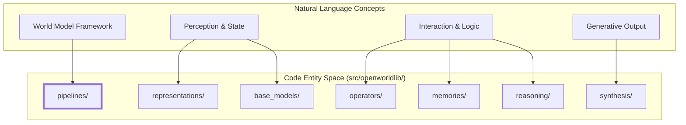
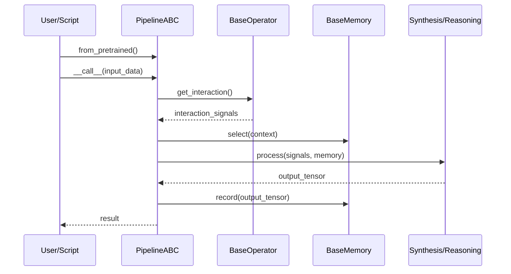

<!-- source: DeepWiki mcp.deepwiki.com · repo OpenDCAI/OpenWorldLib · page 1 OpenWorldLib Overview · fetched 2026-11-02 -->

# OpenWorldLib Overview

Relevant source files

The following files were used as context for generating this wiki page:

- [.gitignore](.gitignore)
- [LICENSE](LICENSE)
- [README.md](README.md)
- [README_zh.md](README_zh.md)
- [data/benchmarks/README.md](data/benchmarks/README.md)
- [docs/awesome_world_model.md](docs/awesome_world_model.md)
- [docs/planning.md](docs/planning.md)
- [src/openworldlib/pipelines/pipeline_utils.py](src/openworldlib/pipelines/pipeline_utils.py)

OpenWorldLib is an open-source, unified framework designed to standardize the development and evaluation of **World Models**. It defines a world model as a perception-centric framework equipped with interaction and long-term memory capabilities, capable of understanding and predicting the complex physical world [README.md:81-83]().

The library integrates diverse research outcomes—ranging from navigation video generation to 3D scene reconstruction and Vision-Language-Action (VLA) models—into a consistent architectural pattern.

## Mission and Core Pillars

The mission of OpenWorldLib is to establish a standardized world model framework that makes the invocation of existing research more structured and reproducible [README.md:111-113](). The framework is built upon four functional pillars that represent the necessary capabilities of a world model [data/benchmarks/README.md:6-12]():

1.  **Synthesis**: The generative layer responsible for producing spatio-temporally consistent visual (video/3D) or auditory content.
2.  **Reasoning**: The cognitive layer for causal inference, future prediction, and counterfactual reasoning.
3.  **Representation**: The perception layer that parses temporal structures, states, and physical properties.
4.  **Memory**: The stateful layer that enables long-term interaction and temporal continuity across generation turns.

### Architectural Mapping: Natural Language to Code Entities

The following diagram bridges the high-level conceptual pillars to the concrete package structure found in the `src/openworldlib` directory.

**System Architecture Overview**

Sources: [README_zh.md:158-190](), [data/benchmarks/README.md:6-12]()

## Supported Task Categories

OpenWorldLib categorizes world model research into several distinct sub-tasks, providing specialized pipelines for each [README.md:118-126]():

| Task Category | Sub-tasks | Representative Pipelines |
| :--- | :--- | :--- |
| **Video Generation** | Navigation, Long Video, Egocentric | `MatrixGame2`, `HunyuanWorldPlay`, `Wan2p2`, `CosmosPredict2p5` |
| **3D Scene Generation** | Point Cloud, Gaussian Splatting | `VGGT`, `FlashWorld`, `Pi3`, `HunyuanMirror` |
| **Reasoning** | VQA, Spatial Reasoning | `SpatialReasoner`, `OmniVinci`, `Qwen2p5Omni` |
| **VLA** | Robot Action Prediction | `PI0`, `GigaBrain0`, `SpiritV1p5` |
| **Simulation** | Embodied Environments | `AI2Thor` |

For a complete catalogue of models and their associated papers, see **[Supported Models & Task Taxonomy](#1.2)**.

## Core Abstractions

At the heart of the library is the `PipelineABC` class, which defines the standard lifecycle for any world model task [src/openworldlib/pipelines/pipeline_utils.py:5-25]().

**Pipeline Interaction Flow**

Sources: [src/openworldlib/pipelines/pipeline_utils.py:5-25](), [README_zh.md:158-190]()

## Getting Started & Hardware Requirements

OpenWorldLib provides a unified installation workflow via `scripts/setup/default_install.sh` [README.md:138-140](). Due to the heavy nature of world models, the framework is primarily tested on high-end hardware:
*   **GPU Memory**: Recommended **80GB** or **141GB** VRAM for full-scale inference [README_zh.md:152]().
*   **Python**: Version 3.10 [README.md:132]().

For detailed environment setup and per-method requirements, see **[Getting Started: Installation & Environment Setup](#1.1)**.

## Child Pages
*   **[Getting Started: Installation & Environment Setup](#1.1)**: Detailed guide on dependency groups, CUDA submodules, and setup scripts.
*   **[Supported Models & Task Taxonomy](#1.2)**: A comprehensive list of integrated models, their task types, and implementation classes.

---

