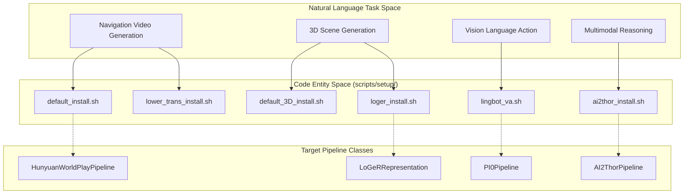
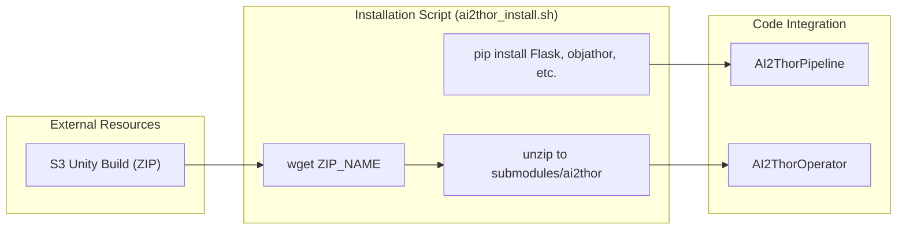

<!-- source: DeepWiki mcp.deepwiki.com · repo OpenDCAI/OpenWorldLib · page 1.1 Getting Started: Installation & Environment Setup · fetched 2026-11-02 -->

# Getting Started: Installation & Environment Setup

<details>
<summary>Relevant source files</summary>

The following files were used as context for generating this wiki page:

- [docs/installation.md](docs/installation.md)
- [pyproject.toml](pyproject.toml)
- [scripts/setup/ai2thor_install.sh](scripts/setup/ai2thor_install.sh)
- [scripts/setup/default_install.sh](scripts/setup/default_install.sh)
- [scripts/setup/flash_world_install.sh](scripts/setup/flash_world_install.sh)
- [scripts/setup/hunyuan_mirror_install.sh](scripts/setup/hunyuan_mirror_install.sh)
- [scripts/setup/libero_install.sh](scripts/setup/libero_install.sh)
- [scripts/setup/lingbot_va.sh](scripts/setup/lingbot_va.sh)
- [scripts/setup/loger_install.sh](scripts/setup/loger_install.sh)
- [scripts/setup/lower_trans_install.sh](scripts/setup/lower_trans_install.sh)
- [scripts/test_inference/test_3d_scene_gen.sh](scripts/test_inference/test_3d_scene_gen.sh)
- [scripts/test_inference/test_audio_gen.sh](scripts/test_inference/test_audio_gen.sh)
- [scripts/test_inference/test_inter_video_gen.sh](scripts/test_inference/test_inter_video_gen.sh)
- [scripts/test_inference/test_vla.sh](scripts/test_inference/test_vla.sh)
- [src/openworldlib/operators/hunyuan_worldplay_operator.py](src/openworldlib/operators/hunyuan_worldplay_operator.py)
- [src/openworldlib/pipelines/hunyuan_world/pipeline_hunyuan_mirror.py](src/openworldlib/pipelines/hunyuan_world/pipeline_hunyuan_mirror.py)
- [src/openworldlib/pipelines/hunyuan_world/pipeline_hunyuan_worldplay.py](src/openworldlib/pipelines/hunyuan_world/pipeline_hunyuan_worldplay.py)
- [src/openworldlib/pipelines/pi3/pipeline_loger.py](src/openworldlib/pipelines/pi3/pipeline_loger.py)
- [test/test_hunyuan_mirror.py](test/test_hunyuan_mirror.py)
- [test/test_hunyuan_worldplay.py](test/test_hunyuan_worldplay.py)
- [test_stream/test_loger_stream.py](test_stream/test_loger_stream.py)
- [tools/installing/readme.md](tools/installing/readme.md)

</details>


This page provides a comprehensive guide to setting up the OpenWorldLib environment. Due to the diverse nature of world models—spanning video synthesis, 3D reconstruction, and robot action prediction—the framework uses a modular installation strategy. Users can install a base environment and then layer task-specific dependencies using specialized scripts or `pyproject.toml` optional groups.

## System Requirements

The framework is optimized for Linux-based environments with NVIDIA GPUs.

| Component | Requirement | Note |
| :--- | :--- | :--- |
| **Python** | 3.10 | Standard across most pipelines [docs/installation.md:22-231]() |
| **CUDA** | 12.1 | Required for most local inference and CUDA submodules [docs/installation.md:23-232]() |
| **PyTorch** | 2.5.1 / 2.6.0 | Version varies by task (e.g., LoGeR requires 2.6.0) [docs/installation.md:112]() |
| **GPU** | NVIDIA (24GB+ VRAM) | Required for large-scale video models like Hunyuan or Wan |

Sources: [docs/installation.md:1-235](), [scripts/setup/loger_install.sh:7]()

## Installation Workflow

OpenWorldLib provides two primary ways to manage dependencies:
1.  **Unified Installation**: Using `pip install -e ".[group]"` for standardized dependency sets.
2.  **Task-Specific Scripts**: Bash scripts located in `scripts/setup/` that handle complex environment setups, including specific PyTorch versions and external build isolations.

### Dependency Group Mapping

The `pyproject.toml` file defines several optional dependency groups to minimize environment bloat.

| Group Name | Purpose | Key Packages |
| :--- | :--- | :--- |
| `transformers_high` | Default for most modern video/reasoning models | `transformers>=4.49.0`, `diffusers==0.36.0` |
| `transformers_low` | Compatibility for older model checkpoints | `transformers<=4.45.1`, `diffusers==0.31.0` |
| `3d_ply_default` | 3D Scene Generation and Point Clouds | `plyfile`, `transformers_high` set |
| `audio_default` | Audio Reasoning and Synthesis | `qwen_omni_utils`, `soundfile` |
| `audio_generation_default` | MMAudio and ThinkSound specific | `k_diffusion`, `descript-audio-codec` |

Sources: [pyproject.toml:11-56]()

### Core Installation Diagram

The following diagram illustrates how the installation scripts bridge the gap between high-level task categories and specific code entities/dependencies.

**Installation Entity Mapping**

Sources: [docs/installation.md:18-191](), [scripts/setup/default_install.sh:1-17](), [scripts/setup/ai2thor_install.sh:1-31](), [src/openworldlib/pipelines/hunyuan_world/pipeline_hunyuan_worldplay.py:8-9]()

---

## Task-Specific Setup Guides

### 1. Navigation & Interactive Video
Most navigation models (MatrixGame2, Hunyuan-GameCraft, Yume) use the `default_install.sh` script, which installs `transformers_high` and `flash-attn`.

```bash
# Standard installation
bash scripts/setup/default_install.sh

# Special case: HunyuanWorld-Voyager (requires older transformers)
bash scripts/setup/lower_trans_install.sh
```
Sources: [docs/installation.md:25-40](), [scripts/setup/default_install.sh:1-17]()

### 2. 3D Scene Generation
3D pipelines often require `plyfile` for point cloud manipulation and specialized rendering backends.

```bash
# General 3D (VGGT, Pi3)
bash scripts/setup/default_3D_install.sh

# LoGeR (Requires PyTorch 2.6.0)
bash scripts/setup/loger_install.sh
```
Sources: [docs/installation.md:92-113](), [scripts/setup/loger_install.sh:7-26]()

### 3. Vision-Language-Action (VLA)
VLA pipelines like $\pi_0$ and GigaBrain-0 use the default environment, but robot-specific simulators like LIBERO or AI2-THOR require additional steps.

```bash
# Base VLA
bash scripts/setup/default_install.sh

# Robot Simulators
bash scripts/setup/libero_install.sh
bash scripts/setup/ai2thor_install.sh
```
Sources: [docs/installation.md:130-152](), [scripts/setup/ai2thor_install.sh:14-27]()

### 4. Audio Generation
Audio pipelines (MMAudio, ThinkSound) require specific codecs and diffusion schedulers defined in the `audio_generation_default` group.

```bash
# Install audio generation dependencies
pip install -e ".[audio_generation_default]"
bash scripts/setup/default_audio_install.sh
```
Sources: [pyproject.toml:43-56](), [docs/installation.md:176]()

---

## Implementation Details: Installation Scripts

### `default_install.sh` Workflow
The `default_install.sh` script serves as the primary entry point for the framework. It ensures that `torch`, `CLIP`, and `flash-attn` are installed correctly to avoid build isolation issues.

1.  **Base Environment**: Installs `torch==2.5.1`. [scripts/setup/default_install.sh:7]()
2.  **Requirements**: Triggers `pip install -e ".[transformers_high]"` to resolve the majority of pipeline dependencies. [scripts/setup/default_install.sh:11]()
3.  **Flash Attention**: Installs `flash-attn==2.5.9.post1` with `--no-build-isolation` to ensure it links against the local torch/CUDA installation. [scripts/setup/default_install.sh:14]()

### Environment Setup for Simulation (AI2-THOR)
The `ai2thor_install.sh` script handles the downloading of external Unity binaries and Python controllers.

**AI2-THOR Setup Data Flow**

Sources: [scripts/setup/ai2thor_install.sh:11-30](), [src/openworldlib/pipelines/pi3/pipeline_loger.py:9-10]()

## Verifying the Installation

After installation, you can verify the environment using the provided test scripts.

```bash
# Verify VLA installation (e.g., PI0)
bash scripts/test_inference/test_vla.sh pi0

# Verify 3D Scene Generation (e.g., Hunyuan Mirror)
python test/test_hunyuan_mirror.py
```
Sources: [scripts/test_inference/test_vla.sh:60-65](), [test/test_hunyuan_mirror.py:18-29]()

---

