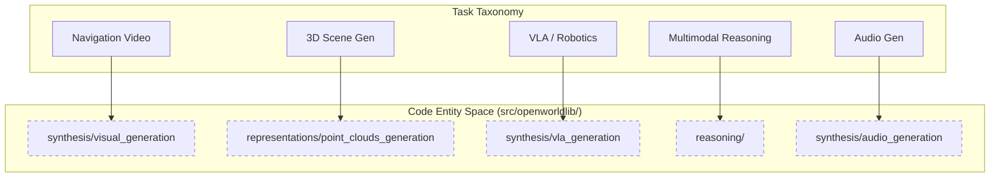
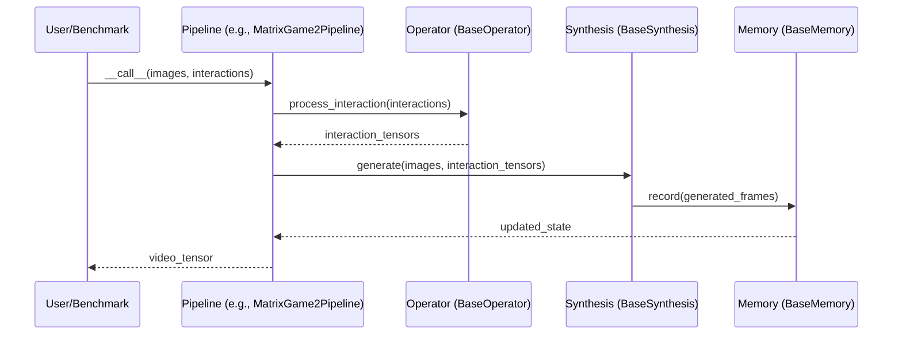

<!-- source: DeepWiki mcp.deepwiki.com · repo OpenDCAI/OpenWorldLib · page 1.2 Supported Models & Task Taxonomy · fetched 2026-11-02 -->

# Supported Models & Task Taxonomy

Relevant source files

The following files were used as context for generating this wiki page:

- [README.md](README.md)
- [README_zh.md](README_zh.md)
- [data/benchmarks/README.md](data/benchmarks/README.md)
- [docs/awesome_world_model.md](docs/awesome_world_model.md)
- [docs/planning.md](docs/planning.md)
- [examples/pipeline_infer_mapping.py](examples/pipeline_infer_mapping.py)
- [examples/pipeline_load_mapping.py](examples/pipeline_load_mapping.py)
- [src/openworldlib/base_models/diffusion_model/video/wan_2p1/utils/fm_solvers_unipc.py](src/openworldlib/base_models/diffusion_model/video/wan_2p1/utils/fm_solvers_unipc.py)
- [src/openworldlib/pipelines/pipeline_utils.py](src/openworldlib/pipelines/pipeline_utils.py)
- [src/openworldlib/synthesis/visual_generation/cosmos/cosmos_predict2p5_synthesis.py](src/openworldlib/synthesis/visual_generation/cosmos/cosmos_predict2p5_synthesis.py)
- [test/test_cosmos_predict2p5.py](test/test_cosmos_predict2p5.py)
- [test/test_depth_anything_v1.py](test/test_depth_anything_v1.py)
- [test/test_lingbot_world.py](test/test_lingbot_world.py)
- [test_stream/test_cosmos_predict2p5_stream.py](test_stream/test_cosmos_predict2p5_stream.py)
- [test_stream/test_lingbot_world_stream.py](test_stream/test_lingbot_world_stream.py)

OpenWorldLib categorizes world models into a structured taxonomy based on their primary functional role in understanding, predicting, or interacting with the environment. This page serves as a technical catalogue of integrated models, their underlying pipeline classes, and the specific tasks they address.

## Task Taxonomy Overview

The framework organizes models into six core capability pillars:
1.  **Navigation Video Generation**: Generating video sequences driven by ego-motion or camera interaction signals.
2.  **3D Scene Generation**: Reconstructing or generating static/dynamic 3D representations from visual inputs.
3.  **Vision-Language-Action (VLA)**: Predicting robotic control actions from multimodal observations.
4.  **Multimodal Reasoning**: Performing spatial, temporal, or causal inference over visual and auditory data.
5.  **Interactive Video**: General-purpose video synthesis with high temporal consistency and prompt adherence.
6.  **Audio Generation**: Generating synchronized environmental sounds or speech for visual scenes.

### Code-to-Task Mapping
The following diagram bridges the high-level task categories to the internal `openworldlib` package structure.

**System Entity Mapping: Tasks to Code Modules**

**Sources:** `[README.md:118-126]()`, `[README_zh.md:158-190]()`

---

## 1. Navigation Video Generation
These models focus on "World Simulation" where the generated output is conditioned on explicit interaction signals (e.g., `forward`, `camera_l`).

| Model Name | Pipeline Class | Key Features |
| :--- | :--- | :--- |
| **Matrix-Game-2** | `MatrixGame2Pipeline` | Universal navigation with interaction-aware diffusion. |
| **Hunyuan-GameCraft** | `HunyuanGameCraftPipeline` | High-fidelity game-like world modeling. |
| **LingBot-World** | `LingBotPipeline` | Large-scale (14B) I2V model with 10-DOF camera control. |
| **Wan-2.2 (IT2V)** | `Wan2p2Pipeline` | Diffusion-based video synthesis with motion conditioning. |

**Data Flow: Navigation Pipeline Execution**

**Sources:** `[examples/pipeline_load_mapping.py:20-51]()`, `[examples/pipeline_infer_mapping.py:7-54]()`, `[test/test_lingbot_world.py:41-47]()`

---

## 2. 3D Scene Generation & Representation
Focuses on the perception and reconstruction of the physical world structure.

| Model Name | Pipeline Class | Task Type |
| :--- | :--- | :--- |
| **DepthAnything V1** | `DepthAnything1Pipeline` | Monocular depth estimation for scene representation. |
| **VGGT / Pi3 / FlashWorld** | (See 3D Extension) | 3D Gaussian Splatting (3DGS) reconstruction. |
| **AI2-THOR** | `pipeline_thor` | Simulation environment for embodied evaluation. |

**Sources:** `[test/test_depth_anything_v1.py:5-7]()`, `[README.md:123-124]()`, `[README_zh.md:183-185]()`

---

## 3. Vision-Language-Action (VLA)
Models that bridge perception and physical execution, typically used for robotic manipulation.

| Model Name | Pipeline Class | Reference Paper |
| :--- | :--- | :--- |
| **Spirit-v1.5** | `SpiritV1p5Pipeline` | General-purpose VLA for multi-embodiment control. |
| **PI-0 / PI-0.5** | `PI0Pipeline` | Diffusion-based robot action prediction. |
| **Giga-Brain** | `GigaBrain0Pipeline` | Large-scale multimodal action transformer. |

**Sources:** `[examples/pipeline_load_mapping.py:71-78]()`, `[examples/pipeline_infer_mapping.py:96-118]()`, `[README.md:125-126]()`

---

## 4. Multimodal Reasoning
High-level cognitive tasks including Visual Question Answering (VQA) and spatial intelligence.

| Model Name | Pipeline Class | Specialization |
| :--- | :--- | :--- |
| **Qwen-2.5-Omni** | `Qwen2p5OmniPipeline` | Unified reasoning across text, image, video, and audio. |
| **OmniVinci** | `OmniVinciPipeline` | Multi-turn multimodal dialogue and reasoning. |
| **SpatialBot** | `SpatialReasonerPipeline` | Explicit coordinate-based spatial understanding. |

**Sources:** `[examples/pipeline_load_mapping.py:54-60]()`, `[examples/pipeline_infer_mapping.py:81-93]()`, `[docs/awesome_world_model.md:87-92]()`

---

## 5. Interactive & Long Video Generation
General synthesis pipelines that prioritize visual quality and temporal consistency over specific navigation controls.

| Model Name | Pipeline Class | Implementation Detail |
| :--- | :--- | :--- |
| **Cosmos-Predict-2.5** | `CosmosPredict2p5Pipeline` | Flow-matching based I2V/V2V generation. |
| **Wan-2.2 / 2.5** | `Wan2p2Pipeline` | T2V and I2V with high-resolution support. |
| **WoW** | `WoWPipeline` | Action-conditioned world modeling for physical consistency. |

**Implementation Note:** The `CosmosPredict2p5Pipeline` utilizes a `FlowUniPCMultistepScheduler` for efficient sampling and supports a `stream()` method for continuous generation turns by maintaining a `memory_module` that tracks the last generated frame.

**Sources:** `[test/test_cosmos_predict2p5.py:26-33]()`, `[test_stream/test_cosmos_predict2p5_stream.py:79-88]()`, `[examples/pipeline_infer_mapping.py:121-133]()`

---

## Task Taxonomy Summary Table

| Category | Representative Models | Primary Code Base |
| :--- | :--- | :--- |
| **Generation** | Matrix-Game, Hunyuan, LingBot, Wan, Cosmos | `synthesis/visual_generation` |
| **Representation** | DepthAnything, 3DGS, AI2-THOR | `representations/` |
| **Reasoning** | Qwen-Omni, OmniVinci, SpatialBot | `reasoning/` |
| **Embodied** | Spirit-v1.5, PI-0, Giga-Brain | `synthesis/vla_generation` |

**Sources:** `[data/benchmarks/README.md:6-12]()`, `[README.md:118-126]()`

---

