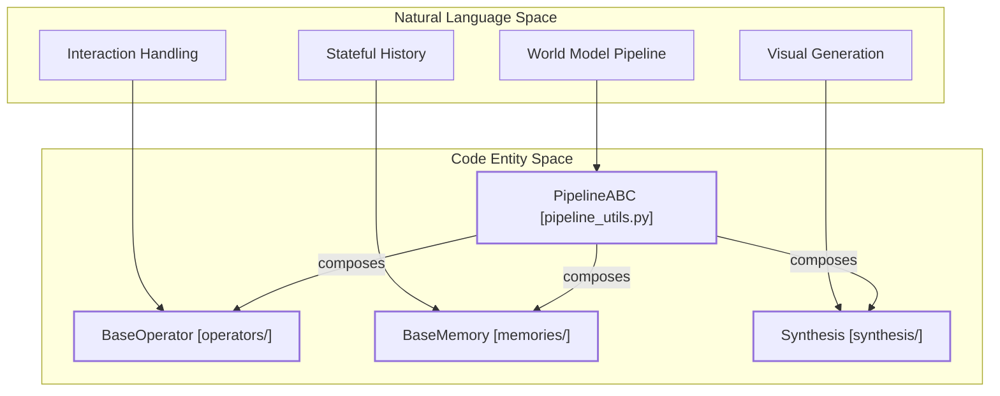
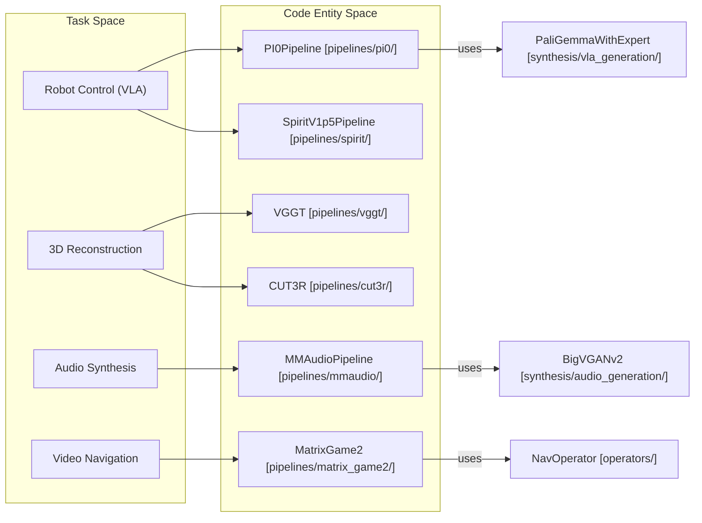

<!-- source: DeepWiki mcp.deepwiki.com · repo OpenDCAI/OpenWorldLib · page 10 Glossary · fetched 2026-11-02 -->

# Glossary

Relevant source files

The following files were used as context for generating this wiki page:

- [README.md](README.md)
- [README_zh.md](README_zh.md)
- [data/benchmarks/benchmark_loader.py](data/benchmarks/benchmark_loader.py)
- [data/benchmarks/generation/navigation_video_generation/benchmark_mapping.py](data/benchmarks/generation/navigation_video_generation/benchmark_mapping.py)
- [data/benchmarks/generation/text2video_generation/benchmark_mapping.py](data/benchmarks/generation/text2video_generation/benchmark_mapping.py)
- [docs/awesome_world_model.md](docs/awesome_world_model.md)
- [docs/installation.md](docs/installation.md)
- [docs/planning.md](docs/planning.md)
- [examples/evaluation_tasks/base_evaluation.py](examples/evaluation_tasks/base_evaluation.py)
- [examples/evaluation_tasks/navigation_video_generation.py](examples/evaluation_tasks/navigation_video_generation.py)
- [examples/pipeline_infer_mapping.py](examples/pipeline_infer_mapping.py)
- [examples/pipeline_load_mapping.py](examples/pipeline_load_mapping.py)
- [examples/run_benchmark.py](examples/run_benchmark.py)
- [pyproject.toml](pyproject.toml)
- [requirements.txt](requirements.txt)
- [scripts/setup/cut3r_install.sh](scripts/setup/cut3r_install.sh)
- [scripts/setup/hunyuan_mirror_install.sh](scripts/setup/hunyuan_mirror_install.sh)
- [scripts/setup/loger_install.sh](scripts/setup/loger_install.sh)
- [scripts/test_benchmark/navigation_video_eval.sh](scripts/test_benchmark/navigation_video_eval.sh)
- [src/openworldlib/base_models/diffusion_model/video/wan_2p1/utils/fm_solvers_unipc.py](src/openworldlib/base_models/diffusion_model/video/wan_2p1/utils/fm_solvers_unipc.py)
- [src/openworldlib/operators/cut3r_operator.py](src/openworldlib/operators/cut3r_operator.py)
- [src/openworldlib/operators/giga_brain_0_operator.py](src/openworldlib/operators/giga_brain_0_operator.py)
- [src/openworldlib/operators/hunyuan_worldplay_operator.py](src/openworldlib/operators/hunyuan_worldplay_operator.py)
- [src/openworldlib/operators/vggt_operator.py](src/openworldlib/operators/vggt_operator.py)
- [src/openworldlib/pipelines/cut3r/pipeline_cut3r.py](src/openworldlib/pipelines/cut3r/pipeline_cut3r.py)
- [src/openworldlib/pipelines/giga_brain_0/pipeline_giga_brain_0.py](src/openworldlib/pipelines/giga_brain_0/pipeline_giga_brain_0.py)
- [src/openworldlib/pipelines/hunyuan_world/pipeline_hunyuan_mirror.py](src/openworldlib/pipelines/hunyuan_world/pipeline_hunyuan_mirror.py)
- [src/openworldlib/pipelines/hunyuan_world/pipeline_hunyuan_worldplay.py](src/openworldlib/pipelines/hunyuan_world/pipeline_hunyuan_worldplay.py)
- [src/openworldlib/pipelines/pi0/pipeline_pi0.py](src/openworldlib/pipelines/pi0/pipeline_pi0.py)
- [src/openworldlib/pipelines/pi3/pipeline_loger.py](src/openworldlib/pipelines/pi3/pipeline_loger.py)
- [src/openworldlib/pipelines/pipeline_utils.py](src/openworldlib/pipelines/pipeline_utils.py)
- [src/openworldlib/pipelines/spatial_ladder/pipeline_spatial_ladder.py](src/openworldlib/pipelines/spatial_ladder/pipeline_spatial_ladder.py)
- [src/openworldlib/pipelines/spatial_reasoner/pipeline_spatial_reasoner.py](src/openworldlib/pipelines/spatial_reasoner/pipeline_spatial_reasoner.py)
- [src/openworldlib/pipelines/vggt/pipeline_vggt.py](src/openworldlib/pipelines/vggt/pipeline_vggt.py)
- [src/openworldlib/reasoning/spatial_reasoning/spatial_ladder/spatial_ladder_reasoning.py](src/openworldlib/reasoning/spatial_reasoning/spatial_ladder/spatial_ladder_reasoning.py)
- [src/openworldlib/reasoning/spatial_reasoning/spatial_reasoner/spatial_reasoner_reasoning.py](src/openworldlib/reasoning/spatial_reasoning/spatial_reasoner/spatial_reasoner_reasoning.py)
- [src/openworldlib/representations/point_clouds_generation/cut3r/cut3r_representation.py](src/openworldlib/representations/point_clouds_generation/cut3r/cut3r_representation.py)
- [src/openworldlib/representations/point_clouds_generation/vggt/vggt_representation.py](src/openworldlib/representations/point_clouds_generation/vggt/vggt_representation.py)
- [src/openworldlib/synthesis/visual_generation/cosmos/cosmos_predict2p5_synthesis.py](src/openworldlib/synthesis/visual_generation/cosmos/cosmos_predict2p5_synthesis.py)
- [src/openworldlib/synthesis/vla_generation/giga_brain_0/giga_brain_0/modeling_giga_brain_0.py](src/openworldlib/synthesis/vla_generation/giga_brain_0/giga_brain_0/modeling_giga_brain_0.py)
- [src/openworldlib/synthesis/vla_generation/giga_brain_0/giga_brain_0/paligemma2_with_expert.py](src/openworldlib/synthesis/vla_generation/giga_brain_0/giga_brain_0/paligemma2_with_expert.py)
- [src/openworldlib/synthesis/vla_generation/pi0/pi0/modeling_pi0.py](src/openworldlib/synthesis/vla_generation/pi0/pi0/modeling_pi0.py)
- [src/openworldlib/synthesis/vla_generation/pi0/pi0_synthesis.py](src/openworldlib/synthesis/vla_generation/pi0/pi0_synthesis.py)
- [test/test_cosmos_predict2p5.py](test/test_cosmos_predict2p5.py)
- [test/test_cut3r.py](test/test_cut3r.py)
- [test/test_depth_anything_v1.py](test/test_depth_anything_v1.py)
- [test/test_giga_brain_0.py](test/test_giga_brain_0.py)
- [test/test_hunyuan_mirror.py](test/test_hunyuan_mirror.py)
- [test/test_hunyuan_worldplay.py](test/test_hunyuan_worldplay.py)
- [test/test_lingbot_world.py](test/test_lingbot_world.py)
- [test/test_matrix_game_2.py](test/test_matrix_game_2.py)
- [test/test_mmaudio.py](test/test_mmaudio.py)
- [test/test_pi0.py](test/test_pi0.py)
- [test/test_pi05.py](test/test_pi05.py)
- [test/test_spatial_ladder.py](test/test_spatial_ladder.py)
- [test/test_spatial_reasoner.py](test/test_spatial_reasoner.py)
- [test/test_thinksound.py](test/test_thinksound.py)
- [test/test_vggt.py](test/test_vggt.py)
- [test_stream/test_cosmos_predict2p5_stream.py](test_stream/test_cosmos_predict2p5_stream.py)
- [test_stream/test_lingbot_world_stream.py](test_stream/test_lingbot_world_stream.py)
- [test_stream/test_loger_stream.py](test_stream/test_loger_stream.py)
- [test_stream/test_vggt_stream.py](test_stream/test_vggt_stream.py)

This page provides definitions and technical context for codebase-specific terms, architectural concepts, and model names within the **OpenWorldLib** framework. It serves as a reference for onboarding engineers to understand how abstract world modeling concepts map to specific code entities.

## 1. Core Architectural Concepts

The framework is built on a modular hierarchy where `PipelineABC` acts as the orchestrator for four functional layers: Synthesis, Reasoning, Representation, and Memory.

### Pipeline (`PipelineABC`)
The top-level class that encapsulates a specific world model's logic. It inherits from `PipelineABC` and implements the standard lifecycle: `from_pretrained`, `process`, and `__call__`.
*   **Implementation**: Defined in `src/openworldlib/pipelines/pipeline_utils.py`.
*   **Registry**: Pipelines are mapped to model types in `examples/pipeline_load_mapping.py` [examples/pipeline_load_mapping.py:1-26]() and their inference logic is defined in `examples/pipeline_infer_mapping.py` [examples/pipeline_infer_mapping.py:7-154]().

### Operator
A module responsible for processing input signals and interaction tokens (e.g., "forward", "camera_left"). It translates raw user input or benchmark data into a format the Synthesis or Reasoning layers can ingest.
*   **Unified Interaction Schema**: Common signals include `forward`, `backward`, `camera_l`, and `camera_r`, used extensively in navigation pipelines like `MatrixGame2` [examples/pipeline_infer_mapping.py:7-14]().

### Memory Module
Stateful containers that maintain temporal or conversational continuity.
*   **Visual Memory**: Stores latent states or frame history for video generation (e.g., `Wan2p2Memory`).
*   **Reasoning Memory**: Stores dialogue history for MLLMs (e.g., `QwenMemory`).

### System Architecture Diagram
The following diagram illustrates the relationship between Natural Language concepts and the Code Entity Space.

"OpenWorldLib Core Architecture"

Sources: [src/openworldlib/pipelines/pipeline_utils.py:1-30](), [README.md:167-189]()

---

## 2. Model & Task Glossary

### Navigation Video Generation
Tasks where the model generates video frames conditioned on a starting image and a sequence of navigation actions.
*   **MatrixGame2**: A high-fidelity navigation generator. The pipeline `MatrixGame2Pipeline` uses interaction signals to produce frames at a specific FPS (default 12) [examples/pipeline_infer_mapping.py:7-20]().
*   **Hunyuan-GameCraft**: Generates interactive 3D-like navigation videos using a specific `interaction_template` [examples/pipeline_infer_mapping.py:23-33]().
*   **LingBot-World**: A navigation model producing 36 frames per interaction step [examples/pipeline_infer_mapping.py:42-48]().

### 3D Scene Generation & Representation
Tasks involving the reconstruction of 3D environments, often using Point Clouds or Gaussian Splatting.
*   **VGGT / Pi3 / LoGeR**: Pipelines for feed-forward 3D reconstruction. They typically output PLY files or 3D Gaussian Splatting (3DGS) parameters [docs/installation.md:88-114]().
*   **3DGS**: 3D Gaussian Splatting, the primary rendering backend. It utilizes CUDA submodules like `diff-gaussian-rasterization` [README_zh.md:190-192]().

### Vision-Language-Action (VLA)
Models that output low-level robot control actions from visual observations and language instructions.
*   **PI0 / PI0.5**: Diffusion-based VLA models. They require `state_norm_stats` and `action_norm_stats` for input/output normalization [test/test_pi0.py:105-116]().
*   **Spirit v1.5**: A VLA pipeline supporting various robot embodiments like "Franka" [examples/pipeline_infer_mapping.py:96-118]().
*   **GigaBrain-0**: Uses a `PaliGemma2WithExpertModel` architecture for multimodal action prediction [src/openworldlib/synthesis/vla_generation/giga_brain_0/giga_brain_0/modeling_giga_brain_0.py:1-50]().

### Multimodal Reasoning
Tasks involving VQA (Visual Question Answering) or spatial intelligence.
*   **Qwen2.5-Omni**: An omni-modality model (text, image, video, audio) used both as a reasoning pipeline and an evaluator in benchmarks [examples/run_benchmark.py:37-46](), [examples/pipeline_infer_mapping.py:81-93]().
*   **SpatialReasoner / SpatialLadder**: Specialized pipelines for precise spatial understanding, often built on `Qwen2_5_VL` [docs/installation.md:179-191]().

### Audio Generation
*   **MMAudio**: Video-to-audio and text-to-audio synthesis using `BigVGANv2` as a vocoder [test/test_mmaudio.py:2-41]().
*   **ThinkSound**: Video-to-audio generation utilizing a `Synchformer` backbone and Chain-of-Thought (CoT) processing [test/test_thinksound.py:2-44]().

---

## 3. Implementation Mapping

The following diagram bridges the functional task descriptions to the specific classes and file structures used in the repository.

"Task to Code Implementation Mapping"

Sources: [examples/pipeline_load_mapping.py:1-26](), [test/test_pi0.py:105-116](), [test/test_mmaudio.py:34-41](), [examples/pipeline_infer_mapping.py:7-14]()

---

## 4. Key Terms & Abbreviations

| Term | Definition | File Reference |
| :--- | :--- | :--- |
| **VLA** | Vision-Language-Action. Models that map vision/language to robot actions. | `src/openworldlib/synthesis/vla_generation/` |
| **3DGS** | 3D Gaussian Splatting. A point-based rendering technique for 3D scenes. | `submodules/diff-gaussian-rasterization/` |
| **CFG** | Classifier-Free Guidance. A technique used in diffusion models to improve prompt adherence. | `test/test_mmaudio.py:51` |
| **CoT** | Chain-of-Thought. Intermediate reasoning steps, used in `ThinkSound`. | `test/test_thinksound.py:40` |
| **Norm Stats** | Normalization Statistics (mean/std) required for VLA input/output scaling. | `test/test_pi0.py:101-103` |
| **Interaction Signal** | Tokens representing physical actions (e.g., `[0, 0, 1]` for forward). | `examples/pipeline_infer_mapping.py:7-14` |
| **Flow Matching** | A generative modeling paradigm used in `Cosmos-Predict 2.5`. | `src/openworldlib/synthesis/visual_generation/cosmos/` |

Sources: [test/test_pi0.py:101-116](), [test/test_mmaudio.py:43-66](), [test/test_thinksound.py:31-44](), [examples/pipeline_infer_mapping.py:7-14]()