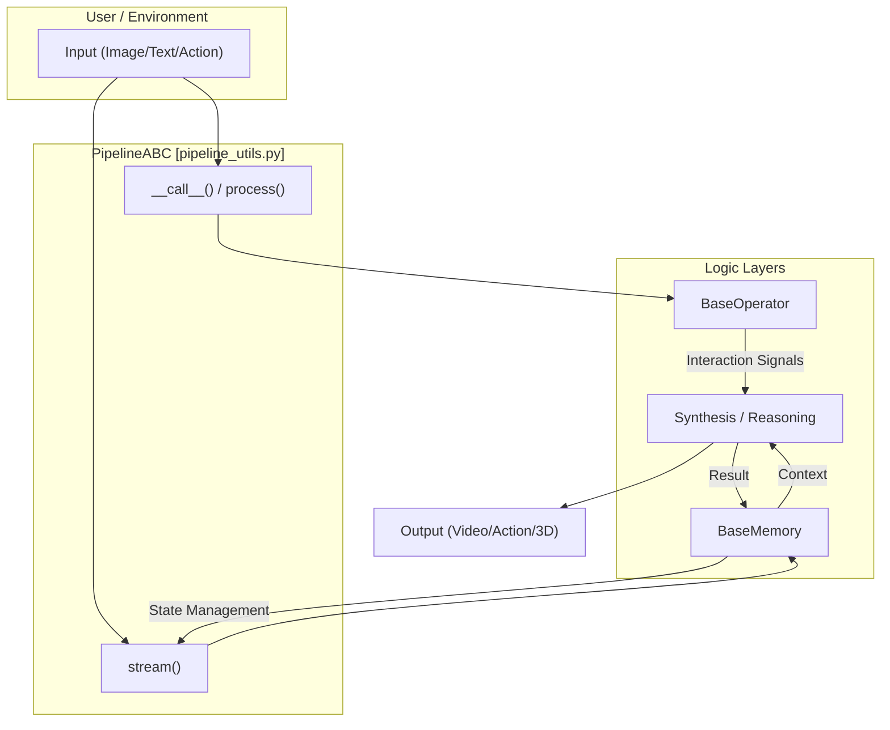
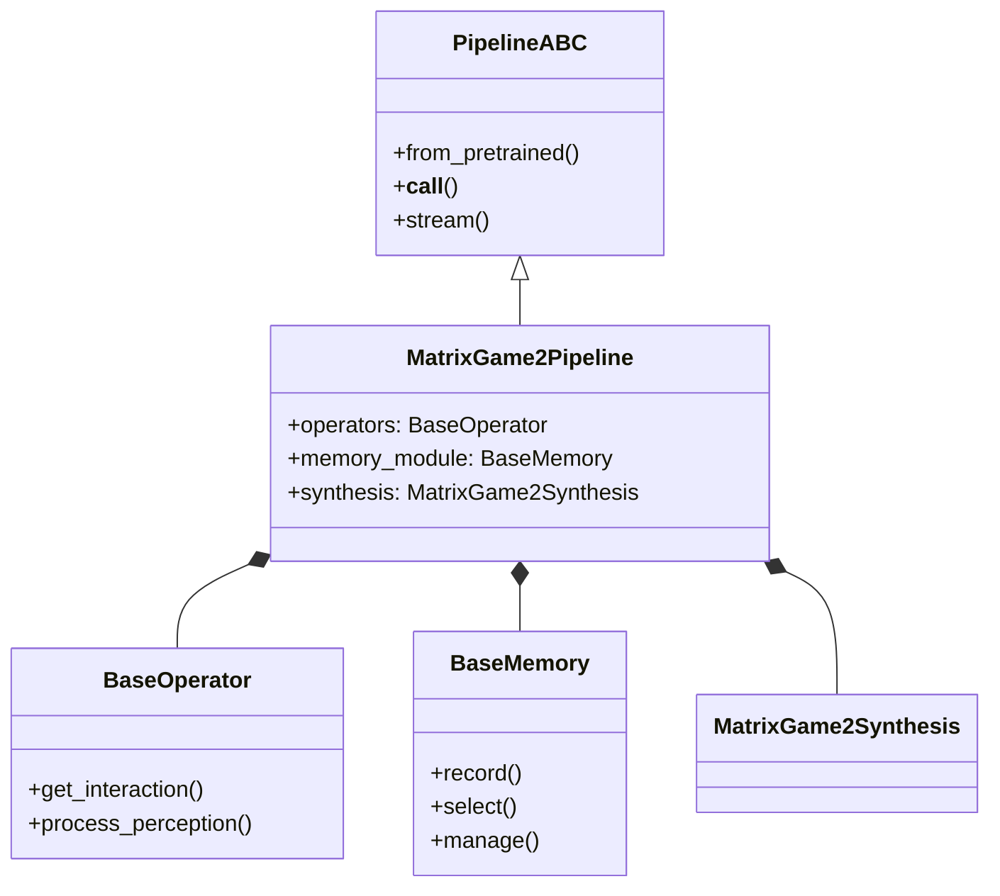

<!-- source: DeepWiki mcp.deepwiki.com · repo OpenDCAI/OpenWorldLib · page 2 Core Architecture · fetched 2026-11-02 -->

# Core Architecture

Relevant source files

The following files were used as context for generating this wiki page:

- [README.md](README.md)
- [README_zh.md](README_zh.md)
- [docs/awesome_world_model.md](docs/awesome_world_model.md)
- [docs/planning.md](docs/planning.md)
- [examples/pipeline_infer_mapping.py](examples/pipeline_infer_mapping.py)
- [examples/pipeline_load_mapping.py](examples/pipeline_load_mapping.py)
- [src/openworldlib/base_models/diffusion_model/video/wan_2p1/utils/fm_solvers_unipc.py](src/openworldlib/base_models/diffusion_model/video/wan_2p1/utils/fm_solvers_unipc.py)
- [src/openworldlib/pipelines/pipeline_utils.py](src/openworldlib/pipelines/pipeline_utils.py)
- [src/openworldlib/synthesis/visual_generation/cosmos/cosmos_predict2p5_synthesis.py](src/openworldlib/synthesis/visual_generation/cosmos/cosmos_predict2p5_synthesis.py)
- [test/test_cosmos_predict2p5.py](test/test_cosmos_predict2p5.py)
- [test/test_depth_anything_v1.py](test/test_depth_anything_v1.py)
- [test/test_lingbot_world.py](test/test_lingbot_world.py)
- [test_stream/test_cosmos_predict2p5_stream.py](test_stream/test_cosmos_predict2p5_stream.py)
- [test_stream/test_lingbot_world_stream.py](test_stream/test_lingbot_world_stream.py)

OpenWorldLib is built on a modular architecture designed to unify diverse world modeling tasks—ranging from video synthesis and 3D scene generation to multimodal reasoning and robot action prediction—under a consistent set of abstractions. The framework decomposes a world model into six primary layers: **Pipeline**, **Operator**, **Synthesis**, **Reasoning**, **Representation**, and **Memory**.

## The Six-Layer Abstraction

The architecture ensures that regardless of the underlying model (e.g., Diffusion, LLM, or 3DGS), the interaction lifecycle remains uniform.

1.  **Pipeline Layer**: The top-level entry point that orchestrates all other modules. It manages the model lifecycle (loading, inference, and streaming).
2.  **Operator Layer**: Handles input processing, interaction signal parsing (e.g., navigation commands), and perception preprocessing.
3.  **Synthesis Layer**: Responsible for generative tasks, including video, image, and audio synthesis, as well as VLA (Vision-Language-Action) generation.
4.  **Reasoning Layer**: Manages cognitive tasks such as spatial understanding, VQA, and multi-modal chain-of-thought.
5.  **Representation Layer**: Handles structural world modeling, such as 3D point cloud generation, depth estimation, and simulation environment states.
6.  **Memory Layer**: Maintains state across multi-turn interactions, enabling temporal continuity in streaming video generation or long-form reasoning.

### System Flow: From Interaction to Generation

The following diagram illustrates how these entities interact during a standard inference and streaming cycle.

**World Model Pipeline Interaction Flow**

**Sources:** [src/openworldlib/pipelines/pipeline_utils.py:5-25](), [README_zh.md:158-190]()

---

## 2.1 PipelineABC: The Pipeline Lifecycle
The `PipelineABC` class in `pipeline_utils.py` defines the standard interface for all models in the library. It provides the `from_pretrained()` method for loading and two primary execution modes: `__call__()` for single-batch inference and `stream()` for stateful, multi-turn interaction.

For details, see [PipelineABC: The Pipeline Lifecycle](#2.1).

**Sources:** [src/openworldlib/pipelines/pipeline_utils.py:5-25]()

## 2.2 Operator Layer: Input & Interaction
The Operator layer acts as the "sensory" and "interface" module. It translates raw user inputs or environment signals into the internal schema used by the synthesis and reasoning engines. This includes the **Unified 3D Interaction Schema** (e.g., `forward`, `camera_l`) used in navigation tasks.

For details, see [Operator Layer: Input Processing & Interaction Signals](#2.2).

**Sources:** [README_zh.md:177-177](), [examples/pipeline_infer_mapping.py:25-28]()

## 2.3 Memory Module: Stateful Interaction
The Memory module is critical for world models that require temporal consistency. It implements a five-stage lifecycle—`record`, `select`, `compress`, `process`, and `manage`—to store and retrieve previous frames or reasoning states. This allows the `stream()` method to generate continuous video segments where the last frame of turn $N$ becomes the first frame of turn $N+1$.

For details, see [Memory Module: Stateful Multi-Turn Interaction](#2.3).

**Sources:** [test_stream/test_cosmos_predict2p5_stream.py:37-101](), [README_zh.md:174-176]()

## 2.4 Base Models: The Core Engines
The `base_models` directory contains the primitive weights and architectures that power the higher-level layers. This includes:
*   **Diffusion Models**: `wan_2p1`, `hunyuan_video`, etc.
*   **LLM/MLLM Cores**: `qwen`, `omnivinci`.
*   **Perception & 3D**: Depth estimation and point cloud backends.

For details, see [Base Models: Diffusion, LLM/MLLM, and Perception Cores](#2.4).

**Sources:** [README_zh.md:169-173](), [examples/pipeline_load_mapping.py:4-92]()

---

## Architectural Mapping: Code to Logic

The following table maps the conceptual "Natural Language Space" of world modeling to the specific "Code Entity Space" within OpenWorldLib.

| Conceptual Layer | Code Implementation Directory | Primary Base Class / Interface |
| :--- | :--- | :--- |
| **Pipeline** | `src/openworldlib/pipelines/` | `PipelineABC` [src/openworldlib/pipelines/pipeline_utils.py:5]() |
| **Operator** | `src/openworldlib/operators/` | `BaseOperator` |
| **Synthesis** | `src/openworldlib/synthesis/` | `VisualGeneration`, `VLAGeneration` |
| **Reasoning** | `src/openworldlib/reasoning/` | `SpatialReasoner`, `GeneralReasoning` |
| **Memory** | `src/openworldlib/memories/` | `BaseMemory` |
| **Representation**| `src/openworldlib/representations/`| `PointCloudsGeneration`, `SimulationEnvironment` |

**Code Entity Relationship Diagram**

**Sources:** [src/openworldlib/pipelines/pipeline_utils.py:5-25](), [examples/pipeline_load_mapping.py:20-26](), [test_stream/test_cosmos_predict2p5_stream.py:79-88]()

---

