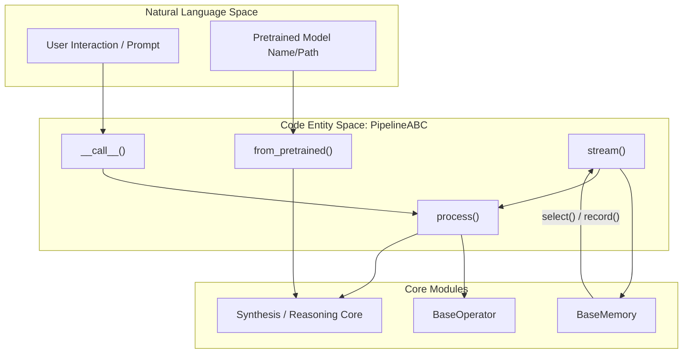
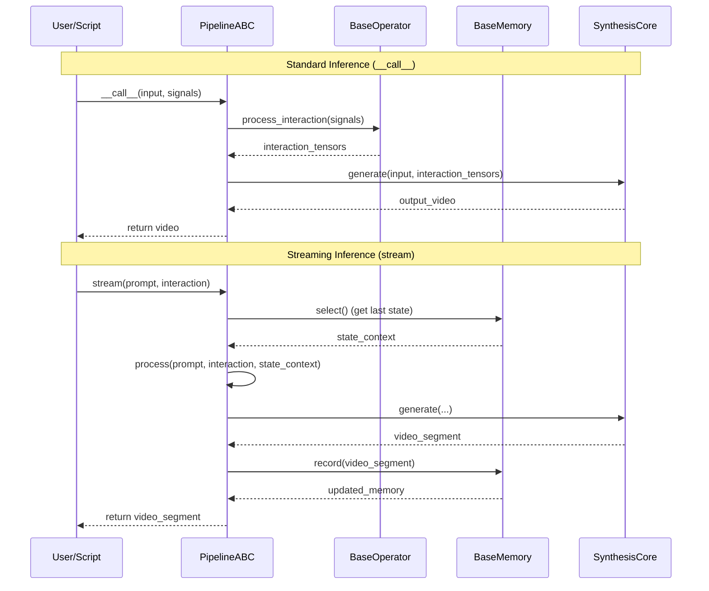

<!-- source: DeepWiki mcp.deepwiki.com · repo OpenDCAI/OpenWorldLib · page 2.1 PipelineABC: The Pipeline Lifecycle · fetched 2026-11-02 -->

# PipelineABC: The Pipeline Lifecycle

Relevant source files

The following files were used as context for generating this wiki page:

- [README.md](README.md)
- [README_zh.md](README_zh.md)
- [docs/awesome_world_model.md](docs/awesome_world_model.md)
- [docs/planning.md](docs/planning.md)
- [examples/pipeline_infer_mapping.py](examples/pipeline_infer_mapping.py)
- [examples/pipeline_load_mapping.py](examples/pipeline_load_mapping.py)
- [src/openworldlib/base_models/diffusion_model/video/wan_2p1/utils/fm_solvers_unipc.py](src/openworldlib/base_models/diffusion_model/video/wan_2p1/utils/fm_solvers_unipc.py)
- [src/openworldlib/pipelines/pipeline_utils.py](src/openworldlib/pipelines/pipeline_utils.py)
- [src/openworldlib/synthesis/visual_generation/cosmos/cosmos_predict2p5_synthesis.py](src/openworldlib/synthesis/visual_generation/cosmos/cosmos_predict2p5_synthesis.py)
- [test/test_cosmos_predict2p5.py](test/test_cosmos_predict2p5.py)
- [test/test_depth_anything_v1.py](test/test_depth_anything_v1.py)
- [test/test_hunyuan_gamecraft.py](test/test_hunyuan_gamecraft.py)
- [test/test_lingbot_world.py](test/test_lingbot_world.py)
- [test_stream/test_cosmos_predict2p5_stream.py](test_stream/test_cosmos_predict2p5_stream.py)
- [test_stream/test_hunyuan_game_craft_stream.py](test_stream/test_hunyuan_game_craft_stream.py)
- [test_stream/test_lingbot_world_stream.py](test_stream/test_lingbot_world_stream.py)

`PipelineABC` is the foundational abstract base class for all inference workflows in OpenWorldLib. It defines a standardized lifecycle for world models, encompassing model loading, input processing, stateful interaction, and both one-shot and streaming inference modes. By enforcing this interface, OpenWorldLib ensures that diverse tasks—from navigation video generation to multimodal reasoning—share a consistent execution pattern.

## The Pipeline Lifecycle Overview

The lifecycle of a pipeline is divided into three distinct phases: initialization, execution, and state management.

1.  **Initialization**: Handled by `from_pretrained()`, where the `Synthesis`, `Reasoning`, `Representation`, and `Memory` modules are instantiated and weights are loaded.
2.  **Standard Inference**: Handled by `__call__()` and `process()`. This is typically used for single-turn tasks or generating a fixed-length sequence from an initial state.
3.  **Streaming Inference**: Handled by `stream()`. This leverages the `Memory` module to maintain temporal or conversational continuity across multiple interactive turns.

### Lifecycle Data Flow

The following diagram illustrates how data flows through the `PipelineABC` methods and interacts with the core architectural layers.

**Diagram: Pipeline Lifecycle and Entity Mapping**

**Sources:** [src/openworldlib/pipelines/pipeline_utils.py:1-100](), [README.md:155-190]()

---

## Key Methods and Implementation

### 1. from_pretrained()
This static method serves as the entry point for instantiating any pipeline. It is responsible for resolving model paths and orchestrating the loading of sub-modules. In the registry files, specialized loading functions wrap this method to handle model-specific requirements (e.g., FSDP settings or specific VAE paths).

*   **Registry Mapping**: The file `pipeline_load_mapping.py` contains a `video_gen_pipe` and `reasoning_pipe` dictionary that maps model strings to these loading functions [examples/pipeline_load_mapping.py:95-114]().
*   **Component Resolution**: For complex models like Cosmos, `from_pretrained` handles a `required_components` dictionary to load separate text encoders and VAEs [examples/pipeline_load_mapping.py:81-92]().

### 2. process()
The `process()` method is the internal engine of the pipeline. It typically performs the following:
1.  **Signal Parsing**: Uses the `Operator` to transform raw user inputs (e.g., "forward") into tensors or structured interaction signals [examples/pipeline_infer_mapping.py:24-33]().
2.  **Perception Processing**: Prepares visual or auditory inputs for the model core.
3.  **Model Invocation**: Calls the underlying `Synthesis` or `Reasoning` classes to perform the actual computation.

### 3. __call__() vs. stream()
OpenWorldLib distinguishes between one-shot generation and interactive, stateful generation.

| Feature | `__call__()` | `stream()` |
| :--- | :--- | :--- |
| **Usage** | Standard inference (one-shot) | Multi-turn / Interactive |
| **Memory** | Stateless or internal-only | Uses `MemoryModule` (record/select) |
| **Continuity** | Fixed duration/output | Appends to history for infinite generation |
| **Example** | `test_lingbot_world.py` [test/test_lingbot_world.py:41-47]() | `test_cosmos_predict2p5_stream.py` [test_stream/test_cosmos_predict2p5_stream.py:79-88]() |

**Sources:** [src/openworldlib/pipelines/pipeline_utils.py:1-100](), [examples/pipeline_infer_mapping.py:7-142](), [test_stream/test_hunyuan_game_craft_stream.py:180-191]()

---

## Pipeline Registry and Mapping

To provide a unified interface for the `run_benchmark.py` and other CLI tools, OpenWorldLib uses a mapping system located in the `examples/` directory.

### Loading Mapping (`pipeline_load_mapping.py`)
This file acts as a factory for pipelines. It defines how specific models (e.g., `matrix-game2`, `wan2p2`) should be initialized.
*   **Functions**: `load_matrix_game2_pipeline`, `load_wan2p2_pipeline`, etc. [examples/pipeline_load_mapping.py:20-78]().
*   **Path Resolution**: Uses `_resolve_path` to handle both single strings and dictionaries of checkpoint paths [examples/pipeline_load_mapping.py:4-17]().

### Inference Mapping (`pipeline_infer_mapping.py`)
This file defines the standard way to invoke the `__call__` method for different pipeline types, abstracting away differences in argument names (e.g., `images` vs `image_path`).
*   **Functions**: `infer_matrix_game2_pipeline`, `infer_qwen2p5_omni_pipeline`, etc. [examples/pipeline_infer_mapping.py:7-118]().
*   **Logic**: It often includes post-processing, such as calculating `num_output_frames` based on the length of the interaction signal [examples/pipeline_infer_mapping.py:8-14]().

**Sources:** [examples/pipeline_load_mapping.py:1-114](), [examples/pipeline_infer_mapping.py:1-155]()

---

## Execution Logic: Standard vs. Streaming

The following diagram details the internal logic when a user triggers a streaming session compared to a standard inference session.

**Diagram: Standard vs. Streaming Execution Logic**

**Sources:** [src/openworldlib/pipelines/pipeline_utils.py:1-100](), [test_stream/test_cosmos_predict2p5_stream.py:69-101](), [test_stream/test_hunyuan_game_craft_stream.py:156-198]()

---

