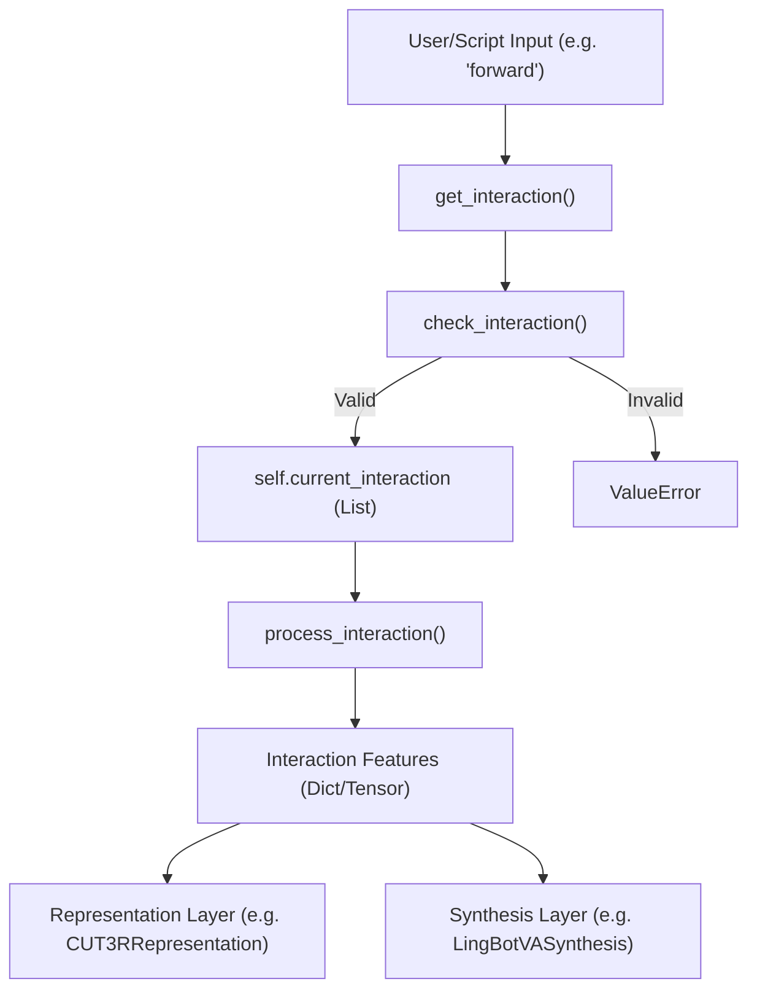
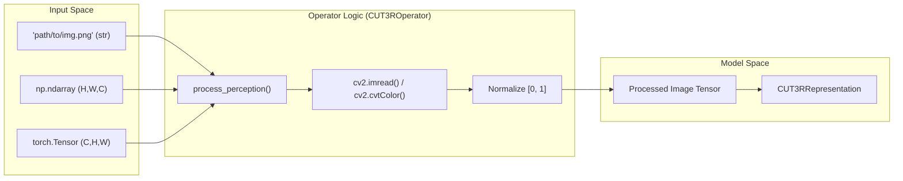

<!-- source: DeepWiki mcp.deepwiki.com · repo OpenDCAI/OpenWorldLib · page 2.2 Operator Layer: Input Processing & Interaction Signals · fetched 2026-11-02 -->

# Operator Layer: Input Processing & Interaction Signals

Relevant source files

The following files were used as context for generating this wiki page:

- [pyproject.toml](pyproject.toml)
- [requirements.txt](requirements.txt)
- [scripts/setup/cut3r_install.sh](scripts/setup/cut3r_install.sh)
- [scripts/setup/hunyuan_mirror_install.sh](scripts/setup/hunyuan_mirror_install.sh)
- [src/openworldlib/operators/cut3r_operator.py](src/openworldlib/operators/cut3r_operator.py)
- [src/openworldlib/operators/hunyuan_worldplay_operator.py](src/openworldlib/operators/hunyuan_worldplay_operator.py)
- [src/openworldlib/operators/lingbot_va_operator.py](src/openworldlib/operators/lingbot_va_operator.py)
- [src/openworldlib/operators/pi0_operator.py](src/openworldlib/operators/pi0_operator.py)
- [src/openworldlib/operators/vggt_operator.py](src/openworldlib/operators/vggt_operator.py)
- [src/openworldlib/pipelines/cut3r/pipeline_cut3r.py](src/openworldlib/pipelines/cut3r/pipeline_cut3r.py)
- [src/openworldlib/pipelines/hunyuan_world/pipeline_hunyuan_mirror.py](src/openworldlib/pipelines/hunyuan_world/pipeline_hunyuan_mirror.py)
- [src/openworldlib/pipelines/hunyuan_world/pipeline_hunyuan_worldplay.py](src/openworldlib/pipelines/hunyuan_world/pipeline_hunyuan_worldplay.py)
- [src/openworldlib/pipelines/lingbot_va/pipeline_lingbot_va.py](src/openworldlib/pipelines/lingbot_va/pipeline_lingbot_va.py)
- [src/openworldlib/pipelines/vggt/pipeline_vggt.py](src/openworldlib/pipelines/vggt/pipeline_vggt.py)
- [src/openworldlib/representations/point_clouds_generation/cut3r/cut3r_representation.py](src/openworldlib/representations/point_clouds_generation/cut3r/cut3r_representation.py)
- [src/openworldlib/representations/point_clouds_generation/vggt/vggt_representation.py](src/openworldlib/representations/point_clouds_generation/vggt/vggt_representation.py)
- [src/openworldlib/synthesis/vla_generation/lingbot_va/lingbot_va_synthesis.py](src/openworldlib/synthesis/vla_generation/lingbot_va/lingbot_va_synthesis.py)
- [test/test_cut3r.py](test/test_cut3r.py)
- [test/test_hunyuan_mirror.py](test/test_hunyuan_mirror.py)
- [test/test_hunyuan_worldplay.py](test/test_hunyuan_worldplay.py)
- [test/test_lingbot_va.py](test/test_lingbot_va.py)
- [test/test_matrix_game_2.py](test/test_matrix_game_2.py)
- [test/test_vggt.py](test/test_vggt.py)
- [test_stream/test_vggt_stream.py](test_stream/test_vggt_stream.py)

The **Operator Layer** serves as the primary interface for translating raw external inputs (images, videos, text prompts) and user interaction signals into structured data formats consumed by the Synthesis, Reasoning, and Representation layers. It is responsible for input validation, signal normalization, and maintaining the lifecycle of interaction states within a pipeline.

## BaseOperator and Lifecycle Methods

All operators inherit from `BaseOperator`, which defines the standard interface for handling interaction sequences and perception data. The operator ensures that high-level semantic commands (e.g., "move forward") are mapped to the specific mathematical or tensor representations required by the underlying models.

### Key Methods

| Method | Description |
| :--- | :--- |
| `interaction_template_init()` | Initializes the internal list of valid interactions based on the `interaction_template`. |
| `get_interaction()` | Validates a single interaction string and appends it to the `current_interaction` list. |
| `check_interaction()` | Performs a membership check against the `interaction_template` to ensure the signal is supported. |
| `process_interaction()` | Converts the accumulated `current_interaction` list into a feature dictionary or tensor (e.g., camera poses). |
| `process_perception()` | Preprocesses visual signals (paths, numpy arrays, or tensors) into normalized RGB arrays. |

**Sources:** [src/openworldlib/operators/cut3r_operator.py:12-42](), [src/openworldlib/operators/cut3r_operator.py:137-175]()

### Interaction Data Flow
The following diagram illustrates how an Operator bridges the gap between a user's natural language or discrete command and the pipeline's internal processing.

**Interaction Signal Translation**

**Sources:** [src/openworldlib/operators/cut3r_operator.py:155-175](), [src/openworldlib/pipelines/cut3r/pipeline_cut3r.py:145-180]()

---

## Unified 3D Interaction Schema

OpenWorldLib enforces a **Unified 3D Interaction Schema** across all navigation and 3D reconstruction pipelines (VGGT, CUT3R, HunyuanWorld, MatrixGame). This allows a single set of control signals to drive different backend architectures.

### Standard Signals
The schema covers three primary control axes:

1.  **Movement (Translation):** `forward`, `backward`, `left`, `right`, and diagonal combinations (e.g., `forward_left`).
2.  **Camera Rotation (Orientation):** `camera_up`, `camera_down`, `camera_l`, `camera_r`, and diagonals (e.g., `camera_ul`).
3.  **Optics:** `camera_zoom_in`, `camera_zoom_out`.

### Implementation Example: `CUT3ROperator`
The `CUT3ROperator` implements this schema to drive 3D Gaussian Splatting (3DGS) rendering.

| Category | Supported Interaction Strings |
| :--- | :--- |
| **Translation** | `forward`, `backward`, `left`, `right`, `forward_left`, `forward_right`, `backward_left`, `backward_right` |
| **Rotation** | `camera_up`, `camera_down`, `camera_l`, `camera_r`, `camera_ul`, `camera_ur`, `camera_dl`, `camera_dr` |
| **Zoom** | `camera_zoom_in`, `camera_zoom_out` |

**Sources:** [src/openworldlib/operators/cut3r_operator.py:18-25](), [test_stream/test_vggt_stream.py:21-28]()

---

## Concrete Operator Implementations

Different pipelines extend the base logic to handle task-specific requirements, such as multi-view observation in VLA or text-conditioned navigation.

### 1. 3D Navigation Operators (`VGGTOperator`, `CUT3ROperator`)
These operators focus on `process_perception` for 3D reconstruction. They handle various input types, including directory paths and text files containing image lists.

*   **Perception Logic:** `process_perception` normalizes images to `[0, 1]` and ensures RGB ordering, even when receiving BGR inputs from OpenCV.
*   **Path Collection:** The `collect_paths` utility allows the operator to ingest entire directories of scene frames for reconstruction.

**Sources:** [src/openworldlib/operators/cut3r_operator.py:70-135](), [src/openworldlib/operators/cut3r_operator.py:44-68]()

### 2. VLA Operators (`PI0Operator`, `LingBotVAOperator`)
VLA (Vision-Language-Action) operators process multimodal inputs for robot control.
*   **Multi-view Handling:** In `LingBotVAPipeline`, the operator manages specific camera keys (e.g., `observation_images_cam_high`, `observation_images_cam_left_wrist`) to form the robot's observation state.
*   **Action Normalization:** These operators often interface with normalization statistics (`norm_stat`) to scale predicted actions into the robot's physical workspace.

**Sources:** [test/test_lingbot_va.py:24-28](), [test/test_lingbot_va.py:61-77]()

### 3. Generative World Operators (`HunyuanWorldPlayOperator`)
Used in pipelines like `HunyuanWorldPlay`, these operators combine the 3D interaction schema with natural language prompts to drive video synthesis.

**Sources:** [test/test_hunyuan_worldplay.py:6-19]()

---

## Technical Data Flow: Perception to Action

The following diagram maps the software entities involved in transforming a raw file path into a processed tensor ready for the model's forward pass.

**Perception Processing Pipeline**

**Sources:** [src/openworldlib/operators/cut3r_operator.py:70-135](), [src/openworldlib/pipelines/cut3r/pipeline_cut3r.py:182-200]()

## Summary of Interaction Schema Usage

| Pipeline | Operator Class | Primary Interaction Mode |
| :--- | :--- | :--- |
| `VGGTPipeline` | `VGGTOperator` | Unified 3D Schema (Navigation) |
| `CUT3RPipeline` | `CUT3ROperator` | Unified 3D Schema (3DGS Control) |
| `LingBotVAPipeline` | `LingBotVAOperator` | Multimodal (Visual + Text Prompt) |
| `MatrixGame2Pipeline` | `MatrixGameOperator` | Unified 3D Schema (Interactive Video) |

**Sources:** [test/test_vggt.py:11-13](), [test/test_cut3r.py:19-20](), [test/test_matrix_game_2.py:19-21]()

---

